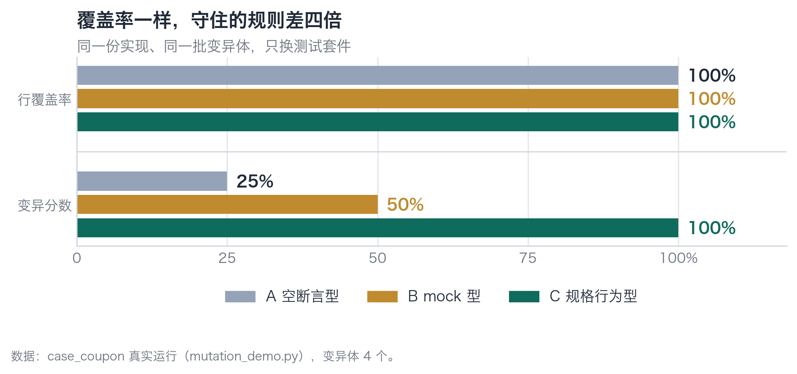
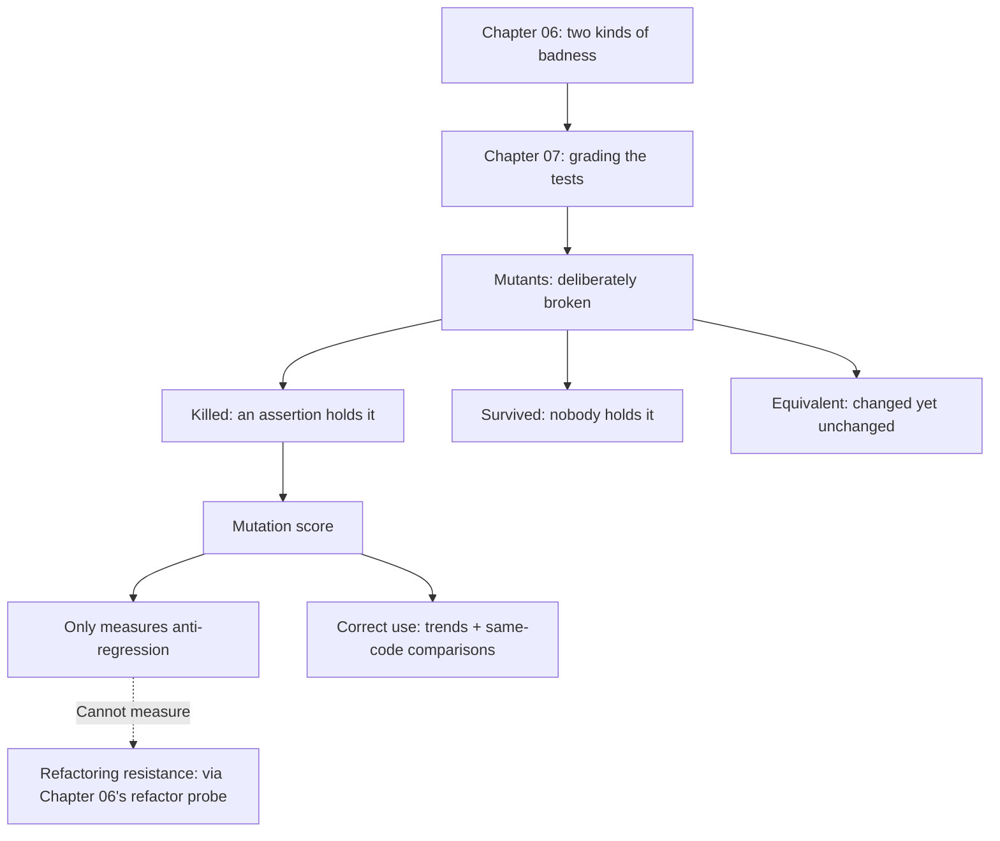

**English** | [中文](./ch07-mutation.zh.md)

# Chapter 07: Layer 3 — Mutation Testing: Grading the Tests Themselves

> **Chapter Guide**: The previous two chapters verified code. This chapter verifies the **tests**. The method is reversed: change the code, not the tests, and see whether the tests go red. You will see a counterintuitive result — the suite with the highest mutation score is exactly the worst one from Chapter 06.
> **Prerequisites**: Chapter 06 (the four pillars, the two kinds of badness).
> **Core Learning Objectives**:
> - Score a test suite with mutation testing, and explain what "killed" and "survived" mean
> - Recognize equivalent mutants, knowing they are noise, not bugs
> - Understand that mutation scores measure only one of the four pillars and cannot serve as a quality red line alone

## 1. Cognitive Anchor: Send a Fake Thief on a Round

### 1.1 A Security Company's Problem

You hired a security team to guard the warehouse. You say "they are very responsible". The boss asks: how do you know?

There are three things you can say:

1. **Look at their patrol logs.** This is coverage — the log says "patrolled".
2. **Ask how many rounds they patrolled.** This is execution counts.
3. **Send someone disguised as a thief to actually steal once.** This is mutation testing.

The first two can both be faked. The third cannot: either the thief is caught, or the goods are gone.

Mutation testing answers this question in exactly the same way: **plant a real bug in your code and see whether the tests raise the alarm.** If they do, someone is genuinely keeping that rule; if not, the test's "patrol log" is fake.

### 1.2 Why "Just Write a Few More Tests" Cannot Solve This

Because the question "are the tests written correctly" cannot be answered by "tests" themselves. You need something that **stands outside the tests** to judge them.

Mutation testing is that thing. It does not care what your tests wrote; it looks at one thing only: **when the code is broken, will you know.**

This shift of viewpoint is crucial: from "I verify the code" to "I verify my own acceptance criteria". This is the only meta-level check in the whole book.

## 2. First Principles: Kill, Survive, Equivalent

### 2.1 Three Concepts

**Mutant**: change one spot of code to get a new version. The change must "look plausible", for example changing `>=` to `>`, `+1` to `+0`, or `return x` to `return None`.

**Killed**: the test suite goes red on this mutant. Some assertion held the rule that was changed.

**Survived**: the test suite stays all green. That means **no assertion whatsoever is holding this rule** — you broke the code and the system did not notice at all.

**Mutation score** = number of killed mutants ÷ total number of mutants.

### 2.2 Where Mutants Come From

Not from inspiration; from fixed operators. The commonly used classes:

| Operator | Example | The defect type it corresponds to |
|---|---|---|
| Boundary flip | `>=` → `>` | off-by-one, selling one extra of stock/quota |
| Arithmetic perturbation | `+1` → `+0` | counting, accumulating, deducting miscounts |
| Condition negation | `if x` → `if not x` | taking the wrong branch |
| Return-value degradation | `return x` → `return None` | null propagation, downstream crashes |
| Side-effect deletion | delete `commit()` / `save()` | written but never persisted |
| Constant substitution | `"exhausted"` → `"unknown"` | wrong error codes, downstream decisions fail |

The key point: **each operator corresponds to a class of real defects**. So mutation testing is not "random tampering"; it is "testing your defense line with known defect types".

### 2.3 Equivalent Mutants: the Noise Floor of Mutation Testing

Some mutants are the same whether changed or not. For example changing `if quota <= used` to `if used >= quota` — semantically identical, and no test can kill it, because **it was never broken in the first place**.

This is called an **equivalent mutant**. It is the known noise of mutation testing, usually 5%–15%, with no automatic way to identify 100% of them; they can only be marked manually.

There is only one handling principle: **do not change code in order to kill equivalent mutants.** That would turn a testing metric into a burden on the code.

Section 3 will give you a real equivalent mutant, which happens to illustrate something even more valuable.

### 2.4 The Cost Model

The cost of mutation testing is `number of mutants × single test-suite runtime`. Four mutants × three suites = 12 test runs; in this chapter's example, 1.1 seconds.

In a real project where tests take 10 minutes, 100 mutants means 1000 minutes — **so it cannot run in full on every commit**. The engineering practice is:

- **Every commit**: run only the mutants of affected modules (incremental).
- **Once a day**: full run, watch the trend.
- **Before a release**: full run, requiring the score to be no lower than last time.

## 3. Hands-on: Three Suites, Four Mutants, Two Runs

### 3.1 Round One: the Original Implementation

```bash
$ cd code/case_coupon
$ python mutation_demo.py
```

```text
变异体 说明                                          A 空断言         B mock 型      C 规格
------------------------------------------------------------------------------------------
M1  边界翻转：used >= quota 变成 used > quota          存活（漏）         存活（漏）         杀死（抓到）
M2  算术错误：used + 1 变成 used + 0                   存活（漏）         杀死（抓到）        杀死（抓到）
M3  判定反转：没找到券码却走进 not_found                     杀死（抓到）        杀死（抓到）        杀死（抓到）
M4  返回值退化：token 变成 None                         存活（漏）         存活（漏）         杀死（抓到）
------------------------------------------------------------------------------------------
变异分数                                            1/4 = 25%     2/4 = 50%     4/4 = 100%
```


*Figure 7-1: The line coverage of all three suites is 100% (they all ran through every branch), but the mutation scores are 25% / 50% / 100%. The gap is not in "how much ran"; it is in "how much was held".*

Reading the three survivals line by line:

- **M1 (`>=` → `>`)**: neither A nor B caught it. A because it only asserts non-null; B because its mock returns `(5, 2)`, and both `2 > 5` and `2 >= 5` are false, taking the same path — **its test data happened to dodge the boundary**.
- **M2 (`+1` → `+0`)**: B caught it, because the number in the SQL string changed from 3 to 2 and the exact match failed. This is B's only real value.
- **M4 (token → None)**: A did not catch it, because `assertIn("token", result)` only checks whether the key exists. The key is there, the value is None, the assertion passes. **The existence of an assertion does not equal the strength of an assertion.**

### 3.2 Round Two: Swap in the Fixed Version

```bash
$ python mutation_demo.py coupon_service_fixed.py
```

```text
变异体 说明                                          A 空断言         B mock 型      C 规格
------------------------------------------------------------------------------------------
M1  边界翻转：used >= quota 变成 used > quota          存活（漏）         杀死（抓到）        存活（漏）
M2  算术错误：used + 1 变成 used + 0                   存活（漏）         杀死（抓到）        杀死（抓到）
M3  判定反转：没找到券码却走进 not_found                     杀死（抓到）        杀死（抓到）        杀死（抓到）
M4  返回值退化：token 变成 None                         存活（漏）         杀死（抓到）        杀死（抓到）
------------------------------------------------------------------------------------------
变异分数                                            1/4 = 25%     4/4 = 100%    3/4 = 75%
```

This is the most important table of this chapter, and it has three counterintuitive points:

**Counterintuitive point one: B (mock style) got 100%, higher than C.**

That test which scored only 1 on refactoring resistance in Chapter 06 now has a perfect mutation score. Why? Because the fixed version extracted the SQL into constants and switched to parameterization, and B's assertion happened to hard-code "what the fixed version's SQL looks like" — it is welded tightly to **this version of the implementation**, so any perturbation gets caught.

This is the fundamental limitation of mutation testing: **it measures only the "regression protection" pillar, and measures "refactoring resistance" not at all.** A test welded to the implementation is always perfect in mutation testing — because any change turns it red, including harmless ones.

**Counterintuitive point two: C dropped from 100% to 75%.**

The one that dropped is M1. In the fixed version, `if used >= quota` is no longer the only line of defense — the real gate is `UPDATE ... WHERE used < quota` plus a `rowcount` check. Changing `>=` to `>`, the conditional update still blocks oversells, and the behavior is completely identical.

**This is an equivalent mutant, not a hole.** It actually proves the fixed version has **two layers of defense**: take one away and there is still one. The handling is to mark it "equivalent" manually; do not touch the code.

**Counterintuitive point three: A is stably bad (25%).**

A suite that holds nothing scores 25% on any implementation. This "stability" is itself a signal: **a mutation score that never moves means the tests have never gotten stronger.**

### 3.3 The Correct Usage

Put the two rounds of results together, and the correct usage of mutation testing emerges:

| Usage | Practice | Why |
|---|---|---|
| **Watch the trend, not the absolute value** | Record weekly scores, see whether they rise | Absolute values are affected by equivalent mutants; trends are not |
| **Compare different suites on the same code** | Like above, swap only the tests | Implementation differences are excluded; all differences belong to the tests |
| **Read it together with the refactor probe** | Mutation score + refactoring-resistance experiment | Looking at mutation scores alone rewards "welded to implementation" tests |
| **Do not change code for the sake of the score** | Mark equivalent mutants and skip them | Otherwise the metric becomes a burden |

One-sentence summary: **the mutation score is the thermometer of "regression protection", not the health-check report of "test quality".**

## 4. Common Misconceptions, and Correct-vs-Wrong Comparisons

| Misconception to fall into | Root cause | The right practice |
|---|---|---|
| **"A 100% mutation score means the tests are solid"** | Mutation scores only measure regression protection; tests welded to the implementation can also get a perfect score | Pair it with the refactor probe. Solid means passing both |
| **"90% coverage + 90% mutation score is double insurance"** | Both metrics measure "can it catch", not "did it catch the right thing" (the tests themselves may assert the wrong direction) | Add one human criterion: does the assertion read like a requirement? |
| **"Equivalent mutants are bugs; fix them"** | Treating them as defects of the tests | Mark them manually and skip. Changing code for them puts the cart before the horse |
| **"Mutation testing is too slow to be practical"** | Only counting the full-run cost | Incremental runs (mutate only changed modules) + daily full runs + threshold checks before releases |
| **"Let the tool auto-generate the mutants"** | The tool's operators may be irrelevant to your business (for example it cannot mutate your quota logic) | Hand-write a few **business-relevant** mutation operators: stock, amounts, state machines |

## 5. Chapter Summary and Local Knowledge Map

### 5.1 Key Points

- **Mutation testing is the only means that judges tests from outside the tests.** It does not ask what you tested; it asks whether you would know when things break.
- **Three outcomes**: killed (an assertion holds it), survived (nobody holds it), equivalent (changed equals unchanged).
- **The mutation score measures only one of the four pillars.** Tests welded to the implementation are always perfect here.
- **Trends are more reliable than absolute values.** Absolute values are disturbed by equivalent mutants; trends reflect real changes.
- **Do not change code for the score.** Mark and skip equivalent mutants; otherwise the metric becomes a burden.

### 5.2 Concept Topology of This Chapter



### 5.3 Interfaces to the Previous and Next Chapters

- **From Chapter 06**: the "regression protection" pillar is now quantified here. But "refactoring resistance" still relies on the refactor probe.
- **To Chapter 08**: mutation testing mutates code, not the scheduler. Concurrency and timing remain out of range.
- **To Chapter 09**: the mutation score will be put together with coverage and escape rate, explaining how the three numbers deceive one another.

## 6. Tiered Exercises

### Tier 1 · Intuition and Concept Checks

**1.** Using the "send a fake thief" analogy, explain what "killed" and "survived" mean.

**2.** Why can a test welded to the implementation get a perfect score in mutation testing? Explain the mechanism.

**3.** The proportion of equivalent mutants is usually 5%–15%. If a project's mutation score sits around 85% and never moves, how do you judge whether it is "has equivalent mutants" or "the tests really have problems"?

### Tier 2 · Deduction and Hands-on Construction

**4.** Add two **business-relevant** mutants to `mutation_demo.py`: one changing the deduction logic, one changing the status decision. Run it and see each suite's results.

**5.** Pick a test suite in your own project and run one mutation test (you can use `mutmut`, `cosmic-ray`, or write ten lines yourself). Record the score, then answer: **the surviving mutants — which rules that you thought were held do they correspond to?**

### Tier 3 · Boundary Conditions and Cross-Chapter Transfer

**6.** Mutation testing is completely ineffective against "performance defects" (turning an O(n) into O(n²) is not caught by any assertion). Design a check that can catch this class of defects, and state its failure boundary.

**7.** Someone proposes using "mutation score" as the team's mandatory red line (below 80% means no merging). List three side effects of this policy, and give mitigations.

<details>
<summary><strong>Click to expand: reference answers and in-depth analysis for this chapter's exercises</strong></summary>

#### 1. Killed and survived

Killed = the fake thief you sent got caught, meaning the defense really works, not just a good-looking patrol log. Survived = the fake thief walked off with the goods and nobody raised the alarm, meaning the "defense" you claimed exists only in the documentation.

Mapped to tests: killed means "an assertion happened to hold the mutated rule"; survived means "this rule was never checked by any assertion" — it is **the blind-spot map of the test suite**.

#### 2. Why welded tests get perfect scores

Because the entire criterion of mutation testing is "the code changed; did the test go red". A test asserting "the SQL string must equal X" goes red on any code change — including harmless ones. So its "detection rate" approaches 100%.

This exposes mutation testing's boundary: **it measures "sensitivity", not "accuracy".** A test that alarms on every change has full sensitivity and zero accuracy. So it must be paired with the refactor probe — that tool measures exactly "accuracy" (whether it false-alarms).

#### 3. 85% and never moving

Three probes: ① look at each surviving mutant and judge manually whether it is equivalent. If all are equivalent, that is the normal noise floor; ② if the survivals mix in real defect types (like boundaries, deductions), the tests genuinely do not cover them, and the "stable" score is "stably missing"; ③ look at the mutation score of newly added code — if new code also scores 85%, the team's test-writing habits have not changed.

The criterion: **look at the composition of surviving mutants, not the total.**

#### 4. Adding two business mutants

For example `used + 1` → `used + 2` (deduct one extra), and `status == "confirmed"` → `status != "cancelled"` (loosening "confirmed" into "not cancelled").

Expected: the first can only be caught by tests asserting the stock number; the second requires asserting "a person in waiting status should not be treated as confirmed". **These two mutants expose "business-semantic coverage", not "code-line coverage"** — which is also the value of hand-written mutation operators: the tool does not know your business; you do.

#### 5. Running it yourself

The key harvest is usually not the score but the names of those "survivals". They pinpoint exactly: **the rules you thought were held have not a single assertion.** This is more direct than any coverage report.

#### 6. Catching performance defects

Three options: **① complexity assertions** (count key operations with counting hooks in the tests, assert no more than a threshold); **② benchmarks + thresholds** (`pytest-benchmark`, assert p95 does not exceed baseline × 1.2); **③ production monitoring** (latency-quantile alerts).

Failure boundaries: ① you need to know in advance "which operations count as key operations"; without that you cannot catch them; ② the thresholds themselves may be wrong, and are disturbed by machine fluctuations (flaky); ③ they can only discover after the fact, not prevent a release.

So the correct posture for performance verification is "**baseline + trend + alerting**", not "a gate". Like concurrency, it belongs to the Chapter 08 class of "things gates cannot catch".

#### 7. Three side effects of a mandatory red line

**Side effect one: writing useless tests for the score.** The team will add a batch of "easy to kill" assertions (like asserting the return value is non-null); the score goes up while real coverage does not change. Mitigation: the red line applies only to **newly added code**, and is paired with the refactor probe.

**Side effect two: tests become rigid.** To get mutants killed, some will write "exact match" style assertions, and refactoring resistance drops. Mitigation: include the refactor probe in the assessment too (look at both metrics together).

**Side effect three: equivalent mutants trigger pointless arguments.** Every time, someone grinds away at an equivalent mutant. Mitigation: keep a "known equivalent mutants" list in the repository and skip it automatically when running.

**The fundamental problem**: any single number turned into a red line gets optimized until it fails. Mutation scores suit a "dashboard"; they do not suit a "gate".

</details>

---

**Next chapter**: at this point, four of the five gates have been covered. The next chapter is about the class none of them can catch — concurrency, timing, resources.

---

## 7. Authoritative References and Further Reading for This Chapter (Authoritative References)

1. **martinfowler.com**: [martinfowler.com](https://martinfowler.com/) - the definitions and norms of this chapter are anchored here (verification date: `2026-10-23`).
2. **OWASP ASVS**: [OWASP ASVS](https://www.owasp.org/www-project-application-security-verification-standard/) - the definitions and norms of this chapter are anchored here (verification date: `2026-10-23`).
3. **Python concurrent.futures**: [Python concurrent.futures](https://docs.python.org/3/library/concurrent.futures.html) - the definitions and norms of this chapter are anchored here (verification date: `2026-10-23`).

> Basis note: the sources above are used to anchor **definitions and norms**, not to extrapolate risk probabilities. Before quoting any number, check the source's year and denominator first.
