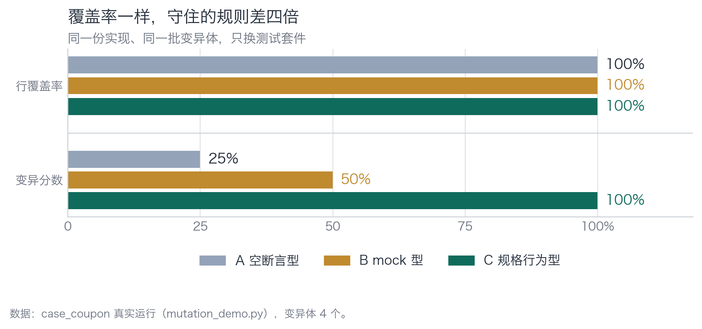
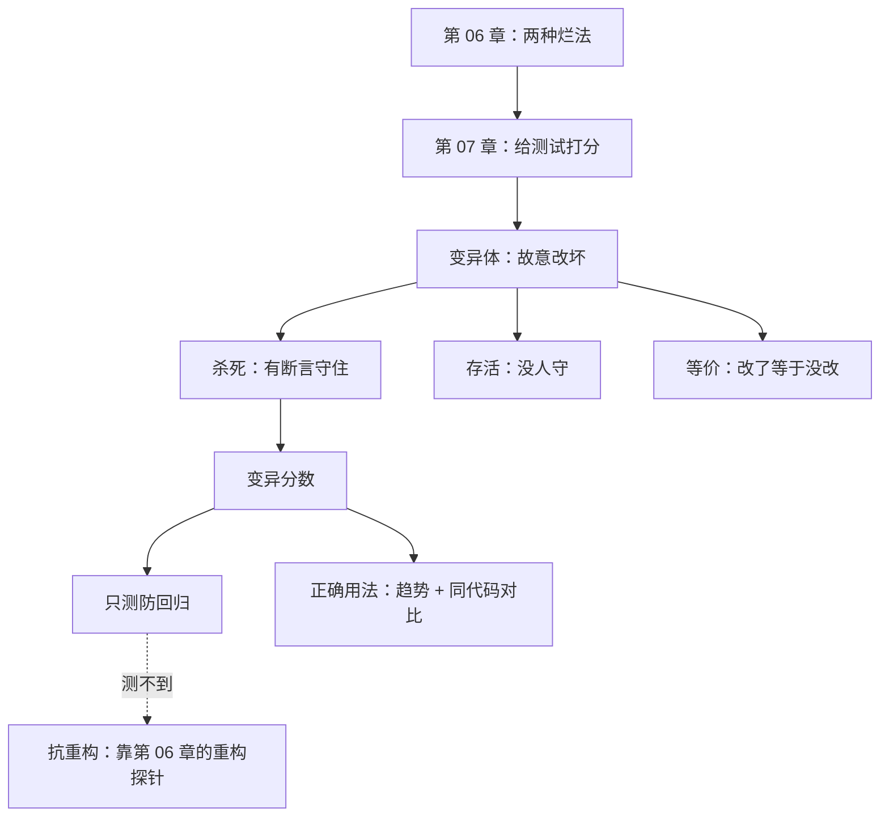

[English](./ch07-mutation.md) | **中文**

# 第 07 章：第 3 层——变异测试，给测试本身打分

> **本章导读**：前两章验的是代码。这一章验的是**测试**。方法是反过来的：不改测试，改代码，看测试会不会红。你会看到一个反直觉的结果——变异分数最高的那套测试，恰好是第 06 章里最烂的那套。
> **前置知识**：第 06 章（四支柱、两种烂法）。
> **核心学习目标**：
> - 用变异测试给一套测试打分，说清"杀死"与"存活"的含义
> - 识别等价变异体，知道它不是 bug 而是噪声
> - 明白变异分数只测四支柱里的一根，不能单独当质量红线

## 1. 认知锚点：派个假小偷走一趟

### 1.1 一个保安公司的问题

你雇了一支保安队看守仓库。你说"他们很负责"。老板问：你怎么知道？

你能说的有三种：

1. **看他们的巡逻记录**。这是覆盖率——记录上写着"巡逻过了"。
2. **问他们巡逻了几次**。这是执行次数。
3. **派个人扮成小偷，真的去偷一次**。这是变异测试。

前两种都能造假。第三种造不了：要么被抓住，要么东西丢了。

变异测试对这个问题的回答方式一模一样：**往你的代码里塞一个真 bug，看测试会不会报警。** 报警了，说明这条规则真的有人在守；没报警，说明测试"巡逻记录"是假的。

### 1.2 为什么这件事不能靠"再多写几个测试"解决

因为"测试写得对不对"这个问题，用"测试"本身回答不了。你需要一个**站在测试之外**的东西来评判测试。

变异测试就是这个东西。它不关心你的测试写了什么，只看一件事：**当代码被改坏时，你会不会知道。**

这个视角的转换很关键：从"我验代码"变成"我验我的验收标准"。这是全书唯一一次元层次的检查。

## 2. 第一性原理：杀死、存活、等价

### 2.1 三个概念

**变异体（mutant）**：把代码改一处，得到一个新版本。改动必须"看起来像真理"，比如把 `>=` 改成 `>`、把 `+1` 改成 `+0`、把 `return x` 改成 `return None`。

**杀死（killed）**：测试套件在这个变异体上变红了。说明有断言守住了被改动的那条规则。

**存活（survived）**：测试套件仍然全绿。说明**这条规则没有任何断言在守**——你把代码改错了，系统毫无察觉。

**变异分数** = 杀死的变异体数 ÷ 变异体总数。

### 2.2 变异体从哪来

不靠灵感，靠固定的算子。常用的几类：

| 算子 | 例子 | 它对应的缺陷类型 |
|---|---|---|
| 边界翻转 | `>=` → `>` | off-by-one、库存/配额多卖一个 |
| 算术微扰 | `+1` → `+0` | 计数、累加、扣减漏算 |
| 条件取反 | `if x` → `if not x` | 分支走错 |
| 返回值退化 | `return x` → `return None` | 空值传播、下游崩溃 |
| 删除副作用 | 删掉 `commit()` / `save()` | 写了但没落库 |
| 常量替换 | `"exhausted"` → `"unknown"` | 错误码错配、下游判断失效 |

关键点：**每个算子对应一类真实缺陷**。所以变异测试不是"随机乱改"，它是"用已知的缺陷类型去测试你的防线"。

### 2.3 等价变异体：变异测试的噪声底

有些变异体改了和没改一样。比如把 `if quota <= used` 改成 `if used >= quota`——语义完全一致，没有任何测试能杀死它，因为**它根本没被改坏**。

这叫**等价变异体**（equivalent mutant）。它是变异测试的已知噪声，比例通常在 5%—15%，没有自动办法 100% 识别，只能人工标记。

处理原则只有一条：**不要为了杀死等价变异体去改代码。** 那会把一个测试指标，变成代码的负担。

第 3 节会给你一个真实的等价变异体，它恰好说明了一件更有价值的事。

### 2.4 成本模型

变异测试的成本是 `变异体数量 × 单次测试耗时`。四个变异体、三套测试 = 12 次测试运行，本章的例子里耗时 1.1 秒。

真实项目里测试跑 10 分钟，100 个变异体，就是 1000 分钟——**所以它不可能每次提交都全量跑**。工程上的做法是：

- **每次提交**：只跑受影响模块的变异体（增量）。
- **每天一次**：全量跑，观察趋势。
- **发版前**：全量跑，且要求分数不低于上次。

## 3. 手把手：三套测试，四个变异体，两次运行

### 3.1 第一轮：原实现

```bash
$ cd code/case_coupon
$ python mutation_demo.py
```

```text
变异体 说明                                          A 空断言         B mock 型      C 规格
------------------------------------------------------------------------------------------
M1  边界翻转：used >= quota 变成 used > quota          存活（漏）         存活（漏）         杀死（抓到）
M2  算术错误：used + 1 变成 used + 0                   存活（漏）         杀死（抓到）        杀死（抓到）
M3  判定反转：没找到券码却走进 not_found                     杀死（抓到）        杀死（抓到）        杀死（抓到）
M4  返回值退化：token 变成 None                         存活（漏）         存活（漏）         杀死（抓到）
------------------------------------------------------------------------------------------
变异分数                                            1/4 = 25%     2/4 = 50%     4/4 = 100%
```


*图 7-1：三套测试的行覆盖率都是 100%（它们都跑遍了所有分支），但变异分数是 25% / 50% / 100%。差距不在"跑了多少"，在"守住了多少"。*

逐行看三个存活：

- **M1（`>=` → `>`）**：A、B 都没抓到。A 是因为只断言非空；B 是因为它的 mock 返回 `(5, 2)`，`2 > 5` 和 `2 >= 5` 都是 false，走的是同一条路径——**它的测试数据刚好绕开了边界**。
- **M2（`+1` → `+0`）**：B 抓到了，因为 SQL 字符串里的数字从 3 变成了 2，精确匹配失败。这是 B 唯一的真实价值。
- **M4（token → None）**：A 没抓到，因为 `assertIn("token", result)` 只查键在不在。键在，值是 None，断言通过。**断言的存在不等于断言的强度。**

### 3.2 第二轮：把修复版放进去

```bash
$ python mutation_demo.py coupon_service_fixed.py
```

```text
变异体 说明                                          A 空断言         B mock 型      C 规格
------------------------------------------------------------------------------------------
M1  边界翻转：used >= quota 变成 used > quota          存活（漏）         杀死（抓到）        存活（漏）
M2  算术错误：used + 1 变成 used + 0                   存活（漏）         杀死（抓到）        杀死（抓到）
M3  判定反转：没找到券码却走进 not_found                     杀死（抓到）        杀死（抓到）        杀死（抓到）
M4  返回值退化：token 变成 None                         存活（漏）         杀死（抓到）        杀死（抓到）
------------------------------------------------------------------------------------------
变异分数                                            1/4 = 25%     4/4 = 100%    3/4 = 75%
```

这张表是本章最重要的一张，它有三处反直觉：

**反直觉一：B（mock 型）拿了 100%，比 C 还高。**

那个在第 06 章抗重构只有 1 分的测试，现在变异分数满格。为什么？因为修复版把 SQL 提成了常量、改成了参数化，而 B 的断言恰好写死了"修复版那条 SQL 长什么样"——它和**这一版实现**绑得死死的，所以任何微扰都会被它抓到。

这就是变异测试的根本局限：**它只测"防回归"这一根支柱，完全不测"抗重构"。** 一个和实现焊死的测试，在变异测试里永远是满分——因为任何改动都会让它红，包括无害的改动。

**反直觉二：C 从 100% 掉到 75%。**

掉的那一个是 M1。修复版里 `if used >= quota` 已经不是唯一防线了——真正的闸是 `UPDATE ... WHERE used < quota` 加 `rowcount` 校验。把 `>=` 改成 `>`，条件更新照样拦下超发，行为完全一致。

**这是等价变异体，不是漏洞。** 它反而证明修复版有**双层防御**：拆掉一层，还有一层。处理方式是人工标记为"等价"，不要动代码。

**反直觉三：A 稳定地烂（25%）。**

一套什么都不守的测试，在任何实现上都是 25%。这个"稳定"本身就是信号：**变异分数长期不动，说明测试从来没变强过。**

### 3.3 正确的用法

把两轮结果放在一起，能得出变异测试的正确用法：

| 用法 | 做法 | 为什么 |
|---|---|---|
| **看趋势，不看绝对值** | 记录每周分数，看是否上升 | 绝对值受等价变异体影响，趋势不受 |
| **对比同一份代码上的不同套件** | 像上面这样，只换测试 | 排除了实现差异，差异全归测试 |
| **配合重构探针一起看** | 变异分数 + 抗重构实验 | 单看变异分数会奖励"焊死实现"的测试 |
| **不为分数改代码** | 等价变异体标记后跳过 | 否则指标变成负担 |

一句话总结：**变异分数是"防回归"的体温计，不是"测试质量"的体检报告。**

## 4. 常见误区与正反例对比

| 踩坑的误区 | 根因 | 正确做法 |
|---|---|---|
| **"变异分数 100% 说明测试很扎实"** | 变异分数只测防回归；和实现焊死的测试也能拿满分 | 配合重构探针。两个都过才算扎实 |
| **"覆盖率 90% + 变异分数 90% 就是双保险"** | 两个指标都测"抓不抓得住"，不测"抓得对不对"（测试本身可能断言错了方向） | 加一条人工判据：断言读起来像不像需求 |
| **"等价变异体是 bug，要修"** | 把它当成测试的缺陷 | 人工标记跳过。为它改代码是本末倒置 |
| **"变异测试太慢，不实用"** | 只算了全量成本 | 增量跑（只变异改动模块）+ 每日全量 + 发版前卡阈值 |
| **"变异体让工具自动生成就行"** | 工具生成的算子可能和你的业务无关（比如它变异不到你的配额逻辑） | 手写几条**业务相关**的变异算子：库存、金额、状态机 |

## 5. 本章小结与局部知识图谱

### 5.1 核心要点

- **变异测试是唯一能站在测试之外评判测试的手段。** 它不问你测了什么，只问改坏了你会不会知道。
- **三个结果**：杀死（有断言守住）、存活（没人守）、等价（改了等于没改）。
- **变异分数只测四支柱里的一根。** 焊死实现的测试在它这里永远是满分。
- **趋势比绝对值可靠。** 绝对值受等价变异体干扰，趋势反映真实变化。
- **不要为分数改代码。** 等价变异体标记跳过，否则指标变成负担。

### 5.2 本章概念拓扑



### 5.3 与前后章的接口

- **接第 06 章**：四支柱里的"防回归"，在这里被量化了。但"抗重构"仍然只能靠重构探针。
- **给第 08 章**：变异测试变异的是代码，不是调度器。并发与时序仍然在射程之外。
- **给第 09 章**：变异分数会和覆盖率、逃逸率放在一起，讲清三个数字怎么互相欺骗。

## 6. 分级通关练习

### Tier 1 · 直觉与概念核验

**1.** 用"派假小偷"的类比，解释什么是"杀死"和"存活"。

**2.** 为什么和实现焊死的测试在变异测试里能拿满分？说清机制。

**3.** 等价变异体的比例通常 5%—15%。如果一个项目的变异分数长期在 85% 左右不动，你怎么判断它是"有等价变异体"还是"测试真的有问题"？

### Tier 2 · 推演与实操构建

**4.** 给 `mutation_demo.py` 加两个**业务相关**的变异体：一个改扣减逻辑，一个改状态判断。跑一遍，看三套测试各自的结果。

**5.** 挑你自己项目里的一套测试，跑一次变异测试（可以用 `mutmut`、`cosmic-ray`，或自己写十行）。记录分数，然后回答：**存活的那几个变异体，对应哪几条你本来以为守住了的规则？**

### Tier 3 · 边界条件与跨章迁移

**6.** 变异测试对"性能缺陷"完全无效（把一个 O(n) 改成 O(n²) 不会被任何断言抓住）。请设计一种能抓住这类缺陷的检查，并说明它的失效边界。

**7.** 有人提出用"变异分数"当团队的强制红线（低于 80% 不许合并）。请列出这个政策的三个副作用，并给出缓解办法。

<details>
<summary><strong>点击展开：本章练习参考答案与深度解析</strong></summary>

#### 1. 杀死与存活

杀死 = 你派去的假小偷被抓住了，说明防线真的在工作，不是因为巡逻记录写得好看。存活 = 假小偷把东西拿走了而没人报警，说明你说的"防线"只存在于文档里。

对应到测试：杀死意味着"有一句断言恰好守住了被改动的规则"；存活意味着"这条规则从来没被任何断言检查过"——它是**测试套件的盲区地图**。

#### 2. 焊死实现的测试为什么满分

因为变异测试的全部判据是"代码变了，测试红不红"。一个断言"SQL 字符串必须等于 X"的测试，对任何代码改动都会红——包括无害改动。所以它的"检出率"接近 100%。

这暴露了变异测试的边界：**它度量的是"敏感度"，不是"准确度"。** 一个对所有变化都报警的测试，敏感度满分，准确度零。所以必须配合重构探针——那个工具测的恰好是"准确度"（会不会误报）。

#### 3. 85% 长期不动

三个探针：① 把存活的变异体逐个看一遍，人工判断是不是等价。如果全是等价，那是正常噪声底；② 如果存活里混着真实缺陷类型（比如边界、扣减），说明测试确实没覆盖到，分数"稳定"是"稳定地漏"；③ 看新增代码的变异分数——如果新代码的分数也是 85%，说明团队写测试的习惯没变。

判据：**看存活变异体的构成，不看总数。**

#### 4. 加两个业务变异体

比如 `used + 1` → `used + 2`（多扣一个）、`status == "confirmed"` → `status != "cancelled"`（把"已确认"放宽成"未取消"）。

预期：第一个只有断言了库存数字的测试能抓到；第二个需要断言"候补状态的人不该被当成已确认"。**这两个变异体暴露的是"业务语义覆盖"，而不是"代码行覆盖"** —— 这也是手写变异算子的价值：工具不知道你的业务，你知道。

#### 5. 自己跑一次

关键收获通常不是分数，是那几个"存活"的名字。它们会精准地指出：**你以为守住的那几条规则，其实一条断言都没有。** 这比任何覆盖率报告都直接。

#### 6. 性能缺陷怎么抓

三个可选方案：**① 复杂度断言**（在测试里用计数钩子统计关键操作次数，断言不超过阈值）；**② 基准测试 + 阈值**（`pytest-benchmark`，断言 p95 不超过基线 × 1.2）；**③ 生产监控**（延迟分位数告警）。

失效边界：① 需要你事先知道"哪个操作算关键操作"，不知道就抓不到；② 阈值本身可能拍错，且会被机器波动干扰（flaky）；③ 只能事后发现，不能阻止上线。

所以性能验证的正确姿态是"**基线 + 趋势 + 告警**"，而不是"门禁"。它和并发一样，属于第 08 章那一类"门禁抓不到的东西"。

#### 7. 强制红线的三个副作用

**副作用一：为了分数写无用测试。** 团队会补一批"容易被杀死"的断言（比如断言返回值非空），分数上去了，真实覆盖没变。缓解：红线只对**新增代码**生效，且配合重构探针。

**副作用二：测试变得僵化。** 为了让变异体被杀，有人会写"精确匹配"式的断言，抗重构性下降。缓解：把重构探针也纳入考核（两个指标一起看）。

**副作用三：等价变异体引发无效争论。** 每次有人对着一个等价变异体较劲。缓解：建立"已知等价变异体"清单，维护在仓库里，跑的时候自动跳过。

**根本问题**：任何单一数字变成红线，都会被优化到失效。变异分数适合当"看板"，不适合当"闸门"。

</details>

---

**下一章**：到这里，五道闸已经讲了四道。下一章讲它们全都抓不到的那一类——并发、时序、资源。

---

## 7. 本章权威参考信源与延伸阅读 (Authoritative References)

1. **martinfowler.com**：[martinfowler.com](https://martinfowler.com/) - 本章的定义与规范以此为锚（核验日期：`2026-10-23`）。
2. **OWASP ASVS**：[OWASP ASVS](https://www.owasp.org/www-project-application-security-verification-standard/) - 本章的定义与规范以此为锚（核验日期：`2026-10-23`）。
3. **Python concurrent.futures**：[Python concurrent.futures](https://docs.python.org/3/library/concurrent.futures.html) - 本章的定义与规范以此为锚（核验日期：`2026-10-23`）。

> 口径提示：以上信源用于锚定**定义与规范**，不用于外推风险概率。引用任何数字前，先核对来源年份与分母。
