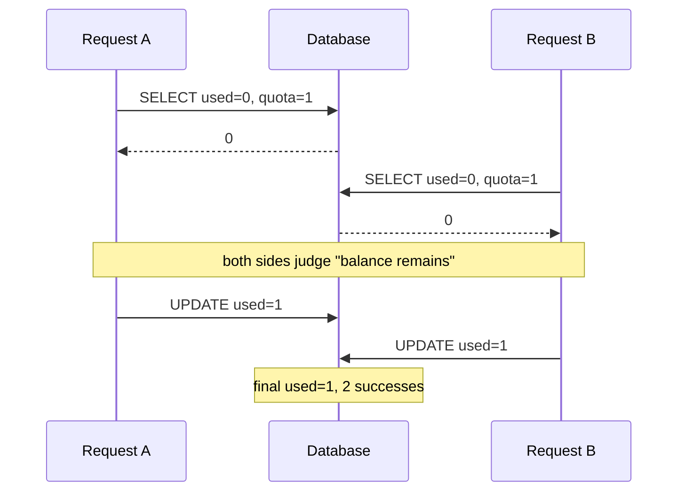
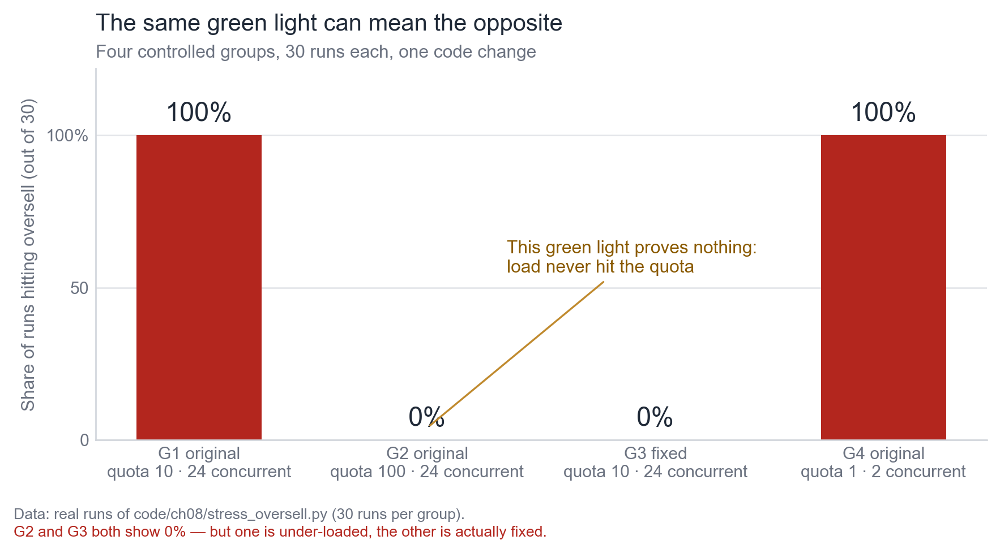
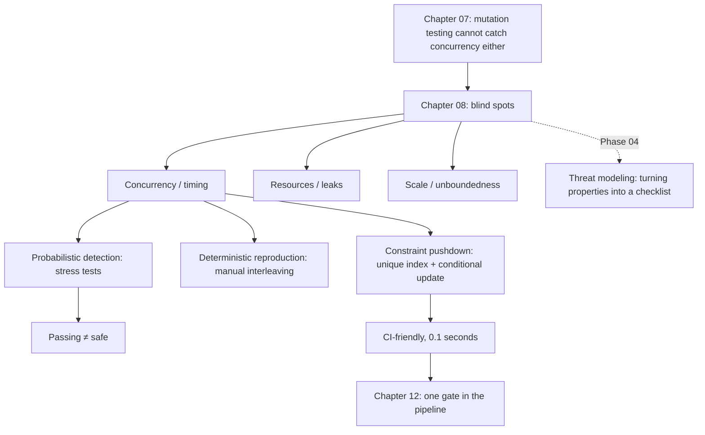

**English** | [中文](./ch08-blind-spots.zh.md)

# Chapter 08: Blind Spots — What No Gate Can Catch

> **Chapter Guide**: The previous four chapters covered four gates, each with a patch it cannot catch. This chapter gathers those patches together: concurrency, timing, resources. They share one thing — **gates cannot see them even in principle**, because they are not questions of "is the code right"; they are questions of "was the property constrained".
> **Prerequisites**: Chapter 02 (omission), Chapter 07 (the boundary of mutation testing).
> **Core Learning Objectives**:
> - Explain why concurrency defects slip past all four gates, rather than "we did not test enough"
> - Distinguish probabilistic detection from deterministic detection, and know what a stress test's "pass" is worth
> - Sink a concurrency property into a database constraint, and write the code that checks it

## 1. Cognitive Anchor: A Searchlight Is Not the Sun

### 1.1 An Unsettling Fact

Those 43 oversells from Chapter 01 cannot be caught by any gate this book covers:

- **Dependency gate**: nothing to do with dependencies.
- **Static analysis**: every line is legal.
- **Unit tests**: behavior is correct single-threaded.
- **Mutation testing**: it mutates code, not the scheduler.
- **Behavior tests**: unless you write a dedicated concurrency case — which will be flaky.

All five gates let it through. This is not because the tools are bad; it is because **they are shining in the wrong place**.

A searchlight can illuminate a cone. Outside the cone is not "nothing there"; it is "you have not turned there". What this chapter does is let you know what is outside the cone, and how to turn there.

### 1.2 What the Three Classes of Blind Spots Share

| Blind spot | Typical shape | Why gates cannot catch it |
|---|---|---|
| **Concurrency/timing** | Two requests interleaving within 8 milliseconds | Gates verify "what the code wrote"; the defect is in "what happened between two statements" |
| **Resources** | Connection pool leaks, unreleased file handles, slow memory growth | The defect is in "long-run cumulative effects"; a single run cannot see it |
| **Scale** | N+1 queries, unbounded result sets, full table scans | The defect appears "after the data volume scales"; test data is too small |

The three share one structure: **correct code + wrong runtime environment = wrong results.** And gates assume the runtime environment is "small, fast, single-threaded, low data volume".

`Release It!` calls this class of problems "stability antipatterns", three of which are directly relevant to this chapter: unbounded result sets, unbalanced capacity, cascading failures. What they share is that **they do not appear in the development environment**.

## 2. First Principles: Why It Is Out of Range

### 2.1 The Shared Assumption of the Four Gates

Abstract the first four gates and they are all doing the same thing:

> **Given a piece of code, decide whether it satisfies some property about "the code".**

- Dependency gate: decide whether imports are on the whitelist
- Static analysis: decide whether the text matches some pattern
- Unit tests: decide whether the return value is correct given an input
- Mutation testing: decide whether tests go red after a change

The object of all four decisions is **code**. But the property of a concurrency defect is about **execution sequences**:

> "There exists no interleaving order that deducts stock below zero."

The subject of this sentence is not code; it is "all possible execution sequences". **Its quantifier is "all", while any test can only cover "finitely many".**

This is why you cannot test it exhaustively: what you must prove is a universal proposition, while tests can only provide existential counterexamples. **Not hitting it does not mean it does not exist; hitting it is what proves existence.**



### 2.2 Three Responses, Each With a Dead End

Facing "cannot test exhaustively", engineering offers three paths:

| Path | Practice | What it gives you | Its dead end |
|---|---|---|---|
| **Probabilistic detection** | Stress tests, fuzz testing, chaos engineering | "We hit it this time" | A pass provides no guarantee at all |
| **Deterministic reproduction** | Hand-orchestrated interleavings, model checking | "This interleaving really breaks things" | Only covers the interleavings you thought of |
| **Constraint sinking** | Unique indexes, conditional updates, transaction isolation levels | "Structurally impossible to break" | Only works for properties expressible as constraints |

The three paths are not parallel; they are **progressive**: probabilistic detection exposes the problem, deterministic reproduction lets you understand it, constraint sinking makes it impossible to recur.

Most teams stop at the first path and think they are done.

### 2.3 What a Probabilistic Detection "Pass" Is Actually Worth

One sentence: **it is worth "did not hit it this time", not "it is safe".**

More precisely, a stress test pass means: under the load you gave, on your machine, with your scheduling, this window did not open. Swap to a slower machine, a different concurrency level, a different database isolation level, and the window may open.

This explains why the sentence "we stress-tested it" appears so often in production incident post-mortems — it is a true sentence, but what it proves is far less than the speaker thinks.

## 3. Hands-on: Four Experiments, Three Conclusions

### 3.1 Experiment One: the Detection Rate Depends on Load, Not on Code

`code/ch08/stress_oversell.py` runs four comparison groups, 30 rounds each:

```text
组1  原版 · 24 并发 · 配额 10   检出 30/30 轮（100%）  单轮最大超发 14 张
组2  原版 · 24 并发 · 配额 100  检出  0/30 轮（ 0%）  单轮最大超发  0 张
组3  修复版 · 24 并发 · 配额 10  检出  0/30 轮（ 0%）  单轮最大超发  0 张
组4  原版 ·  2 并发 · 配额  1   检出 30/30 轮（100%）  单轮最大超发  1 张
```


*Figure 8-1: Groups 2 and 3 are both 0%, but group 2 is "the load never reached the quota, so it could not be hit in the first place", while group 3 is "genuinely fixed". The same number, two meanings.*

**Group 2 is the most important cell of this chapter.** Quota 100, only 24 people arrive — even if all requests arrive simultaneously and all succeed, it cannot oversell. This green light proves nothing; it only shows "you did not give enough load".

Group 4 shows the other half: 2 threads grabbing 1 quota copy hit it every time. So the "detection rate" is not a property of the code; it is **a function of the load**.

**Conclusion one: a stress test's green cannot be taken as "safe"; it can only be taken as "not exposed under this load".**

### 3.2 Experiment Two: Deterministic Reproduction — No Luck, Draw the Interleaving

`case_coupon/race_repro.py` does not call `redeem()`; it manually executes its internal SQL under two interleaving orders:

```text
库存：quota=1, used=0

步   请求    动作                                              手里看到的 used
------------------------------------------------------------------------------
1   A     SELECT quota, used                              0
2   B     SELECT quota, used                              0
3   A     UPDATE used = 1                                 0
4   B     UPDATE used = 1                                 0
------------------------------------------------------------------------------
最终 used = 1；成功核销 2 次，库存 1 张 → 超发 1 张

注意：每一步单独看都是对的。错的是「两步之间没有锁」。
```

**Why not use threads?** Because a thread version would be flaky, and a flaky test equals no test — it goes red randomly in CI, gets a `@skip` added, and then disappears.

Deterministic reproduction sees "the possibility of the incident", not "the incident scene". For a defect these two carry the same information: **you know it will happen, and why.**

**Conclusion two: to truly understand a concurrency defect, you must be able to draw it; if you cannot draw it, you have not understood it yet.**

### 3.3 Experiment Three: Turn Properties Into Constraints, Then Check the Constraints With Code

`code/ch08/constraint_check.py` checks three "things that must exist":

- **K1** the redemption record table has `UNIQUE(code, user_id)`
- **K2** the deduction statement is a conditional atomic update (`WHERE ... used < quota`)
- **K3** cancel/redeem happens in an explicit-lock transaction (`BEGIN IMMEDIATE`)

```text
=== AI 原版：coupon_service.py ===
  失败  K1 唯一约束  ·  redemptions 表上没有唯一索引
  失败  K2 条件更新  ·  扣减语句里没有 used < quota 条件
  失败  K3 显式事务  ·  没有显式锁事务（读与写之间存在窗口）
  → 0/3 条约束成立

=== 修复版 ：coupon_service_fixed.py ===
  通过  K1 唯一约束  ·  发现 1 个唯一索引
  通过  K2 条件更新  ·  发现条件更新：UPDATE coupons SET used = used + 1 WHERE code = ? AN...
  通过  K3 显式事务  ·  扣减位于显式锁事务内
  → 3/3 条约束成立
```

This check finishes in 0.1 seconds, needs no concurrency, no threads, and is fully deterministic. **What it proves is not "no oversell this time", but "overselling is structurally impossible".**

How K1 is implemented deserves a look — it does not read the source and guess; it **actually runs the table-creation statements and then asks the database**:

```python
def k1_unique_index(module_name: str) -> tuple[bool, str]:
    mod = __import__(module_name)
    conn = sqlite3.connect(":memory:", isolation_level=None)
    mod.init_db(conn)
    rows = conn.execute("PRAGMA index_list('redemptions')").fetchall()
    conn.close()
    unique = [r for r in rows if r[2] == 1]
    ...
```

**Asking the database itself is more reliable than reading the source.** The source may create an index in a hundred different ways; `PRAGMA index_list` only recognizes the result.

**Conclusion three: constraint-level checks are the only concurrency defense that can enter CI.** It downgrades a universal proposition ("there exists no execution sequence that oversells") into an existential one ("does this constraint exist"), and the latter is decidable.

### 3.4 One More Class: Resources and Scale

The same thinking generalizes, but the expression differs:

| Property | Constraint expression | Check method |
|---|---|---|
| Connections do not leak | Every acquire must be paired with a release | Static check (try/finally or context manager) + runtime counting assertion |
| Result sets are bounded | All list queries must have LIMIT | Statically scan SQL for LIMIT |
| Requests have timeouts | All external calls must have a timeout | Statically scan call parameters (Chapter 05, exercise 4) |
| Queues do not grow without bound | Enqueue must have a capacity cap | Config check + monitoring alert |

Their shared shape: **translate "a property that only surfaces at runtime" into "structural existence that can be checked".** If it translates, it can enter CI; if not, it can only rely on monitoring.

## 4. Common Misconceptions, and Correct-vs-Wrong Comparisons

| Misconception to fall into | Root cause | The right practice |
|---|---|---|
| **"We stress-tested it; it's fine"** | A stress test pass only shows "did not hit it under this load" | Stress tests as monitoring; constraints as gates (Section 3.3) |
| **"Just write the concurrency test with threads"** | Thread versions are flaky, and flaky equals nothing | Deterministic interleaving reproduction + invariant assertions + constraint checks: the three-piece set |
| **"Adding locks makes it safe"** | Locks in the wrong place (say locking the read but not the write) equal no locks | Sink the constraints to the database layer so that "forgot to lock" cannot err either |
| **"The test environment has little data and runs fast"** | N+1 and unbounded result sets are completely invisible on 100 rows of data | Run one integration test with a production-scale sample; or do a static SQL scan |
| **"This class of problem can only be found in production"** | Only thought of "testing", not that "constraint existence can also be checked" | First ask "can this property be expressed as a constraint"; if yes, put it in CI |

## 5. Chapter Summary and Local Knowledge Map

### 5.1 Key Points

- **Concurrency defects slip past all four gates**, because their property is a universal proposition about "all execution sequences", while tests can only give existential counterexamples.
- **A stress test's green is only worth "did not hit it this time".** Detection rate is a function of load, not a property of code.
- **Deterministic reproduction > probabilistic detection**, because it lets you draw the interleaving, understand the mechanism, and it is not flaky.
- **Constraint sinking is the only defense that can enter CI.** Downgrading "no oversell sequence exists" to "does the constraint exist" makes it decidable.
- **Asking the database itself is more reliable than reading the source.** `PRAGMA index_list` is more accurate than any code pattern match.

### 5.2 Concept Topology of This Chapter



### 5.3 Interfaces to the Previous and Next Chapters

- **From Chapter 07**: mutation testing mutates code, not the scheduler, so it is ineffective against concurrency.
- **To Chapter 09**: the escape rate is the only metric that can back out "how big the blind spot is".
- **To Chapter 12**: the constraint check enters the pipeline as an independent gate, placed after tests and before deployment.
- **To Phase 04 (the next book)**: the "properties nobody wrote down" from this chapter become a formal checklist in threat modeling.

## 6. Tiered Exercises

### Tier 1 · Intuition and Concept Checks

**1.** Why can "it was tested" never prove "concurrency-safe"? Explain in the language of universal propositions and existential counterexamples.

**2.** Group 2 (quota 100, 24 concurrent) and group 3 (fixed version) are both 0%; what is the difference? If you looked only at the numbers, what wrong conclusion would you reach?

**3.** What can each of the three response paths (probabilistic detection, deterministic reproduction, constraint sinking) give? Why must they be used progressively rather than picking one?

### Tier 2 · Deduction and Hands-on Construction

**4.** Add a fourth check to `constraint_check.py`: **the queue must not get stuck** (in a waiting-list system, expired offers must be passed on). Write the implementation idea, and explain why it is harder than the first three.

**5.** Find one of your own projects and list three constraints that "should exist but are not checked" (like "all external APIs must have timeouts", "all list queries must have LIMIT"); write one line of check code for each.

### Tier 3 · Boundary Conditions and Cross-Chapter Transfer

**6.** Constraint sinking has a cost: **it moves logic from the application layer to the data layer**, scattering business rules across two places. Analyze under what conditions this cost exceeds the benefit, and give a criterion.

**7.** This chapter says "if it cannot be translated, it can only rely on monitoring". Design a monitoring metric for discovering problems like "stock got oversold", and explain where it is weaker than constraint checks and where it is stronger.

<details>
<summary><strong>Click to expand: reference answers and in-depth analysis for this chapter's exercises</strong></summary>

#### 1. Why it cannot be tested through

"Concurrency-safe" is a universal proposition: **for all possible execution sequences, stock is never deducted below zero.** Tests can only enumerate finitely many execution sequences, each run giving one existential conclusion: "under this sequence, no problem". Finitely many existential conclusions cannot yield a universal conclusion — this is logical, not a matter of engineering volume.

Conversely, **one counterexample is enough**: if one sequence can drive stock negative, safety is falsified. So tests are asymmetric on concurrency problems: **they can falsify, not prove.**

#### 2. Group 2 vs group 3

Group 2 is "insufficient load; it could not be hit in the first place" — its 0% carries no information about code quality. Group 3 is "constraints in place; structurally cannot be hit" — its 0% is a conclusion.

Looking only at numbers yields the wrong conclusion "both versions are equally safe", and that conclusion ships an unfixed defect. **This is why stress test reports must carry load parameters**: talk about detection rates detached from load, and the numbers are meaningless.

#### 3. What each of the three paths gives

- Probabilistic detection: gives "we hit it this time"; its value is **letting you know such a thing exists**.
- Deterministic reproduction: gives "this interleaving really breaks things"; its value is **letting you understand the mechanism**, and thus know how to fix it.
- Constraint sinking: gives "structurally impossible to break"; its value is **making the problem not come back**.

Why progressive: skip the first step and you do not know what to look for; skip the second and you do not know what to constrain (you may constrain the wrong place); only the third can enter CI, but it needs the first two to supply the answer of "constrain what".

#### 4. The fourth check: the queue must not get stuck

Idea: this property is **temporal**, not structural. Checkable approximations are:

- Check whether an entry point for "scanning expiry" exists: the source must have an `expire` / `sweep`-like method being scheduled (static).
- Check whether rows in the `offered` state have a non-empty `expires_at` field (data constraint).
- Check whether the "passing on" SQL skips already-expired people (static + behavior tests).

Where the difficulty lies: the first three constraints are "some structure exists"; this one is "some action will be executed". **"Will be executed" is a runtime property; static checking can only see "whether this function was written", not "whether it will really be called".** So it must be paired with a runtime assertion (say, a monitor that "every N minutes one sweep must succeed").

#### 5. Three constraints

The criterion: can it be written as one sentence "some structure / some statement must exist". If yes, write it as a check; if not, write it as monitoring.

#### 6. The cost of constraint sinking

Three costs: ① scattered business rules (half in the application layer and half in the database; readers easily miss half); ② migration difficulty (changing constraints means changing data); ③ unfriendly error messages (an IntegrityError thrown by the database means nothing to users).

**Criterion**: if violating this constraint **means irreversible loss** (oversell, double charge, unauthorized write), sink it; if after violation **it can be repaired afterward at a controllable cost** (say, wrong sort order), keep it in the application layer and hold it with tests.

One sentence: **the irreversible uses constraints; the reversible uses tests.**

#### 7. Monitoring oversells

Metric: `successful redemptions - initial stock`, or more generally `actual business actions performed - allowed upper bound`. Make it a scheduled job comparing once a minute.

**Weaker than constraints where**: it is after the fact — the oversell has already happened; you merely know about it. Constraints are before the fact and never give the oversell a chance.

**Stronger than constraints where**: ① it covers properties constraints cannot express (like "unreasonable user experience"); ② it can discover "the constraint was bypassed" (someone edited the database directly); ③ it does not depend on your complete understanding of the property — constraints can only constrain what you thought of; monitoring can see what you did not.

So the correct combination is: **constraints prevent it from happening; monitoring confirms the constraints are still in effect.**

</details>

---

**Next chapter**: the gates are done. The next chapter starts the accounting — which numbers will lie to you, and which will not.

---

## 7. Authoritative References and Further Reading for This Chapter (Authoritative References)

1. **OWASP Top 10 for LLM Applications**: [OWASP Top 10 for LLM Applications](https://owasp.org/www-project-top-10-for-large-language-model-applications/) - the definitions and norms of this chapter are anchored here (verification date: `2026-10-23`).
2. **NIST CSRC**: [NIST CSRC](https://csrc.nist.gov/) - the definitions and norms of this chapter are anchored here (verification date: `2026-10-23`).
3. **METR**: [METR](https://metr.org/) - the definitions and norms of this chapter are anchored here (verification date: `2026-10-23`).

> Basis note: the sources above are used to anchor **definitions and norms**, not to extrapolate risk probabilities. Before quoting any number, check the source's year and denominator first.
