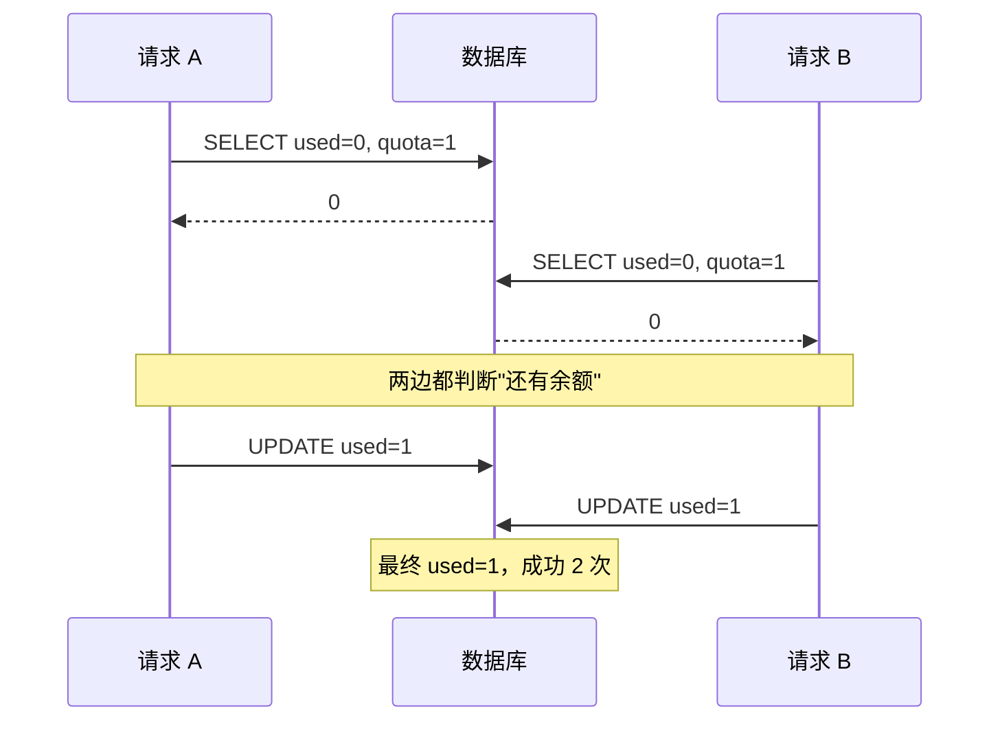
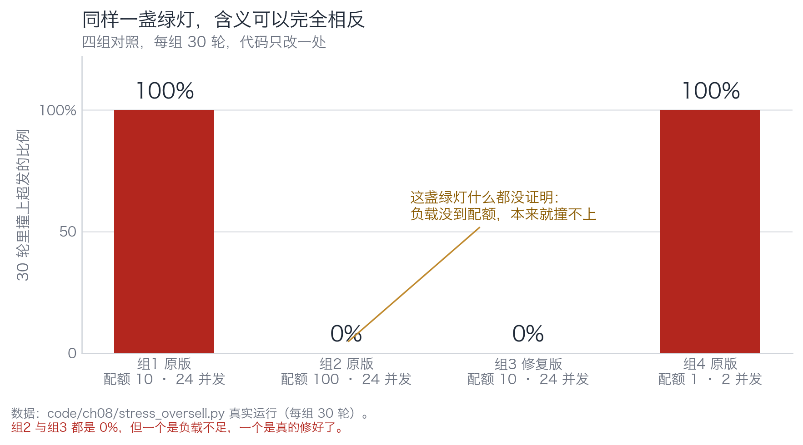
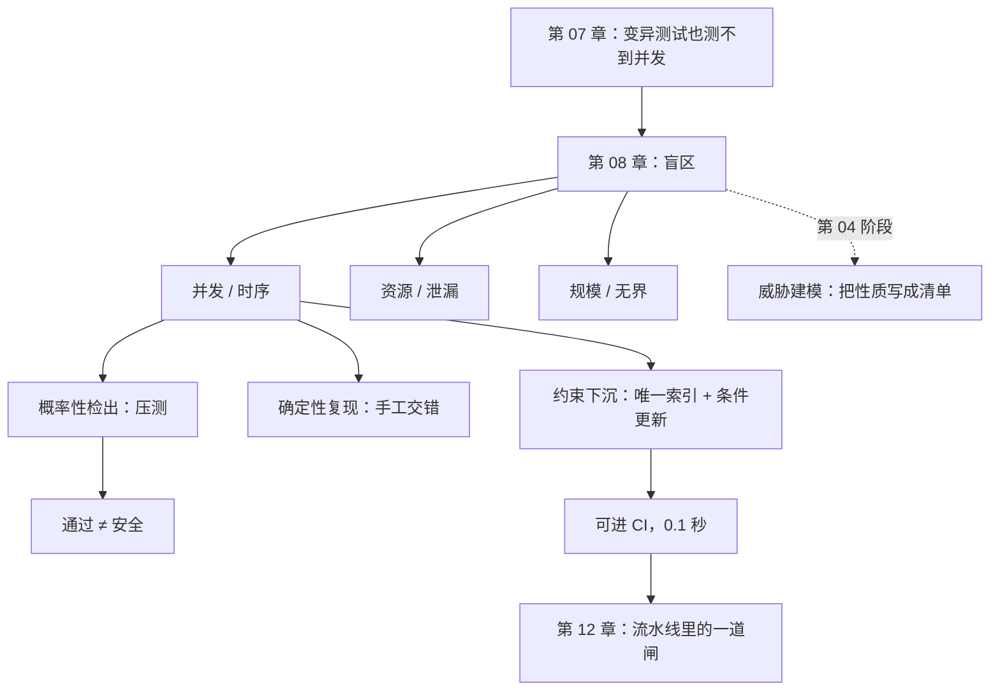

[English](./ch08-blind-spots.md) | **中文**

# 第 08 章：盲区——所有门禁都抓不到的那一类

> **本章导读**：前四章讲了四道闸，每一道都有一块抓不到的地方。这一章把那些地方集中起来看：并发、时序、资源。它们有一个共同点——**门禁在原理上看不见它们**，因为它们不是"代码对不对"的问题，是"性质有没有被约束"的问题。
> **前置知识**：第 02 章（omission）、第 07 章（变异测试的边界）。
> **核心学习目标**：
> - 说清为什么并发缺陷逃过全部四道闸，而不是"我们测得不够"
> - 分清概率性检出与确定性检出，知道压测的"通过"值多少
> - 会把一条并发性质下沉成一条数据库约束，并写出检查它的代码

## 1. 认知锚点：探照灯不是太阳

### 1.1 一个让人不安的事实

第 01 章那 43 次超发，用本书讲的所有门禁都抓不到：

- **依赖门禁**：和依赖无关。
- **静态检查**：每一行都合法。
- **单元测试**：单线程下行为正确。
- **变异测试**：它变异的是代码，不是调度器。
- **行为测试**：除非你专门写一个并发用例，而它会 flaky。

五道闸全部放行。这不是工具不好，是**它们照的地方不对**。

探照灯能照亮一个锥形区域。锥形之外不是"没有东西"，是"你没转过去"。这一章要做的，是让你知道锥形之外有什么、怎么转过去。

### 1.2 三类盲区的共同点

| 盲区 | 典型形态 | 为什么门禁抓不到 |
|---|---|---|
| **并发/时序** | 两个请求在 8 毫秒内交错 | 门禁验的是"代码写了什么"，缺陷在"两条语句之间发生了什么" |
| **资源** | 连接池泄漏、文件句柄不释放、内存缓慢增长 | 缺陷在"长期运行的累积效应"，单次运行看不出来 |
| **规模** | N+1 查询、无界结果集、全表扫描 | 缺陷在"数据量放大之后"，测试数据量太小 |

三者有一个共同结构：**正确的代码 + 错误的运行环境 = 错误的结果。** 而门禁默认运行环境是"小、快、单线程、数据量小"。

`Release It!` 里把这类问题叫"稳定性反模式"，其中三个和本章直接相关：无界结果集、不平衡容量、级联失败。它们的共同点是**不会在开发环境里出现**。

## 2. 第一性原理：为什么它不在射程内

### 2.1 四道闸的共同假设

把前四道闸抽象一下，它们都在做同一件事：

> **给定一段代码，判断它是否符合某个关于"代码"的性质。**

- 依赖门禁：判断 import 是否在白名单里
- 静态检查：判断文本是否匹配某个模式
- 单元测试：判断给定输入下返回值是否正确
- 变异测试：判断改动后测试是否变红

四个判断的对象都是**代码**。而并发缺陷的性质是关于**执行序列**的：

> "不存在一个交错顺序，使得库存被扣成负数。"

这句话的主语不是代码，是"所有可能的执行序列"。**它的量词是"所有"，而任何测试只能覆盖"有限个"。**

这就是为什么你测不完：你要证明的是一个全称命题，而测试只能提供存在性反例。**没撞上不等于不存在，撞上了才等于存在。**



### 2.2 三种应对，各有一条死路

面对"测不完"，工程上有三条路：

| 路线 | 做法 | 它能给你什么 | 它的死路 |
|---|---|---|---|
| **概率性检出** | 压测、模糊测试、混沌工程 | "这次撞上了" | 通过时不提供任何保证 |
| **确定性复现** | 手工编排交错顺序、模型检验 | "这个交错确实会出事" | 只覆盖你想到的交错 |
| **约束下沉** | 唯一索引、条件更新、事务隔离级别 | "结构上不可能出事" | 只对能用约束表达的性质有效 |

三条路不是平行的，是**递进**的：概率性检出让问题暴露，确定性复现让你理解它，约束下沉让它不可能再发生。

大多数团队停在第一条，然后就以为完事了。

### 2.3 概率性检出的"通过"到底值多少

一句话：**它值"这次没撞上"，不值"它是安全的"。**

更准确地说，压测的通过意味着：在你给的负载、你的机器、你的调度下，这个窗口没被打开。换一台慢一点的机器、换一个并发度、换一个数据库隔离级别，窗口可能就打开了。

这解释了为什么"我们压测过了"这句话在生产事故复盘里经常出现——它是一句真话，但它证明的东西比说话人以为的少得多。

## 3. 手把手：四组实验，三个结论

### 3.1 实验一：压测的检出率取决于负载，不取决于代码

`code/ch08/stress_oversell.py` 跑四组对照，每组 30 轮：

```text
组1  原版 · 24 并发 · 配额 10   检出 30/30 轮（100%）  单轮最大超发 14 张
组2  原版 · 24 并发 · 配额 100  检出  0/30 轮（ 0%）  单轮最大超发  0 张
组3  修复版 · 24 并发 · 配额 10  检出  0/30 轮（ 0%）  单轮最大超发  0 张
组4  原版 ·  2 并发 · 配额  1   检出 30/30 轮（100%）  单轮最大超发  1 张
```


*图 8-1：组2 和组3 都是 0%，但组2 是"负载没到配额，本来就撞不上"，组3 是"真的修好了"。同一个数字，两种含义。*

**组2 是本章最重要的一格。** 配额 100，只来 24 个人——就算所有请求同时到达并且全部成功，也超不了。这盏绿灯什么都没证明，它只是说明了"你没给够负载"。

组4 说明另一半：2 个线程抢 1 个配额，每次都能撞上。所以"检出率"不是代码的属性，是**负载的函数**。

**结论一：压测的绿色不能被当成"安全"，只能被当成"这次负载下没暴露"。**

### 3.2 实验二：确定性复现——不撞运气，把交错画出来

`case_coupon/race_repro.py` 不调用 `redeem()`，而是把它内部的 SQL 按两种交错顺序手工执行一遍：

```text
库存：quota=1, used=0

步   请求    动作                                              手里看到的 used
------------------------------------------------------------------------------
1   A     SELECT quota, used                              0
2   B     SELECT quota, used                              0
3   A     UPDATE used = 1                                 0
4   B     UPDATE used = 1                                 0
------------------------------------------------------------------------------
最终 used = 1；成功核销 2 次，库存 1 张 → 超发 1 张

注意：每一步单独看都是对的。错的是「两步之间没有锁」。
```

**为什么不用线程？** 因为线程版会 flaky，而 flaky 的测试等于没有测试——它会在 CI 里随机红，被人加 `@skip`，然后消失。

确定性复现看到的是"事故的可能性"，不是"事故现场"。对一个缺陷来说，这两者的信息量相同：**你知道了它会发生，以及为什么。**

**结论二：想真正理解一个并发缺陷，必须能把它画出来；画不出来，说明你还没理解。**

### 3.3 实验三：把性质变成约束，再用代码检查约束

`code/ch08/constraint_check.py` 检查三条"必须存在的东西"：

- **K1** 核销记录表上有 `UNIQUE(code, user_id)`
- **K2** 扣减语句是带条件的原子更新（`WHERE ... used < quota`）
- **K3** 取消/核销在显式锁事务里（`BEGIN IMMEDIATE`）

```text
=== AI 原版：coupon_service.py ===
  失败  K1 唯一约束  ·  redemptions 表上没有唯一索引
  失败  K2 条件更新  ·  扣减语句里没有 used < quota 条件
  失败  K3 显式事务  ·  没有显式锁事务（读与写之间存在窗口）
  → 0/3 条约束成立

=== 修复版 ：coupon_service_fixed.py ===
  通过  K1 唯一约束  ·  发现 1 个唯一索引
  通过  K2 条件更新  ·  发现条件更新：UPDATE coupons SET used = used + 1 WHERE code = ? AN...
  通过  K3 显式事务  ·  扣减位于显式锁事务内
  → 3/3 条约束成立
```

这份检查 0.1 秒跑完，不需要并发、不需要起线程、完全确定性。**它证明的不是"这次没超发"，而是"结构上不可能超发"。**

K1 的实现方式值得看一眼——它不是读源码猜，而是**真的把建表语句跑一遍，然后问数据库**：

```python
def k1_unique_index(module_name: str) -> tuple[bool, str]:
    mod = __import__(module_name)
    conn = sqlite3.connect(":memory:", isolation_level=None)
    mod.init_db(conn)
    rows = conn.execute("PRAGMA index_list('redemptions')").fetchall()
    conn.close()
    unique = [r for r in rows if r[2] == 1]
    ...
```

**问数据库本身，比读源码可靠。** 源码可能有一百种写法建索引，而 `PRAGMA index_list` 只认结果。

**结论三：约束级检查是唯一能进 CI 的并发防线。** 它把全称命题（"不存在超发的执行序列"）降级成了一个存在性命题（"这个约束存在吗"），而后者是可判定的。

### 3.4 还有一类：资源与规模

同一套思路可以推广，但表达方式不同：

| 性质 | 约束表达 | 检查方式 |
|---|---|---|
| 连接不泄漏 | 每次取用必须配对释放 | 静态检查（try/finally 或上下文管理器）+ 运行期计数断言 |
| 结果集有界 | 所有列表查询必须有 LIMIT | 静态扫描 SQL 里有没有 LIMIT |
| 请求有超时 | 所有外部调用必须有 timeout | 静态扫描调用参数（第 05 章练习 4） |
| 队列不无限增长 | 入队必须有容量上限 | 配置检查 + 监控告警 |

它们的共同形态是：**把"运行时才暴露的性质"翻译成"结构上可检查的存在性"。** 翻译得出来，就能进 CI；翻译不出来，就只能靠监控。

## 4. 常见误区与正反例对比

| 踩坑的误区 | 根因 | 正确做法 |
|---|---|---|
| **"我们压测过了，没问题"** | 压测的通过只说明"这次负载下没撞上" | 压测当监控，约束当门禁（3.3 节） |
| **"并发测试写成线程版就行了"** | 线程版 flaky，flaky 等于没有 | 确定性交错复现 + 不变式断言 + 约束检查，三件套 |
| **"加锁就安全了"** | 锁加错地方（比如锁了读没锁写）等于没加 | 把约束下沉到数据库层，让"忘了加锁"也不可能出错 |
| **"测试环境数据量小，跑得快"** | N+1 和无界结果集在 100 行数据上完全看不出来 | 用生产规模的一个样本跑一次集成测试；或做 SQL 静态扫描 |
| **"这类问题只能靠线上发现"** | 只想到"测"，没想到"约束存在性也能被检查" | 先问"这条性质能不能用约束表达"，能就进 CI |

## 5. 本章小结与局部知识图谱

### 5.1 核心要点

- **并发缺陷逃过全部四道闸**，因为它的性质是关于"所有执行序列"的全称命题，而测试只能给存在性反例。
- **压测的绿色只值"这次没撞上"。** 检出率是负载的函数，不是代码的属性。
- **确定性复现 > 概率性检出**，因为它能让你画出交错、理解机制，而且不 flaky。
- **约束下沉是唯一能进 CI 的防线。** 把"不存在超发序列"降级成"约束存在吗"，后者可判定。
- **问数据库本身，比读源码可靠。** `PRAGMA index_list` 比任何代码模式匹配都准。

### 5.2 本章概念拓扑



### 5.3 与前后章的接口

- **接第 07 章**：变异测试变异代码，不变异调度器，所以它对并发无效。
- **给第 09 章**：逃逸率是唯一能反推"盲区有多大"的指标。
- **给第 12 章**：约束检查会作为一道独立的闸进流水线，排在测试之后、部署之前。
- **给第 04 阶段（下一本书）**：这一章讲的"没人写下的性质"，在威胁建模里会变成一份正式的清单。

## 6. 分级通关练习

### Tier 1 · 直觉与概念核验

**1.** 为什么"测过了"永远不能证明"并发安全"？用全称命题与存在性反例的语言说清。

**2.** 组2（配额 100、24 并发）和组3（修复版）都是 0%，它们的区别是什么？如果你只看数字，会得出什么错误结论？

**3.** 三条应对路线（概率性检出、确定性复现、约束下沉）分别能给出什么？为什么必须递进使用而不是选一条？

### Tier 2 · 推演与实操构建

**4.** 给 `constraint_check.py` 加第四条检查：**队列不能卡住**（候补系统里，过期的 offer 必须被顺延）。写出实现思路，并说明它为什么比前三条难。

**5.** 找一个你自己的项目，列出三条"应该存在但没被检查"的约束（比如"所有对外 API 必须有超时""所有列表查询必须有 LIMIT"），各写一行检查代码。

### Tier 3 · 边界条件与跨章迁移

**6.** 约束下沉有一个代价：**它把逻辑从应用层挪到了数据层**，从此业务规则分散在两个地方。请分析这个代价在什么情况下会超过收益，并给出一个判据。

**7.** 本章说"翻译不出来就只能靠监控"。请设计一个监控指标，用来发现"库存被超发"这类问题，并说明它比约束检查弱在哪里、又强在哪里。

<details>
<summary><strong>点击展开：本章练习参考答案与深度解析</strong></summary>

#### 1. 为什么测不过

"并发安全"是一个全称命题：**对所有可能的执行序列，库存都不会被扣成负数。** 测试只能枚举有限个执行序列，每跑一次给一个存在性结论："这个序列下没问题"。有限个存在性结论推不出一个全称结论——这是逻辑上的，不是工程量上的。

反过来，**一个反例就够了**：只要有一个序列会让库存变负，安全性就被证伪。所以测试在并发问题上是不对称的：**它能证伪，不能证明。**

#### 2. 组2 vs 组3

组2 是"负载不足，本来就撞不上"——它的 0% 不携带任何关于代码质量的信息。组3 是"约束到位，结构上不可能撞上"——它的 0% 是结论。

只看数字会得出"两版一样安全"的错误结论，而这个结论会把一个未修复的缺陷带上线。**这就是为什么压测报告必须带负载参数**：脱离开负载谈检出率，数字没有意义。

#### 3. 三条路线各自给什么

- 概率性检出：给"这次撞上了"，它的价值是**让你知道有这么个东西**。
- 确定性复现：给"这个交错确实会出事"，它的价值是**让你理解机制**，从而知道该怎么修。
- 约束下沉：给"结构上不可能出事"，它的价值是**让问题不再回来**。

必须递进的原因：跳过第一步，你不知道要找什么；跳过第二步，你不知道该约束什么（可能约束错了地方）；只有第三步能进 CI，但它需要前两步提供"约束什么"的答案。

#### 4. 第四条检查：队列不能卡住

思路：这条性质是**时序性**的，不是结构性的。可检查的近似是：

- 检查是否存在"扫描过期"的入口：源码里必须有 `expire` / `sweep` 之类的方法被调度（静态）。
- 检查 `offered` 状态的行是否有 `expires_at` 字段且非空（数据约束）。
- 检查"顺延"的 SQL 是否跳过已过期的人（静态 + 行为测试）。

难在哪：前三条约束都是"某个结构存在"，这条是"某个动作会被执行"。**"会被执行"是一个运行时性质，静态只能检查"有没有写这个函数"，不能检查"它真的会被调用"。** 所以它必须配合一个运行时断言（比如"每 N 分钟必须有一次 sweep 成功"的监控）。

#### 5. 三条约束

判据：能不能写成一句"必须存在某个结构/某条语句"。能，就写成检查；不能，就写成监控。

#### 6. 约束下沉的代价

代价有三：① 业务规则分散（应用层和数据库层各一半，读代码的人容易漏掉一半）；② 迁移困难（改约束要改数据）；③ 报错信息不友好（数据库抛的 IntegrityError 对用户没意义）。

**判据**：如果这条约束**一旦被违反就是不可逆损失**（超发、重复扣款、越权写入），下沉；如果违反后**可以事后修复且代价可控**（比如排序错了），留在应用层，用测试守。

一句话：**不可逆的用约束，可逆的用测试。**

#### 7. 监控超发

指标：`成功核销次数 - 初始库存`，或者更通用地 `实际发生的业务动作数 - 允许的上限`。做成一个定时任务，每分钟对比一次。

**比约束弱在哪**：它是事后的——超发已经发生了，你只是知道了。约束是事前的，根本不给你超发的机会。

**比约束强在哪**：① 它能覆盖约束表达不了的性质（比如"用户体验上的不合理"）；② 它能发现"约束被绕过"的情况（有人直接改数据库）；③ 它不依赖你对性质的完备理解——约束只能约束你想得到的，监控能看见你没想到的。

所以正确的组合是：**约束防止它发生，监控确认约束还在生效。**

</details>

---

**下一章**：门禁讲完了。下一章开始算账——哪个数字会骗你，哪个数字不会。

---

## 7. 本章权威参考信源与延伸阅读 (Authoritative References)

1. **OWASP Top 10 for LLM Applications**：[OWASP Top 10 for LLM Applications](https://owasp.org/www-project-top-10-for-large-language-model-applications/) - 本章的定义与规范以此为锚（核验日期：`2026-10-23`）。
2. **NIST CSRC**：[NIST CSRC](https://csrc.nist.gov/) - 本章的定义与规范以此为锚（核验日期：`2026-10-23`）。
3. **METR**：[METR](https://metr.org/) - 本章的定义与规范以此为锚（核验日期：`2026-10-23`）。

> 口径提示：以上信源用于锚定**定义与规范**，不用于外推风险概率。引用任何数字前，先核对来源年份与分母。
