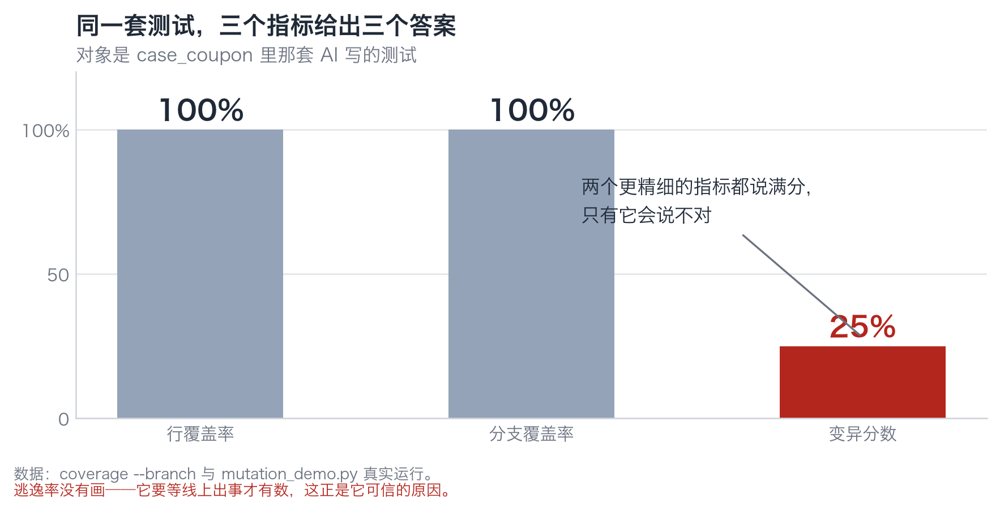
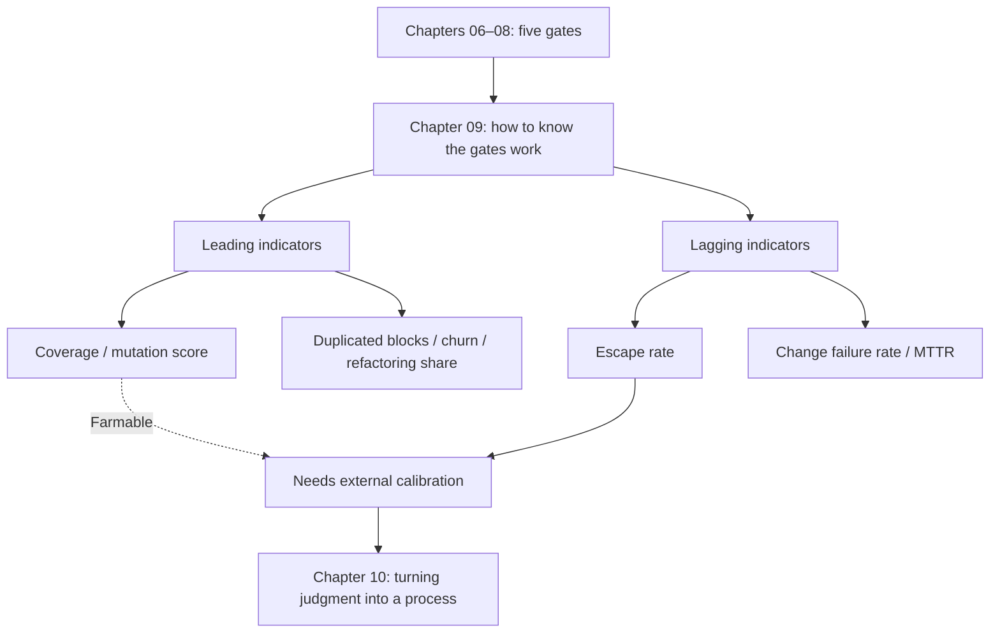

**English** | [中文](./ch09-metrics.zh.md)

# Chapter 09: Which Number on the Dashboard Will Lie to You

> **Chapter Guide**: The previous five chapters built a pile of gates. This chapter solves "how do you know they are actually working". The answer is not "look at coverage"; it is distinguishing the range of each of four metrics — only one of which can falsify you.
> **Prerequisites**: Chapters 06–08 (four pillars, mutation score, blind spots).
> **Core Learning Objectives**:
> - Explain the ranges of line coverage, branch coverage, mutation score, and escape rate, and how they deceive one another
> - Describe a delivery system with the four DORA metrics + rework rate, and stop using "lines of generated code" as performance
> - Recognize the three maintainability signals (duplicated blocks, churn, refactoring share), and know why they are leading indicators

## 1. Cognitive Anchor: The Body-Fat Scale Does Not Measure Fat

### 1.1 A Deceptive Number Everyone Has Used

A body-fat scale works on bioelectrical impedance: it sends a weak current through your body, measures resistance, then estimates the fat percentage with a formula.

What it measures is **resistance**, not fat. The coefficients in the formula come from population statistics and are inaccurate for individuals. Drink a glass of water, break a sweat, evening versus morning — the reading can differ by 3 percentage points.

But everyone watches this number, because **it is more "objective" than the feeling of "have I gotten fatter lately"**.

Software metrics have the same problem: what they measure is not what you want to know, but "some proxy that can be measured cheaply". And once it is on a dashboard, everyone starts optimizing it — including optimizing it in ways that produce no value.

### 1.2 A Concrete Trap

In that Chapter 06 table, the line coverage of all three suites was **100%**.

If you only look at coverage, you conclude "all three are equally good". Add branch coverage — still 100%. Only when you add the mutation score does the 25% / 50% / 100% split appear.

Three metrics: two say perfect, one says wrong. **Which should you believe?**

This chapter answers exactly this question: **where does each metric's range end.**

## 2. First Principles: Four Metrics, Four Ranges

### 2.1 What Each of Them Measures

| Metric | What it measures | The proposition it can falsify | What it cannot measure at all |
|---|---|---|---|
| **Line coverage** | Which code lines were executed | "This code never ran" | Whether the executed lines were asserted |
| **Branch coverage** | Which conditional branches were taken | "This branch was never entered" | What was asserted after entering the branch |
| **Mutation score** | Whether tests go red when code is changed | "No assertion is holding this rule" | Whether the tests false-alarm (refactoring resistance) |
| **Escape rate** | Defects found after release ÷ total defects | "This gate let something through" | Whether the missed thing will be missed again |

The first three rows are **measurements of code**; the fourth row is **a measurement of outcomes**.

This difference is the skeleton of this chapter: **the first three metrics are all "how much I did"; only the escape rate is "how much I missed".**

### 2.2 Why the Escape Rate Is the Only One That Can Falsify You

However beautiful a test suite is, it may still miss a real defect. And "a real defect" is something only production can tell you.

Escape rate = defects found after release ÷ (defects found before release + defects found after release)

Its value: **it is an external referee you cannot manipulate.** Coverage can be farmed; mutation scores can be farmed by welding to the implementation; but the number "users reported 12 bugs" cannot be changed by you.

Its cost is equally clear: **lag**. Something must go wrong first before you learn you were going to go wrong. So it cannot prevent; it can only calibrate — calibrating how much you trust those earlier metrics.

**Usage**: if the escape rate rises for three consecutive months while coverage stays at 90%, then coverage has no relation to "not missing things". What you should adjust then is your trust in coverage, not coverage itself.


*Figure 9-1: The same test suite: line coverage 100%, branch coverage 100%, mutation score 25%. The first two numbers measure "did it run"; the third measures "was it held".*

### 2.3 Relations Between Metrics: Three Ways They Deceive Each Other

**First way: coverage rises, mutation score does not.** Add a batch of assertion-free smoke tests. This is the most common farming method and the hardest to detect — because the coverage rise is very real.

**Second way: mutation score rises, escape rate does not.** Write a pile of "exact match" assertions and kill all the mutants. But these assertions are welded to the implementation, and real defects slip past them all the same (because they only recognize that one way of writing it).

**Third way: all three rise, incident rate does not fall.** Because the defects are not where you are testing. Chapter 08's concurrency and Chapter 11's model output bias are both "tested very earnestly but tested the wrong object".

The criterion can be written in one sentence: **of the four metrics, at least one must come from "things you wish would not happen", otherwise the whole set of metrics is just self-congratulation.**

### 2.4 Delivery-System Metrics: the Four DORA Metrics and Two Supplements

DORA's four metrics (from "Accelerate") measure the "delivery system", not "code quality":

| Metric | Meaning | The question it answers |
|---|---|---|
| Deployment frequency | How often you release | Is the batch small enough |
| Lead time for changes | How long from commit to release | Where is the pipeline clogged |
| Change failure rate | The proportion of releases needing rollback/hotfix | Are the gates enough |
| Time to restore (MTTR) | How long from incident to recovery | Observability and rollback capability |

Of the four, the **change failure rate** is directly relevant to this book — it is the external reading of "gate effectiveness". If a team deploys often and fails often, the gates are not working; if it deploys rarely and fails rarely, the batches are too large and problems are being deferred.

Two supplementary metrics, aimed specifically at the AI-generated code context:

- **Rework rate**: the proportion of AI-generated code subsequently modified by humans. High means unclear specs or insufficient context; low does not mean good — it may mean nobody looked at all.
- **First-pass acceptance rate**: the proportion passing review on the first submission. It is far more meaningful than "how many lines were generated".

### 2.5 Why "Lines of Generated Code" Is a Misleading Metric

Three reasons, each harder than the last:

1. **It rewards verbosity.** For the same feature, which is better, 400 lines or 80? The line-count metric says 400 is better.
2. **It can be diluted.** Formatting, comments, copy-paste all grow line counts.
3. **It is unrelated to delivered value.** Users do not pay for line counts.

But it stays alive in many teams because it is **the easiest to count**. This is the common disease of proxy metrics: they are not kept because they are useful; they are kept because they are easy to measure.

If a "productivity" metric is a must, use **merged change count** or **features shipped**; at least these correspond to real delivery.

### 2.6 The Three Maintainability Signals: Why They Are Leading Indicators

Two GitClear studies (cumulatively analyzing 211 million lines of code changes and 623 million change events) point out three observable signals:

| Signal | Meaning | Why it is a leading indicator |
|---|---|---|
| **Duplicated blocks rising** | Identical/similar code blocks are multiplying | It appears before "change one place, miss three" |
| **Churn rising** | The same file changed repeatedly in a short time | It appears before "nobody dares touch this code" |
| **Refactoring share falling** | The proportion of "tidying" in changes declines | It appears before "complexity runs out of control" |

**Leading vs lagging indicators**: leading indicators deform before the incident; lagging indicators only have numbers after the incident.

- Coverage, mutation score: leading, but farmable.
- Escape rate, change failure rate: lagging, but not farmable.
- The three maintainability signals: **leading and hard to farm** — because to farm them you must genuinely write less duplicated code.

The engineering-correct combination is: **drive daily improvements with leading indicators; calibrate trust with lagging indicators.**

## 3. Hands-on: Computing Four Sets of Numbers for a Module

### 3.1 Set One: the Three Coverage/Score Numbers

```bash
$ cd code/case_coupon
$ python -m coverage run --branch --include=coupon_service.py -m unittest test_coupon_ai -q
$ python -m coverage report -m
Name                Stmts   Miss Branch BrPart  Cover
-----------------------------------------------------
coupon_service.py      18      0      4      0   100%

$ python mutation_demo.py
变异分数   A 空断言 1/4 = 25%
```

Three numbers: line 100%, branch 100%, mutation 25%.

**These three numbers do not contradict each other; they answer three different questions**: did it run (yes), was every fork entered (yes), would breakage be discovered (mostly not).

### 3.2 Set Two: Computing the Escape Rate Once

Suppose this module has been live for a month, and the data is:

- Before release, tests and review found 6 defects
- After release, users and monitoring found 2 defects

Escape rate = 2 ÷ (6 + 2) = **25%**.

How to read this number?

- It does not mean "25% of the code has bugs"; it means "**beyond the defects you already found, a quantity equal to one quarter leaked to production**".
- It is the **real level** of this gate set, not the level you hope for.
- Its benchmark is your own 25% from last month, not an industry average (averages with different bases are not comparable).

### 3.3 Set Three: the Three Maintainability Signals

Take the changes of the last 30 days and compute three numbers:

| Signal | How to compute | Reading |
|---|---|---|
| Duplicated block share | Use a tool (like `jscpd`) to compute duplicated lines ÷ total lines | Rising → "change one place, miss three" is coming |
| Churn rate | Times the same file changed ÷ total commits | Rising → this code is unstable or the spec is unclear |
| Refactoring share | Purely tidying commits ÷ total commits | Falling → everyone is rushing features and complexity is accumulating |

None of the three needs to be precise; **watching the direction is enough**. Their value lies in "knowing three months early".

### 3.4 Set Four: Reading Them Together

| Metric | Value | Range | How to use it |
|---|---|---|---|
| Line coverage 100% | High | Only proves "it ran" | As a floor, not a red line |
| Branch coverage 100% | High | Only proves "every fork was entered" | Same as above |
| Mutation score 25% | Low | Proves "most rules are unguarded" | **This is the number to fix first** |
| Escape rate 25% | Medium | Proves "one in four defects leaks" | Calibrate trust; check the trend every three months |
| Duplicated blocks rising | Bad | Leading signal | Schedule a tidying pass next iteration |

**Read the four numbers together and the conclusion is one sentence**: this test suite runs very completely, guards very shallowly, misses quite a lot, and the code is fragmenting.

This is the process of "from numbers to judgment". **A single number never constitutes a judgment; the interrelation of four numbers constitutes a judgment.**

## 4. Common Misconceptions, and Correct-vs-Wrong Comparisons

| Misconception to fall into | Root cause | The right practice |
|---|---|---|
| **"Coverage is our quality red line"** | Coverage is farmable, and only proves "it ran" | Coverage as a floor; red lines use mutation score + escape rate |
| **"A 100% mutation score means solid tests"** | Mutation scores do not measure refactoring resistance; welded tests can also score perfectly (Chapter 07) | Read it together with the refactor probe |
| **"AI generated 30,000 lines of code; 10x efficiency"** | Line counts are a diluted metric unrelated to delivered value | Use merged change count / features shipped / first-pass acceptance rate |
| **"We deploy often, so we're agile"** | High frequency + high failure rate means industrializing incidents | Read all four DORA metrics together; missing any one causes misreading |
| **"All metrics are rising; should be fine"** | The four metrics may all be farmed the same way | Keep at least one "thing you wish would not happen" as a metric (the escape rate) |

## 5. Chapter Summary and Local Knowledge Map

### 5.1 Key Points

- **Metrics measure proxies, not what you want to know.** The body-fat scale measures resistance; coverage measures execution.
- **The first three metrics are "how much I did"; only the escape rate is "how much I missed".** The latter cannot be farmed, but it lags.
- **Metrics deceive one another**: coverage up while mutation score flat = farming; mutation score up while escape rate flat = welded; all up while incidents not down = wrong object tested.
- **The four DORA metrics measure the delivery system**; the change failure rate is the external reading of gate effectiveness.
- **The three maintainability signals are leading indicators**, and hard to fake — farming them requires genuinely writing less duplicated code.

### 5.2 Concept Topology of This Chapter



### 5.3 Interfaces to the Previous and Next Chapters

- **From Chapter 08**: the size of the blind spot is ultimately exposed by the escape rate.
- **To Chapter 10**: only with numbers can we discuss "does this tier need human eyes".
- **To Chapter 12**: every gate in the pipeline must hang a metric on it, otherwise it will quietly die within six months.

## 6. Tiered Exercises

### Tier 1 · Intuition and Concept Checks

**1.** Using the body-fat scale analogy, explain why "coverage 100%" does not mean "the tests are well written".

**2.** Why is the escape rate the only metric that "cannot be farmed"? What is its cost?

**3.** Under what conditions is the sentence "high deployment frequency means the team is agile" wrong? Which metric must be added to judge?

### Tier 2 · Deduction and Hands-on Construction

**4.** Suppose your project: coverage 85%, mutation score 40%, escape rate 30%, deployment frequency once a week, change failure rate 25%. Give the three things to do first, and explain the ordering.

**5.** Compute the three maintainability signals for your own project (duplicated block share, 30-day churn, refactoring share); write how you computed them, where the data came from, and what the conclusion is.

### Tier 3 · Boundary Conditions and Cross-Chapter Transfer

**6.** The escape rate has a hidden failure mode: **if the team is afraid to release, the escape rate will be low** (because without releases there are no production defects). Design a way to identify whether a "low escape rate" is high capability or fear of shipping.

**7.** This chapter says "a single number does not constitute a judgment". Construct a scenario where **two numbers worsen at the same time while the whole is improving**, and explain how to explain it to the boss.

<details>
<summary><strong>Click to expand: reference answers and in-depth analysis for this chapter's exercises</strong></summary>

#### 1. Coverage and the body-fat scale

The body-fat scale measures resistance and estimates fat with a population formula; coverage measures execution and estimates "tested" with a line ratio. Both are **proxies**: cheap, repeatable, correlated with the truth but not the truth.

More critically, the same point: **once it is on a dashboard, people optimize the proxy, not the goal.** Want lower body fat? Dehydrate. Want higher coverage? Write null assertions.

#### 2. Why the escape rate cannot be farmed

Because its numerator comes from production — what users reported, what monitoring caught, what incident post-mortems listed. The team can suppress "willingness to report" (say, calling bugs "expected behavior"), but that immediately shows up in change failure rate and MTTR, and after doing it twice the team falls apart.

The cost is lag: you must miss first to learn how much you missed. So it can only calibrate, not prevent.

#### 3. When high deployment frequency is bad

When **the change failure rate is also high**. Deploying 20 times a week and failing 5 times equals manufacturing 5 incidents a week. The "agility" here is industrializing risk.

The metric that must be added: change failure rate (or rollback rate). The criterion: **frequency × failure rate = incident frequency**; the two must be read together.

#### 4. The three things to do first

Reading the data: coverage 85% is passable, **the mutation score of 40% is the weak point** (many rules unguarded), escape rate 30% is on the high side, change failure rate 25% also high, deployment frequency once a week is low (large batches).

Ordering:
1. **Raise the mutation score first** (40% → 60%). It directly corresponds to "which rules are unguarded", has the lowest change cost, and the most direct payoff.
2. **Then split deployment batches** (once a week → three times a week). Large batches mean every release is a high-risk event and is one cause of the high change failure rate.
3. **Touch coverage last** (85% → 90%). It has the lowest priority because it is the most farmable and is not the current weak point.

Reason: **first fix the metric that "can point at specific problems", then the "structural" metrics, then the "decorative" ones.**

#### 5. Computing the three signals

The key is not precision; it is **a fixed algorithm, recomputed monthly**. Change the algorithm and the trend breaks.

Write down the data source clearly (git log or a code-platform API), otherwise nobody can reproduce it three months later.

#### 6. Identifying true vs false "low escape rate"

Three cross-checks:

**① Look at deployment frequency and batch size.** No deployments for a month means a low escape rate, of course.
**② Look at the "known but unfixed" backlog.** If the backlog piles up 40 known defects that have not shipped, that is not "no defects"; the defects are held behind the gate.
**③ Look at the volume of the user feedback channel.** If the user feedback channel itself is unused, then "no bug reports" only shows there is no feedback, not that there are no bugs.

The criterion: **the escape rate must be read together with "release volume"**; alone it is meaningless.

#### 7. Two numbers worsening while the whole improves

Scenario: you raise deployment frequency from once a month to three times a week. **Change failure rate rises from 10% to 18%, MTTR rises from 4 hours to 6 hours** — both numbers worsened.

But the whole is improving, because: total incidents = deployments × failure rate. Before: 1 a month × 10% = 0.1 per month; now: 12 a month × 18% = 2.2 per month. Wait — that increased.

Change the scenario: **smaller batches shrink the blast radius of each incident**. Before, one release carried 40 changes and an incident rolled all of them back; now one release carries 3 changes and an incident affects only 3. Here the "change failure rate" rises (because each change is smaller and more likely to trip a gate), but "the impact of each incident" falls, and total loss may fall.

How to explain it to the boss: **do not explain the ratios; explain the totals and the per-incident impact.** "The failure rate went from 10% to 18%, but the features affected per incident dropped from 40 to 3, average recovery time from 4 hours to 40 minutes, and monthly total downtime from 24 minutes to 12 minutes."

**The criterion: ratios move first; totals move later. Watch ratios and you misjudge; watch totals and you do not.** This is also why the four DORA metrics must be read together — any single ratio can always be reinterpreted another way.

</details>

---

**Next chapter**: with the numbers in hand, next comes the decision — for this one feature, does it need human eyes at all.

---

## 7. Authoritative References and Further Reading for This Chapter (Authoritative References)

1. **DORA**: [DORA](https://dora.dev/) - the definitions and norms of this chapter are anchored here (verification date: `2026-10-23`).
2. **METR**: [METR](https://metr.org/) - the definitions and norms of this chapter are anchored here (verification date: `2026-10-23`).
3. **OpenTelemetry**: [OpenTelemetry](https://opentelemetry.io/) - the definitions and norms of this chapter are anchored here (verification date: `2026-10-23`).

> Basis note: the sources above are used to anchor **definitions and norms**, not to extrapolate risk probabilities. Before quoting any number, check the source's year and denominator first.
