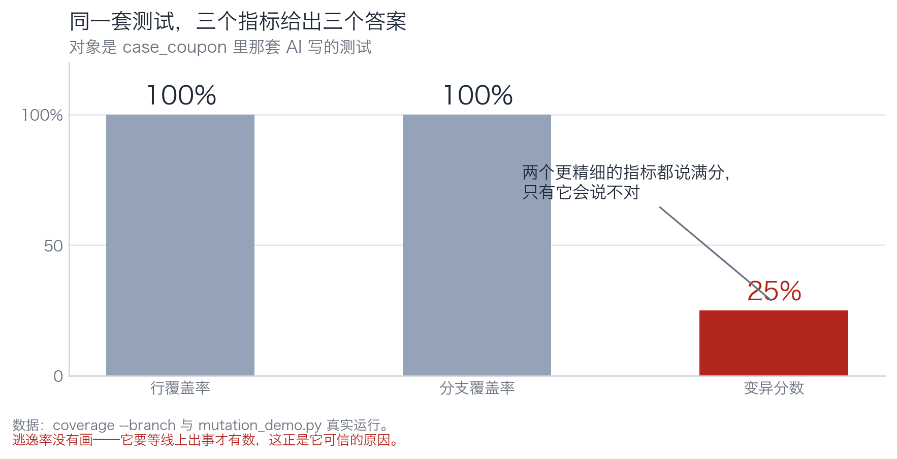

# 第 09 章：仪表盘上哪个数字会骗你

> **本章导读**：前面五章建了一堆闸。这一章解决"怎么知道它们真的在起作用"。答案不是"看覆盖率"，而是分清四种指标各自的射程——其中只有一种能证伪你。
> **前置知识**：第 06—08 章（四支柱、变异分数、盲区）。
> **核心学习目标**：
> - 说清行覆盖、分支覆盖、变异分数、逃逸率四者的射程与互相欺骗方式
> - 会用 DORA 四指标 + 返工率描述交付系统，不再用"生成代码行数"当业绩
> - 识别可维护性三信号（重复块、churn、重构占比），并知道它们为什么是领先指标

## 1. 认知锚点：体脂秤测的不是脂肪

### 1.1 一个所有人都用过的骗人数字

体脂秤的原理是生物电阻抗：它让一股微弱电流通过你的身体，测电阻，然后用一个公式估算脂肪比例。

它测的是**电阻**，不是脂肪。公式里的系数是人群统计出来的，对个体不准。喝一杯水、出一次汗、晚上比早上，读数能差 3 个百分点。

但所有人都在看这个数字，因为**它比"你最近是不是胖了"这种感觉更"客观"**。

软件指标有同一个问题：它们测的不是你想知道的东西，而是"能便宜地测到的某个代理量"。而一旦它上了看板，所有人都会开始优化它——包括用不产生价值的方式优化。

### 1.2 一个具体的陷阱

第 06 章那张表里，三套测试的行覆盖率**都是 100%**。

如果只看覆盖率，你会得出"三套一样好"的结论。加一个分支覆盖，还是 100%。再加一个变异分数，才出现 25% / 50% / 100% 的分化。

三个指标，两个说满分，一个说不对。**你该信哪个？**

这一章回答的就是这个问题：**每个指标的射程到哪里为止。**

## 2. 第一性原理：四种指标，四条射程

### 2.1 它们各自在测什么

| 指标 | 它测的东西 | 它能证伪的命题 | 它完全测不到的 |
|---|---|---|---|
| **行覆盖率** | 哪些代码行被执行过 | "这段代码从没跑过" | 跑过的行有没有被断言 |
| **分支覆盖率** | 哪些条件分支被走到过 | "这个分支从没进过" | 走进分支之后断言了什么 |
| **变异分数** | 改动代码时测试会不会红 | "这条规则没有断言在守" | 测试会不会误报（抗重构） |
| **逃逸率** | 上线后发现的缺陷 ÷ 总缺陷 | "这道闸漏了东西" | 漏的东西下次会不会再漏 |

前三行是**对代码的测量**，第四行是**对结果的测量**。

这个区别是本章的骨架：**前三个指标都是"我做了多少"，只有逃逸率是"我漏了多少"。**

### 2.2 为什么逃逸率是唯一能证伪你的

一个测试套件再漂亮，也可能漏掉一个真实缺陷。而"真实缺陷"这件事，只有生产能告诉你。

逃逸率 = 上线后发现的缺陷数 ÷ （上线前发现的 + 上线后发现的）

它的价值在于：**它是一个来自外部的、你无法操纵的裁判。** 覆盖率可以刷，变异分数可以靠焊死实现刷，但"用户报了 12 个 bug"这个数字你改不了。

它的代价也很清楚：**滞后**。你必须先出事，才知道自己会出事。所以它不能用来预防，只能用来校准——校准你对前面那些指标的信任程度。

**用法**：如果逃逸率连续三个月上升，而覆盖率一直是 90%，那说明覆盖率和"没漏"之间没有关系。这时候该调的是你对覆盖率的信任，不是覆盖率本身。


*图 9-1：同一套测试，行覆盖 100%、分支覆盖 100%、变异分数 25%。前两个数字测的是"跑过没有"，第三个测的是"守住了没有"。*

### 2.3 指标之间的关系：互相欺骗的三种方式

**第一种：覆盖率涨、变异分数不涨。** 补一批无断言的 smoke test。这是最常见的刷法，也是最难被发现的——因为覆盖率涨得很真实。

**第二种：变异分数涨、逃逸率不涨。** 写一堆"精确匹配"的断言，把变异体杀光。但这些断言和实现焊死，真实缺陷一来它们照样漏（因为它们只认那一种写法）。

**第三种：三个都涨、事故率不降。** 因为缺陷不在你测的地方。第 08 章的并发、第 11 章的模型输出偏差，都是"测得很认真但测错了对象"。

判据可以写成一句话：**四个指标里，至少要有一个来自"你不希望发生的事"，否则整套指标都是在自我表扬。**

### 2.4 交付系统指标：DORA 四指标与两个补充

DORA 的四指标（来自《Accelerate》）衡量的是"交付系统"而不是"代码质量"：

| 指标 | 含义 | 它回答的问题 |
|---|---|---|
| 部署频率 | 多久上一次线 | 批量够不够小 |
| 变更前置时间 | 从提交到上线多久 | 流水线堵在哪 |
| 变更失败率 | 上线后需要回滚/热修的比例 | 门禁够不够 |
| 恢复时长（MTTR） | 出事到恢复多久 | 可观测性与回滚能力 |

四个指标里，**变更失败率**和本书直接相关——它是"门禁有效性"的外部读数。如果一个团队部署频率高、失败率也高，说明门禁没起作用；如果频率低、失败率也低，说明批量太大，问题被推迟暴露了。

两个补充指标，专门针对 AI 生成代码的语境：

- **返工率**：AI 生成后被人工修改的比例。它高说明规格不清或上下文不足；它低不代表好——可能说明人根本没看。
- **首轮验收率**：第一次提交就通过评审的比例。它比"生成了多少行"有意义得多。

### 2.5 为什么"生成代码行数"是误导性指标

三个理由，一个比一个硬：

1. **它奖励冗长。** 同样一个功能，400 行和 80 行哪个好？行数指标会说 400 行好。
2. **它可以被注水。** 格式化、注释、复制粘贴都能涨行数。
3. **它和交付价值无关。** 用户不为行数付钱。

但它在很多团队里活着，因为它**最容易统计**。这是代理指标的通病：不是因为有用，是因为好测。

如果一定要一个"产量"指标，用**已合并的变更数**或**上线的功能数**，至少它们对应真实交付。

### 2.6 可维护性三信号：为什么它们是领先指标

GitClear 的两项研究（累计分析 2.11 亿行代码变更、6.23 亿次变更事件）指出了三个可观测信号：

| 信号 | 含义 | 为什么是领先指标 |
|---|---|---|
| **重复块上升** | 相同/近似的代码块在增加 | 它先于"改一处漏三处"出现 |
| **churn 上升** | 同一文件在短时间内被反复改 | 它先于"这块代码没人敢动"出现 |
| **重构占比下降** | 改动中"整理"的比例降低 | 它先于"复杂度失控"出现 |

**领先指标 vs 滞后指标**的区别：领先指标在事故发生前就变形，滞后指标在事故发生后才有数。

- 覆盖率、变异分数：领先，但可刷。
- 逃逸率、变更失败率：滞后，但不可刷。
- 可维护性三信号：**领先且较难刷**——因为要刷它，你得真的少写重复代码。

工程上正确的组合是：**用领先指标驱动日常改进，用滞后指标校准信任。**

## 3. 手把手：给一个模块算四组数

### 3.1 第一组：三个覆盖率/分数

```bash
$ cd code/case_coupon
$ python -m coverage run --branch --include=coupon_service.py -m unittest test_coupon_ai -q
$ python -m coverage report -m
Name                Stmts   Miss Branch BrPart  Cover
-----------------------------------------------------
coupon_service.py      18      0      4      0   100%

$ python mutation_demo.py
变异分数   A 空断言 1/4 = 25%
```

三个数字：行 100%、分支 100%、变异 25%。

**这三个数字不矛盾，它们回答三个不同的问题**：跑到了吗（是）、每个岔路都进了吗（是）、改坏了会发现吗（大部分不会）。

### 3.2 第二组：算一次逃逸率

假设这个模块上线一个月，数据是：

- 上线前，测试与评审发现缺陷 6 个
- 上线后，用户与监控发现缺陷 2 个

逃逸率 = 2 ÷ (6 + 2) = **25%**。

这个数字怎么读？

- 它不说明"25% 的代码有 bug"，说明"**在你已经发现的缺陷之外，还有相当于四分之一的数量漏到了线上**"。
- 它是这套门禁的**真实水平**，不是你希望的水平。
- 它的对标对象是你自己上个月的 25%，不是行业平均值（口径不同的平均值没有可比性）。

### 3.3 第三组：可维护性三信号

取最近 30 天的变更，算三个数：

| 信号 | 怎么算 | 判读 |
|---|---|---|
| 重复块占比 | 用工具（如 `jscpd`）算重复行 ÷ 总行 | 上升 → 后面会有"改一处漏三处" |
| churn 率 | 同一文件被改次数 ÷ 总提交数 | 上升 → 这块代码不稳定或规格不清 |
| 重构占比 | 纯整理性提交 ÷ 总提交 | 下降 → 大家在赶功能，复杂度在积累 |

三个数字都不需要精确，**看方向就够**。它们的价值在于"早三个月知道"。

### 3.4 第四组：把它们放在一起看

| 指标 | 数值 | 射程 | 该怎么用 |
|---|---|---|---|
| 行覆盖 100% | 高 | 只证明"跑过" | 当下限，不当红线 |
| 分支覆盖 100% | 高 | 只证明"岔路都进了" | 同上 |
| 变异分数 25% | 低 | 证明"大部分规则没人守" | **这是当前最该改的数字** |
| 逃逸率 25% | 中 | 证明"每四个缺陷漏一个" | 校准信任，三个月看一次趋势 |
| 重复块上升 | 坏 | 领先信号 | 下个迭代安排一次整理 |

**四个数字连起来读，结论只有一句**：这套测试跑得很全，守得很浅，漏得不少，而且代码在变碎。

这就是"从数字到判断"的过程。**单个数字永远不构成判断，四个数字的相互关系才构成判断。**

## 4. 常见误区与正反例对比

| 踩坑的误区 | 根因 | 正确做法 |
|---|---|---|
| **"覆盖率是我们的质量红线"** | 覆盖率可刷，且只证明"跑过" | 覆盖率当下限；红线用变异分数 + 逃逸率 |
| **"变异分数 100% 说明测试扎实"** | 变异分数不测抗重构，焊死实现也能满分（第 07 章） | 配重构探针一起看 |
| **"AI 生成了 3 万行代码，效率提升 10 倍"** | 行数是注水指标，和交付价值无关 | 用已合并变更数 / 上线功能数 / 首轮验收率 |
| **"我们部署频率高，说明很敏捷"** | 频率高 + 失败率高，等于把事故也高频化 | 四个 DORA 指标一起看，缺一个都会误读 |
| **"指标都在涨，应该没问题"** | 四个指标可能同时被同一种方式刷 | 至少留一个"你不希望发生的事"当指标（逃逸率） |

## 5. 本章小结与局部知识图谱

### 5.1 核心要点

- **指标测的是代理量，不是你想知道的东西。** 体脂秤测电阻，覆盖率测执行。
- **前三个指标是"我做了多少"，只有逃逸率是"我漏了多少"。** 后者不可刷，但滞后。
- **指标会互相欺骗**：覆盖率涨而变异分数不涨 = 刷；变异分数涨而逃逸率不涨 = 焊死；三个都涨而事故不降 = 测错了对象。
- **DORA 四指标衡量交付系统**，其中变更失败率是门禁有效性的外部读数。
- **可维护性三信号是领先指标**，而且较难伪造——要刷它得真的少写重复代码。

### 5.2 本章概念拓扑

```mermaid
flowchart TD
    A["第 06—08 章：五道闸"] --> B["第 09 章：怎么知道闸在起作用"]
    B --> C["领先指标"]
    B --> D["滞后指标"]
    C --> C1["覆盖率 / 变异分数"]
    C --> C2["重复块 / churn / 重构占比"]
    D --> D1["逃逸率"]
    D --> D2["变更失败率 / MTTR"]
    C1 -.->|"可被刷"| E["需要外部校准"]
    D1 --> E
    E --> F["第 10 章：把判断变成流程"]
```



### 5.3 与前后章的接口

- **接第 08 章**：盲区的大小，最终由逃逸率暴露。
- **给第 10 章**：有了数，才能谈"这一档要不要人看"。
- **给第 12 章**：流水线里每道闸都要挂一个指标，否则它会在半年内悄悄失效。

## 6. 分级通关练习

### Tier 1 · 直觉与概念核验

**1.** 用体脂秤的类比，解释为什么"覆盖率 100%"不等于"测试写得好"。

**2.** 为什么逃逸率是唯一"不可刷"的指标？它的代价是什么？

**3.** "部署频率高说明团队敏捷"这句话在什么情况下是错的？需要补哪个指标才能判断？

### Tier 2 · 推演与实操构建

**4.** 假设你的项目：覆盖率 85%、变异分数 40%、逃逸率 30%、部署频率每周 1 次、变更失败率 25%。请给出三条最该先做的事，并说明排序理由。

**5.** 给你自己的项目算三个可维护性信号（重复块占比、30 天 churn、重构占比），写出你怎么算的、数据来自哪、结论是什么。

### Tier 3 · 边界条件与跨章迁移

**6.** 逃逸率有一个隐蔽的失效模式：**如果团队不敢上线，逃逸率会很低**（因为没上线就没有线上缺陷）。请设计一个办法，识别"低逃逸率"是能力强还是不敢上。

**7.** 本章说"单个数字不构成判断"。请构造一个场景，其中**两个数字同时变坏，但整体在变好**，并说明该怎么向老板解释。

<details>
<summary><strong>点击展开：本章练习参考答案与深度解析</strong></summary>

#### 1. 覆盖率与体脂秤

体脂秤测电阻，用人群公式估算脂肪；覆盖率测执行，用行数比例估算"测过了"。两者都是**代理量**：便宜、可重复、和真相关但不是真。

更关键的是同一点：**一旦上了看板，人会优化代理量而不是目标。** 想降体脂，可以脱水；想涨覆盖率，可以写空断言。

#### 2. 逃逸率为什么不可刷

因为它的分子来自生产——用户报的、监控抓的、事故复盘里列的。团队可以压低"上报意愿"（比如把 bug 说成"预期行为"），但那会立刻在变更失败率和 MTTR 上反映出来，而且这种事做两次团队就散了。

代价是滞后：你必须先漏，才知道漏了多少。所以它只能校准，不能预防。

#### 3. 部署频率高什么时候是坏事

当**变更失败率同时高**时。每周部署 20 次、失败 5 次，等于每周制造 5 次事故。这时的"敏捷"是把风险高频化。

必须补的指标：变更失败率（或回滚率）。判据：**频率 × 失败率 = 事故频率**，两者要一起看。

#### 4. 三条最该先做的事

数据读法：覆盖率 85% 尚可，**变异分数 40% 是短板**（说明大量规则无人守），逃逸率 30% 偏高，变更失败率 25% 也偏高，部署频率每周 1 次偏低（批量大）。

排序：
1. **先提变异分数**（40% → 60%）。它直接对应"哪条规则没人守"，改动成本最低，收益最直接。
2. **再拆部署批量**（每周 1 次 → 每周 3 次）。批量大意味着每次上线都是高风险事件，也是变更失败率高的原因之一。
3. **最后动覆盖率**（85% → 90%）。它优先级最低，因为它最可能被刷，而且当前不是短板。

理由：**先改"能指出具体问题"的指标，再改"结构性"的指标，最后改"装饰性"的指标。**

#### 5. 算三个信号

关键不是算得准，是**算法固定、每月重算**。算法变了，趋势就断了。

数据来源写清楚（git log 还是代码平台 API），否则三个月后没人能复现。

#### 6. 识别"低逃逸率"的真假

三个交叉验证：

**① 看部署频率与批量。** 一个月不部署，逃逸率当然低。
**② 看"已知未修"的积压。** 如果 backlog 里堆着 40 个已知缺陷没上线，那不是没有缺陷，是缺陷被扣在门里。
**③ 看用户反馈渠道的量。** 如果用户反馈渠道本身没人用，那"没有报 bug"只说明没有反馈，不说明没有 bug。

判据：**逃逸率必须和"上线量"一起读**，单独看没有意义。

#### 7. 两个数字变坏但整体变好

场景：你把部署频率从每月 1 次提到每周 3 次。**变更失败率从 10% 涨到 18%，MTTR 从 4 小时涨到 6 小时**——两个数字都变坏了。

但整体在变好，因为：事故总数 = 部署次数 × 失败率。原来每月 1 次 × 10% = 0.1 次/月；现在每月 12 次 × 18% = 2.2 次/月。等等，这是变多了。

换个场景：**批量变小让单次事故的影响半径变小**。原来一次上线 40 个改动，出事要回滚全部；现在一次 3 个改动，出事只影响 3 个。此时"变更失败率"上升（因为每次改动更小、更容易触发门禁），但"单次事故的影响"下降，总损失可能下降。

向老板解释的方式：**不要解释比率，解释总量和单次影响。** "失败率从 10% 到 18%，但每次事故影响的功能从 40 个降到 3 个，平均恢复时间从 4 小时降到 40 分钟，月度总停机时长从 24 分钟降到 12 分钟。"

**判据：比率先变，总量后变。看比率会误判，看总量不会。** 这也是为什么 DORA 四指标必须一起看——单个比率永远可以被另一种方式解读。

</details>

---

**下一章**：有了数，接下来是决策——这一个功能，到底要不要人看。

---

## 7. 本章权威参考信源与延伸阅读 (Authoritative References)

1. **DORA**：[DORA](https://dora.dev/) - 本章的定义与规范以此为锚（核验日期：`2026-10-23`）。
2. **METR**：[METR](https://metr.org/) - 本章的定义与规范以此为锚（核验日期：`2026-10-23`）。
3. **OpenTelemetry**：[OpenTelemetry](https://opentelemetry.io/) - 本章的定义与规范以此为锚（核验日期：`2026-10-23`）。

> 口径提示：以上信源用于锚定**定义与规范**，不用于外推风险概率。引用任何数字前，先核对来源年份与分母。
