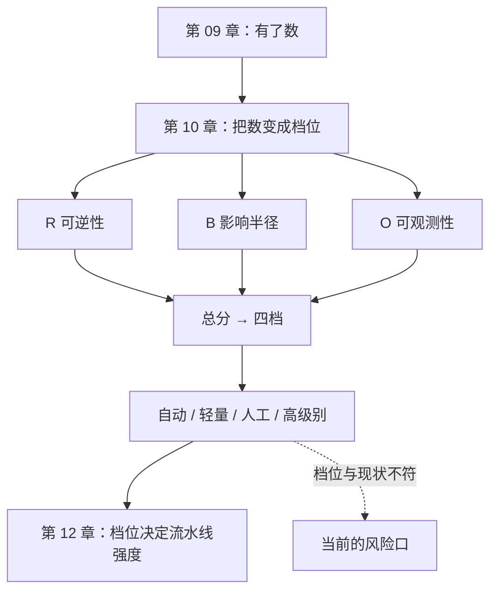

**English** | [中文](./ch10-risk-tiers.zh.md)

# Chapter 10: Risk Tiers — Does This Tier Need Human Eyes

> **Chapter Guide**: Everything so far answers "how to verify". This chapter answers a more practical question: **when there is no time to verify everything, where does the attention go.** The criterion is a three-axis score of reversibility, blast radius, observability — not lines of code, and not "was this written by AI".
> **Prerequisites**: Chapter 02 (defect types), Chapter 09 (metrics).
> **Core Learning Objectives**:
> - Assign a tier to a feature with R × B × O, and give the basis for every point
> - Explain why neither "lines of code" nor "who the author is" can serve as a tiering basis
> - Design a four-tier process that makes "strict where it should be strict, fast where it should be fast"

## 1. Cognitive Anchor: The Emergency Room Triage Desk

### 1.1 The ER Does Not Queue by "How Sick You Are"

The ER's rule is this: **not the sickest person is seen first; the person who can least afford to wait is seen first.**

A fracture patient sweating in pain can wait two hours without harm. A patient with chest tightness who can still talk must get an ECG first — because it may be a heart attack, and two hours of waiting could kill.

**The core of triage is not "severity"; it is "the cost of delay".**

Pre-release review has exactly the same logic. You have ten features to merge and only two hours. Rank by "code complexity" and you review the most complex one first; rank by "the cost of delay" and you review first the one that cannot be taken back once wrong.

### 1.2 Why Most Teams' Tiering Fails

Three common kinds of "fake tiering":

- **By code volume**: anything over 400 lines needs review. Result: a 380-line payment callback sails through, and a 500-line style refactor gets reviewed over and over.
- **By author**: AI-written code needs review. Result: human-written concatenated SQL merges directly (Chapter 02 said it: defects do not care about the author).
- **By module**: core modules need review. Result: the definition of "core module" was set three years ago and is long stale.

All three err in the same place: **they substitute "things that look like risk" for "risk itself".**

Risk itself is one thing: **after it goes wrong, can you go back.**

## 2. First Principles: Three Axes, One Criterion

### 2.1 The Three Axes

| Axis | 0 points | 1 point | 2 points |
|---|---|---|---|
| **Reversibility R** | One rollback restores it | Needs a data-repair script | Irreversible (coupons issued, money charged, messages sent, data deleted) |
| **Blast radius B** | Single user, single record | Single tenant / single feature | Whole site / all tenants / externally visible |
| **Observability O** | Metrics + alerts + logs | Logs only | Only user complaints after the fact |

The three axes are not thumb-sucked; they correspond to the three dimensions of an incident: **can you go back**, **how big is the breakage**, **how fast do you know**.

### 2.2 Why Reversibility Comes First

Because it is the only dimension that "cannot be compensated after the fact".

- Large blast radius but reversible: one rollback and users may not have noticed.
- Poor observability but reversible: you rolled back before users complained.
- **Irreversible + any other problem**: the loss has happened; the rollback only stops the bleeding, it is not an undo.

The criterion can be written in one sentence: **an irreversible operation, however small, deserves one human confirmation.**

### 2.3 The Four Tiers and the Process

| Total score | Tier | Process | Typical examples |
|---|---|---|---|
| 0–1 | Auto-merge | Merge when all gates are green; watch metrics after | Copy tweaks, style fixes, internal tools |
| 2–3 | Light review | Any colleague looks at the diff's **interface and data-change parts**, not implementation details | New read-only endpoints, log fields |
| 4–5 | Human review | A designated reviewer checks against the spec item by item; one manual verification of a failure path is required | Permission changes, bulk data processing |
| 6 | High-level review | Design review + canary + rollback drill + an explicit signer | Payments, coupon issuance, deletion, external notifications |

**The "light review" tier is the hub of the whole design.** Without it, a team has only two options: "review everything" and "review nothing" — reviewing everything cannot hold, reviewing nothing will cause incidents. With it, most changes get a cheap but not naked channel.

### 2.4 Why "AI-Written" Cannot Enter the Criterion

It may influence **your intuition** ("I'll be more suspicious here"), but it cannot enter the **criterion**.

Reason: the point of a criterion is "let others make the same judgment". And the information "who the author is" does not transfer between projects — three months later you switch models and the criterion dies. While "reversibility" is unchanged after ten years.

A more practical reason: **if you tier by author, the team will start hiding the author.** Some will hand-type AI-generated code before submitting, or simply stop using AI. Both outcomes are worse than "reviewing a few more lines of code".

## 3. Hands-on: Five Features, One Card

### 3.1 Scoring

| Feature | R | B | O | Total | Tier | Basis |
|---|---|---|---|---|---|---|
| Coupon redemption | 2 | 2 | 2 | **6** | High-level | Issued coupons are irreversible; site-wide stock; oversells found only by operations |
| Product detail copy generation | 0 | 1 | 1 | **2** | Light | Revertible at any time; single record; has logs |
| User avatar upload | 1 | 1 | 1 | **3** | Light | Old avatar can be restored (needs a script); single user; has logs |
| Bulk export of user data | 1 | 2 | 1 | **4** | Human | The export can be revoked (delete the file), but the leak is irreversible; all tenants |
| Account deletion | 2 | 1 | 1 | **4** | Human | Data unrecoverable; single user; has audit logs |

Two things to note:

**First, code volume has nothing to do with the score.** Coupon redemption is 400 lines and scores 6; bulk export may be 40 lines and scores 4.

**Second, within the same tier there are still differences.** "Bulk export" and "account deletion" both score 4, but their risk natures differ: the former fears leaks, the latter fears wrong deletions. What human review should look at differs — so the tier only decides "whether a human looks", not "what they look at". **What they look at is decided by the spec and the checklist.**

### 3.2 Reverse Check: Where Tiering Contradicts Reality Is a Hole

Take this card and compare it against the team's current process. Three common inconsistencies:

| Inconsistency | Meaning |
|---|---|
| A high-score feature currently auto-merges | **The biggest current risk opening** |
| A low-score feature currently needs three-level approval | Process burden; it breeds the habit of "bypassing approval" |
| Nobody knows what tier a feature belongs to | It was never thought through |

The first is the most dangerous. Usually it is not "forgot to make a rule" but "this feature was an urgent request and shipped first" — and then it stayed that way.

### 3.3 Who Signs, and Signs What

If the "high-level review" tier only says "review required", it says nothing. Three things must be written clearly:

1. **Who signs**: a specific person, not "the team".
2. **Signs what**: not "I read the code", but "I know what the failure modes of this change are, and what the rollback plan is".
3. **Where the signature lives**: a line in the PR description, or a risk register entry. **A signature with no trace equals no signature.**

The criterion: **the content of the signature must be readable by others three months later.** A signature nobody can read is only distributing responsibility, not managing risk.

## 4. Common Misconceptions, and Correct-vs-Wrong Comparisons

| Misconception to fall into | Root cause | The right practice |
|---|---|---|
| **"The more complex the code, the more it needs review"** | Complexity affects "the cost of reviewing", not "the cost of being wrong" | Rank by R×B×O; complexity only affects how long the review takes |
| **"Everything AI-written needs review"** | Substituting author for risk | Tier by reversibility; author info only affects "the degree of suspicion" |
| **"Reviewing everything by humans is safest"** | Human review has a capacity cap; past it, it becomes a rubber stamp | Tier it; concentrate human effort on the 4–6 scores |
| **"We defined tier rules"** | Defined but nobody fills them in at submit time | Build the three-axis scoring into the PR template; no fill, no merge |
| **"Signing means taking responsibility"** | Signed but did not write failure modes and a rollback plan | The signature content must include the two sentences "failure modes + rollback plan" |

## 5. Chapter Summary and Local Knowledge Map

### 5.1 Key Points

- **Triage looks at "the cost of delay", not "how sick".** Tiering looks at reversibility, not code volume.
- **Reversibility comes first**, because it is the only dimension that cannot be compensated after the fact.
- **"Light review" is the hub of the four tiers**; without it, the team is left with review-everything and review-nothing.
- **The author does not enter the criterion**, because it does not transfer and it induces author-hiding behavior.
- **Signatures must leave a trace and have content**: failure modes + rollback plan, readable three months later.

### 5.2 Concept Topology of This Chapter



### 5.3 Interfaces to the Previous and Next Chapters

- **From Chapter 09**: metrics tell you "whether the gates are effective"; tiering tells you "which gates should be stricter".
- **To Chapter 11**: for features with AI components, the O axis (observability) is usually worse — you do not know when the model will degrade.
- **To Chapter 12**: tiers map directly onto pipeline strength (which gates run, how fast, who signs).

## 6. Tiered Exercises

### Tier 1 · Intuition and Concept Checks

**1.** Using ER triage, explain why "code complexity" is not a tiering basis while "reversibility" is.

**2.** Of the three axes, if you could keep only one, which would you keep? Give your reason, and point out under what conditions this choice would hurt you.

**3.** Why can the sentence "AI-written code needs more review" not be written into process documentation? Give two reasons.

### Tier 2 · Deduction and Hands-on Construction

**4.** Score five real features in your project (R/B/O) and compare them with the current process. List all "inconsistencies" and rank them by risk.

**5.** Design a PR template with the three-axis scoring embedded. Requirements: filling it in takes no more than 30 seconds, and it cannot be passed by "filling all 0s".

### Tier 3 · Boundary Conditions and Cross-Chapter Transfer

**6.** Tiering has one failure scenario: **a feature scores 2 when it ships and becomes 6 a year later** (say a feature that originally affected only a single user is now depended on site-wide). Design a mechanism that lets tiers be re-evaluated.

**7.** Someone says "tiering makes the team pour energy into high-score features while low-score features become unmanaged wasteland". Evaluate whether this concern holds, and give countermeasures.

<details>
<summary><strong>Click to expand: reference answers and in-depth analysis for this chapter's exercises</strong></summary>

#### 1. Complexity vs reversibility

Complexity decides "how tiring the review is"; reversibility decides "how much it hurts when wrong". The ER does not see a patient first because their condition is complex; it sees them first because "waiting will kill them".

A 3,000-line refactor may be completely reversible (at the code level, just roll back); a 20-line coupon-issuing script may be completely irreversible (the coupons are already out). **Rank by complexity and you spend your time in the wrong place.**

#### 2. Keeping only one axis

Keep **R (reversibility)**. Reason: a reversible operation, even with huge impact and slow detection, still gives you a chance to remediate; an irreversible operation, even affecting one person, has already harmed that person.

**Where it would hurt you**: R=0 but B=2 and O=2 (rollback-able, site-wide impact, discoverable only via complaints). For example a site-wide style error — it can be rolled back, but everyone saw it, and you must wait for complaints to know. Keeping only R would auto-merge it while the real loss (brand, trust) is not small.

So the three axes are not "pick any"; they are "must be read together". Keeping one is an expedient for extreme situations.

#### 3. Why "AI-written needs more review" cannot enter the process

First, **it does not transfer**. Three months later the model changes, the tools change, and this criterion dies while the process document remains.

Second, **it induces hiding behavior**. Tier by author and the team starts hiding the author: hand-retyping, or not mentioning AI participation in commit messages. Both behaviors are worse than "reviewing a few more lines" — because they make risk invisible.

The right practice: write "was it AI-generated" into the **context** ("where is the spec for this code, what did I verify"), not into the **tiering criterion**.

#### 4. Scoring and comparison

Ordering principle: first list "high score but currently auto-merging" — those are the real holes; then list "low score but heavily reviewed" — those are process burdens.

#### 5. PR template

```markdown
## 这次改动
- 可逆性：□0 一次回滚 □1 需修复脚本 □2 不可逆
- 影响半径：□0 单用户 □1 单功能 □2 全站
- 可观测性：□0 有指标告警 □1 只有日志 □2 只能靠投诉
- 合计：__ 分 → 档位：__
- 若 ≥4：失败模式是什么？回滚方案是什么？（必填）
```

**Preventing "all 0s"**: add an automated check — if R=0 but the change touches messaging/charging/deletion-class keywords, or B=0 but the change touches shared tables, require supplementary notes. **Make "filling it wrong" more troublesome than "filling it right".**

#### 6. Tier drift

Three mechanisms:

**① Periodic re-scoring**: every quarter, re-score the Top 20 most frequently changed features.
**② Reverse dependency lookup**: when a module starts being referenced site-wide, automatically raise its tier (using code dependency analysis).
**③ Incident back-derivation**: every incident post-mortem must ask "was this feature's tier set correctly". If not, change the tiering rules, not that one judgment.

The criterion: **a tier is not a label stuck on a feature; it is a label stuck on "the feature's current state".** States change, so labels should be re-stuck.

#### 7. "Low-score features become wasteland"

**The concern is half right**. Right: if tiering is only used to "decide who reviews", low-score features indeed get nobody looking. Not right: the purpose of tiering is not "review"; it is "allocating attention" — low-score features do not need human review, but they do need **automated gates**.

So the countermeasure is not "also assign people to low-score features"; it is: **fully automate the defenses of low-score features** (tests, dependencies, constraint checks) and spend human effort only on high-score features.

One sentence: **tiering is not "which ones to ignore"; it is "which ones machines manage and which ones humans manage".** If some low-score feature does not even have automated gates, then it is not "low risk"; it is "unassessed" — and the two must be kept distinct.

</details>

---

**Next chapter**: entering the other half of this book — when AI is not just the author, but a component.

---

## 7. Authoritative References and Further Reading for This Chapter (Authoritative References)

1. **NIST CSRC**: [NIST CSRC](https://csrc.nist.gov/) - the definitions and norms of this chapter are anchored here (verification date: `2026-10-23`).
2. **OWASP ASVS**: [OWASP ASVS](https://www.owasp.org/www-project-application-security-verification-standard/) - the definitions and norms of this chapter are anchored here (verification date: `2026-10-23`).
3. **DORA**: [DORA](https://dora.dev/) - the definitions and norms of this chapter are anchored here (verification date: `2026-10-23`).

> Basis note: the sources above are used to anchor **definitions and norms**, not to extrapolate risk probabilities. Before quoting any number, check the source's year and denominator first.
