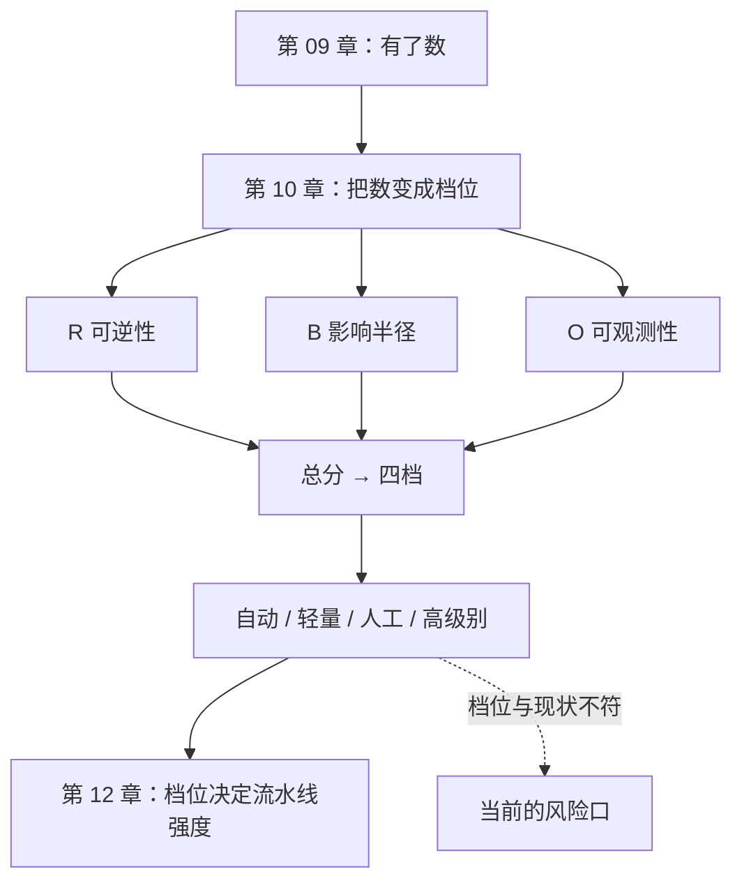

[English](./ch10-risk-tiers.md) | **中文**

# 第 10 章：风险分档——这一档要不要人看

> **本章导读**：前面所有章节都在回答"怎么验"。这一章回答一个更实际的问题：**没时间全验的时候，把注意力放在哪里。** 判据是可逆性、影响半径、可观测性三轴打分，不是代码量，也不是"这是不是 AI 写的"。
> **前置知识**：第 02 章（缺陷类型）、第 09 章（指标）。
> **核心学习目标**：
> - 用 R × B × O 给一个功能定档，并给出每一分的依据
> - 说清为什么"代码行数"和"作者是谁"都不能当分档依据
> - 设计一个四档流程，让"该严的严、该快的快"

## 1. 认知锚点：急诊分诊台

### 1.1 急诊不是按"病得多重"排队

急诊科的规则是这样的：**不是病最重的人先看，是最等不起的人先看。**

一个骨折的病人疼得满头汗，等两小时没事。一个胸闷但能说话的病人，必须先做心电图——因为他可能是心梗，等两小时会死。

**分诊的核心不是"严重程度"，是"延误的代价"。**

软件上线前的复核，逻辑完全一样。你手上十个功能要合，只有两小时。按"代码复杂度"排，你会先去审最复杂那个；按"延误的代价"排，你会先去审那个一旦错了就收不回来的。

### 1.2 为什么大多数团队的分档是失效的

常见的三种"假分档"：

- **按代码量**：400 行以上要审。结果是一个 380 行的支付回调被放过，一个 500 行的样式重构被反复审。
- **按作者**：AI 写的要审。结果是人写的拼接 SQL 直接合了（第 02 章说过，缺陷不关心作者）。
- **按模块**：核心模块要审。结果是"核心模块"的定义三年前定的，早就不准了。

三种都错在同一个地方：**它们用"看起来像风险"的东西替代了"风险本身"。**

风险本身只有一件事：**错了之后，你能不能退回去。**

## 2. 第一性原理：三个轴，一个判据

### 2.1 三轴

| 轴 | 0 分 | 1 分 | 2 分 |
|---|---|---|---|
| **可逆性 R** | 一次回滚就恢复 | 需要数据修复脚本 | 不可逆（已发券、已扣款、已发消息、已删数据） |
| **影响半径 B** | 单用户、单条数据 | 单租户 / 单功能 | 全站 / 全租户 / 对外可见 |
| **可观测性 O** | 有指标 + 告警 + 日志 | 只有日志 | 出事后只能靠用户投诉 |

三轴不是拍脑袋来的，它们分别对应事故的三个维度：**能不能退**、**坏了多大**、**多快知道**。

### 2.2 为什么可逆性排第一

因为它是唯一一个"事后无法弥补"的维度。

- 影响半径大，但可逆：一次回滚，用户可能没感觉到。
- 可观测性差，但可逆：用户投诉之前你就回滚了。
- **不可逆 + 任何其他问题**：损失已经发生，回滚只是止损，不是撤销。

判据可以写成一句话：**不可逆的操作，无论多小，都值得一次人工确认。**

### 2.3 四档与流程

| 总分 | 档位 | 流程 | 典型例子 |
|---|---|---|---|
| 0—1 | 自动放行 | 门禁全绿即合，合并后看指标 | 文案调整、样式修复、内部工具 |
| 2—3 | 轻量评审 | 任一同事看 diff 的**接口与数据变更部分**，不看实现细节 | 新增只读接口、日志字段 |
| 4—5 | 人工评审 | 指定评审人逐条对照规格；必须有一次失败路径的手工验证 | 权限变更、批量数据处理 |
| 6 | 高级别评审 | 设计评审 + 灰度 + 可回滚演练 + 明确签字人 | 支付、发券、删除、对外通知 |

**"轻量评审"这一档是整套设计的枢纽。** 没有它，团队只有"全审"和"全不审"两个选项——全审撑不住，全不审会出事。有了它，大部分变更有了一个便宜但不裸奔的通道。

### 2.4 为什么"AI 写的"不能进判据

它可以影响**你的直觉**（"这段我要多疑一点"），但不能进**判据**。

理由：判据的作用是"让别人也能做出同样的判断"。而"作者是谁"这个信息，在两个项目之间不可迁移——三个月后你换了模型，这条判据就失效了。而"可逆性"十年不变。

一个更实际的理由：**如果你按作者分档，团队会开始隐藏作者。** 有人会把 AI 生成的代码手工敲一遍再提交，或者干脆不用 AI。两种结果都比"多审几行代码"糟。

## 3. 手把手：五个功能，一张卡

### 3.1 打分

| 功能 | R | B | O | 总分 | 档位 | 依据 |
|---|---|---|---|---|---|---|
| 优惠券核销 | 2 | 2 | 2 | **6** | 高级别 | 已发券不可逆；全站库存；超发只能靠运营发现 |
| 商品详情页文案生成 | 0 | 1 | 1 | **2** | 轻量 | 可随时改回；单条数据；有日志 |
| 用户头像上传 | 1 | 1 | 1 | **3** | 轻量 | 可换回旧头像（需脚本）；单用户；有日志 |
| 批量导出用户数据 | 1 | 2 | 1 | **4** | 人工 | 导出可撤销（删除文件），但泄露不可逆；全租户 |
| 删除账号 | 2 | 1 | 1 | **4** | 人工 | 数据不可恢复；单用户；有审计日志 |

注意两件事：

**第一，代码量和分数没关系。** 优惠券核销 400 行拿 6 分，批量导出可能 40 行拿 4 分。

**第二，同一档里也有差别。** "批量导出"和"删除账号"都是 4 分，但风险性质不同：前者怕泄露，后者怕误删。人工评审时该看的东西不一样——所以档位只决定"要不要人看"，不决定"看什么"。**看什么，由规格和清单决定。**

### 3.2 反向检验：分档和现状对不上，就是漏洞

拿这张卡去对照团队现在的流程。常见的三种不一致：

| 不一致 | 含义 |
|---|---|
| 高分功能现在自动合 | **当前最大的风险口** |
| 低分功能现在要三级审批 | 流程负担，会诱发"绕过审批"的习惯 |
| 没人知道某个功能该几档 | 说明它从来没被认真想过 |

第一种最危险。它通常不是"忘了定规则"，而是"这个功能是某个紧急需求，当时先上了"——然后就一直这样。

### 3.3 谁签字，签什么

"高级别评审"这一档如果只写"要评审"，等于没写。必须写清三件事：

1. **谁签**：一个具体的人，不是"团队"。
2. **签什么**：不是"我看了代码"，是"我知道这次改动的失败模式是什么，以及回滚方案是什么"。
3. **签完存在哪**：PR 描述里的一行，或者一张风险登记表。**没有留痕的签字等于没签。**

判据：**签字的内容必须能在三个月后被别人读懂。** 读不懂的签字，只是在分配责任，不是在管理风险。

## 4. 常见误区与正反例对比

| 踩坑的误区 | 根因 | 正确做法 |
|---|---|---|
| **"代码越复杂越要审"** | 复杂度影响"审的成本"，不影响"错的代价" | 按 R×B×O 排；复杂度只影响审多久 |
| **"AI 写的都要审"** | 用作者替代风险 | 按可逆性定档；作者信息只影响"多疑程度" |
| **"全部人工审最安全"** | 人审有容量上限，超了就变成橡皮章 | 分档；把人力集中在 4—6 分 |
| **"我们定了档位规则"** | 定了但没人在提交时填 | 把三轴打分做进 PR 模板，不填不给合 |
| **"签字就是负责"** | 签了但没写失败模式与回滚方案 | 签字内容必须包含"失败模式 + 回滚方案"两句话 |

## 5. 本章小结与局部知识图谱

### 5.1 核心要点

- **分诊看"延误的代价"，不看"病得多重"。** 分档看可逆性，不看代码量。
- **可逆性排第一**，因为它是唯一事后无法弥补的维度。
- **四档里"轻量评审"是枢纽**，没有它，团队只剩全审和全不审。
- **作者不进判据**，因为不可迁移，而且会诱发隐藏作者的行为。
- **签字要留痕、要有内容**：失败模式 + 回滚方案，三个月后能读懂。

### 5.2 本章概念拓扑



### 5.3 与前后章的接口

- **接第 09 章**：指标告诉你"门禁有没有效"，分档告诉你"哪些门禁该更严"。
- **给第 11 章**：含 AI 组件的功能，O 轴（可观测性）通常更差——你不知道模型什么时候会变差。
- **给第 12 章**：档位直接映射到流水线的强度（跑哪些闸、跑多快、谁签）。

## 6. 分级通关练习

### Tier 1 · 直觉与概念核验

**1.** 用急诊分诊解释：为什么"代码复杂"不是分档依据，而"可逆性"是。

**2.** 三个轴里，如果只能保留一个，你留哪个？说明理由，并指出这个选择在什么情况下会害了你。

**3.** "AI 写的代码要多审"这句话，为什么不能写进流程文档？给出两个理由。

### Tier 2 · 推演与实操构建

**4.** 给你的项目里五个真实功能打分（R/B/O），与现行流程对照。列出所有"不一致"，并按风险排序。

**5.** 设计一个 PR 模板，把三轴打分嵌进去。要求：填写时间不超过 30 秒，且不能靠"全填 0"通过。

### Tier 3 · 边界条件与跨章迁移

**6.** 分档有一个失效场景：**一个功能上线时是 2 分，运行一年后变成了 6 分**（比如原本只影响单用户的功能，现在被全站依赖）。请设计一个机制，让档位能被重新评估。

**7.** 有人说"分档会让团队把精力都放在高分功能上，低分功能变成没人管的荒地"。请评估这个担心是否成立，并给出对策。

<details>
<summary><strong>点击展开：本章练习参考答案与深度解析</strong></summary>

#### 1. 复杂度 vs 可逆性

复杂度决定"审起来多累"，可逆性决定"错了多疼"。急诊不会因为一个病人病情复杂就先看他，而是因为"等下去会死"。

一个 3000 行的重构可能完全可逆（代码层面，回滚即可）；一个 20 行的发券脚本可能完全不可逆（券已经发出去了）。**按复杂度排，你会把时间花在错的地方。**

#### 2. 只留一个轴

留 **R（可逆性）**。理由：可逆的操作，即使影响很大、发现很慢，你仍然有补救的机会；不可逆的操作，即使只影响一个人，那一个人也已经受损了。

**它会在什么情况下害你**：R=0 但 B=2 且 O=2（可回滚、全站影响、只能靠投诉发现）。比如一次全站样式错误——能回滚，但所有人都看到了，而且你要等投诉才知道。这时只留 R 会让你自动放行，而实际损失（品牌、信任）不小。

所以三轴不是"可以任选"的，是"必须一起看"的。只留一个是极端情况的权宜之计。

#### 3. 为什么"AI 写的要多审"不能进流程

第一，**不可迁移**。三个月后模型变了、工具变了，这条判据就失效，但流程文档还在。

第二，**它会诱发隐藏行为**。按作者分档，团队会开始隐藏作者：手工重敲一遍、或者在提交信息里不写 AI 参与。这两种行为都比"多审几行"更糟——因为它们让风险变得不可见。

正确的做法是：把"是否 AI 生成"写进**上下文**（"这段代码的规格在第几节、我验证了什么"），而不是写进**档位判据**。

#### 4. 打分与对照

排序原则：先列"高分但现在自动合"的，那是真正的窟窿；再列"低分但审得很重"的，那是流程负担。

#### 5. PR 模板

```markdown
## 这次改动
- 可逆性：□0 一次回滚 □1 需修复脚本 □2 不可逆
- 影响半径：□0 单用户 □1 单功能 □2 全站
- 可观测性：□0 有指标告警 □1 只有日志 □2 只能靠投诉
- 合计：__ 分 → 档位：__
- 若 ≥4：失败模式是什么？回滚方案是什么？（必填）
```

**防"全填 0"**：加一条自动检查——如果 R=0 但改动涉及发消息/扣款/删除类关键词，或者 B=0 但改动涉及共享表，则要求补充说明。**让"填错"变得比"填对"更麻烦。**

#### 6. 档位漂移

三个机制：

**① 定期重评**：每季度把 Top 20 高频改动的功能重新打一次分。
**② 依赖反查**：当一个模块开始被全站引用时，自动提升它的档位（用代码依赖分析）。
**③ 事故反推**：每次事故复盘必问一句"这个功能的档位定得对吗"。如果不对，改档位规则，而不是改那一次的判定。

判据：**档位不是给功能贴的标签，是给"这个功能现在的状态"贴的标签。** 状态会变，标签就该重贴。

#### 7. "低分功能变荒地"

**担心成立一半**。成立的：如果分档只用于"决定谁审"，低分功能确实会没人看。不成立的：分档的目的不是"审"，是"分配注意力"——低分功能不需要人审，但需要**自动门禁**。

所以对策不是"也给低分功能安排人"，而是：**低分功能的防线全自动化**（测试、依赖、约束检查），人力只花在高分功能上。

一句话：**分档不是"哪些不管"，是"哪些用机器管、哪些用人管"。** 如果某个低分功能连自动化门禁都没有，那它不是"低风险"，是"未评估"——这两者要分开。

</details>

---

**下一章**：进入本书的另一半——当 AI 不只是作者，而是组件。

---

## 7. 本章权威参考信源与延伸阅读 (Authoritative References)

1. **NIST CSRC**：[NIST CSRC](https://csrc.nist.gov/) - 本章的定义与规范以此为锚（核验日期：`2026-10-23`）。
2. **OWASP ASVS**：[OWASP ASVS](https://www.owasp.org/www-project-application-security-verification-standard/) - 本章的定义与规范以此为锚（核验日期：`2026-10-23`）。
3. **DORA**：[DORA](https://dora.dev/) - 本章的定义与规范以此为锚（核验日期：`2026-10-23`）。

> 口径提示：以上信源用于锚定**定义与规范**，不用于外推风险概率。引用任何数字前，先核对来源年份与分母。
