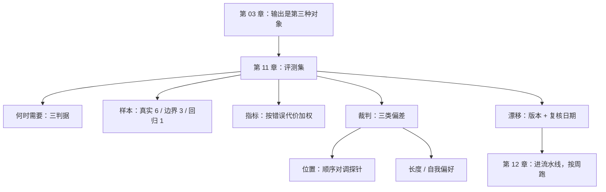

# 第 11 章：评测集——当 AI 是组件，不是作者

> **本章导读**：前七章都在验"AI 写的代码"。这一章换对象：**AI 作为组件**，它给出的输出对不对。对象一换，整套方法都要换——因为输出没有唯一答案，也不能穷举。这一章给你一套可跑的最小评测集，以及识别"裁判自己偏了"的探针。
> **前置知识**：第 03 章（三种验证对象）、第 09 章（指标）。
> **核心学习目标**：
> - 判断一个功能什么时候必须有评测集，什么时候不需要
> - 用"性质断言 + 加权指标"搭一个 30 条的最小评测集
> - 用顺序对调法测出 AI-as-a-judge 的位置偏好

## 1. 认知锚点：考卷和面试官

### 1.1 同一个问题，两种考法

你要判断一个人会不会写代码。

**考卷**：固定十道题，标准答案，每次同一套。分数可比、可复现、可回归。缺点是只能考考卷上有的东西。

**面试官**：临场出题，看反应、看思路。灵活、能考到考卷考不到的东西。缺点是不可复现——同一个候选人，换个面试官结论可能相反。

评测集是考卷，AI-as-a-judge 是面试官。

**关键区别**：考卷的分数能横向比、纵向比；面试官的结论只能当参考。而绝大多数团队在没有考卷的情况下，直接上了面试官。

### 1.2 为什么"用单测验 AI 输出"必然失败

第 03 章演示过：一条精确匹配的断言，对模型输出必然误报——因为措辞会变。

但更根本的原因是**量纲不同**：

- 单测问："给定输入 X，输出是否等于 Y？"——它假设存在唯一的 Y。
- 模型输出的"对"，是一组约束同时成立：金额正确、语气得体、没有承诺做不到的事、长度合适。

**把一个多约束问题压成一个等值判断，信息必然丢失。** 丢掉的那部分，就是上线后用户投诉的东西。

## 2. 第一性原理：什么时候需要评测集

### 2.1 三个判据

不是所有 AI 功能都需要评测集。满足任一条件才需要：

| 判据 | 说明 | 例子 |
|---|---|---|
| **三项中任一可变** | 模型版本、提示词、检索索引——任一变化都会改变输出分布 | 客服回复、摘要、分类 |
| **错误有代价差异** | 不同错误造成的损失差一个量级 | 退款金额写错（严重）vs 措辞生硬（轻微） |
| **人工抽检成本高** | 输出量大到无法全量人工看 | 每天 5000 条商品描述 |

三条都不满足，就不需要。比如一个内部的"把标题转成 slug"的工具——输出确定、错误无代价、量小，写单测就够了。

### 2.2 评测集的三类样本

一个能用的评测集不是"随便找 30 条"，它必须包含三类：

| 类型 | 来源 | 作用 |
|---|---|---|
| **真实流量样本** | 线上日志里采样 | 代表分布。它决定"分数能不能外推" |
| **边界样本** | 人工构造 | 抓那些低频但致命的输入（空值、超长、多语言、恶意注入） |
| **回归样本** | 每次线上事故的输入 | 保证"同一个坑不踩两次" |

三类的比例，经验上是 **6 : 3 : 1**。真实流量太少，分数不可信；边界样本太多，分数虚低（因为真实流量里这些情况很少）。

**回归样本是唯一会持续增长的**——每次事故加一条，一年后它就是这个产品最宝贵的资产。

### 2.3 指标：为什么要按错误代价加权

"准确率 92%"这句话没有信息量，除非你知道**错的是哪 8%**。

正确的做法是给不同错误定价：

```text
加权准确率 = Σ(样本权重 × 判对) ÷ Σ(样本权重)
```

| 错误类型 | 权重 | 理由 |
|---|---|---|
| 金额/数量错误 | 10 | 直接资损，且用户会投诉 |
| 承诺了做不到的事 | 5 | 引发二次投诉，客服成本 |
| 事实性错误（引用了不存在的政策） | 5 | 合规风险 |
| 语气生硬 | 1 | 体验问题，可接受 |
| 格式不符 | 2 | 下游解析失败 |

**加权之后，"92% 准确率"可能变成"78% 加权"**，因为错的那 8% 恰好是权重最高的那些。这个落差就是你需要盯的地方。

### 2.4 AI-as-a-judge 的三类偏差

用模型给模型打分，成本低、可扩展，但有三个可测量的偏差：

| 偏差 | 表现 | 探针 |
|---|---|---|
| **位置偏好** | 倾向于选排在前面的那个 | 交换 A/B 顺序再判一次，结论应该不变 |
| **长度偏好** | 倾向于选更长、更详细的那个 | 构造"短而正确"vs"长而啰嗦"的对照 |
| **自我偏好** | 倾向于选自己（同族模型）生成的 | 用两个不同模型的输出做对照，看是否系统性偏袒 |

**位置偏好是最容易测、也最容易被忽略的。** 下一节会给一个真实实验。

判据：**翻转率超过 10%，这个 judge 不能单独当门禁。** 它可以当"初筛"，但必须有人工复核那部分不一致的样本。

### 2.5 评测集自身的漂移

这是最容易被忽略的一条：**评测集会过期。**

三种过期方式：

1. **样本过期**：真实流量分布变了（新业务、新用户群），老样本不再代表当下。
2. **标准过期**：业务规则变了（新的退款政策），人工标注的"好答案"变成错答案。
3. **判据过期**：判分脚本还在用旧的字段名，跑起来全是红，于是被人跳过。

对策很朴素：**给评测集加版本号和"最近一次人工复核日期"，超过 90 天没复核的，分数不可信。** 没有这个日期，你无法区分"模型退化了"和"评测集过期了"。

## 3. 手把手：测出一个 judge 的位置偏好

### 3.1 实验设计

`code/ch11/eval_harness.py` 用 20 条样本模拟一次裁判：

- 每条样本有 A/B 两版回复，人工标注了哪版更好。
- judge 有真本事（剩下的概率会选对），但 70% 的时候直接选"排在前面的那个"。
- 跑两遍：一遍 A 在前，一遍 B 在前。

```text
$ python eval_harness.py
样本数：20，位置偏好参数：70%
单次判定与人工一致：13/20 = 65%
交换顺序后结论翻转：14/20 = 70%

去偏后（两次一致才采信）：
  可判定样本：6/20 = 30%
  其中判对：6/6 = 100%
  需要人工复核：14 条
```

### 3.2 三个数字怎么读

**一致率 65%**：单看这个数字，你会觉得"还行，比随机好一点"。很多人就是看着这个数字决定用它的。

**翻转率 70%**：换个顺序，70% 的结论变了。**这说明它的判断有七成来自"位置"，只有三成来自"内容"。** 一个 65% 一致率的裁判，如果它的判断是稳定的，那还能用；如果它七成靠位置，那它的 65% 是巧合。

**这就是为什么必须先测翻转率，再看一致率。** 顺序错了，你会被一个虚假的准确率骗过去。

**去偏后 30% 可判定、其中 100% 判对**：用"两次一致才采信"过滤，剩下的 6 条全对，但只有 30% 的样本能被判定。**去偏的代价是覆盖率。** 剩下 70% 必须回到人。

### 3.3 这个实验的工程含义

三句话：

1. **judge 不能当门禁，只能当初筛。** 它的一致性不够，翻转率太高。
2. **去偏是可以做的，但要付覆盖率。** 只有当你的业务能承受"70% 的样本回到人"时才可行。
3. **翻转率可以常驻监控。** 每次评测跑一遍正序 + 反序，翻转率超过阈值就告警——这说明 judge 的版本变了，或者评测集本身有问题。

### 3.4 搭一个 30 条的最小评测集

如果你现在就要搭，按这个顺序做（半天能完成）：

**第一步：定 5 条硬性质。** 从规格里抄，比如"必须含订单号""金额必须与订单一致""不能出现具体赔偿承诺""长度 ≤ 80 字""必须含一个可执行动作"。这五条用规则就能判，不需要 judge。

**第二步：采 18 条真实流量。** 从日志里随机抽最近的，覆盖最近的业务变化。

**第三步：构造 9 条边界。** 空值、超长、多语言、带恶意指令的输入。

**第四步：加 3 条回归。** 最近三次事故的输入。

**第五步：跑一遍，算两个数**：硬性质通过率、人工抽检 20 条的加权准确率。

**第六步：给整个集合打版本号 + 复核日期。**

这套东西的价值不在精度，在于**它可回归**。下周改了提示词，跑一遍就知道是不是变差了——这个能力，比"我觉得新版更好"值钱得多。

## 4. 常见误区与正反例对比

| 踩坑的误区 | 根因 | 正确做法 |
|---|---|---|
| **"用 judge 打分就够了"** | 没测位置偏好 | 先跑顺序对调，翻转率 <10% 才考虑用 |
| **"准确率 92%，可以上线"** | 没按错误代价加权 | 算加权准确率；看错的是哪一类 |
| **"评测集建一次就够了"** | 样本、标准、判据都会过期 | 加版本号与复核日期，90 天不复核就标"不可信" |
| **"30 条太少了，至少 3000 条"** | 追求统计显著性，忽略了维护成本 | 30 条能覆盖三类样本就有用；规模增长应该来自回归样本积累 |
| **"模型升级后分数掉了，回滚模型"** | 可能是评测集过期，不是模型变差 | 先人工复核 20 条，确认是模型退化还是标准过期 |

## 5. 本章小结与局部知识图谱

### 5.1 核心要点

- **评测集是考卷，judge 是面试官。** 没有考卷就上裁判，等于把质量交给一个不可复现的东西。
- **三个判据决定要不要评测集**：模型/提示/检索会变、错误代价有差异、人工抽检成本高。
- **三类样本 6:3:1**：真实流量、边界、回归。回归样本是唯一会持续增值的。
- **准确率要按错误代价加权**，否则"92%"是个没有信息量的数字。
- **先测翻转率，再看一致率。** 位置偏好严重时，一致率是巧合。
- **评测集会过期。** 没有复核日期，你分不清"模型退化"和"标准过期"。

### 5.2 本章概念拓扑



### 5.3 与前后章的接口

- **接第 03 章**：那里说输出对象需要评测集，这里给出怎么建。
- **接第 10 章**：含 AI 组件的功能，O 轴（可观测性）通常更差——模型变差时你可能察觉不到。
- **给第 12 章**：评测集是唯一不适合"每次提交都跑"的闸（太慢、太贵），它按天或按发版跑。

## 6. 分级通关练习

### Tier 1 · 直觉与概念核验

**1.** 考卷和面试官的区别，对应到软件里是哪两个东西？为什么缺少考卷时不能直接上裁判？

**2.** 三个判据里，哪一个最容易被人忽略？忽略它的后果是什么？

**3.** 为什么评测集的样本比例是 6:3:1，而不是平均分配？

### Tier 2 · 推演与实操构建

**4.** 跑 `eval_harness.py`，把 `POSITION_BIAS` 从 0.70 改成 0.50，重跑。翻转率和去偏后的覆盖率各变成多少？这个结果说明什么？

**5.** 给你项目里一个 AI 功能搭 30 条最小评测集。写出五条硬性质、样本来源、以及你打算怎么算加权准确率。

### Tier 3 · 边界条件与跨章迁移

**6.** 位置偏好可以用顺序对调测出来。**长度偏好和自我偏好怎么测？** 各设计一个探针，要求能在 30 条样本内完成。

**7.** 有人说"评测集是给不自信的团队用的，我们靠用户反馈就行"。请评估这个说法，并说明"靠用户反馈"在什么条件下等价于评测集、什么条件下会失效。

<details>
<summary><strong>点击展开：本章练习参考答案与深度解析</strong></summary>

#### 1. 考卷 vs 面试官

考卷 = 评测集，面试官 = AI-as-a-judge。

不能直接上裁判的原因：裁判的结论不可复现。同一个候选人（同一份输出），换个顺序、换个提示、换个版本，结论就变。而你要的是"这次改动有没有让质量下降"——这需要一个**跨时间可比的基准**，只有固定的考卷能给。

#### 2. 最容易被忽略的判据

**"错误有代价差异"**。因为大部分团队用"准确率"这一个数字看质量，默认所有错误等价。而真实业务里，错一个金额和错一个标点，代价差三个数量级。忽略它的后果是：加权准确率 78%，但你看到的是 92%，于是在一个"每次错误都赔钱"的功能上放了行。

#### 3. 为什么 6:3:1

因为评测集的分数要"能外推"到线上。外推的前提是样本分布接近线上分布，所以真实流量必须占多数（60%）。

边界样本占 30%，是因为它们虽然低频但高致命——占太多会让分数虚低（真实流量里这些情况很少发生），占太少又抓不到。

回归样本占 10% 是**起步比例**，它会随时间增长。一个跑了两年的评测集，回归样本可能占到 30%——这是健康的，说明你在积累。

#### 4. 把偏好降到 0.50

翻转率会降到约 50%，去偏后的可判定样本会升到约 25%——注意它反而**下降**了。

原因：偏好 0.5 意味着 judge 一半靠位置、一半靠内容。两次一致的场景是"两次都走了内容分支"，概率 (0.5)² = 25%。而偏好 0.7 时，两次一致的场景还包括"两次都选了同一个位置"——但因为顺序换了，那不会导致一致，所以 0.7 时的 30% 主要来自**位置与内容恰好重合**的样本。

这个结果说明：**翻转率低不等于 judge 好**，还要看一致率。两个数字必须一起读——这和单个指标不构成判断（第 09 章）是同一个道理。

#### 5. 搭 30 条

五条硬性质的判据是"能不能用一行代码判"。能，就不该交给 judge。"必须含订单号"是字符串包含判断；"金额一致"是数值比对；"不出现赔偿承诺"是关键词正则。**把能规则化的先规则化，剩下的才给 judge——这一步能砍掉一半的 judge 调用量。**

#### 6. 长度偏好与自我偏好探针

**长度偏好**：构造 10 对样本，每对里"短的"是正确的、"长的"是啰嗦但正确的（质量略低）。如果 judge 系统性选长的，说明有长度偏好。注意要控制"长的那份质量确实略低"，否则测的是质量不是长度。

**自我偏好**：用模型 X 和模型 Y 各生成 10 条回答，人工标注质量相当。让 X 当裁判，看它是否系统性选自己。如果 X 选 X 的比例显著超过 50%，说明有自我偏好。

两个探针都只要 10 条样本，一个人半天能做完。

#### 7. "靠用户反馈就行"

**等价的条件**：用户量大、反馈渠道通畅、错误可被用户感知、且你能拿到结构化的反馈数据。四条都满足时，用户反馈确实是一种"免费的、持续的真实流量评测"。

**失效的条件**：

① **用户不报**。大部分不满意的用户直接离开，不留言。这时你拿到的是"幸存者的反馈"。
② **用户报不出来**。模型把一个政策条款说得似是而非，用户看不出错，只有专家能发现。
③ **反馈滞后**。用户反馈是滞后指标（第 09 章），你会在事故之后才知道。
④ **沉默的错误**。系统内部调用模型（比如生成 SQL），没有用户在看。

所以正确的姿态不是二选一，而是：**评测集管"事前"，用户反馈管"事后"，两者互为校准。** 如果评测集的分数和用户反馈的趋势长期背离，说明评测集已经不代表真实分布了。

</details>

---

**下一章**：所有零件都齐了。最后一章把它们装成一条流水线，并诚实收口——讲清它会在哪里被绕过。

---

## 7. 本章权威参考信源与延伸阅读 (Authoritative References)

1. **OWASP Top 10 for LLM Applications**：[OWASP Top 10 for LLM Applications](https://owasp.org/www-project-top-10-for-large-language-model-applications/) - 本章的定义与规范以此为锚（核验日期：`2026-10-23`）。
2. **METR**：[METR](https://metr.org/) - 本章的定义与规范以此为锚（核验日期：`2026-10-23`）。
3. **长上下文研究（arXiv:2404.19737）**：[长上下文研究（arXiv:2404.19737）](https://arxiv.org/abs/2404.19737) - 本章的定义与规范以此为锚（核验日期：`2026-10-23`）。

> 口径提示：以上信源用于锚定**定义与规范**，不用于外推风险概率。引用任何数字前，先核对来源年份与分母。
