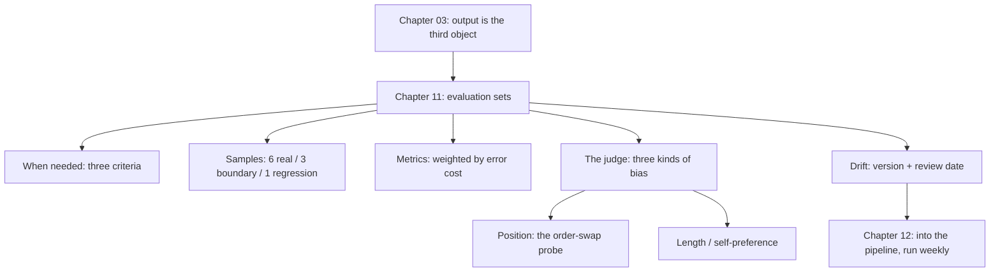

**English** | [中文](./ch11-eval-sets.zh.md)

# Chapter 11: Evaluation Sets — When AI Is a Component, Not the Author

> **Chapter Guide**: The previous seven chapters verified "code AI wrote". This chapter switches the object: **AI as a component** — is its output right? Switch the object and the whole method must switch — because output has no unique answer and cannot be enumerated. This chapter gives you a runnable minimal evaluation set, plus probes for detecting "the judge itself is biased".
> **Prerequisites**: Chapter 03 (three verification objects), Chapter 09 (metrics).
> **Core Learning Objectives**:
> - Judge when a feature must have an evaluation set and when it does not need one
> - Build a minimal 30-item evaluation set with "property assertions + weighted metrics"
> - Measure an AI-as-a-judge's position bias with the order-swap method

## 1. Cognitive Anchor: The Exam Paper and the Interviewer

### 1.1 One Question, Two Ways of Testing

You want to judge whether a person can write code.

**The exam paper**: ten fixed questions, standard answers, the same set every time. Scores are comparable, reproducible, regression-friendly. The downside is it can only test what is on the paper.

**The interviewer**: makes up questions on the spot, watches reactions, watches reasoning. Flexible, can test what the paper cannot. The downside is it is not reproducible — the same candidate, a different interviewer, and the conclusion may flip.

The evaluation set is the exam paper; AI-as-a-judge is the interviewer.

**The key difference**: exam scores can be compared horizontally and vertically; an interviewer's conclusion is only a reference. And the vast majority of teams, without an exam paper, put the interviewer on the job directly.

### 1.2 Why "Unit-Testing AI Output" Is Bound to Fail

Chapter 03 demonstrated it: an exact-match assertion against model output will inevitably false-alarm — because the wording changes.

But the more fundamental reason is **the dimensions differ**:

- A unit test asks: "given input X, does the output equal Y?" — it assumes a unique Y exists.
- The "rightness" of model output is a set of constraints holding simultaneously: the amount is right, the tone is proper, nothing undeliverable is promised, the length fits.

**Compress a multi-constraint problem into one equality judgment and information is inevitably lost.** The lost part is exactly what users complain about after release.

## 2. First Principles: When an Evaluation Set Is Needed

### 2.1 Three Criteria

Not every AI feature needs an evaluation set. It is needed if any one condition holds:

| Criterion | Explanation | Example |
|---|---|---|
| **Any of three items is variable** | Model version, prompt, retrieval index — any change shifts the output distribution | Customer-service replies, summaries, classification |
| **Errors differ in cost** | Different errors cause losses differing by an order of magnitude | Wrong refund amount (serious) vs stiff wording (minor) |
| **Human spot checks are expensive** | Output volume too large to review fully by hand | 5,000 product descriptions a day |

If none of the three holds, it is not needed. For example an internal "turn a title into a slug" tool — deterministic output, costless errors, low volume; unit tests suffice.

### 2.2 The Three Classes of Samples

A usable evaluation set is not "30 random items"; it must contain three classes:

| Class | Source | Role |
|---|---|---|
| **Real traffic samples** | Sampled from production logs | Represents the distribution. It decides "whether the score can be extrapolated" |
| **Boundary samples** | Constructed by hand | Catch the low-frequency but lethal inputs (nulls, overlong, multilingual, malicious injections) |
| **Regression samples** | The inputs of every production incident | Guarantee "the same trap is not stepped in twice" |

The empirical ratio of the three is **6 : 3 : 1**. Too few real traffic samples and the score is untrustworthy; too many boundary samples and the score is falsely low (because these cases are rare in real traffic).

**Regression samples are the only ones that keep growing** — add one per incident, and after a year this is the product's most valuable asset.

### 2.3 Metrics: Why Weight by Error Cost

"92% accuracy" carries no information unless you know **which 8% is wrong**.

The right approach is to price different errors:

```text
weighted accuracy = Σ(sample weight × correct) ÷ Σ(sample weight)
```

| Error type | Weight | Reason |
|---|---|---|
| Amount/quantity errors | 10 | Direct financial loss, and users will complain |
| Promising what cannot be delivered | 5 | Triggers second-round complaints; support cost |
| Factual errors (citing a non-existent policy) | 5 | Compliance risk |
| Stiff tone | 1 | Experience issue; acceptable |
| Format mismatch | 2 | Downstream parsing fails |

**After weighting, "92% accuracy" may become "78% weighted"**, because the wrong 8% happens to be the highest-weighted ones. This gap is what you need to watch.

### 2.4 The Three Biases of AI-as-a-Judge

Scoring models with a model is cheap and scalable, but it has three measurable biases:

| Bias | Manifestation | Probe |
|---|---|---|
| **Position bias** | Tends to pick the one listed first | Swap the A/B order and judge again; the conclusion should not change |
| **Length bias** | Tends to pick the longer, more detailed one | Construct a "short and correct" vs "long and rambling" contrast |
| **Self-preference** | Tends to pick its own (same-family model) output | Use two different models' outputs as a contrast and see whether it systematically favors itself |

**Position bias is the easiest to measure and the easiest to ignore.** The next section gives a real experiment.

The criterion: **if the flip rate exceeds 10%, this judge cannot serve as a gate alone.** It can serve as "first-pass screening", but the inconsistent samples must get human review.

### 2.5 The Evaluation Set's Own Drift

This is the most easily missed item: **evaluation sets expire.**

Three ways they expire:

1. **Samples expire**: the real traffic distribution changed (new business, new user groups), and old samples no longer represent the present.
2. **Standards expire**: business rules changed (a new refund policy), and the human-annotated "good answers" become wrong answers.
3. **Criteria expire**: the scoring script still uses old field names, everything runs red, and people start skipping it.

The countermeasure is plain: **give the evaluation set a version number and a "last human review date"; scores older than 90 days without review are untrustworthy.** Without this date you cannot distinguish "the model degraded" from "the evaluation set expired".

## 3. Hands-on: Measuring a Judge's Position Bias

### 3.1 Experiment Design

`code/ch11/eval_harness.py` uses 20 samples to simulate one judging round:

- Each sample has A/B versions of a reply, with humans annotating which is better.
- The judge has real skill (the remaining probability picks right), but 70% of the time it directly picks "the one listed first".
- Run twice: once with A first, once with B first.

```text
$ python eval_harness.py
样本数：20，位置偏好参数：70%
单次判定与人工一致：13/20 = 65%
交换顺序后结论翻转：14/20 = 70%

去偏后（两次一致才采信）：
  可判定样本：6/20 = 30%
  其中判对：6/6 = 100%
  需要人工复核：14 条
```

### 3.2 How to Read the Three Numbers

**Agreement rate 65%**: looking at this number alone, you would think "not bad, a bit better than random". Many people decide to use it based on exactly this number.

**Flip rate 70%**: change the order and 70% of the conclusions change. **This means seven tenths of its judgment comes from "position" and only three tenths from "content".** A judge with 65% agreement — if its judgments are stable — is usable; if seven tenths rely on position, its 65% is coincidence.

**This is why the flip rate must be measured before looking at the agreement rate.** Get the order wrong and a fake accuracy fools you.

**After de-biasing, 30% decidable and 100% of those correct**: filtering with "trust only when both runs agree", the remaining 6 are all correct, but only 30% of samples can be decided. **The cost of de-biasing is coverage.** The other 70% must go back to humans.

### 3.3 The Engineering Meaning of This Experiment

Three sentences:

1. **A judge cannot be a gate; only a first-pass screener.** Its consistency is insufficient and its flip rate too high.
2. **De-biasing can be done, but costs coverage.** It is only feasible when your business can bear "70% of samples going back to humans".
3. **The flip rate can be monitored continuously.** Run each evaluation forward + backward once; if the flip rate exceeds the threshold, alert — it means the judge's version changed, or the evaluation set itself has a problem.

### 3.4 Building a Minimal 30-Item Evaluation Set

If you want to build one now, do it in this order (half a day of work):

**Step one: fix 5 hard properties.** Copy them from the spec, like "must contain the order number", "the amount must match the order", "no concrete compensation promises", "length ≤ 80 characters", "must contain one executable action". These five can be judged by rules; no judge needed.

**Step two: sample 18 real traffic items.** Randomly pick the most recent from logs, covering recent business changes.

**Step three: construct 9 boundary items.** Nulls, overlong, multilingual, inputs with malicious instructions.

**Step four: add 3 regression items.** The inputs of the three most recent incidents.

**Step five: run once and compute two numbers**: the hard-property pass rate, and the weighted accuracy of 20 human spot checks.

**Step six: give the whole set a version number + review date.**

The value of this set is not precision; it is **that it is regression-friendly**. Next week when the prompt changes, run it once and you know whether it got worse — this capability is worth far more than "I think the new version is better".

## 4. Common Misconceptions, and Correct-vs-Wrong Comparisons

| Misconception to fall into | Root cause | The right practice |
|---|---|---|
| **"Scoring with a judge is enough"** | Position bias untested | Run the order swap first; consider using it only if the flip rate is <10% |
| **"92% accuracy, ship it"** | Not weighted by error cost | Compute weighted accuracy; look at which class is wrong |
| **"Build the evaluation set once and you're done"** | Samples, standards, and criteria all expire | Add version numbers and review dates; after 90 days without review mark "untrustworthy" |
| **"30 items is too few; at least 3,000"** | Chasing statistical significance while ignoring maintenance cost | 30 items covering the three classes are useful; scale should come from accumulating regression samples |
| **"Scores dropped after the model upgrade; roll back the model"** | It may be the evaluation set expiring, not the model degrading | Manually review 20 items first to confirm model regression vs expired standards |

## 5. Chapter Summary and Local Knowledge Map

### 5.1 Key Points

- **The evaluation set is the exam paper; the judge is the interviewer.** Putting a judge on without an exam paper hands quality to something non-reproducible.
- **Three criteria decide the need for an evaluation set**: model/prompt/retrieval will change, errors differ in cost, human spot checks are expensive.
- **Three sample classes at 6:3:1**: real traffic, boundary, regression. Regression samples are the only ones that keep appreciating.
- **Accuracy must be weighted by error cost**, otherwise "92%" is an information-free number.
- **Measure the flip rate first, then look at the agreement rate.** With severe position bias, agreement is coincidence.
- **Evaluation sets expire.** Without a review date you cannot tell "model degradation" from "expired standards".

### 5.2 Concept Topology of This Chapter



### 5.3 Interfaces to the Previous and Next Chapters

- **From Chapter 03**: it said the output object needs an evaluation set; here is how to build one.
- **From Chapter 10**: for features with AI components, the O axis (observability) is usually worse — you may not notice when the model degrades.
- **To Chapter 12**: the evaluation set is the one gate not suited to "run on every commit" (too slow, too expensive); it runs per day or per release.

## 6. Tiered Exercises

### Tier 1 · Intuition and Concept Checks

**1.** The exam paper vs the interviewer — which two things do they correspond to in software? Why can the judge not be put on directly when the exam paper is missing?

**2.** Of the three criteria, which is most easily ignored? What is the consequence of ignoring it?

**3.** Why is the evaluation set's sample ratio 6:3:1 rather than evenly distributed?

### Tier 2 · Deduction and Hands-on Construction

**4.** Run `eval_harness.py`, change `POSITION_BIAS` from 0.70 to 0.50, and re-run. What do the flip rate and the post-de-biasing coverage become? What does this result show?

**5.** Build a 30-item minimal evaluation set for one AI feature in your project. Write out five hard properties, sample sources, and how you plan to compute weighted accuracy.

### Tier 3 · Boundary Conditions and Cross-Chapter Transfer

**6.** Position bias can be measured with the order swap. **How do you measure length bias and self-preference?** Design one probe for each, completable within 30 samples.

**7.** Someone says "evaluation sets are for unconfident teams; we rely on user feedback". Evaluate this claim, and explain under what conditions "relying on user feedback" is equivalent to an evaluation set and under what conditions it fails.

<details>
<summary><strong>Click to expand: reference answers and in-depth analysis for this chapter's exercises</strong></summary>

#### 1. Exam paper vs interviewer

Exam paper = evaluation set; interviewer = AI-as-a-judge.

Why the judge cannot go on directly: a judge's conclusions are not reproducible. The same candidate (the same output), a different order, a different prompt, a different version — and the conclusion changes. What you need is "did this change lower quality" — that requires **a benchmark comparable across time**, which only a fixed exam paper can give.

#### 2. The most easily ignored criterion

**"Errors differ in cost"**. Because most teams look at quality through the single number "accuracy" and implicitly treat all errors as equivalent. In real business, a wrong amount and a wrong punctuation mark differ in cost by three orders of magnitude. The consequence of ignoring it: weighted accuracy is 78% while what you see is 92%, and you green-light a feature where "every error costs money".

#### 3. Why 6:3:1

Because the evaluation set's score must "extrapolate" to production. Extrapolation requires the sample distribution to approximate the production distribution, so real traffic must be the majority (60%).

Boundary samples take 30% because although low-frequency they are highly lethal — too many and the score is falsely low (these cases rarely happen in real traffic), too few and they are not caught.

Regression samples take 10% as a **starting ratio**; they grow over time. An evaluation set running for two years may have 30% regression samples — that is healthy; it means you are accumulating.

#### 4. Dropping the bias to 0.50

The flip rate drops to about 50%, and the post-de-biasing decidable samples rise to about 25% — note it actually **decreased**.

Reason: bias 0.5 means the judge is half position and half content. The two-agree scenario is "both runs took the content branch", with probability (0.5)² = 25%. While at bias 0.7, the two-agree scenario also includes "both picked the same position" — but because the order was swapped, that does not lead to agreement, so the 30% at 0.7 mainly comes from samples where **position and content happen to coincide**.

This result shows: **a low flip rate does not mean the judge is good**; you must also look at the agreement rate. The two numbers must be read together — the same principle as "a single metric does not constitute a judgment" (Chapter 09).

#### 5. Building the 30 items

The criterion for the five hard properties is "can one line of code judge it". If yes, it should not go to the judge. "Must contain the order number" is a substring check; "amount matches" is a numeric comparison; "no compensation promises" is a keyword regex. **Rule-ize what can be rule-ized first, and give the rest to the judge — this step can cut the judge's call volume in half.**

#### 6. Length-bias and self-preference probes

**Length bias**: construct 10 sample pairs; in each pair the "short" one is correct and the "long" one is rambling but correct (slightly lower quality). If the judge systematically picks the long one, there is length bias. Note you must control that "the long one really is slightly lower quality", otherwise you are measuring quality, not length.

**Self-preference**: have model X and model Y each generate 10 answers, with humans annotating comparable quality. Let X judge and see whether it systematically picks itself. If X picks X significantly more than 50% of the time, there is self-preference.

Both probes need only 10 samples; one person can finish them in half a day.

#### 7. "Relying on user feedback is enough"

**Conditions for equivalence**: large user base, smooth feedback channels, errors perceivable by users, and you can obtain structured feedback data. When all four hold, user feedback is indeed a "free, continuous real-traffic evaluation".

**Conditions for failure**:

① **Users do not report**. Most dissatisfied users just leave without commenting. What you get is "survivor feedback".
② **Users cannot report it**. The model states a policy clause in a plausible-but-wrong way; users cannot see the error, only experts can.
③ **Feedback lags**. User feedback is a lagging indicator (Chapter 09); you learn after the incident.
④ **Silent errors**. The system calls the model internally (say, generating SQL) with no user watching.

So the correct posture is not either-or: **the evaluation set manages "before the fact", user feedback manages "after the fact", and the two calibrate each other.** If the evaluation set's scores and user feedback trends diverge over the long run, the evaluation set no longer represents the real distribution.

</details>

---

**Next chapter**: all the parts are ready. The final chapter assembles them into a pipeline and closes honestly — explaining where it will be bypassed.

---

## 7. Authoritative References and Further Reading for This Chapter (Authoritative References)

1. **OWASP Top 10 for LLM Applications**: [OWASP Top 10 for LLM Applications](https://owasp.org/www-project-top-10-for-large-language-model-applications/) - the definitions and norms of this chapter are anchored here (verification date: `2026-10-23`).
2. **METR**: [METR](https://metr.org/) - the definitions and norms of this chapter are anchored here (verification date: `2026-10-23`).
3. **Long-context research (arXiv:2404.19737)**: [Long-context research (arXiv:2404.19737)](https://arxiv.org/abs/2404.19737) - the definitions and norms of this chapter are anchored here (verification date: `2026-10-23`).

> Basis note: the sources above are used to anchor **definitions and norms**, not to extrapolate risk probabilities. Before quoting any number, check the source's year and denominator first.
