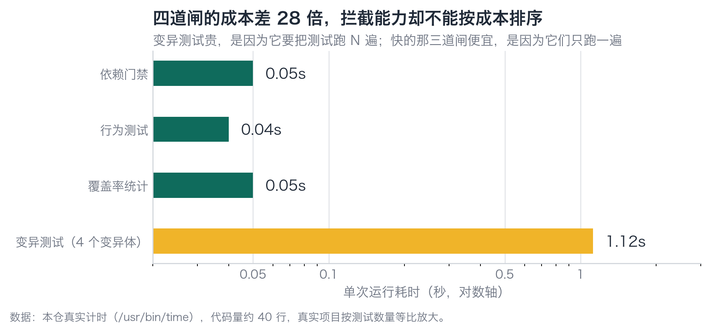
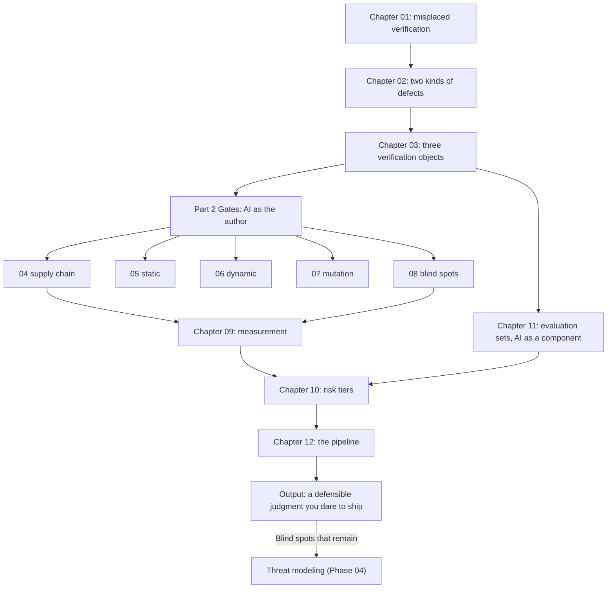

**English** | [中文](./ch12-pipeline.zh.md)

# Chapter 12: Plugging Into the Pipeline — Order, Cost, Bypass, and Cognitive Debt

> **Chapter Guide**: The final chapter assembles all the parts. You will see a seven-gate pipeline run for real, and close on a counterintuitive result: **the highest score of all metrics appears on a piece of defective code.**
> **Prerequisites**: Chapters 04–11.
> **Core Learning Objectives**:
> - Order the gates by "unit interception cost", and state why each sits where it does
> - Recognize three typical bypass paths, and compute the cost of bypassing
> - Use three signals to decide "patch or rewrite", and write this decision as a transferable criterion

## 1. Cognitive Anchor: Design the Gate Badly and People Climb the Wall

### 1.1 A Real Degeneration Process

Week one, CI takes 12 minutes. Everyone waits.

Week three, someone discovers `git push --no-verify` can skip it. The first time he felt a bit guilty; the second time it was just convenient.

Month two, the team starts saying "this CI is too slow; let's merge first and fix it later". **Later never came.**

Month three, that job still runs, but nobody looks at the results — because the traffic lights no longer relate to the real risk.

This process is not "the team doesn't follow rules"; it is **a gate design failure**. A gate's function is not "block everyone"; it is "let those who should pass pass fast, and make sure those who should not cannot pass". A badly designed gate trains people into wall-climbers.

### 1.2 Three Principles of Gate Design

1. **Feedback must be fast**: slow gates get bypassed. So the order must be by cost, cheapest first — it can tell you "don't go further this time" within 0.1 seconds.
2. **Failure must be hard**: warnings are not gates. Deny by default — that is a gate.
3. **Bypasses must leave a trace**: bypassing in emergencies is allowed, but every bypass must leave a record (who, why, when it will be made up). **A bypass with a trace is a manageable risk; a bypass without a trace is the seed of an incident.**

## 2. First Principles: Order By What

### 2.1 Unit Interception Cost

This is the book's single ordering principle: **how many kinds of defects can be blocked per millisecond.**

| Gate | Time (measured in this repo) | Main interceptions | Why this position |
|---|---|---|---|
| 1 Dependency allowlist | 0.11 s | Hallucinated packages, unapproved dependencies | Fastest, and no later gate can see this defect class; it must be first |
| 2 Static analysis | 0.09 s | Concatenated SQL, hardcoded secrets | Second fastest; pure text analysis, no execution |
| 3 Behavior tests | 0.09 s | Spec-violating behaviors | Needs a database but is fast; the first real check of "right or wrong" |
| 4 Coverage threshold | 0.43 s | Unexecuted code | 5x slower than 3 (needs instrumentation), so it comes after 3 |
| 5 Mutation testing | 1.9 s | Holes in the test suite | 20x slower (re-runs tests per mutant), placed after the tests |
| 6 Mutation score threshold | 0 | Same as above (reads the previous step's result) | Pure computation; no more test runs |
| 7 Constraint existence | 0.06 s | Structural concurrency defects | Extremely fast, but depends on 5 having run (it must import the module under test) |


*Figure 12-1: The dependency gate takes 0.05 seconds, mutation testing 1.12 seconds — a 28-fold difference. Mutation testing is expensive not because it is more important, but because it runs the tests N times.*

**Two counterintuitive points about the ordering**:

First, **the most expensive gate is not the most important gate.** Mutation testing is the most expensive, but it solves only one problem — "test quality" — and sits at number five.

Second, **the constraint check is extremely fast yet sits last.** Because it must import the module under test to ask the database "does the constraint exist", and importing depends on gate 1 passing first.

### 2.2 Early Stopping: Failing Once Is Enough

Every gate failure in the pipeline should stop it immediately. The reason is not "saving time"; it is **the order of repair**:

If you keep running tests with broken dependencies, you get a pile of failures unrelated to the dependencies, then spend half an hour reading error logs. **Early stopping keeps the error information singular** — only one thing wrong at a time, and people can locate it.

```bash
run_gate "1 依赖允许清单" "$PY" dependency_gate.py "$FILE"
if [ "$FAILED" -eq 1 ]; then
  hint "在依赖层停住——后面的闸不必跑。"
  exit 1
fi
```

### 2.3 Three Bypass Paths and Their Costs

| Bypass method | Technique | Its real cost | Countermeasure |
|---|---|---|---|
| **Skipping hooks** | `git commit --no-verify` | This commit went through no gate; nobody knows afterward | Re-run on the server side (client-side hooks are hints, not gates) |
| **Admin merge** | Bypass branch protection | One bypass record stays in the audit log, but nobody reads it | Auto-generate an issue per bypass, assigned to the one who bypassed |
| **Skipping CI** | Adding `[skip ci]` in the PR | Same as above, and it leaves an unverified commit on the main branch | Allow skipping only for documentation changes; forbid it for code changes |

What the three share: **they are not technical problems; they are process design problems.** Technically one can always bypass; the question is whether the bypass produces feedback.

The criterion: **if one bypass has no consequences, the second is guaranteed to happen.**

## 3. Hands-on: A Seven-Gate Pipeline, Two Runs

### 3.1 Run One: the Fixed Implementation

```bash
$ cd code
$ bash pipeline.sh
```

```text
门禁流水线 · 被测实现：coupon_service_fixed
  ok  1 依赖允许清单 (111ms)
  ok  2 静态检查 (92ms)
  ok  3 行为测试 (85ms)
  ok  4 覆盖率门槛 (425ms)
  ok  5 变异测试 (1879ms)
  ok  6 变异分数门槛 (3/4)
  ok  7 约束存在性 (58ms)

全部通过。
```

Seven gates, 2.7 seconds. This is so short that **there is no excuse not to run it** — this is the chapter's first actionable conclusion: **if your gates need 12 minutes, first find a way to cut them to under a minute, then discuss "whether to enforce strictly".**

### 3.2 Run Two: the Defective Implementation

```bash
$ bash pipeline.sh coupon_service.py
```

```text
门禁流水线 · 被测实现：coupon_service
  ok  1 依赖允许清单 (112ms)
  ok  2 静态检查 (91ms)
  FAIL 3 行为测试 (95ms)
      AssertionError: True is not false : 注入串不应当核销成功
      Ran 5 tests in 0.015s
      FAILED (failures=2, errors=1)
  FAIL 4 覆盖率门槛 (437ms)
      FAILED (failures=2, errors=1)
  ok  5 变异测试 (1848ms)
  ok  6 变异分数门槛 (4/4)
  FAIL 7 约束存在性 (61ms)
        失败  K1 唯一约束  ·  redemptions 表上没有唯一索引
        失败  K2 条件更新  ·  扣减语句里没有 used < quota 条件
        失败  K3 显式事务  ·  没有显式锁事务（读与写之间存在窗口）
        → 0/3 条约束成立

流水线失败：标红的那道闸拦住了这次提交。
```

### 3.3 Three Places in This Result That Demand a Stop

**First place: `ok 5 变异测试` and `ok 6 变异分数门槛 (4/4)`.**

Defective code got a perfect mutation score.

Why? Because **mutation testing tests the tests, not the code**. This behavior suite is well written; each of the four rules has assertions holding it; mutation testing says "your tests are solid" — that is true. But the code still violates the spec, and that is gate 3's business.

**This is the book's most important boundary: a high mutation score ≠ correct code.** It only says "if I break it, you will know"; it does not say "it is not broken now".

**Second place: `ok 1 依赖允许清单` and `ok 2 静态检查`.**

The dependency gate passes because what is tested here is the local-stub version (the hallucinated package was already blocked in Chapter 04). The static gate passes because it only checks shape — and this code's defects are all semantic (Chapter 05).

These two green lights are **real**; they proved what they should prove. The problem is that "what they should prove" is narrower than you think.

**Third place: `FAIL 7 约束存在性` printed three concrete failures.**

This is the only failure message in the whole run that **tells you what to fix**:

```text
失败  K1 唯一约束  ·  redemptions 表上没有唯一索引
失败  K2 条件更新  ·  扣减语句里没有 used < quota 条件
失败  K3 显式事务  ·  没有显式锁事务（读与写之间存在窗口）
```

A good gate does not just say "failed"; it says "what is missing". These three lines map directly to the fixed version's three changes (Chapter 08).

### 3.4 Conclusions From the Two Runs

| Conclusion | Basis |
|---|---|
| **No single gate can give "ready to ship"** | The fixed version is green on all seven; the defective version is also green on three |
| **The meaning of a green light depends on the question it asks** | The mutation score asks "are the tests good"; behavior tests ask "is the implementation right" |
| **The most expensive gate is not the most important gate** | Mutation testing takes 70% of the time but answers only one question |
| **Gates must stop early and keep information singular** | Only one thing wrong at a time, and people can locate it |

## 4. Common Misconceptions, and Correct-vs-Wrong Comparisons

| Misconception to fall into | Root cause | The right practice |
|---|---|---|
| **"CI is too slow; merge now and fix later"** | The gates had no cost optimization, slow enough to force bypass | Order by unit interception cost + early stopping; compress it to under a minute |
| **"Perfect mutation score; the code can ship"** | Confusing "tests good" with "code correct" (Section 3.3, first place) | Mutation scores only evaluate tests; code correctness relies on behavior tests and the spec |
| **"Our `--no-verify` is temporary"** | The bypass leaves no trace and no return plan | Generate an issue per bypass, assign it to a person, set a due date |
| **"More gates means safer"** | Diminishing marginal returns, and rising total time causes bypassing | For every gate added, first ask "is what it blocks already blocked earlier?" |
| **"This gate has never gone red; it must be useless"** | Never red may mean "genuinely fine", or "it simply cannot go red" | Periodically make "deliberately bad commits" to verify each gate can still go red |

The last row deserves expansion: **a gate that has never gone red and a broken gate look exactly the same on the dashboard.** So periodic "red-team commits" are needed — deliberately commit a known problem and see whether the gates block it. This is the engineering form of task 2 in the plan.

## 5. Book Summary and Knowledge Map

### 5.1 Cognitive Debt: the Book's Closure

Thoughtworks named "AI-generated code is faster than the team's ability to understand it" as **cognitive debt**. This book does not solve it directly, but gives a way to manage it:

| Shape of the debt | Its signal | This book's response |
|---|---|---|
| Code you do not understand | Low mutation score, skipped reviews | Replace understanding with gates (Chapters 04–08) |
| Tests you do not understand | Coverage 100% / mutation 25% | Disassemble false green lights with mutation testing (Chapter 07) |
| A system you do not understand | Rising escape rate, rising churn | Calibrate with lagging indicators (Chapter 09) |
| Risks you do not understand | Tiers inconsistent with reality | Re-rank with R×B×O (Chapter 10) |

**The core stance**: you do not need to understand every line of code, but you must understand **where your blind spots are and how big they are**. The difference between these two things is the difference between "daring to ship" and "rolling the dice".

### 5.2 Rewrite Criteria: Three Signals

Chapter 10 left one question unfinished: when to rewrite. Three criteria, all measurable within a day:

| Signal | Patch | Rewrite |
|---|---|---|
| **Mutation score** | > 70% | < 40% |
| **Coupling density** (cross-file call count on core paths) | Clear module boundaries, replaceable independently | Change one spot and everything moves |
| **Churn and duplicated blocks** | Stable | The same file changed over and over, duplicated blocks growing |

If two of the three fall in the "rewrite" column, seriously consider rewriting; if only one, patch first.

**But the value of the criteria is not the conclusion; it is transferability**: on another project, 3,000 lines becomes 300 or 30,000, but the three rulers do not change.

### 5.3 The Whole Book's Knowledge Map



### 5.4 Three Sentences to Take Away

If this book kept only three sentences:

1. **A green light is a property of the question, not a property of the code.** Swap the ruler, and the same "pass" turns into "fail".
2. **Every gate must state when it fails.** One that only writes "what it catches" is incomplete.
3. **An irreversible operation, however small, deserves one human confirmation.**

## 6. Tiered Exercises

### Tier 1 · Intuition and Concept Checks

**1.** Using the process of "the gate gets climbed over", explain why "slow CI equals no CI".

**2.** Why does mutation testing come after behavior tests rather than before? What happens if you reverse them?

**3.** In one run, the defective code got `mutation score 4/4`. Does this mean mutation testing failed?

### Tier 2 · Deduction and Hands-on Construction

**4.** Run `bash pipeline.sh coupon_service.py`, then fix only one defect (say, add only the unique constraint) and run again. Observe which gates' states changed, and explain why.

**5.** Hook a pipeline up to your project. Requirements: total time under 60 seconds, at least four gates, and every gate failure outputs "what is missing" rather than just "failed".

### Tier 3 · Boundary Conditions and Cross-Chapter Transfer

**6.** Design a "red-team commit" mechanism: periodically verify each gate can still go red. State the frequency, who does it, and what happens on failure.

**7.** The book repeats that "gates cannot catch properties nobody wrote down". Design an organizational (not technical) mechanism to gradually write those properties down. State the mechanism's failure boundary.

<details>
<summary><strong>Click to expand: reference answers and in-depth analysis for this chapter's exercises</strong></summary>

#### 1. Slow CI equals no CI

Because CI's value comes from "running on every commit". Once it is slow enough to need 12 minutes, people start doing other things in parallel, start using `--no-verify`, start "merge now, fix later". **Every bypass trains a habit**, and once that habit forms, the gate becomes decoration.

More precisely: slow CI is not an "efficiency problem"; it is a "reliability problem" — it downgrades your gates from "in effect every time" to "in effect sometimes", and gates that are "in effect sometimes" are statistically equal to none.

#### 2. Why mutation testing comes after behavior tests

Because mutation testing's premise is "there is a runnable test suite". If the behavior tests themselves are red, the mutation score is meaningless — all mutants get "killed", because they run on an already-failing suite (in practice the tool errors or kills everything).

Reversed (mutation first), what happens: you get an illusion of "all killed" and mistakenly think the tests are strong. **Wrong order, reversed conclusion.**

#### 3. Does 4/4 mean mutation testing failed

No. It answered precisely the question it should answer: "can this suite detect broken code?" The answer is yes, and thoroughly.

It did not answer "is this code correct right now" — that is not its question. **This is division of labor, not failure.**

The real problem lies with people: treating the mutation score as the spokesperson for "code quality". Chapter 09 said it: a single metric can always be misread.

#### 4. Fixing only one defect

For example only adding `UNIQUE(code, user_id)`:
- Gate 7 (constraint existence) goes from 0/3 to 1/3, still failing (K2, K3 not passed).
- Gates 3/4 (behavior tests) still fail — because S1 is still missing its "write" half; a constraint without an INSERT is hollow.
- Gates 5/6 (mutation) still 4/4.

The value of this experiment: **it shows you the dependency relations among defects**. Adding a constraint without writing is the same as not adding it. This is also why fixes must be done in groups rather than tried one by one.

#### 5. Hooking up a pipeline

The criteria: total time under 60 seconds, and each gate's output must answer "what is missing". A pipeline that fails these two points will be bypassed within three months.

#### 6. The red-team commit mechanism

**Frequency**: once a month, or once before each major release.
**Who**: rotating duty, and it **must not be the person who wrote that gate** (testing yourself is inevitably lenient).
**How**: pick a defect from historical incidents, re-inject it, and see whether the gates block it.
**What on failure**: it is not enough to fix the gate; ask "when did it start failing" — because that means it may have been leaking for the past N months.

#### 7. Writing down "properties nobody wrote down"

A technical mechanism cannot solve this, because the essence of the problem is **the distribution of knowledge**, not the absence of tools.

An organizational mechanism can be designed like this: **every incident post-mortem must produce one "what should exist" checklist item**, and that item must be written into the spec template of the next similar requirement. The effect: the checklist grows, and it is **growth bought with real losses**.

**Failure boundary**: it can only cover properties "that have already happened". For a novel failure appearing for the first time, the checklist is guaranteed to be missing something. So it cannot replace red teams and threat modeling; it can only supplement them.

It also has a hidden enemy: **post-mortems becoming formalities**. If the post-mortem meeting becomes "be careful next time", the checklist will not grow. The criterion: **has the line count of the checklist file increased**. If not, the mechanism is dead.

</details>

---

**The book ends here.**

Where next? This book handles the verification of "AI as author" and "AI as component". What it does not handle is: **who can break in without logging in** — that is threat modeling's business, and the theme of Phase 04 of the "Vibe Coding Learning Plan". Those "properties nobody wrote down" at the end of this chapter become a formal checklist there.

---

## 7. Authoritative References and Further Reading for This Chapter (Authoritative References)

1. **DORA**: [DORA](https://dora.dev/) - the definitions and norms of this chapter are anchored here (verification date: `2026-10-23`).
2. **Semantic Versioning 2.0.0**: [Semantic Versioning 2.0.0](https://semver.org/) - the definitions and norms of this chapter are anchored here (verification date: `2026-10-23`).
3. **OWASP ASVS**: [OWASP ASVS](https://www.owasp.org/www-project-application-security-verification-standard/) - the definitions and norms of this chapter are anchored here (verification date: `2026-10-23`).

> Basis note: the sources above are used to anchor **definitions and norms**, not to extrapolate risk probabilities. Before quoting any number, check the source's year and denominator first.
