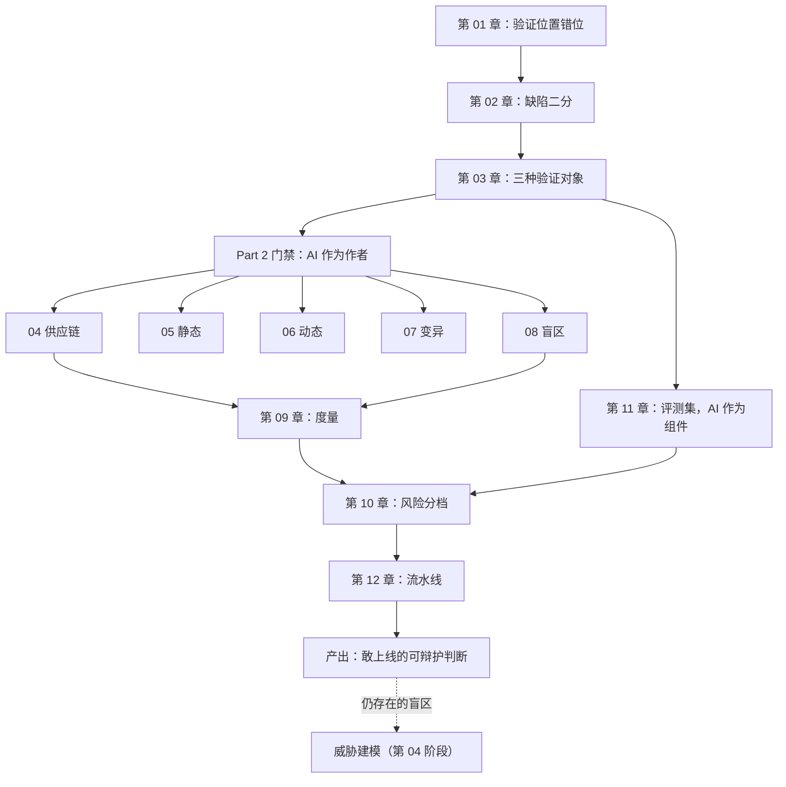

[English](./ch12-pipeline.md) | **中文**

# 第 12 章：装进流水线——顺序、成本、绕过与认知债

> **本章导读**：最后一章把所有零件装起来。你会看到一条七道闸的流水线真实跑一遍，并在一个反直觉的结果里收口：**所有指标里最高的那个，出现在一份有缺陷的代码上。**
> **前置知识**：第 04—11 章。
> **核心学习目标**：
> - 按"单位拦截成本"给门禁排序，并能说出每一道为什么在这个位置
> - 认出三条典型的绕过路径，并算出绕过的成本
> - 用三信号判断"打补丁还是重写"，并把这个判断写成可迁移的判据

## 1. 认知锚点：闸门设计得不好，人会翻墙

### 1.1 一个真实的退化过程

第一周，CI 跑 12 分钟。大家等。

第三周，有人发现 `git push --no-verify` 能跳过。第一次用的时候他有点内疚，第二次就顺手了。

第二个月，团队开始说"这个 CI 太慢，我们先合，回头补"。**回头没有来过。**

第三个月，那个 job 还在跑，但没人看结果——因为红绿灯和实际风险已经没有关系了。

这个过程不是"团队不守规矩"，是**闸门的设计失败了**。闸门的功能不是"拦住所有人"，是"让该过的人快速过，让不该过的过不去"。设计失败的闸门，会把人训练成翻墙的人。

### 1.2 闸门设计的三条原则

1. **反馈要快**：慢的闸门会被绕过。所以顺序必须按成本排，让最便宜的先跑——它能在 0.1 秒内告诉你"这次别往下走了"。
2. **失败要硬**：警告不是闸门。默认拒绝，才叫门禁。
3. **绕过要留痕**：允许在紧急情况下绕过，但每次绕过必须留下记录（谁、为什么、什么时候补）。**留痕的绕过是可管理的风险，不留痕的绕过是事故的种子。**

## 2. 第一性原理：按什么排序

### 2.1 单位拦截成本

这是全书唯一一条排序原则：**每毫秒能拦住多少种缺陷。**

| 闸 | 耗时（本仓实测） | 主要拦截 | 为什么在这个位置 |
|---|---|---|---|
| 1 依赖允许清单 | 0.11 秒 | 幻觉包、未批准依赖 | 最快，且它之后的闸全都看不见这类缺陷，必须第一 |
| 2 静态检查 | 0.09 秒 | 拼接 SQL、硬编码密钥 | 次快；纯文本分析，不需要运行 |
| 3 行为测试 | 0.09 秒 | 违反规格的行为 | 需要建库但很快；是"对不对"的第一道真实检验 |
| 4 覆盖率门槛 | 0.43 秒 | 未被执行的代码 | 比 3 慢 5 倍（要插桩），所以排在 3 后面 |
| 5 变异测试 | 1.9 秒 | 测试套件的空洞 | 慢 20 倍（每条变异体重跑一遍测试），排在测试之后 |
| 6 变异分数门槛 | 0 | 同上（读上一步的结果） | 纯计算，不再跑测试 |
| 7 约束存在性 | 0.06 秒 | 并发结构性缺陷 | 极快，但依赖 5 已经跑完（它要 import 被测模块） |


*图 12-1：依赖门禁 0.05 秒，变异测试 1.12 秒，差 28 倍。变异测试贵不是因为它更重要，是因为它要把测试跑 N 遍。*

**排序的两个反直觉之处**：

第一，**最贵的闸不是最重要的闸。** 变异测试最贵，但它只解决"测试质量"一个问题，排在第五。

第二，**约束检查极快却排在最后。** 因为它需要 import 被测模块才能问数据库"约束在不在"，而 import 依赖第 1 道闸先跑通。

### 2.2 早停：失败一次就够了

流水线的每一道闸失败，都应该立刻停。理由不是"省时间"，是**修复的顺序**：

如果你在依赖错的情况下继续跑测试，你会得到一堆和依赖无关的失败，然后花半小时看错误日志。**早停的作用是让错误信息单一**——一次只有一件事错，人才能定位。

```bash
run_gate "1 依赖允许清单" "$PY" dependency_gate.py "$FILE"
if [ "$FAILED" -eq 1 ]; then
  hint "在依赖层停住——后面的闸不必跑。"
  exit 1
fi
```

### 2.3 三条绕过路径与它们的成本

| 绕过方式 | 手法 | 它的真实成本 | 对策 |
|---|---|---|---|
| **跳过钩子** | `git commit --no-verify` | 这次提交没经过任何闸；事后无人知道 | 服务端再跑一遍（客户端钩子只是提示，不是门禁） |
| **管理员合并** | 绕过分支保护 | 一次绕过的记录留在审计日志里，但没人看 | 每次绕过自动生成一条 issue，指派给绕过者 |
| **跳过 CI** | 在 PR 里加了 `[skip ci]` | 同上，而且会在主分支上留一个未验证的提交 | 只允许在文档类改动上跳过；代码类改动禁止 |

三条的共同点：**它们不是技术问题，是流程设计问题。** 技术上永远能绕过，问题在于绕过之后有没有反馈。

判据：**如果绕过一次没有任何后果，第二次就一定会发生。**

## 3. 手把手：一条七道闸的流水线，两次运行

### 3.1 第一次：修好的实现

```bash
$ cd code
$ bash pipeline.sh
```

```text
门禁流水线 · 被测实现：coupon_service_fixed
  ok  1 依赖允许清单 (111ms)
  ok  2 静态检查 (92ms)
  ok  3 行为测试 (85ms)
  ok  4 覆盖率门槛 (425ms)
  ok  5 变异测试 (1879ms)
  ok  6 变异分数门槛 (3/4)
  ok  7 约束存在性 (58ms)

全部通过。
```

七道闸，2.7 秒。这个时间短到**没有任何理由不跑**——这是本章第一个可操作的结论：**如果你的门禁需要 12 分钟，先想办法把它砍到 1 分钟以内，再谈"要不要严格执行"。**

### 3.2 第二次：有缺陷的实现

```bash
$ bash pipeline.sh coupon_service.py
```

```text
门禁流水线 · 被测实现：coupon_service
  ok  1 依赖允许清单 (112ms)
  ok  2 静态检查 (91ms)
  FAIL 3 行为测试 (95ms)
      AssertionError: True is not false : 注入串不应当核销成功
      Ran 5 tests in 0.015s
      FAILED (failures=2, errors=1)
  FAIL 4 覆盖率门槛 (437ms)
      FAILED (failures=2, errors=1)
  ok  5 变异测试 (1848ms)
  ok  6 变异分数门槛 (4/4)
  FAIL 7 约束存在性 (61ms)
        失败  K1 唯一约束  ·  redemptions 表上没有唯一索引
        失败  K2 条件更新  ·  扣减语句里没有 used < quota 条件
        失败  K3 显式事务  ·  没有显式锁事务（读与写之间存在窗口）
        → 0/3 条约束成立

流水线失败：标红的那道闸拦住了这次提交。
```

### 3.3 这张结果里有三处必须停下来看

**第一处：`ok 5 变异测试` 和 `ok 6 变异分数门槛 (4/4)`。**

一份有缺陷的代码，变异分数拿了满分。

为什么？因为**变异测试检验的是测试，不是代码**。这套行为测试写得很好，四条规则各有断言在守；变异测试说"你的测试很扎实"——这是真的。但代码依然违反了规格，那是第 3 道闸的事。

**这是全书最重要的一条边界：变异分数高 ≠ 代码对。** 它只说"如果我改坏了，你会知道"，不说"现在没坏"。

**第二处：`ok 1 依赖允许清单` 和 `ok 2 静态检查`。**

依赖闸通过，因为这里测的是换成本地桩的版本（幻觉包在第 04 章已经拦掉了）。静态闸通过，因为它只检查形状——而这份代码的缺陷全是语义的（第 05 章）。

这两盏绿灯是**真的**，它们证明了自己该证明的事。问题在于"它们该证明的范围"比你想的窄。

**第三处：`FAIL 7 约束存在性` 输出了三行具体的失败。**

这是全流程里唯一一条**告诉你该改什么**的失败信息：

```text
失败  K1 唯一约束  ·  redemptions 表上没有唯一索引
失败  K2 条件更新  ·  扣减语句里没有 used < quota 条件
失败  K3 显式事务  ·  没有显式锁事务（读与写之间存在窗口）
```

好的门禁不只说"不通过"，它说"缺什么"。这三行直接对应修复版的三处改动（第 08 章）。

### 3.4 从这两次运行能拿走的结论

| 结论 | 依据 |
|---|---|
| **没有任何一道闸能单独给出"可以上线"** | 修好的版本七道全绿；有缺陷的版本也绿了三道 |
| **绿灯的含义取决于它问的问题** | 变异分数问"测试好不好"，行为测试问"实现对不对" |
| **最贵的闸不是最重要的闸** | 变异测试占 70% 的耗时，但只回答一个问题 |
| **门禁必须早停且信息单一** | 一次只让一件事错，人才能定位 |

## 4. 常见误区与正反例对比

| 踩坑的误区 | 根因 | 正确做法 |
|---|---|---|
| **"CI 太慢，先合了回头补"** | 闸门没有做成本优化，慢到必须绕 | 按单位拦截成本排序 + 早停；把它压到 1 分钟内 |
| **"变异分数满分，代码可以上线"** | 混淆"测试好"与"代码对"（3.3 节第一处） | 变异分数只用来评价测试；代码正确性靠行为测试与规格 |
| **"我们加了 `--no-verify` 是临时的"** | 绕过没有留痕，也没有归还计划 | 每次绕过生成一条 issue，指派到人，设到期 |
| **"门禁越多越安全"** | 边际效益递减，且总耗时上升导致被绕 | 每加一道闸，先问"它拦的东西前面有没有被拦过" |
| **"这道闸从没红过，应该没用"** | 没红可能是"真的没问题"，也可能是"它根本不会红" | 定期做"故意的坏提交"，验证每道闸还能红 |

最后一行值得展开：**一道从没红过的闸，和一道坏掉的闸，在仪表盘上长得一模一样。** 所以需要定期的"红队提交"——故意提交一个已知问题，看门禁会不会拦住。这就是规划里任务 2 的工程化形态。

## 5. 全书小结与知识图谱

### 5.1 认知债：本书的收口

Thoughtworks 把"AI 生成代码的速度超过团队理解它的速度"命名为**认知债**。这本书没有直接解决它，但给了一套管理它的方法：

| 债的形态 | 它的信号 | 本书的应对 |
|---|---|---|
| 不理解的代码 | 变异分数低、评审跳过 | 用门禁替代理解（第 04—08 章） |
| 不理解的测试 | 覆盖率 100% / 变异 25% | 用变异测试拆开假绿灯（第 07 章） |
| 不理解的系统 | 逃逸率上升、churn 上升 | 用滞后指标校准（第 09 章） |
| 不理解的风险 | 档位与现状不一致 | 用 R×B×O 重排（第 10 章） |

**核心立场**：你不需要理解每一行代码，但你必须理解**自己的盲区在哪、有多大**。这两件事的差别，就是"敢上线"和"碰运气"的差别。

### 5.2 重写判据：三个信号

第 10 章留了一个问题没答完：什么时候该重写。判据三个，都可以在一天内测出来：

| 信号 | 打补丁 | 重写 |
|---|---|---|
| **变异分数** | > 70% | < 40% |
| **耦合密度**（核心路径的跨文件调用数） | 模块边界清楚，能单独替换 | 改一处动全身 |
| **churn 与重复块** | 稳定 | 同一文件反复改，重复块在增长 |

三个里有两个落在"重写"列，就该认真考虑重写；只有一个，先打补丁。

**但判据的价值不在结论，在可迁移**：换一个项目，3000 行会变成 300 行或 30000 行，但三把尺子不变。

### 5.3 全书知识图谱



### 5.4 三条可以带走的话

如果这本书只留三句话：

1. **绿灯是关于问题的属性，不是关于代码的属性。** 换一把尺子，同一个"通过"会变成"不通过"。
2. **每一道闸都必须写明它什么时候失效。** 只写"能抓什么"的，等于没写完。
3. **不可逆的操作，无论多小，都值得一次人工确认。**

## 6. 分级通关练习

### Tier 1 · 直觉与概念核验

**1.** 用"闸门被人翻墙"的过程，解释为什么"慢的 CI 等于没有 CI"。

**2.** 为什么变异测试排在行为测试之后，而不是之前？如果反过来会发生什么？

**3.** 在一次运行里，有缺陷的代码拿到了 `变异分数 4/4`。这说明变异测试失效了吗？

### Tier 2 · 推演与实操构建

**4.** 跑 `bash pipeline.sh coupon_service.py`，然后只修一个缺陷（比如只加唯一约束），再跑一次。观察哪几道闸的状态变了，解释为什么。

**5.** 给你的项目接一条流水线。要求：总耗时 < 60 秒，含至少四道闸，且每道闸失败时输出"缺什么"而不是只说"失败"。

### Tier 3 · 边界条件与跨章迁移

**6.** 设计一个"红队提交"机制：定期验证每道闸还能红。要求说明频率、由谁做、失败了怎么办。

**7.** 全书反复说"门禁抓不到没人写下的性质"。请设计一个组织机制（不是技术机制），用来把"没人写下的性质"逐步写下来。说明这个机制的失效边界。

<details>
<summary><strong>点击展开：本章练习参考答案与深度解析</strong></summary>

#### 1. 慢 CI 等于没有 CI

因为 CI 的价值来自"每次提交都跑"。一旦它慢到需要 12 分钟，人就会开始并行做别的事、开始用 `--no-verify`、开始"先合了回头补"。**每一次绕过都在训练一种习惯**，而这个习惯一旦形成，闸门就变成了装饰。

更准确地说：慢 CI 不是"效率问题"，是"可靠性问题"——它把你的门禁从"每次都生效"降级成"有时生效"，而"有时生效"的门禁在统计上等于没有。

#### 2. 变异测试为什么排在行为测试之后

因为变异测试的前提是"有一套能跑的测试"。如果行为测试本身是红的，变异测试跑出来的分数没有意义——所有变异体都会"被杀死"，因为它们运行在一个已经失败的测试套件上（实际上工具会报错或全杀）。

反过来（变异在前）会发生什么：你会得到一堆"全杀死"的假象，然后误以为测试很强。**顺序错了，结论会反向。**

#### 3. 4/4 说明变异测试失效了吗

没有。它精确地回答了它该回答的问题："这套测试能发现代码被改坏吗？"答案是能，而且很彻底。

它没有回答"这份代码现在对不对"——那不是它的问题。**这是分工，不是失效。**

真正的问题在于人：把变异分数当成"代码质量"的代言人。第 09 章说过，单一指标永远可以被误读。

#### 4. 只修一个缺陷

比如只加 `UNIQUE(code, user_id)`：
- 第 07 道闸（约束存在性）从 0/3 变成 1/3，仍然失败（K2、K3 没过）。
- 第 03/04 道闸（行为测试）仍然失败——因为 S1 还差"写入"这一半，光有约束没有 INSERT 也是空的。
- 第 05/06 道闸（变异）仍然 4/4。

这个实验的价值：**它让你看到缺陷之间的依赖关系**。约束加了但没写，等于没加。这也是为什么修复要成组做，而不是一条一条试。

#### 5. 接一条流水线

判据：总耗时 60 秒以内，且每道闸的输出要能回答"缺什么"。做不到这两点的流水线，会在三个月内被绕过。

#### 6. 红队提交机制

**频率**：每月一次，或每次大版本前一次。
**谁做**：轮值，且**不能是写这道闸的人**（自己测自己必然宽松）。
**怎么做**：从历史事故里挑一个缺陷，重新注入，看门禁是否拦住。
**失败了怎么办**：不是修这道闸就完了，要问"它是什么时候开始失效的"——因为这意味着过去 N 个月它可能一直在漏。

#### 7. 把"没人写下的性质"写下来

技术机制解决不了这个，因为问题的本质是**知识的分布**，不是工具的缺失。

组织机制可以这样设计：**每次事故复盘，必须产出一条"应该有什么"的清单项**，并且这一项必须被写进下一次同类需求的规格模板里。这样做的效果是：清单在增长，而且是**用真实损失换来的增长**。

**失效边界**：它只能覆盖"已经发生过"的性质。第一次出现的新失效，清单一定是漏的。所以它不能替代红队和威胁建模，只能作为它们的补充。

另外它有一个隐蔽的敌人：**复盘流于形式**。如果复盘会变成"下次注意"，清单就不会长。判据是：**清单文件的行数有没有增加**。没增加，说明机制已经死了。

</details>

---

**全书完。**

下一步去哪里？这本书处理的是"AI 作为作者"和"AI 作为组件"的验证。它没有处理的是：**谁能在不登录的情况下打进来**——那是威胁建模的事，也是《Vibe Coding 学习规划》阶段 4 的主题。这一章末尾那些"没人写下的性质"，在那里会变成一份正式的清单。

---

## 7. 本章权威参考信源与延伸阅读 (Authoritative References)

1. **DORA**：[DORA](https://dora.dev/) - 本章的定义与规范以此为锚（核验日期：`2026-10-23`）。
2. **Semantic Versioning 2.0.0**：[Semantic Versioning 2.0.0](https://semver.org/) - 本章的定义与规范以此为锚（核验日期：`2026-10-23`）。
3. **OWASP ASVS**：[OWASP ASVS](https://www.owasp.org/www-project-application-security-verification-standard/) - 本章的定义与规范以此为锚（核验日期：`2026-10-23`）。

> 口径提示：以上信源用于锚定**定义与规范**，不用于外推风险概率。引用任何数字前，先核对来源年份与分母。
