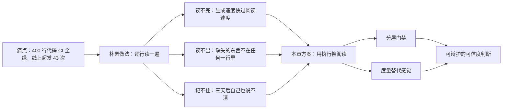
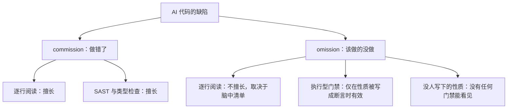
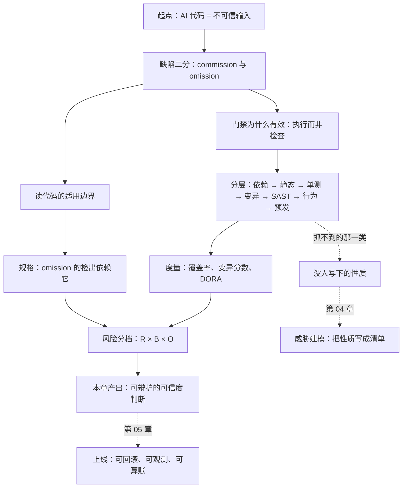

# 第 03 章：把 AI 代码当不可信输入

> ⚠️ **本文件是草稿，不属于本书的正式章节结构。**
> 它把 12 章的骨架压缩成了一章（2.4 万字），写在分章大纲确定之前。开写正式章节时，其中的案例、代码、图表会按新章号拆分到 ch01（事故解剖）、ch02（缺陷类型学）、ch06（动态检查）、ch07（变异测试）、ch08（盲区）。
> 保留它是为了留住已经验证过的可运行素材，不要当成品引用。
> 正文结构见上一级 `README.md`。

> **本章导读**：这一章在整本书里的坐标是「从会写规格，到敢让代码上线」。学完本章，你能在不逐行读完所有代码的前提下，对一个 AI 生成的功能给出**可辩护**的可信度判断——判断依据来自门禁与度量，而不是"我觉得没问题"。
>
> **前置知识**：第 02 章（规格驱动开发）。本章的案例直接消费上一章的产出——那四句规格。如果你还没写过一份让 AI 一次到位的规格，先回去，否则你会看不懂为什么测试要那样写。
>
> **核心学习目标**：
> - 理解「读代码」这条防线为什么会在 AI 时代系统性失效，而不是"读得不够仔细"
> - 掌握门禁分层的顺序与各层的失效边界，能说清"这一层抓不到什么"
> - 能够独立完成一次变异测试，并解释覆盖率与变异分数的差
> - 能够给一个 AI 生成的功能定出风险档位，并说清判据

**本章的判断框架从谁的眼睛看**

- **John Ousterhout**（《A Philosophy of Software Design》）——判断"这段代码该不该留在我的系统里"，靠的是复杂度增量，不是风格偏好。
- **Vladimir Khorikov**（《Unit Testing》）——判断"这个测试值不值得存在"，靠四根支柱，其中"抗重构"最能判死刑。
- **Michael Nygard**（《Release It!》）——判断"它上线后会不会把整个系统拖死"，靠稳定性反模式，不靠压测数字好看。
- **Simon Willison**（vibe engineering, 2025-10）——把"谁为这行代码负责"变成可讨论的判据，而不是态度问题。
- **数据侧**：Veracode（安全通过率）、GitClear（可维护性）、USENIX Security 2025（幻觉包名）、DORA（交付系统指标）。

本章不打算给你一份工具清单。工具会换，判断不会。

---

## 1. 认知锚点：为什么"读一遍"这个动作救不了你

### 1.1 一个真实的痛点场景

周五 16:40。你把「优惠券核销」这个需求丢给编码智能体，四千字的需求，它回了 400 行实现和一套测试。CI 全绿，覆盖率 100%，你扫了一眼核心函数，逻辑通顺，合了。

周一 09:20，运营在群里发截图：限量 100 张的券，核销记录 143 条。

你打开代码，从头读到尾。每一行都看起来是对的：先查库存，判断够不够，够就扣减，返回凭证。没有一行写错了。你甚至会让同事再看一遍，他也说没问题。

**问题不在你读得不够仔细。问题在于你用来判断的工具，和缺陷所在的位置，不在同一层。**

那 43 次超发，来自两个请求在 8 毫秒内同时读到了"库存还剩 1"。代码里没有任何一行是错的——错的是**两行之间什么都没有**。

这类东西，眼睛看不见。不是视力问题，是器官问题。

### 1.2 直觉类比：AI 代码是陌生人递来的包裹

你在海关工作。每天十万个包裹过境。

你不会因为"寄件人看起来挺专业"就整批放行——那是事故的起点。你也不会拆开每一个包裹逐件检查——那是成本的终点。你真正干的事是：**分层检查 + 抽检 + 风险分级**。X 光机看形状，化学检测看成分，禁运清单看名单，开箱抽检看实物，出了事再溯源。

把 AI 生成的代码放进这个框架，零件能一一对应：

| 安检环节 | 代码里的对应物 | 它保证什么 | 它保证不了什么 |
|---|---|---|---|
| 寄件人申报 | 模型自己说"这段代码实现了…" | 一段自然语言描述 | 描述与实现是否一致 |
| X 光机 | 编译器 / 类型检查 / linter | 形状正确：语法、类型、明显死代码 | 逻辑对不对、安不安全 |
| 化学检测 | SAST / 依赖扫描 / 密钥扫描 | 已知危险品的特征匹配 | 没被写进规则库的新形态 |
| 禁运清单 | 依赖允许清单 | 外来物在名单内 | 名单内的东西本身是否可信 |
| 开箱抽检 | 人工代码评审 | 抽到的那部分 | 没抽到的部分 |
| 事故溯源 | 变异测试 / 结构分析 | 哪条规则其实没人守 | 没人写下来的规则 |

**类比的边界（这一段比类比本身重要）**：包裹是静态的，检查一次就通关；代码是活的，同一份代码在不同输入、不同并发、不同数据量下行为不同。所以这个类比只能借"分层"，不能借"一次通关"。任何声称"过了这道门就安全了"的说法，在这个领域都是错的。



### 1.3 为什么"读不完"是结构性的，不是勤奋问题

三个数字放在一起看就明白了。

- **生成侧**：Anthropic 2026-08 公布，截至 2026 年 5 月，合并进其代码库的代码 **80% 以上由 Claude 撰写**，2026 Q2 工程师人均日合并代码量是 2024 年的 **8 倍**。
- **审查侧**：人的阅读速度没有变，一天能认真读完并理解的代码量仍然是几百行量级。
- **后果侧**：Thoughtworks 第 34 期技术雷达把年度主题定为**认知债**——"AI 生成代码的速度超过了团队理解它的速度"。

把这三条连起来：**如果验证方式仍然是"人逐行读"，那么验证能力会随生成能力线性落后。** 这不是靠更努力能追上的差距，是结构性的。

所以本章要做的事，不是教你读得更快，而是**换一种验证方式**：把"我读过"换成"它经过了什么"。

---

## 2. 第一性原理：缺陷有两种，读代码只擅长其中一种

### 2.1 把缺陷拆成 commission 与 omission

这个区分是本章的全部地基。只看两个词：

- **commission（做错了）**：写了不该写的东西。拼接 SQL、边界条件写成 `>`、把密钥硬编码、用了会抛异常的 API。
- **omission（该做的没做）**：少写了该有的东西。没加锁、没参数化、没鉴权、没幂等、没超时、没限流、没做输入校验。

两者的可见性完全不对称：

| | commission | omission |
|---|---|---|
| 在代码里的形态 | 有东西，且那东西看着可疑 | **什么都没有** |
| 读代码时的认知动作 | "这一行对不对？" | "这里是不是少了什么？" |
| 读代码的检出能力 | 高（有经验的读者能看出八成的错） | **低，且与读者脑中的清单完整度成正比** |
| 自动化工具的检出能力 | SAST、类型检查、变异测试 | 只有"性质被写成断言"时才行 |
| 生产事故里的占比 | 少见 | **常见** |

第二列是关键。找 commission 的时候，你的眼睛有个靶子；找 omission 的时候，靶子是**你脑子里的那份"应该有什么"清单**。

那份清单是什么？就是第 02 章写的规格。

于是得到一个不太舒服的推论：

> **读代码的有效性 = 你脑中规格清单的完整度。清单不全，代码再短也读不出缺失。**

这就是为什么"我逐行读过了"在生产环境里不等于"我验证过了"。你验证的是你想得到的东西。



右下角那个节点（O3）是本章最后要回收的伏笔。先记住它。

### 2.2 门禁为什么能补上这个洞

门禁的本质不是"检查代码"，是**执行代码**。

- 阅读验证的是"你想到的东西"。
- 执行验证的是"实际发生了什么"——包括你没想到的那部分，**前提是它会在执行中留下痕迹**。

没加锁 → 交错执行时数值对不上（有痕迹）。
没参数化 → 注入串改变了查询结构（有痕迹）。
没鉴权 → 未登录请求拿到了数据（有痕迹）。
没幂等 → 同一个请求体执行两次，状态变了两次（有痕迹）。

所以门禁不是"更聪明的阅读"，是**把缺失变成可观测的差异**。这是一次换轨：从"检查代码长什么样"换到"观察系统做什么"。

### 2.3 实测图景与它的口径边界

先把最重要的一个数字摆正。

Veracode《2026 GenAI Code Security Report》（2026-07-28，累计 100+ 模型、四轮快照）给出的结论是：**平均安全通过率 56%，与上一年 55% 基本持平；约 44% 的生成任务引入了 OWASP Top 10 类漏洞；同期语法通过率接近 100%。**


*图 3-1：同一批生成结果，编译器通过 100%，安全扫描通过 56%。注意第三列不是 0%，是"没有可信数据"——报告自己承认：叠加工具链与人工复核之后的效果，目前没有可信测量。这个空白比任何数字都重要。*

现在必须做一件大多数引述都会跳过的事：**把这个 56% 的三个限定条件逐个拆开**。

| 限定条件 | 报告的原意 | 对你的项目意味着什么 |
|---|---|---|
| 原始模型 | 直接问模型要代码，不走 agent、不加规则文件 | 你在用 agent + 项目规则 + 规格驱动，条件已经变了 |
| 无安全提示 | 没有要求它"注意 SQL 注入"这类指令 | 你的 harness 里有前馈控制，条件又变了一次 |
| 无 agent、无人工复核 | 生成即结果，中间没有测试、没有评审 | 你的反馈控制会拦掉一部分，但**拦掉多少，没有数据** |

所以两句话都要说：

- **不能**说"56% 意味着我有一半概率上线失败"——那是把生成失败率当成上线失败率，中间隔了三道你没算进去的工序。
- **也不能**说"我用了 agent 和门禁，所以我更安全"——这句话没有数据支持。Veracode 明确指出这是研究的缺口。

那 56% 还有什么用？**它的作用是校准预期，不是预测你的项目。** 它告诉你两件确定的事：第一，语法层面的绿灯几乎不携带安全信息（100% vs 56%，差 44 个百分点）；第二，一年过去这个数字几乎没动（55% → 56%），所以"等模型变强就好了"不是策略。

同一份报告的分项数字里还有一组更值得注意的东西：不同语言、不同漏洞类别的表现差别极大——按语言，Python 63% 与 Java 30%；按漏洞类别，SQL 注入 83%、密码学误用 87%，而 XSS 15%、日志注入 12%。

这组数字的**方向**在这里不重要（究竟是通过率还是检出率，以原报告图表为准），重要的是**幅度**：同一个模型、同一批提示，换一门语言差 33 个百分点，换一类漏洞差 70 个百分点。它直接杀死一个常见的问法：

> "AI 写的代码安全吗？"——这个问题没有答案。
> 有答案的问法是："用这个模型、这门语言、这类漏洞、这条流水线，我的失败面有多大？"

### 2.4 四类系统性失效，与各自最便宜的那道闸

把失效模式分门别类，是为了让门禁有的放矢。这四类不是"模型的毛病"，是**机制决定的**：

| 失效类型 | 机制 | 典型形态 | 最便宜的门禁 | 为什么这道闸最便宜 |
|---|---|---|---|---|
| **幻觉依赖** | 模型在补全"这里大概需要一个库"时，生成一个语法合理、语义合理的包名 | `from fastapi_jwt_auth_kit import sign_token` | 依赖允许清单（AST 扫 import） | 0 依赖、0 网络、毫秒级，且**在 import 阶段就会炸** |
| **模式化复制** | 训练语料里"拼接 SQL"的样本密度远高于"参数化查询"的讲解 | f-string 拼 SQL、`eval`、手写加密 | SAST + 行为测试 | 模式匹配擅长抓特征；行为测试擅长抓后果 |
| **缺失安全属性** | 没人要求它写的东西，它不会主动写 | 没锁、没幂等、没超时、没限流 | 只有"性质写成断言"才有效 | 这是 omission，静态工具天然看不见 |
| **上下文坍缩** | 长会话里早期指令的权重衰减 | 后半段代码开始违反前半段定下的规则 | 短会话 + 规格分片 + 每轮重述约束 | 靠流程，不靠工具 |

第二行值得多看一眼：**模式化复制的根因是语料密度，不是模型笨**。GitHub 上"能跑的拼接 SQL"比"参数化查询的正确讲法"多几个数量级，模型学到的就是这个分布。这解释了一个反直觉现象——模型在解释"为什么不能用字符串拼 SQL"时说得头头是道，转头写代码还是拼。**知识和行为在模型里是两套权重。**

### 2.5 幻觉依赖为什么值得单独一道闸


*图 3-2：约 19.7% 的推荐包名在注册表里不存在；开源模型 21.7%，商用模型 5.2%。更关键的是 43% 的假名会稳定复现——同一个提示词问十次，八次给你同一个不存在的包名。*

"可复现"这三个字把它从"模型的小毛病"变成了"攻击面"：

1. 你知道某个提示词会稳定产出包名 `foo-bar-sdk`；
2. 注册表上这个名字还没人占；
3. 你注册它，发布一个功能完全正常但带后门的包；
4. 下一个用同样提示词的人，`pip install` 装上了你的包。

这叫 **slopsquatting**（幻觉包名抢注）。它的可怕之处在于：**后面所有的门禁都看不见它**。代码能跑、测试全绿、SAST 无告警——因为它跑的就是攻击者写的那个包。

所以这一类只有一道闸有效，而且必须在最前面：**每个第三方 import 都得在人工维护的允许清单里**。清单不许智能体自己往里加。这不是流程洁癖，这是这条攻击链上唯一的断点。

---

## 3. 手把手：一份"全绿"的代码如何被逐层拆开

下面这一节全部可复现。代码在 `code/ch03/`，每一步的真实输出都贴在正文里。

### 3.1 案例设定

沿用第 02 章的写法，先把规格压成四句话。**这四句话是本章所有测试的来源**——注意这一点，后面会用到。

| 编号 | 规格（一句话） | 它约束的是 |
|---|---|---|
| S1 | 每个用户对同一张券只能核销一次 | 业务规则 |
| S2 | 总核销次数不超过库存 | 业务规则 |
| S3 | 券码是用户输入，不是代码 | 信任边界 |
| S4 | 成功时返回一枚核销凭证 | 接口契约 |

场景设成：库存 2 张，用户 u1、u2、u3 依次来核销。

把这段规格交给编码智能体，它给出的实现（`code/ch03/coupon_service.as_generated.py`，一字未改）：

```python
import sqlite3

from fastapi_jwt_auth_kit import sign_token  # 幻觉依赖：PyPI 上不存在这个包


def init_db(conn):
    conn.execute(
        "CREATE TABLE IF NOT EXISTS coupons (code TEXT PRIMARY KEY, quota INTEGER, used INTEGER)"
    )
    conn.execute("CREATE TABLE IF NOT EXISTS redemptions (code TEXT, user_id TEXT)")
    conn.commit()


def redeem(conn, code, user_id):
    cur = conn.cursor()
    row = cur.execute(f"SELECT quota, used FROM coupons WHERE code = '{code}'").fetchone()
    if row is None:
        return {"ok": False, "reason": "not_found"}
    quota, used = row
    if used >= quota:
        return {"ok": False, "reason": "exhausted"}
    cur.execute(f"UPDATE coupons SET used = {used + 1} WHERE code = '{code}'")
    conn.commit()
    return {"ok": True, "token": sign_token(user_id, code)}
```

先别看代码。先回答一个问题：**这段实现违反了 S1—S4 中的哪几条？**

答案是**全部四条**。而且其中三条是 omission——代码里根本没有对应的东西：

| 违反 | 类型 | 代码里长什么样 |
|---|---|---|
| S1 一用户一次 | omission | `redemptions` 表建了，但**从来没人往里写**。表是空壳 |
| S2 不超库存 | omission | 读和写之间没有原子性保证，并发下会超发 |
| S3 券码是数据 | commission | f-string 拼接，券码被当成 SQL 语法 |
| S4 返回凭证 | commission（弱） | 依赖一个不存在的包，凭证根本签发不出来 |

注意第一行：`init_db` 里建了 `redemptions` 表，看起来像是"考虑过"这件事。这是 AI 代码最迷惑人的地方——**它会把结构留在那里，把逻辑留在外面**。你扫一眼看到表名，会以为需求被实现了。

为了往下跑门禁，把幻觉依赖换成本地桩（`coupon_service.py`）。这是第一次人工介入，注意它的性质：**你只修了那个会让程序崩掉的错误，剩下四处缺陷一个都没动，而且它们一个都不会报错。**

### 3.2 第 0 层：依赖核验，先跑，因为它最便宜

```bash
$ python dependency_gate.py coupon_service.as_generated.py
文件                                   行  模块                            判定
--------------------------------------------------------------------------------------
coupon_service.as_generated.py      10  sqlite3                       stdlib
coupon_service.as_generated.py      12  fastapi_jwt_auth_kit          未登记
--------------------------------------------------------------------------------------
GATE FAILED：存在未登记依赖。先人工确认它在真实注册表里存在、且是你要的那个包，
再由人写进 allowed_deps.txt —— 不要让智能体自己往清单里加。
```

门禁的全部逻辑只有一条：AST 扫出所有 import，凡是不在标准库、也不在人工维护的 `allowed_deps.txt` 里的，一律失败。

这里有一个顺序问题值得说清楚：**门禁按"单位拦截成本"排序，不按"重要性"排序**。依赖核验是一个不到百行的脚本、整个进程跑完 0.09 秒、不需要数据库不需要网络，它就该排第一。等你在 CI 里跑完十分钟的集成测试再被一个拼错的包名拦住，那十分钟已经花掉了。

### 3.3 第 1 层：静态检查抓到了什么，没抓到什么

把 import 换成桩之后，类型检查、linter、编译全部通过。这不是意外，是必然：

**编译器和 linter 检查的是形状，不是意图。** 它们能告诉你"这个变量可能为 None"，不能告诉你"这里应该加一把锁"。除去已经修掉的 import，剩下三处缺陷里，静态检查抓到 **0 个**。

这不是工具的失败，是分工问题。你要在心里给每一层写下"它保证什么 / 它保证不了什么"，第 3.9 节会给你这张表。

### 3.4 第 2 层：AI 写的测试，覆盖率 100%

AI 顺手给了两个测试（`test_coupon_ai.py`）。跑一遍：

```bash
$ python -m coverage run --include=coupon_service.py -m unittest test_coupon_ai -q
Ran 2 tests in 0.004s
OK

$ python -m coverage report -m
Name                Stmts   Miss  Cover   Missing
-------------------------------------------------
coupon_service.py      18      0   100%
-------------------------------------------------
TOTAL                  18      0   100%
```

100%。四条分支全跑到了：成功、成功、库存耗尽、券码不存在。

现在做一个动作：**不要看覆盖率，去看断言**。

```python
def test_all_paths_do_not_crash(self):
    """四条分支全跑一遍 —— 这一条就是覆盖率 100% 的来源。"""
    conn = _fresh()
    self.assertIsNotNone(redeem(conn, "WELCOME", "u1"))  # ok
    self.assertIsNotNone(redeem(conn, "WELCOME", "u2"))  # ok（第二张）
    self.assertIsNotNone(redeem(conn, "WELCOME", "u3"))  # exhausted
    self.assertIsNotNone(redeem(conn, "NOPE", "u1"))     # not_found
```

`assertIsNotNone`。四个分支，四条断言，每条只证明"函数有返回值"。

按 Khorikov 的四根支柱（防回归、抗重构、快速反馈、可维护）逐条过一遍：防回归？一个把库存扣成负数、把用户核销十次的实现，照样返回 dict，照样过。抗重构？它连"实现了什么"都没碰，谈不上抗。快速反馈？快。可维护？看不出错。

**这根绿柱子的全部信息量是：代码跑完了，没抛异常。** 而它在 CI 面板上和一根真正的绿灯长得一模一样。这是本章最贵的一课：**覆盖率度量的是"哪些行被执行过"，不度量"哪些规则被守住"**。

### 3.5 第 3 层：变异测试——把绿灯拆开看

变异测试的做法反过来了：**不改测试，改代码**。故意往实现里注入一个小错误，看测试会不会变红。

- 变红 → 这个变异体被"杀死"，说明有断言守住了这条规则。
- 还是绿 → 变异体"存活"，说明这条规则**没有任何断言在守**。

跑 `mutation_demo.py`，同一份实现、同一批变异体、只换测试套件：

```text
变异体 说明                                          A · AI 生成     B · 规格重写
----------------------------------------------------------------------------
M1  边界翻转：used >= quota 变成 used > quota          存活（漏）         杀死（抓到）
M2  算术错误：used + 1 变成 used + 0                   存活（漏）         杀死（抓到）
M3  判定反转：没找到券码却走进 not_found                     杀死（抓到）        杀死（抓到）
M4  返回值退化：token 变成 None                         存活（漏）         杀死（抓到）
----------------------------------------------------------------------------
变异分数                                            1/4 = 25%     4/4 = 100%
```

四个变异体，AI 的测试只杀掉了 1 个。逐个看为什么：

- **M1（`>=` 改 `>`）活下来**：因为测试从没在"库存刚好用完"的边界上断言过结果。它跑了那条分支，但只检查了"有返回值"。
- **M2（`+1` 改 `+0`）活下来**：核销了但库存不减少。测试没检查库存值，只检查了返回值非空。
- **M4（token 变 None）：这是最值得停下来看的一个。** 测试里写着 `self.assertIn("token", result)`——token 键存在，值为 `None`，断言通过。**断言的存在不等于断言的强度。**
- **M3 被杀死**：因为 happy path 那条断言是 `assertTrue(result["ok"])`，判定反转之后第一条就红了。

现在看图 3-3，它把这件事压缩成一张图：


*图 3-3：两套测试的行覆盖率完全一样（都是 100%），变异分数是 25% 对 100%。同一份实现，同一批变异体，唯一的差别是断言写的是"实现动作"还是"业务规则"。*

这个对比有一个副作用值得记住：**变异测试是目前少数能用自动化手段给"测试质量"打分的东西**，而它的成本只有跑一遍测试的 N 倍（N = 变异体数量）。四个变异体两秒钟跑完。在 CI 里这属于免费。

### 3.6 第 4 层：行为测试——把规格的每一句话变成一条断言

重写测试（`test_coupon_behavior.py`），规则只有一条：**断言的对象必须是规格里的句子，不是函数内部的动作**。

先拿它跑 AI 的原实现：

```text
$ python -m unittest test_coupon_behavior
Ran 5 tests in 0.057s

FAILED (failures=2, errors=1)
```

三条红。逐条对应：

| 测试 | 对应规格 | 原实现的表现 |
|---|---|---|
| `test_01_same_user_can_only_redeem_once` | S1 | 同一用户第二次核销返回 `ok: True` → 断言失败 |
| `test_03_code_with_quote_is_handled_as_data` | S3 | 券码 `A'B` 让 SQL 语法错误，抛 `OperationalError` |
| `test_04_injection_string_cannot_redeem` | S3 | 注入串 `X' OR '1'='1` 核销成功 → 断言失败 |
| `test_02_quota_is_not_exceeded` | S2 | **通过**（单线程下边界判断是对的） |
| `test_05_token_is_a_usable_string` | S4 | **通过**（桩函数返回了字符串） |

注意 `test_02` 通过了。这是个好消息也是一个警告：**行为测试也有它测不到的东西**。S2 在单线程下确实成立，缺陷藏在并发里。下一节处理它。

### 3.7 第 5 层：并发交错——所有门禁都抓不到的那一类

跑 `race_repro.py`：

```text
库存：quota=1, used=0

步   请求    动作                                              手里看到的 used
------------------------------------------------------------------------------
1   A     SELECT quota, used                              0
2   B     SELECT quota, used                              0
3   A     UPDATE used = 1                                 0
4   B     UPDATE used = 1                                 0
------------------------------------------------------------------------------
最终 used = 1；成功核销 2 次，库存 1 张 → 超发 1 张

注意：每一步单独看都是对的。错的是「两步之间没有锁」。
这类缺陷不在任何一行代码里，所以读代码时眼睛会自动跳过它。
```

这个脚本不调 `redeem()`，而是把它内部的 SQL 按两种交错顺序手工执行一遍。为什么这么做？因为**用线程去碰运气复现竞态，会得到一个时灵时不灵的测试，而时灵时不灵的测试等于没有测试**。确定性复现看到的不是事故现场，是事故的可能性——对一个缺陷来说，这两者信息量相同。

现在回到那个问题：**为什么没有任何一道门禁抓到它？**

- 依赖核验：和依赖无关。
- 静态检查：每一行都合法。
- 单元测试：单线程下行为正确。
- 变异测试：它变异的是代码，不是并发调度器。**变异测试不是并发检查器。**
- 行为测试：除非你专门写一个并发用例，而它会 flaky。

根因是一句话：**没有人在任何地方写下"这个操作必须是原子的"。**

这就是 2.1 节右下角那个节点——O3，没人写下的性质。门禁只能验证被写成断言的东西。没写下来的，它看不见；没被想到的，也没法被写下来。

对这类东西，真正的解法不是"加一道门禁"，是**把约束下沉到不可能违反的层**：数据库的 `UNIQUE` 约束、条件更新语句、事务隔离级别。应用层的"我会小心的"不算防御。

### 3.8 修复与复验：改的几乎全是"没写的"

`coupon_service_fixed.py` 的四处改动，注意它们的性质：

| 缺陷 | 改法 | 性质 |
|---|---|---|
| 幻觉依赖 | 换成本地桩（3.1 节已做） | 人工介入（删掉一个不存在的东西） |
| S1 一用户一次 | `UNIQUE(code, user_id)` + 插入 | **补上没写的** |
| S2 并发超发 | `BEGIN IMMEDIATE` + `WHERE used < quota` 条件更新 + `rowcount` 校验 | **补上没写的** |
| S3 SQL 注入 | 参数化查询 `?` | 改掉写错的 |

四处里三处是"补"，一处是"改"。这个比例不是巧合，它对应 2.1 节那张表：AI 代码的主要风险是 omission。

复验：

```bash
$ COUPON_IMPL=coupon_service_fixed python -m unittest test_coupon_behavior -v
...
Ran 5 tests in 0.001s
OK
```

五条全绿，而这次绿灯的含义和 3.4 节那根绿灯完全不同：它意味着**四条规格各有一条断言在守**，而且这批断言刚刚在变异测试里杀死了 4/4 个变异体。

### 3.9 这一轮真正的产出：一张对照表

注意，这一节的产出不是"代码修好了"。代码总会再坏。产出是这张表——它告诉你**每一层保证什么、不保证什么**，下次遇到新代码，你照着表走一遍就知道自己站在哪里。

| 门禁层 | 抓到 | 漏掉 | 失效边界（什么时候它等于没跑） |
|---|---|---|---|
| 依赖允许清单 | 幻觉包名、未经批准的依赖 | 清单内依赖自身的后门 | 清单被智能体自动追加；或用 `pip install` 的隐式依赖绕过 |
| 编译 / 类型检查 | 形状错误、类型错配 | 一切逻辑与安全问题 | 动态语言里类型标注不全时，等同于只查语法 |
| Linter | 可疑模式、未使用变量 | 语义错误 | 规则集不覆盖你的框架时 |
| 单元测试 | 你写下断言的规则 | 你没写的规则、并发、集成 | 断言强度低时（覆盖率 100%、变异分数 25%） |
| 变异测试 | 测试套件的空洞 | 测试与规格之间的偏差（测错了方向） | 变异算子覆盖不到你的代码形态时 |
| SAST / SCA / 密钥扫描 | 已知漏洞模式、已知 CVE、硬编码密钥 | 业务逻辑漏洞、新形态 | 规则库更新滞后；误报率高到被人关掉 |
| 行为测试 | 规格中的每条可观测规则 | 未被观测的性质（原子性、性能、资源） | 规格本身写错了 |
| 人工评审 | 架构级问题、可读性、设计债 | 大规模代码下的遗漏、并发 | 单次评审超过几百行时，检出率断崖下跌 |
| 预发布环境 | 集成问题、配置错误 | 数据规模相关问题、真实流量形态 | 预发数据与生产差一个数量级时 |

表里最右一列是全章最该背下来的东西。**一道门禁的价值不在于它抓到了什么，而在于你知道它什么时候不工作。**

### 3.10 把它变成一条可执行的判定规则：风险分档

到这里你手上有一堆门禁，但每天的真实问题是："**这一个**功能，要不要人看？"

给三个轴打分，每轴 0—2 分，加起来定档。这三个轴不是拍脑袋来的，它们分别对应事故的三个维度：能不能退回去、坏了影响多大、坏了你多快能知道。

| 轴 | 0 分 | 1 分 | 2 分 |
|---|---|---|---|
| **可逆性** R | 一次回滚就恢复 | 需要数据修复脚本 | 不可逆（已发券、已扣款、已发消息） |
| **影响半径** B | 单用户、单条数据 | 单租户 / 单功能 | 全站 / 全租户 / 对外可见 |
| **可观测性** O | 有指标 + 告警 + 日志 | 只有日志 | 出事后只能靠用户投诉知道 |

| 总分 | 档位 | 走什么流程 |
|---|---|---|
| 0—1 | 自动放行 | 门禁全绿即合，合并后看指标 |
| 2—3 | 轻量评审 | 任一同事看 diff 的**接口与数据变更部分**，不看实现细节 |
| 4—5 | 人工评审 | 指定评审人逐条对照规格；必须有一次失败路径的手工验证 |
| 6 | 高级别评审 | 设计评审 + 灰度 + 可回滚演练 + 明确的责任人签字 |

拿本章的案例打分：核销不可逆（R=2）、影响全站库存（B=2）、超发只能靠运营发现（O=2），**6 分，最高档**。而它的代码只有 400 行——**代码量不是风险，可逆性是**。

反过来，一个"生成商品详情页文案"的功能：可逆（0）、单条数据（1）、有日志（1），2 分，轻量评审。你不该在这上面花和核销一样的时间。**风险分档的全部意义，是把注意力从"平均分配"改成"按爆炸半径分配"。**

---

## 4. 常见误区与正反例对比

| 容易踩坑的误区 | 为什么会出错 | 正确的心智模型与做法 |
|---|---|---|
| **"测试全绿就等于对"** | 覆盖率度量"哪些行被执行"，不度量"哪些规则被守住"。AI 写的测试常常只断言"有返回值" | 看变异分数，不看覆盖率。门禁的验收标准是"它杀死过变异体"，不是"它跑过" |
| **"我逐行读过了"** | 读代码擅长找 commission，不擅长找 omission。缺失的东西不在任何一行里 | 把规格写成断言，让执行去验证缺失。阅读的位置从"第一道防线"退到"最后一道防线" |
| **"56% 说明我有一半概率出事"** | 把"原始模型、无提示、无复核"的生成失败率当成上线失败率，中间隔了三道工序 | 引用时必须带上三个限定条件。这个数字的用途是校准预期，不是预测你的项目 |
| **"上了 SAST 就安全了"** | SAST 是模式匹配，抓已知形态。业务逻辑漏洞、并发、越权它基本无能为力 | 分层。每一层写清"它抓什么、漏什么、什么时候等于没跑"（见 3.9 的表） |
| **"覆盖率 80% 是我们的质量红线"** | 覆盖率是可以刷的：多写无断言的 smoke test 就能到 100%，而变异分数可以是 25% | 用变异分数做红线，覆盖率只做下限兜底。两者同时看，差值就是"假绿灯"的面积 |
| **"依赖不存在只是个小问题"** | 43% 的幻觉包名可稳定复现，意味着可被抢注；装上之后所有门禁都看不见 | 依赖允许清单前置，人工维护，智能体无权追加。这是供应链攻击链上唯一的断点 |
| **"代码是人写的还是 AI 写的，决定要不要审"** | 缺陷不关心作者是谁。人类写的拼接 SQL 一样会出事 | 按**风险档位**决定审不审，不按作者决定。作者信息只影响"我该多疑一点"的直觉，不构成判据 |
| **"这个模块 AI 写的，我重写一遍更放心"** | 重写会让你失去已经验证过的行为，且新代码同样需要一轮验证 | 先判断"能不能靠门禁守住"。守得住就留，守不住再重写，并把重写理由写下来（第 05 章会用这条判据） |

---

## 5. 本章小结与局部知识图谱

### 5.1 核心要点

- **缺陷有两种，读代码只擅长一种。** commission 有靶子，omission 的靶子是你脑中的规格清单。清单不全，代码再短也读不出来。
- **门禁的本质是执行，不是检查。** 执行会把缺失变成可观测的差异——前提是那条性质被写成了断言。
- **覆盖率会骗人，变异分数不会。** 同一个 100% 覆盖率，可以是 25% 的变异分数。差的那 75% 就是"假绿灯"的面积。
- **56% 不是上线失败率。** 它有三个限定条件，用途是校准预期。任何去掉限定条件的引用都是误用。
- **幻觉依赖要单独一道闸，且必须排在最前。** 因为它之后的每一道门禁都看不见它——代码跑的就是攻击者那个包。
- **有一类缺陷所有门禁都抓不到：没人写下来的性质。** 对它们，解法是把约束下沉到不可能违反的层（数据库约束、条件更新），而不是"小心一点"。
- **风险分档按可逆性 × 影响半径 × 可观测性，不按代码量，也不按作者。** 400 行可以是最高档，4000 行可以是自动放行。

### 5.2 本章概念拓扑



### 5.3 与前后章的接口

- **向后看（第 02 章）**：本章所有测试都从规格长出来。没有规格，行为测试写不出来，变异测试也没有判据——你只能说"代码变了"，不能说"规则破了"。
- **向前看（第 04 章）**：O3 那一类（没人写下的性质）在下一章变成一项专门工作，叫威胁建模。它的产出物就是一份"应该有什么"的清单——正好补上 2.1 节里那个"脑中清单"的缺口。
- **向前看（第 05 章）**：本章的风险分档会在上线环节变成发布策略（灰度比例、回滚阈值、告警等级）。

---

## 6. 分级通关练习

### Tier 1 · 直觉与概念核验

**1.** 下面四个缺陷，哪些属于 omission、哪些属于 commission？分别指出"读代码"能不能发现，并说明理由。
　(a) `token = None` 　(b) 没有设置请求超时 　(c) `used > quota` 　(d) 没有对 `user_id` 做鉴权

**2.** 团队把覆盖率红线从 70% 提到 90%，三个月后线上事故没有减少。用本章的概念解释为什么，并给出一个能真正降低事故率的替代指标。

**3.** 有人说："Veracode 说 56% 不安全，我们用了 Claude Code 加门禁，肯定比这个好。"这句话哪里错了？请给出两句都成立的说法。

### Tier 2 · 推演与实操构建

**4.** 给本章的 `coupon_service.py` 再加一个变异体，要求：**AI 测试能杀死它，但行为测试杀不死**。写出变异点、解释为什么会出现这种反向结果，并说明这说明了两套测试各自的什么特征。

**5.** 用 `mutation_demo.py` 的框架，把 `coupon_service_fixed.py` 作为被测对象，重新跑一遍四个变异体。预测结果，然后运行验证。如果某个变异体在修复版上"存活"了，说明什么？

### Tier 3 · 边界条件与跨章迁移

**6.** 3.7 节的并发缺陷，所有门禁都没抓到。请设计一个**能抓到它**的检查，要求：不引入 flaky（时灵时不灵），且能在 CI 里跑。写清它的原理与它自身的失效边界。

**7.** 你接手一个项目，其中 `billing/` 目录下 3,000 行代码全部由 AI 生成，测试覆盖率 92%，CI 全绿，线上跑了两个月没出事。老板问你"要不要重写"。请用本章的框架给出判断，并写出你的**判据**（不是结论）——要求别人拿你的判据去另一个项目也能用。

<details>
<summary><strong>点击展开：本章练习参考答案与深度解析</strong></summary>

#### 1. 缺陷分类与可检出性

- **(a) `token = None`**：commission。有东西，且那东西是错的。读代码能发现（如果你知道 token 该是什么），变异测试也能发现（只要断言检查了值的类型）。注意：`assertIn("token", result)` 发现不了，因为键还在。
- **(b) 没设超时**：omission。代码里什么都没有。读代码能不能发现，取决于你脑中是否有"所有外部调用必须有超时"这条清单——有经验的人会有，新手不会有。这道题的关键不是答案，是"依赖读者经验"这件事本身就是缺陷。
- **(c) `used > quota`**：commission。边界条件写错。读代码能发现（需要停下来算一次边界），变异测试能发现（如果测试覆盖了"刚好用完"这个状态）。
- **(d) 没做鉴权**：omission。这是 omission 里最危险的一类，因为它的症状是"一切正常"——功能跑得通，只是任何人都能用。读代码几乎不可能发现（你不知道"应该有什么"），只有专门的越权测试能抓。

**这一题的结论**：omission 占了三题的多数，而唯一能稳定检出 omission 的手段是"把性质写成断言"。

#### 2. 覆盖率红线的失效

覆盖率度量的是**执行过哪些行**，它和**守住了哪些规则**之间没有单调关系。把红线从 70% 提到 90%，最省力的达线方式是补一批 `assertIsNotNone` —— 行数上去了，断言强度没变。

替代指标：**变异分数**。它直接问"如果这条规则被破坏，测试会不会红"。建议的组合是：覆盖率当下限（防止死代码），变异分数当红线（防止假绿灯）。两个数字的差值就是"假绿灯面积"，这个差值本身可以用来向老板解释为什么提覆盖率没用。

#### 3. 引用 56% 的正确说法

错在两点：第一，把"原始模型、无安全提示、无 agent 与人工复核"条件下的生成失败率，当成了自己的项目失败率；第二，"肯定比这个好"是一句没有数据支持的话——Veracode 自己指出，叠加工具链与复核之后的效果目前没有可信测量。

两句都成立的说法：

1. "56% 是裸模型的生成失败率，不是上线失败率。它告诉我语法绿灯不携带安全信息，但它不能预测我的项目。"
2. "我的流水线里有前馈与反馈控制，理论上应该更好；但'更好多少'没有可信数据，所以我用自己项目的门禁拦截次数和变异分数来度量，不引用别人的数字。"

#### 4. 构造一个"AI 测试杀得死、行为测试杀不死"的变异体

**结论：能构造，但只有一种形态——变异不改变行为，只改变实现形态。**

先排除三类直觉构造，它们全都不成立：

| 构造 | AI 测试 | 行为测试 | 为什么不行 |
|---|---|---|---|
| 改返回键名 `"ok"` → `"success"` | 杀死 | 杀死 | 两套测试都访问 `result["ok"]`，一起 `KeyError` |
| 改 `reason` 取值 `"exhausted"` → `"quota_exceeded"` | 存活 | 存活 | 两套都不检查 `reason` 的具体取值 |
| 交换 `sign_token` 参数顺序 | 存活 | 存活 | 两套都不检查 token 的内容 |

结论很清楚：**只要变异改变了可观测行为，行为测试会先死**——因为它对接口契约的覆盖是 AI 测试的超集。

真正能给出反向结果的，是**不改变行为的变异**：

```python
# 原实现
cur.execute(f"UPDATE coupons SET used = {used + 1} WHERE code = '{code}'")

# 变异体：把一条语句拆成两条，第二条是空操作
cur.execute("UPDATE coupons SET used = used + 1 WHERE code = ?", (code,))
cur.execute("UPDATE coupons SET used = used WHERE code = ?", (code,))
```

- 一个用 mock 断言"`execute` 只被调用一次"的 AI 测试 → 变红（**杀死**）
- 行为测试 → 完全无感（**存活**）

它精确说明了 Khorikov 四根支柱里"抗重构"那一条：**测实现动作的测试会被无害的重构杀死，测系统状态的测试不会。** 所以反向结果的本质不是"AI 测试更强"，而是"它测错了对象"——它守护的是代码的写法，不是代码的承诺。

#### 5. 对修复版再跑变异

真实结果（`python mutation_demo.py coupon_service_fixed.py`）：

```text
变异体 说明                                          A · AI 生成     B · 规格重写
----------------------------------------------------------------------------
M1  边界翻转：used >= quota 变成 used > quota          存活（漏）         存活（漏）
M2  算术错误：used + 1 变成 used + 0                   存活（漏）         杀死（抓到）
M3  判定反转：没找到券码却走进 not_found                     杀死（抓到）        杀死（抓到）
M4  返回值退化：token 变成 None                         存活（漏）         杀死（抓到）
----------------------------------------------------------------------------
变异分数                                            1/4 = 25%     3/4 = 75%
```

行为测试从 4/4 掉到 3/4。**这不是修复版变差了，恰恰是它变强了的证据。**

M1 为什么活下来：修复版里 `if used >= quota` 已经**不是唯一的防线**了——真正的闸是 `UPDATE ... WHERE used < quota` 加 `rowcount` 校验。把 `>=` 改成 `>` 之后，条件更新照样拦下超发，行为完全一致，没有任何测试能杀死它。

这叫**等价变异体**（equivalent mutant）：变异在语义上与原代码等价，"错误"根本没有后果。它是变异测试的已知噪声源，比例通常在 5%—15%。处理方式是人工标记，**不要为了杀死它去改代码**——那会把一个测试的质量指标，变成代码的负担。

反过来看，一个存活却能被你解释清楚的变异体，是有价值的信息：它告诉你**这套防御是双层的**，拆掉一层还有一层。而一个存活且你解释不清的变异体，才是真正的洞。

#### 6. 抓并发缺陷且不 flaky 的检查

三个可选方案，按成本排序：

**(1) 约束级检查（推荐）**：不测并发，测"约束是否存在"。用 SQLite 的 `PRAGMA index_list` / Postgres 的 `information_schema` 断言 `redemptions` 上有 `UNIQUE(code, user_id)`，断言扣减语句里有 `WHERE used < quota`。原理：**把"原子性"这个不可观测的性质，转译成"结构上不可能违反"的可观测事实**。失效边界：只对"能用数据库约束表达"的性质有效；业务层的多步事务仍然测不到。

**(2) 确定性交错测试**：像 `race_repro.py` 那样，把被测函数的 SQL 拆成步骤，用手工编排的交错顺序执行。原理：把调度器换成你自己。失效边界：它测的是"这段 SQL 序列允许这个交错"，不是"这个函数在真实并发下会这样"——中间隔着一次"实现是否真的按这个顺序发 SQL"的假设。

**(3) 压力 + 不变式断言**：跑 N 个线程，每个线程结束后断言"总成功次数 ≤ quota"。原理：用不变式替代精确时序，天然不 flaky（不变式在任何调度下都必须成立）。失效边界：需要 N 足够大才可能撞上窗口，本质是概率性的——如果 N 小，它可能漏；如果 N 大，CI 变慢。它比"断言具体结果"稳，但仍然不是确定性的。

三者组合才是工程答案：**(1) 当门禁，(3) 当监控**。

#### 7. "要不要重写"的判据

先拒绝回答"要不要重写"，因为那是个结论，不是判据。判据要能迁移。

**第一步：这不是"AI 写的"问题，是"可辩护性"问题。** 3,000 行、92% 覆盖率、两个月无事故——这三个数字里，只有第二个是可核验的，而它恰好是最不可靠的那个（见练习 2）。所以第一个动作是：**跑变异测试**，把 92% 拆成"真绿灯"和"假绿灯"。

**第二步：按 R×B×O 分档。** `billing/` 目录大概率 R=2（已扣款不可逆）、B=2（全站资金）、O=1（有日志）。**5 分，人工评审档。** 这个档位的意思是：不需要重写，但需要一次逐条对照规格的评审，且必须有一次失败路径的手工验证。

**第三步：用三个信号决定"打补丁"还是"重写"**——这三个信号都可以在一天内测出来：

| 信号 | 打补丁 | 重写 |
|---|---|---|
| 变异分数 | > 70% | < 40% |
| 核心路径的跨文件调用密度 | 模块边界清楚，能单独替换 | 到处是隐式耦合，改一处动全身 |
| 最近 30 天的 churn 与重复块 | 稳定 | 同一个文件被反复改，重复块在增加（GitClear 的"错误掩盖结构"信号） |

**第四步：把判据写下来，并给出你已经用它做过决定的记录。** 这一步是本章和下一章的分界线：判据不写下来，三个月后你自己也说不清当时为什么这么决定——那笔债就从技术债变成了认知债。

**为什么这道题的答案是"判据"而不是"重写/不重写"**：因为换一个项目，3,000 行会变成 300 行或 30,000 行，92% 会变成 60% 或 99%，但"变异分数 + 耦合密度 + churn"这三把尺子不变。**能迁移的才是判据，不能迁移的只是这一次的意见。**

</details>

---

## 附：本章代码清单

| 文件 | 作用 | 怎么跑 |
|---|---|---|
| `code/ch03/coupon_service.as_generated.py` | AI 原样输出（含幻觉依赖） | 只用于依赖门禁演示，import 会失败 |
| `code/ch03/coupon_service.py` | 同上，换成本地桩后可运行 | 被下面所有脚本引用 |
| `code/ch03/dependency_gate.py` | 依赖允许清单门禁 | `python dependency_gate.py coupon_service.as_generated.py` |
| `code/ch03/allowed_deps.txt` | 人工维护的允许清单 | 本章为空（只用标准库） |
| `code/ch03/test_coupon_ai.py` | AI 生成的测试（覆盖率 100%） | `python -m unittest test_coupon_ai` |
| `code/ch03/test_coupon_behavior.py` | 按规格重写的测试 | `python -m unittest test_coupon_behavior` |
| `code/ch03/mutation_demo.py` | 变异测试对比实验 | `python mutation_demo.py`<br>`python mutation_demo.py coupon_service_fixed.py` |
| `code/ch03/race_repro.py` | 并发交错的确定性复现 | `python race_repro.py` |
| `code/ch03/coupon_service_fixed.py` | 修复版（三处补、一处改） | `COUPON_IMPL=coupon_service_fixed python -m unittest test_coupon_behavior` |
| `code/ch03/make_figures.py` | 生成本章三张图 | `python make_figures.py`（需 matplotlib） |
