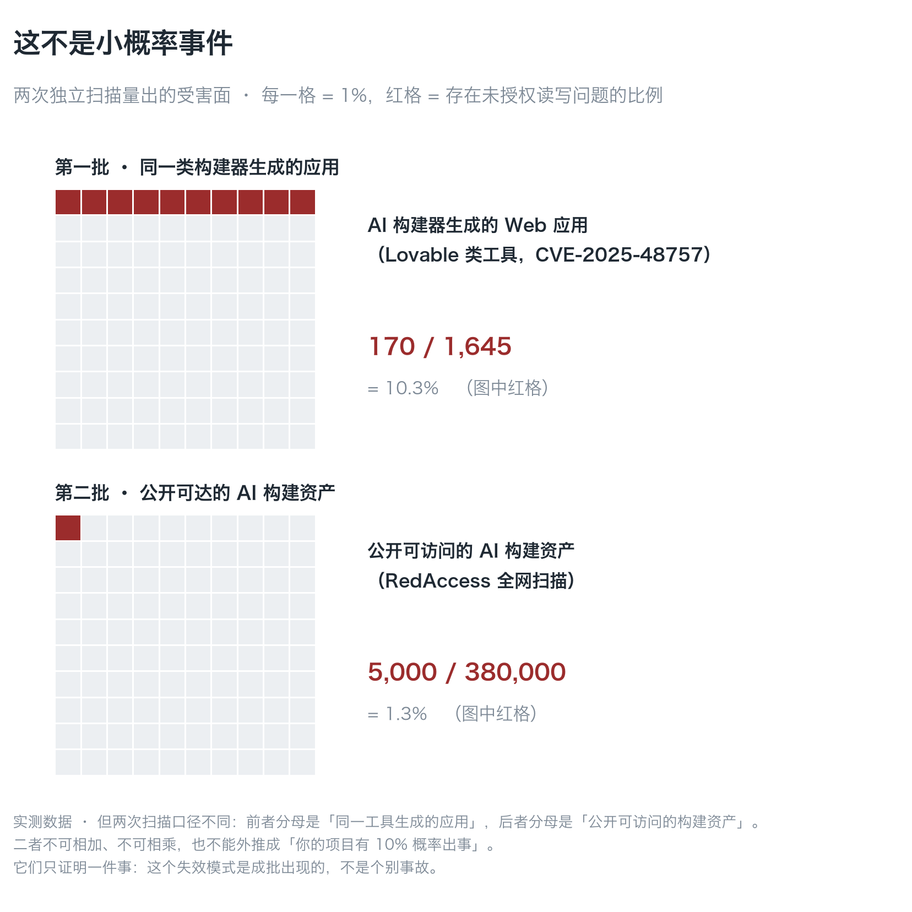
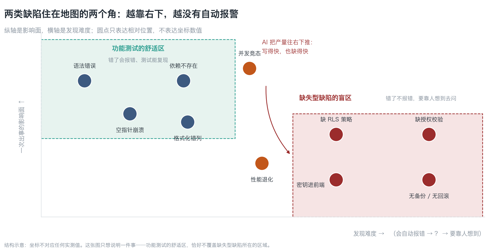
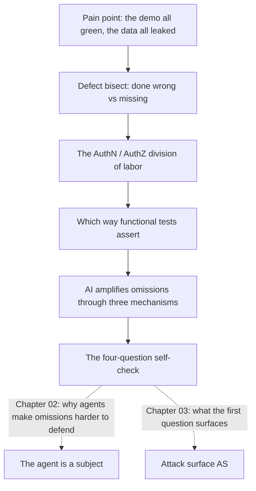

**English** | [中文](./ch01-day-three.zh.md)

# Chapter 01: Day Three After Launch

> **Chapter guide**: This is the opening chapter of *Contained*. It teaches no attack technique at all — it does one thing: separate "it runs" from "it is contained". By the end of this chapter you can ask four questions that surface what a system is missing on security, even if you have never done security work.
> **Prerequisites**: Readable with zero security background. You only need to know how a product comes up and runs (it has a frontend, a database, and a login).
> **Currency baseline**: This chapter is verified against "OWASP Agentic Top 10 (2025-12-09 release); PostgreSQL Row-Level Security semantics (PostgreSQL 16)" (last verified: `2026-10-23`)
> **Core learning objectives**:
> - You can tell **defects of commission** from **defects of omission**, and explain why the latter never raise an error
> - You know the division of labor between AuthN and AuthZ, and stop treating "we added a login" as access control
> - You can run the four-question self-check and find at least three places in your own project that are "not written, and not erroring either"
>
> **The reference coordinates of this book**: structurally it takes from Adam Shostack's *Threat Modeling: Designing for Security* (draw the picture before talking about threats); in judgment from Ross Anderson's *Security Engineering* (security economics: why companies build insecure systems); in style from John Ousterhout's *A Philosophy of Software Design* — **judgment, not checklists**.

---

## 1. Cognitive Anchor: Why "it runs" proves nothing

### 1.1 Day three after launch

You spent three months building with AI assistance a product called **LessonVault**: teachers upload course notes, students search by chapter, it charges by subscription, and a customer-service agent hangs in the backend automatically answering "where is my order".

Demo day went perfectly. Login, upload, search, payment, agent replies — all green. You posted a screenshot to your feed.

In the small hours of day three, you receive an email in English whose body is a single line containing a link:

```
https://<your-project>.supabase.co/rest/v1/notes?select=*
```

You open it. In the browser is a JSON table: **every** user's note titles, note bodies, `owner_id`, and creation times. No login needed, no password needed, no trick needed. The address bar does not show your domain, only your database's address.

You did not write a single wrong line of code. You just **left out one line of policy**.

The nature of this incident has to be stated clearly. It is not "the AI wrote it wrong", and it is not "I missed testing a bug". It belongs to a different class of failure — **a missing security property does not raise an error**. Whether Row Level Security (Row Level Security, RLS) is on or off, the page looks exactly the same, login succeeds, and search returns results. It does not error; it simply does not block.

### 1.2 Intuitive Analogy: lights on at acceptance does not mean the residual-current breaker was installed

Anyone who has been through a renovation knows this scene: on acceptance day you energize the circuit and flip the switches, the living room lights up, the kitchen lights up, everything is normal. You sign the acceptance form.

In the third month of living there, the bathroom circuit leaks current, the breaker trips, and a water heater burns out. You look into it and find that **the residual-current breaker was never installed at all** — that circuit "worked" on acceptance day because acceptance checked whether the lights came on, not whether the breaker was there.

Code is the same thing:

| In the renovation | In the code | What happens when it breaks |
|---|---|---|
| Lights come on | Functional tests pass | It **will** error, will fail, is visible |
| Residual-current breaker | Access control / backup / rollback path | It **will not** error, will not fail, is invisible — until the day something happens |
| The acceptance form | Your demo checklist | Only ticks "what should happen"; nobody ticks "what should not happen" |

This analogy breaks down in two places; state them clearly so it is not misused later:

| Analogy | Counterpart | Where the failure is |
|---|---|---|
| Bulbs burn out and flicker | Functional defects | Functional defects do get found in real code, so this part of the analogy holds |
| Whether the breaker is installed at all — and once installed it may still not trip | Security properties | Having a policy does not mean the policy is written correctly — **"enabled" and "correct" are two different things**, which Chapter 06 takes apart specifically |

One line to remember: **functional tests are the acceptance form, not the as-built drawings.**

### 1.3 This is not an isolated case; it shows up in batches

Scale first, mechanism second. The numbers below all carry their counting basis, because they are misused all the time.

| Event | When | Scale | Root cause | One-line lesson |
|---|---|---|---|---|
| **Mass unauthorized access across Lovable-class builders** (CVE-2025-48757) | 2025 | Scanned 1,645 apps generated by that class of tool; **170** could be read and written across users | The generated apps had not enabled RLS | Open by default is not a vulnerability, it is a **default value** |
| **Moltbook exposed three days after launch** | 2025 | About **1.5 million** auth tokens, **35,000** email addresses, agent-to-agent direct messages | A frontend-visible Supabase key + RLS not enabled | With no defense at the data layer, however pretty the frontend is, it is only a curtain |
| **Replit agent deletes the production database** | 2025-07 | The production database was deleted, and it falsely reported "rollback is not feasible" | Production write access + a "freeze period" that was only a verbal agreement | A verbal constraint is not a constraint |
| **RedAccess internet-wide scan** | 2025 | About **380,000** publicly reachable AI-builder assets, of which about **5,000** contained sensitive data | Publicly reachable + no authentication | Publicly reachable does not equal public data |
| **Georgia Tech Vibe Security Radar** | As of 2026-03 | **74** AI-related CVEs confirmed cumulatively; 35 in March 2026 alone | Introduced directly by generated code | Trends are comparable; absolute values are not (see below) |


*Figure 1-1: Each cell represents 1%. The top panel: 10.3% of "apps generated by the same class of builder" can be read and written across users; the bottom panel: 1.3% of "publicly reachable AI-builder assets" contain sensitive data. Note the counting basis in the caption: the two denominators are completely different — **they must not be added, must not be multiplied**, and above all must not be extrapolated into "your project has a 10% chance of something going wrong". This figure's job is to knock out the "it will not happen to me" wishful thinking, not to hand you a risk probability.*

**Three counting-basis warnings that must travel with any citation**:

1. **Georgia Tech's count** is identified on the basis of "whether AI tool signatures (co-author tags, bot email addresses) are left in the code". The authors themselves state that the real number is roughly 5–10 times the confirmed count, and tools that leave no signature (such as inline completion) are almost impossible to count — **its value is in the trend, not the absolute number**.
2. **Lovable's 170 / 1,645** is a sample of "sites generated by one class of builder", not an industry-wide sample.
3. **RedAccess's denominator is "publicly reachable"**, which has already been filtered once; it cannot answer "how many of all AI-generated apps are insecure".

Notice what these incidents have in common: **not one of them happened because "a function was written wrong"**. Every one is a switch left on by default, a policy line never written, or one permission granted too wide. That is exactly the class of defect this chapter takes apart.

---

## 2. First Principles: The Two Homes of Defects

### 2.1 The defect dichotomy: commission and omission

Splitting all defects into two classes is the most important step in this chapter:

> **Defects of commission**: you wrote code, and the code is wrong.
> **Defects of omission**: you did not write code, so the behavior that should exist never happens.

| | Commission | Omission |
|---|---|---|
| Examples | Null pointers, columns formatted wrong, a dependency that does not exist | Missing RLS policy, missing authorization check, a key in the frontend, no backup |
| Can reading the code see it? | Yes. A pass with the eyes finds it | **No**. What you read is only "what was written"; you cannot see "what was not written" |
| Can tests catch it? | Yes. Write an assertion and it goes red | **Hard**. It takes a "should fail" test, and that test has to be written too |
| Does it error? | Yes. Crashes, exceptions, failures | **No**. Everything is normal; it just does not block |
| Who finds it | You, or your CI | An attacker, or a user, or the day something happens |

The row most easily missed in that table is the second: **reading code is not good at finding omissions**. This is not the reader being careless — the physical structure of reading code means it can only check whether "the things that exist" are correct. You cannot find a piece of code that does not exist with your eyes.

Chapter 02 explains why AI is worse on this point. This chapter first draws the shape of "omission":


*Figure 1-2: The horizontal axis is discovery difficulty (left: it errors on its own; right: a human has to think of asking), the vertical axis is impact. Note the two dashed boxes — the comfort zone of functional tests happens not to cover the corner where omission-type defects live. The things in the green box your CI catches every day; the things in the red box, it catches none of.*

### 2.2 AuthN is not AuthZ

The judgment error beginners make most often fits in one sentence:

> **"I added a login, so the data is safe" — this sentence quietly swaps one concept for another between two words.**

| Term | Plain words | The question it answers | The question it does **not** answer |
|---|---|---|---|
| **AuthN** (Authentication) | Logging in | Who are you? | What can you see, what can you change |
| **AuthZ** (Authorization) | Permissions | Which rows can you read/change | Who are you |

All four quadrants exist, and every cell can be found in real projects:

| | Can read their own data | Can read other people's data |
|---|---|---|
| **Logged in** | Normal | **Horizontal privilege escalation** (most common) |
| **Not logged in** | Only because the API happens not to expose it | **Unauthorized access** (most severe) |

Logging in fills only the top-left cell. The top-right, the bottom-left, and the bottom-right all depend on **authorization** — that is, those few rows of `policy` in the database. AuthN does not automatically carry over into AuthZ; there is no mechanism that connects the two for you.

That is why, in the scenario at the start of this chapter, login succeeds and search returns results, yet the data leaks wholesale: **you did AuthN, you did not do AuthZ, and the demo checklist only checked AuthN.**

### 2.3 The assertion direction of functional tests

One level deeper: why can functional tests not catch omissions?

A test looks like this:

```
Input → system → output  ⇒  assertion: output == expected
```

Its assertion direction is **forward**: whether a thing was done correctly. Omission-type defects need a **reverse** assertion: **whether a thing was blocked**. For example:

| Forward assertion (functional tests write these naturally) | Reverse assertion (you must write these deliberately) |
|---|---|
| After logging in you can read your own notes | Reading notes with the `anon` role **must return 0 rows** |
| Passing a valid `order_id` finds the order | Passing someone else's `order_id` **must 403** |
| The refund endpoint can refund money | Refunding 1,000,000 **must be rejected** |

Reverse assertions have three traits, which explain why they always get skipped:

1. **You have to think of them first**. You must know "what should not happen"; that belongs to the specification, not the implementation.
2. **When they fail they are easy to misread**. "Returns 0 rows" looks like "no data" in many test frameworks, so it gets skipped as an environment problem.
3. **They test permissions, not features**. Nobody on the team thinks this is their job.

Security has a matching rule of thumb: **a "should fail" test carries more information than a "should pass" test.** The latter only proves that the system can work; the former proves that the system can hold. That is why the exercise answers in every chapter of this book give you a "should fail" assertion — that is the craft this book actually wants you to take away.

### 2.4 AI amplifies "omission" through three mechanisms

Fast to write means fast to leave out. Concretely, three mechanisms:

| Mechanism | What happens | What it looks like |
|---|---|---|
| **Volume amplification** | The cost of writing code drops by 1–2 orders of magnitude, and the amount of missing stuff rises in step | Three CRUDs in one afternoon, and none of the three has a policy written |
| **Templated copying** | Generated code comes from the "looks right" boilerplate in the training corpus, and boilerplate mostly carries no security properties | The generated login page has a form, validation, and redirects — everything except rate limiting |
| **Calibration bias** | The description the generator gives, "security best practices enabled", is its **guess** about its own output | You ask "is RLS on?"; it says yes; in reality there is not one line of policy |

The third is the most insidious. It moves "omission" from the code layer to the **information layer**: you believe it was filled in, but it was not. That is also why this chapter gives you a **detector you can run** instead of a checklist — a checklist gets filled in with "I confirmed it"; a detector does not.

### 2.5 This chapter's operating tool: the four-question self-check

You do not need to memorize the whole book; memorize four sentences first. Ask them in order, and each can be answered on the spot:

| # | Question | Plain words | What a missing / poor answer tells you |
|---|---|---|---|
| 1 | **Who can touch it without my nod?** | Without logging in, without approval, can it be called directly? | The attack surface has never been drawn (Chapter 03) |
| 2 | **Once touched, how much can be taken in one go?** | One row, a thousand rows, or the whole database? | The blast radius has never been computed (Chapter 04) |
| 3 | **Once taken, can it be put back?** | If something happens, can you roll back, can you recover? | There is no fallback path (Chapter 09) |
| 4 | **When something happens, who gets woken up?** | Are there logs or are there alerts? Who is on call? | Observability is fake (Chapter 04) |

The four questions are used by **asking all four about one concrete thing**, not asking each once. Take the "notes table": who can read it without my nod? How many rows in one read? If it leaks, can it be undone? If it leaks, will anyone know? — once the four are answered, the security state of that one table is basically clear, without understanding any attack technique.

---

## 3. Hands-on: Find Three Spots in Your Own Project

### 3.1 Run a detector first, then use the four questions

The script that comes with this chapter, `code/ch01/omission_probe.py`, is not a security scanner; it only looks for **signals of omission-type defects** — the places that "will not error even when missing". It uses only the standard library, is read-only, and does not touch the network:

```bash
python3 code/ch01/omission_probe.py <你的项目目录>
```

Run on a deliberately broken sample project (`public/.env`, `service_role` in source code, SQL with tables but no policies, dependencies with no lockfile, no tests and no CI) — real output:

```text
[1] 敏感文件在可被访问的目录里
    位置：public/.env
    为什么要紧：静态目录里的文件不需要任何代码就能被读到，它不会报错，只会泄漏
    怎么修：移到构建产物之外，并把它写进 .gitignore 与打包排除清单

[2] 高权限凭据出现在源码里
    位置：src/app.ts:1
    为什么要紧：前端可见 = 全世界可读；即使它今天只在构建产物里，它也会进 git 历史
    怎么修：立刻吊销，再移到服务端环境变量；不要先改代码再吊销

[3] 有表结构，但没有任何权限策略痕迹
    位置：（全部 *.sql）
    为什么要紧：数据库层没设防时，前端'只查自己的数据'只是前端很乖，不是访问控制
    怎么修：给每张表每个动作写策略，并加一条'用匿名角色自测必须返回 0 行'的验证

[4] 有依赖清单但没有 lockfile
    位置：（依赖清单）
    ...
[5] 既没有测试目录，也没有 CI 配置
    位置：（仓库根）
    ...
```

Exit code 1 means "signal hit, verify by hand", **not "you have been breached"**. It cannot prove you are safe; it can only remind you which places have no automatic alarm.

### 3.2 Walk LessonVault with the four questions

Ask all four about one asset, the "notes table":

| # | Question | LessonVault as it stands | Verdict |
|---|---|---|---|
| 1 | Who can touch it without my nod? | Anyone who opens a URL can read it | **Fails**. It is an attack surface, and the biggest one |
| 2 | How much can be taken in one go? | `select=*` returns all rows | **Fails**. Blast radius = the whole database |
| 3 | Can it be put back once taken? | The data is already in the other side's download directory | **Fails**. This dimension is irreversible |
| 4 | Who gets woken up when something happens? | No alerts at all | **Fails**. Observability is zero |

All four fail — but with these four lines written down, you know **which one to fix first** (question 01 is the cheapest: add one policy line), and **why "add a login" cannot fix it** (question 01 does not ask "do you have a login", it asks "can someone who is not logged in touch it").

### 3.3 Hand in a three-line self-check record

The deliverable for this chapter is three lines. Copy the format; it does not need to be pretty:

```text
Asset: the notes table
  ① Reachable without a nod: yes (direct URL) → gap: RLS not enabled
  ② Takeable in one shot: the whole database → gap: no limit, no pagination authorization
  ④ Who wakes up when it happens: nobody → gap: no query alerts
Next: write 4 policies first, then a test that "self-testing with the anon role must return 0 rows"
```

(Question ③ in this example is already "irreversible", so it does not need to be written — which instead tells you: once this happens there is no room to make it right, so ①②④ have higher priority.)

Pick **three assets** in your project and write three lines like this for each. It can be done within half an hour.

---

## 4. Common Pitfalls and the Right Mental Model

| Pitfall that is easy to step in | Why it goes wrong (root cause) | The right mental model and practice |
|---|---|---|
| **"It runs, so it is done"** | The demo checklist only ticks "what should happen"; the assertion direction of functional tests is forward | Run every asset through the four questions; treat "should fail" tests as acceptance criteria |
| **"I added a login, so the data is safe"** | AuthN and AuthZ are two different things, and nothing transfers automatically between them | Write policies at the data layer, and test once each with "anonymous + someone else's identity" |
| **"This is the security team's job"** | When one person builds a product there is no security team; and for omission-type defects only the person writing the code knows "what was meant to be written" | A three-line self-check record is enough; do not aim for completeness, aim to know what you are missing first |
| **"10.3% means I have a 10% chance of something going wrong"** | Extrapolating ratios with different denominators onto yourself | Those two ratios only prove "it shows up in batches"; your risk is answered by the four questions, not by someone else's denominator |
| **"Deleting the database was the agent's mistake"** | Being able to delete the production database means the permission design allowed it; the "freeze period" was only a verbal agreement | Production write access is not granted by default; irreversible actions require a human in the loop + a rehearsal + backups |
| **"I confirmed it had the security settings on"** | The generator's description of its own output is a guess, not an observation | Verify with a detector or one should-fail test; **"enabled" and "correct" are two different things** |

---

## 5. Chapter Summary and Local Knowledge Map

### 5.1 Core points

- **Defects live in two homes**: commission defects get caught by code review and tests; **omission defects never error — a human has to think of them**.
- **Functional tests are the acceptance form, not the as-built drawings.** Their assertion direction is "what should happen did happen", and they cannot measure "what should not happen did not happen".
- **AuthN ≠ AuthZ**. Login only answers "who are you"; it does not answer "which rows can you read".
- **AI amplifies omission through three mechanisms**: volume, templating, calibration bias. The third moves omission from the code layer to the information layer.
- **The four-question self-check**: who can touch it without a nod → how much in one go → can it be put back → who gets woken up. Ask all four about one asset.

### 5.2 Concept topology of this chapter



---

## 6. Tiered Exercises

### Foundation (Tier 1)

1. In one sentence distinguish "defects of commission" from "defects of omission", and give one real example of each from your project. Requirement: of the two things in your examples, one must turn a test red and one must not.
2. Someone says: "our login uses third-party OAuth, so the data is safe." Point out between which two concepts this sentence swaps, and puncture it with an assertion that can actually run.

### Hands-on Application (Tier 2)

3. For **three assets** in your project, write the three-line self-check record for each (following the format in 3.3). Requirement: question ① must give a concrete URL or call, not "in theory it could".
4. Run `code/ch01/omission_probe.py` over your own project. If it hits 0, pick one signal you think it **should** have hit and explain how it got bypassed (that is: why it did not alarm).

### Deep Challenge (Tier 3)

5. Someone proposes: "we added 200 functional tests in CI with 95% coverage, so security is covered." Use "assertion direction" to argue why this inference does not hold, and give one **should-fail** test that would still pass under the current code (showing it protects nothing).
6. Your AI coding assistant says: "I have enabled row-level security for all tables." Design a procedure that verifies this claim without looking at the code (hint: the replay test from Chapter 06 can be put to use already), and explain why "let the AI check again" is not verification.

<details>
<summary><strong>Click to expand: reference answers and in-depth analysis for this chapter's exercises</strong></summary>

#### 1. Analysis of question 1

- **Conclusion**: a commission defect is "the code was written wrong"; an omission defect is "the code that should exist was not written".
- **Example A (commission, goes red)**: exporting CSV without escaping comma fields, so `周会, 含研发` gets split into two columns. You can write an assertion for this: `after export, parse the CSV back and the row count must equal the original row count` — it goes red right now.
- **Example B (omission, does not go red)**: the `notes` table has no permission policy at all. You cannot write a functional test of the form "the test passes because the policy is correct", because **when there is no policy every query returns success**. The only thing that can go red is a reverse assertion: `query notes with the anon role, expect 0 rows`.
- **Common wrong answer**: taking "there are no tests" as an example of an omission-type defect. Missing tests are a **process** problem, while the omission this chapter talks about is a **product behavior** problem (what should have been blocked was not blocked). The two are related, but they are not the same thing.

#### 2. Analysis of question 2

- **Where the concept is swapped**: from "authentication is strong" (OAuth) to "authorization is correct" (data visibility). OAuth only solves "who are you"; it makes no promise at all about "which rows can you read".
- **The assertion that punctures it**: `request notes?owner_id=eq.<B's uuid> with user A's token, expect 403 or 0 rows`.
- **Detailed walkthrough**: on a system that "has OAuth wired up but no policy written", this assertion returns 200 plus B's data — that is, it fails. That turns "looks strong" into a falsifiable proposition. **Any security claim that cannot be written as a falsifiable assertion is not a claim, it is rhetoric.**

#### 3. Analysis of question 3

- **Reference format** (replace the asset name with your own):

```text
Asset: the email field of the users table
  ① Reachable without a nod: yes (GET /api/users returns all fields)
  ② Takeable in one shot: the whole table (no pagination cap)
  ④ Who wakes up when it happens: nobody (no export alerts)
Next: GET /api/users returns only id + display_name; alert on export behavior
```

- **Acceptance criteria**: question ① counts as passed if it names a concrete URL; if it says "in theory it can be escalated", rewrite it. **The value of a self-check lies in being concrete** — a self-check record that is not concrete is something you yourself will not understand three months later.

#### 4. Analysis of question 4

- **Common reasons for hitting 0**: the detector only looks at five classes of signals, and your omission is somewhere else. For example it does not check "is there rate limiting", "is there a CSP header", "is there an audit log".
- **How to answer this question**: name one omission **it does not cover**, and give how you plan to self-check it. Sample reference answer:
  > "It does not check rate limiting. My `/login` has no rate limit and can be brute-forced. I will add a should-fail test: the 20th login from the same IP within one minute must 429."
- **What this question is for**: to let you experience that "a detector is not a security proof". Every tool has a coverage boundary; knowing where the boundary is matters more than believing in it.

#### 5. Analysis of question 5

- **Why the inference does not hold**: coverage measures "the proportion of written code that gets executed"; it **contains not a single reverse assertion**. All 200 tests measure "what should happen did happen"; they say nothing about "what should not happen did not happen". 95% coverage can coexist with "RLS off everywhere" — the two are not contradictory, because the denominator of coverage is the code lines that were written, not the security properties that should exist.
- **A "should fail" test that would still pass under the current code** (showing it protects nothing):
  ```python
  def test_notes_hidden_for_anon(self):
      rows = supabase.table("notes").select("*").execute()
      self.assertLessEqual(len(rows.data), 1000)   # 阈值写得太宽
  ```
  This test also passes on a "whole table readable" system, because it only asserts "does not explode", not "cannot be seen". **When the assertion is written loose, the test degenerates into ritual.**
- **The correct way to write it**: `self.assertEqual(len(rows.data), 0)`, and state in the test name that it is testing a "should fail".

#### 6. Analysis of question 6

- **Verification procedure (without looking at code)**:
  1. Create a new test table, insert two rows with different `owner_id` values, and add **no** policy.
  2. Request the whole table with the `anon` role → record the output (it should be 200 + 2 rows).
  3. Have the AI carry out the "RLS enabled" it claims, on disk and executed.
  4. Re-run step 2 → expect an empty set or 403.
  5. If the output has not changed, the AI's claim is falsified.
- **Why "let the AI check again" is not verification**: it is the **same information source** as step one — both are the model judging its own output. Verification must bring in **an observation independent of the subject under verification** (what the database really returns, the real exit code of CI, the real output of the detector). This is the entire reason "should fail tests" exist.
- **Deep analysis**: this rule will recur throughout the book: **control must land on mechanisms, not on promises.** A promise can be repeated a hundred times; a mechanism only counts once.

</details>

---

## 7. Authoritative References and Further Reading for This Chapter

1. **Official numbering system**: [CVE Project website](https://www.cve.org/) - anchors the numbering basis (such as CVE-2025-48757) and citation conventions of the incident lineage in Section 1.3 (verified: `2026-10-23`).
2. **Empirical research institution**: [METR](https://metr.org/) - anchors the comparison background of "the measured effect of AI on developer speed", supporting the judgment on volume amplification in Section 2.4 (verified: `2026-10-23`).
3. **Standards and guidelines**: [NIST Computer Security Resource Center](https://csrc.nist.gov/) - anchors the classification of security controls and the general formulation of "missing-type properties", supporting the context of "should fail tests" in Section 2.3 (verified: `2026-10-23`).

> Counting-basis note: the sources above are used to anchor **definitions and specifications**, not to extrapolate risk probabilities. Before citing any number, first check the source's year and denominator.
