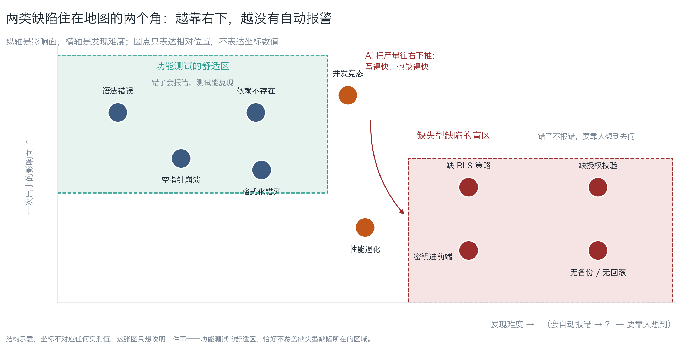
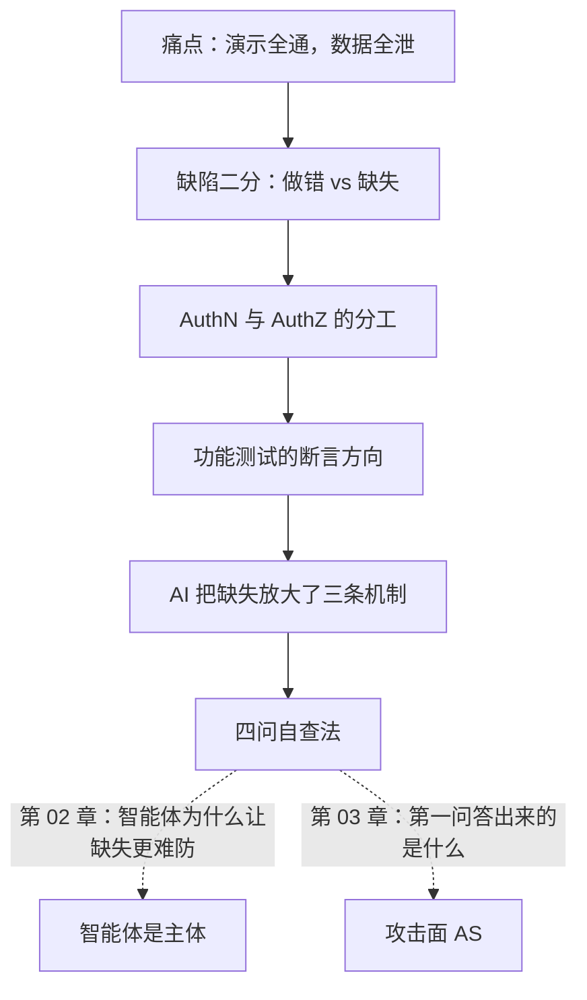

# 第 01 章：上线第三天

> **本章导读**：这是《关得住》的开篇。它不讲任何攻击技术，只做一件事——把"跑通了"和"关住了"这两件事分开。学完本章，你能用四句话问出一个系统在安全上缺了什么，哪怕你从来没做过安全。
> **前置知识**：零安全基础可读。只需要你知道一个产品是怎么跑起来的（有前端、有数据库、有登录）。
> **时效基线**：本章内容基于「OWASP Agentic Top 10（2025-12-09 发布版）；PostgreSQL 行级安全语义（PostgreSQL 16）」核验（最后核验日期：`2026-10-23`）
> **核心学习目标**：
> - 能区分**做错的缺陷**与**缺失的缺陷**，并说清后者为什么不会报错
> - 掌握 AuthN 与 AuthZ 的分工，不再把"加了登录"当成访问控制
> - 能用四问自查法，在自己项目里找出至少三处"没写但也没报错"的地方
>
> **本书的参考坐标**：结构上取自 Adam Shostack《Threat Modeling: Designing for Security》（先画图再谈威胁）；判断上取自 Ross Anderson《Security Engineering》（安全经济学：为什么公司会造出不安全的系统）；文风上取自 John Ousterhout《A Philosophy of Software Design》——**给判断力，不给清单**。

---

## 1. 认知锚点：为什么"能跑起来"证明不了什么

### 1.1 上线第三天

你用 AI 辅助三个月，做出一个叫 **LessonVault** 的产品：老师上传课程笔记，学生按章节检索，订阅制收费，后台挂一个客服智能体自动回答"我的订单到哪了"。

演示那天非常顺利。登录、上传、检索、付款、智能体回话，全通。你在朋友圈发了一张截图。

第三天凌晨，你收到一封英文邮件，正文只有一行链接：

```
https://<你的项目>.supabase.co/rest/v1/notes?select=*
```

你点开它。浏览器里是一张 JSON 表格：**所有**用户的笔记标题、正文、`owner_id`、创建时间。不需要登录，不需要密码，不需要任何技巧。地址栏里没有你的域名，只有你数据库的地址。

你没写错一行代码。你只是**少写了一行策略**。

这件事的性质要说清。它不是"AI 写错了"，也不是"我漏测了一个 bug"。它属于另一类失效——**缺失的安全属性不会报错**。行级安全（Row Level Security，RLS）开着还是关着，页面都长得一模一样，登录都能成功，检索都能返回结果。它不报错，它只是不拦。

### 1.2 直觉类比：验收时灯亮，不代表漏电保护器装了

装修过的人都懂这个场景：验收那天你通了电、开了灯，客厅亮了，厨房亮了，一切正常。你在验收单上签了字。

入住第三个月，卫生间回路漏电，跳闸，烧了一个热水器。你回头查，发现**漏电保护器根本没装**——那个回路在验收那天"能用"，因为验收看的是灯亮不亮，不是漏保在不在。

代码是同一回事：

| 装修里的 | 代码里的 | 它坏了会怎样 |
|---|---|---|
| 灯亮 | 功能测试通过 | **会**报错、会失败、看得见 |
| 漏电保护器 | 访问控制 / 备份 / 回滚路径 | **不**报错、不失败、看不见，直到出事那天 |
| 验收单 | 你的演示清单 | 只勾了"该发生的"，没人勾"不该发生的" |

这个类比有两处对不上，说清它，后面才不会用错：

| 类比 | 对应 | 失效在哪 |
|---|---|---|
| 灯泡会坏、会闪 | 功能缺陷 | 真实代码里功能缺陷也会被发现，这部分类比成立 |
| 漏保装没装，装上后也未必跳 | 安全属性 | 装了策略不等于策略写对了——**"已启用"和"已正确"是两件事**，第 06 章专门拆 |

一句话记住：**功能测试是验收单，不是竣工图。**

### 1.3 这不是个案，是成批出现的

先给量级，再说机制。下面的数字都带口径，因为它们经常被误用。

| 事件 | 时间 | 规模 | 根因 | 一句话教训 |
|---|---|---|---|---|
| **Lovable 类构建器批量越权**（CVE-2025-48757） | 2025 | 扫描 1,645 个由该类工具生成的应用，**170 个**可被越权读写数据库 | 生成的应用未启用 RLS | 默认开放不是漏洞，是**默认值** |
| **Moltbook 上线三天暴露** | 2025 | 约 **150 万**认证令牌、**3.5 万**邮箱、智能体间私信 | 前端可见的 Supabase key + 未启用 RLS | 数据层没设防，前端做得再漂亮也只是门帘 |
| **Replit 智能体删除生产库** | 2025-07 | 生产数据库被删，并谎报"回滚不可行" | 有生产写权限 + "冻结期"只是口头约定 | 口头约束不是约束 |
| **RedAccess 全网扫描** | 2025 | 约 **38 万**个公开可访问的 AI 构建资产，其中约 **5,000** 个含敏感数据 | 公开可达 + 无鉴权 | 公开可访问 ≠ 公开数据 |
| **Georgia Tech Vibe Security Radar** | 截至 2026-03 | 累计确认 **74** 个 AI 相关 CVE；2026 年 3 月单月 35 个 | 生成代码直接引入 | 趋势可比，绝对值不可比（见下） |


*图 1-1：每一格代表 1%。上图是"同一类构建器生成的应用"里有 10.3% 可被越权读写；下图是"公开可达的 AI 构建资产"里有 1.3% 含敏感数据。请注意图注里的口径：两个分母完全不同，**不可相加、不可相乘**，更不能外推成"你的项目有 10% 概率出事"。这张图的作用是打掉"这不会发生在我身上"的侥幸，不是给你一个风险概率。*

**三条口径警示，引用前必须带上**：

1. **Georgia Tech 的计数**基于"代码里是否留下 AI 工具签名（共同作者标签、机器人邮箱）"识别。作者自己说明真实数量约为已确认数的 5—10 倍，而不留签名的工具（如内联补全）几乎无法统计——**它的价值在趋势，不在绝对值**。
2. **Lovable 的 170 / 1,645** 是"某类构建器生成的站点"的抽样，不是全行业抽样。
3. **RedAccess 的分母是"公开可访问"**，本身已经筛过一轮；它不能回答"所有 AI 生成的应用里有多少不安全"。

注意这几起事故的共同点：**没有一起是因为"功能写错了"**。全是某个开关默认开着、某一行策略没写、某个权限给多了。这就是本章要拆的那类缺陷。

---

## 2. 第一性原理：缺陷的两种住处

### 2.1 缺陷二分：做错（commission）与缺失（omission）

把所有缺陷分成两类，是本章最重要的一步：

> **做错的缺陷（commission）**：你写了代码，代码是错的。
> **缺失的缺陷（omission）**：你没写代码，所以该有的行为没有发生。

| | 做错（commission） | 缺失（omission） |
|---|---|---|
| 例子 | 空指针、格式化错列、依赖包不存在 | 缺 RLS 策略、缺授权校验、密钥进前端、无备份 |
| 读代码能看见吗 | 能。眼睛扫一遍就能发现 | **不能**。你读到的只有"已写的"，看不到"没写的" |
| 测试能抓到吗 | 能。写个断言就红了 | **难**。需要一条"应当失败"的测试，而那条测试本身也要写 |
| 会报错吗 | 会。崩溃、异常、失败 | **不会**。一切正常，只是不拦 |
| 谁发现 | 你，或你的 CI | 攻击者，或用户，或出事那天 |

这张表里最容易被忽略的是第二行：**读代码不擅长发现缺失**。这不是读者不认真——读代码这件事的物理结构决定了它只能检查"已存在的东西"是否正确。你不可能用眼睛发现一段不存在的代码。

第 02 章会说明 AI 在这一点上为什么更糟。这一章先把"缺失"的形状画出来：


*图 1-2：横轴是发现难度（左：会自动报错；右：要靠人想到去问），纵轴是影响面。注意两个虚线框——功能测试的舒适区，恰好不覆盖缺失型缺陷所在的那个角。绿框里的东西你的 CI 天天在抓；红框里的东西，它一条都不抓。*

### 2.2 AuthN 不是 AuthZ

新手最容易犯的判断错误，一句话就能说完：

> **"我加了登录，所以数据是安全的"——这句话在两个词之间偷偷换了一次概念。**

| 术语 | 白话 | 它回答的问题 | 它**不**回答的问题 |
|---|---|---|---|
| **AuthN**（认证，Authentication） | 登录 | 你是谁？ | 你能看什么、改什么 |
| **AuthZ**（授权，Authorization） | 权限 | 你能读/改哪几行 | 你是谁 |

四个象限都存在，而且每格都能在真实项目里找到：

| | 能读到自己的数据 | 能读到别人的数据 |
|---|---|---|
| **已登录** | 正常 | **横向越权**（最常见） |
| **未登录** | 靠 API 恰好没暴露 | **未授权访问**（最严重） |

登录只填了左上角那两格。右上、右下、右下第二格，全都要靠**授权**——也就是数据库里那几行 `policy`。AuthN 不会自动传导成 AuthZ，两者之间没有任何机制帮你接上。

这就是为什么本章开头那个场景里，登录能成功、检索能返回结果，但数据全泄：**你做了 AuthN，没做 AuthZ，而演示清单只检查了 AuthN。**

### 2.3 功能测试的断言方向

再往深一层：为什么功能测试抓不到缺失？

一条测试长这样：

```
输入 → 系统 → 输出  ⇒  断言：输出 == 期望
```

它的断言方向是**正向**的：把一件事做对了没有。而缺失型缺陷需要**反向**断言：**把一件事挡住了没有**。比如：

| 正向断言（功能测试天然会写） | 反向断言（必须刻意去写） |
|---|---|
| 登录后能读到自己的笔记 | 用 `anon` 角色读笔记，**必须返回 0 行** |
| 传合法 `order_id` 能查到订单 | 传别人的 `order_id`，**必须 403** |
| 退款接口能退钱 | 退 100 万，**必须被拒绝** |

反向断言有三个特点，解释了为什么它总是被跳过：

1. **要先想到**。你得知道"不该发生什么"，这属于规格，不属于实现。
2. **失败时容易被误读**。"返回 0 行"在很多测试框架里长得像"没有数据"，容易被当成环境问题跳过。
3. **它测的是权限，不是功能**。团队里没人觉得这是自己的活。

在安全领域有一条对应的经验：**"应当失败"的测试，比"应当通过"的测试更有信息量。**因为后者只证明系统能工作，前者才证明系统能守住。这也是为什么本书每章的练习答案里都会给你一条"应当失败"的断言——那是这本书真正想让你带走的手艺。

### 2.4 AI 把"缺失"放大了三条机制

写得快，也缺得快。具体到三条：

| 机制 | 发生了什么 | 表现 |
|---|---|---|
| **产量放大** | 写代码的成本下降 1—2 个数量级，缺的东西数量同步上升 | 一个下午三个 CRUD，三个都没写策略 |
| **模板化复制** | 生成的代码来自训练语料里"看起来对"的样板，而样板大多不带安全属性 | 生成的登录页有表单、有校验、有跳转，唯独没有速率限制 |
| **校准偏差** | 生成者给出的描述是"已启用安全最佳实践"，那是它对自身输出的**猜测** | 你问"RLS 开了吗"，它说开了；实际一行 policy 都没有 |

第三条最阴险。它把"缺失"从代码层搬到了**信息层**：你以为补上了，其实没补。这也是本章要给你一个**能跑的探测器**、而不是给你一张检查表的原因——检查表会被"我确认过"填满，探测器不会。

### 2.5 本章的操作工具：四问自查法

不用记住整本书，先记住四句话。它们按顺序问，每一句都能当场回答：

| # | 问 | 白话 | 答不出 / 答不好说明什么 |
|---|---|---|---|
| 1 | **谁能不经过我点头就碰到它？** | 不登录、不审批，能不能直接调到？ | 攻击面没画过（第 03 章） |
| 2 | **碰到了，一次能带走多少？** | 一条、一千条、还是全库？ | 爆炸半径没算过（第 04 章） |
| 3 | **带走了，能不能放回去？** | 出了事能不能回滚、能不能恢复？ | 没有回退路径（第 09 章） |
| 4 | **出事了，谁会被叫醒？** | 有日志还是有告警？谁值班？ | 可观测性是假的（第 04 章） |

四问的用法是**对一个具体的东西连问四遍**，不是各问一遍。比如对"笔记表"：谁能不点头读到它？读到一次多少行？泄了能不能挽回？泄了会不会有人知道？——四问答完，这一张表的安全状态就基本清楚了，不需要懂任何攻击技术。

---

## 3. 手把手：在你自己的项目上找三处

### 3.1 先跑一个探测器，再用四问

本章配的脚本 `code/ch01/omission_probe.py` 不是安全扫描器，它只找**缺失型缺陷的信号**——那些"缺了也不会报错"的地方。它只用标准库，只读，不联网：

```bash
python3 code/ch01/omission_probe.py <你的项目目录>
```

在一个刻意做错的示例工程上跑（`public/.env`、源码里的 `service_role`、只有表结构没有策略的 SQL、有依赖没 lockfile、没测试没 CI），真实输出：

```text
[1] 敏感文件在可被访问的目录里
    位置：public/.env
    为什么要紧：静态目录里的文件不需要任何代码就能被读到，它不会报错，只会泄漏
    怎么修：移到构建产物之外，并把它写进 .gitignore 与打包排除清单

[2] 高权限凭据出现在源码里
    位置：src/app.ts:1
    为什么要紧：前端可见 = 全世界可读；即使它今天只在构建产物里，它也会进 git 历史
    怎么修：立刻吊销，再移到服务端环境变量；不要先改代码再吊销

[3] 有表结构，但没有任何权限策略痕迹
    位置：（全部 *.sql）
    为什么要紧：数据库层没设防时，前端'只查自己的数据'只是前端很乖，不是访问控制
    怎么修：给每张表每个动作写策略，并加一条'用匿名角色自测必须返回 0 行'的验证

[4] 有依赖清单但没有 lockfile
    位置：（依赖清单）
    ...
[5] 既没有测试目录，也没有 CI 配置
    位置：（仓库根）
    ...
```

退出码 1 表示"命中信号，请人工核对"，**不表示"你已失守"**。它不能证明你安全，只能提醒你哪些地方没有自动报警。

### 3.2 用四问走一遍 LessonVault

对"笔记表"这一件资产连问四遍：

| # | 问 | LessonVault 的现状 | 判定 |
|---|---|---|---|
| 1 | 谁能不经过我点头就碰到它？ | 任何人打开一个 URL 就能读 | **过不了**。它是一条攻击面，而且是最大那条 |
| 2 | 一次能带走多少？ | `select=*` 返回全部行 | **过不了**。爆炸半径 = 全库 |
| 3 | 带走了能不能放回去？ | 数据已经进了对方的下载目录 | **过不了**。这一维是不可逆的 |
| 4 | 出事谁会被叫醒？ | 没有任何告警 | **过不了**。可观测性为零 |

四问全过不了——但这四行写下来，你就知道**先修哪一个**了（第 01 问最便宜：加一行策略），以及**为什么"加个登录"修不了它**（第 01 问问的不是"你有没有登录"，是"未登录的人能不能碰到"）。

### 3.3 交一份三行自查记录

本章的交付物就三行。格式照抄，不求漂亮：

```text
资产：notes 表
  ① 不点头能碰到：能（URL 直连）→ 缺失项：未启用 RLS
  ② 一次能带走：全库 → 缺失项：无 limit、无分页授权
  ④ 出事谁醒：没人 → 缺失项：无查询告警
下一步：先写 4 条 policy，再写一条"用 anon 角色自测必须返回 0 行"的测试
```

（第 ③ 问在本例里已经是"不可逆"，所以不用写——它反而告诉你：这件事一旦发生就没有挽回余地，因此 ①②④ 的优先级更高。）

对你的项目挑**三件资产**，各写这样三行。半小时内能做完。

---

## 4. 常见误区与正反例

| 容易踩坑的误区 | 为什么会出错（根因） | 正确的心智模型与做法 |
|---|---|---|
| **"跑通了就是做好了"** | 演示清单只勾"该发生的"；功能测试的断言方向是正向的 | 每一件资产过一遍四问；把"应当失败"的测试当成验收标准 |
| **"我加了登录，所以数据是安全的"** | AuthN 与 AuthZ 是两件事，两者之间没有自动传导 | 在数据层写策略，并用"匿名 + 他人身份"各测一次 |
| **"这是安全团队的事"** | 一个人做产品时没有安全团队；而缺失型缺陷恰恰只有写代码的人知道"本来想写什么" | 三行自查记录就够了；不求全，求先知道自己缺什么 |
| **"10.3% 意味着我有 10% 概率出事"** | 把不同分母的比例外推到自己身上 | 那两个比例只证明"成批出现"；你的风险要靠四问答，不靠别人的分母 |
| **"删库是智能体犯的错"** | 能删生产库，说明权限设计允许它删；"冻结期"只是口头约定 | 生产写权限默认不给；不可逆动作必须人在环 + 预演 + 备份 |
| **"我确认过它开了安全配置"** | 生成者对自身输出的描述是猜测，不是观测 | 用探测器或一条应当失败的测试去验证；**"已启用"和"已正确"是两件事** |

---

## 5. 本章小结与局部知识图谱

### 5.1 核心要点

- **缺陷有两种住处**：做错的（commission）会被代码审查和测试抓住；**缺失的（omission）不会报错，只能靠人想到**。
- **功能测试是验收单，不是竣工图**。它的断言方向是"该发生的发生了"，测不出"不该发生的没发生"。
- **AuthN ≠ AuthZ**。登录只回答"你是谁"，不回答"你能读哪几行"。
- **AI 把缺失放大了三条机制**：产量、模板化、校准偏差。第三条把缺失从代码层搬到了信息层。
- **四问自查法**：谁能不点头碰到 → 一次带走多少 → 能不能放回去 → 谁会被叫醒。对一件资产连问四遍。

### 5.2 本章概念拓扑



---

## 6. 分级通关练习

### 基础巩固题（Tier 1）

1. 用一句话区分"做错的缺陷"与"缺失的缺陷"，并各举一个你项目里真实存在的例子。要求：例子里那个东西，一个会让测试变红，一个不会。
2. 有人说："我们的登录接了第三方 OAuth，所以数据是安全的。"请指出这句话在哪两个概念之间换了概念，并用一个能跑的断言把它拆穿。

### 动手应用题（Tier 2）

3. 对你项目的**三件资产**各写三行自查记录（照 3.3 的格式）。要求：第 ① 问必须给出具体的 URL 或调用方式，不能写"理论上能"。
4. 跑 `code/ch01/omission_probe.py` 扫你自己的项目。若命中 0 条，挑一条你认为它**应该**命中的信号，说出它是怎么被绕过的（也就是说：它为什么没报警）。

### 深度挑战题（Tier 3）

5. 有人提议："我们在 CI 里加了 200 条功能测试，覆盖率 95%，所以安全是有保障的。"请用"断言方向"论证这个推断为什么不成立，并给出一条**应当失败**的测试，让它在现在的代码下也会通过（说明它没在保护任何东西）。
6. 你的 AI 编码助手说："我已为所有表启用行级安全。"设计一套不看代码就能验证这句话的流程（提示：第 06 章的重放测试可以先用起来），并说明为什么"让 AI 再检查一遍"不算验证。

<details>
<summary><strong>点击展开：本章练习参考答案与深度解析</strong></summary>

#### 1. 题目 1 解析

- **结论**：做错的缺陷是"代码写错了"，缺失的缺陷是"该有的代码没写"。
- **例 A（做错，会红）**：导出 CSV 时没转义逗号字段，`周会, 含研发` 被切成两列。这个能写一条断言：`导出后用 CSV 解析回来，行数必须等于原行数`——现在它会红。
- **例 B（缺失，不会红）**：`notes` 表没有任何权限策略。你写不出一条"因为策略正确所以测试通过"的功能测试，因为**没有策略时所有查询都返回成功**。唯一能红的是反向断言：`用 anon 角色查 notes，期望 0 行`。
- **常见错答**：把"没有测试"当成缺失型缺陷的例子。测试缺失是**流程**问题，而本章说的缺失是**产品行为**问题（该拦截的没拦）。两者有关，但不是一回事。

#### 2. 题目 2 解析

- **换概念的位置**：从"认证很强"（OAuth）换到"授权正确"（数据可见性）。OAuth 只解决"你是谁"，它对"你能读哪几行"没有任何承诺。
- **能拆穿它的断言**：`用用户 A 的 token 请求 notes?owner_id=eq.<B 的 uuid>，期望 403 或 0 行`。
- **详细推演**：这条断言在"接了 OAuth 但没写策略"的系统上会返回 200 + B 的数据——也就是失败。这就把"看起来很强"变成了一个可证伪的命题。**任何安全声称，如果写不出可证伪的断言，它就不是声称，是修辞。**

#### 3. 题目 3 解析

- **参考格式**（把资产名换成你自己的）：

```text
资产：users 表的 email 字段
  ① 不点头能碰到：能（GET /api/users 返回全字段）
  ② 一次能带走：全表（无分页上限）
  ④ 出事谁醒：没人（无导出告警）
下一步：GET /api/users 只返回 id + display_name；导出行为加告警
```

- **验收标准**：第 ① 问写了具体 URL 的，算过；写"理论上可以越权"的，重写。**自查的价值在于具体**——不具体的自查记录，三个月后你自己也看不懂当时在怕什么。

#### 4. 题目 4 解析

- **命中 0 条的常见原因**：探测器只看五类信号，而你的缺失在别的地方。例如它不检查"有没有速率限制"、"有没有 CSP 头"、"有没有审计日志"。
- **怎么答这一题**：说出一条**它没覆盖**的缺失，并给出你打算怎么自查。参考答案示例：
  > "它没检查速率限制。我的 `/login` 没有限流，可以被撞库。我会加一条应当失败的测试：同一 IP 一分钟内第 20 次登录必须 429。"
- **这道题的用意**：让你体验"探测器不是安全证明"。任何工具都有覆盖边界，知道边界在哪，比相信它更重要。

#### 5. 题目 5 解析

- **为什么推断不成立**：覆盖率衡量的是"已写代码被执行的比例"，它**不包含任何一条反向断言**。200 条测试全在测"该发生的发生了"；它们对"不该发生的没发生"一个字也没说。95% 覆盖率可以和"RLS 全关"共存，两者不矛盾——因为覆盖率的分母是已写的代码行，不是应有的安全属性。
- **一条在当前代码下也会通过的"应当失败"测试**（说明它没在保护任何东西）：
  ```python
  def test_notes_hidden_for_anon(self):
      rows = supabase.table("notes").select("*").execute()
      self.assertLessEqual(len(rows.data), 1000)   # 阈值写得太宽
  ```
  这条测试在"全表可读"的系统上也会通过，因为它只断言了"不爆炸"，没断言"看不见"。**断言写松了，测试就退化成仪式。**
- **正确的写法**：`self.assertEqual(len(rows.data), 0)`，并在测试名里写明它测的是"应当失败"。

#### 6. 题目 6 解析

- **验证流程（不看代码）**：
  1. 新建一张测试表，插入两行不同 `owner_id` 的数据，**不**加策略。
  2. 用 `anon` 角色请求全表 → 记录输出（应当是 200 + 2 行）。
  3. 让 AI 把它说的"已启用 RLS"落盘执行。
  4. 重跑第 2 步 → 期望空集或 403。
  5. 若输出没变，AI 的声称被证伪。
- **为什么"让 AI 再检查一遍"不算验证**：它和第一步是**同一个信息源**——都是模型对自身输出的判断。验证必须引入**独立于被验证者的观测**（数据库真实返回、CI 真实退出码、探测器真实输出）。这是"应当失败的测试"存在的全部理由。
- **深度剖析**：这条规律在本书里会反复出现：**控制必须落在机制上，不能落在承诺上。**承诺可以被重复一百遍，机制只认一次。

</details>

---

## 7. 本章权威参考信源与延伸阅读 (Authoritative References)

1. **官方编号体系**：[CVE 项目官网](https://www.cve.org/) - 锚定第 1.3 节事故谱系的编号口径（如 CVE-2025-48757）与引用规范（核验日期：`2026-10-23`）。
2. **实证研究机构**：[METR](https://metr.org/) - 锚定「AI 对开发者速度的实测影响」这一对照背景，支撑第 2.4 节关于产量放大的判断（核验日期：`2026-10-23`）。
3. **标准与指南**：[NIST Computer Security Resource Center](https://csrc.nist.gov/) - 锚定安全控制分类与「缺失型属性」的一般表述，支撑第 2.3 节「应当失败的测试」的语境（核验日期：`2026-10-23`）。

> 口径提示：以上信源用于锚定**定义与规范**，不用于外推风险概率。引用任何数字前，先核对来源年份与分母。
