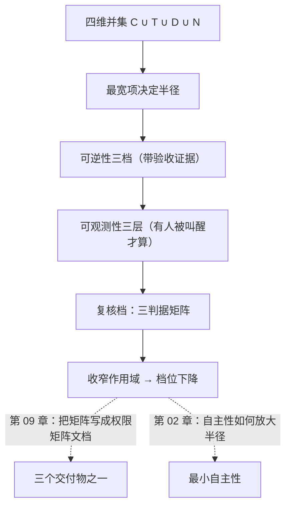

# 第 04 章：爆炸半径

> **本章导读**：上一章回答"谁能进来"。这一章回答一个更难的问题——**进来之后能带走多少**。学完本章，你能算出任何一条工具链的爆炸半径，并据此判断"这个动作要不要人在环"，还能说出"为什么先改这个、不改那个"。
> **前置知识**：第 03 章（攻击面、穿越点清单）。第 01 章的四问用到第二、三、四问——本章就是把那三问答完整。
> **时效基线**：本章内容基于「凭据作用域语义（RFC 8707 资源指示器）；本书三判据矩阵 v1.0」核验（最后核验日期：`2026-10-23`）
> **核心学习目标**：
> - 掌握 `BR = C ∪ T ∪ D ∪ N` 的四维并集，能解释为什么"只读"这句话几乎没有信息量
> - 能把可逆性、可观测性从形容词变成可核对的判据
> - 能用排序式 `R ≈ AS × BR × (1 - D)` 判断"今天先改哪个"，并说清它**不是**概率模型

---

## 1. 认知锚点："我只给了它只读权限"

### 1.1 一句几乎没有信息量的话

你给客服智能体挂了一个数据库连接，有人提醒你注意安全。你的回答是：

> "放心，我只给了它**只读**权限。"

这句话听起来稳妥，实际上几乎没有信息量。因为决定"一次能出多大事"的，从来不是"读还是写"，而是四件事的乘积：

- 它能以**谁的名义**说话（凭据）
- 它能**做多少动作**（工具）
- 它一次能**看到多少行**（数据）
- 它能把东西**送到哪去**（出口）

只读 + 全库 + 能出网 = **一次全量导出**。数据被读走一次，就等于失窃了两份（你一份，对方一份）。"只读"挡住的是**篡改**，挡不住**外泄**——而外泄通常是更严重的那件事（合规、隐私、商业机密，都没有"回滚"这个选项）。

### 1.2 直觉类比：进门，和能装走几车

接上一章的写字楼：

- **攻击面**是"能不能推开这扇门"（第 03 章的量）
- **爆炸半径**是"推开门之后，一次能装走几车"（本章的量）

这两件事互相独立。一扇很窄的门（一个只读接口）后面可以是一整个仓库（全库数据）；一扇很宽的门（管理后台）后面可能只有一个空柜子。

| 类比 | 对应 | 关键差别 |
|---|---|---|
| 一次能装走几车 | 爆炸半径（blast radius） | 真实仓库有物理体积限制；**软件里的"车"可以无限大、无限多** |
| 门宽 | 攻击面 | 门宽和能装多少**没有必然关系** |
| 出货通道 | 网络出口 N | 仓库没有后门；**软件的后门是 `curl`**，一秒钟能把东西发到世界任何地方 |

最后一行是最要命的一条：**出口是半径里最容易被漏掉的一项**。很多人算半径时会想到凭据、想到数据，唯独忘了"它能把东西发出去"。

### 1.3 一次越权怎么用上四项

回到 LessonVault 的客服智能体。一段来自"帮助文档"的文本让它导出笔记，它按下面的顺序做：

1. **凭据（C）**：它出示 `service_role`——这个 key 的作用域是"绕过所有 RLS"
2. **工具（T）**：它调用 `search_notes(query)`，参数是空的
3. **数据（D）**：工具没有 limit，返回全部 500 行笔记
4. **出口（N）**：它调用 `send_email(to, body)`，收件人由参数决定

四步，每一步单独看都"做对了"。**整条链路没有人在任何一步批准过**。这就是第 01 章说的缺失型缺陷在智能体身上的形态：每一项都不算漏洞，合起来是一次全量外泄。

半径就是这四项的**并集**——由最宽的那项决定。本章接下来把这个"宽"变成可算的东西。

---

## 2. 第一性原理：四个维度，一个并集

### 2.1 定义

> **爆炸半径 BR = C（凭据）∪ T（工具）∪ D（数据）∪ N（网络出口）**

四个符号逐个说白：

| 符号 | 含义 | 白话问法 | 常见误判 |
|---|---|---|---|
| **C** 凭据 | 这个进程能出示的所有身份 | "它能以谁的名义说话？" | 只想到 API key，忘了 CI token、SSH key、云厂商 role、本地 `~/.aws/credentials` |
| **T** 工具 | 它能调用的所有动作 | "它能做什么，而不只是能读什么？" | 只想到数据库，忘了它能 `git push`、能发邮件、能改 DNS |
| **D** 数据 | 它读得到的全部数据的并集 | "它一次能看到多少行？" | 只想到自己那张表，忘了同库的其他表、备份、日志、对象存储 |
| **N** 出口 | 它能把数据送到哪 | "它能把东西发给谁？" | 忘了它能 `curl` 任意地址，也忘了 **DNS 查询本身就是外泄通道** |

最后一格的补充很重要：即使你禁止了所有出站 HTTP，一个能解析域名的进程仍然可以通过把数据编码进查询域名来外传（`<数据>.attacker.com`）。**出口的判定标准是"能不能让外部收到东西"，不是"能不能 POST"。**

### 2.2 为什么是并集，不是相加

因为一次越权常常**同时用上四项**：凭据让它进门，工具让它动手，数据决定拿多少，出口决定带走多远。所以：

> **半径由最宽的那一项决定，其余三项只是配合。**

这不是数学上的严格并集运算，是一个**工程近似**：把四项里最宽的那个当作半径。它的用处是排序——当你发现"只读 + 全库 + 能出网"时，你应该先去收窄**数据**（加 limit、加视图），而不是去优化"只读"（它已经是只读了）。

反过来看一个常见的误判：**四项都收窄，才叫收窄**。把 D 从全库降到 20 行，但 N 仍然全通，半径仍然是"20 行 × 无限次调用 × 任何目的地"。四项里只要有一项是"无限"，半径就近似无限。

### 2.3 四档配置：省掉的每一道限制都是半径上的一格


*图 1-1：同样叫"AI 编程助手"，四档配置的半径差着好几个数量级。圆点的大小表示"该维度是否可达及其宽窄"，不是数值；右侧一列是"一次动作最远能造成的影响面"。最下面那一档——全权限 shell 加生产凭据——不是"更聪明的助手"，而是一个持你工牌、可被任意文本操控的临时工。*

四档从上到下，是"省事"的四个档位。注意第三档（CI 智能体）和第四档的差别：**第三档的出网是白名单，第四档是全通**。这一格之差，决定了"数据能不能被带走"。

### 2.4 可逆性：把"能不能退回去"变成可核对的判据

半径之外，还有第二个维度——**动作做完能不能退回去**。它分三档，每一档都要有**验收证据**，不能凭感觉：

| 档位 | 白话 | 验收证据（没有证据就不算这档） | 例子 |
|---|---|---|---|
| **可回滚** | 再点一下就回去了 | 有幂等键 / 有反向操作，且演练过 | 改一行配置、切一个 feature flag |
| **需恢复** | 要从快照捞回来 | 有备份，且**真的恢复过一次** | 删一张表、改一批数据 |
| **不可逆** | 对外已经发生 | 无。这一档的"证据"是：没有挽回路径 | 发出去的邮件、转出去的钱、推送通知 |

中间那一档最容易自欺：**"我们有备份"不等于"我们能恢复"**。没做过恢复演练的备份，只是一个安慰剂。判据很简单：你能不能在 30 分钟内把一张表恢复到昨天的状态，并且**有人真的做过**。

### 2.5 可观测性：日志 ≠ 告警 ≠ 有人被叫醒

第三个维度是**出事时会不会有人知道**。它有三层，逐层递减：

| 层 | 白话 | 判据 |
|---|---|---|
| **有告警且有人接** | 出事时有人被叫醒 | 有值班表、有告警渠道、告警真的响过 |
| **只有日志** | 出事时事后能查 | 有记录，但没有人实时看 |
| **看不见** | 出事时没人知道 | 连记录都没有，或记录在无人看的地方 |

**"有日志"经常被当成可观测性，这是错的。** 没人看的日志等于没有。可观测性的真实定义是：**出事时会不会有人被叫醒**。这也是第 01 章四问的第四问。

这条判据有个反直觉的推论：**一个没有日志的系统，比一个日志很多但没人看的系统更诚实**——前者知道"我看不见"，后者会误以为"我看得很清楚"。

### 2.6 排序式：用来决定先改哪个

把上面三个维度接起来：

```
R ≈ AS × BR × (1 - D)
```

- **AS**：未授权可达的（入口，能力）对数（第 03 章的量）
- **BR**：单次动作可影响的对象数（本章的量）
- **D**：被门禁与监控**实际拦住**的比例

必须马上补三句：

1. **这不是概率模型**。它的唯一用途是排序——当你只有一周、有五个洞要补时，它告诉你先补哪个。
2. **D 是"实际拦住"，不是"配置过"**。配置了门禁但没人接告警，D 接近 0。
3. **同一风险有两种长相**：小而多（AS 大、BR 小），或大而少（AS 小、BR 大）。两者在排序时同级。


*图 1-2：等值线上两点等价。A 点是"入口多但每次影响小"，B 点是"入口少但每次影响大"——排序时它们同级，但**修法不同**：A 收入口，B 收半径。多数情况下缩 BR 更便宜：改一个参数校验，比拆掉一整个入口快得多。*

**"先改哪个"的决策规则**（这是本章最实用的一句）：

> 在同一等值线上，**先改便宜的那个**；不在同一等值线上，**先改线高的那个**。

---

## 3. 手把手：算一遍，再降档

### 3.1 先算：脚本输出

本章配的脚本 `code/ch04/blast_radius.py` 把每个工具换算成"影响半径 × 可逆性 × 可观测性 → 复核档"。对 LessonVault 的客服智能体（六个工具）跑一次，真实输出（原表还有一列 kill switch，这里为版面省去）：

| 工具 | 作用域 | 影响半径 | 可逆性 | 可观测性 | 复核档 |
|---|---|---|---|---|---|
| `lookup_order(order_id)` | 读：orders 单行 | 1 个对象 | 可回滚 | 有日志+告警 | **自动放行** |
| `search_notes(query)` | 读：notes 全表（limit 1000） | 1 个服务 / 千行级 | 可回滚 | 只有日志 | **单人在环** |
| `issue_refund(order_id, cents)` | 写：Stripe 退款，单笔上限 50 元 | 1 个对象 | 不可逆 | 有日志+告警 | **单人在环** |
| `bulk_refund(filter, cents)` | 写：按筛选条件批量退款，无上限 | 全库 / 全租户 | 不可逆 | 只有日志 | **默认禁止** |
| `send_email(to, subject, body)` | 外发：任意收件人 | 全库 / 全租户 | 不可逆 | 看不见 | **默认禁止** |
| `update_subscription(user_id, plan)` | 写：subscriptions 单行 | 1 个对象 | 需快照恢复 | 有日志+告警 | **自动 + 事后审** |

脚本的结论文案值得读一遍：

```text
已实现工具的复核档取最高项：**默认禁止**
不该实现（应删掉工具定义，而不是加确认框）：`bulk_refund(...)`、`send_email(...)`

需要盯的三处：
  - search_notes(query)：可观测性不足，升一档
  - bulk_refund(filter, cents)：落在「默认禁止」档——正确做法是**不实现**，而不是加确认框
  - send_email(to, subject, body)：落在「默认禁止」档——正确做法是**不实现**，而不是加确认框
```

### 3.2 看到"默认禁止"，第一反应是收窄，不是加弹窗

两个工具落到最高档。这时大多数人的第一反应是"给它们加个确认框"。**这是错的。**

> **"默认禁止"是一个信号：这个工具的作用域写得太宽了**，宽到没有任何审批能兜住它。

正确的做法是**改作用域**：

- `bulk_refund` → **删掉**。批量退款不是客服智能体的职责，它是财务流程。工具不存在，攻击面就不存在。
- `send_email(to, subject, body)` → `reply_ticket(ticket_id, body)`。收件人不再由参数决定，而是由工单决定；正文发送前存档。
- `search_notes(limit 1000)` → `search_notes(limit<=20)`，并且只返回命中行的摘要。
- 可观测性从"只有日志"补到"有日志 + 有告警"（发送前存档、发送后回执对账）。

注意这四条改的都是**作用域**，没有一条是"加审批"。

### 3.3 重算：档位真的降下来了

改完之后重跑（`python3 blast_radius.py --json tools_revised.json`，真实输出，同样省去 kill switch 与可观测性两列）：

| 工具 | 作用域 | 影响半径 | 可逆性 | 复核档 |
|---|---|---|---|---|
| `lookup_order(order_id)` | 读：orders 单行 | 1 个对象 | 可回滚 | **自动放行** |
| `search_notes(query, limit<=20)` | 读：notes 单行命中，硬上限 20 行 | 1 个对象 | 可回滚 | **自动放行** |
| `refund_order(order_id, cents<=5000)` | 单笔 ≤50 元，单日 ≤500 元 | 1 个对象 | 不可逆 | **单人在环** |
| `reply_ticket(ticket_id, body)` | 只回本工单客户，正文存档 | 1 个对象 | 不可逆 | **单人在环** |
| `update_subscription(user_id, plan)` | 写：subscriptions 单行 | 1 个对象 | 需快照恢复 | **自动 + 事后审** |

```text
已实现工具的复核档取最高项：**单人在环**（由 `reply_ticket(ticket_id, body)` 决定）
理由：档位不能线性平均。链路里只要有一个不可撤的出口，整条链就是不可撤的。
```

整条链路从"有两个工具必须删掉"变成"最高档是单人在环"。**这个变化不是靠审批换来的，是靠收窄作用域换来的。**

这是本章最想让你带走的一句操作原则：

> **先缩半径，再谈审批。**

### 3.4 用排序式决定今天改什么

假设有三件事要做：

| 待办 | AS | BR | D | R 的量级 | 修的成本 | 结论 |
|---|---|---|---|---|---|---|
| 给 `search_notes` 加 limit | 中 | 大 | 低 | 高 | 低（改一个参数） | **今天就改** |
| 给 `/login` 加速率限制 | 中 | 小 | 中 | 中 | 中 | 本周改 |
| 拆掉 MCP 的一个工具 | 小 | 中 | 中 | 中 | 高（要改集成） | 排期 |

**为什么第一条优先**：它的 BR 最大、D 最低、修的成本最低。三件事在排序上高，在成本上低——这种"便宜又高"的组合永远排第一。

---

## 4. 常见误区与正反例

| 容易踩坑的误区 | 为什么会出错（根因） | 正确的心智模型与做法 |
|---|---|---|
| **"我只给了它只读权限"** | 只读挡住篡改，挡不住外泄；半径由 C∪T∪D∪N 最宽项决定 | 追问另外三项：能看多少行、能调多少动作、能发到哪 |
| **"备份有就行"** | 没做恢复演练的备份是安慰剂 | 判据是"30 分钟内能恢复，且有人做过" |
| **"有日志就是可观测"** | 没人看的日志等于没有 | 判据是"出事时会不会有人被叫醒" |
| **"R 算出来 0.3，风险不高"** | 把排序式当概率模型 | 它只能排序；任何绝对数值都是误用 |
| **"先修 AS 最大的那个"** | 忽略成本；入口整改往往比加 limit 贵得多 | 同一等值线上先改便宜的；不同线上先改高的 |
| **"加个确认框就安全了"** | 确认框会被点习惯（自动化偏见），高频弹窗必然导致不看内容 | 落在"默认禁止"的工具应该**不实现**，而不是加弹窗 |

---

## 5. 本章小结与局部知识图谱

### 5.1 核心要点

- **BR = C ∪ T ∪ D ∪ N，由最宽的那项决定**。"只读"这句话几乎没有信息量。
- **可逆性分三档**，每档要有验收证据；"有备份"不等于"能恢复"。
- **可观测性的判据是"会不会有人被叫醒"**，不是"有没有日志"。
- **R ≈ AS × BR × (1 - D) 只用于排序**，不做概率；同一风险有"小而多"和"大而少"两种长相。
- **先缩半径，再谈审批**。"默认禁止"是作用域写宽了的信号，正确反应是收窄或删掉工具。

### 5.2 本章概念拓扑



---

## 6. 分级通关练习

### 基础巩固题（Tier 1）

1. 有人说："这个工具只读，所以很安全。"请用 BR 的四个维度把它拆开，并指出这句话漏掉了哪两项。
2. 判断下面三个动作的可逆性档位，并说出你的验收证据：改一行配置、删一张表、给用户发一封"订单已发货"的邮件。

### 动手应用题（Tier 2）

3. 用 `blast_radius.py` 的矩阵手算：`issue_refund` 若把影响半径从 1 改成 3（无上限批量退款）、可观测性从 1（有告警）改成 3（看不见），复核档会落到哪一档？然后用脚本改参数验证你的手算。
4. 对你项目里的三个动作各填一行"半径 + 可逆性 + 可观测性 + 复核档"，并说出今天先改哪一个、为什么（要引用本章的排序规则）。

### 深度挑战题（Tier 3）

5. 有人提议："我们把爆炸半径算成一个数字（比如 7.2），给每个工具打分排序。"请论证这个做法的问题（提示：BR 是并集不是乘积；"7.2"和"7.3"有意义吗？），并给出更好的表达方式。
6. 你的智能体有"读笔记"和"发邮件"两个工具，都在"单人在环"档。有人提议把它们合并成一个"整理笔记并汇报"的工具（一次调用做完两步）。请分析合并后的半径变化，以及它对复核档的影响。

<details>
<summary><strong>点击展开：本章练习参考答案与深度解析</strong></summary>

#### 1. 题目 1 解析

- **拆开**：C（它以谁的名义读？若是 `service_role`，它不受任何策略约束）；T（读之外还能调什么？若只有查询，T 较窄）；D（一次能看多少行？若无 limit，D = 全库）；N（读到的数据能不能发出去？若进程能出网，N = 任意地址）。
- **漏掉的两项**：通常是 **D** 和 **N**。"只读"只回答了 T 的一部分，完全没提"能看多少"和"能送多远"。
- **常见错答**：只答"只读 = 不能删数据，所以安全"。这答的是**篡改**，不是**外泄**。**只读挡篡改，不挡外泄。**

#### 2. 题目 2 解析

| 动作 | 档位 | 验收证据 |
|---|---|---|
| 改一行配置 | 可回滚 | 有反向操作（改回去），且演练过一次 |
| 删一张表 | 需恢复 | 有备份 + **真的做过一次恢复演练**（没做过 = 只是安慰剂） |
| 发"订单已发货"邮件 | 不可逆 | 无。邮件已到达对方收件箱，撤回不等于没发生 |

- **容易判错的是第二档**：很多人把"删表"判成"不可逆"。如果表有快照、且你演练过恢复，它属于"需恢复"——**档位取决于你的恢复能力，不取决于动作本身**。
- **第三档的邮件**：即使邮件服务提供"撤回"功能，收件人可能已经看到、已经转发。**对外已发生 = 不可逆。**

#### 3. 题目 3 解析

- **手算**：可逆性 = 3（不可逆），影响半径 = 3 → 矩阵基础档 = 默认禁止。可观测性 = 3 ≥ 2，但已在最高档，不再升档。
- **验证**：改 `DEFAULT_SPEC` 里 `issue_refund` 的 `radius` 与 `observability`，重跑 `python3 blast_radius.py`。输出会把它列进"不该实现"清单。
- **深度剖析**：这道题的目的是让你体会**档位不是线性的**。三个维度各跳两格，档位从"单人在环"跳到"默认禁止"——跨了两档。这意味着**任何一维的失控都会被另外两维放大**，所以修的时候不必三维全修：把半径从 3 收回 1，档位立刻回到"单人在环"。**这是优先级判断的依据：先修半径，因为它最便宜**（改一个参数校验，比给邮件加内容审核便宜得多）。

#### 4. 题目 4 解析

- **示例**（换你自己的）：
  | 动作 | 半径 | 可逆 | 可观测 | 档位 |
  |---|---|---|---|---|
  | `get_user(id)` | 1 个对象 | 可回滚 | 有告警 | 自动放行 |
  | `export_users()` | 全库 | 不可逆 | 只有日志 | 默认禁止 |
  | `update_profile(id, name)` | 1 个对象 | 需恢复 | 有告警 | 自动 + 事后审 |
- **今天先改哪个**：`export_users`——它的 R 最高（BR 全库、D 低），而修的成本最低（改成"只导出自己的、带 limit"）。**不要因为"导出"听起来不像攻击就排后面。**

#### 5. 题目 5 解析

- **问题一：BR 是并集不是乘积**。把四项乘成一个数，等于假设"凭据 × 工具 × 数据 × 出口"可以互换——但事实上只要有一项是"无限"，半径就近似无限。乘积会掩盖这一点。
- **问题二：分数没有可解释性**。"7.2"和"7.3"的差别没有任何物理含义，你无法据此决定"先改哪个"，也无法向别人解释"为什么是 7.2"。
- **更好的表达**：用**档位 + 证据**。"这个工具在'单人在环'档，因为它的半径是 1 个对象、不可逆、有告警。" 档位是离散的、可核对的、可对外解释的。
- **什么时候可以打分**：在**同一维度内部**排序（比如"这五个工具的半径从大到小"），此时分数是序数，不假装是基数。**关键差别在于：分数只能比大小，不能做乘法。**

#### 6. 题目 6 解析

- **合并前**：两个工具各自的半径分别是"读：1 个对象/可回滚"和"发：1 个对象/不可逆"。因为分开，**读的动作不会自动触发发的动作**——要两次调用、两次审批。
- **合并后**：一次调用 = 读 + 发。半径变成 **C ∪ T ∪ D ∪ N 的并集**：数据（笔记内容）+ 出口（邮件）+ 不可逆（发出即达）。**半径从"读"跳到"读+外泄"**。
- **对复核档的影响**：合并后的工具不可逆、且涉及外泄，复核档从"单人在环"跳到"双人 + 预演"或"默认禁止"（取决于作用域）。
- **设计结论**：**合并工具 = 放大半径**。工具应当按"动作类型"拆，不按"用户场景"拆。用户想要"一步做完"，那是 UX 的事，可以用一个前端按钮触发两次独立调用（每次各自审批），而不是把两个工具焊成一个。
- **这条规律对人类流程同样成立**：财务上的"出纳"和"会计"分开，不是因为两个人更有效率，是因为**合并会让一次失误的半径变成全部**。

</details>

---

## 7. 本章权威参考信源与延伸阅读 (Authoritative References)

1. **标准规范**：[RFC 8707 - Resource Indicators for OAuth 2.0](https://www.rfc-editor.org/rfc/rfc8707) - 锚定「凭据作用域 / 受众绑定」的定义，支撑第 2.1 节 C 维度的判据（核验版本：RFC 8707）（核验日期：`2026-10-23`）。
2. **缺陷分类**：[MITRE CWE](https://cwe.mitre.org/) - 锚定「权限分配不当」类缺陷，支撑第 2.2 节「最宽项决定半径」的反例（核验日期：`2026-10-23`）。
3. **方法与风险表达**：[NIST Computer Security Resource Center](https://csrc.nist.gov/) - 锚定风险排序（而非概率估计）的一般方法，支撑第 2.6 节 R 式子的用法边界（核验日期：`2026-10-23`）。

> 口径提示：以上信源用于锚定**定义与规范**，不用于外推风险概率。引用任何数字前，先核对来源年份与分母。
