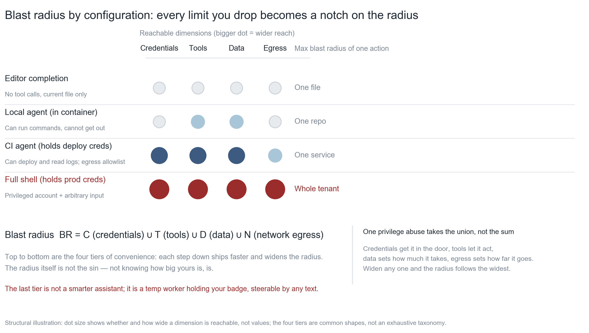
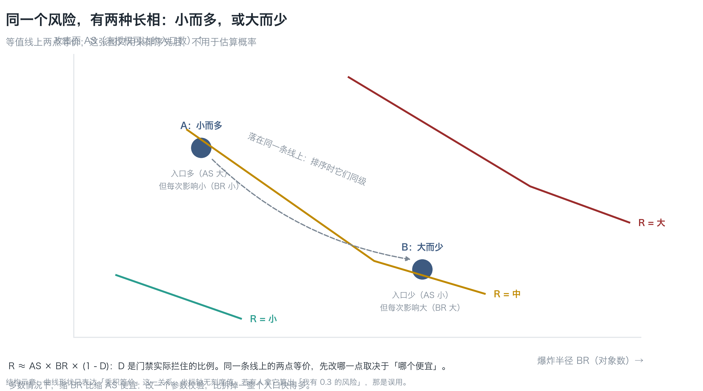
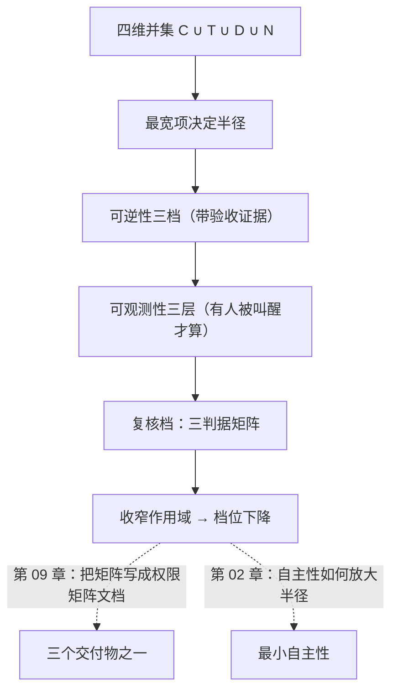

**English** | [中文](./ch04-blast-radius.zh.md)

# Chapter 04: Blast Radius

> **Chapter guide**: The previous chapter answered "who can get in". This chapter answers a harder question — **how much can be carried away once inside**. By the end of this chapter you can compute the blast radius of any tool chain, judge from it "does this action need a human in the loop", and say "why fix this one first, not that one".
> **Prerequisites**: Chapter 03 (attack surface, crossing list). Chapter 01's four questions use the second, third, and fourth — this chapter is where those three get fully answered.
> **Currency baseline**: This chapter is verified against "credential scope semantics (RFC 8707 resource indicators); this book's three-criteria matrix v1.0" (last verified: `2026-10-23`)
> **Core learning objectives**:
> - You master the four-dimension union `BR = C ∪ T ∪ D ∪ N`, and can explain why "read-only" carries almost no information
> - You can turn reversibility and observability from adjectives into checkable criteria
> - You can use the ranking formula `R ≈ AS × BR × (1 - D)` to decide "which one to fix today", and explain that it is **not** a probability model

---

## 1. Cognitive Anchor: "I only gave it read-only access"

### 1.1 A sentence that carries almost no information

You hooked a database connection to the customer-service agent, and someone reminded you about security. Your answer is:

> "Relax, I only gave it **read-only** access."

This sounds prudent, but it actually carries almost no information. Because what decides "how bad one incident can get" is never "read or write", but the product of four things:

- In **whose name** it can speak (credentials)
- **How many actions** it can take (tools)
- **How many rows** it can see at once (data)
- **Where it can send** things (exit)

Read-only + whole database + can reach the network = **one full export**. Once data is read out, you have effectively lost two copies (one for you, one for them). "Read-only" blocks **tampering**; it does not block **exfiltration** — and exfiltration is usually the more serious event (compliance, privacy, trade secrets — none of them have a "rollback" option).

### 1.2 Intuitive Analogy: getting in the door, and how many truckloads you can carry off

Continue with the office building of the previous chapter:

- **Attack surface** is "can this door be pushed open" (the quantity of Chapter 03)
- **Blast radius** is "once the door is open, how many truckloads can be carried off in one go" (the quantity of this chapter)

These two are independent of each other. Behind a very narrow door (a read-only API) there can be a whole warehouse (the entire database); behind a very wide door (an admin console) there may be only an empty cabinet.

| Analogy | Correspondence | Key difference |
|---|---|---|
| How many truckloads in one go | Blast radius | A real warehouse has physical volume limits; **the "trucks" in software can be infinitely large and infinitely many** |
| Door width | Attack surface | Door width and how much can be carried have **no necessary relationship** |
| The shipping channel | Network exit N | A warehouse has no back door; **the back door of software is `curl`**, which can send things anywhere in the world in one second |

That last row is the deadliest one: **the exit is the item most easily missed in the radius**. When computing radius people think of credentials, think of data, and only forget "it can send things out".

### 1.3 How one escalation uses all four items

Back to the LessonVault customer-service agent. Text from a "help document" makes it export notes, and it does so in this order:

1. **Credentials (C)**: it presents `service_role` — this key's scope is "bypass all RLS"
2. **Tools (T)**: it calls `search_notes(query)` with an empty parameter
3. **Data (D)**: the tool has no limit and returns all 500 rows of notes
4. **Exit (N)**: it calls `send_email(to, body)`, where the recipient is decided by a parameter

Four steps, each one "done right" on its own. **Nobody approved any step of the whole chain.** This is the shape of the omission-type defect of Chapter 01 on an agent: each item is not a vulnerability; together they are one full exfiltration.

The radius is the **union** of these four items — decided by the widest one. The rest of this chapter turns that "width" into something computable.

---

## 2. First Principles: Four Dimensions, One Union

### 2.1 Definition

> **Blast radius BR = C (credentials) ∪ T (tools) ∪ D (data) ∪ N (network exit)**

Explain the four symbols in plain words:

| Symbol | Meaning | Plain question | Common misjudgment |
|---|---|---|---|
| **C** credentials | Every identity this process can present | "In whose name can it speak?" | Only thinking of API keys, and forgetting CI tokens, SSH keys, cloud provider roles, local `~/.aws/credentials` |
| **T** tools | Every action it can invoke | "What can it do, not just what can it read?" | Only thinking of the database, and forgetting it can `git push`, send mail, change DNS |
| **D** data | The union of all data it can read | "How many rows can it see at once?" | Only thinking of its own table, and forgetting other tables in the same database, backups, logs, object storage |
| **N** exit | Where it can send data | "Who can it send things to?" | Forgetting it can `curl` any address, and forgetting that **DNS queries are themselves an exfiltration channel** |

The supplement to the last cell is important: even if you ban all outbound HTTP, a process that can resolve domain names can still exfiltrate by encoding data into the query domain (`<数据>.attacker.com`). **The criterion for an exit is "can the outside receive something", not "can it POST".**

### 2.2 Why a union, not a sum

Because one escalation often **uses all four items at once**: credentials get it in the door, tools let it act, data decides how much to take, exit decides how far it goes. So:

> **The radius is decided by the widest item; the other three only cooperate.**

This is not a strict set-theoretic union; it is an **engineering approximation**: take the widest of the four items as the radius. Its use is ranking — when you find "read-only + whole database + can reach the network", you should go narrow the **data** (add limits, add views) first, not optimize "read-only" (it is already read-only).

Now look at a common misjudgment in reverse: **only when all four are narrowed has anything been narrowed**. Drop D from the whole database to 20 rows, but N is still fully open, and the radius is still "20 rows × unlimited invocations × any destination". As long as one of the four is "unlimited", the radius is approximately unlimited.

### 2.3 Four configurations: every restriction you skip is one rung on the radius


*Figure 4-1: All called "AI coding assistant", the radius of the four configurations differs by several orders of magnitude. Dot size shows "whether that dimension is reachable and how wide", not a number; the right-hand column is "the furthest impact a single action can cause". The bottom configuration — full-permission shell plus production credentials — is not "a smarter assistant" but a temp wearing your badge who can be steered by arbitrary text.*

The four configurations from top to bottom are four tiers of "saving effort". Note the difference between the third (CI agent) and the fourth: **the third has allowlisted outbound network, the fourth is fully open**. That one cell decides "whether data can be carried away".

### 2.4 Reversibility: turn "can it be undone" into a checkable criterion

Beyond the radius there is a second dimension — **once the action is done, can it be undone**. It comes in three tiers, and each tier must have **acceptance evidence**, not vibes:

| Tier | Plain words | Acceptance evidence (no evidence, not this tier) | Example |
|---|---|---|---|
| **Rollback-capable** | One more click and it is back | An idempotency key / a reverse operation exists, and has been rehearsed | Change a config line, flip a feature flag |
| **Needs recovery** | Has to be fished out of a snapshot | Backups exist, and **one restore has actually been done** | Drop a table, change a batch of data |
| **Irreversible** | It has already happened externally | None. The "evidence" of this tier is: there is no way back | Mail already sent, money already transferred, push notifications |

The middle tier is the easiest to fool yourself with: **"we have backups" does not equal "we can restore"**. A backup that has never been through a restore rehearsal is just a placebo. The criterion is simple: can you restore a table to yesterday's state within 30 minutes, and **has someone actually done it**.

### 2.5 Observability: logs ≠ alerts ≠ someone gets woken up

The third dimension is **whether anyone will know when something happens**. It has three layers, decreasing layer by layer:

| Layer | Plain words | Criterion |
|---|---|---|
| **Alerts and someone picks up** | Someone gets woken up when something happens | There is an on-call schedule, an alert channel, and the alert has actually fired |
| **Logs only** | It can be investigated after the fact | There are records, but nobody watches them in real time |
| **Invisible** | Nobody knows when something happens | No records at all, or records somewhere nobody looks |

**"We have logs" is often treated as observability. That is wrong.** Logs nobody reads count as nothing. The real definition of observability is: **will someone be woken up when something happens**. That is also the fourth of Chapter 01's four questions.

This criterion has a counter-intuitive corollary: **a system with no logs is more honest than a system with lots of logs nobody reads** — the former knows "I cannot see", the latter deludes itself that "I see very clearly".

### 2.6 The ranking formula: to decide which to fix first

Connect the three dimensions above:

```
R ≈ AS × BR × (1 - D)
```

- **AS**: the number of (entry, capability) pairs reachable without authorization (the quantity of Chapter 03)
- **BR**: the number of objects a single action can affect (the quantity of this chapter)
- **D**: the proportion **actually blocked** by gates and monitoring

Three sentences must be added immediately:

1. **This is not a probability model**. Its only use is ranking — when you have one week and five holes to patch, it tells you which to patch first.
2. **D is "actually blocked", not "was configured"**. If gates are configured but nobody picks up alerts, D is close to 0.
3. **The same risk has two appearances**: small and many (large AS, small BR), or large and few (small AS, large BR). The two rank the same.


*Figure 4-2: Two points on the same contour are equivalent. Point A is "many entrances, small impact each", point B is "few entrances, large impact each" — they rank the same, but **the fix differs**: A narrows entrances, B narrows radius. In most cases shrinking BR is cheaper: changing one parameter check is much faster than tearing out a whole entrance.*

**The decision rule for "which to fix first"** (the most practical sentence in this chapter):

> On the same contour, **fix the cheaper one first**; on different contours, **fix the higher one first**.

---

## 3. Hands-on: Compute once, then step down

### 3.1 Compute first: script output

The script that comes with this chapter, `code/ch04/blast_radius.py`, converts every tool into "impact radius × reversibility × observability → review tier". Run once on the LessonVault customer-service agent (six tools), real output (the original table also has a kill switch column, omitted here for space):

| Tool | Scope | Impact radius | Reversibility | Observability | Review tier |
|---|---|---|---|---|---|
| `lookup_order(order_id)` | Read: one orders row | 1 object | Rollback-capable | Logs + alerts | **Auto-allow** |
| `search_notes(query)` | Read: whole notes table (limit 1000) | 1 service / thousands of rows | Rollback-capable | Logs only | **Single human in the loop** |
| `issue_refund(order_id, cents)` | Write: Stripe refund, 50-yuan per-transaction cap | 1 object | Irreversible | Logs + alerts | **Single human in the loop** |
| `bulk_refund(filter, cents)` | Write: batch refunds by filter, no cap | Whole DB / whole tenant | Irreversible | Logs only | **Default deny** |
| `send_email(to, subject, body)` | Outbound: any recipient | Whole DB / whole tenant | Irreversible | Invisible | **Default deny** |
| `update_subscription(user_id, plan)` | Write: one subscriptions row | 1 object | Needs snapshot restore | Logs + alerts | **Auto + post-hoc review** |

The script's conclusion text is worth reading once:

```text
已实现工具的复核档取最高项：**默认禁止**
不该实现（应删掉工具定义，而不是加确认框）：`bulk_refund(...)`、`send_email(...)`

需要盯的三处：
  - search_notes(query)：可观测性不足，升一档
  - bulk_refund(filter, cents)：落在「默认禁止」档——正确做法是**不实现**，而不是加确认框
  - send_email(to, subject, body)：落在「默认禁止」档——正确做法是**不实现**，而不是加确认框
```

### 3.2 On seeing "default deny", the first reaction is narrowing, not adding a popup

Two tools land on the top tier. At this point most people's first reaction is "add a confirmation checkbox for them". **That is wrong.**

> **"Default deny" is a signal: this tool's scope is written too wide**, so wide that no approval can catch it.

The right move is to **change the scope**:

- `bulk_refund` → **delete it**. Batch refunds are not the customer-service agent's job; they are a finance process. The tool does not exist, so the attack surface does not exist.
- `send_email(to, subject, body)` → `reply_ticket(ticket_id, body)`. The recipient is no longer decided by a parameter but by the ticket; the body is archived before sending.
- `search_notes(limit 1000)` → `search_notes(limit<=20)`, and it returns only a digest of the matching rows.
- Observability goes from "logs only" up to "logs + alerts" (archive before sending, reconcile receipts after sending).

Note that all four change **scope**; not one is "add approval".

### 3.3 Recompute: the tier really comes down

Re-run after the change (`python3 blast_radius.py --json tools_revised.json`, real output, again omitting the kill switch and observability columns):

| Tool | Scope | Impact radius | Reversibility | Review tier |
|---|---|---|---|---|
| `lookup_order(order_id)` | Read: one orders row | 1 object | Rollback-capable | **Auto-allow** |
| `search_notes(query, limit<=20)` | Read: single-row note hits, hard cap 20 rows | 1 object | Rollback-capable | **Auto-allow** |
| `refund_order(order_id, cents<=5000)` | ≤50 yuan per transaction, ≤500 yuan per day | 1 object | Irreversible | **Single human in the loop** |
| `reply_ticket(ticket_id, body)` | Replies only to this ticket's customer, body archived | 1 object | Irreversible | **Single human in the loop** |
| `update_subscription(user_id, plan)` | Write: one subscriptions row | 1 object | Needs snapshot restore | **Auto + post-hoc review** |

```text
已实现工具的复核档取最高项：**单人在环**（由 `reply_ticket(ticket_id, body)` 决定）
理由：档位不能线性平均。链路里只要有一个不可撤的出口，整条链就是不可撤的。
```

The whole chain goes from "two tools must be deleted" to "the top tier is a single human in the loop". **This change was not bought with approvals; it was bought by narrowing scope.**

This is the operating principle this chapter most wants you to take away:

> **Shrink the radius first, then talk about approvals.**

### 3.4 Use the ranking formula to decide what to change today

Suppose three things are on the to-do list:

| To-do | AS | BR | D | Order of R | Cost to fix | Conclusion |
|---|---|---|---|---|---|---|
| Add a limit to `search_notes` | Medium | Large | Low | High | Low (change one parameter) | **Fix today** |
| Add rate limiting to `/login` | Medium | Small | Medium | Medium | Medium | Fix this week |
| Remove one MCP tool | Small | Medium | Medium | Medium | High (integration changes) | Schedule it |

**Why the first one comes first**: its BR is largest, its D lowest, and its fix cheapest. High in ranking and low in cost — that "cheap and high" combination always ranks first.

---

## 4. Common Pitfalls and the Right Mental Model

| Pitfall that is easy to step in | Why it goes wrong (root cause) | The right mental model and practice |
|---|---|---|
| **"I only gave it read-only access"** | Read-only blocks tampering, not exfiltration; the radius is decided by the widest of C∪T∪D∪N | Ask about the other three items: how many rows can it see, how many actions can it call, where can it send |
| **"Backups are enough"** | A backup with no restore rehearsal is a placebo | The criterion is "can restore within 30 minutes, and someone has done it" |
| **"Having logs means observable"** | Logs nobody reads count as nothing | The criterion is "will someone be woken up when something happens" |
| **"R computes to 0.3, the risk is low"** | Treating the ranking formula as a probability model | It can only rank; any absolute number is misuse |
| **"Fix the one with the largest AS first"** | Ignoring cost; entrance reengineering is often far more expensive than adding a limit | On the same contour fix the cheaper one first; on different contours fix the higher one |
| **"Add a confirmation checkbox and it is safe"** | Checkboxes get clicked on habit (automation bias); frequent popups inevitably mean nobody reads them | Tools that land on "default deny" should be **not implemented**, not given a popup |

---

## 5. Chapter Summary and Local Knowledge Map

### 5.1 Core points

- **BR = C ∪ T ∪ D ∪ N, decided by the widest item**. "Read-only" carries almost no information.
- **Reversibility comes in three tiers**, each needing acceptance evidence; "we have backups" does not equal "we can restore".
- **The criterion of observability is "will someone be woken up"**, not "are there logs".
- **R ≈ AS × BR × (1 - D) is only for ranking**, never probabilities; the same risk has "small and many" and "large and few" appearances.
- **Shrink the radius first, then talk about approvals**. "Default deny" is a signal that the scope was written too wide; the right reaction is narrowing or deleting the tool.

### 5.2 Concept topology of this chapter



---

## 6. Tiered Exercises

### Foundation (Tier 1)

1. Someone says: "this tool is read-only, so it is safe." Take it apart with the four dimensions of BR, and point out which two items this sentence leaves out.
2. Judge the reversibility tier of the following three actions, and state your acceptance evidence: change a config line, drop a table, send a user an "order shipped" email.

### Hands-on Application (Tier 2)

3. Compute by hand with the `blast_radius.py` matrix: if `issue_refund` had its impact radius changed from 1 to 3 (uncapped batch refunds) and its observability from 1 (alerts) to 3 (invisible), which tier would its review level land on? Then verify your hand computation by changing the parameters in the script.
4. For three actions in your project, fill in one row each of "radius + reversibility + observability + review tier", and say which one to fix first today and why (you must cite this chapter's ranking rule).

### Deep Challenge (Tier 3)

5. Someone proposes: "let's compute blast radius as a single number (say 7.2) and score every tool for ranking." Argue what is wrong with this (hint: BR is a union, not a product; do "7.2" and "7.3" mean anything?), and give a better way to express it.
6. Your agent has two tools, "read notes" and "send email", both at the "single human in the loop" tier. Someone proposes merging them into one "tidy up notes and report" tool (two steps in one call). Analyze the radius change after merging, and its effect on the review tier.

<details>
<summary><strong>点击展开：本章练习参考答案与深度解析</strong></summary>

#### 1. Analysis of question 1

- **Take it apart**: C (in whose name does it read? If `service_role`, it is bound by no policy at all); T (besides reading, what else can it call? If only queries, T is narrow); D (how many rows at once? Without a limit, D = the whole database); N (can the data it reads be sent out? If the process can reach the network, N = any address).
- **The two items left out**: usually **D** and **N**. "Read-only" only answered part of T, and said nothing about "how much can it see" or "how far can it send".
- **Common wrong answer**: answering only "read-only = cannot delete data, so it is safe". That answers **tampering**, not **exfiltration**. **Read-only blocks tampering; it does not block exfiltration.**

#### 2. Analysis of question 2

| Action | Tier | Acceptance evidence |
|---|---|---|
| Change a config line | Rollback-capable | A reverse operation exists (change it back), and has been rehearsed once |
| Drop a table | Needs recovery | Backups + **a restore rehearsal has actually been done once** (not done = just a placebo) |
| Send an "order shipped" email | Irreversible | None. The mail has arrived in the other side's inbox; a recall does not mean it did not happen |

- **The one easily misjudged is the second tier**: many people judge "drop a table" as "irreversible". If the table has snapshots and you have rehearsed a restore, it belongs to "needs recovery" — **the tier depends on your recovery capability, not on the action itself**.
- **The email of the third tier**: even if the mail service offers a "recall" function, the recipient may already have seen it and forwarded it. **Already happened externally = irreversible.**

#### 3. Analysis of question 3

- **Hand computation**: reversibility = 3 (irreversible), impact radius = 3 → the matrix base tier = default deny. Observability = 3 ≥ 2, but it is already at the top tier, so it does not rise further.
- **Verification**: change `radius` and `observability` of `issue_refund` in `DEFAULT_SPEC`, and re-run `python3 blast_radius.py`. The output will list it under "should not be implemented".
- **Deep analysis**: the point of this question is to let you feel that **tiers are not linear**. Three dimensions each jump two rungs, and the tier leaps from "single human in the loop" to "default deny" — across two tiers. This means **losing control of any one dimension gets amplified by the other two**, so when fixing you do not have to fix all three: pull the radius from 3 back to 1 and the tier immediately returns to "single human in the loop". **That is the basis for priority judgment: fix the radius first, because it is the cheapest** (changing one parameter check is much cheaper than adding content review to email).

#### 4. Analysis of question 4

- **Sample** (swap in your own):
  | Action | Radius | Reversible | Observable | Tier |
  |---|---|---|---|---|
  | `get_user(id)` | 1 object | Rollback-capable | Alerts | Auto-allow |
  | `export_users()` | Whole DB | Irreversible | Logs only | Default deny |
  | `update_profile(id, name)` | 1 object | Needs recovery | Alerts | Auto + post-hoc review |
- **Which to fix today**: `export_users` — its R is highest (BR whole database, low D), and its fix is cheapest (change it to "export only your own, with a limit"). **Do not rank it last just because "export" does not sound like an attack.**

#### 5. Analysis of question 5

- **Problem one: BR is a union, not a product**. Multiplying the four items into one number assumes "credentials × tools × data × exit" are interchangeable — but in fact as long as one item is "unlimited", the radius is approximately unlimited. The product hides that.
- **Problem two: scores have no interpretability**. The difference between "7.2" and "7.3" has no physical meaning; you cannot decide "which to fix first" from it, nor explain to others "why 7.2".
- **A better expression**: use **tier + evidence**. "This tool is at the 'single human in the loop' tier, because its radius is 1 object, irreversible, with alerts." Tiers are discrete, checkable, and explainable to outsiders.
- **When scoring is allowed**: ranking **within the same dimension** (say "these five tools by radius, largest first"), where the score is ordinal and does not pretend to be cardinal. **The key difference: scores can compare sizes, but cannot be multiplied.**

#### 6. Analysis of question 6

- **Before merging**: the two tools' radii are "read: 1 object / rollback-capable" and "send: 1 object / irreversible". Because they are separate, **the read action does not automatically trigger the send action** — it takes two calls, two approvals.
- **After merging**: one call = read + send. The radius becomes **the union of C ∪ T ∪ D ∪ N**: data (note content) + exit (email) + irreversible (sent means delivered). **The radius jumps from "read" to "read + exfiltrate"**.
- **Effect on the review tier**: the merged tool is irreversible and involves exfiltration, so the review tier jumps from "single human in the loop" to "two-person + rehearsal" or "default deny" (depending on scope).
- **Design conclusion**: **merging tools = amplifying radius**. Tools should be split by "action type", not by "user scenario". The user wanting "one step to finish it" is a UX matter; one frontend button can trigger two independent calls (each with its own approval) instead of welding two tools into one.
- **This rule holds for human processes too**: finance separates "cashier" and "accountant" not because two people are more efficient, but because **merging turns the radius of one mistake into everything**.

</details>

---

## 7. Authoritative References and Further Reading for This Chapter

1. **Standard**: [RFC 8707 - Resource Indicators for OAuth 2.0](https://www.rfc-editor.org/rfc/rfc8707) - anchors the definition of "credential scope / audience binding", supporting the criterion of dimension C in Section 2.1 (verified version: RFC 8707) (verified: `2026-10-23`).
2. **Defect classification**: [MITRE CWE](https://cwe.mitre.org/) - anchors "improper permission assignment" defects, supporting the counter-example of "the widest item decides the radius" in Section 2.2 (verified: `2026-10-23`).
3. **Method and risk expression**: [NIST Computer Security Resource Center](https://csrc.nist.gov/) - anchors the general method of risk ranking (rather than probability estimation), supporting the usage boundary of the R formula in Section 2.6 (verified: `2026-10-23`).

> Counting-basis note: the sources above are used to anchor **definitions and specifications**, not to extrapolate risk probabilities. Before citing any number, first check the source's year and denominator.
