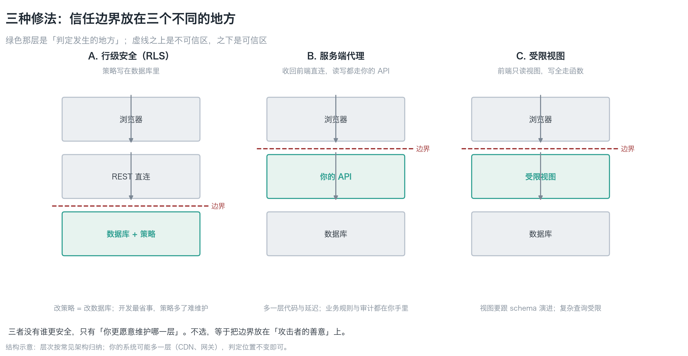
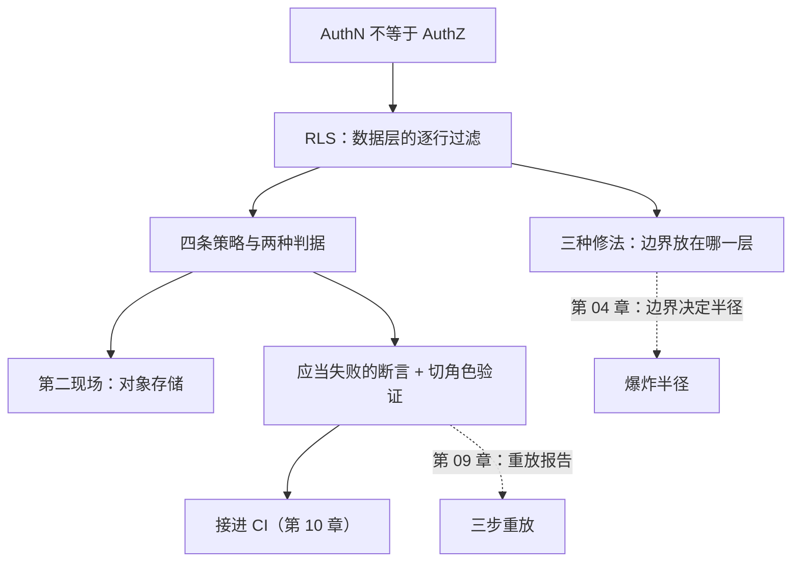

**English** | [中文](./ch06-identity-and-rls.zh.md)

# Chapter 06: Identity and Default Traps

> **Chapter guide**: Chapter 01 said "a missing security property does not raise an error". This chapter covers the most commonly missing one — **authorization at the data layer**. By the end of this chapter you can reproduce the "public key + missing RLS" vulnerability shape yourself in ten minutes, state the cost of each of the three fixes, and know how to verify the sentence "I confirmed it is on".
> **Prerequisites**: Chapter 01 (the division of labor between AuthN and AuthZ, the four-question self-check), Chapter 03 (the F2 line in the crossing list). This chapter uses Chapter 09's replay script directly; you do not need to read that chapter first.
> **Currency baseline**: This chapter is verified against "PostgreSQL Row-Level Security semantics (PostgreSQL 16); Supabase anon / service_role credential semantics (2025 shape)" (last verified: `2026-10-23`)
> **Core learning objectives**:
> - You master the semantics of the four RLS policies, and know the difference between omitting `with check` and explicitly writing `true`
> - You can independently reproduce "public key + missing RLS", and state the cost of each of the three fixes
> - You can use the replay test to verify "I confirmed it is on", and no longer believe any verbal or model self-report

---

## 1. Cognitive Anchor: One switch, three days, 1.5 million records

### 1.1 Moltbook's three days

In 2025 a product called Moltbook launched. It was built with AI assistance and looked quite good, and within three days something happened: about **1.5 million** auth tokens, **35,000** email addresses, and the direct messages between agents were all exposed.

The root cause was not wrong code; it was two things stacking:

1. A frontend-visible Supabase key (this is **by design**, not a leak)
2. **RLS not enabled** (this is a default value)

Neither alone constitutes an incident: a public key is a BaaS premise, and RLS being off just means "no defense". **Together, the database is open to the whole world.**

The same class of incident appeared in batches in 2025: scanning 1,645 apps generated by the same class of builder, 170 could be read and written across users (10.3%). What they share is — **the demo script passes, the data leaks wholesale, and the interface shows nothing unusual**.

### 1.2 Intuitive analogy: the doorbell and the master key

The two "keys" BaaS hands you are extremely different:

| Analogy | Correspondence | What it can do |
|---|---|---|
| **Doorbell** | `anon` / publishable key | Press it and the people inside decide whether to open. **It has no permissions itself**; permissions are decided by database policies |
| **Master key** | `service_role` / secret key | Insert it and **every door opens**, including bypassing all policies |

A doorbell with a problem (nobody answers) is a small matter; **the master key hanging by the door** is a big matter. And the most common incident is the third kind: **the doorbell is pressed and the door simply opens** — because no lock was ever installed on the door (RLS not enabled).

| Where the analogy fails | Explanation |
|---|---|
| A real doorbell cannot be copied | The `anon` key is visible in plaintext in the browser; **anyone can copy it** |
| A real lock is visible once installed | Whether RLS is installed is **completely invisible** in the interface |
| A real master key is registered | Once `service_role` enters the frontend it enters git history and **can be dug out forever** |

### 1.3 Why "I looked at it" is not verification

The most important sentence of this chapter:

> **"I confirmed it is on" is not an observation, it is a guess.**

Your AI coding assistant will tell you "row-level security enabled" — that is its **description** of its own output, not an **observation** of the database state. Verification must bring in evidence independent of the subject under verification (what the database really returns, the real CI exit code, the real output of a probe script). The ten-minute procedure of Section 3.3 in this chapter is exactly this.

---

## 2. First Principles: Which line the policy is written on

### 2.1 What RLS is (in plain words)

Row Level Security (RLS) is a database-level filter: **on every query, every row must first pass the conditions you wrote**; rows that do not pass are neither returned nor modifiable.

Its three traits:

1. **It lives at the data layer, not the application layer**. The frontend cannot route around it, because the decision happens inside the database.
2. **It authorizes separately by action**. Read (select), insert, update, delete each get their own policies.
3. **It is off by default**. If you do not turn it on, it does not exist — exactly the standard shape of an "omission-type defect".


*Figure 6-1: The same `GET` request: the top row is RLS off (the default), the bottom row has four policies enabled. The only difference is the middle cell, "policy decision". The pages look identical and login succeeds — so it does not error, it just does not block. Functional tests go green on both rows; only a "should fail" assertion can tell them apart.*

### 2.2 Four policies, two kinds of criteria

The minimally usable RLS is four policies. Each has two kinds of criteria, easily confused:

| Criterion | Plain words | Where it applies |
|---|---|---|
| `using (...)` | **When reading**: which rows are visible / modifiable / deletable | select / update / delete |
| `with check (...)` | **When writing**: what a newly written row looks like | insert / update |

One detail that must be remembered clearly:

> **When `update` omits `with check`, PostgreSQL falls back to `using`** (it does not open up).
> So the real trap is not "forgot to write it", but **explicitly writing `with check (true)`** — that allows changing a row's `owner_id` to someone else, and the page shows nothing unusual at all.

The complete minimal baseline is in `code/ch06/rls_policies.sql`. The core lines:

```sql
alter table public.notes enable row level security;   -- 总闸，不开则下面全部无效

create policy notes_select_own on public.notes
    for select to authenticated
    using (owner_id = auth.uid());                    -- 读：只看自己那几行

create policy notes_update_own on public.notes
    for update to authenticated
    using (owner_id = auth.uid())                     -- 改哪一行
    with check (owner_id = auth.uid());               -- 改成什么样
```

Two details: `insert` uses only `with check`, `select` uses only `using`, and `update` **needs both**; **`using (true)` opens the whole table to every logged-in user**, and it is more dangerous than writing no policy at all, because you will believe it is defended.

### 2.3 The second crime scene: object storage

If the `notes` table is locked but the attachment bucket is not, it is the front door locked and the back window open.

Supabase's `storage.objects` is equally subject to RLS; the policy shape is the same, only the condition becomes a **path prefix** (usually putting `owner_id` in the first path segment). Almost everyone misses this spot the first time — because the mental model "the data is in the table" is too strong.

### 2.4 Three fixes: which layer the trust boundary sits at


*Figure 6-2: The green layer is "where the decision happens". A puts the boundary in the database, B in your API, C in the view definitions. Note that everything above the dashed line is untrusted — the three fixes only raise the trust line upward, and it cannot reach "the browser".*

| Option | What you do | Cost | Fits |
|---|---|---|---|
| **A. Row-level security** | Policies written in the database | A wrong policy equals no policy; many policies get hard to maintain; cross-table joins get constrained along with the policies | Simple data model, read-heavy, write-light |
| **B. Server-side proxy** | Take away frontend direct connect; reads and writes go through your API | One more layer of latency and code; weaker offline/realtime capability | Clear business rules, needs auditing |
| **C. Restricted views** | Frontend reads views only; all writes go through functions | Views must track schema evolution; complex queries get constrained | Reports, public data |

**None of the three is inherently safer**; it is only "which layer you would rather maintain". Not choosing is the worst — then the boundary sits on "the attacker's goodwill".

---

## 3. Hands-on: Ten-minute reproduction + verification

### 3.1 First probe: RLS off

Steps (do it in a demo environment, not against production):

1. Create a table, insert two rows with different `owner_id` values
2. **Do not** enable RLS, **do not** write policies
3. Request the whole table with the `anon` key

Expected result: **200 + two rows**. Run it with `code/ch09/replay_probe.py` (real commands):

```bash
python3 replay_probe.py --base-url https://<项目>.supabase.co \
  --anon-key <anon> --table notes --dry-run   # 先空跑看请求
python3 replay_probe.py --base-url https://<项目>.supabase.co \
  --anon-key <anon> --table notes             # 再真跑
```

Step 2 is judged **compromised** (it returns the whole table). This is the minimal reproduction of the Moltbook incident shape — **not a single line of code is wrong**.

### 3.2 Second probe: add RLS

Run the `enable row level security` and the four policies from `code/ch06/rls_policies.sql`, then run the same command again. Expected result: **empty set**, and the verdict becomes **healthy**.

The difference between the two outputs is the entire meaning of the three words "default value". **This step must be archived**: write the row counts of both runs into your replay report (`templates/replay-report.md`).

### 3.3 A trap almost everyone steps in the first time

When verifying policies in Supabase's SQL Editor you will hit a strange phenomenon: **the policies are written, yet the query still returns the whole table**.

The reason: SQL Editor runs as `postgres` (a superuser) by default, and **superusers bypass RLS**. So:

```sql
-- 必须显式切角色，否则你永远测出「通过」
set local role anon;
select count(*) from public.notes;      -- 期望 0
reset role;

set local role authenticated;
set local request.jwt.claims = '{"sub":"<用户A的uuid>","role":"authenticated"}';
select count(*) from public.notes;      -- 期望 = A 自己的行数
reset role;
```

**This trap is worth remembering on its own**: it makes your verification look "passing" while testing nothing at all. What makes Chapter 01's "should fail tests" hard to write is exactly this kind of false positive.

### 3.4 Wire the verification into CI

Policies degrade (someone turns RLS off for integration debugging and forgets to turn it back on). Three assertions (Chapter 10 expands; the shape is given here):

```bash
# 1) 匿名与越权必须失败
python3 code/ch09/replay_probe.py --base-url "$SB_URL" --anon-key "$SB_ANON" --table notes

# 2) 前端产物里不得出现 service_role
grep -Eq "service_role|SUPABASE_SERVICE" -r .next/static/ && exit 1

# 3) 迁移文件里必须有 enable row level security
grep -Lq "row level security" supabase/migrations/*.sql && exit 1
```

The third is the simplest and the most easily skipped: **it tests "was it written", not "was it written right"**. Whether it is written right is up to the first.

---

## 4. Common Pitfalls and the Right Mental Model

| Pitfall that is easy to step in | Why it goes wrong (root cause) | The right mental model and practice |
|---|---|---|
| **"I added a login, so the data is safe"** | AuthN answers "who are you", AuthZ answers "which rows can you read"; nothing transfers automatically between them | Write policies at the data layer; test once each with "anonymous + someone else's identity" |
| **"RLS is on, so it is safe"** | The policy is written as `using(true)`, or `with check` explicitly writes `true` | Every policy gets one "should fail" test |
| **"The key is in the frontend, but it is only anon, no problem"** | `anon` stands for "logged-out users"; private tables are open to it by default unless RLS says no | Treat `anon` as "any stranger", not "my frontend" |
| **"I'll put service_role in the frontend temporarily to test"** | Even temporary commits enter git history and build artifacts | The master key lives only in server-side environment variables; revoke it immediately after testing |
| **"I checked in the SQL Editor, the policies are fine"** | Superusers bypass RLS; the "pass" you measured is fake | Explicitly `set local role anon` and test again |
| **"The table is locked, so we're fine"** | Object storage is the second crime scene | Bucket policies by path prefix, written and tested together with table policies |

---

## 5. Chapter Summary and Local Knowledge Map

### 5.1 Core points

- **RLS is data-layer filtering**: authorization per action, off by default — a classic omission-type defect.
- **`using` governs reads, `with check` governs writes**; update needs both. The real trap is explicitly writing `with check (true)`.
- **`anon` is the doorbell, `service_role` is the master key**; the moment the master key appears in the frontend, every policy goes to zero.
- **The three fixes only put the trust boundary at different layers**: database / your API / views. Not choosing is the worst.
- **Verification must switch roles** (superusers bypass RLS), and must use "should fail" assertions.
- **Object storage is the second crime scene**; table locked but bucket unlocked is the front door locked and the back window open.

### 5.2 Concept topology of this chapter



---

## 6. Tiered Exercises

### Foundation (Tier 1)

1. In one sentence distinguish `using` from `with check`, and explain why `update` needs both.
2. Someone verifies policies in the SQL Editor and finds "it returns 0 rows, the policies work". Point out where that conclusion may be wrong, and give the correct way to verify.

### Hands-on Application (Tier 2)

3. Run the complete ten-minute procedure in a demo environment: create table → RLS off → probe gets the whole table → enable RLS + four policies → probe again gets an empty set. Write the row counts and verdicts of both runs into `templates/replay-report.md`.
4. Write four policies for your `notes` (or equivalent table), and write one **should-fail** assertion (the five elements are in Chapter 09's format). Requirement: the assertion must fail under the current code.

### Deep Challenge (Tier 3)

5. Your system has two tables, `orders` and `order_items`, and `order_items` has no `owner_id`. Write the row-level policy (hint: an `exists` lookup to the parent table), and explain why "wrapping the lookup in a `security definer` function" may instead open a back door.
6. Someone proposes: "let's just not use RLS at all; route every read and write through the server-side API (option B), which is safer." Argue whether B is really "safer", and give three things B must additionally take on (hint: auditing, rate limits, error handling).

<details>
<summary><strong>点击展开：本章练习参考答案与深度解析</strong></summary>

#### 1. Analysis of question 1

- **`using` governs reads**: it decides which rows are visible, modifiable, deletable. **`with check` governs writes**: it decides what a newly written (or updated) row looks like.
- **Why update needs both**: `using` decides "which row to change", `with check` decides "what it may become". Giving only `using` makes PostgreSQL fall back to it (which is safe), but **explicitly writing `with check (true)` opens the back door** — you can change `owner_id` to someone else and "gift" a row away.
- **Memory hook**: omission is safe, **explicitly opening up is the dangerous one**. This is the opposite of many people's intuition.

#### 2. Analysis of question 2

- **Where it may be wrong**: SQL Editor runs as a superuser by default, and **superusers bypass RLS**. So "returns 0 rows" may just be because the table has no data, or you queried the wrong table — it **did not prove the policies work**.
- **The correct way**: run `set local role anon;` before querying; then simulate a specific user with `set local request.jwt.claims` and query again. Keep the output of both.
- **A steadier approach**: do not rely on SQL Editor; use `replay_probe.py` to send real requests from outside — it uses the real `anon` identity and cannot be bypassed.

#### 3. Analysis of question 3

- **Reference fill-in** (swap in your own):
  | Step | Request | Status | Rows | Verdict |
  |---|---|---|---|---|
  | Before RLS | `GET /rest/v1/notes?select=*` | 200 | 2 | Compromised |
  | After RLS | `GET /rest/v1/notes?select=*` | 200 | 0 | Healthy |
- **Acceptance criteria**: the report archives both outputs and states clearly that "the difference comes from enable + four policies". Just writing "fixed it" does not count.

#### 4. Analysis of question 4

- **The four policies** are in Section 2.2.
- **The should-fail assertion** (five elements):
  ```
  主体 = anon 角色；动作 = select count(*)；对象 = notes；
  期望 = 0 行；判据来源 = CI 退出码（replay_probe.py 的退出码非 0 即挂）
  ```
- **The condition under which it fails on current code**: if RLS is off or a policy is wrong, `count` > 0 and the assertion fails. **That is exactly where its meaning lies** — it tests "what should not happen did not happen".

#### 5. Analysis of question 5

- **Policy shape**:
  ```sql
  create policy items_select_own on public.order_items for select to authenticated
      using (exists (
          select 1 from public.orders o
          where o.id = order_items.order_id and o.user_id = auth.uid()
      ));
  ```
- **Why `security definer` may open a back door**: a `security definer` function executes as the **function owner**, bypassing the RLS the caller should be subject to. If the lookup is written inside such a function, it opens an escalation path for everyone who can call it.
- **The safe approach**: write the lookup as an ordinary subquery (executing as the caller, subject to RLS); if `security definer` is unavoidable, explicitly `set search_path` and check every line for privilege escalation.

#### 6. Analysis of question 6

- **B is not inherently safer**: it only moves the boundary from the database to your API. **Safety depends on what you write at that layer** — if the API does no row-level checks, B is a more concentrated escalation point.
- **The three things B must additionally take on**:
  1. **Auditing**: every read and write must be recorded (the database at the RLS layer cannot record business semantics);
  2. **Rate limits and quotas**: with direct connect the database rate-limits; going through an API you must do it yourself;
  3. **Error handling and idempotency**: the API layer must distinguish "no permission" from "no data", and keep retries safe.
- **Conclusion**: A, B, C are **choices of boundary position**, not choices of security level. The real reason to pick B is usually "I want business rules and auditing", not "I want to be safer".

</details>

---

## 7. Authoritative References and Further Reading for This Chapter

1. **Official docs**: [PostgreSQL Documentation · Row Security Policies](https://www.postgresql.org/docs/current/ddl-rowsecurity.html) - anchors the semantics and omission behavior of `using` / `with check`, supporting the four policies of Section 2.2 (verified version: PostgreSQL 16).
2. **Official architecture docs**: [Supabase Docs](https://supabase.com/docs) - anchors the `anon` / `service_role` credential semantics and the frontend direct-connect shape, supporting Sections 1.2 and 2.4.
3. **Defect classification**: [MITRE CWE](https://cwe.mitre.org/) - anchors the "missing authorization / improper permission assignment" defect class, supporting the classification of the incident lineage in Section 1.1.

> Counting-basis note: the sources above are used to anchor **definitions and specifications**, not to extrapolate risk probabilities. Before citing any number, first check the source's year and denominator.
