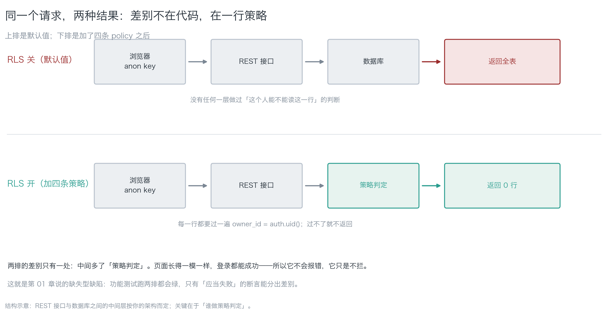
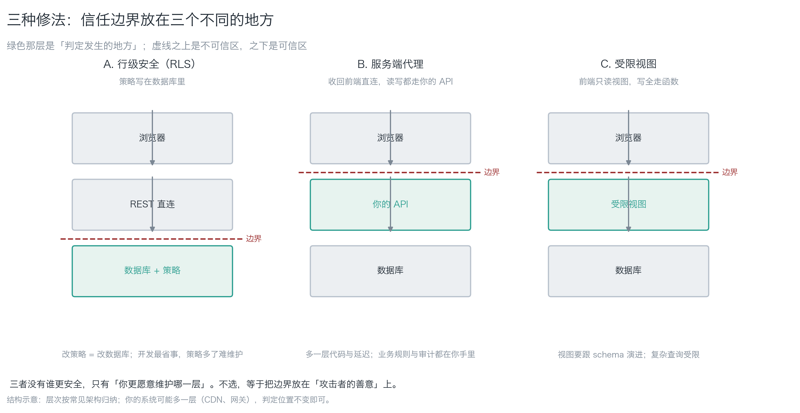
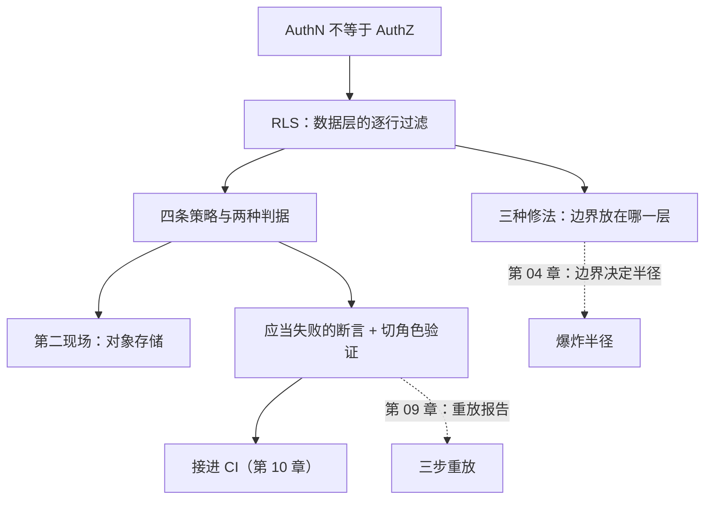

[English](./ch06-identity-and-rls.md) | **中文**

# 第 06 章：身份与默认陷阱

> **本章导读**：第 01 章说"缺失的安全属性不会报错"，这一章讲最常缺失的那一个——**数据层的授权**。学完本章，你能在十分钟内自己复现"公开 key + 缺失 RLS"这个漏洞形态，说出三种修法各自的代价，并且知道怎么验证"我确认它开了"这句话。
> **前置知识**：第 01 章（AuthN 与 AuthZ 的分工、四问自查法）、第 03 章（穿越点清单里 F2 那条线）。第 09 章的重放脚本本章直接用，不需要先读。
> **时效基线**：本章内容基于「PostgreSQL 行级安全语义（PostgreSQL 16）；Supabase anon / service_role 凭据语义（2025 形态）」核验（最后核验日期：`2026-10-23`）
> **核心学习目标**：
> - 掌握 RLS 的四条策略语义，知道 `with check` 省略与显式写 `true` 的差别
> - 能独立复现"公开 key + 缺失 RLS"，并说明三种修法各自的代价
> - 能用重放测试验证"我确认它开了"，不再相信任何口头或模型自述

---

## 1. 认知锚点：一个开关，三天，150 万条记录

### 1.1 Moltbook 的三天

2025 年，一个叫 Moltbook 的产品上线。它是 AI 辅助做出来的，做得挺好看，上线三天就出事了：约 **150 万**认证令牌、**3.5 万**个邮箱、智能体之间的私信内容，全部暴露。

根因不是代码写错了，是两件事的叠加：

1. 前端可见的 Supabase key（这是**设计如此**，不是泄漏）
2. **未启用 RLS**（这是一个默认值）

两者单独都不构成事故：key 公开是 BaaS 的前提，RLS 关着只是"没设防"。**合起来，就是数据库对全世界开放。**

同一类事故在 2025 年成批出现：扫描 1,645 个由同一类构建器生成的应用，170 个可被越权读写（10.3%）。它们的共同点是——**演示脚本能过、数据全泄，且界面上看不出任何异常**。

### 1.2 直觉类比：门铃和万能钥匙

BaaS 给你的两把"钥匙"，差别极大：

| 类比 | 对应 | 它能做什么 |
|---|---|---|
| **门铃** | `anon` / publishable key | 按一下，里面的人决定开不开门。**它本身没有权限**，权限由数据库策略决定 |
| **万能钥匙** | `service_role` / secret key | 插进去，**所有门都开**，包括绕过所有策略 |

门铃出问题（比如按了没人应）是小事；**万能钥匙挂在门口**是大事。而最常见的事故是第三种：**门铃按了，门直接开了**——因为门上根本没装锁（RLS 未启用）。

| 类比失效的地方 | 说明 |
|---|---|
| 真实的门铃不能被复制 | `anon` key 在浏览器里明文可见，**人人可复制** |
| 真实的锁装上就能看见 | RLS 装没装，界面上**完全看不出** |
| 真实的万能钥匙有登记 | `service_role` 一旦进前端，就进 git 历史，**永远可以被挖出来** |

### 1.3 为什么"我看过了"不算验证

这一章最要紧的一句话：

> **"我确认它开了"不是观测，是猜测。**

AI 编码助手会告诉你"已启用行级安全"——那是它对自身输出的**描述**，不是对数据库状态的**观测**。验证必须引入独立于被验证者的证据（数据库真实返回、CI 真实退出码、探测脚本真实输出）。本章 3.3 节的十分钟流程就是干这个的。

---

## 2. 第一性原理：策略写在哪一行

### 2.1 RLS 是什么（白话）

行级安全（Row Level Security，RLS）是数据库的一层过滤：**每一次查询，每一行都要先过一遍你写的条件**，过不了就不返回、不让改。

它的三个特点：

1. **它在数据层，不在应用层**。前端绕不过去，因为判定发生在数据库里。
2. **它按动作分开授权**。读（select）、插（insert）、改（update）、删（delete）各写各的策略。
3. **默认是关的**。你不开，它就不存在——这正是"缺失型缺陷"的标准形状。


*图 6-1：同一个 `GET` 请求，上排是 RLS 关（默认值），下排是开了四条策略。差别只有中间那一格"策略判定"。页面长得一模一样、登录都能成功——所以它不会报错，它只是不拦。功能测试跑两排都会绿，只有"应当失败"的断言能分出差别。*

### 2.2 四条策略，两种判据

最小可用的 RLS 是四条策略。每条有两种判据，容易混：

| 判据 | 白话 | 用在哪 |
|---|---|---|
| `using (...)` | **读的时候**：哪几行可见 / 可改 / 可删 | select / update / delete |
| `with check (...)` | **写的时候**：新写入的行长什么样 | insert / update |

一个必须记清的细节：

> **`update` 省略 `with check` 时，PostgreSQL 会拿 `using` 顶上**（不是放开）。
> 所以真正的坑不是「忘了写」，而是**显式写了 `with check (true)`**——那等于允许把一行的 `owner_id` 改成别人，而这在页面上看不出任何异常。

完整的最小基线见 `code/ch06/rls_policies.sql`。核心几行：

```sql
alter table public.notes enable row level security;   -- 总闸，不开则下面全部无效

create policy notes_select_own on public.notes
    for select to authenticated
    using (owner_id = auth.uid());                    -- 读：只看自己那几行

create policy notes_update_own on public.notes
    for update to authenticated
    using (owner_id = auth.uid())                     -- 改哪一行
    with check (owner_id = auth.uid());               -- 改成什么样
```

两个细节：`insert` 只用 `with check`，`select` 只用 `using`，`update` **两个都要给**；**`using (true)` 等于对所有登录用户开放全表**，它比不写策略更危险，因为你会以为已经设防了。

### 2.3 第二现场：对象存储

`notes` 表锁了，附件桶没锁，等于前门上锁、后窗开着。

Supabase 的 `storage.objects` 同样受 RLS 约束，策略形状一样，只是判定条件换成**路径前缀**（通常把 `owner_id` 放在路径第一段）。这个位置几乎所有人第一次都会漏——因为"数据在表里"这个心智模型太强了。

### 2.4 三种修法：信任边界放在哪一层


*图 6-2：绿色那层是"判定发生的地方"。A 把边界放在数据库，B 放在你的 API，C 放在视图定义。注意虚线之上都是不可信区——三种修法只是把可信线往上提，提不到"浏览器"。*

| 方案 | 做法 | 代价 | 适用 |
|---|---|---|---|
| **A. 行级安全** | 策略写在数据库里 | 策略写错等于没写；策略多了难维护；跨表关联会被策略连带约束 | 数据模型简单、读多写少 |
| **B. 服务端代理** | 收回前端直连，读写走你的 API | 多一层延迟与代码量；离线/实时能力变弱 | 有明确业务规则、需要审计 |
| **C. 受限视图** | 前端只读视图，写全走函数 | 视图要跟 schema 演进；复杂查询受限 | 报表、公开数据 |

三者**没有谁更安全**，只有"你更愿意维护哪一层"。不选是最差的——那时边界在"攻击者的善意"上。

---

## 3. 手把手：十分钟复现 + 验证

### 3.1 第一次探测：不开 RLS

步骤（在演示环境做，别对生产）：

1. 建一张表，插入两行不同 `owner_id` 的数据
2. **不**启用 RLS，**不**写策略
3. 用 `anon` key 请求全表

预期结果：**200 + 两行数据**。用 `code/ch09/replay_probe.py` 跑（真实命令）：

```bash
python3 replay_probe.py --base-url https://<项目>.supabase.co \
  --anon-key <anon> --table notes --dry-run   # 先空跑看请求
python3 replay_probe.py --base-url https://<项目>.supabase.co \
  --anon-key <anon> --table notes             # 再真跑
```

第 2 步会判成**已失守**（返回全表）。这就是 Moltbook 事故形态的最小复现——**没有任何一行代码是错的**。

### 3.2 第二次探测：加上 RLS

跑 `code/ch06/rls_policies.sql` 里的 `enable row level security` 与四条策略，再跑一次同一条命令。预期结果：**空集**，判定变**健康**。

两次输出的差别，就是"默认值"这三个字的全部含义。**这一步要留档**：把两次的行数写进你的重放报告（`templates/replay-report.zh.md`）。

### 3.3 一个几乎所有人第一次都会踩的坑

在 Supabase 的 SQL Editor 里验证策略时，你会遇到一个诡异现象：**明明策略写了，查询还是返回全表**。

原因：SQL Editor 默认以 `postgres`（超级用户）身份运行，**超级用户绕过 RLS**。所以：

```sql
-- 必须显式切角色，否则你永远测出「通过」
set local role anon;
select count(*) from public.notes;      -- 期望 0
reset role;

set local role authenticated;
set local request.jwt.claims = '{"sub":"<用户A的uuid>","role":"authenticated"}';
select count(*) from public.notes;      -- 期望 = A 自己的行数
reset role;
```

**这条坑值得单独记**：它让你的验证看起来"通过"，实际上什么都没测。第 01 章说的"应当失败的测试"之所以难写，就是这类假阳性。

### 3.4 把验证接进 CI

策略会退化（有人为了联调关掉 RLS，忘了开回来）。三条断言（第 10 章展开，这里给形状）：

```bash
# 1) 匿名与越权必须失败
python3 code/ch09/replay_probe.py --base-url "$SB_URL" --anon-key "$SB_ANON" --table notes

# 2) 前端产物里不得出现 service_role
grep -Eq "service_role|SUPABASE_SERVICE" -r .next/static/ && exit 1

# 3) 迁移文件里必须有 enable row level security
grep -Lq "row level security" supabase/migrations/*.sql && exit 1
```

第 3 条是最简单也最容易被跳过的：**它测的是"有没有写"，不是"写得对不对"**。写得对不对靠第 1 条。

---

## 4. 常见误区与正反例

| 容易踩坑的误区 | 为什么会出错（根因） | 正确的心智模型与做法 |
|---|---|---|
| **"我加了登录，所以数据是安全的"** | AuthN 答"你是谁"，AuthZ 答"你能读哪几行"，两者没有自动传导 | 在数据层写策略；用"匿名 + 他人身份"各测一次 |
| **"RLS 开了就安全了"** | 策略写成 `using(true)`，或 `with check` 显式写 `true` | 每条策略配一条"应当失败"的测试 |
| **"key 在前端，但只是 anon，没关系"** | `anon` 代表"未登录用户"；私有表默认就对它开放，除非 RLS 说不 | 把 `anon` 当成"任何陌生人"，不是"我的前端" |
| **"我临时把 service_role 放前端测一下"** | 临时提交也进 git 历史与构建产物 | 万能钥匙只在服务端环境变量；测完立刻吊销 |
| **"SQL Editor 里查了，策略没问题"** | 超级用户绕过 RLS，测出来的"通过"是假的 | 显式 `set local role anon` 再测 |
| **"表锁了就没事了"** | 对象存储是第二现场 | 桶策略按路径前缀，与表策略一起写、一起测 |

---

## 5. 本章小结与局部知识图谱

### 5.1 核心要点

- **RLS 是数据层的过滤**：按动作分开授权，默认是关的——典型的缺失型缺陷。
- **`using` 管读，`with check` 管写**；update 两个都要给。真正的坑是显式写 `with check (true)`。
- **`anon` 是门铃，`service_role` 是万能钥匙**；万能钥匙出现在前端的那一刻，所有策略归零。
- **三种修法只是把信任边界放在不同层**：数据库 / 你的 API / 视图。不选最差。
- **验证必须切角色**（超级用户绕过 RLS），且必须用"应当失败"的断言。
- **对象存储是第二现场**，表锁了桶没锁等于前门上锁后窗开着。

### 5.2 本章概念拓扑



---

## 6. 分级通关练习

### 基础巩固题（Tier 1）

1. 用一句话区分 `using` 与 `with check`，并说明为什么 `update` 两个都要给。
2. 有人在 SQL Editor 里验证策略，发现"返回 0 行，策略生效了"。请指出这个结论可能错在哪，并给出正确的验证方式。

### 动手应用题（Tier 2）

3. 在演示环境跑完整的十分钟流程：建表 → 不开 RLS → 探测到全表 → 开 RLS + 四策略 → 再探测得空集。把两次的行数与判定写进 `templates/replay-report.zh.md`。
4. 给你的 `notes`（或等价表）写四条策略，并写一条**应当失败**的断言（格式见第 09 章的五要素）。要求：断言能在当前代码下失败。

### 深度挑战题（Tier 3）

5. 你的系统有 `orders` 和 `order_items` 两张表，`order_items` 没有 `owner_id`。请写出行级策略（提示：`exists` 回查父表），并说明为什么"用 `security definer` 函数封装回查"可能反而开出一条后门。
6. 有人提议："我们干脆不用 RLS，全部读写走服务端 API（方案 B），这样更安全。"请论证 B 是否真的"更安全"，并给出 B 需要额外承担的三件事（提示：审计、速率、错误处理）。

<details>
<summary><strong>点击展开：本章练习参考答案与深度解析</strong></summary>

#### 1. 题目 1 解析

- **`using` 管读**：决定哪几行可见、可改、可删。**`with check` 管写**：决定新写入（或改后）的行长什么样。
- **为什么 update 两个都要给**：`using` 决定"改哪一行"，`with check` 决定"改成什么样"。只给 `using` 时 PostgreSQL 会拿它顶上（这是安全的），但**显式写 `with check (true)` 就把后门打开了**——可以把 `owner_id` 改成别人，把一行"送"出去。
- **记忆点**：省略是安全的，**显式放开才是危险的**。这与很多人的直觉相反。

#### 2. 题目 2 解析

- **可能错在哪**：SQL Editor 默认以超级用户身份运行，**超级用户绕过 RLS**。所以"返回 0 行"可能只是因为表里没数据，或者你查错了表——它**没有证明策略生效**。
- **正确方式**：`set local role anon;` 之后再查；再用 `set local request.jwt.claims` 模拟具体用户查一次。两次都要留输出。
- **更稳的做法**：不依赖 SQL Editor，用 `replay_probe.py` 从外部发真实请求——它用的是真实的 `anon` 身份，绕不过去。

#### 3. 题目 3 解析

- **参考填法**（换成你的）：
  | 步骤 | 请求 | 状态码 | 行数 | 判定 |
  |---|---|---|---|---|
  | 开 RLS 前 | `GET /rest/v1/notes?select=*` | 200 | 2 | 已失守 |
  | 开 RLS 后 | `GET /rest/v1/notes?select=*` | 200 | 0 | 健康 |
- **验收标准**：报告里两次输出都留了档，且写清"差别来自 enable + 四条策略"。只写"修好了"的不算。

#### 4. 题目 4 解析

- **四条策略**见 2.2 节。
- **应当失败的断言**（五要素）：
  ```
  主体 = anon 角色；动作 = select count(*)；对象 = notes；
  期望 = 0 行；判据来源 = CI 退出码（replay_probe.py 的退出码非 0 即挂）
  ```
- **它在当前代码下失败的条件**：如果 RLS 没开或策略写错，`count` > 0，断言失败。**这就是它有意义的地方**——它测的是"不该发生的没发生"。

#### 5. 题目 5 解析

- **策略形状**：
  ```sql
  create policy items_select_own on public.order_items for select to authenticated
      using (exists (
          select 1 from public.orders o
          where o.id = order_items.order_id and o.user_id = auth.uid()
      ));
  ```
- **为什么 `security definer` 可能开后门**：`security definer` 函数以**函数所有者**的身份执行，会绕过调用者本该受的 RLS。如果回查写在这样的函数里，等于给所有能调用它的人开了一条提权路径。
- **稳妥做法**：回查写成普通子查询（以调用者身份执行，受 RLS 约束）；若必须用 `security definer`，要显式 `set search_path` 并逐行检查权限提升。

#### 6. 题目 6 解析

- **B 不天然更安全**：它只是把边界从数据库挪到你的 API。**安全性取决于你在那一层写了什么**——API 若不做行级校验，B 就是一个更集中的越权点。
- **B 需要额外承担的三件事**：
  1. **审计**：每次读写要有记录（RLS 那层数据库记不了业务语义）；
  2. **速率与配额**：直连时数据库限流，走 API 要自己做；
  3. **错误处理与幂等**：API 层要区分"没权限"和"没数据"，并保证重试安全。
- **结论**：A、B、C 是**边界位置的选择**，不是安全等级的选择。选 B 的真实理由通常是"我要业务规则与审计"，不是"我要更安全"。

</details>

---

## 7. 本章权威参考信源与延伸阅读 (Authoritative References)

1. **官方文档**：[PostgreSQL 文档 · Row Security Policies](https://www.postgresql.org/docs/current/ddl-rowsecurity.html) - 锚定 `using` / `with check` 的语义与省略行为，支撑第 2.2 节的四条策略（核验版本：PostgreSQL 16）。
2. **官方架构文档**：[Supabase Docs](https://supabase.com/docs) - 锚定 `anon` / `service_role` 凭据语义与前端直连形态，支撑第 1.2 节与第 2.4 节。
3. **缺陷分类**：[MITRE CWE](https://cwe.mitre.org/) - 锚定「缺少授权 / 权限分配不当」类缺陷，支撑第 1.1 节事故谱系的归类。

> 口径提示：以上信源用于锚定**定义与规范**，不用于外推风险概率。引用任何数字前，先核对来源年份与分母。
