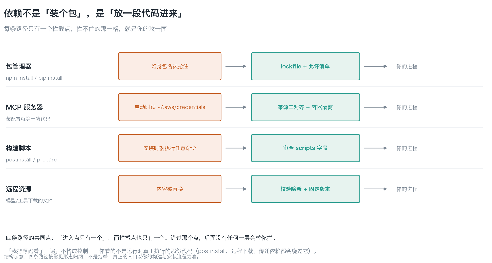
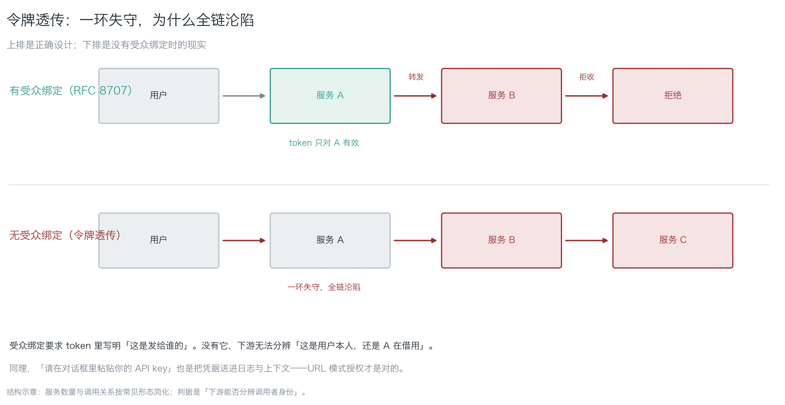
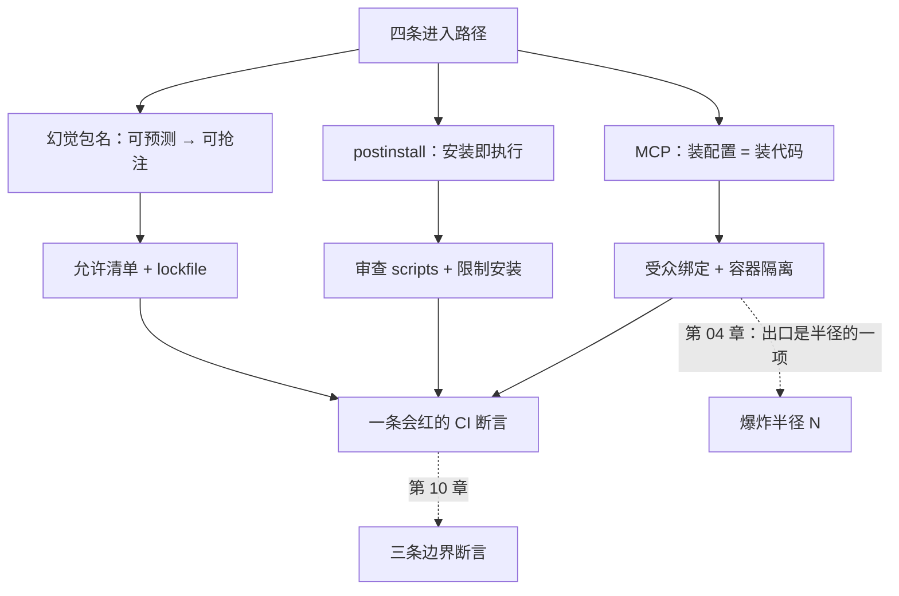

**English** | [中文](./ch07-supply-chain.zh.md)

# Chapter 07: Supply Chain

> **Chapter guide**: The previous chapters were all about "the things you write". This chapter is about **how the things other people write get in** — packages, MCP servers, build scripts, remote resources. By the end of this chapter you can name the four paths by which dependencies enter a system and each path's single interception point, and you know why "I read the source code once" does not constitute a control.
> **Prerequisites**: Chapter 02 (deputy escalation, credential holding). Chapter 04's blast radius will be used.
> **Currency baseline**: This chapter is verified against "hallucinated package name research (USENIX Security 2025, second-hand summary); OAuth 2.1 and RFC 8707 audience binding; MCP registry shape (2025)" (last verified: `2026-10-23`)
> **Core learning objectives**:
> - You master the four paths by which dependencies enter a system, know where each interception point is, and what happens if it is missed
> - You can explain why hallucinated package names mean "predictable means squattable", and block it with an allowlist
> - You can state the four MCP security boundaries (audience binding / URL authorization / SSRF / registry squatting)

---

## 1. Cognitive Anchor: The package you installed was squatted for you three years ago

### 1.1 A package that does not exist

You are having AI write some date-handling code. When it finishes it recommends a package along the way:

```bash
npm install date-helper-utils
```

You install it and it runs. What you do not know is: `date-helper-utils` **does not exist** on npm — it is a hallucinated name. What you installed is a package of the same name that someone **squatted immediately** after the model first hallucinated that name, carrying a `postinstall` that reads `~/.aws/credentials` and sends it out.

This is not hypothetical. Research shows about **19.7%** of LLM-recommended package names do not exist in the registry (21.7% for open-source models, 5.2% for commercial models), identifying **205,474** unique hallucinated package names, of which **43%** reproduce on every query.

> **Reproducible means predictable, and predictable means squattable.**

(This data comes from a USENIX Security 2025 paper, cited here via second-hand summary; the ratios change with the model — check the source year before citing.)

### 1.2 Intuitive Analogy: the workers the renovation crew brings along

The workers you hire yourself (the code you write) — you check their qualifications. But the renovation crew (the package manager) also brings **its own workers** (transitive dependencies), and even **its friends** (MCP servers) — these people come and go with keys to your house, and you know none of them.

| Analogy | Correspondence | Where it fails |
|---|---|---|
| The crew's own workers | Transitive dependencies | You did not hire them, but they enter your house |
| Their friends | Third-party MCP servers | Installing a config equals installing a piece of code |
| The power tools they bring | Build scripts (`postinstall`) | **It was powered on and tested at install time** |
| The "same model" on the tool list | Hallucinated package names get squatted | Same name, different contents |

### 1.3 MCP: installing config = installing code

The Model Context Protocol (MCP) lets models connect to external tools. It turns "integration" from writing code into installing configuration — the other side of that sentence is:

> **You moved the attack surface from the code into the config file, and config files usually get no review.**

An MCP server is a piece of code that **runs on your machine holding your credentials**. At startup it can read `~/.aws/credentials`, reach the network, and call your tools. This is exactly the best vehicle for the deputy escalation of Chapter 02.

---

## 2. First Principles: Four Paths, Four Interception Points

### 2.1 The four paths by which dependencies enter


*Figure 7-1: Each path has only **one entry point**, and only one interception point. Miss that point and no later layer will stop it for you. Note the third (build scripts) — its risk happens "at install time", not "at runtime".*

| Path | Entry point | Risk | The single interception point |
|---|---|---|---|
| **Package manager** | `npm install` / `pip install` | Hallucinated package names get squatted | Lockfile + allowlist |
| **MCP server** | Installing config | Reads credentials at startup, reaches the network | Three-way source alignment + container isolation |
| **Build scripts** | `postinstall` / `prepare` | **Arbitrary commands execute at install time** | Review the `scripts` field |
| **Remote resources** | Files downloaded by models/tools | Content gets swapped | Verify hashes + pin versions |

**The third is the most easily missed**: `postinstall` runs the moment `npm install` runs, before your code has executed and before your tests have started. **The install process is itself a code execution.**

### 2.2 Why "I read the source once" does not constitute a control

Three reasons, each standing on its own:

1. **What you read is not what runs**: `postinstall`, runtime downloads, and conditional loading all route around your reading.
2. **Transitive dependencies change**: you read `a@1.2.3`; next week the `b` that `a` depends on goes to `2.0`, and `b`'s behavior changes.
3. **What you read is static text; what it does is dynamic behavior**: code that looks like string concatenation becomes execution the moment `child_process` is involved.

So control must land on **mechanisms**: sandboxes, allowlists, hash verification, dependency allowlists. **Control by mechanism beats control by people**, because people are only careful the first time.

### 2.3 The four MCP security boundaries


*Figure 7-2: The top row is the correct design — the token is valid only for A, and B rejects it; the bottom row is reality without audience binding — A passes the token down, one link falls and the whole chain falls.*

| # | Boundary | Plain words | What to do |
|---|---|---|---|
| 1 | **Audience binding** (RFC 8707) | The token says "who this is for" | Without it, A passes to B, and B cannot tell "is it the user, or A borrowing" |
| 2 | **URL pattern authorization** | Credentials never pass through the client | Any design of "please paste your API key in the dialog" writes the key into logs |
| 3 | **SSRF** | Tools will request URLs from config | Network allowlist; **`http://169.254.169.254/` is the cloud metadata service and can be exchanged for temporary credentials** |
| 4 | **Registry squatting** | Same name, different author | Three-way alignment before installing: author, release date, repository URL |

One practice principle covers most of it: **issue credentials only to "the one tool that needs them", not to the whole session**. Session-level credentials equal hanging the master key in the public lobby.

---

## 3. Hands-on: Block one squatting attempt

### 3.1 The allowlist: run it once

`code/ch07/dependency_allowlist.py` (stdlib, read-only):

```bash
python3 dependency_allowlist.py --lock package-lock.json --allow allowlist.txt
```

Run on a lockfile with a squatted package deliberately planted, real output:

```text
发现 1 个不在允许清单里的包：
  - evil-pkg

判据：新包必须由人看过来源与 postinstall，再手动加进清单。
```

Exit code 1. **It does not tell you whether the package is bad; it only tells you "no human has looked at this package"** — and a package no human has looked at is your attack surface.

### 3.2 Three-way source alignment (before installing)

For every new package, three things must line up:

| # | Align what | What to do if it does not line up |
|---|---|---|
| 1 | **Author**: the maintainer on the package page vs the organization you assume | Same name, different author → reject outright |
| 2 | **Release date**: first publish date vs when you started using it | A same-named package appearing out of nowhere → reject |
| 3 | **Repository URL**: the `repository` field vs the official domain | Points at an unfamiliar repository → reject |

Add one more: **look at the `scripts` field**. If there is a `postinstall` / `prepare`, know what it will do; if you cannot understand it, do not install.

### 3.3 Restricting after install (this is the mainstay)

"Looking" will always miss things, so the mainstay is restriction:

1. **Filesystem**: mount only the working directory in the container. `~/.aws`, `~/.ssh`, `~/.config` are **not mounted — not mounted means unreadable**, more reliable than "it promised not to read".
2. **Credentials**: do not inject long-lived keys; use short-lived, narrowly scoped temporary credentials, distributed per tool (Chapter 02's least Agency).
3. **Network**: deny outbound by default; the allowlist carries only the necessary domains.
4. **Processes**: non-root, read-only root filesystem, restricted `fork`.

**Of the four, the first is the most valuable**: it turns the question "will it read credentials" from a matter of "trust" into a matter of "physics".

### 3.4 One minimal CI assertion

```bash
python3 code/ch07/dependency_allowlist.py --lock package-lock.json --allow allowlist.txt
```

Wire it into CI and a new package that has not entered the list turns it red. It is the same kind of thing as Chapter 10's three assertions — **testing "what should not happen did not happen"**.

---

## 4. Common Pitfalls and the Right Mental Model

| Pitfall that is easy to step in | Why it goes wrong (root cause) | The right mental model and practice |
|---|---|---|
| **"I read the source code once"** | What you read is not what runs; transitive dependencies change | Rely on mechanisms: lockfiles, allowlists, sandboxes, network allowlists |
| **"The package installs and runs, so it is fine"** | Malicious behavior often runs only in `postinstall` or under specific triggers | Look at the `scripts` field; probe first with `--ignore-scripts` at install time |
| **"MCP is just config, not code"** | Installing config = installing a piece of code that holds your credentials | Three-way source alignment + container isolation + credentials per tool |
| **"A model-recommended package should be fine"** | 19.7% of recommended names do not exist at all; reproducible → squattable | Allowlist: new packages enter only after a human looks |
| **"Passing the token downstream is fine, it is all my services anyway"** | Without audience binding, one link falls and the whole chain falls | RFC 8707 audience binding; issue credentials only to a single tool |
| **"A network allowlist is too much hassle, leave it open for now"** | Fully open = data can be sent anywhere (the N of Chapter 04) | Deny by default, allowlist to permit; DNS counts as an exit too |

---

## 5. Chapter Summary and Local Knowledge Map

### 5.1 Core points

- **Dependencies enter by four paths**: package manager, MCP server, build scripts, remote resources. Each has only one interception point.
- **Hallucinated package names are predictable → squattable**; the allowlist is the lowest-cost line of defense.
- **`postinstall` executes at install time** — the install process is itself a code execution.
- **"Reading the source" does not constitute a control**; control must land on mechanisms (lockfiles, allowlists, sandboxes, hashes).
- **The four MCP boundaries**: audience binding, URL pattern authorization, SSRF, registry squatting.
- **Restricting after installing** is more reliable than verifying before installing: not mounted means unreadable.

### 5.2 Concept topology of this chapter



---

## 6. Tiered Exercises

### Foundation (Tier 1)

1. In one sentence explain why "hallucinated package names are predictable" leads to "they can be squatted", and give one lowest-cost line of defense.
2. How does the risk of `postinstall` differ from that of an ordinary dependency? When does it execute?

### Hands-on Application (Tier 2)

3. Run `code/ch07/dependency_allowlist.py --lock <your-lockfile> --allow <list>`. If it hits 0, write one scenario where "it should have hit but did not" (hint: which kind of package can it not see?).
4. Do a "three-way source alignment" on one new package you want to install, writing the check result and conclusion (install / do not install) for each of the three items.

### Deep Challenge (Tier 3)

5. Your agent installed three third-party servers through MCP, one of which reads `~/.aws/credentials` at startup. Design a scheme of "verifiable before install, restrictable after install", and explain why "I read the source once" does not constitute a control.
6. Someone proposes: "we use `npm audit` to auto-fix vulnerabilities, so the supply chain is secure." Point out which class of risk `npm audit` covers and which it misses (hint: are squatted packages in the `npm audit` database?).

<details>
<summary><strong>Click to expand: reference answers and in-depth analysis for this chapter's exercises</strong></summary>

#### 1. Analysis of question 1

- **The inference chain**: the model hallucinates the same batch of names every time (43% reproduce) → attackers can predict these names → squat them in the registry ahead of time → what you `install` is their package.
- **The lowest-cost line of defense**: the **allowlist** (new packages enter only after a human has looked at their source and `scripts`), paired with a lockfile pinning versions.
- **Why it is cheap**: it does not scan for malicious behavior (that cannot be done); it only blocks "things nobody has looked at" — and attackers depend exactly on "nobody looking".

#### 2. Analysis of question 2

- **The difference is execution timing**: an ordinary dependency runs only **when your code imports it**; `postinstall` runs **at install time**. That is, a malicious `postinstall` has already executed before you have written a single call to it.
- **The corresponding defenses**: `npm install --ignore-scripts` to install once and watch behavior; or ban `scripts` in CI; or use lockfile + audit.
- **Common wrong answer**: "my code does not call it anyway." — **`postinstall` does not need to be called.**

#### 3. Analysis of question 3

- **The packages it cannot see**: direct GitHub references (`npm i user/repo`), local `file:` dependencies, private registries, packages dynamically `install`ed in subprocesses.
- **Reference answer**:
  > "It cannot see packages installed straight from a repository like `npm i user/repo`. Such packages have no registry metadata, so author and release date cannot be aligned three ways. I will ban such references in CI and force the registry path."
- **What this question is for**: to let you experience "a tool's coverage boundary". **Knowing where the boundary is matters more than believing in it.**

#### 4. Analysis of question 4

- **Sample fill-in**:
  | Item | Check | Result |
  |---|---|---|
  | Author | Package page `maintainers` vs official org | Match |
  | Release date | First release 2024-03 | Contemporaneous with the project, normal |
  | Repository | `repository` points at official GitHub | Match |
  | `scripts` | No `postinstall` | Safe |
  | **Conclusion** | | **Install** (into the allowlist) |
- **Acceptance criteria**: all four items are written and the conclusion is definite. Writing "looks fine" means redoing it.

#### 5. Analysis of question 5

- **Before installing**: three-way source alignment + look at `scripts` + pin versions + verify hashes.
- **After installing** (the mainstay):
  1. **Do not mount** `~/.aws`, `~/.ssh` (not mounted means unreadable);
  2. Short-lived credentials, distributed per tool;
  3. Deny outbound by default, allowlist to permit;
  4. Non-root, read-only root filesystem.
- **Why "reading the source" is not a control**: see the three reasons of 2.2. The most fundamental one is — **what you read is static text; what it does is dynamic behavior**.

#### 6. Analysis of question 6

- **What `npm audit` covers**: known vulnerabilities (packages and versions in the CVE list).
- **What it misses**: **squatted packages** — because a squatted package is a "new package", not in the vulnerability database; it has no known CVE, it is itself malicious.
- **One level deeper**: `npm audit` answers "does this package have known vulnerabilities"; it does not answer "should this package have been installed at all". **The allowlist answers the latter.**
- **Conclusion**: two tools govern two things, and both are necessary. `npm audit` is the "health check"; the allowlist is the "gate".

</details>

---

## 7. Authoritative References and Further Reading for This Chapter

1. **Frontier research**: [USENIX Security '25](https://www.usenix.org/conference/usenixsecurity25) - anchors the empirical data on hallucinated package names and slopsquatting (19.7% / 43%, cited via second-hand summary), supporting Section 1.1 (verified: `2026-10-23`).
2. **Standard**: [RFC 8707 - Resource Indicators for OAuth 2.0](https://www.rfc-editor.org/rfc/rfc8707) - anchors token audience binding, supporting boundary 1 of Section 2.3 (verified version: RFC 8707).
3. **Defect classification**: [MITRE CWE](https://cwe.mitre.org/) - anchors the "untrusted input introduces code / dependency confusion" defect class, supporting the classification of the four paths in Section 2.1.

> Counting-basis note: the sources above are used to anchor **definitions and specifications**, not to extrapolate risk probabilities. Before citing any number, first check the source's year and denominator.
