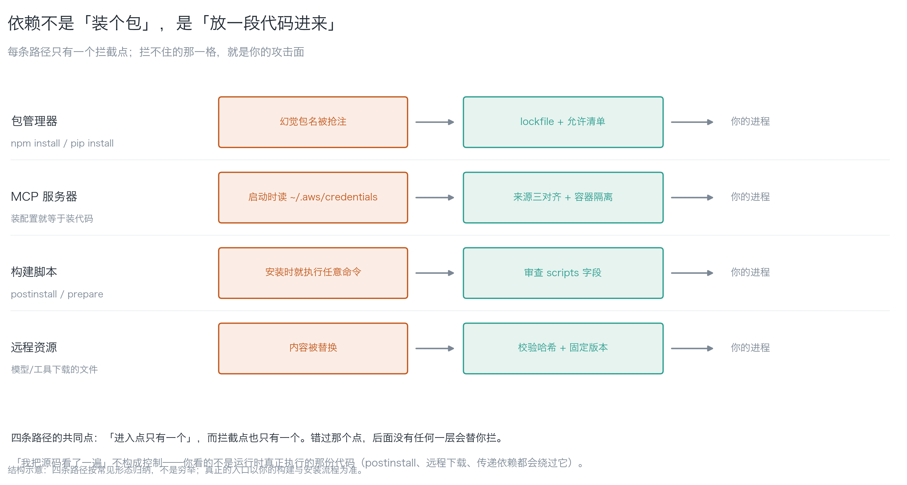
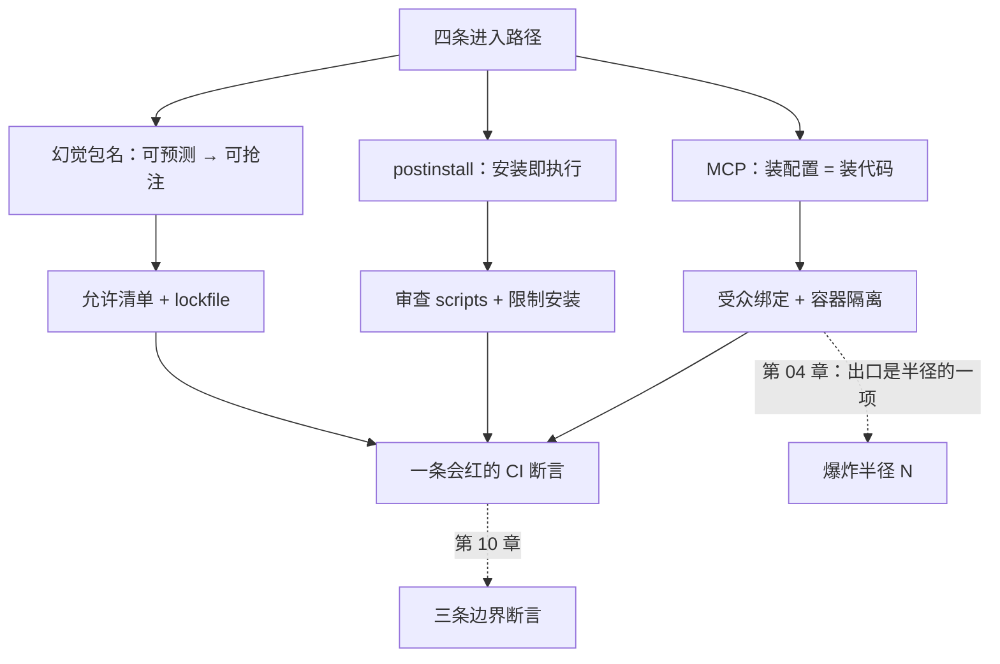

[English](./ch07-supply-chain.md) | **中文**

# 第 07 章：供应链

> **本章导读**：前几章讲的都是"你写的东西"。这一章讲**别人写的东西怎么进来**——包、MCP 服务器、构建脚本、远程资源。学完本章，你能说出依赖进入系统的四条路径与各自唯一的拦截点，并且知道为什么"我把源码看了一遍"不构成控制。
> **前置知识**：第 02 章（代理越权、凭据持有）。第 04 章的爆炸半径会用到。
> **时效基线**：本章内容基于「幻觉包名研究（USENIX Security 2025，二手汇总）；OAuth 2.1 与 RFC 8707 受众绑定；MCP 注册表形态（2025）」核验（最后核验日期：`2026-10-23`）
> **核心学习目标**：
> - 掌握依赖进入系统的四条路径，知道每条的拦截点在哪、错过了会怎样
> - 能解释幻觉包名为什么"可预测就可抢注"，并用允许清单挡住它
> - 能说清 MCP 的四条安全边界（受众绑定 / URL 授权 / SSRF / 注册表抢注）

---

## 1. 认知锚点：你装的那个包，三年前就有人替你占好了

### 1.1 一个不存在的包

你在让 AI 写一段日期处理代码。它写完顺手推荐了一个包：

```bash
npm install date-helper-utils
```

装上了，跑通了。你不知道的是：`date-helper-utils` 在 npm 上**不存在**——它是一个幻觉出来的名字。你装上的，是有人在模型第一次幻觉出这个名字之后**立刻抢注**的同名包，里面带一段 `postinstall`：读 `~/.aws/credentials`，发出去。

这不是假设。研究显示约 **19.7%** 的 LLM 推荐包名在注册表里并不存在（开源模型 21.7%，商用模型 5.2%），识别出 **205,474** 个独有幻觉包名，其中 **43%** 每次查询都复现。

> **可复现就意味着可预测，可预测就意味着可抢注。**

（该数据出自 USENIX Security 2025 论文，本书经二手汇总转引；比例会随模型变化，引用前请核对来源年份。）

### 1.2 直觉类比：装修队自带的工人

你自己雇的工人（你写的代码），你会看他的资质。但装修队（包管理器）还会带来**他自己的工人**（传递依赖），甚至带来**他朋友**（MCP 服务器）——这些人拿着你家的钥匙进出，你一个都不认识。

| 类比 | 对应 | 失效在哪 |
|---|---|---|
| 装修队自带的工人 | 传递依赖 | 你没雇他，但他进你家 |
| 他朋友 | MCP 第三方服务器 | 装个配置就等于装一段代码 |
| 他带来的电动工具 | 构建脚本（`postinstall`） | **装的时候就开机试了一下** |
| 工具单上的"同款" | 幻觉包名被抢注 | 名字一样，东西不一样 |

### 1.3 MCP：装配置 = 装代码

模型上下文协议（MCP）让模型能连外部工具。它把"集成"从写代码变成了装配置——这句话的另一面是：

> **你把攻击面从代码里挪到了配置文件里，而配置文件通常没人审。**

一个 MCP 服务器就是一段**在你机器上跑、拿你凭据**的代码。它启动时能读 `~/.aws/credentials`、能出网、能调你的工具。这正是第 02 章说的代理越权的最佳载体。

---

## 2. 第一性原理：四条路径，四个拦截点

### 2.1 依赖进入系统的四条路径


*图 7-1：每条路径只有**一个进入点**，拦截点也只有一个。错过那个点，后面没有任何一层会替你拦。注意第三条（构建脚本）——它的风险发生在"安装时"，而不是"运行时"。*

| 路径 | 进入点 | 风险 | 唯一的拦截点 |
|---|---|---|---|
| **包管理器** | `npm install` / `pip install` | 幻觉包名被抢注 | lockfile + 允许清单 |
| **MCP 服务器** | 装配置 | 启动时读凭据、出网 | 来源三对齐 + 容器隔离 |
| **构建脚本** | `postinstall` / `prepare` | **安装时就执行任意命令** | 审查 `scripts` 字段 |
| **远程资源** | 模型/工具下载的文件 | 内容被替换 | 校验哈希 + 固定版本 |

**第三条最容易被忽略**：`postinstall` 在 `npm install` 的那一刻就跑了，那时你的代码还没执行、你的测试还没开始。**装的过程本身就是一次代码执行。**

### 2.2 为什么"我看了一遍源码"不构成控制

三个理由，每个独立成立：

1. **你看的不是运行时执行的那份**：`postinstall`、运行期下载、条件加载都会绕过你的阅读。
2. **传递依赖会变**：你看了 `a@1.2.3`，下周 `a` 依赖的 `b` 升到 `2.0`，`b` 的行为变了。
3. **你看的是静态文本，它做的是动态行为**：一段看起来是字符串拼接的代码，配合 `child_process` 就是执行。

所以控制必须落在**机制**上：沙箱、白名单、哈希校验、允许清单。**靠机制的控制优于靠人的控制**，因为人只在第一次认真。

### 2.3 MCP 的四条安全边界


*图 7-2：上排是正确设计——token 只对 A 有效，B 拒收；下排是没有受众绑定时的现实——A 把 token 传下去，一环失守全链沦陷。*

| # | 边界 | 白话 | 做法 |
|---|---|---|---|
| 1 | **受众绑定**（RFC 8707） | token 里写明"这是发给谁的" | 没有它，A 传给 B，B 分不清"是用户还是 A 在借" |
| 2 | **URL 模式授权** | 凭据不经过客户端 | 任何"请在对话框粘贴 API key"的设计，都是把密钥写进日志 |
| 3 | **SSRF** | 工具会按配置请求 URL | 出网白名单；**`http://169.254.169.254/` 是云元数据服务，能换到临时凭据** |
| 4 | **注册表抢注** | 同名不同作者 | 装之前三对齐：作者、发布时间、仓库地址 |

一条实践原则覆盖大半：**只给"需要它的那一个工具"发凭据，不给整个会话发**。会话级凭据等于把万能钥匙挂在公共门厅。

---

## 3. 手把手：挡一次抢注

### 3.1 允许清单：跑一遍

`code/ch07/dependency_allowlist.py`（stdlib，只读）：

```bash
python3 dependency_allowlist.py --lock package-lock.json --allow allowlist.txt
```

在一个故意放了抢注包的 lockfile 上跑，真实输出：

```text
发现 1 个不在允许清单里的包：
  - evil-pkg

判据：新包必须由人看过来源与 postinstall，再手动加进清单。
```

退出码 1。**它不告诉你包是不是坏的，只告诉你"这个包没被人看过"**——而没被人看过的包，就是你的攻击面。

### 3.2 来源三对齐（装之前）

对每一个新包，三件事必须对得上：

| # | 对什么 | 对不上就怎么办 |
|---|---|---|
| 1 | **作者**：包页上的维护者 vs 你以为的组织 | 同名不同作者 → 直接拒 |
| 2 | **发布时间**：首次发布日期 vs 你的使用时间 | 突然出现的同名包 → 拒 |
| 3 | **仓库地址**：`repository` 字段 vs 官方域名 | 指向陌生仓库 → 拒 |

再加一条：**看 `scripts` 字段**。有 `postinstall` / `prepare` 的，要知道它会干什么；看不懂的，不装。

### 3.3 装之后能限制（这才是主力）

"看"永远会漏，所以主力是限制：

1. **文件系统**：容器里只挂工作目录。`~/.aws`、`~/.ssh`、`~/.config` **不挂载——没挂载就读不到**，比"它承诺不读"可靠。
2. **凭据**：不注入长期密钥；用短寿命、窄作用域的临时凭据，按工具分发（第 02 章的最小自主性）。
3. **网络**：默认拒绝出网，白名单只放必要域名。
4. **进程**：非 root、只读根文件系统、限制 `fork`。

**四条里最有价值的是第 1 条**：它把"它会不会读凭据"这个问题，从"信任"问题变成了"物理"问题。

### 3.4 一条最小 CI 断言

```bash
python3 code/ch07/dependency_allowlist.py --lock package-lock.json --allow allowlist.txt
```

接进 CI，新包没进清单就红。它和第 10 章的三条断言是一类东西——**测"不该发生的没发生"**。

---

## 4. 常见误区与正反例

| 容易踩坑的误区 | 为什么会出错（根因） | 正确的心智模型与做法 |
|---|---|---|
| **"我把源码看了一遍"** | 你看的不是运行时执行的那份；传递依赖会变 | 靠机制：lockfile、允许清单、沙箱、白名单 |
| **"包装上了能跑就是没问题"** | 恶意行为常常在 `postinstall` 或特定触发条件下才跑 | 看 `scripts` 字段；装的时候用 `--ignore-scripts` 先探一次 |
| **"MCP 只是配置，不算代码"** | 装配置 = 装一段拿你凭据的代码 | 来源三对齐 + 容器隔离 + 按工具发凭据 |
| **"模型推荐的包应该没问题"** | 19.7% 的推荐名根本不存在；可复现 → 可抢注 | 允许清单：新包必须人看过才进 |
| **"token 传给下游没关系，反正都是我的服务"** | 没有受众绑定，一环失守全链沦陷 | RFC 8707 受众绑定；只给单个工具发凭据 |
| **"出网白名单太麻烦，先全通"** | 全通 = 数据可以被送到任何地方（第 04 章的 N） | 默认拒绝，白名单放行；DNS 也算出口 |

---

## 5. 本章小结与局部知识图谱

### 5.1 核心要点

- **依赖进入有四条路径**：包管理器、MCP 服务器、构建脚本、远程资源。每条只有一个拦截点。
- **幻觉包名可预测 → 可抢注**；允许清单是最低成本的防线。
- **`postinstall` 在安装时就执行**——装的过程本身就是一次代码执行。
- **"看源码"不构成控制**；控制要落在机制上（lockfile、白名单、沙箱、哈希）。
- **MCP 四条边界**：受众绑定、URL 模式授权、SSRF、注册表抢注。
- **装之后能限制**比装之前能验证更可靠：不挂载就读不到。

### 5.2 本章概念拓扑



---

## 6. 分级通关练习

### 基础巩固题（Tier 1）

1. 用一句话说明"幻觉包名可预测"为什么会导致"可抢注"，并给出一条最低成本的防线。
2. `postinstall` 和普通依赖的风险差在哪？它在什么时候执行？

### 动手应用题（Tier 2）

3. 跑 `code/ch07/dependency_allowlist.py --lock <你的 lockfile> --allow <清单>`。若命中 0 条，写一个"它应该命中但没命中"的场景（提示：哪种包它看不见？）。
4. 对你要装的一个新包做"来源三对齐"，写出三项各自的核对结果与结论（装 / 不装）。

### 深度挑战题（Tier 3）

5. 你的智能体通过 MCP 装了三个第三方服务器，其中一个在启动时读 `~/.aws/credentials`。请设计"装之前能验证、装之后能限制"的方案，并说明为什么"我把源码看了一遍"不构成控制。
6. 有人提议："我们用 `npm audit` 自动修漏洞，所以供应链安全了。"请指出 `npm audit` 覆盖的是哪一类风险、漏掉的是哪一类（提示：抢注包在 `npm audit` 的库里吗？）。

<details>
<summary><strong>点击展开：本章练习参考答案与深度解析</strong></summary>

#### 1. 题目 1 解析

- **推导链**：模型每次都幻觉出同一批名字（43% 复现）→ 攻击者能预测这些名字 → 提前在注册表抢注 → 你 `install` 的就是他的包。
- **最低成本的防线**：**允许清单**（新包必须人看过来源与 `scripts` 再进清单），配 lockfile 固定版本。
- **为什么它便宜**：它不扫描恶意行为（做不到），它只拦"没人看过的东西"——而攻击者恰恰依赖"没人看"。

#### 2. 题目 2 解析

- **差别在执行时机**：普通依赖在**你的代码 import 它时**才跑；`postinstall` 在**安装时**就跑。也就是说，恶意的 `postinstall` 在你还没写一行调用时就已经执行了。
- **对应的防线**：`npm install --ignore-scripts` 先装一遍看行为；或在 CI 里禁止 `scripts`；或用 lockfile + 审计。
- **常见错答**："反正我的代码没调用它。"——**`postinstall` 不需要被调用**。

#### 3. 题目 3 解析

- **它看不见的包**：GitHub 直接引用（`npm i user/repo`）、本地 `file:` 依赖、私有 registry、子进程里动态 `install` 的包。
- **参考答案**：
  > "它看不见 `npm i user/repo` 这种直接从仓库装的包。这类包没有 registry 元数据，作者与发布时间无从三对齐。我会在 CI 里禁止这类引用，强制走 registry。"
- **这道题的用意**：让你体验"工具的覆盖边界"。**知道边界在哪，比相信它更重要。**

#### 4. 题目 4 解析

- **示例填法**：
  | 项 | 核对 | 结果 |
  |---|---|---|
  | 作者 | 包页 `maintainers` vs 官方组织 | 一致 |
  | 发布时间 | 首次发布 2024-03 | 与项目同期，正常 |
  | 仓库 | `repository` 指向官方 GitHub | 一致 |
  | `scripts` | 无 `postinstall` | 安全 |
  | **结论** | | **装**（进允许清单） |
- **验收标准**：四项都写了，且结论明确。写"看起来没问题"的，重做。

#### 5. 题目 5 解析

- **装之前**：来源三对齐 + 看 `scripts` + 固定版本 + 校验哈希。
- **装之后**（主力）：
  1. **不挂载** `~/.aws`、`~/.ssh`（没挂载就读不到）；
  2. 短寿命凭据，按工具分发；
  3. 默认拒绝出网，白名单放行；
  4. 非 root、只读根文件系统。
- **为什么"看源码"不构成控制**：见 2.2 的三条理由。最根本的一条是——**你看的是静态文本，它做的是动态行为**。

#### 6. 题目 6 解析

- **`npm audit` 覆盖**：已知漏洞（CVE 列表里的包与版本）。
- **它漏掉**：**抢注包**——因为抢注包是"新包"，不在漏洞库里；它没有已知 CVE，它本身就是恶意的。
- **更深一层**：`npm audit` 回答"这个包有没有已知漏洞"，它不回答"这个包该不该被装进来"。**允许清单回答后者。**
- **结论**：两个工具管两件事，缺一不可。`npm audit` 是"体检"，允许清单是"门禁"。

</details>

---

## 7. 本章权威参考信源与延伸阅读 (Authoritative References)

1. **前沿研究**：[USENIX Security '25](https://www.usenix.org/conference/usenixsecurity25) - 锚定幻觉包名与 slopsquatting 的实证数据（19.7% / 43%，二手汇总转引），支撑第 1.1 节（核验日期：`2026-10-23`）。
2. **标准规范**：[RFC 8707 - Resource Indicators for OAuth 2.0](https://www.rfc-editor.org/rfc/rfc8707) - 锚定令牌受众绑定，支撑第 2.3 节边界 1（核验版本：RFC 8707）。
3. **缺陷分类**：[MITRE CWE](https://cwe.mitre.org/) - 锚定「不受信输入引入代码 / 依赖混淆」类缺陷，支撑第 2.1 节四条路径的归类。

> 口径提示：以上信源用于锚定**定义与规范**，不用于外推风险概率。引用任何数字前，先核对来源年份与分母。
