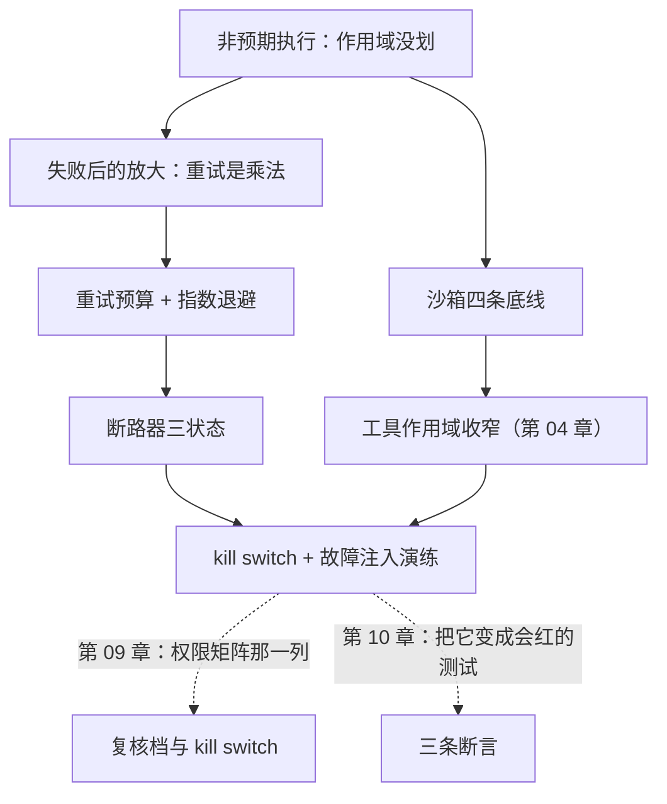

**English** | [中文](./ch08-execution-and-cascade.zh.md)

# Chapter 08: Unintended Execution and Cascades

> **Chapter guide**: The previous chapters were about "keeping bad things out". This chapter is about **how to stop them running once inside, and how not to amplify things once they break**. By the end of this chapter you can state the four sandbox baselines, put a budget on retries, and know why "an un-rehearsed circuit breaker equals none".
> **Prerequisites**: Chapter 02 (agency, least Agency), Chapter 04 (blast radius, kill switch).
> **Currency baseline**: This chapter is verified against "general practice of sandbox isolation (container boundary context); circuit breaker state machine (standard practice)" (last verified: `2026-10-23`)
> **Core learning objectives**:
> - You master the four sandbox baselines, and can turn "it promises not to read" into "it cannot read"
> - You can compute retry amplification, put a budget on retries and pair it with circuit breaking
> - You can design a failure injection drill that verifies the kill switch and the breaker really fire

---

## 1. Cognitive Anchor: A "cleanup script"

### 1.1 It is right; it just does not know what `--force` means

The agent finds lots of temporary files in the project, writes a cleanup script, and you click run. The script is right — `find . -name "*.tmp" -delete` cleans up neatly. Along the way it adds a `--force`, clears `node_modules` too, and deletes `.env.local` (it took that for "local temporary configuration").

**Every line conforms to the instruction "clean up temporary files".** The problem is not that it wrote it wrong; it is two things:

1. It has the ability to **execute** (it can run a shell)
2. Nobody told it **which paths must not be touched**, and it guessed one itself

This is the everyday shape of "unintended code execution" (ASI05): **not malice; just an undrawn scope.**

### 1.2 Intuitive analogy: handing over a chainsaw

Putting a tool into the agent's hands is like handing a chainsaw to an apprentice:

- The chainsaw makes you ten times faster (the value of the tool)
- But it also makes you **irreversible** — sawn-off wood cannot be reattached
- The apprentice's judgment is unstable, while the chainsaw's destructive power is constant

| Analogy | Correspondence | Key difference |
|---|---|---|
| The chainsaw | Tools (shell / refunds / sending mail) | A real chainsaw has a guard; **the software guard has to be installed by you** |
| Sawn-off wood cannot be reattached | Irreversible actions | Software has exceptions: backups and snapshots (the three tiers of Chapter 04) |
| The apprentice's judgment | The model's judgment | Judgment is unstable, **so the boundary must be installed on the tool, not on the judgment** |

### 1.3 The second kind of amplification: retries

Execution has the other half: **what to do after a failure**. The agent's (or your HTTP client's) default reaction is to retry — and retrying is multiplication:

```
一次 429 → 重试 ×3 → 又 429 → 每个请求都重试 ×3 → 9 倍流量 → 全站 429
```

Each step alone looks "reasonable" (of course you retry after a failure), and together they are **cascading failure** (ASI08).

---

## 2. First Principles: Four Baselines, One Budget, Three States

### 2.1 The four sandbox baselines

The goal of a sandbox is not "keeping code from running"; it is **turning "it promises not to read" into "it cannot read"**:

| # | Baseline | Plain words | Why it beats a "promise" |
|---|---|---|---|
| 1 | **Mount only the working directory** | `~/.aws`, `~/.ssh` are not mounted | Not mounted means unreadable — a physical fact |
| 2 | **Non-root** | No administrator privileges | Cannot delete system files or modify other containers |
| 3 | **Read-only root filesystem** | The root directory cannot be written | Malicious code cannot leave a back door |
| 4 | **Network allowlist** | Deny by default, permit only necessary domains | Data cannot be carried away (the N of Chapter 04) |

**The first is the most valuable**: it turns a "trust" question into a "physics" question. This is the same idea as Chapter 06's RLS — **put the boundary on a mechanism**.

One companion rule: **restrict `fork`**. A process that can `fork` can spawn subprocesses that route around the limits; in containers that is the overture of an "escape attempt".

### 2.2 Retries are multiplication


*Figure 8-1: Each step alone is reasonable; together they form a multiplicative amplification chain. Note the last cell — "unrelated services also go down", because they share the same upstream or the same connection pool.*

The amplification formula (engineering approximation):

```
发往上游的请求数 ≈ 1 × retries^failures
```

- `retries` = how many retries per failure
- `failures` = how many consecutive failing layers

Three failures with 3 retries each = 27×. **Nobody ever computes this multiplication**, and it is the most common root cause of cascade incidents.

Three disciplines:

1. **Retries need a budget**: total count + total duration, whichever hits first stops
2. **Exponential backoff is mandatory**: retrying immediately = kicking the upstream again while it is busiest
3. **Only retry retryable errors**: 4xx (except 429) usually should not be retried

### 2.3 Circuit breaker: making failure cheap


*Figure 8-2: Closed (passing normally) → Open (fail fast, send nothing) → Half-open (let one probe through) → Closed. The key is "half-open lets exactly one probe through" — it is the only path in the whole state machine that recovers automatically.*

| State | Behavior | Value |
|---|---|---|
| **Closed** | Passes normally, failure count +1 | Zero overhead normally |
| **Open** | Everything fails fast, no requests sent | **Makes failure cheap**: the upstream catches its breath, and you save money |
| **Half-open** | Let one probe request through | Probe succeeds → closed; fails → back to open |

**Circuit breaking is not about making the service faster; it is about making failure cheap.** That sentence is worth copying down — many people install circuit breakers "to improve availability", while what it actually does is "controlling losses".

### 2.4 Multi-agent: contamination spreads

Chapter 02 said that agents "trust" each other. In a multi-agent pipeline, upstream artifacts get executed as instructions downstream (ASI07). Contamination from one injection gets **amplified level by level**:

```
抓取的网页（注入）→ 规划智能体（产生坏计划）→ 执行智能体（照做）→ 外发（数据出去）
```

The countermeasure matches Chapter 05: **downstream treats upstream artifacts as data, not as instructions**; tool scope narrows level by level; each level "can do less" than the one above it.

### 2.5 The three requirements of a kill switch

Chapter 09 expands; the criteria are given here:

1. **One press and it stops**: no change process required, no redeployment required
2. **The system still works after stopping**: the degradation path is written in advance
3. **A stop must be rehearsed**: an un-rehearsed kill switch equals none

---

## 3. Hands-on: Compute one amplification, rehearse one circuit break

### 3.1 Compute: run the script and see the amplification

`code/ch08/retry_budget.py` (simulation, no upstream connection). Real output:

```text
======================================================================
重试策略对比（模拟，1 次连续故障）
======================================================================
  无预算重试              发往上游   7 次   每层 ×3，乘法放大
  有预算（上限 3）          发往上游   2 次   发满就停，剩下的快速失败
  断路（阈值 2）           发往上游   2 次   到阈值就打开，不发请求

相对无预算重试：
  有预算（上限 3）          少发   5 次（71%）
  断路（阈值 2）           少发   5 次（71%）

结论：断路不是让服务更快，是让失败变便宜。
```

Run `--fail 3` and the gap widens to a dozen times or more — **that is the price of "every step is reasonable"**.

### 3.2 Rehearse: one failure injection

The drill matters more than the configuration. One 30-minute drill:

| Step | Action | Expectation |
|---|---|---|
| 1 | Make the upstream return 429 (mock or rate limit) | The client triggers retries |
| 2 | Observe the retry count | Does not exceed the budget (say 3) |
| 3 | Sustain the failure for 30 seconds | The breaker opens, requests fail fast |
| 4 | Restore the upstream | The half-open probe succeeds, back to closed |
| 5 | Press the kill switch | All outbound actions stop within 30 seconds |

**Step 5 is the most easily skipped**, and it is exactly the meaning of that column in Chapter 09's permission matrix — **an un-rehearsed kill switch equals none**.

### 3.3 Retrofit list (ranked by cost-effectiveness)

| Retrofit | Cost | Effect |
|---|---|---|
| Retry budget + exponential backoff | Low | Immediately compresses amplification to constant scale |
| Network allowlist | Medium | Data cannot be carried away (the N of the radius) |
| Mount only the working directory | Medium | Credentials cannot be read (the C of the radius) |
| Circuit breaker | Medium | Makes failure cheap |
| Split tools + per-instance approval | High | Agency goes down (Chapter 02) |

**The first three have the best cost-effectiveness**: they change no business logic, only boundaries.

---

## 4. Common Pitfalls and the Right Mental Model

| Pitfall that is easy to step in | Why it goes wrong (root cause) | The right mental model and practice |
|---|---|---|
| **"The script is its own writing; it will be careful"** | Judgment is unstable; the boundary must be installed on the tool | The four sandbox baselines; do not mount dangerous paths |
| **"If it fails, just try a few more times"** | Retries are multiplication and amplify failure | Budget + exponential backoff + retry only retryable errors |
| **"The circuit breaker is for improving availability"** | What it does is control losses, not speed things up | Remember one sentence: make failure cheap |
| **"With the breaker configured we are safe"** | An un-rehearsed threshold is usually wrong | A 30-minute failure injection drill |
| **"Open outbound for easier debugging"** | Fully open = data can be sent anywhere | Deny by default, allowlist to permit |
| **"Each agent owns its own stage, so contamination cannot pass"** | Downstream treats upstream artifacts as instructions; contamination amplifies level by level | Treat upstream artifacts as data; narrow scope level by level |

---

## 5. Chapter Summary and Local Knowledge Map

### 5.1 Core points

- **The four sandbox baselines**: mount only the working directory, non-root, read-only root, network allowlist. The first turns a "trust" question into a "physics" question.
- **Retries are multiplication**: `retries^failures`. There must be a budget, exponential backoff, and error classification.
- **Circuit breakers make failure cheap**: closed → open → half-open; half-open lets exactly one probe through.
- **Multi-agent contamination spreads**: downstream treats upstream artifacts as data, and scope narrows level by level.
- **The three kill switch requirements**: one press and it stops, still usable after stopping, and rehearsed.
- **Retrofit ranking by cost-effectiveness**: budget and allowlists first, then the sandbox, and only then splitting tools.

### 5.2 Concept topology of this chapter



---

## 6. Tiered Exercises

### Foundation (Tier 1)

1. State the four sandbox baselines, and explain why "mount only the working directory" is more reliable than "it promises not to read credentials".
2. Why does "if it fails, try a few more times" turn one failure into one incident? Give the amplification formula.

### Hands-on Application (Tier 2)

3. Run `code/ch08/retry_budget.py --fail 3`, record the request counts of the three strategies, and compute how many times more "no budget" sends than "circuit breaking".
4. Design one 30-minute failure injection drill for a side-effecting call of yours (refund / send mail / delete data): write out the five steps and the expectation of each.

### Deep Challenge (Tier 3)

5. Someone proposes: "let's drop the retry count from 3 to 1, and then there is no amplification." Argue why this is not a good plan (hint: what happens when the failure rate is high? What about user experience?), and give a better combination.
6. In your multi-agent pipeline, the upstream agent's output becomes the downstream's input. Design one gate where "contamination cannot spread" (hint: how does downstream tell data from instructions? How does scope narrow level by level?).

<details>
<summary><strong>点击展开：本章练习参考答案与深度解析</strong></summary>

#### 1. Analysis of question 1

- **The four baselines**: mount only the working directory, non-root, read-only root filesystem, network allowlist (plus restricting `fork`).
- **Why "mount only" is reliable**: it is a **physical fact** — that path is not in the filesystem, so the code cannot read it. Whereas "promises not to read" is **intent**, and intent can be injected, misunderstood, or accidentally overridden.
- **In one sentence**: turn a trust question into a physics question.

#### 2. Analysis of question 2

- **The amplification formula**: `requests sent upstream ≈ retries^failures`. 3 failures × 3 retries each = 27×.
- **Why it becomes an incident**: upstream rate limiting originally affects only your one client; 27× the traffic takes the upstream down and affects **all** users and services (the last cell of Figure 8-1).
- **Common wrong answer**: "retries improve the success rate." — **they improve the per-call success rate and lower the system survival rate.**

#### 3. Analysis of question 3

- **Reference numbers** (`--fail 3`): no budget ≈ 40 requests, circuit breaking (threshold 2) ≈ 2, roughly **20×**.
- **Write it clearly**: the multiplier is not fixed; it depends on `retries` and `failures`; **but the order-of-magnitude gap is structural**.
- **Extension**: change the budget from 3 to 5 and run again, observing the "stop when the budget is spent" curve — that is the intuitive meaning of "budget".

#### 4. Analysis of question 4

- **The five steps** are in 3.2.
- **Acceptance criteria**: step 5 (kill switch) must be on the list, and it must state "all outbound actions stop within 30 seconds". **A drill without step 5 equals no drill.**
- **Why 30 minutes is enough**: it does not need to reproduce a real incident; it only needs to **prove the gate fires**. This is the same thing as Chapter 09's "should fail assertions".

#### 5. Analysis of question 5

- **Why it is not a good plan**: when the failure rate is high (say the upstream flaps for 30 seconds), requests with only 1 retry fail en masse and **the user experience collapses outright**; while the amplification risk is still there (only with a smaller multiplier).
- **A better combination**:
  1. **Exponential backoff + jitter** (avoid everyone retrying at once);
  2. **A total budget** (count + duration);
  3. **Circuit breaking** (fail fast, stop kicking);
  4. **Retry only retryable errors** (429/5xx retryable, 4xx not).
- **The key judgment**: **lowering the count shrinks the problem; adding a budget + breaker makes the problem cheap**. The latter is the actual solution.

#### 6. Analysis of question 6

- **One gate**: downstream treats upstream artifacts as **data**, not as **instructions** — concretely, put the upstream output into a "data parameter" (say `context_text`) instead of splicing it into the system prompt or task instruction.
- **Scope narrows level by level**: upstream can read the whole database; downstream can read only "the rows upstream specified"; downstream's exit (N) is narrower than upstream's.
- **One more gate**: each level's tool definitions are approved independently (Chapter 09's permission matrix), and credentials are not shared.
- **Deep analysis**: the essence of this question is that **trust boundaries must be layered**. "Each agent owns its own stage" sounds like isolation, but if they share credentials and share context, the isolation does not exist.

</details>

---

## 7. Authoritative References and Further Reading for This Chapter

1. **Defect classification**: [MITRE CWE](https://cwe.mitre.org/) - anchors the "unintended code execution / improper permission management" defect class, supporting the classification of the four sandbox baselines in Section 2.1.
2. **Standards and guidelines**: [NIST Computer Security Resource Center](https://csrc.nist.gov/) - anchors the general principles of isolation and least privilege, supporting Sections 2.1 and 2.5.
3. **Methodology source**: [OWASP](https://owasp.org/) - anchors the failure classification of agent applications (including cascading failure), supporting the circuit breaker of Section 2.3 and contamination spread of Section 2.4.

> Counting-basis note: the sources above are used to anchor **definitions and specifications**, not to extrapolate risk probabilities. Before citing any number, first check the source's year and denominator.
