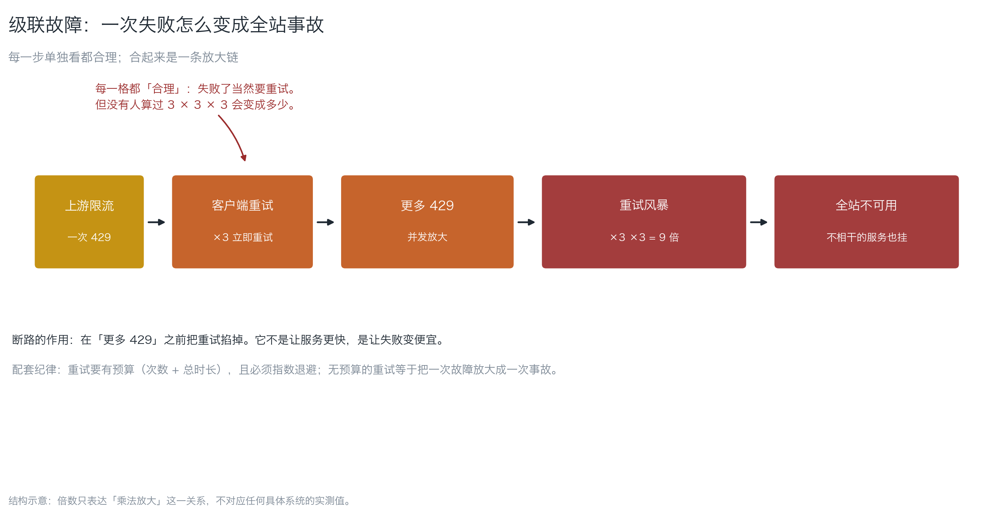
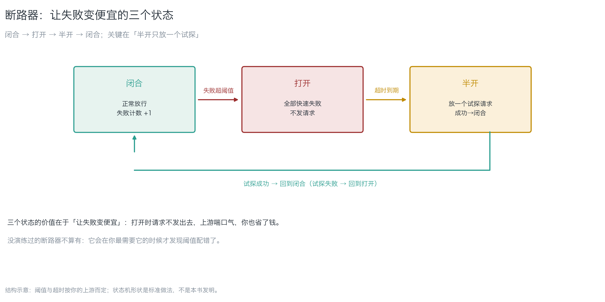
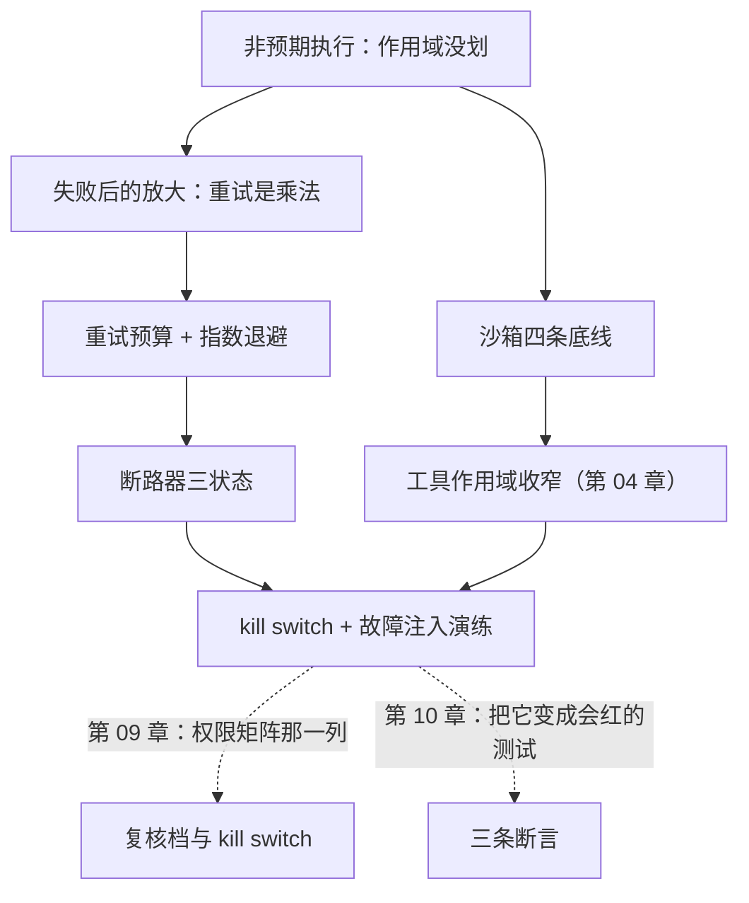

# 第 08 章：非预期执行与级联

> **本章导读**：前几章讲"别让坏东西进来"。这一章讲**进来之后怎么不让它跑起来，以及跑坏了怎么不放大**。学完本章，你能说出沙箱的四条底线、给重试加预算、并知道为什么"没演练过的断路器等于没有"。
> **前置知识**：第 02 章（自主度、最小自主性）、第 04 章（爆炸半径、kill switch）。
> **时效基线**：本章内容基于「沙箱隔离的一般实践（容器边界语境）；断路器状态机（标准做法）」核验（最后核验日期：`2026-10-23`）
> **核心学习目标**：
> - 掌握沙箱的四条底线，能把"它承诺不读"改成"它读不到"
> - 能算出重试放大，会给重试加预算并配断路
> - 能设计一次故障注入演练，验证 kill switch 与熔断真的会响

---

## 1. 认知锚点：一个"清理脚本"

### 1.1 它是对的，只是它不知道 `--force` 意味着什么

智能体发现项目里有大量临时文件，写了一个清理脚本，你点了运行。脚本是对的——`find . -name "*.tmp" -delete` 清得干干净净。它顺手加了个 `--force`，把 `node_modules` 也清了，还删了 `.env.local`（它觉得那是"本地临时配置"）。

**每一行都符合"清理临时文件"这个指令。** 问题不在它写错了，在两件事：

1. 它有**执行**的能力（能跑 shell）
2. 没有人告诉它**哪些路径不能碰**，它自己猜了一个

这就是"非预期代码执行"（ASI05）的日常形态：**不是恶意，是作用域没划。**

### 1.2 直觉类比：给你一把电锯

把工具交到智能体手里，像把电锯交给一个学徒：

- 电锯让你快十倍（工具的价值）
- 但它也让你**不可逆**——锯掉的木头接不回来
- 学徒的判断力不稳定，而电锯的破坏力是恒定的

| 类比 | 对应 | 关键差别 |
|---|---|---|
| 电锯 | 工具（shell / 退款 / 发信） | 真实电锯有护板；**软件的护板要你自己装** |
| 锯掉接不回来 | 不可逆动作 | 软件里有例外：备份与快照（第 04 章的三档） |
| 学徒的判断 | 模型的判断 | 判断不稳定，**所以边界要装在工具上，不装在判断上** |

### 1.3 第二种放大：重试

执行问题还有另一半：**失败之后怎么办**。智能体（或你的 HTTP 客户端）的默认反应是重试——而重试是乘法：

```
一次 429 → 重试 ×3 → 又 429 → 每个请求都重试 ×3 → 9 倍流量 → 全站 429
```

每一步单独看都"合理"（失败了当然要重试），合起来就是**级联故障**（ASI08）。

---

## 2. 第一性原理：四条底线、一个预算、三个状态

### 2.1 沙箱的四条底线

沙箱的目标不是"让代码跑不起来"，是**把"它承诺不读"改成"它读不到"**：

| # | 底线 | 白话 | 为什么它比"承诺"可靠 |
|---|---|---|---|
| 1 | **只挂工作目录** | `~/.aws`、`~/.ssh` 不挂载 | 没挂载就读不到，是物理事实 |
| 2 | **非 root** | 不给管理员权限 | 删不了系统文件、改不了别的容器 |
| 3 | **只读根文件系统** | 根目录不能写 | 恶意代码留不下后门 |
| 4 | **出网白名单** | 默认拒绝，只放必要域名 | 数据带不走（第 04 章的 N） |

**第 1 条最值钱**：它把一个"信任"问题变成了"物理"问题。这与第 06 章的 RLS 是同一个思路——**把边界放在机制上**。

配套一条：**限制 `fork`**。能 `fork` 的进程可以起子进程绕过限制，这在容器里叫"逃逸尝试"的前奏。

### 2.2 重试是乘法


*图 8-1：每一步单独看都合理；合起来是一条乘法放大链。注意最后一格——"不相干的服务也挂"，因为它们共享同一个上游或同一个连接池。*

放大公式（工程近似）：

```
发往上游的请求数 ≈ 1 × retries^failures
```

- `retries` = 每次失败重试几次
- `failures` = 连续几层失败

三次失败、每次重试 3 次 = 27 倍。**没有人算过这个乘法**，是级联事故最常见的根因。

三条纪律：

1. **重试要有预算**：总次数 + 总时长，二者先到先停
2. **必须指数退避**：立刻重试 = 在上游最忙的时候再踹一脚
3. **只重试可重试的错误**：4xx（除 429）通常不该重试

### 2.3 断路器：让失败变便宜


*图 8-2：闭合（正常放行）→ 打开（快速失败，不发请求）→ 半开（放一个试探）→ 闭合。关键在"半开只放一个试探"——它是整个状态机里唯一能自动恢复的路径。*

| 状态 | 行为 | 价值 |
|---|---|---|
| **闭合** | 正常放行，失败计数 +1 | 平时零开销 |
| **打开** | 全部快速失败，不发请求 | **让失败变便宜**：上游喘口气，你也省了钱 |
| **半开** | 放一个试探请求 | 试探成功 → 闭合；失败 → 回到打开 |

**断路不是让服务更快，是让失败变便宜。** 这句话值得抄下来——很多人装断路器是为了"提高可用性"，其实它做的是"控制损失"。

### 2.4 多智能体：污染会传播

第 02 章说过，智能体之间是"信"的。在多智能体流水线里，上游产物会被下游当指令执行（ASI07）。一次注入的污染会**逐级放大**：

```
抓取的网页（注入）→ 规划智能体（产生坏计划）→ 执行智能体（照做）→ 外发（数据出去）
```

对策与第 05 章一致：**下游把上游产物当数据，不当指令**；工具作用域逐级收窄；每一级的"能做的事"都比上一级小。

### 2.5 kill switch 的三个要求

第 09 章展开，这里给判据：

1. **一按就停**：不要求走变更流程、不要求重新部署
2. **停了之后系统还能用**：降级路径提前写好
3. **停过要演练**：没演练过的 kill switch 等于没有

---

## 3. 手把手：算一次放大，练一次熔断

### 3.1 算：跑脚本看放大

`code/ch08/retry_budget.py`（模拟，不连上游）。真实输出：

```text
======================================================================
重试策略对比（模拟，1 次连续故障）
======================================================================
  无预算重试              发往上游   7 次   每层 ×3，乘法放大
  有预算（上限 3）          发往上游   2 次   发满就停，剩下的快速失败
  断路（阈值 2）           发往上游   2 次   到阈值就打开，不发请求

相对无预算重试：
  有预算（上限 3）          少发   5 次（71%）
  断路（阈值 2）           少发   5 次（71%）

结论：断路不是让服务更快，是让失败变便宜。
```

把 `--fail 3` 跑一遍，差距会拉开到十几倍——**这就是"每一步都合理"的代价**。

### 3.2 练：一次故障注入

演练比配置重要。一次 30 分钟的演练：

| 步 | 动作 | 期望 |
|---|---|---|
| 1 | 让上游返回 429（mock 或限流） | 客户端触发重试 |
| 2 | 观察重试次数 | 不超过预算（例如 3 次） |
| 3 | 持续故障 30 秒 | 断路器打开，请求快速失败 |
| 4 | 恢复上游 | 半开试探成功，回到闭合 |
| 5 | 按 kill switch | 30 秒内停止所有外发动作 |

**第 5 步最容易被跳过**，而它恰恰是第 09 章权限矩阵里那一列的意义——**没演练过的 kill switch，等于没有**。

### 3.3 改造清单（按性价比排序）

| 改造 | 成本 | 效果 |
|---|---|---|
| 重试加预算 + 指数退避 | 低 | 立刻把放大压到常数级 |
| 出网白名单 | 中 | 数据带不走（半径的 N） |
| 只挂工作目录 | 中 | 凭据读不到（半径的 C） |
| 断路器 | 中 | 失败变便宜 |
| 拆工具 + 逐次批准 | 高 | 自主度下降（第 02 章） |

**前三条性价比最高**：它们不改业务逻辑，只改边界。

---

## 4. 常见误区与正反例

| 容易踩坑的误区 | 为什么会出错（根因） | 正确的心智模型与做法 |
|---|---|---|
| **"脚本是它写的，它自己会小心"** | 判断不稳定；边界要装在工具上 | 沙箱四条底线；危险路径不挂载 |
| **"失败了就多试几次"** | 重试是乘法，会放大故障 | 预算 + 指数退避 + 只重试可重试的错误 |
| **"装断路器是为了提高可用性"** | 它做的是控制损失，不是提速 | 记住一句话：让失败变便宜 |
| **"配置了断路就安全了"** | 没演练过的阈值往往是错的 | 30 分钟故障注入演练 |
| **"出网全通方便调试"** | 全通 = 数据可以送到任何地方 | 默认拒绝，白名单放行 |
| **"多智能体各管一段，污染传不过去"** | 下游把上游产物当指令，污染逐级放大 | 上游产物当数据；作用域逐级收窄 |

---

## 5. 本章小结与局部知识图谱

### 5.1 核心要点

- **沙箱四条底线**：只挂工作目录、非 root、只读根、出网白名单。第 1 条把"信任"问题变成"物理"问题。
- **重试是乘法**：`retries^failures`。要有预算、要指数退避、要分类错误。
- **断路器让失败变便宜**：闭合 → 打开 → 半开；半开只放一个试探。
- **多智能体的污染会传播**：下游把上游产物当数据，作用域逐级收窄。
- **kill switch 三要求**：一按就停、停了还能用、停过要演练。
- **改造性价比排序**：先预算与白名单，再沙箱，最后拆工具。

### 5.2 本章概念拓扑



---

## 6. 分级通关练习

### 基础巩固题（Tier 1）

1. 说出沙箱的四条底线，并解释为什么"只挂工作目录"比"它承诺不读凭据"可靠。
2. 为什么"失败了就多试几次"会把一次故障变成一次事故？给出放大公式。

### 动手应用题（Tier 2）

3. 跑 `code/ch08/retry_budget.py --fail 3`，把三种策略的请求数记下来，算出"无预算"比"断路"多发了几倍。
4. 给你的一个带副作用的调用（退款/发信/删数据）设计一次 30 分钟故障注入演练：写清五步与每步的期望。

### 深度挑战题（Tier 3）

5. 有人提议："我们把重试次数从 3 降到 1，这样就不会放大。"请论证这为什么不是好方案（提示：失败率高时会发生什么？用户体验如何？），并给出更好的组合。
6. 你的多智能体流水线里，上游智能体的输出会成为下游的输入。请设计一道"污染不会传播"的闸（提示：下游如何区分数据与指令？作用域如何逐级收窄？）。

<details>
<summary><strong>点击展开：本章练习参考答案与深度解析</strong></summary>

#### 1. 题目 1 解析

- **四条底线**：只挂工作目录、非 root、只读根文件系统、出网白名单（外加限制 `fork`）。
- **为什么"只挂载"可靠**：它是**物理事实**——文件系统里没有那个路径，代码读不到。而"承诺不读"是**意图**，意图会被注入、被误解、被意外覆盖。
- **一句话**：把信任问题变成物理问题。

#### 2. 题目 2 解析

- **放大公式**：`发往上游的请求数 ≈ retries^failures`。3 次失败 × 每次重试 3 次 = 27 倍。
- **为什么会变成事故**：上游限流本来只影响你一个客户端；27 倍流量会把上游打挂，影响**所有**用户与服务（图 8-1 最后一格）。
- **常见错答**："重试能提高成功率。"——**它提高的是单次成功率，降低的是系统存活率**。

#### 3. 题目 3 解析

- **参考数字**（`--fail 3`）：无预算 ≈ 40 次，断路（阈值 2）≈ 2 次，约 **20 倍**。
- **要写清**：倍数不是固定的，它取决于 `retries` 与 `failures`；**但数量级差距是结构性的**。
- **延伸**：把预算从 3 改到 5 再跑一次，观察"发满就停"的曲线——这就是"预算"的直观含义。

#### 4. 题目 4 解析

- **五步**见 3.2。
- **验收标准**：第 5 步（kill switch）必须在清单里，且写清"30 秒内停止所有外发动作"。**没写第 5 步的演练，等于没练。**
- **为什么 30 分钟够**：它不需要复现真实事故，只需要**证明闸会响**。这与第 09 章"应当失败的断言"是同一件事。

#### 5. 题目 5 解析

- **为什么不是好方案**：失败率高时（例如上游抖动 30 秒），重试 1 次的请求大量失败，**用户体验直接崩**；而放大风险其实还在（只是倍数小了）。
- **更好的组合**：
  1. **指数退避 + 抖动**（避免所有人同时重试）；
  2. **总预算**（次数 + 时长）；
  3. **断路**（快速失败，别再踹）；
  4. **只重试可重试的错误**（429/5xx 可重试，4xx 不重试）。
- **关键判断**：**降次数是把问题缩小，加预算+断路是把问题变便宜**。后者才是解法。

#### 6. 题目 6 解析

- **一道闸**：下游把上游产物当**数据**，不当**指令**——具体做法是把上游输出放进"数据参数"（例如 `context_text`），而不是拼进系统提示或任务指令。
- **作用域逐级收窄**：上游能读全库，下游只能读"上游指定的那几行"；下游的出口（N）比上游窄。
- **再加一道**：每一级的工具定义独立审批（第 09 章的权限矩阵），不共用一套凭据。
- **深度剖析**：这道题的本质是**信任边界要有层级**。"多智能体各管一段"听起来像隔离，但如果它们共用凭据、共用上下文，隔离就不存在。

</details>

---

## 7. 本章权威参考信源与延伸阅读 (Authoritative References)

1. **缺陷分类**：[MITRE CWE](https://cwe.mitre.org/) - 锚定「非预期代码执行 / 权限管理不当」类缺陷，支撑第 2.1 节沙箱四条底线的归类。
2. **标准与指南**：[NIST Computer Security Resource Center](https://csrc.nist.gov/) - 锚定隔离与最小权限的一般原则，支撑第 2.1 节与第 2.5 节。
3. **方法论来源**：[OWASP](https://owasp.org/) - 锚定智能体应用的失效分类（含级联故障），支撑第 2.3 节断路器与第 2.4 节污染传播。

> 口径提示：以上信源用于锚定**定义与规范**，不用于外推风险概率。引用任何数字前，先核对来源年份与分母。
