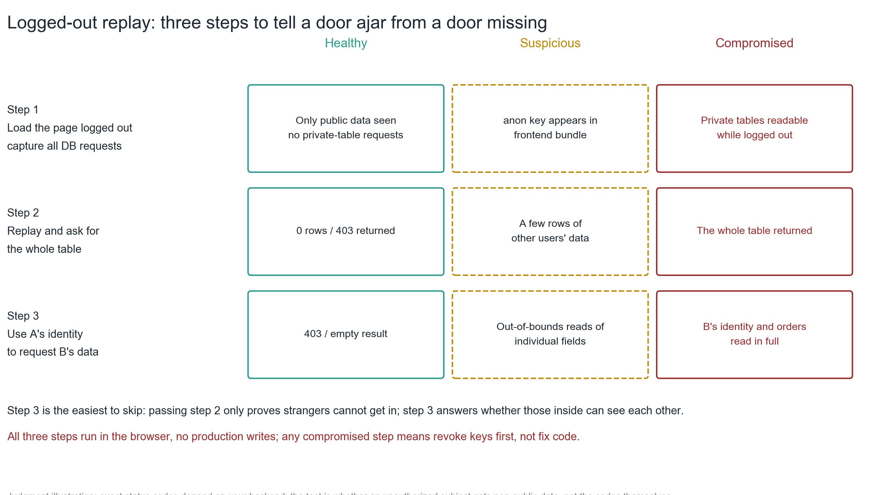
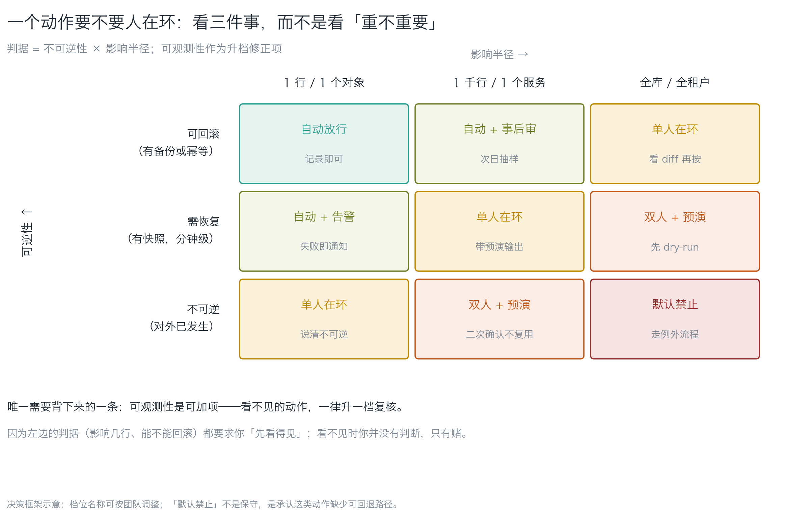
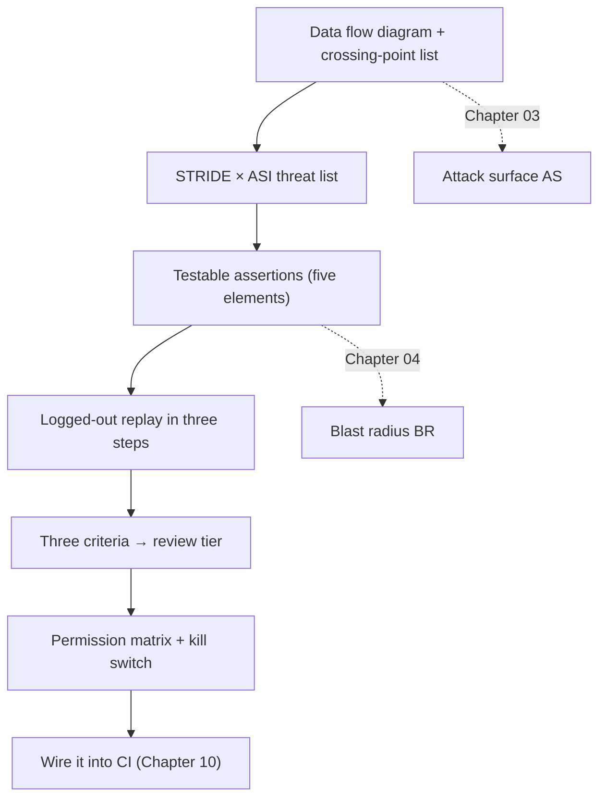

**English** | [中文](./ch09-three-deliverables.zh.md)

# Chapter 09: Threat Model, Replay Report, Permission Matrix

> **Chapter guide**: The previous chapters gave you two quantities (attack surface, blast radius) and three criteria. This chapter collects them into **three documents you can hand over** — not for you to read, but for a colleague with no security background to execute from. By the end of this chapter you hold all the deliverables of Phase 4.
> **Prerequisites**: Chapter 03 (data flow diagram and crossing list), Chapter 04 (BR and the three criteria). Chapter 01's four questions are the skeleton of these three documents.
> **Currency baseline**: This chapter is verified against "STRIDE classification (Microsoft SDL context); PostgreSQL Row-Level Security (PostgreSQL 16); OAuth 2.0 (RFC 6749)" (last verified: `2026-10-23`)
> **Core learning objectives**:
> - You master the STRIDE × ASI two-column usage, and can write a **testable assertion** for every threat
> - You can independently run the three logged-out replay steps and draw conclusions by the verdict matrix
> - You can produce a permission matrix, and state "why this tool is at this tier and where the kill switch is"

---

## 1. Cognitive Anchor: What an executable model looks like

### 1.1 It is not a thirty-page document

What many people imagine as a "threat model" is a thirty-page Word document: dense with terms, complete with frameworks, every paragraph correct, and nobody reads it twice.

But the goal of this book, stated at the start of this chapter, is: **let a person with no security background understand it and execute it**. That goal directly decides the document's shape. An executable threat model is one diagram + an eight-row table + eight assertions:

| Deliverable | Shape | What the reader does with it |
|---|---|---|
| **Data flow diagram + crossing list** | One diagram + 8 rows | Point at each row and say "how is this line stopped right now" |
| **Threat list** | An 8-row table, one assertion per row | Paste the assertions into CI and watch them run |
| **Permission matrix** | One row per tool | Check the scope against the table; delete what lands on "default deny" |

There is one judgment criterion: **can the reader run the first assertion without asking you?** If yes, it passes; if no, rewrite.

### 1.2 Intuitive Analogy: an acceptance form, not as-built drawings

Continue the renovation analogy of Chapter 01: you do not give the renovation crew "on the necessity of electrical safety"; you give them an **acceptance form** — on it: "residual-current breaker install position: ___, does pressing the test button trip it: □Yes □No".

The three documents are three acceptance forms:

- **Crossing list**: does every door have a lock, and where is the lock
- **Threat list**: for each lock, how to test that it is really locked
- **Permission matrix**: who may hold each key, for how long, and how to take it back

What they share is that they are **checkable**. Every item can be answered "yes/no", not "hmm, roughly".

### 1.3 The three documents are not three islands

They are three links on one chain:

```
Diagram (what gates exist) → table (what risks each gate has) → assertion (how you know the gate is locked) → matrix (how the keys are managed)
```

If you only do the middle link, there is no village ahead and no inn behind: a threat list without a diagram misses threats; a threat list without assertions is rhetoric; a system without a matrix makes the assertions expire three days later (someone adds a new tool and updates no document).

---

## 2. First Principles: How to Write the Four Things

### 2.1 STRIDE × ASI: why two columns

Threat classification has two commonly used coordinate systems:

| System | What it governs | Its blind spot |
|---|---|---|
| **STRIDE** | Which class of bad thing: spoofing / tampering / repudiation / information disclosure / denial of service / elevation | It **misses "prompt injection"** — not in the traditional six |
| **OWASP ASI 01—10** | Which class of AI-specific bad thing | It **misses old problems** like CSRF and session hijacking |

Using both columns is so nothing is missed. STRIDE governs "traditional bad things", ASI governs "new bad things"; for threats that are not AI-specific, just put `—` in the ASI column.

### 2.2 The five elements of a testable assertion

This is the most important craft in this chapter. An assertion must spell out all five:

```
Subject + action + object + expectation + source of the criterion
```

| Element | Example | What happens if it is unclear |
|---|---|---|
| **Subject** | With the `anon` role / with user A's token | Nobody knows in whose identity to run it; results are not reproducible |
| **Action** | `select count(*)` / GET | Nobody knows what to do |
| **Object** | `notes` table / `owner_id=eq.<B's uuid>` | Nobody knows what is touched |
| **Expectation** | 0 rows / 403 / alert over threshold | Nobody knows what counts as passing |
| **Source of the criterion** | CI exit code / probe script output | Nobody knows where to look for the result |

Contrast with counter-examples:

| Unqualified wording | Why it fails | Qualified wording |
|---|---|---|
| "should keep the data safe" | No subject, action, object, or expectation; not falsifiable | `execute select count(*) from notes with the anon role, expect 0, CI exit code 0 means pass` |
| "test the permissions" | Too vague | `request owner_id=eq.<B> with A's token, expect 403` |
| "must not be escalated" | Double negative + no criterion | Same as above |

**An assertion that cannot be run is not an assertion, it is rhetoric.** This is the standard that recurs throughout the book.

### 2.3 Logged-out replay: three steps, three outcomes

Three steps, all read-only:

1. **With no credentials at all**, request the data API directly → expect 401/403 or an empty set
2. **With the `anon` key** (grabbed from the bundle — attackers do this too) request "give me the whole table" → expect an empty set
3. **With user A's token** request **user B's** row → expect an empty set

Step 3 is the easiest to miss. **Passing step 2 only shows "strangers cannot get in"; step 3 answers "can those who got in see each other".**


*Figure 9-1: The verdict matrix of three steps × three outcomes. Note the dashed-box column — "suspicious" is not "fine"; it is "I have not understood it yet". In real projects the most common state is getting stuck in this middle column and then ignoring it.*

The three verdict rules:

- **Healthy**: 401/403, or 200 with an empty set (the typical expression of working RLS)
- **Suspicious**: 200 with data, but it is unclear whether the fields are public. **"Suspicious" must become "understood" or "compromised"; it cannot stay there**
- **Compromised**: 200 with non-public data obtained. **The first action is to revoke the key, not to change the code**

### 2.4 The three criteria and the kill switch

The review tier is decided by three criteria (expanded in Chapter 04; the operational version is here):


*Figure 9-2: The horizontal axis is impact radius, the vertical axis is reversibility, and the text in each cell is the review tier. The only thing to memorize is the footnote: **observability is additive — any action you cannot see goes up one tier**. The reason is hard: the criteria on the left (how many rows affected, can it be rolled back) all require you to "see it first"; when you cannot see it, you are not judging, only gambling.*

The kill switch goes in the same table as the permission matrix, because it and permissions are two sides of one thing. Three concrete requirements:

1. **One press and it stops**: no change process required, no redeployment required. Usually done by flipping a feature flag or revoking a key.
2. **The system still works after stopping**: the degradation path is written in advance (agent disabled → tickets enter a human queue).
3. **A stop must be rehearsed**: an un-rehearsed kill switch equals none.

### 2.5 Three templates

The `templates/` directory holds three directly fillable templates:

| Template | Deliverable | Key columns |
|---|---|---|
| `threat-model.md` | Threat list | **Testable assertion**, residual risk, "known uncovered" |
| `replay-report.md` | Replay report | One row per step + verdict + fix and retest |
| `permission-matrix.md` | Permission matrix | Three criteria + review tier + kill switch + step-down record |

How to use the templates is **copy the structure, not the content**. Your project is not LessonVault, and the columns will be filled differently.

---

## 3. Hands-on: Collect LessonVault into three documents

### 3.1 Deliverable one: data flow diagram + crossing list

The diagram is in Chapter 03 (the Mermaid DFD). The list is produced with `code/ch03/boundary_map.py`: 8 crossings, 6 not yet in place. This document's job is to **force out the gaps** — the blank "existing control" cells are its most valuable part.

### 3.2 Deliverable two: threat list (STRIDE × ASI)

Translate every row of the crossing list into a threat, with an assertion. LessonVault's 8:

| # | Component | STRIDE | ASI | Concrete threat | **Testable assertion** | Countermeasure | Residual risk |
|---|---|---|---|---|---|---|---|
| T1 | F2 direct connect | Information disclosure | ASI03 | Read the whole table logged out | `anon` role `select count(*) from notes` must be 0 | RLS four policies | Policy written wrong (`using(true)`) |
| T2 | F3 storage | Information disclosure | — | Change the path to read others' attachments | Changing `owner_id` in the URL must 403 | Bucket policy by path prefix | Signed URLs get forwarded (time-limited) |
| T3 | F5 agent | Elevation | ASI02 / ASI03 | The agent performs escalations on the user's behalf | Audit log rows with `actor≠subject` must be 0 | User-level tokens + per-action authorization | The user themselves is the attacker |
| T4 | F6 context | Tampering | ASI01 | Hidden instructions in a page export the whole DB | Run 20 injection samples; successful escalations must be 0 | Least privilege at the tool layer (not prompts) | Novel injections will always exist |
| T5 | Dependencies | Tampering | ASI04 | Installing a squatted package | No package outside the allowlist may appear in the dependency tree | Lockfile + allowlist + scanning | Transitive dependencies |
| T6 | Email | Abuse | ASI05 | Sending phishing mail as your domain | Daily mail volume over threshold must alert and stop sending | SPF/DKIM + rate limiting | Content cannot be judged automatically |
| T7 | Retries | Denial of service | ASI08 | Retrying failures blows up the upstream | Same request retried > 3 times within 5 minutes must trip the breaker | Exponential backoff + circuit breaker | Legitimate retries of long-tail tasks |
| T8 | Approval | Trust exploitation | ASI09 | Approval fatigue causes mis-approval | More than 20 approvals a day must trigger a process review | Tiered approval (see 3.4) | People tire in the end |

**How to check whether this table qualifies**: pull the "testable assertion" column out on its own and see whether each one can be pasted into CI. If they cannot be pulled out, it is still rhetoric.

### 3.3 Deliverable three: replay report + permission matrix

**Replay**: run `code/ch09/replay_probe.py` (standard library only, GET only, `limit` enforced):

```bash
# 先空跑，确认要发什么
python3 replay_probe.py \
  --base-url https://<你的项目>.supabase.co \
  --anon-key <从 bundle 里抓到的那份> \
  --table notes --dry-run

# 确认无误后真跑（第 3 步需要两个参数）
python3 replay_probe.py \
  --base-url https://<你的项目>.supabase.co \
  --anon-key <anon> --table notes \
  --token-a <A 的 access_token> --victim-id <B 的 uuid>
```

Exit codes 0 / 1 / 2 (healthy / suspicious / compromised), **can be wired straight into CI**: whether the door is locked should not depend on someone remembering to check.

**Permission matrix**: computed with Chapter 04's method (`blast_radius.py`); two tools land on "default deny", and after narrowing scope they drop to "single human in the loop". The complete table is in Chapter 04 §3.3 — **this chapter does not recompute it, because the deliverable is that table, not the algorithm**.

Three columns the matrix must have but many people miss:

| Missed column | Why it is needed | How to fill it |
|---|---|---|
| **Credential lifetime** | Long-lived credentials = every use is a chance to copy them | Long-lived / short-lived (how long) / exchanged per use |
| **Kill switch** | Permissions and "how to take them back" are two sides of one thing | The concrete one-press-and-it-stops action (which flag to flip) |
| **Max impact per call** | The furthest damage one call can do | E.g. `1 row of subscription state` |

### 3.4 Before handing over, run this checklist

| # | Check | Passing standard |
|---|---|---|
| 1 | Does the diagram have trust boundaries | At least one dashed line |
| 2 | Is every arrow labeled with its credential | No label, sent back |
| 3 | Does the crossing list have a "gap" column | Blanks are allowed; pretending to have controls is not |
| 4 | Does every threat have an assertion | Can be pulled out and pasted into CI |
| 5 | Are the assertions "should fail" ones | At least half test "what should not happen did not happen" |
| 6 | Are the three replay steps judged separately | They cannot be merged into "overall pass" |
| 7 | Does the matrix have a kill switch | None = the permissions are half-written |
| 8 | Has anyone rehearsed the kill switch | Un-rehearsed = none |

**Item 5 is the soul of this table.** A threat list that is all "should pass" shares the flaw of Chapter 01's "functional test blind spot" — it only tests what should happen, not what should not happen.

---

## 4. Common Pitfalls and the Right Mental Model

| Pitfall that is easy to step in | Why it goes wrong (root cause) | The right mental model and practice |
|---|---|---|
| **"Threat modeling is the security team's job"** | When one person builds a product there is no security team; and only the person writing the code knows "what was meant to be written" for omission-type defects | Draw it in one afternoon: 8 arrows + 8 threats + 8 assertions. Not completeness; it must run |
| **"The document is written, so it is delivered"** | A document without assertions is rhetoric | Checklist items 4 and 5: assertions must be pasteable into CI, and more than half must be reverse assertions |
| **"All three replay steps passed, so we are safe"** | Merged verdicts hide the "suspicious" column | Judge the three steps separately; "suspicious" must be chased into "understood" or "compromised" |
| **"Write the permission matrix once and forget it"** | Every new tool adds a row; not updating equals not writing | Wire the matrix into the tool definition review process; a new tool must fill in the table first |
| **"Just add a confirmation checkbox"** | Checkboxes get clicked on habit (automation bias) | Tools landing on "default deny" are **not implemented**; small radius auto-allowed, large radius two-person + rehearsal |
| **"Injection cannot be stopped, so we can only accept it"** | Setting the goal as "the model is not fooled", which is unreachable today | Change the goal to "even when fooled it grabs nothing": shrink BR so that successful injection has no usable exit |

---

## 5. Chapter Summary and Local Knowledge Map

### 5.1 Core points

- **An executable threat model = one diagram + an eight-row table + eight assertions**, and the criterion is "the reader can run the first assertion without asking you".
- **STRIDE × ASI two columns**: STRIDE misses injection, ASI misses old problems; both columns together miss nothing.
- **The five elements of a testable assertion**: subject + action + object + expectation + source of the criterion. Without the five elements, it is rhetoric.
- **The three replay steps are judged separately**; "suspicious" is not "fine", it is "I have not understood it yet".
- **The permission matrix must have a kill switch**, and the kill switch counts only once rehearsed.
- **Checklist item 5**: at least half the assertions are "should fail" ones — that is the soul of the whole book.

### 5.2 Concept topology of this chapter



---

## 6. Tiered Exercises

### Foundation (Tier 1)

1. Rewrite this assertion with the five elements: "make sure user data cannot be accessed with escalated privileges." The rewritten version must be pasteable straight into CI.
2. What question do steps 2 and 3 of the replay test each answer? Why is doing only step 2 not complete?

### Hands-on Application (Tier 2)

3. For three crossing lines in your project, write one threat + one testable assertion each. Requirement: the assertion must contain "do Y in X's identity, expect Z".
4. Run the three steps of `code/ch09/replay_probe.py` (you may `--dry-run` first), and give each step's verdict per the verdict matrix of Figure 9-1. If "suspicious" appears, write down how you plan to chase it into "understood".

### Deep Challenge (Tier 3)

5. On the spot, tier the following three actions (using the matrix of Figure 9-2) and state your basis: ① change your own nickname ② send a "system upgrade notice" to every user ③ delete all of one user's notes. Then say: which one deserves "two-person + rehearsal", and why is the split not based on "how important it feels"?
6. Someone proposes: "let's have AI automatically generate the threat model from the code, so nobody has to write it by hand." Analyze the feasibility of this proposal (hint: where does the assertion's "source of the criterion" come from? How do you verify the generated model misses nothing?), and give a workable "AI drafts + human decides" process.

<details>
<summary><strong>Click to expand: reference answers and in-depth analysis for this chapter's exercises</strong></summary>

#### 1. Analysis of question 1

- **Rewritten**: `execute select count(*) from notes with the anon role, expect 0 rows; a non-zero CI exit code means failure.`
- **Element by element**: subject = the `anon` role; action = `select count(*)`; object = `notes`; expectation = 0 rows; source of the criterion = CI exit code.
- **Another qualified wording** (horizontal escalation): `request GET /rest/v1/notes?owner_id=eq.<B's uuid> with user A's access_token, expect 403 or an empty set; the verdict is based on replay_probe.py's exit code.`
- **Common wrong answer**: "request B's data with A's token, expect failure." — "failure" is not an expectation; it is the nature of an outcome. **The expectation must be observable** (status code, row count, alert), not an evaluation like "fail/succeed".

#### 2. Analysis of question 2

- **Step 2 answers**: "can a stranger (logged out, holding only the public anon key) read the whole table?"
- **Step 3 answers**: "can someone who got in (logged-in user A) read someone else's (user B's) data?"
- **Why step 2 alone is not complete**: passing step 2 only proves **people outside the boundary cannot get in**; step 3 proves **people inside the boundary cannot see each other**. In real incidents horizontal escalation is more common than unauthorized access — because an attacker only has to register an account and is automatically "inside the boundary".
- **A memory hook**: step 2 tests "is the door locked"; step 3 tests "are there partitions inside". **A locked door with no partitions is a very common building.**

#### 3. Analysis of question 3

- **Sample** (swap in your own):
  | Crossing line | Threat | Testable assertion |
  |---|---|---|
  | F2 frontend → DB | Read the whole table logged out | `anon` role `select count(*) from orders` expect 0 |
  | F5 agent → API | Refund on behalf of any user | `audit log row count where actor≠subject` expect 0 |
  | F8 API → email | Send mail as your domain | `daily mail volume > 500` must stop sending |
- **Acceptance criteria**: an assertion containing an "expectation" and a concrete criterion passes; writing "make sure it cannot be escalated" means rewriting.

#### 4. Analysis of question 4

- **Verdicts** (per Figure 9-1):
  - Step 1: if 401/403 → healthy; if 200 with rows → compromised
  - Step 2: if 0 rows → healthy; if rows → compromised (this is the most severe)
  - Step 3: if 403/empty → healthy; if B's rows are read → compromised
- **How to chase "suspicious"**: capture one real response and see whether the fields are public fields (say course titles were always public). Once understood, change the verdict; if not understood, escalate to "compromised" and revoke. **Staying at "suspicious" is not allowed.**
- **What this question is for**: to let you feel the value of "separate steps". Many people run it and write one line, "overall pass", which deletes the most informative column.

#### 5. Analysis of question 5

| Action | Impact radius | Reversibility | Observability | Review tier |
|---|---|---|---|---|
| ① Change your own nickname | 1 object | Rollback-capable | Logs | **Auto-allow** |
| ② Site-wide "system upgrade notice" | Whole site / already external | Irreversible | Alerts | **Two-person + rehearsal** (or "default deny" if no send cap) |
| ③ Delete all of one user's notes | 1 user (but irreversible) | Needs snapshot restore (if backups exist) | Logs + alerts | **Single human in the loop** (with backups) or **two-person + rehearsal** (without) |

- **Why ② is "two-person + rehearsal"**: its radius is the whole site and it is irreversible (the mail is out). Sorting by "how important it feels", many people would rank ③ heavier — but ③'s radius is 1 user while ②'s is the whole site. **The criteria are radius × reversibility, not subjective importance.**
- **Why ③'s tier depends on backups**: snapshots exist and a restore has been rehearsed → "needs recovery", single human in the loop; no backups → "irreversible", two-person + rehearsal. **The tier of the same action depends on your recovery capability, not on the action itself.**

#### 6. Analysis of question 6

- **Feasibility problems**:
  1. **The assertion's "source of the criterion" cannot be generated**. AI can write "should fail" assertion text, but it does not know where your CI runs, what the probe script is called, or how exit codes are defined. The source of the criterion must be filled in by a human.
  2. **The generated model cannot prove itself complete**. What AI generates is "the threats it thinks should exist", while the value of omission-type defects lies exactly in "the one nobody thought of". **Checking a generator with a generator is the same information source** (echoing Chapter 01).
- **A workable process**:
  1. AI drafts: feed it the data flow diagram and have it produce a threat list draft (STRIDE × ASI two columns) + assertion drafts;
  2. Human decides: check item by item "does this threat really hold in my system", "can the assertion run", "what is the source of the criterion";
  3. Human fills gaps: explicitly ask yourself "what is the one AI did not write", and add at least one;
  4. Run it: paste the assertions into CI and watch them actually go red (Chapter 10).
- **Deep analysis**: the essence of this process is **using AI where it is strong** (translating diagrams into tables, generating candidates in bulk) and humans where humans are strong (judging which hold, filling gaps, giving criteria). **AI drafts, human decides** — these four words are this book's entire claim about human-machine division of labor.

</details>

---

## 7. Authoritative References and Further Reading for This Chapter

1. **Methodology source**: [OWASP](https://owasp.org/) - anchors STRIDE and threat modeling practice, supporting the two-column classification of Section 2.1 and the threat list of Section 3.2 (verified: `2026-10-23`).
2. **Official docs**: [PostgreSQL Documentation · Row Security Policies](https://www.postgresql.org/docs/current/ddl-rowsecurity.html) - anchors RLS policy semantics (using / with check), supporting the objects of the "should fail" assertions in Section 2.3 (verified version: PostgreSQL 16) (verified: `2026-10-23`).
3. **Standard**: [RFC 6749 - The OAuth 2.0 Authorization Framework](https://www.rfc-editor.org/rfc/rfc6749) - anchors token lifetime and scope semantics, supporting the permission matrix's "credential lifetime" column (verified: `2026-10-23`).

> Counting-basis note: the sources above are used to anchor **definitions and specifications**, not to extrapolate risk probabilities. Before citing any number, first check the source's year and denominator.
