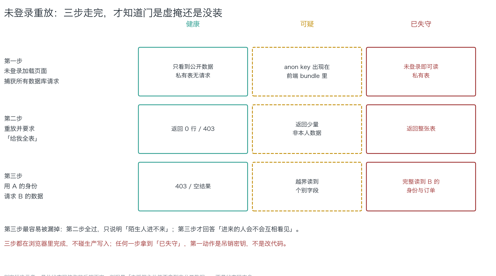
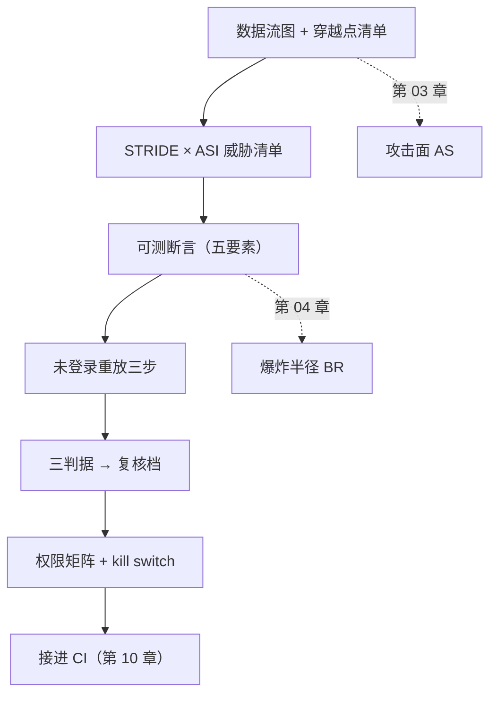

# 第 09 章：威胁模型、重放报告、权限矩阵

> **本章导读**：前面几章给了你两个量（攻击面、爆炸半径）和三条判据。这一章把它们收成**三份能交出去的文档**——不是给你看的，是给一个非安全背景的同事照着执行的。学完本章，你手上就有阶段 4 的全部交付物。
> **前置知识**：第 03 章（数据流图与穿越点清单）、第 04 章（BR 与三判据）。第 01 章的四问是这三份文档的骨架。
> **时效基线**：本章内容基于「STRIDE 分类（Microsoft SDL 语境）；PostgreSQL 行级安全（PostgreSQL 16）；OAuth 2.0（RFC 6749）」核验（最后核验日期：`2026-10-23`）
> **核心学习目标**：
> - 掌握 STRIDE × ASI 双栏的用法，能给每条威胁写出**可测断言**
> - 能独立跑完未登录重放三步，并按判读矩阵下结论
> - 能产出权限矩阵，并说清"为什么这个工具在这一档、kill switch 在哪"

---

## 1. 认知锚点：一份能让人照着执行的模型长什么样

### 1.1 它不是三十页文档

很多人想象的"威胁模型"是一份三十页的 Word：术语密集、框架齐全、每一段都正确、没人读第二遍。

但本章开头说过这本书的目标是：**让一个非安全背景的人看懂并照着执行**。这个目标直接决定了文档的形状。一份能被执行的威胁模型，是一张图 + 八行表 + 八条断言：

| 交付物 | 形状 | 读者照着做什么 |
|---|---|---|
| **数据流图 + 穿越点清单** | 一张图 + 8 行 | 指着每一行说"这条线现在怎么挡的" |
| **威胁清单** | 8 行表，每行一条断言 | 把断言粘进 CI，看它跑 |
| **权限矩阵** | 每个工具一行 | 对着表核对作用域，落"默认禁止"的删掉 |

判断标准只有一条：**读者能不能在不问你的情况下，跑出第一条断言？** 能，就合格；不能，就重写。

### 1.2 直觉类比：验收单，而不是竣工图

接上第 01 章的装修类比：你不会给装修队一份"论电气安全的必要性"，你给的是一张**验收单**——上面写着"漏电保护器安装位置：___，测试按钮按下是否跳闸：□是 □否"。

三份文档就是三张验收单：

- **穿越点清单**：每扇门有没有锁，锁在哪
- **威胁清单**：每一把锁怎么测它真的锁上了
- **权限矩阵**：每把钥匙谁能拿、拿多久、怎么收回

它们的共同点是**可核对**。每一条都能被"是/否"回答，而不是"嗯，差不多"。

### 1.3 三份文档不是三个孤岛

它们是三条链上的三环：

```
图（有什么门）→ 表（门有什么风险）→ 断言（怎么知道门锁着）→ 矩阵（钥匙怎么管）
```

如果只做中间一环，前不着村后不着店：没图的威胁清单会漏威胁，没断言的威胁清单是修辞，没矩阵的系统会让断言三天后失效（有人加了个新工具，没更新任何文档）。

---

## 2. 第一性原理：四种东西怎么写

### 2.1 STRIDE × ASI：为什么要两栏

威胁分类有两个常用坐标系：

| 坐标系 | 管什么 | 它的盲区 |
|---|---|---|
| **STRIDE** | 哪一类坏事：冒充 / 篡改 / 抵赖 / 信息泄露 / 拒绝服务 / 提权 | 会**漏掉"提示注入"**——它不在传统六类里 |
| **OWASP ASI 01—10** | AI 特有的哪一类坏事 | 会**漏掉 CSRF、会话劫持**这类老问题 |

两栏并用，是为了不漏。STRIDE 管"传统坏事"，ASI 管"新坏事"；不是 AI 特有的威胁，ASI 那栏填 `—` 就行。

### 2.2 可测断言的五要素

这是本章最重要的手艺。一条断言必须写全五样：

```
主体 + 动作 + 对象 + 期望 + 判据来源
```

| 要素 | 例子 | 写不清会怎样 |
|---|---|---|
| **主体** | 用 `anon` 角色 / 用用户 A 的 token | 不知道用谁的身份跑，结果不可复现 |
| **动作** | `select count(*)` / GET | 不知道做什么 |
| **对象** | `notes` 表 / `owner_id=eq.<B 的 uuid>` | 不知道碰什么 |
| **期望** | 0 行 / 403 / 超阈值告警 | 不知道什么算过 |
| **判据来源** | CI 退出码 / 探测脚本输出 | 不知道去哪里看结果 |

反例对照：

| 不合格的写法 | 为什么不合格 | 合格的写法 |
|---|---|---|
| "应当保证数据安全" | 没有主体、动作、对象、期望，无法证伪 | `用 anon 角色执行 select count(*) from notes，期望 0，CI 退出码 0 表示通过` |
| "测试权限" | 太泛 | `用 A 的 token 请求 owner_id=eq.<B>，期望 403` |
| "不能被越权" | 双重否定 + 无判据 | 同上 |

**一条不能跑的断言，不是断言，是修辞。** 这是全书反复出现的那条标准。

### 2.3 未登录重放：三步与三种结果

三步，全部只读：

1. **不带任何凭据**，直接请求数据接口 → 期望 401/403 或空集
2. **用 `anon` key**（从 bundle 里抓，攻击者也会这么做）请求"给我全表" → 期望空集
3. **用用户 A 的令牌**请求**用户 B** 的那一行 → 期望空集

第 3 步最容易被漏。**第 2 步全过只说明"陌生人进不来"；第 3 步才回答"进来的人会不会互相看见"。**


*图 1-1：三步 × 三种结果的判读矩阵。注意虚线框那一列——"可疑"不是"没事"，它是"我还没看懂"。真实项目里最常见的状态就是卡在中间这一列，然后被忽略。*

判读的三条规则：

- **健康**：401/403，或 200 但空集（RLS 生效的典型表现）
- **可疑**：200 且有数据，但不确定是不是公开字段。**"可疑"必须变成"我看懂了"或"已失守"，不能停在那里**
- **已失守**：200 且拿到了非公开数据。**第一动作是吊销密钥，不是改代码**

### 2.4 三判据与 kill switch

复核档由三条判据决定（第 04 章展开过，这里给操作版）：


*图 1-2：横轴是影响半径，纵轴是可逆性，格子里的字是复核档。唯一需要背下来的是底注：**可观测性是可加项——看不见的动作，一律升一档**。理由很硬：左边的判据（影响几行、能不能回滚）都要求你"先看得见"；看不见的时候你并没有判断，只有赌。*

kill switch 要写在权限矩阵的同一张表里，因为它和权限是同一件事的两面。三个具体要求：

1. **一按就停**：不要求走变更流程，不要求重新部署。做法通常是关掉一个 feature flag 或撤下一个密钥。
2. **停了之后系统还能用**：降级路径要提前写好（智能体停用 → 工单进入人工队列）。
3. **停过要演练**：没演练过的 kill switch，等于没有。

### 2.5 三份模板

`templates/` 目录里有三份可直接填的模板：

| 模板 | 对应交付物 | 关键列 |
|---|---|---|
| `threat-model.md` | 威胁清单 | **可测断言**、残留风险、"已知未覆盖" |
| `replay-report.md` | 重放报告 | 三步各一行 + 判定 + 修复与复测 |
| `permission-matrix.md` | 权限矩阵 | 三判据 + 复核档 + kill switch + 降档记录 |

模板的用法是**照抄结构，不抄内容**。你的项目和 LessonVault 不一样，列的填法也会不一样。

---

## 3. 手把手：把 LessonVault 收成三份文档

### 3.1 交付物一：数据流图 + 穿越点清单

图在第 03 章（Mermaid DFD）。清单用 `code/ch03/boundary_map.py` 跑出来，8 条穿越、6 条未落实。这一份文档的作用是**逼出缺口**——留空的"现有控制"栏是它最有价值的部分。

### 3.2 交付物二：威胁清单（STRIDE × ASI）

把穿越点清单的每一行翻译成一条威胁，并配断言。LessonVault 的 8 条：

| # | 组件 | STRIDE | ASI | 具体威胁 | **可测断言** | 对策 | 残留风险 |
|---|---|---|---|---|---|---|---|
| T1 | F2 直连 | 信息泄露 | ASI03 | 未登录读全表 | `anon` 角色 `select count(*) from notes` 必须为 0 | RLS 四策略 | 策略写错（`using(true)`） |
| T2 | F3 存储 | 信息泄露 | — | 换路径读他人附件 | 改 URL 里的 `owner_id` 必须 403 | 桶策略按路径前缀 | 签名 URL 被转发（有时效） |
| T3 | F5 智能体 | 提权 | ASI02 / ASI03 | 智能体代用户执行越权动作 | 审计日志里 `actor≠subject` 的行必须为 0 | 用户级令牌 + 逐动作授权 | 用户自己就是攻击者 |
| T4 | F6 上下文 | 篡改 | ASI01 | 网页藏指令导出全库 | 注入样本跑 20 次，越权成功次数必须为 0 | 工具层最小权限（不靠提示词） | 新型注入永远存在 |
| T5 | 依赖 | 篡改 | ASI04 | 装到抢注包 | 依赖树里不得出现不在允许清单的包 | lockfile + 允许清单 + 扫描 | 传递依赖 |
| T6 | 邮件 | 滥用 | ASI05 | 以你的域名发钓鱼信 | 单日发信量超阈值必须告警并停发 | 域名 SPF/DKIM + 速率限制 | 内容层面无法自动判定 |
| T7 | 重试 | 拒绝服务 | ASI08 | 失败重试打爆上游 | 同请求 5 分钟内重试 > 3 次必须熔断 | 指数退避 + 断路器 | 长尾任务的合理重试 |
| T8 | 审批 | 信任利用 | ASI09 | 审批疲劳导致误批 | 单日审批 > 20 次必须触发流程复盘 | 分档审批（见 3.4） | 人终究会疲劳 |

**怎么检查这张表是不是合格的**：把"可测断言"那一列单独抽出来，看能不能一条条粘进 CI。抽不出来，说明它还是修辞。

### 3.3 交付物三：重放报告 + 权限矩阵

**重放**：跑 `code/ch09/replay_probe.py`（只用标准库，只发 GET，强制带 `limit`）：

```bash
# 先空跑，确认要发什么
python3 replay_probe.py \
  --base-url https://<你的项目>.supabase.co \
  --anon-key <从 bundle 里抓到的那份> \
  --table notes --dry-run

# 确认无误后真跑（第 3 步需要两个参数）
python3 replay_probe.py \
  --base-url https://<你的项目>.supabase.co \
  --anon-key <anon> --table notes \
  --token-a <A 的 access_token> --victim-id <B 的 uuid>
```

退出码 0 / 1 / 2（健康 / 可疑 / 已失守），**可以直接接进 CI**：门锁没锁，不该靠人记得去查。

**权限矩阵**：用第 04 章的方法算完（`blast_radius.py`），两个工具落在"默认禁止"，收窄作用域后降到"单人在环"。完整表见第 04 章 §3.3——**本章不再重复算，因为交付物是那张表，不是算法**。

矩阵里必须有、但很多人漏掉的三列：

| 漏掉的列 | 为什么必须有 | 填法 |
|---|---|---|
| **凭据生命周期** | 长寿命凭据 = 每一次都是一次可被复制的机会 | 长寿命 / 短寿命（多久）/ 每次交换 |
| **kill switch** | 权限和"怎么收回"是同一件事的两面 | 一按就停的具体动作（关哪个 flag） |
| **单次最大影响** | 一次调用最远能造成什么 | 例：`1 行订阅状态` |

### 3.4 交出去之前，过一遍这张检查单

| # | 检查 | 通过标准 |
|---|---|---|
| 1 | 图上有信任边界吗 | 至少一条虚线 |
| 2 | 每条箭头标凭据了吗 | 不标的打回 |
| 3 | 穿越点清单有"缺口"栏吗 | 留空是允许的，假装有控制不允许 |
| 4 | 每条威胁都有断言吗 | 抽出来能粘进 CI |
| 5 | 断言是"应当失败"的吗 | 至少一半测的是"不该发生的没发生" |
| 6 | 重放三步分开判读了吗 | 不能合并成"整体通过" |
| 7 | 矩阵里有 kill switch 吗 | 没有 = 权限写了一半 |
| 8 | 有人演练过 kill switch 吗 | 没演练过 = 没有 |

**第 5 条是这张表的灵魂。** 一份全是"应当通过"的威胁清单，和第 01 章说的"功能测试盲区"是同一个毛病——它只测该发生的，不测不该发生的。

---

## 4. 常见误区与正反例

| 容易踩坑的误区 | 为什么会出错（根因） | 正确的心智模型与做法 |
|---|---|---|
| **"威胁建模是安全团队的事"** | 一个人做产品时没有安全团队；而缺失型缺陷只有写代码的人知道"本来想写什么" | 一下午画完：8 条箭头 + 8 条威胁 + 8 条断言。不求全，求能跑 |
| **"文档写完了就算交付"** | 没有断言的文档是修辞 | 检查单第 4、5 条：断言要能粘进 CI，且一半以上是反向断言 |
| **"三步重放都通过了，所以安全"** | 合并判读会掩盖"可疑"那一列 | 三步分开判读；"可疑"必须被追成"看懂了"或"已失守" |
| **"权限矩阵写一次就不用管了"** | 每加一个工具就多一行；不更新等于没写 | 把矩阵接进工具定义的评审流程；新增工具必须先填表 |
| **"加个确认框就够了"** | 确认框会被点习惯（自动化偏见） | 落在"默认禁止"的工具**不实现**；小半径自动放行，大半径双人预演 |
| **"注入防不住，所以只能认命"** | 把目标定成"模型不被骗"，这个目标目前达不到 | 把目标改成"被骗了也拿不到东西"：缩小 BR，让注入成功也没有可用的出口 |

---

## 5. 本章小结与局部知识图谱

### 5.1 核心要点

- **能被执行的威胁模型 = 一张图 + 八行表 + 八条断言**，判断标准是"读者能不问你就跑出第一条断言"。
- **STRIDE × ASI 双栏**：STRIDE 漏注入，ASI 漏老问题，两栏并用才不漏。
- **可测断言五要素**：主体 + 动作 + 对象 + 期望 + 判据来源。写不出五要素的，是修辞。
- **重放三步分开判读**；"可疑"不是"没事"，是"我还没看懂"。
- **权限矩阵必须有 kill switch**，且 kill switch 要演练过才算有。
- **检查单第 5 条**：至少一半断言是"应当失败"的——这是全书的魂。

### 5.2 本章概念拓扑



---

## 6. 分级通关练习

### 基础巩固题（Tier 1）

1. 用五要素改写这条断言："要保证用户数据不会被越权访问。"要求改写后的版本能直接粘进 CI。
2. 重放测试的第 2 步和第 3 步各回答什么问题？为什么只做第 2 步不算完成？

### 动手应用题（Tier 2）

3. 对你项目的三条穿越线各写一条威胁 + 一条可测断言。要求：断言里必须出现"用 X 的身份做 Y，期望 Z"。
4. 跑完 `code/ch09/replay_probe.py` 的三步（可以先 `--dry-run`），按图 1-1 的判读矩阵给出三步各自的判定。若出现"可疑"，写出你打算怎么把它追成"看懂了"。

### 深度挑战题（Tier 3）

5. 现场给下面三个动作分档（用图 1-2 的矩阵），并说出依据：① 修改自己的昵称 ② 给全站用户发一封"系统升级通知" ③ 删除一个用户的全部笔记。然后说出：哪一个应该"双人 + 预演"，为什么不是按"重不重要"来分？
6. 有人提议："我们用 AI 自动把代码里的威胁模型生成出来，这样就不用手写了。"请分析这个提议的可行性（提示：断言的"判据来源"从哪来？生成的模型怎么验证它不漏？），并给出一个"AI 起草 + 人裁决"的可行流程。

<details>
<summary><strong>点击展开：本章练习参考答案与深度解析</strong></summary>

#### 1. 题目 1 解析

- **改写后**：`用 anon 角色执行 select count(*) from notes，期望 0 行；CI 退出码非 0 表示失败。`
- **逐要素**：主体 = `anon` 角色；动作 = `select count(*)`；对象 = `notes`；期望 = 0 行；判据来源 = CI 退出码。
- **另一种合格写法**（横向越权）：`用用户 A 的 access_token 请求 GET /rest/v1/notes?owner_id=eq.<B 的 uuid>，期望 403 或空集；判定依据是 replay_probe.py 的退出码。`
- **常见错答**："用 A 的 token 请求 B 的数据，期望失败。"——"失败"不是期望，是结果的性质。**期望必须是可观察的**（状态码、行数、告警），不能是"失败/成功"这种评价。

#### 2. 题目 2 解析

- **第 2 步回答**："陌生人（未登录 + 仅有公开 anon key）能不能读到全表？"
- **第 3 步回答**："进来的人（已登录的用户 A）能不能读到别人（用户 B）的数据？"
- **为什么只做第 2 步不算完成**：第 2 步全过只证明**边界外的人进不来**；第 3 步才证明**边界内的人不能互相看见**。真实事故里，横向越权比未授权访问更常见——因为攻击者只要注册一个账号，就自动"进了边界"。
- **一个记忆点**：第 2 步测的是"门锁没锁"，第 3 步测的是"室内有没有隔断"。**锁了门、没做隔断，是一栋很常见的楼。**

#### 3. 题目 3 解析

- **示例**（换你自己的）：
  | 穿越线 | 威胁 | 可测断言 |
  |---|---|---|
  | F2 前端 → DB | 未登录读全表 | `anon` 角色 `select count(*) from orders` 期望 0 |
  | F5 智能体 → API | 代任意用户退款 | `审计日志 actor≠subject 的行数` 期望 0 |
  | F8 API → 邮件 | 以你的域名发信 | `单日发信量 > 500` 必须触发停发 |
- **验收标准**：断言里出现"期望"和具体判据的，算过；写"确保不能越权"的，重写。

#### 4. 题目 4 解析

- **判定**（按图 1-1）：
  - 第 1 步：若返回 401/403 → 健康；若 200 且有行 → 已失守
  - 第 2 步：若返回 0 行 → 健康；若有行 → 已失守（这是最严重的）
  - 第 3 步：若 403/空 → 健康；若读到 B 的行 → 已失守
- **"可疑"怎么追**：抓一次真实响应，看字段是不是公开字段（如课程标题本来就是公开的）。看懂了就改判；看不懂就升级为"已失守"并吊销。**不允许停在"可疑"。**
- **这道题的用意**：让你体会"三步分开"的价值。很多人跑完只写一句"整体通过"，那等于把最有信息量的那一列删掉了。

#### 5. 题目 5 解析

| 动作 | 影响半径 | 可逆性 | 可观测性 | 复核档 |
|---|---|---|---|---|
| ① 修改自己的昵称 | 1 个对象 | 可回滚 | 有日志 | **自动放行** |
| ② 全站发"系统升级通知" | 全库 / 已对外 | 不可逆 | 有告警 | **双人 + 预演**（若无发信上限则"默认禁止"） |
| ③ 删除一个用户的全部笔记 | 1 个用户（但不可逆） | 需快照恢复（若有备份） | 有日志+告警 | **单人在环**（有备份）或 **双人 + 预演**（无备份） |

- **为什么 ② 是"双人 + 预演"**：它的半径是全站、且不可逆（邮件已发出）。按"重不重要"分类，很多人会把 ③ 判得更重——但 ③ 的半径是 1 个用户，而 ② 是全站。**判据是半径 × 可逆性，不是主观的重要性。**
- **为什么 ③ 的档位取决于备份**：有快照、演练过恢复 → "需恢复"，单人在环；没备份 → "不可逆"，双人 + 预演。**同一个动作的档位，取决于你的恢复能力，不取决于动作本身。**

#### 6. 题目 6 解析

- **可行性问题**：
  1. **断言的"判据来源"无法生成**。AI 能写出"应当失败"的断言文本，但它不知道你的 CI 跑在哪、探测脚本叫什么、退出码怎么定。判据来源必须由人填。
  2. **生成的模型无法自证不漏**。AI 生成的是"它认为该有的威胁"，而缺失型缺陷的价值恰恰在于"没想到的那一条"。**用生成器检查生成器，是同一个信息源**（呼应第 01 章）。
- **可行的流程**：
  1. AI 起草：把数据流图喂给它，让它产出威胁清单草稿（STRIDE × ASI 双栏）+ 断言草稿；
  2. 人裁决：逐条核对"这条威胁在我的系统里真的成立吗"、"断言能跑吗"、"判据来源是什么"；
  3. 人补漏：专门问自己一句"AI 没写的那条是什么"，至少补一条；
  4. 跑起来：把断言粘进 CI，看它真的会红（第 10 章）。
- **深度剖析**：这条流程的本质是**把 AI 用在它擅长的地方**（把图翻译成表格、批量生成候选），把人用在人擅长的地方（判断哪条成立、补漏、给判据）。**AI 起草，人裁决**——这四个字是本书关于"人机分工"的全部主张。

</details>

---

## 7. 本章权威参考信源与延伸阅读 (Authoritative References)

1. **方法论来源**：[OWASP](https://owasp.org/) - 锚定 STRIDE 与威胁建模实践，支撑第 2.1 节双栏分类与第 3.2 节威胁清单（核验日期：`2026-10-23`）。
2. **官方文档**：[PostgreSQL 文档 · Row Security Policies](https://www.postgresql.org/docs/current/ddl-rowsecurity.html) - 锚定 RLS 策略语义（using / with check），支撑第 2.3 节「应当失败」断言的对象（核验版本：PostgreSQL 16）（核验日期：`2026-10-23`）。
3. **标准规范**：[RFC 6749 - The OAuth 2.0 Authorization Framework](https://www.rfc-editor.org/rfc/rfc6749) - 锚定 token 生命周期与作用域语义，支撑权限矩阵「凭据生命周期」一列（核验日期：`2026-10-23`）。

> 口径提示：以上信源用于锚定**定义与规范**，不用于外推风险概率。引用任何数字前，先核对来源年份与分母。
