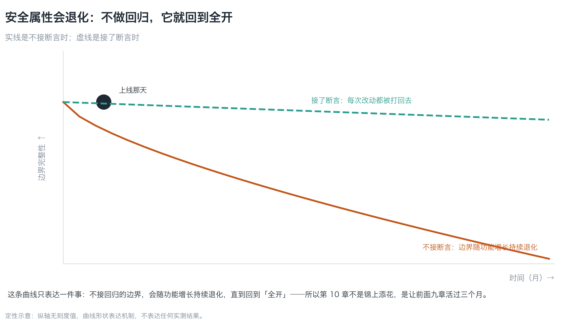
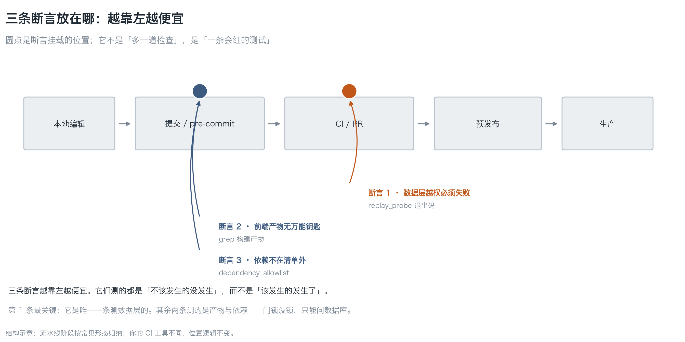
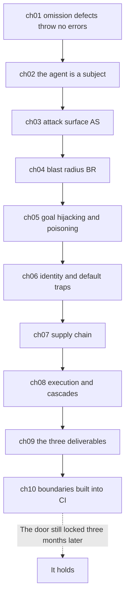

**English** | [中文](./ch10-boundaries-in-ci.zh.md)

# Chapter 10: Building Boundaries into CI and Release

> **Chapter guide**: This is the last chapter of the book. The first nine gave you two quantities, three criteria, and countermeasures for four holes — this chapter answers the most practical question: **will they still be there three months from now**. By the end of this chapter you can wire the three boundary assertions into CI, turn "is the door locked" into a test that goes red, and know how to drill and how to run a retrospective.
> **Prerequisites**: Chapter 09 (the three deliverables, should-fail assertions). The conclusions of the earlier chapters are used here, but need not be re-read.
> **Currency baseline**: This chapter is verified against "general practice of CI assertion-style testing; release process and change windows (common shapes)" (last verified: `2026-10-23`)
> **Core learning objectives**:
> - You master the shape of the three boundary assertions and can wire them into any CI
> - You can design a "deliberately break it" drill that confirms the assertions really go red
> - You can state the mechanism of security property decay, and use drills and retrospectives to make it survive three months

---

## 1. Cognitive Anchor: Three months later, the door is open again

### 1.1 One re-check

You finished everything the first nine chapters asked: the threat model exists, RLS is on, the permission matrix is written, and the kill switch is in place. Ship it, done.

Three months later you re-run the replay test (Chapter 09's script), and step 2 returns **the whole table**.

Investigation finds: two weeks ago someone turned RLS off temporarily for integration debugging and forgot to turn it back on. **Nobody did anything wrong** — integration debugging genuinely needed it. What went wrong is that **nothing turns red when RLS is switched off**.

That is the truth about security properties:

> **They are not built; they are held.** Without regression, they decay as features grow, until you are back to "fully open".


*Figure 10-2: The solid line is without wired assertions, the dashed line is with them. The curve shape says one thing only: **boundaries need regression, they are not a one-time delivery**. So this chapter is not the icing on the cake; it is what makes the previous nine chapters survive three months.*

### 1.2 Intuitive Analogy: the fire drill

A fire drill is not "one more formality"; it is **verifying that the escape routes still exist**. Likewise:

- The threat model is the **blueprint** (which doors there are)
- The permission matrix is **key management** (who can open which)
- The assertions are the **daily inspection** (is the door locked)
- The drill is the **fire drill** (the escape route really works)

**A building with a blueprint but no inspection will definitely have its doors open after three months.**

### 1.3 Why "testing what should not happen" is hard to keep up

Chapter 01 covered assertion direction. Here is the persistence problem:

| Testing "what should happen" | Testing "what should not happen" |
|---|---|
| Failure = someone wrote it wrong, easy to fix | Failure = the boundary decayed, **and it may be me who switched it off** |
| Everyone races to fix it | Easily marked "environment problem" and skipped |
| Failure count is stable with development | Failure count is low, so it gets deleted "because it is always green" |

**The last row is the deadliest**: when an assertion stays green for a long time, someone deletes it ("useless"). So every assertion needs **one record of being deliberately broken** — proving it can go red.

---

## 2. First Principles: Three Assertions

### 2.1 The shape of the assertions


*Figure 10-1: The dots are where the assertions mount. The further left, the cheaper. Note that all of them test "what should not happen did not happen", not "what should happen did happen".*

| Assertion | What it tests | Source of the criterion | Where it mounts |
|---|---|---|---|
| **1 · Data layer defended** | Anonymous and escalated access must fail | `replay_probe.py` exit code | CI (every PR) |
| **2 · The master key did not reach the frontend** | Build artifacts contain no `service_role` | `grep` over build artifacts | pre-commit / CI |
| **3 · Dependencies within the list** | No package outside the list in the lockfile | `dependency_allowlist.py` | pre-commit / CI |

**The first is the most critical**: it is the only one testing the **data layer**. The other two test artifacts and dependencies — **whether the door is locked can only be asked of the database**.

One zero-cost companion: the migration files must contain `row level security` (item 1 of `gate_check.py`). It tests "was it written", not "was it written right" — whether it is written right is up to the first.

### 2.2 One packaged entry point

`code/ch10/gate_check.py` packs the three assertions into one command:

```bash
python3 code/ch10/gate_check.py <你的项目目录> --allow allowlist.txt
```

Run on a deliberately broken sample project, real output:

```text
======================================================================
三条边界断言
目录：/private/tmp/omit-demo
======================================================================
  [失败] 断言 1 · 数据层设防
         有建表语句但没有 enable row level security（1 个文件）
  [失败] 断言 2 · 万能钥匙没进前端
         高权限凭据出现在 1 处（示例：src/app.ts:1）
  [通过] 断言 3 · 依赖在清单内
         没有 lockfile（跳过）
----------------------------------------------------------------------
失败 2 条：断言 1 · 数据层设防、断言 2 · 万能钥匙没进前端
它们测的都是「不该发生的没发生」。CI 里挂红是好事——说明门还在。
```

Exit codes 0 / 1, straight into CI.

### 2.3 Drill: deliberately break it once

After configuring the assertions, you **must do this once**:

| Step | Action | Expectation |
|---|---|---|
| 1 | Temporarily comment out one line of RLS policy | Assertion 1 goes red |
| 2 | Restore | Goes green |
| 3 | Add a line `const k = "service_role_xxx"` in the frontend source | Assertion 2 goes red |
| 4 | Restore | Goes green |
| 5 | Add a package outside the list to the lockfile | Assertion 3 goes red |
| 6 | Restore | Goes green |

**Archive the screenshots/logs of these six steps**, and write them into Chapter 09's checklist item 8. For an assertion that has never gone through this step, you do not know whether it can go red — **then it may be just decoration**.

### 2.4 Drill and retrospective: make it survive three months

One assertion decays, and a set of assertions decays faster. Three maintenance disciplines:

1. **Every incident / drill, store the real path as a new sample** (same as Chapter 05's regression set)
2. **Every quarter, deliberately break it once**, confirming it still goes red (five minutes)
3. **Pre-release checklist**: is RLS on, can the kill switch be pressed, have backups been rehearsed

The retrospective template (filled within 48 hours after an incident):

| Item | Fill in |
|---|---|
| What happened | |
| Which assertion should have stopped it | |
| Why it did not (missing / wrong / switched off) | |
| What new assertion was added | |
| Who retests and when | |

**The third row is the soul of the retrospective**. It turns "an incident" into "growth of the assertion list".

---

## 3. Hands-on: Wire it into CI, confirm it goes red

### 3.1 A CI configuration (shape, not template)

```yaml
# 伪配置：按你的 CI 工具改语法
steps:
  - name: 边界断言
    run: |
      python3 code/ch10/gate_check.py . --allow allowlist.txt
      python3 code/ch09/replay_probe.py \
        --base-url "$SB_URL" --anon-key "$SB_ANON" --table notes
  - name: 注入回归
    run: python3 code/ch05/injection_regression.py --judge results.json
```

Key point: **the three assertions must run at the PR stage**, not at pre-release. Chapter 01's "the earlier you find it the cheaper" becomes concrete here as "the further left, the cheaper" (Figure 10-1).

### 3.2 Confirm it really goes red

Run the six steps of 2.3. If one step does not go red, fix the assertion first and talk about the rest later — **an assertion that cannot go red is more dangerous than no assertion**, because it gives you the illusion of "already defended" (Chapter 01's calibration bias).

### 3.3 Wiring into the release process

| Pre-release check | Criterion | Who does it |
|---|---|---|
| Three assertions green | CI status | Automatic |
| RLS policies match migrations | Assertion 1 | Automatic |
| Kill switch usable | Stops outbound within 30 seconds | Human (rehearsed quarterly) |
| Backups restorable | Restore one table within 30 minutes | Human (rehearsed quarterly) |
| Permission matrix updated | Every new tool has a row | Human (on tool changes) |

**The last two are the "human" parts**, and the easiest to skip. Writing them into the release form turns discipline into process.

---

## 4. Common Pitfalls and the Right Mental Model

| Pitfall that is easy to step in | Why it goes wrong (root cause) | The right mental model and practice |
|---|---|---|
| **"Writing the document is enough"** | Documents do not execute; CI executes | Turn boundaries into assertions and wire the assertions into CI |
| **"The assertion is always green, let's delete it"** | Always green may mean it tests nothing | Deliberately break it once a quarter, keep the record |
| **"Security is a one-time delivery"** | Boundaries decay as features grow (Figure 10-2) | Regression + drills + retrospectives |
| **"CI is too slow; put the assertions at pre-release"** | The later you find it, the more expensive (Chapter 01) | Put the three assertions at the PR stage |
| **"A drill is just running the tests"** | A drill tests "does the gate fire", not "is the code right" | Deliberately break it + the 30-second kill switch drill |
| **"Write the retrospective clearly and that is it"** | A retrospective that does not become an assertion means it happens again | The third row of a retrospective must produce a new assertion |

---

## 5. Chapter Summary and the Book's Closing

### 5.1 Core points

- **Security properties are held, not built**: without regression they decay to "fully open".
- **The three assertions**: data layer defended, master key not in the frontend, dependencies within the list. The first is the most valuable.
- **Every assertion needs one "deliberately broken" record**, otherwise you do not know whether it can go red.
- **Drills and retrospectives**: one deliberate break per quarter, one kill switch drill per quarter; the retrospective's third row must produce a new assertion.
- **The further left, the cheaper**: assertions belong at the PR stage, not at pre-release.

### 5.2 The skeleton of the whole book (ten chapters walked)



The ten chapters are really only answering three things, and they are Chapter 01's four questions:

| The four questions | The chapters that answer them |
|---|---|
| Who can touch it without a nod? | ch03 (attack surface) + ch06/07 (default traps and supply chain) |
| How much can be taken in one go? | ch04 (blast radius) + ch02 (agency) |
| Can it be put back? | ch04 (reversibility) + ch08 (drills and rollback) |
| Who gets woken up when something happens? | ch04 (observability) + ch09/10 (assertions and alerts) |

**This book will not make you a security engineer**; it only wants one thing to hold: **you can say whether your system is contained, and there is a test that goes red watching it for you.**

---

## 6. Tiered Exercises

### Foundation (Tier 1)

1. In one sentence explain "security properties are held, not built", and give one method to verify it "is still there".
2. What do the three boundary assertions each test? Why is the first the most valuable?

### Hands-on Application (Tier 2)

3. Wire `code/ch10/gate_check.py` into your CI (or local pre-commit), run the six-step drill of 2.3, and record which steps went red.
4. Write your own pre-release checklist (no fewer than five items), and say which items are automatic and which depend on people.

### Deep Challenge (Tier 3)

5. Someone proposes: "let's make the security check a weekly scan that does not block PRs." Argue why this is not enough (hint: decay speed vs check frequency? fix cost?), and give a better timing.
6. In the retrospective, the "which assertion should have stopped it" column says "there was no assertion". State the correct action in that situation, and give a concrete example of turning an incident into an assertion.

<details>
<summary><strong>Click to expand: reference answers and in-depth analysis for this chapter's exercises</strong></summary>

#### 1. Analysis of question 1

- **In one sentence**: a boundary is not a one-time delivery; it decays as features grow (someone turns RLS off for debugging and forgets to turn it back on).
- **Verification method**: run a **should-fail** assertion (say step 2 of `replay_probe.py`), or **deliberately break one spot** and see whether it goes red.
- **Memory hook**: **green does not mean it is there; red means it is there.**

#### 2. Analysis of question 2

- **The three**: ① data layer defended (anonymous and escalated access must fail) ② the master key did not reach the frontend ③ dependencies within the list.
- **Why the first is the most valuable**: it asks the database directly, "is the door locked". The other two test artifacts and dependencies — **artifacts and dependencies are "inputs"; the data layer is "the asset itself"**.
- **Supplement**: the second and third cannot be skipped either, because they stop the two classes of holes from Chapters 06 and 07.

#### 3. Analysis of question 3

- **Expected result**: all three "breaks" go red (assertions 1/2/3 once each), and all go green after restoring.
- **If one does not go red**: fix the assertion first (wrong criterion / wrong path / skipped), **do not lower the expectation**. An assertion that cannot go red is more dangerous than none.
- **Archive**: the output screenshots or logs of the six steps, written into Chapter 09's checklist item 8.

#### 4. Analysis of question 4

- **Sample checklist**:
  | Item | Automatic / human |
  |---|---|
  | Three assertions green | Automatic |
  | RLS matches migrations | Automatic |
  | Kill switch stops within 30 seconds | Human (rehearsed quarterly) |
  | Backup restorable within 30 minutes | Human (rehearsed quarterly) |
  | Permission matrix has rows for new tools | Human (on tool changes) |
  | Dependency allowlist updated | Automatic |
  | Injection regression set green | Automatic |
- **Key point**: the **human** items must be written into the release form, or they get skipped.

#### 5. Analysis of question 5

- **Why it is not enough**:
  1. **Decay speed > check frequency**: dozens of PRs can merge in a week, each possibly switching RLS off;
  2. **Fix cost rises with time**: discovered a week later, the rollback cost far exceeds the PR stage (Chapter 01's "the later the more expensive");
  3. **Not blocking PRs = not blocking merges**: a bad boundary enters the trunk and the next build carries it.
- **Better**: **run the three assertions at the PR stage** (blocking merges), and **run a heavier scan weekly** (catching what slipped through). It is not either/or.

#### 6. Analysis of question 6

- **The correct action**: turn this incident **into a new assertion**, then wire it into CI. The value of an incident is that it points at a "nobody thought of it" omission.
- **Concrete example**:
  > Incident: someone set the Storage bucket to public read and every attachment leaked.
  > Assertion: `request storage/<owner_id>/file with anon, expect 403`; add item 4 to `gate_check.py` — the bucket policy must contain `foldername(name)`.
- **Deep analysis**: this exercise practices the whole book's landing point — **incident → assertion → a test that goes red**. Walk the three steps and one incident earns its ticket price; do not, and it is just an incident.

</details>

---

## 7. Authoritative References and Further Reading for This Chapter

1. **Methodology source**: [OWASP](https://owasp.org/) - anchors security verification and regression practice, supporting the classification of the three assertions in Section 2.1 and the drill discipline of Section 2.4.
2. **Standards and guidelines**: [NIST Computer Security Resource Center](https://csrc.nist.gov/) - anchors the general principles of control verification and continuous monitoring, supporting the maintenance disciplines of Section 2.4.
3. **Defect classification**: [MITRE CWE](https://cwe.mitre.org/) - anchors the regression testing approach for "missing authorization / misconfiguration" defects, supporting the deliberately-break-it drill of Section 2.3.

> Counting-basis note: the sources above are used to anchor **definitions and specifications**, not to extrapolate risk probabilities. Before citing any number, first check the source's year and denominator.
