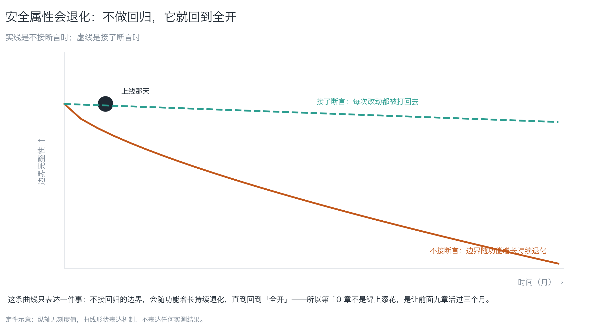
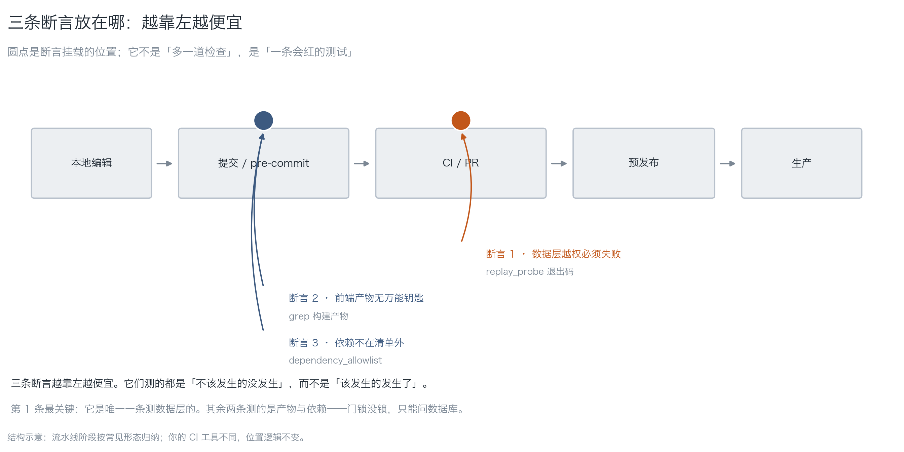
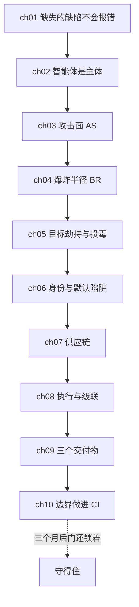

# 第 10 章：把边界做进 CI 与发布

> **本章导读**：这是本书最后一章。前九章给了你两个量、三条判据、四个洞的对策——这一章回答一个最实际的问题：**三个月后它们还在不在**。学完本章，你能把三条边界断言接进 CI，让"门锁没锁"变成一条会红的测试，并且知道怎么演练、怎么复盘。
> **前置知识**：第 09 章（三份交付物、应当失败的断言）。前面各章的结论这里会用到，但不必重读。
> **时效基线**：本章内容基于「CI 断言式测试的一般实践；发布流程与变更窗口（常见形态）」核验（最后核验日期：`2026-10-23`）
> **核心学习目标**：
> - 掌握三条边界断言的形状，能把它们接进任意 CI
> - 能设计一次"故意改坏"的演练，确认断言真的会红
> - 能说出安全属性退化的机制，并用演练与复盘让它活过三个月

---

## 1. 认知锚点：三个月后，门又开了

### 1.1 一次复查

你按前九章做完了：威胁模型有了，RLS 开了，权限矩阵写了，kill switch 也有了。上线，收工。

三个月后你重跑一次重放测试（第 09 章的脚本），第 2 步返回**全表**。

排查发现：两周前有人为了联调临时关掉 RLS，改完忘了开回来。**没人做错事**——联调确实需要。出错的是**没有任何东西会在 RLS 被关掉时变红**。

这就是安全属性的真相：

> **它不是做出来的，是守出来的。** 不做回归，它会随功能增长持续退化，直到回到「全开」。


*图 1-2：实线是不接断言时，虚线是接了断言时。曲线形状只表达一件事：**边界需要回归，不是一次性交付**。所以这一章不是锦上添花，是让前面九章活过三个月。*

### 1.2 直觉类比：消防演习

消防演习不是"多一道手续"，它是**验证逃生通道还在**。同理：

- 威胁模型是**图纸**（告诉你有哪些门）
- 权限矩阵是**钥匙管理**（谁能开哪扇）
- 断言是**每天的巡检**（门锁着没有）
- 演练是**消防演习**（逃生通道真的能走通）

**只有图纸没有巡检的楼，三个月后门一定是开的。**

### 1.3 为什么"测不该发生的事"难坚持

第 01 章讲过断言方向。这里说坚持的问题：

| 测"该发生的" | 测"不该发生的" |
|---|---|
| 失败 = 有人写错了，好修 | 失败 = 边界退化了，**可能是我自己关的** |
| 大家抢着修 | 容易被标记"环境问题"跳过 |
| 失败次数随开发稳定 | 失败次数低，容易被删掉"因为它总是绿的" |

**最后一条最致命**：断言长期是绿的，有人会把它删了（"没用"）。所以每条断言都要有**一次故意改坏的记录**——证明它会红。

---

## 2. 第一性原理：三条断言

### 2.1 断言的形状


*图 1-1：圆点是断言挂载的位置。越靠左越便宜。注意它们测的都是"不该发生的没发生"，而不是"该发生的发生了"。*

| 断言 | 测什么 | 判据来源 | 挂在哪 |
|---|---|---|---|
| **1 · 数据层设防** | 匿名与越权必须失败 | `replay_probe.py` 退出码 | CI（每次 PR） |
| **2 · 万能钥匙没进前端** | 构建产物无 `service_role` | `grep` 构建产物 | pre-commit / CI |
| **3 · 依赖在清单内** | lockfile 无清单外包 | `dependency_allowlist.py` | pre-commit / CI |

**第 1 条最关键**：它是唯一一条测**数据层**的。其余两条测的是产物与依赖——**门锁没锁，只能问数据库**。

配套一条零成本的：迁移文件里必须出现 `row level security`（`gate_check.py` 的第 1 条）。它测"有没有写"，不测"写得对不对"——写得对不对靠第 1 条。

### 2.2 一个打包好的入口

`code/ch10/gate_check.py` 把三条断言装成一条命令：

```bash
python3 code/ch10/gate_check.py <你的项目目录> --allow allowlist.txt
```

在一个刻意做错的示例工程上跑，真实输出：

```text
======================================================================
三条边界断言
目录：/private/tmp/omit-demo
======================================================================
  [失败] 断言 1 · 数据层设防
         有建表语句但没有 enable row level security（1 个文件）
  [失败] 断言 2 · 万能钥匙没进前端
         高权限凭据出现在 1 处（示例：src/app.ts:1）
  [通过] 断言 3 · 依赖在清单内
         没有 lockfile（跳过）
----------------------------------------------------------------------
失败 2 条：断言 1 · 数据层设防、断言 2 · 万能钥匙没进前端
它们测的都是「不该发生的没发生」。CI 里挂红是好事——说明门还在。
```

退出码 0 / 1，直接接 CI。

### 2.3 演练：故意改坏一次

配置完断言，**必须做一次**：

| 步 | 动作 | 期望 |
|---|---|---|
| 1 | 临时注释掉一行 RLS 策略 | 断言 1 变红 |
| 2 | 恢复 | 变绿 |
| 3 | 在前端源码里加一行 `const k = "service_role_xxx"` | 断言 2 变红 |
| 4 | 恢复 | 变绿 |
| 5 | 往 lockfile 加一个清单外的包 | 断言 3 变红 |
| 6 | 恢复 | 变绿 |

**把这六步的截图/日志留档**，写进第 09 章的检查单第 8 条。没做过这一步的断言，你不知道它会不会红——**那它可能只是装饰**。

### 2.4 演练与复盘：让它活过三个月

一条断言会退化，一套断言更会。三条维护纪律：

1. **每次事故/演练，把真实路径存成新样本**（第 05 章的回归集同理）
2. **每季度故意改坏一次**，确认还红（五分钟）
3. **发布前检查单**：RLS 开着吗、kill switch 能按吗、备份演练过吗

复盘模板（事故后 48 小时内填）：

| 项 | 填写 |
|---|---|
| 发生了什么 | |
| 哪条断言本该拦住它 | |
| 为什么没拦住（漏写 / 写错 / 被关） | |
| 加了什么新断言 | |
| 谁在什么时候复测 | |

**第三行是复盘的灵魂**。它把"事故"变成"断言清单的增长"。

---

## 3. 手把手：接进 CI，确认会红

### 3.1 一段 CI 配置（形状，不是模板）

```yaml
# 伪配置：按你的 CI 工具改语法
steps:
  - name: 边界断言
    run: |
      python3 code/ch10/gate_check.py . --allow allowlist.txt
      python3 code/ch09/replay_probe.py \
        --base-url "$SB_URL" --anon-key "$SB_ANON" --table notes
  - name: 注入回归
    run: python3 code/ch05/injection_regression.py --judge results.json
```

要点：**三条断言必须在 PR 阶段跑**，不要等到预发布。第 01 章说的"越早发现越便宜"，在这里具体化为"越靠左越便宜"（图 1-1）。

### 3.2 确认它真的会红

跑 2.3 的六步。如果某一步没红，先修断言，再谈其他——**一条不会红的断言比没有断言更危险**，因为它给你"已经设防"的错觉（第 01 章的校准偏差）。

### 3.3 与发布流程接线

| 发布前检查 | 判据 | 谁做 |
|---|---|---|
| 三条断言绿 | CI 状态 | 自动 |
| RLS 策略与迁移一致 | 断言 1 | 自动 |
| kill switch 可用 | 30 秒内停外发 | 人（每季度演练） |
| 备份可恢复 | 30 分钟内恢复一张表 | 人（每季度演练） |
| 权限矩阵已更新 | 新工具都有行 | 人（工具变更时） |

**最后两条是"人"的部分**，也是最容易省掉的。把它们写进发布单，就是把纪律变成流程。

---

## 4. 常见误区与正反例

| 容易踩坑的误区 | 为什么会出错（根因） | 正确的心智模型与做法 |
|---|---|---|
| **"文档写了就行"** | 文档不执行；执行的是 CI | 把边界变成断言，断言接进 CI |
| **"断言总绿，删了吧"** | 总绿可能意味着它测不到东西 | 每季度故意改坏一次，留记录 |
| **"安全是一次性交付"** | 边界会随功能增长退化（图 1-2） | 回归 + 演练 + 复盘 |
| **"CI 太慢，把断言放预发布"** | 越晚发现越贵（第 01 章） | 三条断言放 PR 阶段 |
| **"演练就是跑一遍测试"** | 演练测的是"闸会响"，不是"代码对" | 故意改坏 + kill switch 30 秒演练 |
| **"复盘写清楚就行了"** | 复盘不变成断言，下次还会发生 | 复盘第三行必须产出新断言 |

---

## 5. 本章小结与全书收束

### 5.1 核心要点

- **安全属性是守出来的**：不做回归就退化到「全开」。
- **三条断言**：数据层设防、万能钥匙没进前端、依赖在清单内。第 1 条最值钱。
- **每条断言都要有一次"故意改坏"的记录**，否则不知道它会不会红。
- **演练与复盘**：每季度一次改坏、每季度一次 kill switch；复盘第三行必须产出新断言。
- **越靠左越便宜**：断言放 PR 阶段，不放预发布。

### 5.2 全书的骨架（十章走完）



十章其实只在回答三件事，它们就是第 01 章的四问：

| 四问 | 回答它的章节 |
|---|---|
| 谁能不点头碰到它？ | ch03（攻击面）+ ch06/07（默认陷阱与供应链） |
| 一次能带走多少？ | ch04（爆炸半径）+ ch02（自主度） |
| 能不能放回去？ | ch04（可逆性）+ ch08（演练与回滚） |
| 出事谁会被叫醒？ | ch04（可观测性）+ ch09/10（断言与告警） |

**这本书不会让你变成安全工程师**，它只想让一件事成立：**你能说出你的系统关不关得住，并且有一条会红的测试替你盯着。**

---

## 6. 分级通关练习

### 基础巩固题（Tier 1）

1. 用一句话说明"安全属性是守出来的"，并给出一条验证它"还在"的方法。
2. 三条边界断言分别测什么？为什么说第 1 条最值钱？

### 动手应用题（Tier 2）

3. 把 `code/ch10/gate_check.py` 接进你的 CI（或本地 pre-commit），跑 2.3 的六步演练，记录哪几步变红。
4. 写一份你自己的发布前检查单（不少于五项），并说出哪几项是自动的、哪几项靠人。

### 深度挑战题（Tier 3）

5. 有人提议："我们把安全检查做成一个每周跑一次的扫描，不挡 PR。"请论证这为什么不够（提示：退化速度 vs 检查频率？修复成本？），并给出更好的时机。
6. 复盘里"哪条断言本该拦住它"这一栏填了"没有断言"。请说明这种情况下的正确动作，并给出一个把事故变成断言的具体例子。

<details>
<summary><strong>点击展开：本章练习参考答案与深度解析</strong></summary>

#### 1. 题目 1 解析

- **一句话**：边界不是一次性交付，它会随功能增长退化（有人为联调关掉 RLS 忘了开回来）。
- **验证方法**：跑一条**应当失败**的断言（例如 `replay_probe.py` 的第 2 步），或**故意改坏一处**看它红不红。
- **记忆点**：**绿色不代表在，红色才代表在。**

#### 2. 题目 2 解析

- **三条**：① 数据层设防（匿名与越权必须失败）② 万能钥匙没进前端 ③ 依赖在清单内。
- **为什么第 1 条最值钱**：它直接问数据库"门锁着没有"。其余两条测的是产物与依赖——**产物与依赖都是"输入"，数据层才是"资产本身"**。
- **补充**：第 2、3 条也不能省，因为它们拦的是第 06、07 章那两类洞。

#### 3. 题目 3 解析

- **期望结果**：三次"改坏"都变红（断言 1/2/3 各一次），恢复后都变绿。
- **如果某次没红**：先修断言（判据写错了 / 路径不对 / 被跳过），**不要降低期望**。一条不会红的断言比没有更危险。
- **留档**：六步的输出截图或日志，写进第 09 章检查单第 8 条。

#### 4. 题目 4 解析

- **示例检查单**：
  | 项 | 自动/人 |
  |---|---|
  | 三条断言绿 | 自动 |
  | RLS 与迁移一致 | 自动 |
  | kill switch 30 秒可停 | 人（每季度演练） |
  | 备份 30 分钟可恢复 | 人（每季度演练） |
  | 权限矩阵新工具有行 | 人（工具变更时） |
  | 依赖允许清单已更新 | 自动 |
  | 注入回归集绿 | 自动 |
- **要点**：**人**的那几项要写进发布单，否则会被省掉。

#### 5. 题目 5 解析

- **为什么不够**：
  1. **退化速度 > 检查频率**：一周内可以合几十个 PR，每个都可能关掉 RLS；
  2. **修复成本随时间上升**：一周后才发现，回滚成本远高于 PR 阶段（第 01 章的"越晚越贵"）；
  3. **不挡 PR = 不挡合并**：坏的边界进了主干，下次构建就带着它。
- **更好**：**PR 阶段跑三条断言**（挡合并），**每周跑一次更重的扫描**（找漏网的）。两者不是二选一。

#### 6. 题目 6 解析

- **正确动作**：把这条事故**变成一条新断言**，然后接进 CI。事故的价值在于它指出了一个"没人想到"的缺失。
- **具体例子**：
  > 事故：有人把 Storage 桶设成公开读，附件全泄。
  > 断言：`用 anon 请求 storage/<owner_id>/file，期望 403`；`gate_check.py` 增加第 4 条——桶策略里必须出现 `foldername(name)`。
- **深度剖析**：这条练习在练全书的落点——**事故 → 断言 → 会红的测试**。三步走完，一次事故就值回票价；不走完，它就只是一次事故。

</details>

---

## 7. 本章权威参考信源与延伸阅读 (Authoritative References)

1. **方法论来源**：[OWASP](https://owasp.org/) - 锚定安全验证与回归实践，支撑第 2.1 节三条断言的归类与第 2.4 节演练纪律。
2. **标准与指南**：[NIST Computer Security Resource Center](https://csrc.nist.gov/) - 锚定控制验证与持续监控的一般原则，支撑第 2.4 节的维护纪律。
3. **缺陷分类**：[MITRE CWE](https://cwe.mitre.org/) - 锚定「缺失授权 / 配置错误」类缺陷的回归测试思路，支撑第 2.3 节故意改坏演练。

> 口径提示：以上信源用于锚定**定义与规范**，不用于外推风险概率。引用任何数字前，先核对来源年份与分母。
