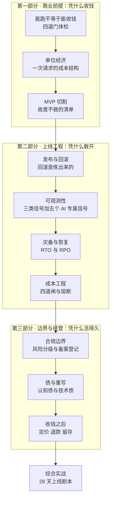

# 《从能跑到能收钱：AI 产品上线与经营》开源教材

> **定位**：面向"已经用 AI 做出能跑的原型、但还没有人为它付过钱"的读者。零商业基础、零运维基础可读。
> **设计原则**：第一性原理拆解 · 直觉先行 · 图文紧耦合 · 每个判据都能算出数或指出条文
> **在整条路线里的坐标**：这是《Vibe Coding 学习规划》的**阶段 5**，前四阶段解决"做得出来、写得对、守得住"，这一阶段解决"卖得掉、扛得住、算得清、说得明"。

---

## 0. 一句话说明这本书要补的那个洞

前四个阶段的所有训练，都在回答一个问题：**这段代码能不能信。**
这一阶段要回答的是另一个问题：**这件事值不值得继续做下去。**

这两件事的失败模式长得完全不一样：

| 前四阶段的失败 | 这一阶段的失败 |
|---|---|
| 代码跑不起来 | 代码跑得很好，但没人愿意付钱 |
| 有漏洞、权限越界 | 有人付钱，但每收 100 块要花掉 130 块 |
| 测试没覆盖到 | 覆盖得很好，但一次事故把三个月口碑清零 |
| 架构撑不住改动 | 架构撑得住，但按钮上少一行字，卖不到你想卖的地方 |

所以这一阶段的教材不能写成"运维手册 + 法条摘抄"。它得从**钱**开始讲，因为钱是唯一一个能把产品、工程、法务三条线同时拉到一个桌面上的东西。

**本书的核心主张**：上线不是工程事件，是商业事件。工程只负责"不出事"，商业负责"值得出事"。一个人做产品时，这两件事必须由同一个脑子完成。

---

## 1. 领域全景与学习目标

### 1.1 为什么需要单独一个阶段

三个真实场景，几乎每个独立开发者都会撞上其中一个：

**场景 A：Demo 掌声很响，收款链接没人点。**
朋友说"这个好用"，你上线了，注册 200 人，付费 0 人。问题不在代码，在于你从来没定义过"谁会为什么付钱"，也没设计过"从用到付"的那一步。免费用户不是需求验证，是社交礼貌。

**场景 B：第一笔钱进来了，你开始亏。**
订阅定价 29 元/月，用户一天用 40 次，每次请求背后是三次模型调用加一次向量检索。月底算账，这个用户贡献毛利 −11 元。你卖得越多亏得越快，而且**你是在看银行余额时才知道的**。

**场景 C：一次事故，把前面所有努力清零。**
数据库迁移写错一个字段，线上数据错乱 40 分钟。你没有回滚脚本，只能一边修一边等。用户看到的是"服务不可用 + 数据可能丢了"。技术上是 40 分钟，商业上是这个用户再也不回来。

这三个场景分别对应本书的三部分：**凭什么收钱 / 凭什么敢开 / 凭什么活得久**。

### 1.2 学完这本教材你将掌握什么

- **核心认知层**
  - 能判断一个产品现在缺的是"价值"还是"计价"还是"交付"还是"责任"——这四件事的补法完全不同
  - 能算清一次请求的真实成本，并说出毛利率在你这个用量下会往哪边走
  - 能区分技术债与认知债，并说得出各自该用什么信号来观测
  - 能判断自己落在监管的哪一档，依据是哪一条条文，而不是"应该没事吧"

- **系统架构层**
  - 能画出自己产品的"收钱链路图"：从用户点按钮到钱进账户，中间每一处会漏钱、漏数据、漏责任的地方都标出来
  - 能设计一套最小可用的发布与回滚体系，含数据库迁移的前向兼容方案
  - 能设计一套面向 AI 产品的可观测性：普通三类信号 + 五个 AI 专属信号
  - 能设计成本四道闸：输入裁剪、缓存、模型路由、预算熔断

- **实战应用层**
  - 把一个真实产品上线：有域名、有监控、有告警、有回滚脚本，并**真的回滚过一次**
  - 完成一次"删库"恢复演练，拿到自己系统的实测 RTO
  - 产出一张连续四周的 AI 代码健康度看板
  - 写出两页"成本—合规边界说明"，说清三条线各自的边界与触发动作

### 1.3 本书的三条硬规矩

1. **金额与费率一律标"快照日期 + 以你签约为准"。** 书里教的是算法（成本结构、盈亏平衡、毛利敏感性），不是报价单。任何具体价格在半年后都会过期，任何只给数字不给算法的书都是在害人。
2. **不给"最佳实践清单"，给判据。** 每条结论都要能落成两种东西之一：一个能算出来的数，或一条能指认的条文。做不到这两点的，这本书不写。
3. **每个实践任务都有可交付物。** 没有"思考一下你的商业模式"这种题。要么是一张表，要么是一个脚本，要么是一次演练记录。

---

## 2. 领域全景知识图谱



**读图方式**：三条竖线是三部分，横向箭头是"上一部分的产出成为下一部分的输入"。注意 `A3 → B1` 这条：**没有锁定范围的发布，等于没有发布**——MVP 没切干净，回滚方案就没法设计，因为你不知道哪些功能必须保住。同理 `B4 → C1`：成本结构没算清，合规成本就没法估，你会把"要不要做欧洲市场"当成一个价值观问题，而它其实是一道算术题。

---

## 3. 知识模块矩阵

| 章 | 模块 | 核心解决的问题 | 前置依赖 | 主视觉资产 | 难度 |
| :--- | :--- | :--- | :--- | :--- | :--- |
| 01 | 收钱四道门 | 我这个产品现在到底卡在哪一门 | 无（本章自足） | 判定流程图 + 漏斗示意 | ★★☆☆☆ |
| 02 | 单位经济 | 一次请求值多少钱，我赚还是亏 | 第 01 章 | 成本瀑布图 + 毛利敏感性曲线 | ★★★☆☆ |
| 03 | MVP 切割 | 第一版到底做什么、故意不做什么 | 第 01、02 章 | 功能四象限 + 决策树 | ★★☆☆☆ |
| 04 | 发布与回滚 | 出事那天我能不能十分钟退回上一版 | 第 03 章 | 迁移时序图 + 回滚决策树 | ★★★★☆ |
| 05 | 可观测性 | 用户投诉之前我能不能先知道 | 第 04 章 | 三层架构图 + 错误预算燃烧曲线 | ★★★☆☆ |
| 06 | 灾备与恢复 | 数据没了，我多久能回来 | 第 04、05 章 | RTO 时间轴 + 降级决策树 | ★★★★☆ |
| 07 | 成本工程 | 怎么让成本随用量线性而不是指数 | 第 02、05 章 | 四道闸漏斗 + 异常检测曲线 | ★★★☆☆ |
| 08 | 合规边界 | 我落在哪一档，依据哪一条 | 第 01、07 章 | 法规时间轴 + 合规判定树 | ★★★★☆ |
| 09 | 债与重写 | 什么时候该继续补，什么时候该推倒 | 第 04、05、07 章 | 健康度看板 + 重写决策矩阵 | ★★★★☆ |
| 10 | 综合实战 | 把这九章的东西在 28 天里跑一遍 | 全部 | 甘特图 + 上线检查单流程 | ★★★★★ |

---

## 4. 分章详细大纲

### 第一部分 · 商业前提：凭什么收钱

#### 第 01 章：能跑不等于能收钱 (`chapters/ch01-can-run-not-can-charge.md`)

- **直觉锚点**：朋友夸你做的菜好吃，和有人愿意花 68 块点这道菜，中间隔着四件事——他不饿、他不信、他买不到、他吃了出事没人负责。产品也一样。
- **核心知识**
  - 收钱的四道门：**有人愿意付**（价值假设）、**有可计价的单位**（计价假设）、**交付得出去**（交付假设）、**担得起责任**（责任假设）
  - 四种"看起来像验证、其实不是"的信号：朋友试用、免费注册、Demo 演示、社交媒体点赞
  - 为什么"能跑"是最弱的一种证据：它只证明了技术可行性，而技术可行性在今天几乎不构成壁垒
  - 最小付费验证：不是做完整产品，是**先收一笔钱**
  - 四道门各自缺失时的症状与补法（这是本章的主表）
- **规划图表**
  - 图 1-1：四道门与卡点的对照图（Python 结构图，逐门给出通过条件与症状）
  - 图 1-2：验证动作的性价比散点（Python，证据强度 × 耗时，标注为作者判断）
- **实操推演**：拿你手上那个"能跑"的东西做一次四门体检，产出一页《收钱判定书》：四门各打一个"过 / 不过 / 未测"，未测的写出"用什么最小动作去测"，并给出 7 天内能完成的最小验证动作。
- **难度**：★★☆☆☆

#### 第 02 章：单位经济——把一次请求算到分 (`chapters/ch02-unit-economics.md`)

- **直觉锚点**：奶茶店老板算的不是"一杯卖 18 块"，而是"奶 3.2、杯 0.8、房租摊 4.1、平台抽 2.7，剩 7.2"。你卖的是"一次 AI 请求"，算法一模一样。
- **核心知识**
  - 变动成本与固定成本的边界；为什么"服务器月租"在低用量时是固定成本、高用量时会变成变动成本
  - 一次 AI 请求的成本结构：输入 token、输出 token、embedding、向量检索、缓存未命中的重复计算、存储、带宽、支付手续费
  - **成本方差**：同一功能用不同实现，成本可以差一个数量级——这是 AI 产品独有的、最容易被低估的一条
  - 贡献毛利、毛利率、盈亏平衡点；订阅制下的"重度用户吃垮模型"
  - 单位经济的三种死法：定价低于边际成本、免费额度设成无限、缓存命中率长期为零
  - 敏感性分析：哪个变量动 20% 会把毛利打穿
- **规划图表**
  - 图 2-1：单用户月成本瀑布图（Python，从收入逐项减到贡献毛利）
  - 图 2-2：毛利率随用量变化的曲线 + 盈亏平衡点标注（Python，三个定价档对照）
- **实操推演**：给自己产品建一张《单用户月成本表》，跑 10 / 100 / 1000 三个用量档，算出每档的毛利率与盈亏平衡用户数；再做一个敏感性表：模型单价 +20%、缓存命中率 −30%、单用户用量 +50%，哪个先让你亏。
- **难度**：★★★☆☆

#### 第 03 章：MVP 切割——故意不做的清单 (`chapters/ch03-mvp-scope.md`)

- **直觉锚点**：装修时"先住进去"和"装完再住"的差别，不在省钱，在于**你会在真实居住中发现哪面墙该拆**。没住进去的人，永远在猜。
- **核心知识**
  - MVP 的判据只有一条：**它是否构成一个完整的付费闭环**（能看见价值 → 能付钱 → 能拿到东西 → 出事能找到人）
  - 四类必须有的功能：收钱、可用、不出事、能找人；四类可以没有的：好看、齐全、自动化、可配置
  - "故意不做"清单的写法：每条要写"不做的理由"和"什么信号出现时再做"
  - 范围蔓延的三种早期信号：需求开始出现"顺便"、设计稿开始出现"如果"、你开始为没做的功能写说明
  - 功能后悔成本：上线后砍功能的代价，通常是上线前不做的 10 倍以上（组织成本远大于代码成本）
- **规划图表**
  - 图 3-1：付费闭环四环图（Python 结构图，标出四种断点）
  - 图 3-2：功能四象限（Python 散点 + 分区，成本已折入维护）
- **实操推演**：把需求池砍到只剩一个付费闭环，产出三栏表《现在做 / 以后做 / 永远不做》，每栏都写判据；再写一份《上线判据》——满足哪五条才算可以开放付费。
- **难度**：★★☆☆☆

---

### 第二部分 · 上线工程：凭什么敢开

#### 第 04 章：发布与回滚——回滚是练出来的 (`chapters/ch04-release-rollback.md`)

- **直觉锚点**：登山绳不是用来爬的，是用来掉的。你带它上山，是希望永远不用；但没带的人，不叫勇敢，叫没算过账。
- **核心知识**
  - 发布的四种形态与代价：整包替换、蓝绿、金丝雀、特性开关；一个人做产品时最该先有哪个
  - **数据库迁移才是回滚的真正难点**：代码可以回滚，数据回滚不了。expand-contract 三步法（先加列不删、双写、再切读、最后删旧）
  - 回滚的三层：代码回滚、配置回滚、数据回滚；三层各自的时间尺度差一个数量级
  - 回滚演练脚本：触发条件、决策人、执行命令、验证方法、对外话术
  - 发布检查单的最小项（10 项），以及"为什么检查单必须能被打勾，不能是原则性描述"
- **规划图表**
  - 图 4-1：三层回滚的时间尺度（Python 对数轴，标出"不可逆"那一格）
  - 图 4-2：expand-contract 四步迁移（Python 结构图，含每步的读写与回滚方式）
- **实操推演**：做一次真实回滚演练。要求：故意发布一个带缺陷的版本（真实缺陷，不是假动作），在预发环境走完整回滚流程，记录四个数——发现耗时、决策耗时、执行耗时、验证耗时。产出《回滚演练记录》，含失败环节与改法。
- **难度**：★★★★☆

#### 第 05 章：可观测性——你看不见的故障，用户会替你看 (`chapters/ch05-observability.md`)

- **直觉锚点**：开车看仪表盘，不是因为你怀疑发动机，是因为**人对自己造的东西会盲目乐观**。仪表盘的存在意义，是替你否定"应该没事"。
- **核心知识**
  - 三类信号：日志（发生了什么）、指标（发生了多少）、链路（慢在哪一段）
  - 四个黄金信号：延迟、流量、错误、饱和度；为什么饱和度对 AI 产品格外重要（配额撞墙是常态）
  - **AI 产品专属的五个信号**：token 消耗速率、首 token 延迟、拒答率 / 幻觉反馈率、检索命中率、单请求成本
  - 告警设计：症状告警优于原因告警；告警疲劳的成因与解法（合并、分级、静默窗口）
  - SLO 与错误预算：把"稳定性"从形容词变成可花销的额度；燃烧率告警的基本用法
- **规划图表**
  - 图 5-1：燃烧率与烧穿时间（Python，四条速率的剩余预算曲线）
  - 图 5-2：错误预算的阶梯消耗（Python，一个月四次故障的累计曲线）
- **实操推演**：给项目接最小可观测性——一个仪表盘（四个黄金信号 + 两个 AI 专属信号）+ 三条告警。然后**故意造一次故障**（例如让上游模型超时），验证三条告警里至少两条按时响。产出《告警验证记录》，含未触发项的原因分析。
- **难度**：★★★☆☆

#### 第 06 章：灾备与恢复——备份不等于恢复 (`chapters/ch06-disaster-recovery.md`)

- **直觉锚点**：消防演习不是演给检查看的。演练过的人，在真着火时会先摸门把手；没演练过的人，会先找手机。
- **核心知识**
  - RTO（多久能回来）与 RPO（会丢多少）的定义，以及怎么用业务语言反推它们：不是"技术上限是多少"，是"丢多少用户会走"
  - 备份的三种失败：没备、备了没验、验了恢复不了；第三种最常见也最致命
  - 数据分级：可重建（缓存、索引）、可重建但有成本（派生数据）、不可重建（用户内容、支付记录）
  - 恢复演练的五个步骤：定义场景、断真环境、计时、逐项验证、写回文档
  - 外部依赖的单点：模型 API 挂了怎么办——排队、降级到小模型、返回兜底文案、明确告知；四种策略的体验代价对比
- **规划图表**
  - 图 6-1：RTO 与 RPO 时间轴图（Python，标出故障点、最后可用备份点、恢复完成点）
  - 图 6-2：四种降级策略的取舍（Python 2×2，体验代价 × 实现成本）
- **实操推演**：在预发环境做一次真实"删库"演练（真的删，不是注释掉）：记录四件事——发现时间、开始恢复时间、恢复完成时间、数据丢失范围。产出你自己的**实测 RTO/RPO**，和你在页面上向用户承诺的数字对照。如果不一致，改承诺还是改架构，写清决定。
- **难度**：★★★★☆

#### 第 07 章：成本工程——预算、路由、熔断 (`chapters/ch07-cost-engineering.md`)

- **直觉锚点**：家里的电表和空气开关是两样东西。电表让你知道花了多少，空气开关让你在烧起来之前断电。多数人只装了电表。
- **核心知识**
  - 成本四道闸，按投入产出排序：输入裁剪（最便宜）→ 缓存（收益最大）→ 模型路由（最灵活）→ 预算熔断（最后一道）
  - 模型路由策略：按任务难度分档，而不是按用户等级分档；分档错误的两种代价（降级伤体验、升级伤毛利）
  - 缓存的两类：精确缓存与语义缓存；语义缓存的误命中风险与阈值选择
  - 单会话预算、单用户日预算、全局日预算；kill switch 的三种粒度与各自的爆炸半径
  - 成本异常检测：不看绝对值，看同比与环比——"今天这一小时是上周同时段的 5 倍"比"今天花了 300 块"有用得多
  - 订阅制与用量制的成本错配：包月不限量在 AI 产品里通常是自杀条款
- **规划图表**
  - 图 7-1：三道闸的累积效果（Python，1000 次请求的成本递减）
  - 图 7-2：预算熔断的仿真（Python，死循环触发熔断后的走平曲线）
- **实操推演**：给产品加"单用户日预算 + 全局熔断"，写压测脚本把用量推到阈值的 120%，验证：熔断是否在预算耗尽前触发、触发后用户体验是什么、恢复是否需要人工。产出《熔断验证记录》与一张"成本—用量"对照表。
- **难度**：★★★☆☆

---

### 第三部分 · 边界与经营：凭什么活得久

#### 第 08 章：合规边界——条文怎么落到按钮上 (`chapters/ch08-compliance.md`)

- **直觉锚点**：开店要办证，但没人一开始就告诉你办哪张。你会先去问同行，同行说的往往是"我当年没办也没事"——这是最危险的一种知识。
- **核心知识**
  - **先分清"你卖到哪"**：卖到欧盟、卖到国内、只卖给企业客户，三套义务完全不同，别混着抄
  - **EU AI Act 的时间表**（截至 2026-10 快照）
    - 2026-08-02：法案其余部分开始适用；**透明度义务（第 50 条）与通用 AI 模型（GPAI）义务可被强制执行**——聊天机器人必须告知"你在和 AI 交互"，AI 生成/修改的图像、音频、视频必须标识，生成内容须带机器可读标记
    - 2026-12-02：新增禁令生效（未经同意生成他人私密形象、儿童性虐待材料）；2026-08-02 之前已上市系统的机器可读标识义务宽限到此日
    - 2027-12-02：附件三高风险系统（招聘筛选、信用评分、教育评估、关键基础设施、执法辅助等）义务适用
    - 2028-08-02：嵌入受监管产品（医疗器械、机械等）的高风险系统义务适用
    - 关键判断：**多数独立开发者做的是 limited-risk，8 月 2 日那道门是"透明度"，不是"技术文档马拉松"**。把 2027 年的活提前干，和把 2026 年的活漏掉，是同一种错误
  - **国内的双轨制**：自研模型对外提供服务走**备案**；通过 API 调用已备案模型能力的应用或功能，经属地网信部门同意走**登记**。已上线服务须在显著位置或产品详情页公示所用模型名称、备案号或上线编号，并按《人工智能生成合成内容标识办法》添加标识
  - **支付与订阅合规**：《消费者权益保护法实施条例》第十条与《网络交易监督管理办法》第十八条要求——接受服务前与续费日前（后者明确为前五日）以显著方式提示，由消费者自主选择；服务期内提供显著、简便的随时取消入口
  - **数据合规**：最小收集、明确用途、可删除；跨境传输是独立问题，别和"存哪台服务器"混为一谈
  - 合规的三种成本：改造工程成本、流程成本、机会成本（不能卖到某地）
- **规划图表**
  - 图 8-1：风险档 × 义务矩阵（Python 热力格，四档 × 六类义务）
  - 图 8-2：EU AI Act 义务时间轴（Python 竖轴，含"今天"位置与 16 个月缓冲）
- **实操推演**：写两页《成本—合规边界说明》。必须含：我在 EU AI Act 的哪一档、依据哪一条；我在国内走备案还是登记、当前状态；我的自动续费提示放在哪一步、取消入口在几层；三条边界各自的触发动作（什么情况必须停机、什么情况必须告知、什么情况必须改架构）。
- **难度**：★★★★☆

#### 第 09 章：债与重写——什么时候该推倒 (`chapters/ch09-debt-rewrite.md`)

- **直觉锚点**：老房子翻新还是重建，不看房子多旧，看**承重墙动没动**。软件里的承重墙，是数据模型和权限边界。
- **核心知识**
  - 技术债与认知债的分工：技术债在代码里（慢、难改），认知债在人脑里（没人说得清它为什么这么写）；AI 把交付速度推高时，两者同步上涨，而认知债更难度量
  - 五个健康度指标：首轮验收率、返工率、门禁拦截次数、单任务成本、变更失败率；各自看趋势不看绝对值
  - 重写的四条判据：改动半径（改一个需求要动几个文件）、理解成本（新人/三个月后的你要多久能改）、缺陷密度趋势（连续四周上升）、门禁通过率趋势（持续下降且补测试无效）
  - 第二系统效应：重写时最容易把"不要的复杂度"换成"想要的复杂度"，结果更复杂
  - 渐进式替换（绞杀者模式）：先在新代码里包一层，再逐步把流量切过去，永远保持可回滚
- **规划图表**
  - 图 9-1：健康度看板样例（Python 四联子图：首轮验收率、返工率、拦截次数、单任务成本，各带趋势线）
  - 图 9-2：重写判据打分卡（Python，四条判据的评分与阈值线）
- **实操推演**：给自己项目建健康度看板，连续四周填数（前两周可回溯 git 与 CI 记录），然后写下你的一条重写判据，并**用它做过一次真实决定**（哪怕结论是"不重写"）。产出《健康度四周报》+《重写判据与一次应用记录》。
- **难度**：★★★★☆

#### 第 10 章：综合实战——28 天上线剧本 (`chapters/ch10-launch-playbook.md`)

- **直觉锚点**：发射台的倒计时不是为了制造紧张，是为了让**每个"再检查一遍"都有明确的检查对象**。没有倒计时，检查会变成无限延期。
- **核心知识**
  - 28 天排期（与"五周学习周期"的区别：五周含消化，28 天是纯执行）：D1–D3 范围锁定与四门体检 → D4–D7 计价与单位经济 → D8–D13 上线工程（发布/监控/备份）→ D14–D17 三次演练（回滚、恢复、熔断）→ D18–D21 灰度 → D22–D24 合规与文案 → D25–D27 缓冲 → D28 公开
  - 上线日检查单（20 项）：能回滚、有告警、有备份、有客服入口、有价格页、有退款政策、有 AI 交互告知、有内容标识、有隐私说明、有 kill switch……
  - 前 90 天的三张表：收入表（按档位/渠道）、成本表（按请求/用户/模型）、故障表（时间/影响/根因/修复）
  - 定价的最小实验：不要做 A/B 测试，先做**三档定价 + 一个企业询价入口**，看谁问什么
  - 退款与支持的处理原则：退款速度换口碑，但要有止损线；支持工单是最好的需求池
  - 什么时候涨价、什么时候降价：看毛利结构与流失原因，不看同行
- **规划图表**
  - 图 10-1：28 天甘特图（Python，标出三个演练日与一个缓冲带）
  - 图 10-2：累计现金流与回本点（Python 仿真，含初始投入与流失率）
- **实操推演**：把第 01–09 章的产物合成一个可交付的《上线包》：仓库（含回滚脚本与检查单）+ 两张表（单位经济、合规边界）+ 一次演练记录。然后真的开放付费，拿到第一笔真实收入（金额不重要，来源重要）。
- **难度**：★★★★★

---

## 5. 与《Vibe Coding 学习规划》阶段 5 的映射

| 规划条目 | 落在哪几章 | 对应交付物 |
| :--- | :--- | :--- |
| 知识点 · MVP 范围切割 | 第 03 章 | 三栏表 + 上线判据 |
| 知识点 · 成本方差与预算控制 | 第 02、07 章 | 单用户成本表 + 熔断验证记录 |
| 知识点 · 上线三件套（回滚/可观测/灾备） | 第 04、05、06 章 | 回滚演练记录 + 告警验证记录 + 实测 RTO |
| 知识点 · 认知债与技术债的分工 | 第 09 章 | 四周健康度看板 |
| 知识点 · 合规时间表 | 第 08 章 | 两页合规边界说明 |
| 知识点 · 团队与流程 | 第 09、10 章 | 健康度看板 + 上线检查单 |
| 知识点 · 什么时候该停下来重写 | 第 09 章 | 重写判据 + 一次应用记录 |
| 实践任务 1 · 真实产品上线 + 一次真实回滚 | 第 04 章 + 第 10 章 | 有域名、有监控、有回滚脚本 + 演练记录 |
| 实践任务 2 · AI 代码健康度看板 | 第 09 章 | 五指标看板，按周刷新 |
| 实践任务 3 · 成本—合规边界说明 | 第 02、07、08 章 | 两页说明，三条线各写边界与触发动作 |

**覆盖检查**：规划里阶段 5 的 7 条知识点与 3 个实践任务，全部有对应章节与交付物，无遗漏项。

---

## 6. 前置桥接：读这本之前你至少要有什么

本书假设你已经走完阶段 1–4。如果没走完，不必回头重读全套，但下面 6 条必须能一句话讲清——讲不清的那一条，去对应阶段补，不要硬读第 04 章以后的内容。

| 能力 | 自测问法 | 缺了去哪补 |
| :--- | :--- | :--- |
| 版本控制与回滚 | 线上出问题，你怎么在 5 分钟内退回上一版？ | 阶段 1 任务 1 |
| 测试与门禁 | 你怎么在合并前知道"这次改动没破坏别的东西"？ | 阶段 3 任务 1 |
| 权限与密钥 | 你的密钥放在哪，前端能不能看到？ | 阶段 4 任务 2 |
| 规格与验收 | 你怎么判断一个功能"做完了"？ | 阶段 2 任务 1 |
| 威胁建模 | 不登录的人能读到你的什么数据？ | 阶段 4 任务 1 |
| HTTP 与数据库常识 | 一次请求经过哪几层，"事务"解决什么问题？ | 学习规划附录 A |

**明确不在本书范围内**：企业级多租户架构、SaaS 计费系统的工程实现、跨境数据合规的具体法律意见、融资与股权。这些分别属于别的专业，本书只在需要时给出边界提示。

---

## 7. 仓库目录结构

```text
phase5/
├── README.md                          # 本文件：全景图谱、分级大纲、学习路线
├── chapters/                          # 十章正文
│   ├── ch01-can-run-not-can-charge.md
│   ├── ch02-unit-economics.md
│   ├── ch03-mvp-scope.md
│   ├── ch04-release-rollback.md
│   ├── ch05-observability.md
│   ├── ch06-disaster-recovery.md
│   ├── ch07-cost-engineering.md
│   ├── ch08-compliance.md
│   ├── ch09-debt-rewrite.md
│   └── ch10-launch-playbook.md
├── assets/                            # 经质量门禁核验的高清图
│   ├── ch01/ ... ch10/
├── code/                              # 可直接运行的配套代码
│   ├── _figstyle.py                   # 配图统一样式与绘图助手（被 import）
│   ├── make_figures_p5.py             # 全部 20 张配图的生成脚本
│   ├── ch02/unit_economics.py         # 单位经济计算器（三档用量 + 敏感性）
│   ├── ch03/mvp_matrix.py             # 功能四象限打分
│   ├── ch04/rollback_drill.py         # 回滚演练计时与记录模板
│   ├── ch05/slo_burn.py               # 错误预算与燃烧率
│   ├── ch06/rto_calc.py               # RTO/RPO 反推与实测对照
│   ├── ch07/budget_guard.py           # 预算熔断参考实现（可嵌入）
│   ├── ch08/compliance_matrix.py      # 风险分级与义务清单生成
│   ├── ch09/health_dashboard.py       # 健康度看板绘图
│   └── ch10/launch_checklist.py       # 上线日检查单（可打勾、可导出）
└── templates/                         # 可直接抄的交付物模板
    ├── 收钱判定书.md
    ├── 单用户月成本表.csv
    ├── 回滚演练记录.md
    ├── 成本合规边界说明.md
    └── 上线包检查单.md
```

---

## 8. 视觉与代码规范

**配色**（与本书的语义绑定，不做装饰）

| 用途 | 色值 | 语义 |
| :--- | :--- | :--- |
| 主文字 | `#1F2933` | 结论、坐标轴 |
| 次要文字 | `#7B8794` | 图注、口径说明 |
| 安全 / 正向 | `#2A9D8F` | 可回滚、在预算内、合规 |
| 风险 / 负向 | `#C2571A` | 不可逆、超支、越界 |
| 结构 / 中性 | `#3D5A80` | 架构块、流程节点 |
| 强调 | `#E9C46A` | 关键数字、阈值线 |

**图注纪律（三条，违反即返工）**

1. 每张图必须在图注里标明它是**实测数据**还是**结构示意**。把示意画成数据，等于伪造证据。
2. 引用外部数字必须带来源与时间，且带上原始口径限定（例如 Veracode 的 56% 是"原始模型、无安全提示"条件下的生成失败率，不是上线失败率）。
3. 金额类图表一律在角落标 `2026-10 快照，以你签约为准`。

**Python 环境**：`matplotlib` + `numpy`。macOS 无 Noto Sans CJK，字体回退顺序用 `Hiragino Sans GB → Arial Unicode MS → STHeiti → PingFang SC`，否则中文出豆腐块。生成后用 `view_file` 逐张目检。

---

## 9. 三条学习路线

| 路线 | 章节 | 周期 | 适合谁 |
| :--- | :--- | :--- | :--- |
| **A · 上线速成** | 01 → 02 → 03 → 04 → 05 → 10 | 14 天 | 手上已有能跑的原型，30 天内必须开放付费 |
| **B · 完整十讲** | 01 → … → 10 | 5 周 | 按《Vibe Coding 学习规划》阶段 5 推进 |
| **C · 只补边界** | 08 单章 + 01 的四道门 | 3 天 | 产品已在收钱，只担心合规与定价 |

**已经上线、只是在出事的读者**：直接跳 04 → 05 → 06 → 07，这四章是"止血包"；01–03 回头再补，它们影响的是你下一版该做什么，不影响你今天能不能活。

---

## 10. 质量门禁

每章交付前必须过三关，任一不过即返工：

1. **配图门禁**：每张 Python 图逐张目检——中文字形无豆腐块、标签不重叠不越界、白底对比清晰、层次一眼可辨；Mermaid 图在 GitHub 渲染下节点不超 18 个。
2. **语法与链接门禁**：`python3 scripts/verify_textbook_quality.py phase5/README.md phase5/chapters/` —— 检查 Mermaid 括号未加引号、折叠答案块是否闭合、本地图片链接是否存在、是否有占位符残留。
   `templates/` 不参与这一关：它们是填空表单，不是教学章节，脚本按"章"校验时会把它们误判为缺配图。
3. **教学完整门禁**：零"知识诅咒"跳跃——每个新术语首次出现时先给直觉桥再给定名；每个结论后有可算的数或可指的条文；全文无空章节、无省略推导。

---

## 11. 当前进度

| 项 | 状态 | 说明 |
| :--- | :--- | :--- |
| 全景图谱与分级大纲 | 已完成 | 本文件 |
| 第 01–10 章正文 | 已完成 | 十章全部含六模块、配图、误区表与分级练习 |
| 配图（20 张） | 已完成并逐张目检 | 每章 2 张：1 张结构图 + 1 张量化图 |
| 配套代码（9 个脚本） | 已完成并实跑 | 正文引用的输出均为真实 stdout |
| 交付物模板（5 份） | 已完成 | 可直接抄进项目 |
| 质量门禁 | 通过 | README + 10 章共 11 个文件，零问题 |

**怎么跑配套代码**：脚本之间有共享的样式模块，所以要在 `code/` 目录下执行：

```bash
cd phase5/code
python make_figures_p5.py          # 生成全部 20 张图
python ch02/unit_economics.py      # 单位经济
python ch07/budget_guard.py --test # 熔断的 6 条断言
```

**贯穿案例**：全书用同一个产品——会议纪要助手「纪要」（订阅 39 元/月，单次会议 50 分钟）——把所有概念串起来。金额假设集中在 `code/_figstyle.py` 的常量区与 `code/ch02/unit_economics.py` 顶部，换一个产品时只需要改这两处。

**两处刻意的取舍**：

1. 所有单价都标了快照日期（2026-10），书里教的是算法而不是报价。价格会变，算法不会。
2. 图注一律区分「实测 / 条文 / 仿真 / 结构示意」。把示意画成数据，是这类教材最常见的失信方式。
