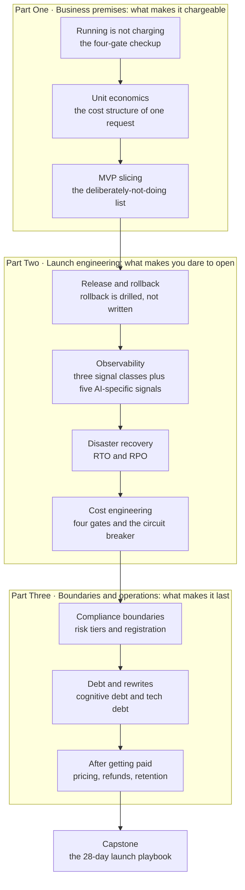

**English** | [中文](./README.zh.md)

# From Running to Getting Paid: Launching and Operating an AI Product — Open-Source Textbook

> **Positioning**: aimed at readers who have "built a working prototype with AI, but nobody has paid for it yet". Readable with zero business background and zero operations background.
> **Design principles**: First Principles decomposition · intuition first · tightly coupled figures and text · every criterion yields a computable number or points to a clause
> **Its place in the whole route**: this is **Stage 5** of the Vibe Coding Study Plan. The first four stages solve "can build it, writes it right, defends it"; this stage solves "can sell it, can carry it, can account for it, can explain it".

---

## 0. In One Sentence: The Gap This Book Fills

All the training of the first four stages answers one question: **can this code be trusted.**
This stage answers a different question: **is this worth continuing.**

The failure modes of these two look completely different:

| Failures of the first four stages | Failures of this stage |
|---|---|
| The code does not run | The code runs great, but nobody will pay |
| There are vulnerabilities, permission violations | People pay, but every 100 taken costs 130 |
| Tests do not cover it | Covered well, but one incident zeroes out three months of goodwill |
| The architecture cannot carry changes | The architecture carries it, but one missing line of copy on a button and it does not sell where you want |

So the textbook for this stage cannot be written as "an operations manual + copied statute excerpts". It has to start from **money**, because money is the only thing that can pull the product, engineering, and legal threads onto one table at the same time.

**The core claim of this book**: launch is not an engineering event; it is a business event. Engineering is only responsible for "nothing breaks"; business is responsible for "it is worth breaking". When one person builds a product, both must be done by the same brain.

---

## 1. Domain Panorama and Learning Objectives

### 1.1 Why a Separate Stage Is Needed

Three real scenarios; almost every independent developer runs into one of them:

**Scenario A: Loud applause for the demo, nobody clicks the payment link.**
Friends say "this is useful", you launch, 200 signups, 0 paying. The problem is not the code; it is that you never defined "who would pay for what", nor designed the step "from using to paying". Free users are not demand validation; they are social politeness.

**Scenario B: The first money comes in, and you start losing.**
Subscription priced at 29 yuan/month; a user uses it 40 times a day, and behind each request are three model calls plus one vector retrieval. At month-end the numbers say this user contributes −11 yuan. The more you sell the faster you lose, and **you only find out when you look at the bank balance**.

**Scenario C: One incident zeroes out everything before it.**
A database migration writes one field wrong and production data is corrupted for 40 minutes. You have no rollback script and can only fix while waiting. What users see is "service unavailable + data may be lost". Technically 40 minutes; commercially, that user never comes back.

These three scenarios map to this book's three parts: **why anyone would pay / why you dare open / why you survive long**.

### 1.2 What You Will Master After This Textbook

- **Core cognition layer**
  - Judge whether what a product currently lacks is "value" or "pricing" or "delivery" or "responsibility" — the fixes for these four are completely different
  - Calculate the real cost of one request, and say which way gross margin will move at your usage level
  - Distinguish technical debt from cognitive debt, and name the signals that observe each
  - Judge which regulatory tier you fall into, based on which clause, rather than "should be fine, right"

- **System architecture layer**
  - Draw your product's "getting-paid chain": from the user clicking the button to the money landing in the account, marking every place that can leak money, leak data, or leak responsibility
  - Design a minimal viable release and rollback system, including forward-compatible database migrations
  - Design observability for an AI product: the ordinary three signal types + five AI-specific signals
  - Design the four cost gates: input trimming, caching, model routing, budget circuit breaking

- **Practical application layer**
  - Launch a real product: domain, monitoring, alerts, rollback script, and **having actually rolled back once**
  - Complete one "drop-table" recovery drill and obtain your system's measured RTO
  - Produce a four-week AI code health dashboard
  - Write a two-page "Cost–Compliance Boundary Statement", spelling out the boundaries and trigger actions of each of the three threads

### 1.3 Three Hard Rules of This Book

1. **Every amount and rate is marked with "snapshot date + your contract governs".** The book teaches algorithms (cost structure, break-even, margin sensitivity), not price lists. Any specific price expires within half a year, and any book that gives numbers without algorithms is doing harm.
2. **No "best-practice checklists"; give criteria.** Every conclusion must land as one of two things: a number you can compute, or a clause you can point to. What cannot do either is not written in this book.
3. **Every practical task has a deliverable.** There are no questions like "think about your business model". It is either a table, or a script, or a drill record.

---

## 2. Domain Panorama Knowledge Graph



**How to read the figure**: the three vertical boxes are the three parts; the horizontal arrows mean "the output of one part becomes the input of the next". Note the `A3 → B1` edge: **a release without locked scope equals no release** — if the MVP is not cut cleanly, the rollback plan cannot be designed, because you do not know which features must survive. Likewise `B4 → C1`: without a clear cost structure, compliance cost cannot be estimated, and you will treat "should we enter the European market" as a values question when it is really an arithmetic one.

---

## 3. Knowledge Module Matrix

| Chapter | Module | Core problem it solves | Prerequisites | Main visual asset | Difficulty |
| :--- | :--- | :--- | :--- | :--- | :--- |
| 01 | The four gates of getting paid | Which gate is my product stuck at right now | None (self-contained) | Decision flowchart + funnel sketch | ★★☆☆☆ |
| 02 | Unit economics | What one request is worth; am I earning or losing | Chapter 01 | Cost waterfall + margin sensitivity curve | ★★★☆☆ |
| 03 | MVP slicing | What the first version does and deliberately does not do | Chapters 01, 02 | Feature quadrant + decision tree | ★★☆☆☆ |
| 04 | Release and rollback | On the day things break, can I get back to the previous version in ten minutes | Chapter 03 | Migration sequence diagram + rollback decision tree | ★★★★☆ |
| 05 | Observability | Can I know before users complain | Chapter 04 | Three-layer architecture diagram + error-budget burn curve | ★★★☆☆ |
| 06 | Disaster recovery | The data is gone; how fast can I come back | Chapters 04, 05 | RTO timeline + degradation decision tree | ★★★★☆ |
| 07 | Cost engineering | How to make cost linear rather than exponential in usage | Chapters 02, 05 | Four-gate funnel + anomaly detection curve | ★★★☆☆ |
| 08 | Compliance boundaries | Which tier am I in, under which clause | Chapters 01, 07 | Regulation timeline + compliance decision tree | ★★★★☆ |
| 09 | Debt and rewrites | When to keep patching and when to tear it down | Chapters 04, 05, 07 | Health dashboard + rewrite decision matrix | ★★★★☆ |
| 10 | Putting it into practice | Run the material of these nine chapters in 28 days | All | Gantt chart + launch checklist flow | ★★★★★ |

---

## 4. Detailed Per-Chapter Outline

### Part One · Business Prerequisites: Why Anyone Would Pay

#### Chapter 01: Running Is Not the Same as Getting Paid (`chapters/ch01-can-run-not-can-charge.md`)

- **Intuition anchor**: between a friend praising your dish and someone willing to pay 68 yuan to order it lie four things — he is not hungry, he does not trust it, he cannot buy it, and if it makes him sick nobody is responsible. Products are the same.
- **Core knowledge**
  - The four gates of getting paid: **someone willing to pay** (value hypothesis), **a billable unit** (pricing hypothesis), **deliverable** (delivery hypothesis), **responsibility you can bear** (responsibility hypothesis)
  - Four signals that "look like validation but are not": friends trying it, free signups, demo presentations, social media likes
  - Why "it runs" is the weakest kind of evidence: it only proves technical feasibility, and technical feasibility barely constitutes a barrier today
  - Minimal paid validation: not building the full product, but **collecting one payment first**
  - The symptoms and fixes for each missing gate (this chapter's main table)
- **Planned figures**
  - Figure 1-1: A contrast chart of the four gates and their sticking points (Python structure diagram, giving pass conditions and symptoms per gate)
  - Figure 1-2: Cost-effectiveness scatter of validation actions (Python, evidence strength × time, annotated as author judgment)
- **Hands-on exercise**: take that "it runs" thing in your hands and run a four-gate checkup, producing a one-page Revenue Decision Record: mark each gate "pass / fail / untested", write for the untested ones "what minimal action tests it", and give the minimal validation action completable within 7 days.
- **Difficulty**: ★★☆☆☆

#### Chapter 02: Unit Economics — Calculating a Single Request Down to the Cent (`chapters/ch02-unit-economics.md`)

- **Intuition anchor**: what the milk-tea shop owner calculates is not "18 yuan a cup", but "milk 3.2, cup 0.8, rent 4.1, platform 2.7, leaving 7.2". You sell "one AI request"; the algorithm is identical.
- **Core knowledge**
  - The boundary between variable and fixed cost; why "server monthly rent" is fixed cost at low usage and becomes variable cost at high usage
  - The cost structure of one AI request: input tokens, output tokens, embeddings, vector retrieval, repeated computation on cache misses, storage, bandwidth, payment fees
  - **Cost variance**: the same feature implemented differently can differ by an order of magnitude in cost — unique to AI products and the most underestimated point
  - Contribution margin, gross margin, break-even point; "heavy users eating the model alive" under subscriptions
  - Three ways unit economics die: pricing below marginal cost, unlimited free quota, cache hit rate at zero long-term
  - Sensitivity analysis: which variable moving 20% punches through the margin
- **Planned figures**
  - Figure 2-1: Per-user monthly cost waterfall (Python, from revenue down item by item to contribution margin)
  - Figure 2-2: Gross margin vs. usage curve + break-even annotation (Python, three pricing tiers compared)
- **Hands-on exercise**: build a Monthly Cost per User table for your product, run the 10 / 100 / 1000 three usage tiers, and compute each tier's gross margin and break-even user count; then make a sensitivity table: model price +20%, cache hit rate −30%, per-user usage +50% — which makes you lose money first.
- **Difficulty**: ★★★☆☆

#### Chapter 03: MVP Slicing — The List of Things You Deliberately Won't Do (`chapters/ch03-mvp-scope.md`)

- **Intuition anchor**: the difference between "moving in first" and "finish decorating, then move in" is not saving money; it is that **you discover which wall to tear down by actually living there**. People who never moved in are forever guessing.
- **Core knowledge**
  - The MVP criterion has exactly one clause: **does it form a complete paid loop** (see the value → pay → get the thing → find someone when things break)
  - Four kinds of features you must have: taking money, usable, does not break, reachable; four kinds you can skip: pretty, complete, automated, configurable
  - How to write the "deliberately not doing" list: each entry states "why not" and "what signal means do it later"
  - Three early signals of scope creep: requirements start with "while we are at it", designs start with "what if", you start writing docs for features not built
  - Feature regret cost: cutting a feature after launch usually costs 10x more than not building it (organizational cost far exceeds code cost)
- **Planned figures**
  - Figure 3-1: The four-link paid loop diagram (Python structure diagram, marking the four break points)
  - Figure 3-2: The feature quadrant (Python scatter + zones, cost already folded in maintenance)
- **Hands-on exercise**: cut the requirement pool down to one paid loop, producing the three-column table "Now / Later / Never", each column with criteria; then write a "Launch Criteria" — which five conditions must hold before payments open.
- **Difficulty**: ★★☆☆☆

---

### Part Two · Launch Engineering: Why You Dare Open

#### Chapter 04: Release and Rollback — Rollback Is Trained, Not Written (`chapters/ch04-release-rollback.md`)

- **Intuition anchor**: the climbing rope is not for climbing; it is for falling. You bring it up the mountain hoping never to need it; but the person who does not bring one is not brave, they have not done the math.
- **Core knowledge**
  - The four release shapes and their costs: whole-package replacement, blue-green, canary, feature flags; which one a solo builder should have first
  - **Database migration is the real difficulty of rollback**: code can roll back, data cannot. The expand-contract method (add columns without deleting, dual write, switch reads, drop old last)
  - The three layers of rollback: code, config, data; each layer's time scale differs by an order of magnitude
  - The rollback drill script: trigger conditions, decision maker, execution commands, verification method, external wording
  - The minimal items of a release checklist (10), and "why a checklist must be checkable, not a statement of principles"
- **Planned figures**
  - Figure 4-1: Time scales of the three rollback layers (Python log axis, marking the "irreversible" cell)
  - Figure 4-2: The four-step expand-contract migration (Python structure diagram, with reads/writes and rollback per step)
- **Hands-on exercise**: run one real rollback drill. Requirements: deliberately release a defective version (a real defect, not a mock), walk the complete rollback flow in staging, and record four numbers — detection time, decision time, execution time, verification time. Produce a Rollback Drill Record, including the failure points and fixes.
- **Difficulty**: ★★★★☆

#### Chapter 05: Observability — The Failures You Cannot See, Users Will See for You (`chapters/ch05-observability.md`)

- **Intuition anchor**: you watch the dashboard while driving not because you suspect the engine, but because **people are blindly optimistic about what they build themselves**. The dashboard exists to negate "it should be fine" on your behalf.
- **Core knowledge**
  - Three signal types: logs (what happened), metrics (how much happened), traces (which segment is slow)
  - Four golden signals: latency, traffic, errors, saturation; why saturation matters especially for AI products (hitting quota walls is normal)
  - **Five AI-product-specific signals**: token consumption rate, time to first token, refusal/hallucination feedback rate, retrieval hit rate, per-request cost
  - Alert design: symptom alerts beat cause alerts; the causes of alert fatigue and their fixes (grouping, severity, quiet windows)
  - SLOs and error budgets: turning "stability" from an adjective into spendable allowance; basic use of burn-rate alerts
- **Planned figures**
  - Figure 5-1: Burn rate and burn-through time (Python, remaining-budget curves at four rates)
  - Figure 5-2: Stepwise consumption of the error budget (Python, cumulative curve of four failures in a month)
- **Hands-on exercise**: attach minimal observability to the project — one dashboard (four golden signals + two AI-specific signals) + three alerts. Then **deliberately induce one failure** (say, make the upstream model time out) and verify that at least two of the three alerts fire on time. Produce an Alert Verification Record, including the reasons for untriggered items.
- **Difficulty**: ★★★☆☆

#### Chapter 06: Disaster Recovery — Backup Is Not the Same as Recovery (`chapters/ch06-disaster-recovery.md`)

- **Intuition anchor**: fire drills are not performed for inspectors. The person who has drilled feels the doorknob first in a real fire; the person who has not looks for their phone first.
- **Core knowledge**
  - RTO (how fast we come back) and RPO (how much we lose), and how to derive them in business language: not "what is the technical ceiling" but "losing how many users makes them leave"
  - The three failures of backup: none taken, taken but unverified, verified but unrestorable; the third is the most common and the most fatal
  - Data classification: rebuildable (caches, indexes), rebuildable at a cost (derived data), not rebuildable (user content, payment records)
  - The five steps of a recovery drill: define the scenario, a real environment, timing, item-by-item verification, writing back to the docs
  - Single points among external dependencies: what to do when the model API dies — queue, degrade to a small model, return fallback text, say so explicitly; comparing the experience costs of four strategies
- **Planned figures**
  - Figure 6-1: RTO/RPO timeline diagram (Python, marking failure point, last usable backup point, recovery completion point)
  - Figure 6-2: Trade-offs of the four degradation strategies (Python 2×2, experience cost × implementation cost)
- **Hands-on exercise**: run one real "drop-table" drill in staging (really delete, not comment out): record four things — when it was detected, when recovery started, when recovery completed, the scope of data loss. Produce your own **measured RTO/RPO** and compare against the numbers you promise users on the page. If they disagree, decide and write down clearly whether to change the promise or the architecture.
- **Difficulty**: ★★★★☆

#### Chapter 07: Cost Engineering — Budgets, Routing, Circuit Breaking (`chapters/ch07-cost-engineering.md`)

- **Intuition anchor**: the electricity meter and the circuit breaker at home are two different things. The meter tells you how much you spent; the breaker cuts the power before it burns. Most people only installed a meter.
- **Core knowledge**
  - The four cost gates, ordered by ROI: input trimming (cheapest) → caching (biggest gain) → model routing (most flexible) → budget circuit breaking (the last gate)
  - Model routing strategy: tier by task difficulty, not by user tier; the two costs of mis-tiering (downgrading hurts experience, upgrading hurts margin)
  - Two kinds of caching: exact and semantic; semantic cache false-hit risk and threshold selection
  - Per-session budget, per-user daily budget, global daily budget; the three granularities of a kill switch and their blast radii
  - Cost anomaly detection: look not at absolute values but at year-on-year and month-on-month — "this hour today is 5x the same hour last week" is far more useful than "we spent 300 today"
  - Cost mismatch between subscriptions and usage pricing: unlimited monthly plans are usually a suicide clause in AI products
- **Planned figures**
  - Figure 7-1: Cumulative effect of three gates (Python, cost decline over 1000 requests)
  - Figure 7-2: Simulation of the budget circuit breaker (Python, the flattening curve after a loop trips the breaker)
- **Hands-on exercise**: add "per-user daily budget + global circuit breaker" to the product, write a load-test script that pushes usage to 120% of the threshold, and verify: whether the breaker trips before the budget runs out, what the user experience is after tripping, and whether recovery needs a human. Produce a Circuit-Break Verification Record and a "cost vs. usage" table.
- **Difficulty**: ★★★☆☆

---

### Part Three · Boundaries and Business: Why You Survive Long

#### Chapter 08: Compliance Boundaries — How Regulation Lands on Buttons (`chapters/ch08-compliance.md`)

- **Intuition anchor**: opening a shop requires a license, but nobody tells you which one at the start. You ask peers first, and what peers say is often "I never got one and it was fine" — the most dangerous kind of knowledge.
- **Core knowledge**
  - **First distinguish "where you sell"**: selling to the EU, selling domestically, selling only to enterprise customers — three completely different obligation sets; do not mix and copy
  - **The EU AI Act timeline** (snapshot as of 2026-10)
    - 2026-08-02: the rest of the Act starts applying; **transparency obligations (Article 50) and GPAI obligations become enforceable** — chatbots must disclose "you are interacting with AI", AI-generated/modified images, audio, and video must be labeled, and generated content must carry machine-readable markings
    - 2026-12-02: new prohibitions take effect (generating intimate imagery of others without consent, child sexual abuse material); the machine-readable labeling obligation for systems already on the market before 2026-08-02 is grace-perioded to this date
    - 2027-12-02: Annex III high-risk system obligations apply (recruitment screening, credit scoring, educational assessment, critical infrastructure, law-enforcement support, etc.)
    - 2028-08-02: obligations apply for high-risk systems embedded in regulated products (medical devices, machinery, etc.)
    - Key judgment: **most independent developers build limited-risk products; the August 2 door is "transparency", not "the technical documentation marathon"**. Doing the 2027 work early and missing the 2026 work is the same mistake
  - **The domestic dual track**: self-developed models offered as a service go through **filing**; applications or features that call already-filed model capabilities via API go through **registration** with local cyberspace authority approval. Services already live must publish the model name, filing number, or launch number in a prominent place or on the product detail page, and add labels per the Measures for Labeling AI-Generated and Synthetic Content
  - **Payment and subscription compliance**: Article 10 of the Regulation for the Implementation of the Consumer Rights Protection Law and Article 18 of the Measures for the Supervision and Administration of Online Transactions require — prominent notice before accepting the service and before renewal (the latter explicitly five days prior), with the consumer choosing freely; and a prominent, simple cancellation entry available at any time during the service period
  - **Data compliance**: minimal collection, explicit purpose, deletable; cross-border transfer is a separate question — do not conflate it with "which server it sits on"
  - Three kinds of compliance cost: refactoring engineering cost, process cost, opportunity cost (markets you cannot sell to)
- **Planned figures**
  - Figure 8-1: Risk tier × obligation matrix (Python heat grid, four tiers × six obligation classes)
  - Figure 8-2: EU AI Act obligation timeline (Python vertical axis, with the "today" position and 16-month buffer)
- **Hands-on exercise**: write a two-page Cost–Compliance Boundary Statement. It must include: which tier I am in under the EU AI Act and on which article; whether I take filing or registration domestically and the current state; where my auto-renewal notice sits and how deep the cancellation entry is; the trigger actions of each of the three boundaries (when I must stop, when I must disclose, when I must change the architecture).
- **Difficulty**: ★★★★☆

#### Chapter 09: Debt and Rewrites — When to Tear It Down (`chapters/ch09-debt-rewrite.md`)

- **Intuition anchor**: whether to renovate or rebuild an old house does not depend on how old it is, but on **whether the load-bearing walls have been touched**. The load-bearing walls in software are the data model and permission boundaries.
- **Core knowledge**
  - The division of labor between technical and cognitive debt: technical debt lives in the code (slow, hard to change), cognitive debt lives in people's heads (nobody can say why it is written this way); as AI pushes delivery speed up, both rise together, and cognitive debt is harder to measure
  - Five health metrics: first-pass acceptance rate, rework rate, gate interceptions, per-task cost, change failure rate; each watched as trend, not absolute value
  - The four rewrite criteria: change radius (files touched per requirement), comprehension cost (how long a newcomer/the you of three months later needs to change one spot), defect density trend (rising four weeks straight), gate pass-rate trend (falling persistently while adding tests does not help)
  - The second-system effect: when rewriting it is easiest to swap "unwanted complexity" for "wanted complexity", ending up more complex
  - Incremental replacement (the strangler pattern): wrap a layer in the new code first, then migrate traffic over gradually, staying rollback-capable at all times
- **Planned figures**
  - Figure 9-1: Sample health dashboard (Python quad panel: first-pass acceptance rate, rework rate, interceptions, per-task cost, each with a trend line)
  - Figure 9-2: The rewrite-criteria scorecard (Python, scores and threshold lines for the four criteria)
- **Hands-on exercise**: build a health dashboard for your project and fill in numbers for four consecutive weeks (the first two weeks can be reconstructed from git and CI records), then write down one rewrite criterion and **use it to make one real decision** (even if the conclusion is "do not rewrite"). Produce a "Four-Week Health Report" + "Rewrite Criteria and One Application Record".
- **Difficulty**: ★★★★☆

#### Chapter 10: Putting It into Practice — The 28-Day Launch Playbook (`chapters/ch10-launch-playbook.md`)

- **Intuition anchor**: the launchpad countdown is not for creating tension; it is so that **every "check once more" has a definite object**. Without a countdown, checking becomes indefinite postponement.
- **Core knowledge**
  - The 28-day schedule (versus the "five-week learning cycle": five weeks include absorption; 28 days is pure execution): D1–D3 scope locking and four-gate checkup → D4–D7 pricing and unit economics → D8–D13 launch engineering (release/monitoring/backup) → D14–D17 three drills (rollback, recovery, circuit break) → D18–D21 gradual rollout → D22–D24 compliance and copy → D25–D27 buffer → D28 public
  - The launch-day checklist (20 items): can roll back, has alerts, has backups, has a support entry, has a pricing page, has a refund policy, has AI interaction disclosure, has content labeling, has a privacy statement, has a kill switch……
  - The three tables for the first 90 days: revenue table (by tier/channel), cost table (by request/user/model), incident table (time/impact/root cause/fix)
  - The minimal pricing experiment: do not run A/B tests; first do **three-tier pricing + one enterprise inquiry entry**, and see who asks what
  - Principles for refunds and support: refund speed buys goodwill, but there must be a stop-loss line; support tickets are the best requirement pool
  - When to raise price and when to cut it: look at the margin structure and churn reasons, not at competitors
- **Planned figures**
  - Figure 10-1: 28-day Gantt chart (Python, marking three drill days and one buffer band)
  - Figure 10-2: Cumulative cash flow and payback point (Python simulation, with initial investment and churn rate)
- **Hands-on exercise**: combine the deliverables of Chapters 01–09 into one deliverable Release Package: repository (with rollback script and checklist) + two tables (unit economics, compliance boundary) + one drill record. Then actually open payments and collect the first real revenue (the amount does not matter; the source does).
- **Difficulty**: ★★★★★

---

## 5. Mapping to Stage 5 of the Vibe Coding Study Plan

| Plan item | Where it lands | Corresponding deliverable |
| :--- | :--- | :--- |
| Knowledge · MVP scope slicing | Chapter 03 | Three-column table + launch criteria |
| Knowledge · Cost variance and budget control | Chapters 02, 07 | Per-user cost table + circuit-break verification record |
| Knowledge · The launch trio (rollback / observability / disaster recovery) | Chapters 04, 05, 06 | Rollback drill record + alert verification record + measured RTO |
| Knowledge · The division between cognitive and technical debt | Chapter 09 | Four-week health dashboard |
| Knowledge · Compliance timeline | Chapter 08 | Two-page compliance boundary statement |
| Knowledge · Teams and processes | Chapters 09, 10 | Health dashboard + launch checklist |
| Knowledge · When to stop and rewrite | Chapter 09 | Rewrite criteria + one application record |
| Practical task 1 · Real product launch + one real rollback | Chapter 04 + Chapter 10 | Domain, monitoring, rollback script + drill record |
| Practical task 2 · AI code health dashboard | Chapter 09 | Five-metric dashboard, refreshed weekly |
| Practical task 3 · Cost–compliance boundary statement | Chapters 02, 07, 08 | Two-page statement, each of the three threads with boundaries and trigger actions |

**Coverage check**: all 7 knowledge points and 3 practical tasks of Stage 5 in the plan have corresponding chapters and deliverables, with nothing missing.

---

## 6. Prerequisite Bridging: What You Need Before Reading This Book

This book assumes you have finished Stages 1–4. If not, you need not reread the whole set, but you must be able to state each of the following 6 in one sentence — for whichever you cannot, go back to that stage to fill in; do not force your way past Chapter 04.

| Capability | Self-test question | Where to fill the gap |
| :--- | :--- | :--- |
| Version control and rollback | Production has a problem; how do you get back to the previous version within 5 minutes? | Stage 1, Task 1 |
| Testing and gates | How do you know before merging "this change did not break anything else"? | Stage 3, Task 1 |
| Permissions and keys | Where do your keys live; can the front end see them? | Stage 4, Task 2 |
| Specs and acceptance | How do you judge that a feature is "done"? | Stage 2, Task 1 |
| Threat modeling | What data of yours can a non-logged-in person read? | Stage 4, Task 1 |
| HTTP and database basics | How many layers does one request pass through; what problem do "transactions" solve? | Study Plan Appendix A |

**Explicitly out of scope**: enterprise multi-tenant architecture, engineering implementation of SaaS billing systems, specific legal advice on cross-border data compliance, financing and equity. These belong to other professions; this book only gives boundary hints where needed.

---

## 7. Repository Structure

```text
phase5/
├── README.md                            # this file: panoramic map, tiered outline, study route
├── chapters/                          # ten chapters
│   ├── ch01-can-run-not-can-charge.md
│   ├── ch02-unit-economics.md
│   ├── ch03-mvp-scope.md
│   ├── ch04-release-rollback.md
│   ├── ch05-observability.md
│   ├── ch06-disaster-recovery.md
│   ├── ch07-cost-engineering.md
│   ├── ch08-compliance.md
│   ├── ch09-debt-rewrite.md
│   └── ch10-launch-playbook.md
├── assets/                            # high-res figures verified by the quality gates
│   ├── ch01/ ... ch10/
├── code/                              # runnable companion code
│   ├── _figstyle.py                   # shared figure style and plotting helpers (imported)
│   ├── make_figures_p5.py             # generation script for all 20 figures
│   ├── ch02/unit_economics.py         # unit economics calculator (three tiers + sensitivity)
│   ├── ch03/mvp_matrix.py             # feature four-quadrant scoring
│   ├── ch04/rollback_drill.py         # rollback drill timing and record template
│   ├── ch05/slo_burn.py               # error budget and burn rate
│   ├── ch06/rto_calc.py               # RTO/RPO back-calculation vs measured
│   ├── ch07/budget_guard.py           # budget circuit-breaker reference implementation (embeddable)
│   ├── ch08/compliance_matrix.py      # risk tiering and obligation list generation
│   ├── ch09/health_dashboard.py       # health dashboard plotting
│   └── ch10/launch_checklist.py       # launch-day checklist (tickable, exportable)
└── templates/                         # delivery templates you can copy as-is
    ├── revenue-decision-record.md
    ├── monthly-cost-per-user.csv
    ├── rollback-drill-record.md
    ├── cost-compliance-boundary.md
    └── release-package-checklist.md
```

---

## 8. Visual and Code Standards

**Color palette** (bound to this book's semantics; no decoration)

| Use | Value | Meaning |
| :--- | :--- | :--- |
| Primary text | `#1F2933` | Conclusions, axes |
| Secondary text | `#7B8794` | Captions, scope notes |
| Safe / positive | `#2A9D8F` | Rollback-capable, within budget, compliant |
| Risk / negative | `#C2571A` | Irreversible, overspend, out of bounds |
| Structural / neutral | `#3D5A80` | Architecture blocks, flow nodes |
| Emphasis | `#E9C46A` | Key numbers, threshold lines |

**Caption discipline (three rules; violating them means rework)**

1. Every figure must state in its caption whether it is **measured data** or **structural illustration**. Drawing an illustration as data is fabricating evidence.
2. External numbers must carry source and time, plus the original scope qualifier (for example, Veracode's 56% is the generation failure rate under "original model, no safety prompts", not the post-launch failure rate).
3. Monetary figures all carry `2026-10 snapshot, subject to your own contract` in the corner.

**Python environment**: `matplotlib` + `numpy`. macOS lacks Noto Sans CJK; the font fallback order is `Hiragino Sans GB → Arial Unicode MS → STHeiti → PingFang SC`, otherwise Chinese renders as tofu blocks. After generating, eyeball each figure with `view_file`.

---

## 9. Three Learning Routes

| Route | Chapters | Duration | Who it suits |
| :--- | :--- | :--- | :--- |
| **A · Launch crash course** | 01 → 02 → 03 → 04 → 05 → 10 | 14 days | Already has a working prototype and must open payments within 30 days |
| **B · Full ten lectures** | 01 → … → 10 | 5 weeks | Following Stage 5 of the Vibe Coding Study Plan |
| **C · Boundaries only** | Chapter 08 alone + Chapter 01's four gates | 3 days | Product is already taking money; only worried about compliance and pricing |

**Readers already live and currently bleeding**: jump straight to 04 → 05 → 06 → 07; these four chapters are the "stop-the-bleeding pack". Come back for 01–03 later; they affect what you build in the next version, not whether you survive today.

---

## 10. Quality Gates

Every chapter must pass three gates before delivery; failing any one means rework:

1. **Figure gate**: every Python figure eyeballed one by one — Chinese glyphs with no tofu blocks, labels not overlapping or out of bounds, clear contrast on white background, hierarchy visible at a glance; Mermaid figures render on GitHub with no more than 18 nodes.
2. **Syntax and link gate**: `python3 scripts/verify_textbook_quality.py phase5/README.md phase5/chapters/` — checks that Mermaid parentheses are quoted, collapsed answer blocks are closed, local image links exist, and no placeholder residue remains.
   `templates/` does not take part in this gate: they are fill-in forms, not teaching chapters, and the script's per-chapter validation would misjudge them as missing figures.
3. **Teaching completeness gate**: zero "curse of knowledge" leaps — every new term gets an intuition bridge before its name; every conclusion is followed by a computable number or a pointable clause; no empty sections and no skipped derivations anywhere.

---

## 11. Current Progress

| Item | Status | Notes |
| :--- | :--- | :--- |
| Panorama map and tiered outline | Complete | This file |
| Chapters 01–10 body text | Complete | All ten chapters contain the six modules, figures, misconception tables, and tiered exercises |
| Figures (20) | Complete, each eyeballed | 2 per chapter: 1 structure diagram + 1 quantitative chart |
| Companion code (9 scripts) | Complete and actually run | All outputs quoted in the text are real stdout |
| Deliverable templates (5) | Complete | Can be copied straight into a project |
| Quality gates | Passed | README + 10 chapters, 11 files total, zero problems |

**How to run the companion code**: the scripts share a style module, so run them in the `code/` directory:

```bash
cd phase5/code
python make_figures_p5.py          # 生成全部 20 张图
python ch02/unit_economics.py      # 单位经济
python ch07/budget_guard.py --test # 熔断的 6 条断言
```

**The running case**: the whole book uses the same product — the meeting-minutes assistant "Minutes" (subscription 39 yuan/month, 50 minutes per meeting) — to thread all the concepts together. The monetary assumptions are concentrated in the constants section of `code/_figstyle.py` and the top of `code/ch02/unit_economics.py`; to switch products you only change those two places.

**Two deliberate trade-offs**:

1. Every unit price is marked with a snapshot date (2026-10); the book teaches algorithms, not quotes. Prices change; algorithms do not.
2. Captions always distinguish "measured / clause / simulation / structural illustration". Drawing an illustration as data is the most common way textbooks like this lose trust.
