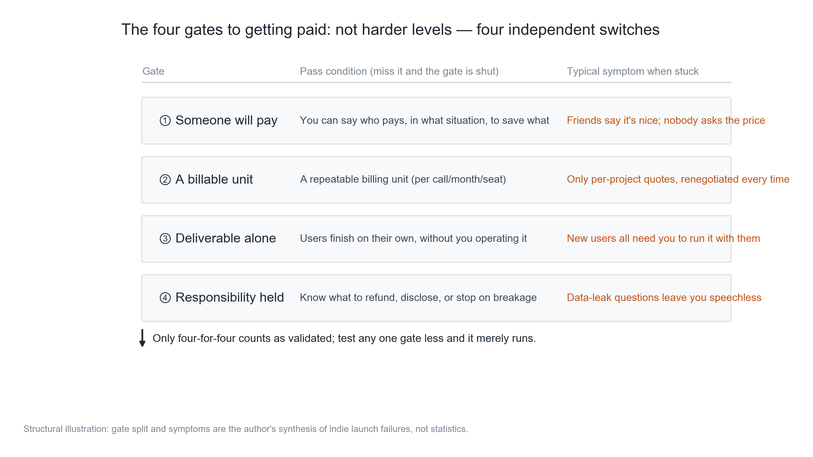
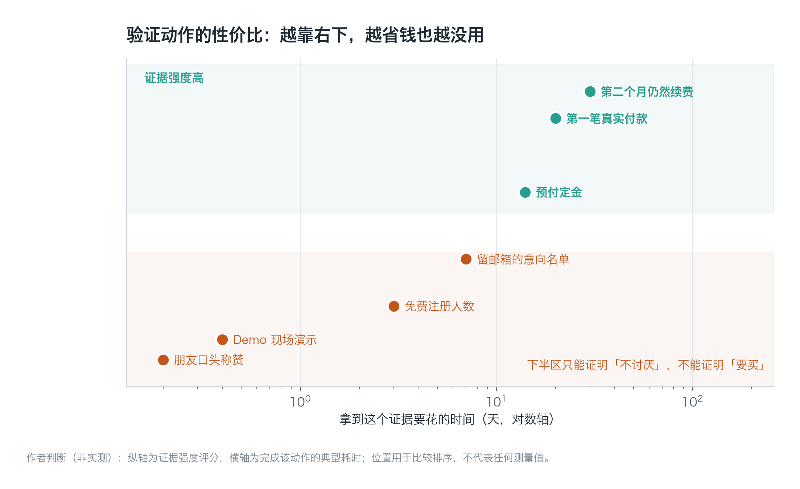
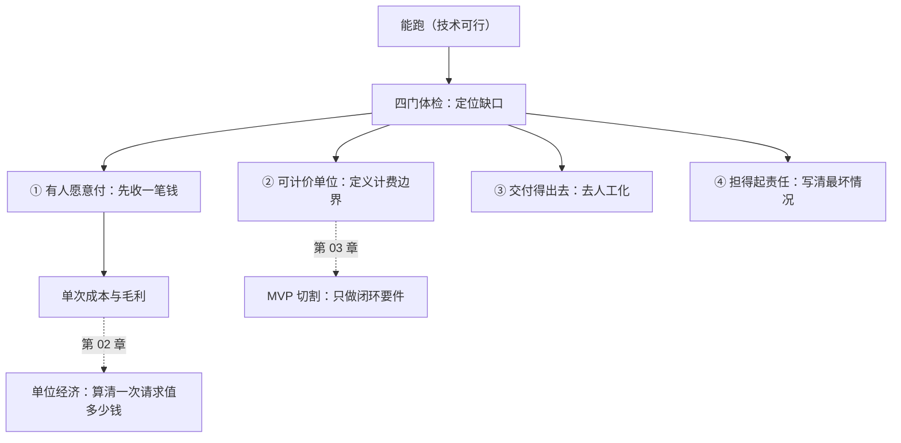

**English** | [中文](./ch01-can-run-not-can-charge.zh.md)

# Chapter 01: Running Is Not the Same as Getting Paid

> **Chapter guide**: This is the foundation of the whole book. It gives you a four-pronged gauge for judging where a "thing that runs" is actually stuck — whether nobody wants it, it cannot be priced, it cannot be delivered, or you cannot bear the responsibility. The fix is completely different in each of the four cases; fix the wrong one and you waste months.
> **Prerequisites**: Readable with zero business background. All you need is something you have "built and find usable yourself."
> **Core learning objectives**:
> - Understand why "technically feasible" and "commercially feasible" are two different things, and what evidence can prove each of them
> - Master the method for judging the four gates of getting paid, run a checkup on your own product, and write down the gaps
> - Be able to design a minimal paid validation that can be completed within 7 days and whose cost is capped

---

## 1. Cognitive Anchor: How Much Is a Friend's Praise Worth

### 1.1 A Scenario Almost Everyone Has Been In

You built something and showed it to three friends. They said "pretty good", "this works", "let me know when it's done".

So you spent two months finishing it, launched it, wrote a landing page, hooked up payments. First month: 200 signups, 0 paying.

You began to suspect the copy was the problem, so you rewrote it three times; then that the price was too high, so you dropped it from 49 to 29; then that features were lacking, so you added four. Still 0 paying.

The real problem was planted two months ago: **those words "pretty good" answer the question "can this thing be used", but you took them as an answer to "is this thing worth buying".** Four gates stand between those two questions, and your friends only helped you verify one small corner of the first gate.

### 1.2 Intuitive Analogy: Hosting Dinner vs. Opening a Restaurant

A friend comes to your home for dinner and says "this dish is really good". What does it take for that statement to hold? He is hungry, he does not have to pay, he does not have to wait for a table, and if it makes him sick you do not have to compensate him.

If tomorrow you put that same dish on the street and sell it for 68 yuan, the four conditions above **fail at the same time**: he may not be hungry, he has to pay, he has to wait, and if it makes him sick you are liable.

A product has exactly the same structure. During a free trial, the user is not hungry (no real task), does not pay, does not wait (you are right there running it for them), and you are not liable (they have invested nothing). The moment you start charging, all four become real problems.

**The boundary of this analogy**: a restaurant also has location, supply chain, and reputation — things a product does not have; this analogy is only for showing that "a free scenario masks all four conditions at once". Do not use it to derive the cost structure (that is Chapter 02's job).

---

## 2. First Principles: What the Four Gates Are

### 2.1 Definition of the Four Gates and How to Judge Each

Getting paid can be decomposed into four independent switches. They are not four levels of increasing difficulty but four conditions that **cannot substitute for one another** — if any one of them is shut, no money comes in, and the fix is completely different.

*Figure 1-1: How to read this figure — look at the "pass condition" column first; if you can answer it in one sentence, the gate passes; if you cannot, it is "untested", not "failed". The column on the right holds the exact words you will hear when you are stuck; most people mistake them for encouragement.*

| Gate | One-sentence definition | Judging question | What it looks like when missing |
| :--- | :--- | :--- | :--- |
| (1) Someone willing to pay | There is a specific person, in a specific situation, willing to pay to have some chore taken off their hands | "Who, when, and to get rid of what, would pay this money?" | Lots of users, paid conversion near 0 |
| (2) A billable unit | The value can be cut into a repeatable billing unit | "What do I charge by? Will this unit start an argument every single time?" | Can only quote per project, renegotiating every deal |
| (3) Deliverable | The user can complete it themselves, without you operating it beside them | "Can a stranger finish without reading instructions?" | Every new user needs you to babysit |
| (4) Responsibility you can bear | When something goes wrong, you know whether to refund, notify, or shut down | "If the worst happens, can I afford it and explain it?" | The moment a user asks about data security, you go vague |

These four gates have an easily overlooked property: **there is no substitution between them**. However good the features are, they cannot think through "what to charge by" for you; however low the price, it cannot turn "cannot be delivered" into deliverable.

### 2.2 Why "It Runs" Is the Weakest Kind of Evidence

"It runs" proves technical feasibility. In 2026, technical feasibility barely constitutes a barrier — whatever you can build with AI in two weeks, others can build too.

Worse, "it runs" **actively creates an illusion**: because you use it yourself every day, you mistake yourself for the user; because you know every button, you assume the flow is smooth; because you know its boundaries, you assume users know them too.

*Figure 1-2: The horizontal axis is the time it takes to obtain this evidence (log scale); the vertical axis is how strongly it proves "someone wants to buy". Note the cluster at bottom-left — friend praise, demo applause, free signups: all three together still do not reach the "credible zone". At bottom-right, "still renewing in month two" is the most expensive and hardest evidence.*

This figure is worth a thirty-second pause. It says three things:

1. **Cheap validations are almost all ineffective.** Free signup counts, likes on your social feed, demo applause — all in the lower half. They can only prove "not hated".
2. **Effective validations require you to pay out first.** A deposit means going out and asking for money; a first payment means hooking up payments. Asking for money is itself a real test — most people do not dare do it, so they stay at "it runs" forever.
3. **The hardest evidence is repeat purchase.** The first payment may be curiosity; renewing in month two is when the value is proven. So the minimal validation cycle is not "launch day" — it is one billing cycle.

### 2.3 A Counterintuitive Conclusion

Many people think the order is "build the product first, then find users, then set the price".

Survival rate comes from reversing the order: **first confirm that someone will pay for something, then decide what unit to charge by, then build the minimal deliverable version, and only then talk about responsibility boundaries.** Because if any of the first three steps does not hold, the engineering investment in the fourth is sunk cost.

This is also why this book puts "getting paid" before engineering — not because business matters more than engineering, but because **business judgment decides which engineering is worth doing**.

---

## 3. Hands-on: Running a Four-Gate Checkup on the "Minutes" Assistant

### 3.1 Case Setup

The "Minutes" assistant: upload a meeting recording, get it automatically transcribed, then generate structured minutes (decisions, action items, owners, deadlines). The target users are project leads at small teams of 5–20 people. Planned pricing: 39 yuan/month for 30 meetings per month.

Current state: the features run; you have used it yourself for two months, gave it to 6 friends to try, and 3 of them still use it every week.

### 3.2 Walking Through Each Gate

| Gate | Current state | Evidence in hand | What is missing | Action doable within 7 days |
| :--- | :--- | :--- | :--- | :--- |
| (1) Someone willing to pay | **Untested** | 3 friends using it, 0 have asked the price | Nobody has ever paid for it; nobody has even asked "how much" | Find 5 target users and ask for a 20 yuan deposit to lock in 3 months |
| (2) Billable unit | **Fails** | Plan to charge "per session", but a 20-minute meeting vs. a 3-hour one differs 9x in cost | The billing unit has no defined boundary | Switch to "billed minutes": 1500 minutes included per month, 0.05 yuan/minute beyond that |
| (3) Deliverable | **Fails** | Every output format needs manual adjusting by you | A stranger cannot self-serve | Fix three templates and turn "manually adjusting the format" into a choice |
| (4) Responsibility you can bear | **Untested** | Never written any statement | The recording holds other people's voices; if a transcription error misleads a decision, who is liable | Write a one-page "Usage Boundaries": does not replace official records, do not upload sensitive meetings, kept 30 days and deletable |

The conclusion of this checkup is not "can we launch" but the **order**: fix (1) first (because it is the only one that cannot be solved by writing code), fix (2) in parallel (because it decides how the pricing page reads), and (3)(4) can proceed in parallel but must be scheduled after (1).

The reason is direct: if 4 of the 5 people will not pay a 20 yuan deposit, then however well you do (3)(4) it is wasted. And if 4 are willing to pay, you will immediately know how to set (2) — they will tell you "roughly how many meetings a month we hold".

### 3.3 Why Ask for a Deposit First Instead of Running a Survey

A survey asks "would you buy?", and the answer is cheap; a deposit asks "pay 20 yuan now", and the answer is expensive.

The information content differs by an order of magnitude. More crucially, collecting a deposit forces you to make three things clear: what you are selling, for how much, and when it is delivered. If you cannot make those three clear, it means you have not figured it out yourself — and that is exactly what the four-gate checkup is meant to expose.

---

## 4. Common Misconceptions and Correct/Incorrect Contrasts

| Easy pitfall | Why it goes wrong | The right mental model and practice |
| :--- | :--- | :--- |
| **"Friends all say it is good, so there is demand"** | Friends are answering "can it be used", not "will I buy it"; and social settings carry politeness inflation | Treat "it is good" as zero information. If you want evidence, ask for money — even 20 yuan |
| **"Grow a big free user base first, charge later"** | Free users behave completely differently from paying users; the "demand" accumulated during the free phase is mostly fake demand | Set a low-barrier paid entry point from day one. A free tier is fine, but there must exist an entry where users can pay |
| **"A lower price cannot hurt"** | Price is one of the strongest signals. Pricing too low makes users doubt quality, and leaves you unable to cover cost (Chapter 02) | Calculate per-session cost and contribution margin first, then price; better to sell higher and sell less |
| **"All four gates must pass before launch"** | When (1) is untested, investment in (2)(3)(4) is all gambling; the wrong order stretches the validation cycle to months | Prioritize (1); run (2) alongside (1); fix (3)(4) immediately after (1) shows a signal. Launching with known gaps is allowed, but the gaps must be written down |
| **"Compliance is a later-stage concern"** | While the responsibility gate is shut, one incident can end the product; and compliance work often touches the architecture (Chapter 08) | Before launch, at least write down "what happens in the worst case"; a complete compliance system is not required |

---

## 5. Chapter Summary and Local Knowledge Graph

### 5.1 Key Points

- **The four gates are four independent switches**, not four difficulty levels. Fix whichever is missing; fixing in the wrong order wastes months.
- **"It runs" only proves technical feasibility**; in 2026 that barely constitutes a barrier, let alone a reason to buy.
- **Evidence has strengths**: friend praise < free signups < intent list < prepaid deposit < first payment < renewal in month two. Cheap validations are basically ineffective.
- **Collecting one payment first** is the core act of minimal validation; it tests value, pricing, and delivery at the same time.
- **Launching with gaps is allowed**, but the gaps must be written down, and you must know under what conditions they turn into incidents.

### 5.2 Concept Topology of This Chapter

---

## 6. Tiered Exercises and Reference Solutions

### Basic Consolidation (Tier 1: Intuition and Concept Check)

1. In each of the four scenarios below, which gate is most likely stuck? Write one sentence for each.
   - (a) The product has 3000 free users, a 0.1% paid conversion rate, and support receives "can it be free?" inquiries every day.
   - (b) Every new customer needs you to configure it for them remotely before they can use it, and you have already turned away 5 customers because of it.
   - (c) Customers love it, but every price talk requires recalculating; the same feature has been quoted at 3000, 8000, and 15000.
   - (d) Users ask "where are the meeting recordings stored, and will they be used to train models", and you answer "it should be safe".

2. Judge whether this is true or false and explain why: "As long as the features are good enough, users will naturally pay."

### Applied Practice (Tier 2: Reasoning and Hands-on Construction)

3. Run a four-gate checkup on the product in your hands, producing a table (gate / state / evidence / gap / action within 7 days). Requirement: the "evidence" for each gate must be a verifiable fact, not a "feeling".

4. Design a minimal paid validation that can be completed within 7 days. You must state: whom to ask, how much to ask for, what delivery is promised, the total budget cap, and the failure criterion (what result counts as "this gate did not pass").

### Deep Challenge (Tier 3: Boundary Conditions and Cross-Chapter Transfer)

5. Suppose all four gates passed and money came in, but three months later 70% of paying users churned. Analyze: this may not be a four-gate problem but what kind of problem? Give at least three possibilities, and state what evidence should be used to distinguish each.

<strong>Click to expand: reference answers and in-depth analysis for this chapter's exercises</strong>

#### 1. Positioning the Gate

- **(a) Stuck at (1), and it is the typical form of "the value hypothesis is wrong".** 3000 free users + 0.1% conversion + users proactively asking "can it be free" shows they want "a free tool", not "a tool that solves the problem". Note: this cannot simply be attributed to "the price is too high", because if it were a price issue, users would say "too expensive" rather than "can it be free".
- **(b) Stuck at (3) delivery.** Needing you to babysit means delivery cost grows linearly with user count, and you are only one person. If this gate does not pass, the precondition for scaling does not exist.
- **(c) Stuck at (2) billable unit.** Three quotes for the same feature means the value has not been cut into a stable unit. Customers will suspect you charge differently by person, and the trust cost becomes enormous.
- **(d) Stuck at (4) responsibility.** "It should be safe" is the most dangerous answer — it means you have neither control nor commitment. In To B scenarios this gate is usually a hard threshold.

#### 2. True or False

**Wrong, and on AI products this judgment is wrong even more thoroughly.** The reasoning has three layers:

- First layer: good features are a "necessary condition", not a "sufficient condition". Among the four gates they only affect part of (1).
- Second layer: the feature advantage of AI products has a very short half-life. The model you use today, competitors can use in three months too.
- Third layer: the payment decision is jointly determined by "perceived value − perceived cost − perceived risk". Features only act on the first item, while the risk term (data security, accuracy, liability) carries especially high weight in AI products.

#### 3. Scoring Points for the Checkup Table

A passing table has three traits:

- **The evidence column states facts** ("3 people used it 4 weeks in a row", not "user feedback is good");
- **The gap column states mechanisms** ("the billing unit has no defined boundary", not "pricing needs optimizing");
- **The action column has a time and a cap** ("find 5 people within 7 days, budget 200 yuan").

A failing table usually writes "untested" as "passed" — the most expensive mistake, because it makes you skip the one thing you should do.

#### 4. Design Points for the Minimal Validation

An executable version:

| Item | Content |
| :--- | :--- |
| Whom to ask | 5 project leads you know but who are not friends (a colleague's former colleague, active people in a community) |
| How much | 20 yuan deposit, locking in the 39 yuan/month price for 3 months |
| What is promised | Deliver minutes of one real meeting per week, human-backed, returned within 48 hours |
| Budget cap | 200 yuan (including transfer fees and one coffee) |
| Failure criterion | Fewer than 2 of the 5 pay the deposit → (1) did not pass; refund and stop development |

The key is the last row: **write the failure criterion first, then act**. Otherwise you will keep finding reasons to explain why "a few more people will do it".

#### 5. Three Possibilities for the Churn Problem

When all four gates pass, the money is in, and users still churn, it usually falls into these three:

| Possibility | Manifestation | Evidence used to distinguish |
| :--- | :--- | :--- |
| **Insufficient value frequency** | Users recognize the value but only hold two meetings a month, so the subscription feels not worth it | Usage frequency distribution: if 60% of users use it < 3 times a month, it is a frequency problem |
| **The substitute is good enough** | Users went back to the free approach (manual notes + a general-purpose LLM) | Churn interviews contain "I can just use XX instead" |
| **Unstable quality** | Three times in ten the transcription is wildly wrong, so users do not dare rely on it | Success rate measured per meeting; whether complaints concentrate on long meetings or accents |

How to distinguish: **look at the cross-table of usage frequency and success rate**. Low frequency + high success rate = frequency problem (change the pricing model, e.g. per use); high frequency + low success rate = quality problem (change the engineering); low frequency + low success rate = the value hypothesis itself is in trouble (back to Chapter 01).

Note that the fixes for these three are completely different: frequency problems change pricing (Chapter 02), quality problems change the pipeline (Chapter 05), value problems change the product definition (Chapter 03). **Making any change before distinguishing them is gambling.**

---

## 7. Authoritative Sources and Further Reading (Authoritative References)

1. **DORA**: [DORA](https://dora.dev/) - the definitions and norms of this chapter are anchored here (verification date: `2026-10-23`).
2. **METR**: [METR](https://metr.org/) - the definitions and norms of this chapter are anchored here (verification date: `2026-10-23`).
3. **The Twelve-Factor App**: [The Twelve-Factor App](https://12factor.net/) - the definitions and norms of this chapter are anchored here (verification date: `2026-10-23`).

> Measurement note: the sources above are used to anchor **definitions and norms**, not to extrapolate risk probabilities. Before quoting any number, check the source's year and its denominator.
