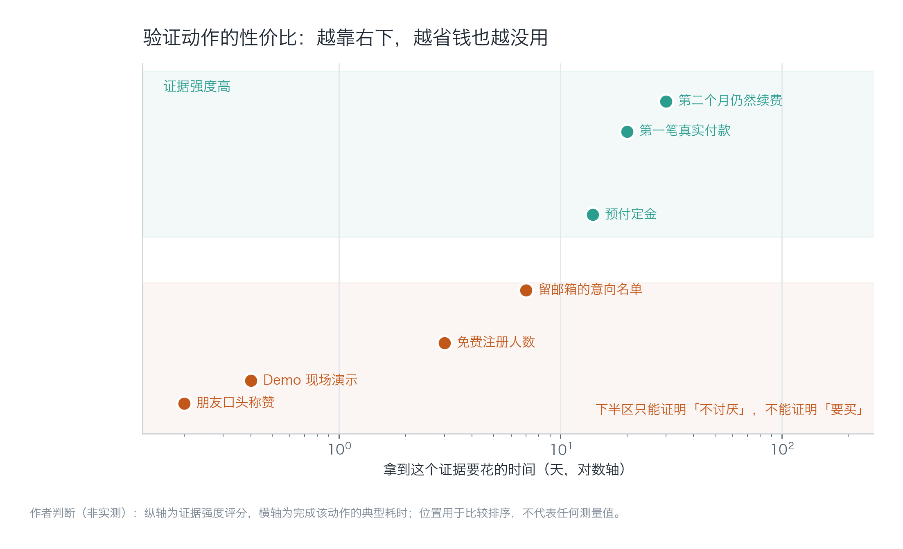
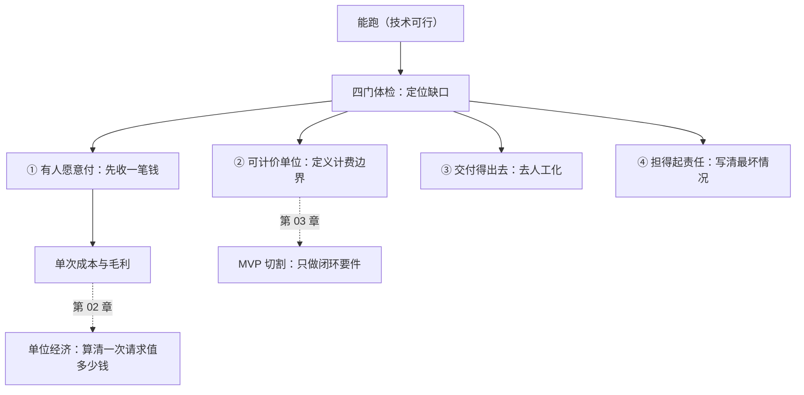

[English](./ch01-can-run-not-can-charge.md) | **中文**

# 第 01 章：能跑不等于能收钱

> **本章导读**：这是全书的地基。它给你一把四齿的尺子，用来判断一个"能跑起来"的东西现在到底卡在哪一步——是没人要、没法计价、交付不出去，还是担不起责任。四种情况的补法完全不同，补错了会白花几个月。
> **前置知识**：零商业基础可读。只需要你手上有一个"自己觉得能用"的东西。
> **核心学习目标**：
> - 理解"技术可行"与"商业可行"为什么是两件事，以及它们各自能被什么证据证明
> - 掌握收钱四道门的判定方法，能对自己的产品做一次体检并写出缺口
> - 能够设计一个 7 天内可完成、成本有上限的最小付费验证

---

## 1. 认知锚点：朋友的称赞值多少钱

### 1.1 一个几乎人人都遇到过的场景

你做了个东西，给三个朋友看过。他们说"挺好用的""这个可以啊""做出来告诉我"。

于是你花了两个月把它做完整，上线，写了落地页，接了支付。第一个月注册 200 人，付费 0 人。

你开始怀疑是文案不行，改了三版；又怀疑是价格太高，从 49 降到 29；再怀疑是功能不够，加了四个。付费还是 0。

真正的问题在两个月前就埋下了：**"挺好用的"这四个字，回答的是"这东西能不能用"，而你把它当成了"这东西值不值得买"的回答。** 这两个问题之间隔着四道门，朋友只帮你验证了第一道门的一小块。

### 1.2 直觉类比：请客与开店

朋友来家里吃饭，说"这菜真好吃"。这句话成立需要什么？他饿了、他不用付钱、他不用等位、他吃坏了你也不用赔。

如果明天你把这道菜放到街边卖 68 块，上面四个条件**同时失效**：他可能不饿、他要付钱、他要等、他吃坏了你要负责。

产品是一模一样的结构。免费试用时，用户不饿（没有真实任务）、不用付钱、不用等（你在旁边帮他跑）、不用你负责（他没投入）。一旦开始收钱，这四件事全部变成真问题。

**类比的边界**：餐馆还有选址、供应链、口碑这些产品没有的东西；这个类比只用于说明"免费场景会同时屏蔽四个条件"，不要拿它推演成本结构（那是第 02 章的事）。

---

## 2. 第一性原理：四道门分别是什么

### 2.1 四道门的定义与判定问法

收钱这件事可以拆成四个独立的开关。它们不是难度递增的四关，而是四个**互不替代**的条件——任何一道关着，钱就进不来，而且补法完全不同。

*图 1-1：读这张图的方法——先看"通过条件"列，用一句话回答得出来就算过；回答不出来就是"未测"，不是"不过"。右侧那一列是你卡住时会听到的原话，多数人把它当成了鼓励。*

| 门 | 一句话定义 | 判定问法 | 缺了它的表现 |
| :--- | :--- | :--- | :--- |
| ① 有人愿意付 | 存在一个具体的人，在具体场景里，愿意为省掉某件事掏钱 | "谁、在什么时候、为了省掉什么，会付这笔钱？" | 用户很多，付费转化率接近 0 |
| ② 有可计价的单位 | 价值能被切成一个可重复计费的单元 | "我按什么收费？这个单位会不会每次都吵？" | 只能按项目报价，每单重新谈 |
| ③ 交付得出去 | 用户自己就能完成，不需要你在旁边操作 | "一个陌生人能不能不看说明完成？" | 每个新用户都要你陪跑 |
| ④ 担得起责任 | 出事时你知道该退钱、该告知、该停机 | "最坏情况发生时，我赔得起、说得清吗？" | 用户一问数据安全，你就含糊 |

这四道门有一个容易被忽略的性质：**它们之间没有替代关系**。功能做得再好，也不能替你把"按什么收费"想清楚；价格定得再低，也不能让"交付不出去"变成能交付。

### 2.2 为什么"能跑"是最弱的一种证据

"能跑"证明的是技术可行性。在 2026 年，技术可行性几乎不构成壁垒——你能用 AI 在两周内做出来的东西，别人也能。

更麻烦的是，"能跑"会**主动制造一种错觉**：因为你自己天天在用，你会误以为自己就是用户；因为你熟悉每一个按钮，你会误以为流程顺滑；因为你知道它的边界，你会误以为用户也知道。

*图 1-2：横轴是拿到这个证据要花的时间（对数轴），纵轴是它能证明"有人要买"的强度。注意左下角那一簇——朋友称赞、Demo 演示、免费注册，三个加起来也到不了"可信区"。右下角的"第二个月仍然续费"是最贵也最硬的证据。*

这张图值得停下来看三十秒。它说明三件事：

1. **便宜的验证几乎都无效。** 免费注册数、朋友圈点赞、Demo 掌声，全在下半区。它们只能证明"不讨厌"。
2. **有效的验证都需要你先付出。** 预付定金要你去开口要钱，第一笔付款要你把支付接上。开口要钱这件事本身就是一次真实测试——多数人不敢做，所以永远停在"能跑"。
3. **最硬的证据是复购。** 第一笔付款可能是好奇，第二个月续费才是价值成立。所以验证的最小周期不是"上线当天"，是一个计费周期。

### 2.3 一个反直觉的结论

很多人以为顺序是"先做产品，再找用户，再定价"。

真实的顺序反过来才有存活率：**先确认有人愿意为某件事付钱，再决定按什么单位收，再去做能交付的最小版本，最后才谈责任边界。** 因为前三步任何一步不成立，第四步的工程投入都是沉没成本。

这也是为什么本书把"能收钱"放在工程之前——不是商业比工程重要，是**商业判断决定哪些工程值得做**。

---

## 3. 手把手：给「纪要助手」做一次四门体检

### 3.1 案例设定

「纪要助手」：上传会议录音，自动转写成文字，再生成结构化纪要（决议、行动项、负责人、截止时间）。目标用户是 5—20 人小团队的项目负责人。设想定价 39 元/月、每月 30 次会议。

当前状态：功能能跑，自己用了两个月，给 6 个朋友试用，其中 3 人每周还在用。

### 3.2 逐门推演

| 门 | 当前状态 | 手上有什么证据 | 缺什么 | 7 天内能做的动作 |
| :--- | :--- | :--- | :--- | :--- |
| ① 有人愿意付 | **未测** | 3 个朋友在用，0 人问过价格 | 没有人为它掏过钱，连"多少钱"都没被问过 | 找 5 个目标用户，开口要 20 元定金锁 3 个月 |
| ② 可计价单位 | **不过** | 想按"次"收，但一次会议 20 分钟和 3 小时成本差 9 倍 | 计费单位没有定义边界 | 改成"按计费分钟数"：每月含 1500 分钟，超出按 0.05 元/分钟 |
| ③ 交付得出去 | **不过** | 每次输出格式都要自己手动调 | 陌生人无法自助完成 | 固定三套模板，把"手动调格式"变成选择项 |
| ④ 担得起责任 | **未测** | 没写过任何说明 | 录音里是别人的声音，转写错了导致决议误解谁负责 | 写一页《使用边界》：不替代正式记录、涉及敏感会议请勿上传、保留 30 天可删 |

这次体检的结论不是"能不能上线"，而是**顺序**：先补①（因为它是唯一无法靠写代码解决的），同时补②（因为它决定定价页怎么写），③④ 可以并行但要排在①之后。

理由很直接：如果 5 个人里有 4 个不愿意付 20 元定金，那么③④ 做得再好也是白做。而如果 4 个人愿意付，你会立刻知道②该怎么定——他们会告诉你"我们一个月大概开多少次会"。

### 3.3 为什么先要定金，而不是先做问卷

问卷问的是"你会买吗"，答案是廉价的；定金问的是"现在付 20 块"，答案是昂贵的。

两者的信息量差一个数量级。更关键的是，收定金会强迫你说清三件事：卖什么、多少钱、什么时候交付。这三件事说不清，说明你自己还没想明白——而这正是四门体检要暴露的东西。

---

## 4. 常见误区与正反例对比

| 容易踩坑的误区 | 为什么会出错 | 正确的心智模型与做法 |
| :--- | :--- | :--- |
| **"朋友都说好用，说明有需求"** | 朋友在回答"能不能用"，不是"买不买"；且社交场合存在礼貌性高估 | 把"好用"当成零信息。要证据就开口要钱，哪怕 20 元 |
| **"先免费做大用户量，以后再收费"** | 免费用户的行为模式与付费用户完全不同；免费期积累的"需求"多半是伪需求 | 从第一天就设一个低门槛付费点。免费版可以有，但必须存在一个能付钱的入口 |
| **"价格低一点总没错"** | 价格是最强的信号之一。定价过低会让用户怀疑质量，也会让你无法覆盖成本（第 02 章） | 先算清单次成本与贡献毛利，再定价；宁可卖贵一点、卖少一点 |
| **"四道门要全过了才能上线"** | ①未测时，②③④ 的投入全是赌；顺序错了会把验证周期拉长到几个月 | ①优先；②与①并行；③④ 在①有信号后立刻补。允许带着已知缺口上线，但要写清缺口 |
| **"合规是做大以后的事"** | 责任门关着的时候，一次事故就能终结产品；而合规改造往往牵动架构（第 08 章） | 上线前至少写清"最坏情况怎么办"，不要求完整合规体系 |

---

## 5. 本章小结与局部知识图谱

### 5.1 核心要点

- **四道门是四个独立开关**，不是四个难度等级。缺哪道补哪道，补错顺序会浪费几个月。
- **"能跑"只证明技术可行**，在 2026 年这几乎不构成壁垒，也不构成购买理由。
- **证据有强弱**：朋友称赞 < 免费注册 < 意向名单 < 预付定金 < 首笔付款 < 次月续费。便宜的验证基本无效。
- **先收一笔钱**是最小验证的核心动作，它同时检验了价值、计价、交付三件事。
- **允许带缺口上线**，但缺口必须写出来，并且知道它在什么条件下会变成事故。

### 5.2 本章概念拓扑

---

## 6. 分级通关练习与参考解析

### 基础巩固题（Tier 1：直觉与概念核验）

1. 下面四个场景，各自最可能卡在哪一道门？请各写一句话说明。
   - (a) 产品有 3000 个免费用户，付费转化率 0.1%，客服每天收到"能不能免费"的询问。
   - (b) 每个新客户都要你远程帮他配置一遍才能用，你已经因此拒绝了 5 个客户。
   - (c) 客户很喜欢，但每次谈价格都要重新算一遍，同一个功能报过 3000、8000、15000 三个价。
   - (d) 用户问"会议录音存在哪、会不会被用来训练模型"，你答"应该是安全的"。

2. 判断对错并说明理由："只要功能足够好，用户自然会付费。"

### 动手应用题（Tier 2：推演与实操构建）

3. 给你手上的产品做一次四门体检，产出一张表（门 / 状态 / 证据 / 缺口 / 7 天内动作）。要求：每一门的"证据"必须是可核验的事实，不能写"感觉"。

4. 设计一个 7 天内能完成的最小付费验证。必须写明：向谁要、要多少、承诺交付什么、总预算上限、失败判据（什么结果算"这门没过"）。

### 深度挑战题（Tier 3：边界条件与跨章迁移）

5. 假设四道门全过了，也收到了钱，但三个月后付费用户流失了 70%。请分析：这可能不是四道门的问题，而是哪一类问题？给出至少三种可能，并说明各自该用什么证据去区分。

<strong>点击展开：本章练习参考答案与深度解析</strong>

#### 1. 四门定位

- **(a) 卡在①，且是"价值假设错了"的典型形态。** 3000 个免费用户 + 0.1% 转化 + 用户主动问"能不能免费"，说明他们要的是"免费的工具"，不是"解决问题的工具"。注意：这里不能简单归因为"定价太高"，因为如果是价格问题，用户会说"太贵了"而不是"能不能免费"。
- **(b) 卡在③交付。** 需要你陪跑意味着交付成本随用户数线性增长，而你只有一个人。这一门不过，规模化的前提就不存在。
- **(c) 卡在②计价单位。** 同一功能三个报价，说明价值没有被切成稳定单元。客户会因此怀疑你在看人下菜，信任成本极高。
- **(d) 卡在④责任。** "应该是安全的"是最危险的答案——它意味着你既没有控制，也没有承诺。这一门在 To B 场景里通常是硬门槛。

#### 2. 判断对错

**错，而且这个判断在 AI 产品上错得更彻底。** 理由有三层：

- 第一层：功能好是"必要条件"不是"充分条件"。四道门里它只影响①的一部分。
- 第二层：AI 产品的功能优势半衰期很短。你今天用的模型，三个月后竞品也能用。
- 第三层：付费决策由"感知价值 − 感知成本 − 感知风险"三者共同决定。功能只作用于第一项，而风险项（数据安全、准确性、责任）在 AI 产品里权重特别高。

#### 3. 体检表评分要点

合格的表有三个特征：

- **证据栏写的是事实**（"3 人连续使用 4 周"，不是"用户反馈良好"）；
- **缺口栏写的是机制**（"计费单位未定义边界"，不是"定价待优化"）；
- **动作栏有时间和上限**（"7 天内找 5 人，预算 200 元"）。

不合格的表通常把"未测"写成"通过"——这是最贵的错误，因为它会让你跳过唯一该做的事。

#### 4. 最小验证的设计要点

一个可执行的版本：

| 项 | 内容 |
| :--- | :--- |
| 向谁要 | 5 位你认识但非朋友的项目负责人（同事的前同事、社群里的活跃者） |
| 要多少 | 20 元定金，锁定 3 个月 39 元/月的价格 |
| 承诺什么 | 每周交付 1 次真实会议的纪要，人工兜底，48 小时内返回 |
| 预算上限 | 200 元（含转账手续费与一次咖啡） |
| 失败判据 | 5 人中少于 2 人付定金 → ①未过；退款并停止开发 |

关键在最后一行：**先写失败判据，再去做**。否则你会不断给自己找理由解释为什么"再找几个人就好了"。

#### 5. 流失问题的三种可能

四门全过、钱也收到、还是流失，通常落在下面三类：

| 可能 | 表现 | 用于区分的证据 |
| :--- | :--- | :--- |
| **价值频率不足** | 用户认可价值，但一个月只开两次会，订阅显得不划算 | 使用频次分布：如果 60% 用户月使用 < 3 次，是频率问题 |
| **替代品足够好** | 用户用回了免费方案（手动记 + 通用大模型） | 流失访谈里出现"我直接用 XX 也行" |
| **质量不稳定** | 十次里有三次转写错得离谱，用户不敢依赖 | 按会议计算的成功率；投诉集中在长会议还是口音 |

区分方法：**看使用频次与成功率的交叉表**。低频 + 高成功率 = 频率问题（该改计价方式，比如按次）；高频 + 低成功率 = 质量问题（该改工程）；低频 + 低成功率 = 价值假设本身有问题（回到第 01 章）。

注意这三类的补法完全不同：频率问题改计价（第 02 章），质量问题改链路（第 05 章），价值问题改产品定义（第 03 章）。**在没有区分之前动手改任何一样，都是在赌。**

---

## 7. 本章权威参考信源与延伸阅读 (Authoritative References)

1. **DORA**：[DORA](https://dora.dev/) - 本章的定义与规范以此为锚（核验日期：`2026-10-23`）。
2. **METR**：[METR](https://metr.org/) - 本章的定义与规范以此为锚（核验日期：`2026-10-23`）。
3. **The Twelve-Factor App**：[The Twelve-Factor App](https://12factor.net/) - 本章的定义与规范以此为锚（核验日期：`2026-10-23`）。

> 口径提示：以上信源用于锚定**定义与规范**，不用于外推风险概率。引用任何数字前，先核对来源年份与分母。
