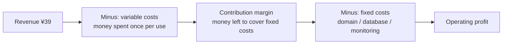
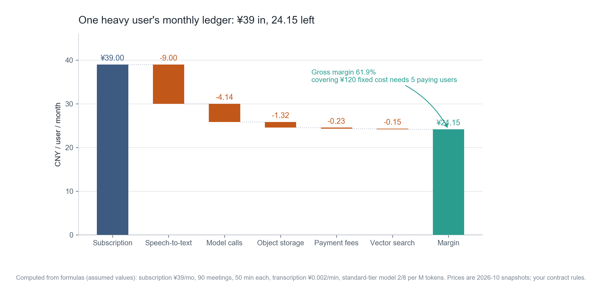
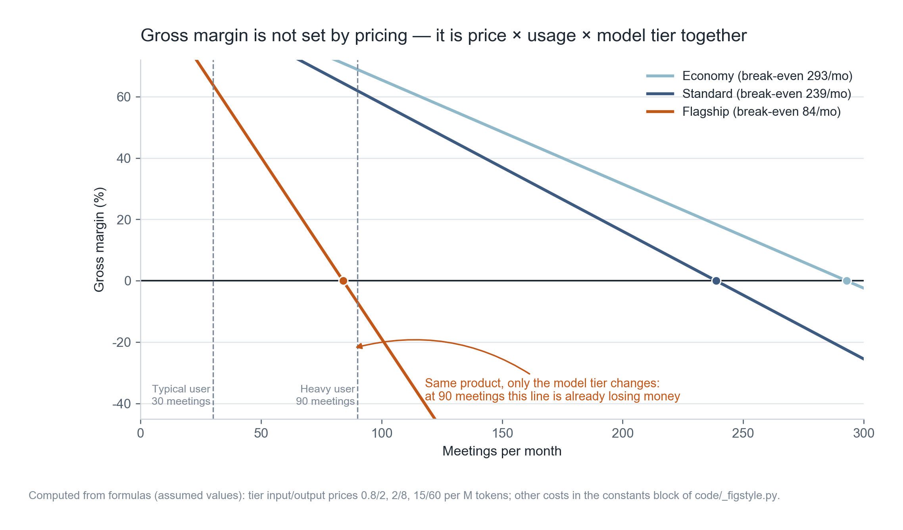
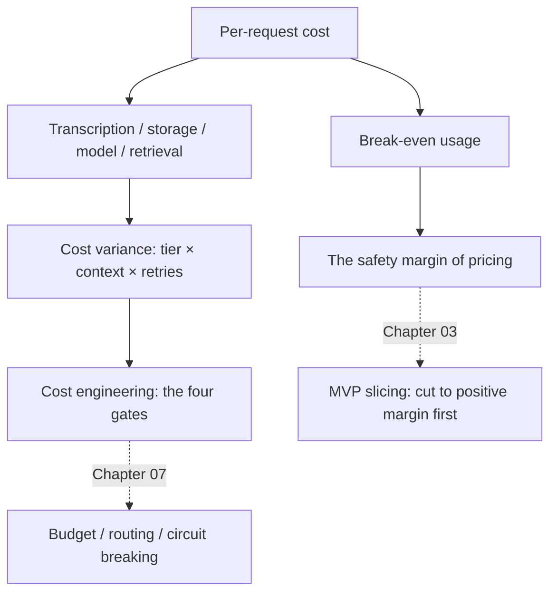

**English** | [中文](./ch02-unit-economics.zh.md)

# Chapter 02: Unit Economics — Calculating a Single Request Down to the Cent

> **Chapter guide**: This chapter does exactly one thing: break down "how much does one AI request cost" to every single cent, then answer three questions — how big is my gross margin, will I lose money at my usage level, and which variable will punch through the margin the moment it moves.
> **Prerequisites**: Chapter 01's four gates (especially gate (2), the billable unit).
> **Core learning objectives**:
> - Master the complete composition of per-request cost, and be able to calculate your own per-request cost and gross margin independently
> - Understand "cost variance": the same feature implemented differently can differ in cost by an order of magnitude
> - Be able to use break-even and sensitivity analysis to find the variable that really should be moved

---

## 1. Cognitive Anchor: What the Milk-Tea Shop Owner Calculates Is Not "18 Yuan a Cup"

### 1.1 A Real Scenario

Ask a milk-tea shop owner how business is, and he will not say "18 yuan a cup, quite good". He will say: milk 3.2, cup 0.8, rent amortized to 4.1 per cup, platform takes 2.7, labor 3.5 — 3.7 profit per cup, 200 cups a day, minus utilities and wastage, 12,000 take-home a month.

People selling products and people selling milk tea are calculating the same thing: **revenue minus "the part that grows with every additional unit sold", and what remains is the money you can use to support the team, invest in R&D, and pay rent.**

AI products die here most easily, because of one property: **marginal cost is not zero, and it fluctuates wildly**. For traditional software, one more user costs almost nothing; for an AI product, one more user can make you lose two thousand this month — and you will not know it before you look at the bank balance.

### 1.2 Intuitive Analogy: Three Layers of Gross Margin



**The boundary of this analogy**: a milk-tea shop has inventory and wastage; an AI product has caching and retries; the structure is similar, but the "wastage" of an AI product (failed calls, retried requests, over-long contexts) is often far higher than a milk-tea shop's discard rate, and it is invisible.

---

## 2. First Principles: Where the Money Goes in One Request

### 2.1 The Four-Layer Structure of Cost

First distinguish two kinds of cost; this is the precondition for all later calculations:

| Type | Definition | Examples | Traits |
| :--- | :--- | :--- | :--- |
| **Variable cost** | Cost that increases with every additional unit served | Transcription, model tokens, storage, payment fees | Grows linearly with usage |
| **Fixed cost** | Cost essentially unrelated to usage | Domain name, base database tier, monitoring, email | Diluted by user count |

"Server monthly rent" needs care: at low usage it is fixed cost; at high usage the database tier and bandwidth grow with it, and it silently becomes variable cost. The judging method is simple — **ask one question: "if users grow tenfold, will this bill grow"**.

### 2.2 Item-by-Item Breakdown of Per-Request Cost

Taking the "Minutes" assistant as an example, one 50-minute meeting:

$$
C_{\text{per-request}} = \underbrace{M \times p_{\text{asr}}}_{\text{transcription}} + \underbrace{\frac{M \times s}{1024} \times p_{\text{store}}}_{\text{storage}} + \underbrace{\left(\frac{T_{\text{in}} p_{\text{in}} + T_{\text{out}} p_{\text{out}}}{10^6}\right)}_{\text{model calls}} + \underbrace{e}_{\text{retrieval amortized}}
$$

Explaining each symbol in turn:

| Symbol | Meaning | Value in this example |
| :--- | :--- | :--- |
| $M$ | Meeting duration (minutes) | 50 |
| $p_{\text{asr}}$ | Transcription unit price (yuan/minute) | 0.002 |
| $s$ | Audio size (MB/minute) | 1.0 |
| $p_{\text{store}}$ | Object storage (yuan/GB/month) | 0.30 |
| $T_{\text{in}}$ / $T_{\text{out}}$ | Input / output tokens per meeting | 15000 / 2000 |
| $p_{\text{in}}$ / $p_{\text{out}}$ | Model unit price (yuan/million tokens) | 2.0 / 8.0 |
| $e$ | Vector retrieval amortization | 0.0017 |

Plugging in: transcription 0.100 + storage 0.015 + model 0.046 + retrieval 0.002 ≈ **0.163 yuan per request**.

Note the difference in magnitude here: **transcription takes sixty percent, the model less than thirty.** This conclusion runs counter to many people's intuition — everyone assumes "AI products are expensive because of tokens", but in long-audio scenarios transcription is the big part. This finding directly decides which gate to move first in Chapter 07.



*Figure 2-1: Read from top to bottom — 39 yuan comes in, transcription 9.00 is deducted first, then model 4.14, all the way down to 24.15. The purpose of this figure is to let you see at a glance "which bar is the longest", not to memorize the specific numbers.*

### 2.3 Gross Margin and Break-Even

Gross margin = contribution margin / revenue. It is not decided by pricing alone but by three numbers together: **unit price × usage × per-request cost**.

$$
\text{break-even usage} = \frac{P(1 - r_{\text{pay}})}{C_{\text{per-request}}}
$$

Where $P$ is the subscription price and $r_{\text{pay}}$ is the payment channel fee rate (0.6% in this example). The meaning of this formula is plain: when the money you receive (after the channel fee) just covers the variable cost, that is the break-even point; every meeting beyond it is net loss.



*Figure 2-2: The three lines correspond to the three model tiers. Look at three places — (1) where each line crosses 0 (break-even usage); (2) the vertical line at 90, where the flagship tier has already fallen to −7.1%; (3) the steepness of the lines, which represents "how much margin drops for each additional use".*

The one sentence to remember from this figure: **same product, same price, and only because you chose a more expensive model, a heavy user turns from "earning 24 yuan" into "losing 2.76 yuan".** This is cost variance.

### 2.4 Three Sources of Cost Variance

| Source | Mechanism | Magnitude |
| :--- | :--- | :--- |
| **Model tier** | The flagship tier's input price is 18x the economy tier | Per-request cost differs 3–7x |
| **Context length** | Stuffing the entire message history in without restraint | Late-session cost of a long conversation is 5–10x the beginning |
| **Retries and failures** | Timeout retries, re-running failed parses, users double-clicking | Silently amplifies by 10%–50% |

The first two are design problems; the third is an engineering problem. Stacked together, they are why "the cost on the budget sheet" and "the cost on the bill" often differ threefold.

---

## 3. Hands-on: Calculating the "Minutes" Assistant End to End

### 3.1 Complete Code

```python
# code/ch02/unit_economics.py（节选，完整版见仓库）
PRICE = 39.0              # 订阅价，元/月
MEETING_MIN = 50
ASR_PER_MIN = 0.002
TOK_IN, TOK_OUT = 15_000, 2_000
TIERS = {"经济档": (0.8, 2.0), "标准档": (2.0, 8.0), "旗舰档": (15.0, 60.0)}

def cost_per_meeting(tier):
    pin, pout = TIERS[tier]
    llm = TOK_IN * pin / 1e6 + TOK_OUT * pout / 1e6
    asr = MEETING_MIN * ASR_PER_MIN
    storage = MEETING_MIN / 1024 * 0.30
    return asr + storage + llm + 0.0017
```

### 3.2 Real Run Output

```text
$ python code/ch02/unit_economics.py

=== 单位经济：三档模型 × 三个用量档 ===   （节选：经济档三行与部分对齐已略）
订阅 ¥39.0/月　单次 50 分钟　转写 ¥0.002/分钟　存储 ¥0.3/GB/月　支付 0.6%
模型单价（元/百万 token）：经济档 0.8/2.0　标准档 2.0/8.0　旗舰档 15.0/60.0

档位    用量      次数      变动成本      贡献毛利      毛利率      单次成本
标准档   轻度      10      1.86     37.14    95.2%     0.186
标准档   典型      30      5.10     33.90    86.9%     0.170
标准档   重度      90     14.85     24.15    61.9%     0.165

旗舰档   轻度      10      4.85     34.15    87.6%     0.485
旗舰档   典型      30     14.07     24.93    63.9%     0.469
旗舰档   重度      90     41.76     -2.76    -7.1%     0.464

=== 盈亏平衡（每月多少次会议开始亏） ===
经济档： 292.9 次/月
标准档： 238.8 次/月
旗舰档：  84.0 次/月　→ 重度用户已经越线

=== 敏感性：标准档 · 重度 90 次，各变量单独恶化 ===
模型单价 +20%                         毛利率  59.8%　（变化 -2.1 个百分点）
缓存命中率归零（输入 token +30%）            毛利率  59.9%　（变化 -2.1 个百分点）
单用户用量 +50%                        毛利率  43.2%　（变化 -18.7 个百分点）
```

### 3.3 Three Conclusions, Ordered by Importance

**First, usage is the strongest variable.** Usage +50% drops gross margin by 18.7 percentage points, while model price +20% drops only 2.1 points. The reason is simple: the model is only 28% of per-request cost, while usage multiplies across all costs.

This explains a common confusion — "I switched to a cheaper model, why am I still losing money?" Because you moved the small part.

**Second, jumping tiers matters far more than raising price.** Unit price +20% is barely felt, but going from standard to flagship tier (7.5x input price) turns a heavy user straight from +24.15 to −2.76. So the correct practice for model selection is: **tier by task, not one model for the whole site** (expanded in Chapter 07).

**Third, fixed cost must be diluted by "user count", not by "usage".** Per-user contribution margin is 24.15, fixed cost 120 yuan/month, needing 5 paying users to cover. This number is very useful: it tells you "the 6th user is when you really start earning", and it tells you not to rush into more expensive monitoring and database tiers early on.

### 3.4 How to Use This Table for Pricing

Suppose you want to price at 39 yuan/month; reverse-engineer first:

1. Target gross margin ≥ 60% → per-user variable cost ≤ 15.6 yuan;
2. Standard tier 0.163 per request → at most 95 meetings per month;
3. But a heavy user has 90 — **right at the edge, with no headroom**.

So pricing 39 yuan with the standard tier is not safe enough. Three options: price at 49 (40 meetings of headroom), add a 99 yuan "all-you-can-use tier", or push the heavy users' cost down (caching + routing). **These three options correspond to three completely different kinds of work; calculate first, then choose.**

---

## 4. Common Misconceptions and Correct/Incorrect Contrasts

| Easy pitfall | Why it goes wrong | The right mental model and practice |
| :--- | :--- | :--- |
| **"An AI product's cost is just token fees"** | In long-audio, large-file, multi-turn retrieval scenarios, transcription/storage/retrieval can take seventy percent | Break cost into four layers and calculate item by item first, then talk optimization. Always find the biggest item first |
| **"Averaging is enough"** | Averages hide the distribution. 10% of heavy users may eat 60% of the cost | Calculate at least three usage tiers (light/typical/heavy) and check whether the worst tier is positive |
| **"80% gross margin is very safe"** | High margin with uncapped usage means one anomalous user can eat the profit of dozens of normal users | Gross margin must be read together with a "usage cap"; high margin without a cap is a paper number |
| **"Lose money first; at scale costs will drop"** | AI's marginal cost does not fall with scale (unless you run your own inference); scale only amplifies the loss | Scale effects exist in fixed cost, not in tokens; make the unit economics positive first |
| **"Caching saves a lot"** | Cache benefit depends on the repeat rate. Meeting records have a low repeat rate, and the hit rate may be single digits | Measure the hit rate first, then decide whether to write code for caching (Chapter 07) |

---

## 5. Chapter Summary and Local Knowledge Map

### 5.1 Key Points

- **Per-request cost = transcription + storage + model + retrieval**; each item must be calculated separately, never estimated as a whole.
- **Gross margin is jointly decided by three numbers**: unit price, usage, per-request cost. Adjusting just one usually fails.
- **Usage is the strongest lever**, because it multiplies across all costs; small fluctuations in model price have little impact.
- **Jumping tiers is a cliff**: going from standard to flagship is not "a bit more expensive", it changes the margin structure.
- **Break-even usage** is the safety boundary of pricing; it should be written into the pricing document, not discovered on the bill at month end.

### 5.2 Concept Topology of This Chapter



---

## 6. Tiered Exercises and Reference Solutions

### Basic Consolidation (Tier 1: Intuition and Concept Check)

1. A product is priced at 29 yuan/month, per-request cost 0.12 yuan, and users use it 120 times a month on average. What is the gross margin? What is the break-even usage? If you want to raise gross margin to 70%, what three paths are there, and what does each cost?

2. Judge whether this is true or false and explain why: "Cutting the transcription unit price from 0.002 to 0.0015 can raise gross margin from 61.9% to 70%."

### Applied Practice (Tier 2: Reasoning and Hands-on Construction)

3. Build a "Monthly Cost per User" table for your own product, running the 10 / 100 / 1000 three usage tiers. Requirement: every cost item must state the source of its unit price (official pricing page + crawl date).

4. Modify `unit_economics.py` to add a "cache hit rate" parameter (on a hit the model cost is zero, but retrieval cost stays), and plot the gross margin curve for hit rates 0%—80%. Answer: at what hit rate does writing code for caching become worthwhile?

### Deep Challenge (Tier 3: Boundary Conditions and Cross-Chapter Transfer)

5. Your product's gross margin is 75%, which looks healthy. But the data shows: 5% of users consume 55% of tokens. Analyze what consequences this will cause, and give three response plans with their side effects.

<details>
<summary><strong>Click to expand: reference answers and in-depth analysis for this chapter's exercises</strong></summary>

#### 1. Gross Margin and the Three Paths

**Gross margin**: per-user variable cost = 120 × 0.12 = 14.4 yuan (channel fee not counted for now), contribution margin = 29 − 14.4 = 14.6, gross margin = 50.3%.

**Break-even usage**: 29 / 0.12 ≈ 242 times/month.

**Three paths to 70%**:

| Path | Concrete action | Cost |
| :--- | :--- | :--- |
| Raise price | 29 → 48 yuan | Conversion drops; existing users may churn; the value needs re-explaining |
| Reduce usage | Cap at 150 times per month, charge per use beyond that | Heavy users dissatisfied; billing complexity rises; product and billing systems need changes |
| Reduce per-request cost | 0.12 → 0.072 (down 40%) | Usually requires switching models or changing the pipeline, quality may drop; the largest engineering effort |

Key judgment: **among the three paths only "reduce usage" improves margin and predictability at the same time**; the other two both move the risk elsewhere.

#### 2. True or False

**Wrong.** Calculate: transcription drops from 0.100 to 0.075, per-request cost from 0.163 to 0.138. At 90 uses variable cost drops from 14.85 to 12.6, contribution margin 26.4, gross margin 67.7% — **2.3 percentage points short of 70%**.

The point of this exercise: intuition overestimates the effect of cutting a single price. To reach 70% you must at the same time cut model cost by 15% or push usage down to 80 times.

#### 3. Scoring Points for the Cost Table

- Every item has a unit price and a source date (prices change; the source is the only thing that can be re-checked);
- Distinguish "per-request cost" from "per-month cost", do not add them mixed together;
- Include payment channel fees and storage growth (many people miss storage, because it is nearly zero on the first month's bill).

#### 4. Method and Conclusion for the Cache Curve

Multiply the model cost by $(1 - h)$, where $h$ is the hit rate:

```python
cost = asr + storage + llm * (1 - h) + emb
```

In this example the model is only 28%, so even at 80% hit rate the gross margin only rises from 61.9% to about 68% — **less than 7 percentage points**. And the repeat rate of meeting scenarios is naturally very low (every meeting is different), so the real hit rate may be only 5%—10%.

Conclusion: **this product is not worth writing cache code for**, unless you can prove the repeat rate is high (for example, the same meeting gets uploaded repeatedly by multiple people). Switch to high-repeat scenarios like customer-service Q&A or document Q&A, and the conclusion flips. That is what "measure the hit rate before acting" means.

#### 5. Consequences and Countermeasures When 5% of Users Eat 55% of Tokens

**Consequence**: the average is distorted. You think gross margin is 75%, but in reality it is "95% of users at 85% margin, 5% of users at −150% margin". Once the share of such users rises (say a whole team starts using it), overall margin falls off a cliff, and you cannot see the cause on the monthly report.

| Plan | Action | Side effect |
| :--- | :--- | :--- |
| Usage cap + overage billing | N included per month, charged per use beyond that | Heavy users may churn, but what churns is money-losing users |
| Tiered pricing | Basic/Pro/Team three tiers, team tier with shared quota | Needs quota sharing and statistics, medium engineering effort |
| Cost-side optimization | Enable routing and long-text compression for this group | Quality may drop; assess whether it affects these high-value users |

The worst practice is "do nothing and hope the average holds" — that means subsidizing 5% of users' abuse with 95% of users' profit, until the subsidy collapses.

</details>

---

## 7. Authoritative Sources and Further Reading (Authoritative References)

1. **The Twelve-Factor App**: [The Twelve-Factor App](https://12factor.net/) - the definitions and norms of this chapter are anchored here (verification date: `2026-10-23`).
2. **Stripe Idempotent Requests**: [Stripe Idempotent Requests](https://stripe.com/docs/api/idempotent_requests) - the definitions and norms of this chapter are anchored here (verification date: `2026-10-23`).
3. **DORA**: [DORA](https://dora.dev/) - the definitions and norms of this chapter are anchored here (verification date: `2026-10-23`).

> Measurement note: the sources above are used to anchor **definitions and norms**, not to extrapolate risk probabilities. Before quoting any number, check the source's year and its denominator.
