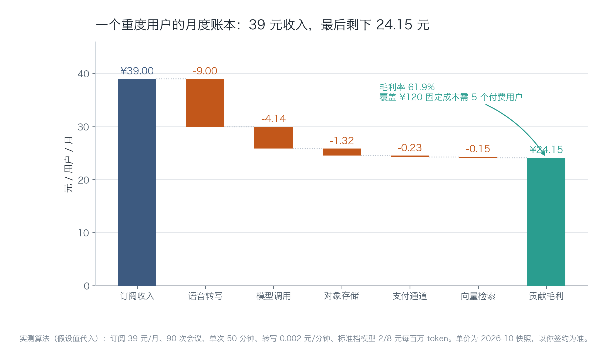
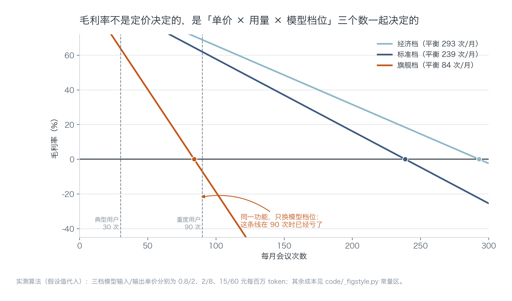
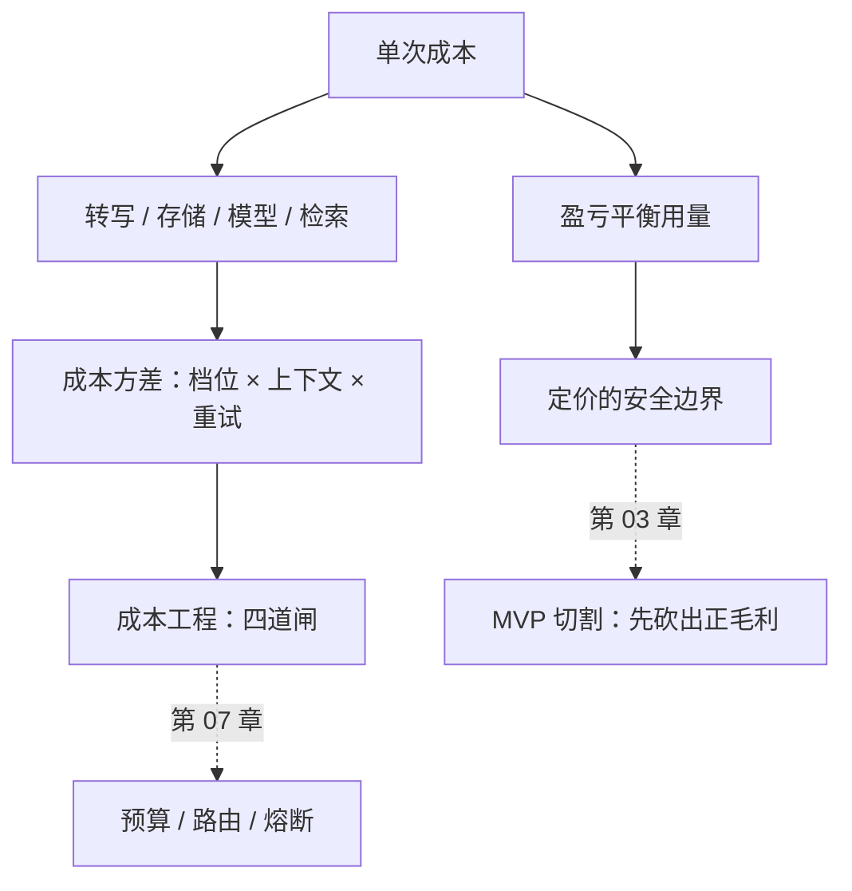

[English](./ch02-unit-economics.md) | **中文**

# 第 02 章：单位经济——把一次请求算到分

> **本章导读**：这一章只做一件事：把"一次 AI 请求要花多少钱"拆到每一分钱，然后回答三个问题——我的毛利是多少、我这个用量下会不会亏、哪个变量一动就会把毛利打穿。
> **前置知识**：第 01 章的四道门（尤其是②可计价单位）。
> **核心学习目标**：
> - 掌握单次请求成本的完整构成，能独立算出自己的单次成本与毛利率
> - 理解"成本方差"：同一功能换个实现，成本可以差一个数量级
> - 能用盈亏平衡与敏感性分析，找出真正该动的那个变量

---

## 1. 认知锚点：奶茶店老板算的不是"一杯卖 18 块"

### 1.1 一个真实的场景

你问奶茶店老板生意怎么样，他不会说"一杯卖 18，挺好"。他会说：奶 3.2、杯子 0.8、房租摊到每杯 4.1、平台抽 2.7、人工 3.5——一杯赚 3.7，一天卖 200 杯，扣掉水电损耗，一个月到手一万二。

卖产品的人和卖奶茶的人在算同一件事：**收入减掉"每多卖一份就要多花的那部分"，剩下的才是你能拿来养团队、投研发、交房租的钱。**

AI 产品最容易死在这里，因为它有一个特征：**边际成本不为零，而且波动极大**。传统软件多一个用户几乎不花钱，AI 产品多一个用户可能让你这个月亏两千——而你在看银行余额之前不会知道。

### 1.2 直觉类比：毛利的三个层次


**类比的边界**：奶茶店有库存和损耗，AI 产品有缓存和重试；结构相似，但 AI 产品的"损耗"（失败的调用、重试的请求、超长的上下文）往往比奶茶店的报废率高得多，而且不可见。

---

## 2. 第一性原理：一次请求的钱花在哪

### 2.1 成本的四层结构

先分清两类成本，这是后面所有计算的前提：

| 类型 | 定义 | 例子 | 特点 |
| :--- | :--- | :--- | :--- |
| **变动成本** | 每多服务一个单位就增加的成本 | 转写、模型 token、存储、支付手续费 | 随用量线性增长 |
| **固定成本** | 与用量基本无关的成本 | 域名、数据库基础规格、监控、邮箱 | 靠用户数摊薄 |

"服务器月租"这一项要小心：低用量时它是固定成本，高用量时数据库规格和带宽会跟着涨，它就在悄悄变成变动成本。判断方法很简单——**问一句"用户翻十倍，这笔钱会不会涨"**。

### 2.2 单次成本的逐项拆解

以「纪要助手」为例，一次 50 分钟的会议：

$$
C_{\text{单次}} = \underbrace{M \times p_{\text{asr}}}_{\text{转写}} + \underbrace{\frac{M \times s}{1024} \times p_{\text{store}}}_{\text{存储}} + \underbrace{\left(\frac{T_{\text{in}} p_{\text{in}} + T_{\text{out}} p_{\text{out}}}{10^6}\right)}_{\text{模型调用}} + \underbrace{e}_{\text{检索摊销}}
$$

逐项说明每个符号：

| 符号 | 含义 | 本例取值 |
| :--- | :--- | :--- |
| $M$ | 会议时长（分钟） | 50 |
| $p_{\text{asr}}$ | 转写单价（元/分钟） | 0.002 |
| $s$ | 音频体积（MB/分钟） | 1.0 |
| $p_{\text{store}}$ | 对象存储（元/GB/月） | 0.30 |
| $T_{\text{in}}$ / $T_{\text{out}}$ | 单次会议的输入 / 输出 token | 15000 / 2000 |
| $p_{\text{in}}$ / $p_{\text{out}}$ | 模型单价（元/百万 token） | 2.0 / 8.0 |
| $e$ | 向量检索摊销 | 0.0017 |

代入：转写 0.100 + 存储 0.015 + 模型 0.046 + 检索 0.002 ≈ **0.163 元/次**。

注意这里的量级差异：**转写占了六成，模型只占不到三成。** 这个结论和很多人的直觉相反——大家默认"AI 产品贵在 token"，但在长音频场景里，转写才是大头。这个发现会直接决定第 07 章该先动哪道闸。



*图 2-1：从上往下读——39 元进来，先被扣掉转写 9.00，再扣模型 4.14，一路扣到 24.15。这张图的作用是让你一眼看到"哪一根柱子最长"，而不是记住具体数字。*

### 2.3 毛利率与盈亏平衡

毛利率 = 贡献毛利 / 收入。它不是由定价单独决定的，而是三个数一起决定的：**单价 × 用量 × 单次成本**。

$$
\text{盈亏平衡用量} = \frac{P(1 - r_{\text{pay}})}{C_{\text{单次}}}
$$

其中 $P$ 是订阅价，$r_{\text{pay}}$ 是支付通道费率（本例 0.6%）。这个式子的含义很直白：你收到的钱（扣掉通道费）刚好够付变动成本时，就是平衡点；再往上每多一次会议，都是净亏。



*图 2-2：三条线对应三档模型单价。看三个地方——① 每条线与 0 的交点（平衡用量）；② 90 次那条竖线，旗舰档在这里已经跌到 −7.1%；③ 线的陡峭程度，它代表"用量每增加一次，毛利掉多少"。*

这张图最该记住的一句话：**同一个产品、同一个价格，只因为你选了更贵的模型，重度用户就从"赚 24 元"变成"亏 2.76 元"。** 这就是成本方差。

### 2.4 成本方差的三个来源

| 来源 | 机制 | 量级 |
| :--- | :--- | :--- |
| **模型档位** | 旗舰档的输入价是经济档的 18 倍 | 单次成本差 3—7 倍 |
| **上下文长度** | 无节制地把历史消息全文塞进去 | 长会话后期成本是开头的 5—10 倍 |
| **重试与失败** | 超时重试、解析失败重跑、用户重复点击 | 隐性放大 10%—50% |

前两个是设计问题，第三个是工程问题。三者叠加，就是为什么"预算表上的成本"和"账单上的成本"经常差三倍。

---

## 3. 手把手：把「纪要助手」算一遍

### 3.1 完整代码

```python
# code/ch02/unit_economics.py（节选，完整版见仓库）
PRICE = 39.0              # 订阅价，元/月
MEETING_MIN = 50
ASR_PER_MIN = 0.002
TOK_IN, TOK_OUT = 15_000, 2_000
TIERS = {"经济档": (0.8, 2.0), "标准档": (2.0, 8.0), "旗舰档": (15.0, 60.0)}

def cost_per_meeting(tier):
    pin, pout = TIERS[tier]
    llm = TOK_IN * pin / 1e6 + TOK_OUT * pout / 1e6
    asr = MEETING_MIN * ASR_PER_MIN
    storage = MEETING_MIN / 1024 * 0.30
    return asr + storage + llm + 0.0017
```

### 3.2 真实运行输出

```text
$ python code/ch02/unit_economics.py

=== 单位经济：三档模型 × 三个用量档 ===   （节选：经济档三行与部分对齐已略）
订阅 ¥39.0/月　单次 50 分钟　转写 ¥0.002/分钟　存储 ¥0.3/GB/月　支付 0.6%
模型单价（元/百万 token）：经济档 0.8/2.0　标准档 2.0/8.0　旗舰档 15.0/60.0

档位    用量      次数      变动成本      贡献毛利      毛利率      单次成本
标准档   轻度      10      1.86     37.14    95.2%     0.186
标准档   典型      30      5.10     33.90    86.9%     0.170
标准档   重度      90     14.85     24.15    61.9%     0.165

旗舰档   轻度      10      4.85     34.15    87.6%     0.485
旗舰档   典型      30     14.07     24.93    63.9%     0.469
旗舰档   重度      90     41.76     -2.76    -7.1%     0.464

=== 盈亏平衡（每月多少次会议开始亏） ===
经济档： 292.9 次/月
标准档： 238.8 次/月
旗舰档：  84.0 次/月　→ 重度用户已经越线

=== 敏感性：标准档 · 重度 90 次，各变量单独恶化 ===
模型单价 +20%                         毛利率  59.8%　（变化 -2.1 个百分点）
缓存命中率归零（输入 token +30%）            毛利率  59.9%　（变化 -2.1 个百分点）
单用户用量 +50%                        毛利率  43.2%　（变化 -18.7 个百分点）
```

### 3.3 三个结论，按重要性排序

**第一，用量是最强的变量。** 用量 +50% 让毛利率掉 18.7 个百分点，而模型单价涨 20% 只掉 2.1 个百分点。原因很简单：模型只占单次成本 28%，而用量直接乘在全部成本上。

这解释了一个常见困惑——"我把模型换成便宜的了，怎么还是亏？"因为你动的是小头。

**第二，跳档比涨价影响大得多。** 单价 +20% 几乎无感，但从标准档换到旗舰档（输入价 7.5 倍），重度用户直接从 +24.15 变成 −2.76。所以模型选型的正确做法是：**按任务分档，而不是全站统一一个模型**（第 07 章展开）。

**第三，固定成本要靠"用户数"摊，不是靠"用量"。** 单用户贡献毛利 24.15，固定成本 120 元/月，需要 5 个付费用户覆盖。这个数字很有用：它告诉你"第 6 个用户开始才是真赚"，也告诉你早期不要急着上更贵的监控和数据库规格。

### 3.4 这张表该怎么用在定价上

假设你要定 39 元/月，先反推：

1. 目标毛利率 ≥ 60% → 单用户变动成本 ≤ 15.6 元；
2. 标准档单次 0.163 元 → 每月最多 95 次会议；
3. 但重度用户是 90 次——**正好卡在边上，没有余量**。

所以定价 39 元配标准档是不够安全的。三个选项：定价 49（余量 40 次）、加一个 99 元的"畅享档"、或者把重度用户的成本压下来（缓存 + 路由）。**这三个选项对应三种完全不同的工作，先算清再选。**

---

## 4. 常见误区与正反例对比

| 容易踩坑的误区 | 为什么会出错 | 正确的心智模型与做法 |
| :--- | :--- | :--- |
| **"AI 产品成本就是 token 费"** | 在长音频、大文件、多轮检索场景，转写/存储/检索可能占七成 | 先把成本拆成四层逐项算，再谈优化。永远先找最大项 |
| **"按平均值算就够了"** | 平均值掩盖了分布。10% 的重度用户可能吃掉 60% 的成本 | 至少算三档用量（轻度/典型/重度），看最差那档是否为正 |
| **"毛利率 80% 很安全"** | 毛利率高但用量无上限时，一个异常用户就能吃掉几十个正常用户的利润 | 毛利率要配"用量上限"一起看；没有上限的高毛利是纸面数字 |
| **"先亏着做，规模上来成本会降"** | AI 的边际成本不会随规模下降（除非你自建推理），规模上来只会放大亏损 | 规模效应存在于固定成本，不存在于 token；先让单位经济为正 |
| **"缓存能省很多"** | 缓存收益取决于重复率。会议记录场景重复率低，命中率可能只有个位数 | 先测命中率，再决定要不要为缓存写代码（第 07 章） |

---

## 5. 本章小结与局部知识图谱

### 5.1 核心要点

- **单次成本 = 转写 + 存储 + 模型 + 检索**，每一项都要单独算，不能估总数。
- **毛利率由三个数共同决定**：单价、用量、单次成本。只调其中一个通常会失效。
- **用量是最强的杠杆**，因为它乘在全部成本上；模型单价的小幅波动影响很小。
- **跳档是断崖**：从标准档到旗舰档不是"贵一点"，是毛利结构改变。
- **盈亏平衡用量**是定价的安全边界，它应该写在定价文档里，而不是等月底看账单。

### 5.2 本章概念拓扑



---

## 6. 分级通关练习与参考解析

### 基础巩固题（Tier 1：直觉与概念核验）

1. 某产品订阅 29 元/月，单次成本 0.12 元，用户平均每月用 120 次。毛利率是多少？盈亏平衡用量是多少？如果你想把毛利率提到 70%，有哪三条路，各自的代价是什么？

2. 判断对错并说明理由："转写单价从 0.002 降到 0.0015，毛利率能从 61.9% 提到 70%。"

### 动手应用题（Tier 2：推演与实操构建）

3. 给你自己的产品建一张《单用户月成本表》，跑 10 / 100 / 1000 三个用量档。要求：每项成本都要写出单价来源（官网价目页 + 抓取日期）。

4. 修改 `unit_economics.py`，加入"缓存命中率"参数（命中时模型成本为零，但检索成本不变），画出命中率 0%—80% 的毛利率曲线。回答：命中率要到多少，才值得为缓存写代码？

### 深度挑战题（Tier 3：边界条件与跨章迁移）

5. 你的产品毛利率 75%，看起来健康。但数据显示：5% 的用户消耗了 55% 的 token。请分析这会造成什么后果，并给出三种应对方案及各自的副作用。

<details>
<summary><strong>点击展开：本章练习参考答案与深度解析</strong></summary>

#### 1. 毛利率与三条路

**毛利率**：单用户变动成本 = 120 × 0.12 = 14.4 元（暂不计通道费），贡献毛利 = 29 − 14.4 = 14.6，毛利率 = 50.3%。

**盈亏平衡用量**：29 / 0.12 ≈ 242 次/月。

**提到 70% 的三条路**：

| 路径 | 具体做法 | 代价 |
| :--- | :--- | :--- |
| 涨价 | 29 → 48 元 | 转化率下降；老用户可能流失；需要重新解释价值 |
| 降用量 | 设每月 150 次上限，超出按次计费 | 重度用户不满；计费复杂度上升；需要改产品与账单系统 |
| 降单次成本 | 0.12 → 0.072（降 40%） | 通常要换模型或改链路，质量可能下降；工程量最大 |

关键判断：**三条路里只有"降用量"能同时改善毛利与可预测性**，另外两条都是把风险转移到别处。

#### 2. 判断对错

**错。** 算一下：转写从 0.100 降到 0.075，单次成本从 0.163 降到 0.138。90 次时变动成本从 14.85 降到 12.6，贡献毛利 26.4，毛利率 67.7%——**离 70% 差 2.3 个百分点**。

这个练习的意义在于：直觉会高估单项降价的效果。要过 70%，还需要同时把模型成本降 15% 或把用量压到 80 次。

#### 3. 成本表的评分要点

- 每一项都有单价与来源日期（价格会变，来源是唯一能复核的东西）；
- 区分"每次成本"和"每月成本"，不要混着加；
- 包含支付通道费与存储增长（很多人漏掉存储，因为第一个月账单里它几乎为零）。

#### 4. 缓存曲线的做法与结论

把模型成本乘以 $(1 - h)$，$h$ 为命中率：

```python
cost = asr + storage + llm * (1 - h) + emb
```

在本例中，模型只占 28%，所以即使命中率 80%，毛利率也只从 61.9% 提到约 68%——**不到 7 个百分点**。而会议场景的重复率天然很低（每场会都不同），真实命中率可能只有 5%—10%。

结论：**这个产品不值得为缓存写代码**，除非你能证明重复率很高（例如同一场会被多人重复上传）。换成客服问答、文档问答这类高重复场景，结论就相反。这就是"先测命中率再动手"的意思。

#### 5. 5% 用户吃掉 55% token 的后果与对策

**后果**：平均值失真。你以为毛利率 75%，实际是"95% 的用户毛利 85%，5% 的用户毛利 −150%"。一旦这类用户占比上升（比如某个团队全员使用），整体毛利会断崖式下跌，而你在月度报表上看不出原因。

| 方案 | 做法 | 副作用 |
| :--- | :--- | :--- |
| 用量上限 + 超额计费 | 每月含 N 次，超出按次收 | 重度用户可能流失，但流失的是亏钱的用户 |
| 分档定价 | 基础/专业/团队三档，团队档含共享额度 | 需要做额度共享与统计，工程量中等 |
| 成本侧优化 | 对该群体启用路由与长文压缩 | 质量可能下降，需评估是否影响这批高价值用户 |

最差的做法是"什么都不做，指望平均值"——那等于用 95% 用户的利润补贴 5% 用户的滥用，直到补贴不起。

</details>

---

## 7. 本章权威参考信源与延伸阅读 (Authoritative References)

1. **The Twelve-Factor App**：[The Twelve-Factor App](https://12factor.net/) - 本章的定义与规范以此为锚（核验日期：`2026-10-23`）。
2. **Stripe Idempotent Requests**：[Stripe Idempotent Requests](https://stripe.com/docs/api/idempotent_requests) - 本章的定义与规范以此为锚（核验日期：`2026-10-23`）。
3. **DORA**：[DORA](https://dora.dev/) - 本章的定义与规范以此为锚（核验日期：`2026-10-23`）。

> 口径提示：以上信源用于锚定**定义与规范**，不用于外推风险概率。引用任何数字前，先核对来源年份与分母。
