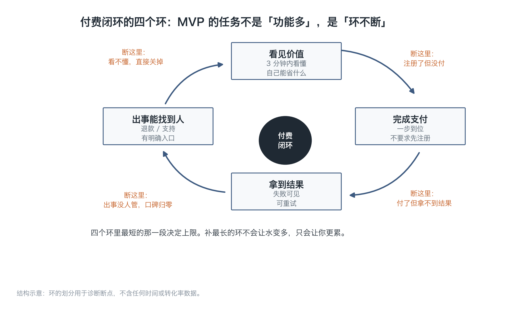
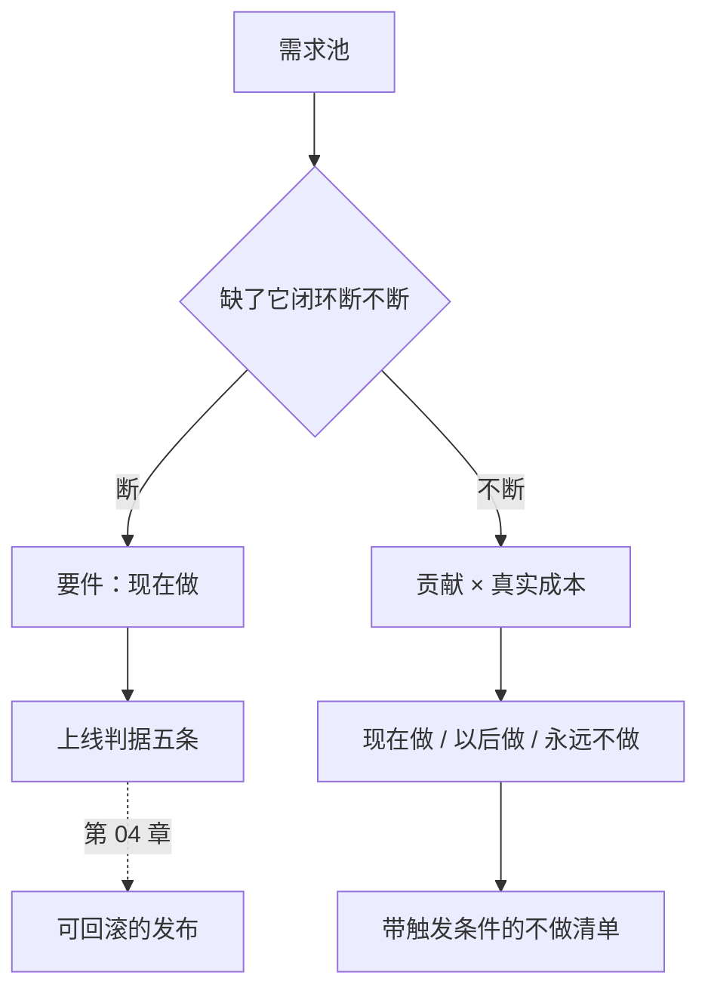

# 第 03 章：MVP 切割——故意不做的清单

> **本章导读**：第一版做多大，决定你多久能拿到真实反馈。本章给出一把尺子：只有"缺了它就没有付费闭环"的功能才算要件，其余全部进"故意不做"清单，并且每条都要写清触发条件。
> **前置知识**：第 01 章（四道门的③交付）、第 02 章（成本结构，因为它决定"贵不贵"）。
> **核心学习目标**：
> - 理解付费闭环的四个环，能用它判断一个功能是不是"要件"
> - 掌握"要件不看成本、非要件才看象限"的切割顺序
> - 能产出一张三栏表（现在做 / 以后做 / 永远不做），每条带触发条件

---

## 1. 认知锚点：先住进去，还是装完再住

### 1.1 一个装修的真实教训

装修最贵的错误，是"装完再住"。

你在图纸上把所有细节都想清楚了：这里做个柜子、那里留个插座、阳台改成书房。住进去第一周就发现：柜子挡住了插座，阳台下午西晒根本没法待，厨房动线要横穿客厅。

这些错误不是审美问题，是**信息不足**——你缺的不是设计能力，是"真的在里面生活一周"的经验。

软件一模一样。你在需求池里列的每一个功能，都是图纸上的柜子。真正的信息（用户到底怎么用、哪一步会卡、哪个功能根本没人点）只有在"有人付钱在用"之后才出现。


### 1.2 直觉类比：四环链条

付费闭环可以画成四个环，任何一个断开，钱就进不来：



*图 3-1：四个环首尾相接，最短的那一段决定上限。注意四个"断这里"的标注——它们是四种完全不同的失败，补法也完全不同。*

**类比的边界**：真实产品还有"留存环"（第二次使用）和"推荐环"，但那两个是上线之后才需要优化的，MVP 阶段盯着它们会把范围撑爆。

---

## 2. 第一性原理：什么才算"要件"

### 2.1 判据只有一条

> **缺了它，用户就无法完成"看见价值 → 付钱 → 拿到结果 → 出事能找到人"这条链。**

注意这条判据的关键词是"完成"，不是"体验好"。录音上传必须能转写（否则没有价值），但转写结果不需要排版精美（那是体验）。

按这条判据，「纪要助手」的要件只有三个：录音上传与转写、结构化纪要生成、订阅与支付。

- **导出 Word/PDF** 不是要件。用户能看见结果就算完成，导出是"拿走"的便利。
- **说话人分离** 不是要件。没有它，纪要里写"某人说"，有了它写"张三说"。价值更高，但闭环不依赖它。
- **团队共享** 不是要件。一个人用也能完成闭环。

### 2.2 要件不看成本，非要件才看象限

这是本章最重要的一条，也是最容易被工具误导的地方。

很多优先级工具会让你把所有功能放进"价值 × 成本"的四象限，然后从左上角开始做。这会犯一个致命错误：**把"贵但必需"的东西排到后面**。结构化纪要生成又贵又难，但缺了它就没有产品——它不该被象限否决。

正确的顺序是两步：

1. **先摘要件**：不看成本，只看"缺了它闭环断不断"。
2. **剩下的进象限**：用"贡献 × 真实成本"排序，决定做不做、什么时候做。


*图 3-2：右上角那一片（录音转写、结构化纪要）看着"贵"，但它们是要件，不受象限约束。象限真正的作用是处理中间那一片——行动项提取、说话人分离、自定义模板。*

### 2.3 真实成本 = 实现成本 + 维护成本 × 权重

很多功能不是"做不起"，是"养不起"。团队共享空间做起来两周，但之后的权限、同步、冲突处理会持续吃掉你每个版本的时间。

所以打分时要把维护成本折进去。本书用的权重是 0.4：

$$
C_{\text{真实}} = C_{\text{实现}} + 0.4 \times C_{\text{维护}}
$$

这个权重不是真理，是一个提醒：**维护成本至少要被计入，哪怕权重估错了，也比忽略强。**

### 2.4 范围蔓延的三个早期信号

范围蔓延不会以"我要加个功能"的形式出现，它长得更温和：

| 信号 | 原话 | 实际含义 |
| :--- | :--- | :--- |
| **"顺便"** | "既然都做了转写，顺便把翻译也加上吧" | 一个新链路，不是一个字段 |
| **"如果"** | "如果用户想改模板呢？如果他想分享给同事呢？" | 你在为想象中的用户写代码 |
| **"说明"** | 你开始为"还没做的功能"写说明或占位 | 你已经默认它要做，只是排期问题 |

三个信号出现任何一个，就该回到判据问一句：**缺了它，闭环断不断？** 不断，就写进清单，附触发条件。

---

## 3. 手把手：把 12 个需求砍到 4 个

### 3.1 运行打分器

```bash
$ python code/ch03/mvp_matrix.py
```

核心逻辑（完整版见仓库）：

```python
def bucket(essential, contribution, cost):
    if essential:
        return "现在做（闭环要件）"      # 要件不受象限约束
    if contribution >= 5 and cost < 5:
        return "现在做"
    if contribution >= 5:
        return "想清楚再做"
    if cost < 5:
        return "顺手就做"
    return "永远不做"
```

### 3.2 真实运行输出（节选）

```text
=== 功能清单（成本已按 0.4 权重折入维护成本）===
功能                要件        贡献      真实成本  结论
结构化纪要生成           是        9.6      10.8  现在做（闭环要件）
录音上传与转写           是        9.4       9.5  现在做（闭环要件）
订阅与支付             是        9.2       4.0  现在做（闭环要件）
行动项提取             —        8.6       7.6  想清楚再做
导出 Word / PDF     —        7.8       3.0  现在做
说话人分离             —        6.2       8.4  想清楚再做
自定义模板             —        5.6       6.6  想清楚再做
团队共享空间            —        5.0      11.6  想清楚再做
移动端 App           —        3.4      12.8  永远不做
日历自动入会            —        3.2       7.4  永远不做
多语言界面             —        2.6       6.0  永远不做
情绪与语气分析           —        1.4       9.6  永远不做

第一版范围：4 项；其中闭环要件 3 项
要件里有 2 项成本 ≥ 9：录音上传与转写、结构化纪要生成　—— 这就是为什么第一版必须砍掉一切非要件。
```

### 3.3 三个值得注意的地方

**第一，要件里有两项成本 ≥ 9。** 这意味着第一版的工程量有 80% 花在"必须做但不加分"的地方——这是正常的，不是效率低。想清楚这一点，你就不会因为"做了两个月只有一个功能"而焦虑。

**第二，导出 Word/PDF 进了"现在做"。** 它成本低（3.0）、贡献高（7.8），属于"顺手就做"的典型。这类功能要克制：单个便宜，十个加起来就是一个版本。

**第三，四个"永远不做"里，移动端 App 的成本最高（12.8）。** 它不是"以后再说"，是"以你现在的人力，做了就会死"。写进清单的意义是：以后有人提，你有依据回答，而不是每次重新纠结。

### 3.4 故意不做清单长什么样

清单的价值全在"触发条件"那一列。没有触发条件的清单，三个月后就会被"我觉得用户需要"推翻。

```text
- 行动项提取：想清楚再做；触发条件：用户访谈里出现 3 次以上「找不到谁负责什么」
- 说话人分离：想清楚再做；触发条件：付费用户中三人以上会议的占比超过 30%
- 自定义模板：想清楚再做；触发条件：同一用户连续三周手动修改输出格式
- 团队共享空间：想清楚再做；触发条件：出现第一个 5 人以上的付费团队
- 移动端 App：永远不做；触发条件：移动端访问占比超过 40% 且留存明显更高
```

注意触发条件的写法：**可观测、可计数、不需要你主观判断**。"用户需要"不是触发条件，"30% 的会议是三人以上"是。

### 3.5 上线判据（和范围一起写）

范围定完，紧接着要写"什么条件下允许开放付费"。这是五条，缺一条就不要开：

1. 付费闭环四环全通，且你自己走过一遍完整流程（用真实支付，不是测试模式）。
2. 单位经济为正：最差用量档的毛利率 > 0（第 02 章）。
3. 有一条能回滚的发布路径，且演练过一次（第 04 章）。
4. 出事时用户能找到你：至少一个邮箱 + 一个页面说明退款政策。
5. 写清"这个版本不做什么"，并放在用户能看到的地方。

第 5 条经常被忽略。它同时解决两个问题：降低预期（减少"为什么没有 XX 功能"的工单），以及给自己留退路（缺口是公开的，不是隐瞒的）。

---

## 4. 常见误区与正反例对比

| 容易踩坑的误区 | 为什么会出错 | 正确的心智模型与做法 |
| :--- | :--- | :--- |
| **"功能越多，越多人买"** | 购买决策看的是"能不能解决我的问题"，功能多反而增加选择成本与维护负担 | 第一版只保证闭环不断；功能数量与付费意愿没有正相关 |
| **"先把简单的做完，难的以后做"** | 难的那部分往往就是要件（核心算法、支付、合规），推迟它等于推迟验证 | 先摘要件，再在非要件里按象限排序 |
| **"用户说要，那就做"** | 用户说的是方案，不是问题。他要的是"找到谁负责什么"，不是"行动项提取"这个功能 | 把需求翻译回问题，再判断有没有更便宜的解法 |
| **"MVP 就是功能少的版本"** | 功能少但闭环断了，不叫 MVP，叫半成品 | MVP 的判据是闭环完整，不是功能数量少 |
| **"清单写了就不用管了"** | 没有触发条件的清单会被情绪推翻 | 每条都写可计数的触发条件，并定期回看数据 |

---

## 5. 本章小结与局部知识图谱

### 5.1 核心要点

- **MVP 的判据是"付费闭环完整"**，不是"功能数量少"。
- **先摘要件，再看象限**：要件不受成本约束，象限只处理"锦上添花"。
- **真实成本 = 实现 + 0.4 × 维护**：养不起的功能，做起来就是负债。
- **范围蔓延的信号是"顺便""如果""说明"**，出现就该回到判据。
- **"故意不做"必须带可计数的触发条件**，否则三个月后就会被推翻。

### 5.2 本章概念拓扑



---

## 6. 分级通关练习与参考解析

### 基础巩固题（Tier 1：直觉与概念核验）

1. 判断下面五个功能对「纪要助手」是不是要件，各写一句话理由：语音降噪、模板选择、发票申请、密码重置、用量统计。

2. 判断对错并说明理由："把维护成本折进真实成本，会让所有功能都变得不值得做。"

### 动手应用题（Tier 2：推演与实操构建）

3. 把你的需求池（至少 10 项）填进三栏表，每项给出贡献分、真实成本分、结论、触发条件。要求：要件单独标注，并说明为什么。

4. 修改 `mvp_matrix.py`，把维护权重从 0.4 改成 0.2 和 0.6，各跑一次。观察哪些功能的结论发生了翻转，并解释翻转的合理性。

### 深度挑战题（Tier 3：边界条件与跨章迁移）

5. 你的第一版砍掉了"说话人分离"，上线两个月后，30% 的付费用户是三四人会议。触发条件命中了，但实现它需要三周，而你现在正在处理一个稳定性问题。请给出你的决策过程，并说明你会怎么向用户解释。

<details>
<summary><strong>点击展开：本章练习参考答案与深度解析</strong></summary>

#### 1. 要件判断

| 功能 | 是否要件 | 理由 |
| :--- | :--- | :--- |
| 语音降噪 | **否** | 闭环不依赖音质完美；转写质量差是体验问题，可以在说明里写清"建议安静环境" |
| 模板选择 | **否** | 固定一套模板也能交付结果；模板是"更好用"，不是"能不能用" |
| 发票申请 | **是（若面向企业）** | 企业采购没有发票就无法付款，闭环在"付钱"这一环断掉 |
| 密码重置 | **是** | 用户忘密码就进不去，闭环在第一步断掉。这类"基础设施型"功能最容易被当成细节漏掉 |
| 用量统计 | **否** | 用户不看统计也能用完；但它是"防止超额投诉"的必需品，属于运营工具而非产品功能 |

这里最值得记住的是"密码重置"——它便宜、无聊、却经常被漏掉，然后在第一周就造成大量支持工单。

#### 2. 判断对错

**错，但错得有价值。** 折入维护成本会让一些功能从"现在做"掉到"想清楚再做"，这正是它的作用：**逼你面对长期负担**。它不会让所有功能都变得不值得做，因为要件的判断在成本之前——要件再贵也做。

如果真的出现"所有功能都不值得做"，说明你的权重或评分尺度失真了（比如把维护成本都打了 9 分），该校准的是分数，不是结论。

#### 3. 三栏表的评分要点

合格的表能通过一个测试：**把表给一个不了解你产品的人看，他能不能说出"为什么这个不做"**。说不出来，说明触发条件写得不够具体。

#### 4. 权重翻转实验

在 0.2 权重下，团队共享空间（8.8 + 0.2×7 = 10.2）仍然超线，说明它的实现成本本身就高，权重不是决定因素。在 0.6 权重下，说话人分离（6.8 + 2.4 = 9.2）和自定义模板（5.4 + 1.8 = 7.2）都会更靠后。

翻转的合理性判断标准：**这个功能的维护成本是不是真的会随版本累积？** 团队共享空间会（权限、同步、冲突），而导出 PDF 不会（格式稳定）。所以对前者提高权重是合理的，对后者提高则是过度保守。

#### 5. 触发条件命中但排不进去

决策过程应该分三步，并且写下来：

1. **先算它值多少钱**：30% 的付费用户、假设 60 个付费用户 → 18 人受影响。如果这 18 人的月流失率因此高 10%，等于每月少 1.8 个用户 × 24 元贡献毛利 ≈ 43 元/月。三周的工程量换 43 元/月的止损，明显不划算。
2. **再找便宜替代**：能不能在纪要里加一句"多人会议建议手动标注发言人"？成本一天，能挡住一部分抱怨。
3. **最后排期**：等稳定性问题解决后再做，时间点写进路线图，公开给用户。

对用户的解释要具体、有日期、不含糊：

> "多人会议的发言人区分在做，预计 11 月中上线。在那之前，建议在会议开始时让每位发言人自报姓名，转写结果里会保留。给你带来不便，抱歉。"

这句话包含三个要素：**承认问题、给出时间、给出临时方案**。缺任何一个，用户都会觉得你在敷衍。

</details>

---

## 7. 本章权威参考信源与延伸阅读 (Authoritative References)

1. **martinfowler.com**：[martinfowler.com](https://martinfowler.com/) - 本章的定义与规范以此为锚（核验日期：`2026-10-23`）。
2. **The Twelve-Factor App**：[The Twelve-Factor App](https://12factor.net/) - 本章的定义与规范以此为锚（核验日期：`2026-10-23`）。
3. **Semantic Versioning 2.0.0**：[Semantic Versioning 2.0.0](https://semver.org/) - 本章的定义与规范以此为锚（核验日期：`2026-10-23`）。

> 口径提示：以上信源用于锚定**定义与规范**，不用于外推风险概率。引用任何数字前，先核对来源年份与分母。
