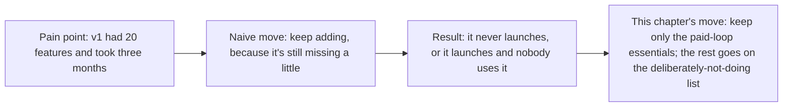
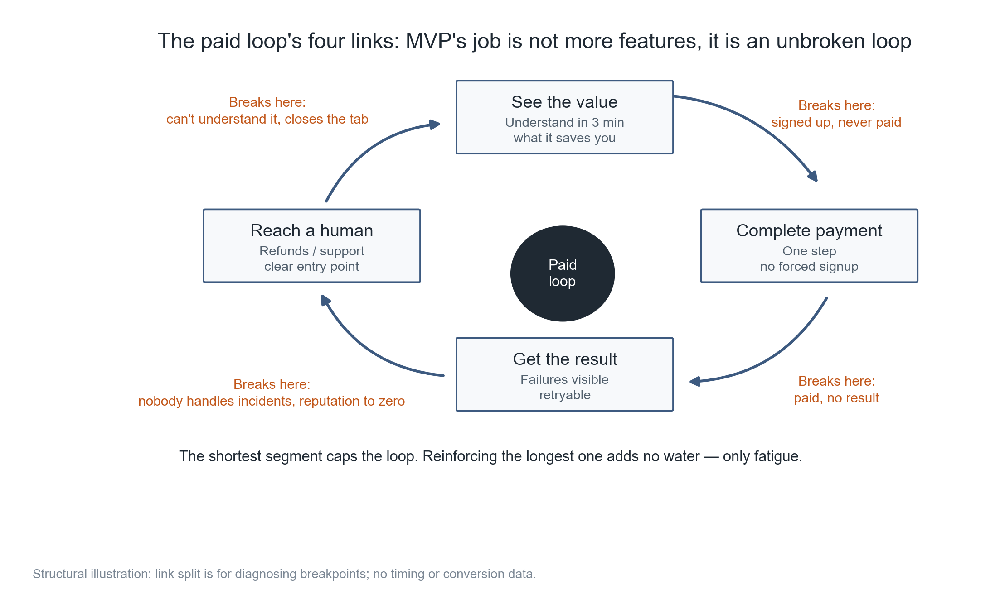
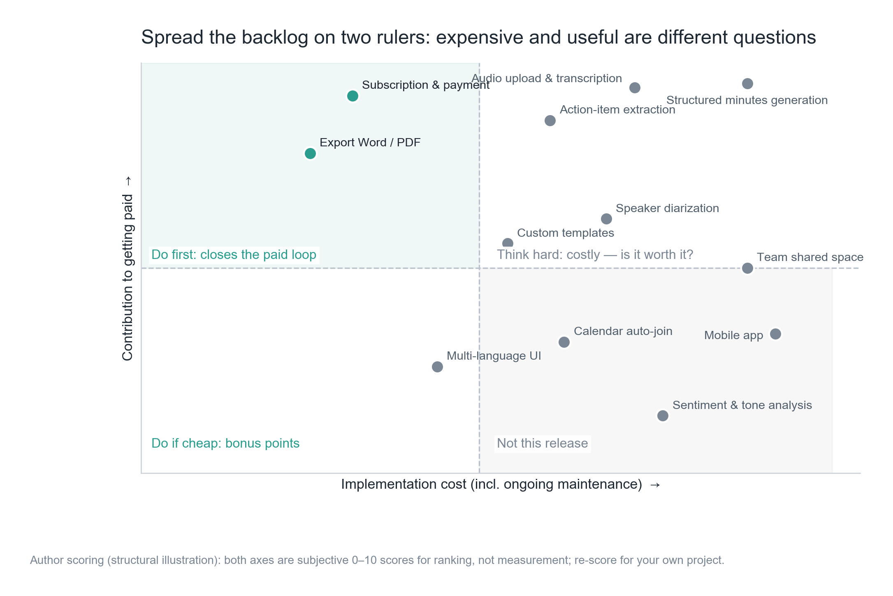
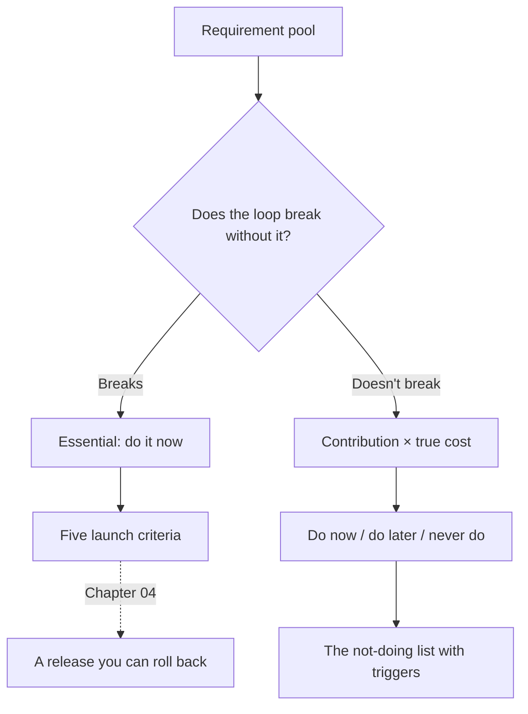

**English** | [中文](./ch03-mvp-scope.zh.md)

# Chapter 03: MVP Slicing — The List of Things You Deliberately Won't Do

> **Chapter guide**: How big the first version is decides how soon you get real feedback. This chapter gives you a gauge: only features whose absence breaks the paid loop count as essentials; everything else goes on the "deliberately not doing" list, and every item must state its trigger condition.
> **Prerequisites**: Chapter 01 (gate (3), delivery), Chapter 02 (cost structure, because it decides "is it expensive").
> **Core learning objectives**:
> - Understand the four links of the paid loop, and use it to judge whether a feature is an "essential"
> - Master the slicing order of "essentials do not look at cost; only non-essentials go to the quadrant"
> - Be able to produce a three-column table (now / later / never), each row with a trigger condition

---

## 1. Cognitive Anchor: Move In First, or Finish Decorating First

### 1.1 A Real Renovation Lesson

The most expensive mistake in renovation is "finish decorating, then move in".

You thought through every detail on the blueprint: build a cabinet here, leave a socket there, turn the balcony into a study. The first week living in it you discover: the cabinet blocks the socket, the balcony gets the western sun and is unusable in the afternoon, and the kitchen path cuts right across the living room.

These are not aesthetic problems; they are **insufficient information** — what you lacked was not design skill but the experience of "actually living in it for a week".

Software is exactly the same. Every feature you list in the requirement pool is a cabinet on the blueprint. The real information (how users actually use it, which step gets stuck, which feature nobody ever clicks) only appears after "someone is paying to use it".



### 1.2 Intuitive Analogy: The Four-Link Chain

The paid loop can be drawn as four links; if any one of them breaks, no money comes in:



*Figure 3-1: The four links connect head to tail; the shortest one sets the ceiling. Note the four "breaks here" annotations — they are four completely different failures, and the fixes are completely different too.*

**The boundary of this analogy**: real products also have a "retention loop" (second use) and a "referral loop", but those two only need optimizing after launch; watching them at the MVP stage blows the scope up.

---

## 2. First Principles: What Counts as an "Essential"

### 2.1 There Is Only One Criterion

> **Without it, the user cannot complete the chain "see the value → pay → get the result → find someone when something goes wrong".**

Note the keyword in this criterion is "complete", not "well-experienced". Recording upload must transcribe (otherwise there is no value), but the transcript result does not need beautiful typesetting (that is experience).

By this criterion the "Minutes" assistant has only three essentials: recording upload and transcription, structured minutes generation, subscription and payment.

- **Export to Word/PDF** is not an essential. The user completes the loop by seeing the result; export is the convenience of "taking it away".
- **Speaker diarization** is not an essential. Without it the minutes write "someone said"; with it they write "Zhang San said". The value is higher, but the loop does not depend on it.
- **Team sharing** is not an essential. One person using it completes the loop too.

### 2.2 Essentials Do Not Look at Cost; Only Non-Essentials Look at the Quadrant

This is the most important rule in this chapter, and the place where tools most easily mislead you.

Many prioritization tools will have you put all features into the "value × cost" four quadrants and start from the top-left. This makes a fatal mistake: **scheduling "expensive but essential" things to later**. Structured minutes generation is expensive and hard, but without it there is no product — it must not be vetoed by the quadrant.

The correct order has two steps:

1. **First pull out the essentials**: do not look at cost, only at "does its absence break the loop".
2. **The rest goes into the quadrant**: rank by "contribution × real cost", deciding whether to build it and when.



*Figure 3-2: The top-right patch (recording transcription, structured minutes) looks "expensive", but they are essentials and not bound by the quadrant. The quadrant's real job is the middle patch — action item extraction, speaker diarization, custom templates.*

### 2.3 Real Cost = Implementation Cost + Maintenance Cost × Weight

Many features are not "unaffordable to build" but "unaffordable to keep". Team shared space takes two weeks to build, but afterwards permissions, sync, and conflict handling keep eating time from every one of your releases.

So maintenance cost must be folded into the score. The weight this book uses is 0.4:

$$
C_{\text{true}} = C_{\text{implementation}} + 0.4 \times C_{\text{maintenance}}
$$

This weight is not truth; it is a reminder: **maintenance cost must at least be counted; even if the weight is estimated wrong, that beats ignoring it.**

### 2.4 Three Early Signals of Scope Creep

Scope creep does not appear in the form of "I want to add a feature"; it looks gentler:

| Signal | The words | What it really means |
| :--- | :--- | :--- |
| **"While we are at it"** | "Since we already do transcription, let us add translation too" | A new pipeline, not a new field |
| **"What if"** | "What if users want to change templates? What if they want to share with colleagues?" | You are writing code for imaginary users |
| **"Docs"** | You start writing docs or placeholders for "features not built yet" | You have already assumed it will be built; it is only a scheduling question |

If any of the three signals appears, go back to the criterion and ask one question: **without it, does the loop break?** If not, write it on the list, with a trigger condition.

---

## 3. Hands-on: Cutting 12 Requirements Down to 4

### 3.1 Run the Scorer

```bash
$ python code/ch03/mvp_matrix.py
```

Core logic (full version in the repo):

```python
def bucket(essential, contribution, cost):
    if essential:
        return "现在做（闭环要件）"      # 要件不受象限约束
    if contribution >= 5 and cost < 5:
        return "现在做"
    if contribution >= 5:
        return "想清楚再做"
    if cost < 5:
        return "顺手就做"
    return "永远不做"
```

### 3.2 Real Run Output (Excerpt)

```text
=== 功能清单（成本已按 0.4 权重折入维护成本）===
功能                要件        贡献      真实成本  结论
结构化纪要生成           是        9.6      10.8  现在做（闭环要件）
录音上传与转写           是        9.4       9.5  现在做（闭环要件）
订阅与支付             是        9.2       4.0  现在做（闭环要件）
行动项提取             —        8.6       7.6  想清楚再做
导出 Word / PDF     —        7.8       3.0  现在做
说话人分离             —        6.2       8.4  想清楚再做
自定义模板             —        5.6       6.6  想清楚再做
团队共享空间            —        5.0      11.6  想清楚再做
移动端 App           —        3.4      12.8  永远不做
日历自动入会            —        3.2       7.4  永远不做
多语言界面             —        2.6       6.0  永远不做
情绪与语气分析           —        1.4       9.6  永远不做

第一版范围：4 项；其中闭环要件 3 项
要件里有 2 项成本 ≥ 9：录音上传与转写、结构化纪要生成　—— 这就是为什么第一版必须砍掉一切非要件。
```

### 3.3 Three Things Worth Noting

**First, two of the essentials cost ≥ 9.** This means 80% of the first version's engineering goes into "must build but adds no points" — that is normal, not inefficiency. Once this is clear, you will not be anxious about "two months of work and only one feature".

**Second, export to Word/PDF landed in "do now".** It is cheap (3.0) with high contribution (7.8), the typical "do it while you are there". Be restrained with this kind of feature: one is cheap, ten add up to a whole release.

**Third, among the four "never" items, the mobile app costs the most (12.8).** It is not "later", it is "with your current headcount, building it kills you". Writing it on the list means: when someone raises it later, you have grounds to answer, instead of agonizing again every time.

### 3.4 What the Deliberate-Not-Doing List Looks Like

The list's value is all in the "trigger condition" column. A list without trigger conditions gets overturned three months later by "I think users need it".

```text
- 行动项提取：想清楚再做；触发条件：用户访谈里出现 3 次以上「找不到谁负责什么」
- 说话人分离：想清楚再做；触发条件：付费用户中三人以上会议的占比超过 30%
- 自定义模板：想清楚再做；触发条件：同一用户连续三周手动修改输出格式
- 团队共享空间：想清楚再做；触发条件：出现第一个 5 人以上的付费团队
- 移动端 App：永远不做；触发条件：移动端访问占比超过 40% 且留存明显更高
```

Note how trigger conditions are written: **observable, countable, not requiring your subjective judgment**. "Users need it" is not a trigger condition; "30% of meetings have three or more people" is.

### 3.5 Launch Criteria (Written Alongside the Scope)

Once the scope is settled, next write "under what conditions is opening payments allowed". There are five; do not open if any one is missing:

1. All four links of the paid loop work, and you have walked the complete flow yourself (with real payments, not test mode).
2. Unit economics are positive: the worst usage tier's gross margin > 0 (Chapter 02).
3. There is a release path you can roll back, and it has been drilled once (Chapter 04).
4. When something goes wrong users can reach you: at least one email + one page explaining the refund policy.
5. Write down clearly "what this version does not do", and put it where users can see it.

Item 5 is often ignored. It solves two problems at once: lowering expectations (fewer "why is there no XX feature" tickets), and leaving yourself an escape route (the gap is public, not concealed).

---

## 4. Common Misconceptions and Correct/Incorrect Contrasts

| Easy pitfall | Why it goes wrong | The right mental model and practice |
| :--- | :--- | :--- |
| **"More features, more buyers"** | The purchase decision looks at "can it solve my problem"; more features add choice cost and maintenance burden | The first version only guarantees the loop stays unbroken; feature count has no positive correlation with willingness to pay |
| **"Do the easy ones first, hard ones later"** | The hard part is usually the essential (core algorithm, payment, compliance); deferring it defers validation | Pull out the essentials first, then rank the non-essentials by quadrant |
| **"The user asked for it, so build it"** | The user is stating a solution, not a problem. What they want is "find who is responsible for what", not the "action item extraction" feature | Translate the requirement back into the problem, then judge whether there is a cheaper solution |
| **"MVP just means a version with few features"** | Few features but a broken loop is not an MVP, it is a half-product | The MVP criterion is a complete loop, not a small feature count |
| **"Once written, the list needs no attention"** | A list without trigger conditions gets overturned by emotion | Write a countable trigger condition for each item, and review the data regularly |

---

## 5. Chapter Summary and Local Knowledge Graph

### 5.1 Key Points

- **The MVP criterion is "the paid loop is complete"**, not "few features".
- **Pull out the essentials first, then look at the quadrant**: essentials are not bound by cost; the quadrant only handles the "nice-to-haves".
- **Real cost = implementation + 0.4 × maintenance**: a feature you cannot afford to keep is a liability once built.
- **The signals of scope creep are "while we are at it", "what if", "docs"** — when they appear, go back to the criterion.
- **"Deliberately not doing" must carry countable trigger conditions**, otherwise it gets overturned three months later.

### 5.2 Concept Topology of This Chapter



---

## 6. Tiered Exercises and Reference Solutions

### Basic Consolidation (Tier 1: Intuition and Concept Check)

1. Judge whether the following five features are essentials for the "Minutes" assistant, with one sentence of reasoning each: voice noise reduction, template selection, invoice requests, password reset, usage statistics.

2. Judge whether this is true or false and explain why: "Folding maintenance cost into real cost makes every feature not worth building."

### Applied Practice (Tier 2: Reasoning and Hands-on Construction)

3. Fill your requirement pool (at least 10 items) into the three-column table, giving each item a contribution score, real cost score, conclusion, and trigger condition. Requirement: mark the essentials separately and explain why.

4. Modify `mvp_matrix.py`, change the maintenance weight from 0.4 to 0.2 and 0.6, and run each once. Observe which features' conclusions flip, and explain whether the flips are reasonable.

### Deep Challenge (Tier 3: Boundary Conditions and Cross-Chapter Transfer)

5. Your first version cut "speaker diarization". Two months after launch, 30% of paying users are in three- or four-person meetings. The trigger condition is hit, but implementing it takes three weeks, and you are currently handling a stability problem. Give your decision process, and explain how you would explain it to users.

<details>
<summary><strong>Click to expand: reference answers and in-depth analysis for this chapter's exercises</strong></summary>

#### 1. Judging Essentials

| Feature | Is it an essential? | Reason |
| :--- | :--- | :--- |
| Voice noise reduction | **No** | The loop does not depend on perfect audio quality; poor transcription quality is an experience issue, which can be covered by writing "quiet environment recommended" in the docs |
| Template selection | **No** | A single fixed template also delivers results; templates are "nicer to use", not "usable or not" |
| Invoice requests | **Yes (if selling to companies)** | Corporate purchasing cannot pay without an invoice; the loop breaks at the "pay" link |
| Password reset | **Yes** | A user who forgets their password cannot get in; the loop breaks at the first step. This kind of "infrastructure" feature is most easily missed as a detail |
| Usage statistics | **No** | Users can finish using it without looking at statistics; but it is a necessity for "preventing overage complaints", an operations tool rather than a product feature |

The one most worth remembering here is "password reset" — cheap, boring, and often missed, then causing a flood of support tickets in the first week.

#### 2. True or False

**Wrong, but the wrongness is valuable.** Folding in maintenance cost drops some features from "do now" to "think it through first", which is exactly its job: **forcing you to face the long-term burden**. It does not make every feature unworthy, because the essential judgment comes before cost — however expensive, an essential gets built.

If "no feature is worth building" really happens, it means your weight or scoring scale is distorted (say you scored maintenance cost 9 for everything); what needs calibrating is the score, not the conclusion.

#### 3. Scoring Points for the Three-Column Table

A passing table can survive one test: **show the table to someone who does not know your product — can they say "why is this one not built"**. If they cannot, the trigger conditions are not specific enough.

#### 4. The Weight-Flip Experiment

At weight 0.2, team shared space (8.8 + 0.2×7 = 10.2) still crosses the line, showing that its implementation cost is inherently high and the weight is not the deciding factor. At weight 0.6, speaker diarization (6.8 + 2.4 = 9.2) and custom templates (5.4 + 1.8 = 7.2) both move further back.

The criterion for judging a flip's reasonableness: **will this feature's maintenance cost really accumulate across releases?** Team shared space will (permissions, sync, conflicts), while PDF export will not (stable format). So raising the weight for the former is reasonable; for the latter it is over-conservative.

#### 5. Trigger Hit but No Room in the Schedule

The decision process should have three steps, and be written down:

1. **First calculate what it is worth**: 30% of paying users, assuming 60 paying users → 18 people affected. If those 18 people's monthly churn rate is 10% higher because of this, that equals 1.8 fewer users per month × 24 yuan contribution margin ≈ 43 yuan/month. Three weeks of engineering to stop a loss of 43 yuan/month is clearly not worth it.
2. **Then find a cheap substitute**: can we add one line to the minutes saying "for multi-person meetings we suggest manually labeling speakers"? It costs one day, and blocks part of the complaints.
3. **Schedule last**: build it after the stability problem is solved; write the time point into the roadmap and make it public to users.

The explanation to users must be specific, dated, and unambiguous:

> "Speaker distinction for multi-person meetings is in progress and expected to launch in mid-November. Until then, we suggest having each speaker state their name at the start of the meeting, which the transcript will preserve. Sorry for the inconvenience."

This sentence contains three elements: **acknowledge the problem, give a time, give a workaround**. Missing any one, users will feel you are brushing them off.

</details>

---

## 7. Authoritative Sources and Further Reading (Authoritative References)

1. **martinfowler.com**: [martinfowler.com](https://martinfowler.com/) - the definitions and norms of this chapter are anchored here (verification date: `2026-10-23`).
2. **The Twelve-Factor App**: [The Twelve-Factor App](https://12factor.net/) - the definitions and norms of this chapter are anchored here (verification date: `2026-10-23`).
3. **Semantic Versioning 2.0.0**: [Semantic Versioning 2.0.0](https://semver.org/) - the definitions and norms of this chapter are anchored here (verification date: `2026-10-23`).

> Measurement note: the sources above are used to anchor **definitions and norms**, not to extrapolate risk probabilities. Before quoting any number, check the source's year and its denominator.
