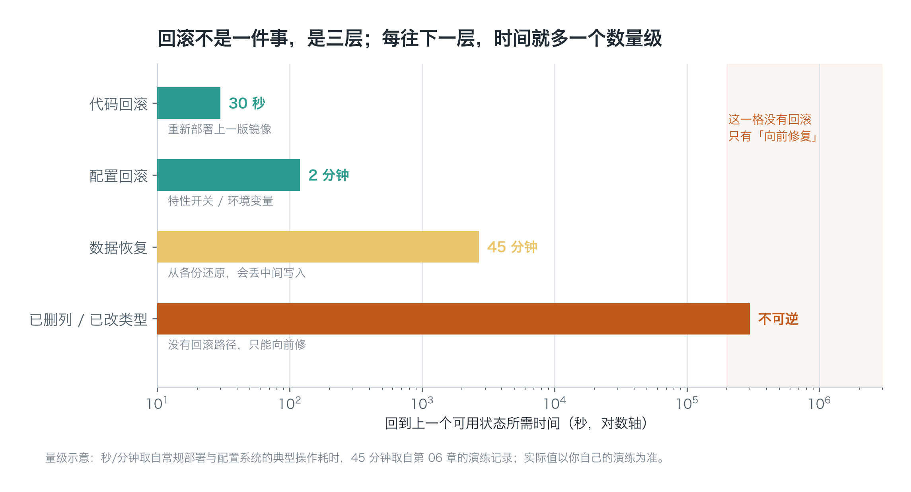
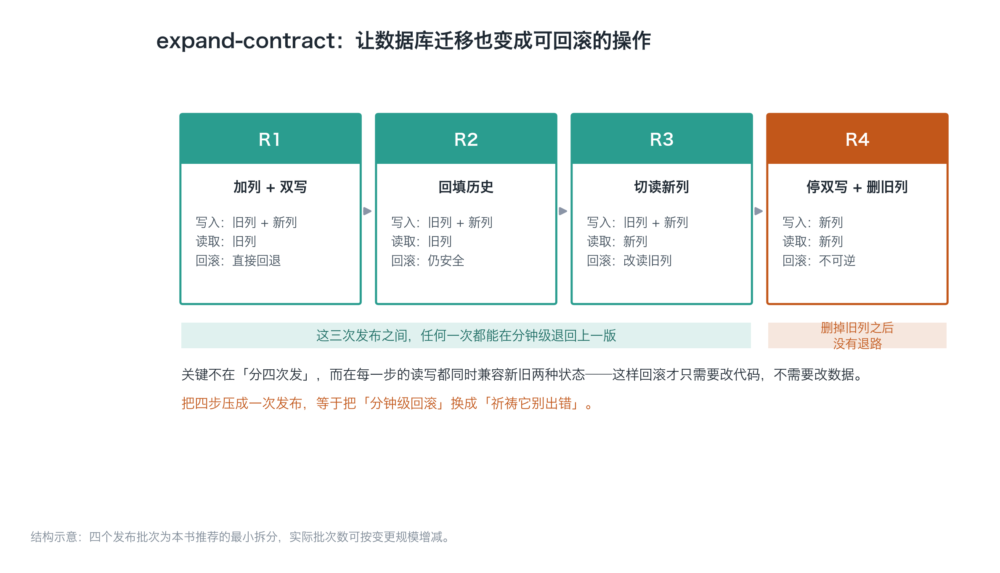
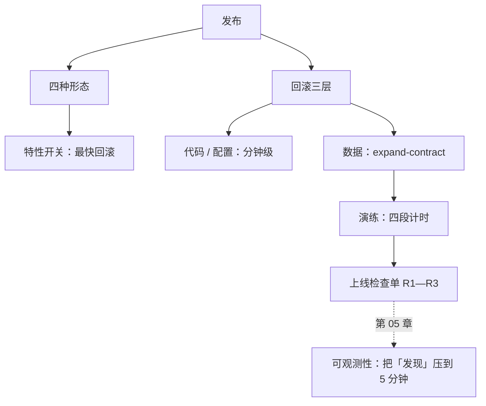

# 第 04 章：发布与回滚——回滚是练出来的

> **本章导读**：上线能力不是"能部署"，是"能退回去"。本章把回滚拆成三层（代码、配置、数据），指出真正的难点在数据库迁移，并给出一套四步迁移法与一次真实演练的判定表。
> **前置知识**：第 03 章（范围锁定——不知道哪些功能必须保住，就没法设计回滚）。
> **核心学习目标**：
> - 掌握四种发布形态的代价，能为一个人的项目选出正确的那一种
> - 理解"代码可回滚、数据不可回滚"，能独立设计 expand-contract 迁移
> - 能执行一次回滚演练，并用四段耗时判断这套流程是否可写进检查单

---

## 1. 认知锚点：登山绳不是用来爬的

### 1.1 一个 22 分钟的下午

14:02，你把一个新版本推上线。改动很小：给纪要表加了一个"摘要版本"字段，顺手改了一处读取逻辑。

14:11，第一个用户发来消息："我的纪要变成空白了。"

你打开日志，发现新逻辑在遇到旧数据时返回了空。更要命的是，你为了"保持整洁"，在同一次发布里把旧字段的读取代码删掉了。

14:19，你决定回滚。`git revert` 很顺利，镜像部署也很快。但回滚之后，那 9 分钟里写入的用户数据仍然是空摘要——**代码退回去了，数据没有。**

14:24，你手动补了三条数据，给三个用户道了歉。总计 22 分钟，损失可控。

但真正的问题不是这 22 分钟，是你在 14:19 那一刻才发现：**你从来没有演练过回滚。** 你只是假设它能用。


### 1.2 直觉类比：安全绳与安全带

登山绳带在身上，是希望永远不用。没带的人不叫勇敢，叫没算过账——因为他把"这次不会掉"当成了规划的一部分。

软件里的安全绳有两个特征，和登山绳一样：

- **它必须在你出发前就装好**，出事时再找绳子来不及；
- **它必须被检查过**，一根放了三年没打开的绳子，你不知道它有没有霉。

**类比的边界**：登山绳断了你就没了，软件回滚失败通常还能"向前修"。但向前修的时间成本往往比回滚大一个数量级，而且是在用户注视下修。

---

## 2. 第一性原理：回滚的三层与四种发布

### 2.1 回滚不是一件事，是三层



*图 4-1：横轴是对数刻度，注意每一层之间差一个数量级。最右边那根红色柱子是本图最重要的一格——它不是"很慢"，是"没有这条路"。*

| 层 | 回滚对象 | 典型耗时 | 前提 |
| :--- | :--- | :--- | :--- |
| 代码 | 上一版镜像 / 上一版构建产物 | 30 秒—2 分钟 | 镜像还在，且部署可重放 |
| 配置 | 特性开关、环境变量、路由规则 | 1—3 分钟 | 配置与代码分离，且有版本 |
| 数据 | 已写入的行、已删除的列、已改的类型 | 分钟到小时，或不可逆 | 有备份，或迁移本身前向兼容 |

绝大多数"回滚方案"只覆盖第一层。这就是为什么很多团队"回滚成功"之后问题还在——因为坏数据已经写进去了。

### 2.2 四种发布形态，一个人该选哪种

| 形态 | 机制 | 回滚速度 | 代价 | 适合谁 |
| :--- | :--- | :--- | :--- | :--- |
| 整包替换 | 停旧起新 | 慢（要重新部署） | 最低 | 单机、低流量、能接受短暂中断 |
| 蓝绿 | 两套环境切流量 | 快（切回即可） | 双倍资源 | 有一定流量、要求零中断 |
| 金丝雀 | 先给 5% 流量 | 快（撤掉小流量） | 需要流量切分能力 | 有真实流量且能分群 |
| 特性开关 | 代码先上，功能后开 | 最快（关开关） | 代码里长期留着分支 | **独立开发者首选** |

对一个人做的产品，**特性开关是性价比最高的一层**。它把"回滚"从一次部署变成一次配置修改，把风险窗口从分钟级压到秒级。

代价是代码里会有 `if (featureEnabled('summary_v2'))` 这种分支。管理它的规则很简单：**开关必须在上线后两周内删掉**，否则一年后你会有一棵永远测不全的分支树。

### 2.3 真正的难点：数据库迁移

代码可以退回上一版，数据不能。一条 `ALTER TABLE ... DROP COLUMN` 执行完，旧版本代码就再也读不到那列数据了。

所以迁移的正确做法是把它拆成四次发布，让**每一个中间状态都同时兼容新旧两版代码**。这个方法叫 expand-contract：



*图 4-2：注意前三步的"读取"列——它一直读旧列，直到第三步才切。这个"慢"是故意的：它保证任何时刻回滚，旧代码都能读到完整数据。*

具体到「纪要助手」的字段升级：

```sql
-- R1：加列 + 双写（旧代码不受影响，新代码开始写两份）
ALTER TABLE meetings ADD COLUMN summary_v2 JSONB;
-- 应用层：写入时同时写 summary 和 summary_v2

-- R2：回填历史（可分批，可中断，可重跑）
UPDATE meetings SET summary_v2 = to_jsonb(summary)
WHERE summary_v2 IS NULL AND id BETWEEN 1 AND 10000;

-- R3：切读（改一行配置，出问题改回来）
-- 读取路径改为 summary_v2，保留 fallback 到 summary

-- R4：停双写 + 删旧列（此时才真正不可逆）
ALTER TABLE meetings DROP COLUMN summary;
```

四步之间可以隔几天，也可以隔几小时，取决于你的风险偏好。**唯一的硬规则是：不要在同一个发布里既改结构又改读取。**

### 2.4 判断一次迁移是否可回滚

问三个问题，任何一个答"否"，这次迁移就没有回滚路径：

1. 执行后，旧版本代码还能正常读吗？
2. 执行后，新写入的数据旧版本能理解吗？
3. 如果 10 分钟后要退回去，需要恢复数据吗？

三个都是"是/能/不需要"，才可以和代码回滚放在同一次发布里。否则必须拆。

---

## 3. 手把手：一次真实回滚演练

### 3.1 演练设计

要求三条，缺一条这次演练就不算数：

- **真实缺陷**：不是假动作，要真的让一个功能坏掉（本例：新读取逻辑遇到旧数据返回空）。
- **真实环境**：预发环境 + 真实数据副本，不是本地。
- **真实计时**：从发布那一刻开始掐表，包括"发现"的时间——这一段最容易被漏记。

### 3.2 运行记录器

```bash
$ python code/ch04/rollback_drill.py
```

### 3.3 真实输出

```text
=== 回滚演练记录 ===
阶段                              实测      目标  判定
--------------------------------------------------------
发现（故障 → 知道）                    9 分     5 分  超时
决策（知道 → 决定）                    3 分     5 分  达标
执行（决定 → 上一版可用）                 5 分     3 分  超时
验证（可用 → 确认没事）                  5 分    10 分  达标
--------------------------------------------------------
故障到确认恢复                       22 分

结论：2 段超时，不能写进检查单。逐条改法：
  - 发现（故障 → 知道）：实测 9 分 / 目标 5 分 → 补一条症状告警（错误率 5 分钟窗口），不要等用户反馈
  - 执行（决定 → 上一版可用）：实测 5 分 / 目标 3 分 → 回滚命令一条化，镜像保留期 ≥ 7 天并纳入演练
```

### 3.4 这一次演练暴露的真问题

输出最后还有一段，值得单独拎出来：

> 回滚脚本能跑，但它假设「上一版镜像还在」。若镜像保留策略是 3 天，而故障发生在上线第 4 天，脚本会静默失败。

这是演练最有价值的部分。**演练的目的不是证明你能回滚，是找出"你以为能、其实不能"的地方。**

三个高频陷阱，几乎每个项目都会中一个：

| 陷阱 | 现象 | 修法 |
| :--- | :--- | :--- |
| 镜像过期 | 脚本执行成功，但部署的是更早的版本 | 保留期 ≥ 7 天，写进部署配置，与回滚脚本同源 |
| 迁移已执行 | 代码退回去了，新列还在，旧代码报错 | expand-contract；不可逆迁移单独排期 |
| 配置漂移 | 回滚了代码，但环境变量还是新值 | 配置纳入版本控制，回滚时一起回 |

### 3.5 把结果写进检查单

演练完不是写个总结就完了，要把结论落到可执行的检查项上。至少三条：

- [ ] 回滚命令一条化，任何人都能执行（不需要理解架构）
- [ ] 镜像保留期 ≥ 7 天，且演练时验证过一次
- [ ] 迁移脚本里没有 `DROP` 或改类型，如果有，单独排期并写公告

第 10 章的上线日检查单里，这三条就是 R1—R3。

---

## 4. 常见误区与正反例对比

| 容易踩坑的误区 | 为什么会出错 | 正确的心智模型与做法 |
| :--- | :--- | :--- |
| **"有回滚文档就等于能回滚"** | 文档没被执行过，里面的命令可能已经失效（镜像名、路径、权限都会变） | 每季度演练一次；文档里的命令必须能直接复制执行 |
| **"回滚就是把代码退回去"** | 数据已经写入/删除，代码退回去只会让新旧数据混在一起 | 回滚前先判断"这次改动有没有写数据"，有就先做数据方案 |
| **"一次发布改完更省事"** | 把结构变更和逻辑变更放在一起，等于把两个风险叠成一个 | 结构变更与逻辑变更分开；必须同时上时，用 expand-contract |
| **"金丝雀很专业，必须上"** | 没有足够流量时，5% 的样本量根本看不出问题，反而拖慢发布 | 单机低流量用整包 + 特性开关；有流量再上金丝雀 |
| **"出事了先定位再决定"** | 定位可能花 30 分钟，而回滚只要 2 分钟。定位期间用户还在受损 | 先回滚再定位；回滚不丢证据（日志还在） |

---

## 5. 本章小结与局部知识图谱

### 5.1 核心要点

- **回滚分三层**：代码（秒/分钟）、配置（分钟）、数据（分钟到小时或不可逆）。
- **数据是真正的难点**，因为代码能退、数据不能。判断标准是"旧代码还能不能读"。
- **expand-contract 四步**：加列双写 → 回填 → 切读 → 删旧列。前三步任何时刻都能退。
- **特性开关是独立开发者的性价比之王**，但开关要在一个版本内删掉。
- **演练必须真实计时**，包括"发现"这一段——它常常是最长的一段。

### 5.2 本章概念拓扑



---

## 6. 分级通关练习与参考解析

### 基础巩固题（Tier 1：直觉与概念核验）

1. 下面四次发布，哪些可以和代码回滚放在同一次发布里？说明理由。
   - (a) 给表加一个可空列，代码只写不读。
   - (b) 把 `varchar(50)` 改成 `varchar(200)`。
   - (c) 删除一个已经没人用的旧接口。
   - (d) 把枚举值 `status` 从 `a/b` 扩成 `a/b/c`。

2. 判断对错并说明理由："有了特性开关，就不需要回滚预案了。"

### 动手应用题（Tier 2：推演与实操构建）

3. 给你的项目写一份回滚脚本（或一份可复制的命令序列），要求：所有变量（镜像 tag、路径、环境名）都在开头集中定义，执行时不需要读代码。

4. 做一次真实演练，产出四段耗时表。要求：至少有一段超时，并把改法写成检查项。如果全部达标，说明你的目标定得太松。

### 深度挑战题（Tier 3：边界条件与跨章迁移）

5. 你发现一个已上线三天的版本，把 2000 条纪要的 `created_at` 写成了 UTC+0 而不是本地时间。代码已经修好，但历史数据是错的。请设计处理方案，并说明为什么不能简单"回滚到三天前"。

<details>
<summary><strong>点击展开：本章练习参考答案与深度解析</strong></summary>

#### 1. 可回滚性判断

| 场景 | 能否与代码回滚同批 | 理由 |
| :--- | :--- | :--- |
| (a) 加可空列，只写不读 | **能** | 旧代码不读新列，完全不受影响；这是 expand 的第一步 |
| (b) 扩长度 | **能（大多数数据库）** | 扩大长度通常不破坏旧代码；但要注意反向（缩小）一定不可回滚 |
| (c) 删旧接口 | **不能** | 回滚后旧代码会调用已删除的接口；应先下线流量、观察一个周期、再删 |
| (d) 扩枚举 | **能（需谨慎）** | 新值旧代码不认识，若旧代码有"未知值抛错"逻辑就会炸；上线前要确认旧代码对未知值宽容 |

判断的通用方法：**想象旧代码在新数据库上跑一遍，会不会出错。** 会，就拆。

#### 2. 判断对错

**错。** 开关解决的是"功能级回滚"，解决不了三件事：

- 数据已经按新逻辑写入（开关关掉，坏数据还在）；
- 开关本身可能是坏的（配置中心挂了，或者开关没有权限控制）；
- 有些改动不是功能（迁移、依赖升级、证书更换），开关管不了。

开关是"最快的一层"，不是"唯一的一层"。

#### 3. 脚本的评分要点

合格的回滚脚本有三个特征：**变量集中在顶部、每一步有验证、失败时停止而不是继续**。不合格的脚本通常在第二步就 `set -e` 缺失，导致失败后继续执行，把状态搞得更乱。

#### 4. 演练设计要点

"至少有一段超时"不是苛刻，是现实：第一次演练几乎不可能全达标。目标值应该按"业务能忍受多久"来定，而不是按"我希望能多快"。

如果全达标，把目标收紧一档再演练一次。目标的作用是暴露问题，不是给自己发奖。

#### 5. 时区数据错误的处理

先说为什么不能回滚：**回滚会把三天内所有正常变更一起退掉**（新用户、新纪要、支付记录），损失远大于 2000 条时间戳。回滚是"整体撤销"，而这里需要的是"定点修复"。

处理方案分三步：

1. **确认偏差量**：UTC+0 与本地时间差固定 8 小时（中国），所以修复是确定性的 `UPDATE ... SET created_at = created_at + interval '8 hours' WHERE id IN (...)`。
2. **限定范围**：用发布窗口的时间段 + 版本标记圈定受影响行，不要用"全表 +8 小时"（会打歪正常数据）。
3. **可回滚的修复**：先备份受影响行到临时表，再更新；出问题可以从临时表恢复。

第四步是复盘：为什么测试没抓到？通常是测试数据用了固定时间戳，没有覆盖"跨时区写入"。补一条用例，比写一份检讨有用。

</details>

---

## 7. 本章权威参考信源与延伸阅读 (Authoritative References)

1. **Semantic Versioning 2.0.0**：[Semantic Versioning 2.0.0](https://semver.org/) - 本章的定义与规范以此为锚（核验日期：`2026-10-23`）。
2. **DORA**：[DORA](https://dora.dev/) - 本章的定义与规范以此为锚（核验日期：`2026-10-23`）。
3. **The Twelve-Factor App**：[The Twelve-Factor App](https://12factor.net/) - 本章的定义与规范以此为锚（核验日期：`2026-10-23`）。

> 口径提示：以上信源用于锚定**定义与规范**，不用于外推风险概率。引用任何数字前，先核对来源年份与分母。
