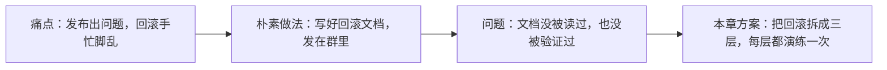
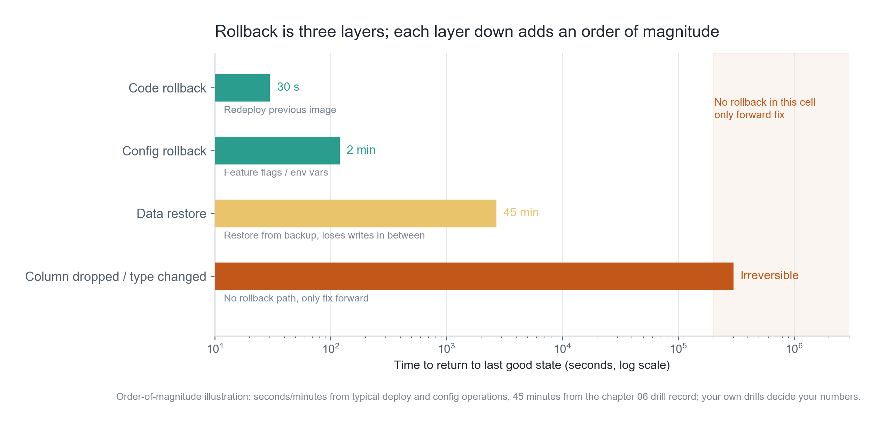
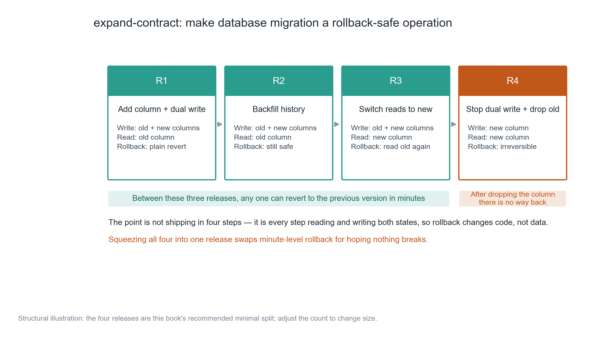
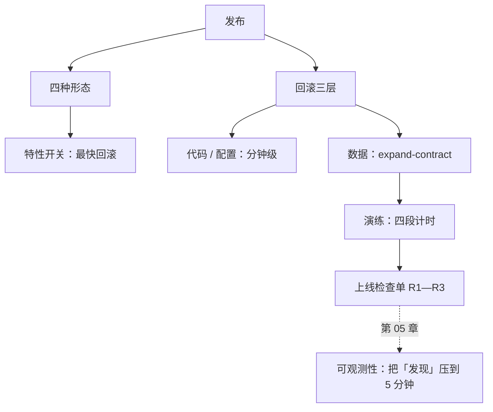

**English** | [中文](./ch04-release-rollback.zh.md)

# Chapter 04: Release and Rollback — Rollback Is Trained, Not Written

> **Chapter guide**: Launch capability is not "can deploy", it is "can go back". This chapter breaks rollback into three layers (code, config, data), points out that the real difficulty is database migration, and gives a four-step migration method plus the verdict table of one real drill.
> **Prerequisites**: Chapter 03 (scope locking — if you do not know which features must survive, you cannot design rollback).
> **Core learning objectives**:
> - Master the costs of the four release shapes, and pick the right one for a one-person project
> - Understand "code can roll back, data cannot", and be able to design an expand-contract migration independently
> - Be able to run one rollback drill, and use the four segment timings to judge whether the process can be written into the checklist

---

## 1. Cognitive Anchor: The Climbing Rope Is Not for Climbing

### 1.1 A 22-Minute Afternoon

14:02, you push a new version live. The change is small: add a "summary version" field to the minutes table, and tweak one read path while you are at it.

14:11, the first user messages you: "my minutes have gone blank".

You open the logs and find the new logic returns empty on old data. Worse, to "keep things clean" you deleted the old field's read code in the same release.

14:19, you decide to roll back. `git revert` goes smoothly and the image deploy is fast. But after the rollback, the user data written during those 9 minutes still holds empty summaries — **the code went back, the data did not.**

14:24, you hand-fix three records and apologize to three users. 22 minutes total, the damage manageable.

But the real problem is not the 22 minutes; it is that only at 14:19 did you discover: **you have never drilled a rollback.** You just assumed it would work.



### 1.2 Intuitive Analogy: Safety Rope and Seat Belt

You carry a climbing rope hoping you never need it. Someone who does not carry one is not brave, they have not done the math — because they made "I won't fall this time" part of their plan.

The safety rope in software has two properties, same as a climbing rope:

- **It must be rigged before you set out**; looking for a rope when things go wrong is too late;
- **It must have been inspected**; a rope that sat unpacked for three years, you do not know whether it has gone moldy.

**The boundary of this analogy**: when a climbing rope snaps you are gone, while a failed software rollback can usually still be "fixed forward". But fixing forward often costs an order of magnitude more than rolling back, and it happens under the users' eyes.

---

## 2. First Principles: The Three Layers of Rollback and the Four Release Shapes

### 2.1 Rollback Is Not One Thing; It Is Three Layers



*Figure 4-1: The horizontal axis is a log scale; note the order of magnitude between each layer. The red bar at the far right is the most important cell in this figure — it is not "very slow", it is "this path does not exist".*

| Layer | Rollback object | Typical time | Precondition |
| :--- | :--- | :--- | :--- |
| Code | Previous image / previous build artifact | 30 seconds – 2 minutes | The image is still there, and deploys are replayable |
| Config | Feature flags, environment variables, routing rules | 1–3 minutes | Config is separated from code and is versioned |
| Data | Rows already written, columns already dropped, types already changed | Minutes to hours, or irreversible | There are backups, or the migration itself is forward-compatible |

The vast majority of "rollback plans" only cover the first layer. That is why many teams still have the problem after a "successful rollback" — because the bad data has already been written.

### 2.2 Four Release Shapes: Which One for a Solo Builder

| Shape | Mechanism | Rollback speed | Cost | Who it suits |
| :--- | :--- | :--- | :--- | :--- |
| Whole-package replacement | Stop old, start new | Slow (redeploy) | Lowest | Single machine, low traffic, tolerates brief downtime |
| Blue-green | Two environments, switch traffic | Fast (switch back) | Double resources | Some traffic, zero downtime required |
| Canary | Give 5% of traffic first | Fast (withdraw the small slice) | Needs traffic splitting | Real traffic and can segment users |
| Feature flag | Code ships first, feature opens later | Fastest (flip the flag) | Branches linger in the code long-term | **First choice for independent developers** |

For a product built by one person, **the feature flag is the best-value layer**. It turns "rollback" from a deployment into a config change, compressing the risk window from minutes to seconds.

The cost is branches like `if (featureEnabled('summary_v2'))` in the code. The rule for managing them is simple: **the flag must be deleted within two weeks of launch**, otherwise a year later you will have a branch tree that can never be fully tested.

### 2.3 The Real Difficulty: Database Migration

Code can go back to the previous version; data cannot. Once an `ALTER TABLE ... DROP COLUMN` runs, old-version code can never read that column again.

So the correct way to migrate is to split it into four releases, such that **every intermediate state works with both old and new code**. This method is called expand-contract:



*Figure 4-2: Note the "read" column of the first three steps — it keeps reading the old column and only switches at step three. This "slowness" is deliberate: it guarantees that whenever you roll back, the old code can still read complete data.*

Concretely for the "Minutes" assistant's field upgrade:

```sql
-- R1：加列 + 双写（旧代码不受影响，新代码开始写两份）
ALTER TABLE meetings ADD COLUMN summary_v2 JSONB;
-- 应用层：写入时同时写 summary 和 summary_v2

-- R2：回填历史（可分批，可中断，可重跑）
UPDATE meetings SET summary_v2 = to_jsonb(summary)
WHERE summary_v2 IS NULL AND id BETWEEN 1 AND 10000;

-- R3：切读（改一行配置，出问题改回来）
-- 读取路径改为 summary_v2，保留 fallback 到 summary

-- R4：停双写 + 删旧列（此时才真正不可逆）
ALTER TABLE meetings DROP COLUMN summary;
```

The four steps can be days apart or hours apart, depending on your risk appetite. **The only hard rule: never change the structure and the read path in the same release.**

### 2.4 Judging Whether a Migration Is Rollback-Capable

Ask three questions; if any answer is "no", this migration has no rollback path:

1. After it runs, can the old-version code still read normally?
2. After it runs, can the old version understand newly written data?
3. If we have to go back 10 minutes from now, does data need restoring?

Only if all three are "yes / yes / not needed" can it share a release with a code rollback. Otherwise it must be split.

---

## 3. Hands-on: One Real Rollback Drill

### 3.1 Drill Design

Three requirements; miss one and the drill does not count:

- **A real defect**: not a mock action — actually break a feature (this example: the new read logic returns empty on old data).
- **A real environment**: staging plus a real data copy, not local.
- **Real timing**: start the watch at the moment of release, including the "detection" segment — this is the one most often left unrecorded.

### 3.2 Run the Recorder

```bash
$ python code/ch04/rollback_drill.py
```

### 3.3 Real Output

```text
=== 回滚演练记录 ===
阶段                              实测      目标  判定
--------------------------------------------------------
发现（故障 → 知道）                    9 分     5 分  超时
决策（知道 → 决定）                    3 分     5 分  达标
执行（决定 → 上一版可用）                 5 分     3 分  超时
验证（可用 → 确认没事）                  5 分    10 分  达标
--------------------------------------------------------
故障到确认恢复                       22 分

结论：2 段超时，不能写进检查单。逐条改法：
  - 发现（故障 → 知道）：实测 9 分 / 目标 5 分 → 补一条症状告警（错误率 5 分钟窗口），不要等用户反馈
  - 执行（决定 → 上一版可用）：实测 5 分 / 目标 3 分 → 回滚命令一条化，镜像保留期 ≥ 7 天并纳入演练
```

### 3.4 The Real Problem This Drill Exposed

There is one more paragraph at the end of the output, worth pulling out on its own:

> The rollback script runs, but it assumes "the previous image is still there". If the image retention policy is 3 days and the failure happens on day 4 after launch, the script fails silently.

This is the most valuable part of a drill. **The purpose of a drill is not to prove you can roll back; it is to find the places where "you thought you could, but actually cannot".**

Three high-frequency traps; almost every project hits one:

| Trap | Symptom | Fix |
| :--- | :--- | :--- |
| Expired image | The script runs successfully, but what gets deployed is an even older version | Retention ≥ 7 days, written into deploy config, same source as the rollback script |
| Migration already ran | The code went back, the new column is still there, old code errors out | expand-contract; irreversible migrations get their own schedule |
| Config drift | Code rolled back, but the environment variable still holds the new value | Put config under version control and roll it back together |

### 3.5 Write the Results into the Checklist

After the drill, do not stop at writing a summary; turn the conclusions into executable checklist items. At least three:

- [ ] Rollback in a single command, executable by anyone (no understanding of the architecture needed)
- [ ] Image retention ≥ 7 days, and verified once during a drill
- [ ] No `DROP` or type changes in migration scripts; if any, schedule separately and publish a notice

In Chapter 10's launch-day checklist, these three items are R1–R3.

---

## 4. Common Misconceptions and Correct/Incorrect Contrasts

| Easy pitfall | Why it goes wrong | The right mental model and practice |
| :--- | :--- | :--- |
| **"Having rollback docs equals being able to roll back"** | The docs have never been executed; the commands in them may be stale (image names, paths, permissions all change) | Drill once a quarter; the commands in the docs must be copy-paste executable |
| **"Rollback just means reverting the code"** | Data has been written/deleted; reverting code only mixes old and new data | Before rolling back, judge "did this change write data"; if yes, make a data plan first |
| **"Changing everything in one release saves trouble"** | Putting schema changes and logic changes together stacks two risks into one | Separate schema changes from logic changes; if they must ship together, use expand-contract |
| **"Canary is professional; we must have it"** | Without enough traffic, a 5% sample shows nothing and only slows the release | Single machine with low traffic: whole-package + feature flag; add canary once you have traffic |
| **"When something breaks, locate first, then decide"** | Locating can take 30 minutes while rolling back takes 2. Users keep suffering during the locating | Roll back first, then locate; rolling back does not destroy evidence (the logs remain) |

---

## 5. Chapter Summary and Local Knowledge Graph

### 5.1 Key Points

- **Rollback has three layers**: code (seconds/minutes), config (minutes), data (minutes to hours, or irreversible).
- **Data is the real difficulty**, because code can go back and data cannot. The judging standard is "can the old code still read".
- **The four expand-contract steps**: add column + dual write → backfill → switch reads → drop old column. Any of the first three steps can still retreat.
- **The feature flag is the best-value option for independent developers**, but the flag must be deleted within one release cycle.
- **A drill must be timed for real**, including the "detection" segment — it is often the longest one.

### 5.2 Concept Topology of This Chapter



---

## 6. Tiered Exercises and Reference Solutions

### Basic Consolidation (Tier 1: Intuition and Concept Check)

1. Of the four releases below, which can share a release with a code rollback? Explain your reasoning.
   - (a) Add a nullable column to a table; code writes but never reads it.
   - (b) Change `varchar(50)` to `varchar(200)`.
   - (c) Delete an old interface nobody uses anymore.
   - (d) Extend the enum `status` from `a/b` to `a/b/c`.

2. Judge whether this is true or false and explain why: "With feature flags, you no longer need a rollback plan."

### Applied Practice (Tier 2: Reasoning and Hands-on Construction)

3. Write a rollback script for your project (or a copyable command sequence). Requirements: all variables (image tag, path, environment name) defined centrally at the top, and execution requires no reading of the code.

4. Run one real drill and produce the four-segment timing table. Requirements: at least one segment overruns, and the fix is written as a checklist item. If everything meets target, your targets are too loose.

### Deep Challenge (Tier 3: Boundary Conditions and Cross-Chapter Transfer)

5. You discover that a version live for three days wrote `created_at` for 2000 minutes records as UTC+0 instead of local time. The code is fixed, but the historical data is wrong. Design a handling plan, and explain why simply "rolling back to three days ago" will not do.

<details>
<summary><strong>Click to expand: reference answers and in-depth analysis for this chapter's exercises</strong></summary>

#### 1. Judging Rollback-Capability

| Scenario | Can share a batch with code rollback? | Reason |
| :--- | :--- | :--- |
| (a) Add nullable column, write-only | **Yes** | Old code does not read the new column and is completely unaffected; this is the first step of expand |
| (b) Extend length | **Yes (most databases)** | Extending length usually does not break old code; but note the reverse (shrinking) is definitely not rollback-capable |
| (c) Delete old interface | **No** | After rollback, old code would call the deleted interface; take the traffic down first, observe one cycle, then delete |
| (d) Extend enum | **Yes (with care)** | Old code does not know the new value; if old code has "throw on unknown value" logic it will explode; confirm old code is tolerant of unknown values before launch |

The general judging method: **imagine the old code running on the new database — will it error?** If yes, split it.

#### 2. True or False

**Wrong.** Flags solve "feature-level rollback", and cannot solve three things:

- Data has already been written with the new logic (flip the flag, the bad data is still there);
- The flag itself may be broken (the config center is down, or the flag has no access control);
- Some changes are not features (migrations, dependency upgrades, certificate rotation) and flags cannot manage them.

A flag is "the fastest layer", not "the only layer".

#### 3. Scoring Points for the Script

A passing rollback script has three traits: **variables concentrated at the top, verification after every step, stop on failure instead of continuing**. Failing scripts usually lack `set -e` from step two onward, so they keep executing after a failure and make the state even messier.

#### 4. Drill Design Points

"At least one segment overruns" is not harsh, it is reality: the first drill almost never meets all targets. Target values should be set by "how long the business can tolerate", not by "how fast I wish I were".

If everything meets target, tighten the targets one notch and drill again. Targets exist to expose problems, not to hand yourself a medal.

#### 5. Handling Time-Zone Data Errors

First, why not roll back: **rolling back would revert every normal change from the last three days** (new users, new minutes, payment records), a loss far greater than 2000 timestamps. Rollback is "wholesale undo", while what is needed here is "point repair".

The handling plan has three steps:

1. **Confirm the offset**: UTC+0 differs from local time by a fixed 8 hours (China), so the repair is deterministic: `UPDATE ... SET created_at = created_at + interval '8 hours' WHERE id IN (...)`.
2. **Bound the scope**: use the release window's time range + version markers to circle the affected rows; do not use "+8 hours on the whole table" (it would hit normal data).
3. **A rollback-capable repair**: back up the affected rows into a temp table first, then update; if something goes wrong you can restore from the temp table.

The fourth step is the retrospective: why did the tests not catch it? Usually because the test data used fixed timestamps and never covered "cross-time-zone writes". Adding one test case beats writing an apology.

</details>

---

## 7. Authoritative Sources and Further Reading (Authoritative References)

1. **Semantic Versioning 2.0.0**: [Semantic Versioning 2.0.0](https://semver.org/) - the definitions and norms of this chapter are anchored here (verification date: `2026-10-23`).
2. **DORA**: [DORA](https://dora.dev/) - the definitions and norms of this chapter are anchored here (verification date: `2026-10-23`).
3. **The Twelve-Factor App**: [The Twelve-Factor App](https://12factor.net/) - the definitions and norms of this chapter are anchored here (verification date: `2026-10-23`).

> Measurement note: the sources above are used to anchor **definitions and norms**, not to extrapolate risk probabilities. Before quoting any number, check the source's year and its denominator.
