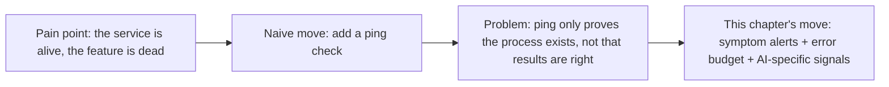
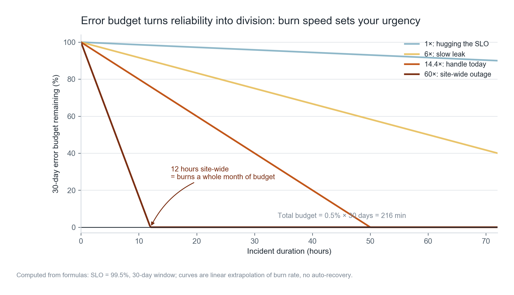
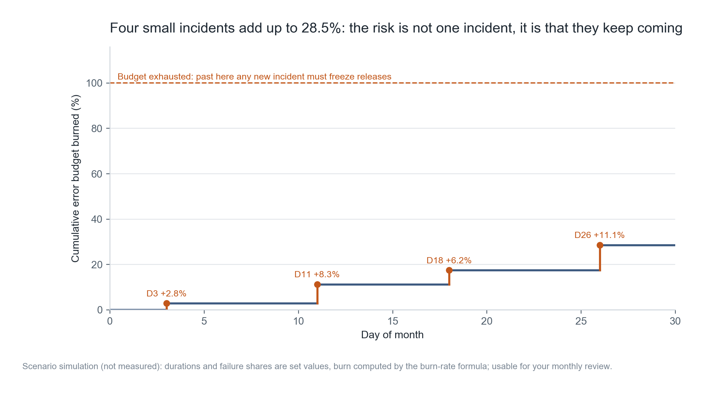
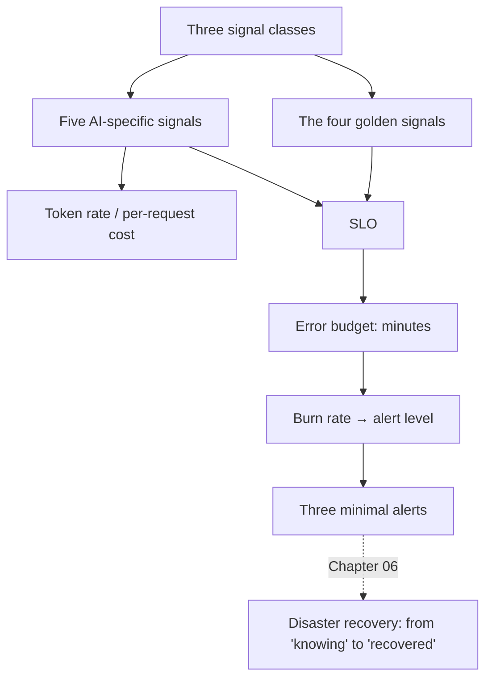

**English** | [中文](./ch05-observability.zh.md)

# Chapter 05: Observability — The Failures You Cannot See, Users Will See for You

> **Chapter guide**: This chapter solves "how to know something broke before users complain". It does not teach tools; it teaches three kinds of signals, five AI-specific metrics, and the method for converting "stability" into minutes — the error budget.
> **Prerequisites**: Chapter 04 (the first segment of rollback timing is "detection"; this chapter is what pushes that segment down).
> **Core learning objectives**:
> - Master the three signal types and the four golden signals, and pick the minimal dashboard for your own product
> - Understand SLOs and error budgets, and calculate your own allowable failure minutes and alert thresholds
> - Be able to design three alerts that neither over-disturb nor miss, and verify them with one deliberately induced failure

---

## 1. Cognitive Anchor: People Are Blindly Optimistic About What They Build Themselves

### 1.1 A Typical Workday

Ten in the morning, you are working on an unrelated feature. Your phone buzzes: a paying user — "today's minutes keep coming out empty, is it broken?"

You open the backend and find that two hours ago the upstream transcription API started returning 429, your retry logic exhausted all 3 retries, and then it silently returned an empty string. The system is "working normally"; the result is just empty.

**Not a single alert fired.** Because your monitoring only watches "is the service alive", and the service is alive and well.



### 1.2 Intuitive Analogy: The Point of a Dashboard

You watch the dashboard while driving, not because you suspect the engine. It is because **people are blindly optimistic about what they build themselves** — you had it serviced yesterday, so you feel nothing can go wrong today.

The dashboard's job is not to provide information; it is **to negate "it should be fine" on your behalf**.

**The boundary of this analogy**: a car's dashboard has the manufacturer setting the scales for you (what counts as overheating); software has no manufacturer, and you must set the scales yourself — that is exactly the problem SLOs solve.

---

## 2. First Principles: Signals, Budgets, and Alerts

### 2.1 Three Signal Types, Each Answering One Question

| Signal | What it answers | Typical content | When it is most useful |
| :--- | :--- | :--- | :--- |
| **Logs** | What happened | A request's input arguments, error stack, model response | Post-incident locating |
| **Metrics** | How much happened | Request count, error rate, latency percentiles, token consumption | Trends and alerts |
| **Traces** | Which segment is slow | The time one request spends in transcription → retrieval → model → persistence | Locating bottlenecks |

None of the three can replace the others. The person with only logs relies on grep for alarming; the person with only metrics knows "3% wrong" but not where it went wrong; the person with only traces can see slowness, but cannot see "whether the slowness is normal".

### 2.2 Four Golden Signals + Five AI-Specific Signals

The generic four (latency, traffic, errors, saturation) are not enough for AI products, because AI failures are often "successfully returned wrong content".

| AI-specific signal | Definition | Why you must watch it |
| :--- | :--- | :--- |
| **Token consumption rate** | Input/output tokens per minute | It is a cost proxy; an anomalous rise usually means an infinite loop or prompt bloat |
| **Time to first token (TTFT)** | Time from request to the first character | The "fast or slow" the user feels is decided by this; total latency is secondary |
| **Refusal / handoff-to-human rate** | The share of model refusals or user abandonments | It exposes quality problems earlier than the error rate |
| **Retrieval hit rate** | The share of recalled results actually cited | Most "hallucination" in RAG products comes from retrieval misses |
| **Per-request cost** | The monetary amount per request | The only metric that translates technical anomalies into money |

The first and the fifth belong on the same chart. **The shape of the cost curve often tells you something broke earlier than the error rate** — because an infinite loop burns the money first and pushes the error rate up only afterwards.

### 2.3 Converting Stability into Minutes: The Error Budget

An SLO (service level objective) is a percentage, say 99.5%. Its complement is the "allowed failure ratio", and multiplied by the time window that gives the **error budget**:

$$
\text{budget minutes} = (1 - \text{SLO}) \times 30 \times 24 \times 60
$$

99.5% → 216 minutes/month, about 3.6 hours. This number is very useful because it turns "we want stability" into something negotiable: **how many minutes are left to burn this month.**

With a budget, you can define "how urgent". Burn rate is "how many times the allowed speed the current consumption is running":

- 1× means hugging the SLO exactly, using it up in exactly one month;
- 60× means that at this speed, one month's allowance burns out in 12 hours.



*Figure 5-1: The horizontal axis is incident duration. The four lines are four consumption speeds. The one to watch is the steepest: a full-site outage for 12 hours = the entire month's budget goes to zero, after which any new failure must freeze releases.*

### 2.4 Alert Design: Symptoms First, Confirmed Over Multiple Windows

Two principles solve 80% of alert quality problems:

**First, report symptoms, not causes.** "Error rate above 5%" is a symptom; "CPU is high" is a cause. A cause does not necessarily lead to a symptom (CPU high but users feel nothing), while a symptom is always something users can feel. Cause-type metrics belong on the dashboard for trends, not for waking people up.

**Second, confirm over a long window, and confirm with a short window that it is still ongoing.** Watching only a 1-hour window is sluggish (small incidents get averaged out); watching only a 5-minute window is noisy (jitter triggers alerts). Alert only when both windows are satisfied — the classic Google SRE solution:

| Severity | Long window | Short window | Threshold | Meaning |
| :--- | :--- | :--- | :--- | :--- |
| P1 | 1 hour | 5 minutes | 14.4× | 1 hour burns 2% of the monthly budget |
| P2 | 6 hours | 30 minutes | 6× | 6 hours burns 5% of the monthly budget |
| P3 | 3 days | 6 hours | 1× | A slow leak, handled on working days |

14.4 is a calculated number: 1 hour is 0.1389% of a month, and to burn 2% within that hour the rate must be 0.02 / 0.001389 = 14.4.

---

## 3. Hands-on: Installing Minimal Observability for the "Minutes" Assistant

### 3.1 Calculate the Budget First

```bash
$ python code/ch05/slo_burn.py
```

```text
=== 1. 预算换算（30 天窗口）===
SLO             允许失败比例        每月可用故障        每周
99.0%           1.00%         432 分      100 分
99.5%           0.50%         216 分       50 分
99.9%           0.10%          43 分       10 分

本书取 SLO = 99.5%，即每月 216 分钟（约 3.6 小时）

=== 2. 燃烧率：这个速度下，多久烧光一个月预算 ===
燃烧率       含义                            烧穿时间
1.0       刚好贴着 SLO 走                    30 天
6.0       慢性泄漏                           5 天
14.4      一天内必须处理                      50 小时
60.0      全站不可用                        12 小时
```

Note the 1× row: **"hugging the SLO exactly" means using it up over a full 30 days, not 3.6 hours.** This is a common miscalculation — dividing "budget minutes" by the multiplier gives 216 minutes, and that is wrong. The correct calculation is "window duration ÷ multiplier".

### 3.2 Cumulative Consumption from Four Failures This Month

```text
（第 3 节多窗口阈值表已略，可自行运行查看）

=== 4. 本月四次故障的累计消耗 ===
  D3  全站不可用                       +  2.8%　累计   2.8%
  D11 转写队列积压，20% 请求失败             +  8.3%　累计  11.1%
  D18 登录故障                        +  6.2%　累计  17.4%
  D26 单模型降级，10% 请求失败              + 11.1%　累计  28.5%

  合计 28.5% —— 还在预算内，但已经用掉四分之一。
```



*Figure 5-2: Each failure is a vertical jump; the flat segments are "time without incidents". Four small failures, each acceptable on its own, add up to 28.5%.*

This figure explains a counterintuitive phenomenon: **many teams are not killed by one big failure; they are drained by four small ones.** Every post-incident review concludes "limited impact", but the budget keeps leaking, until some month you do not even dare do one normal release.

### 3.3 Minimal Dashboard: Six Charts + Three Alerts

No more than six charts on the dashboard; beyond that nobody looks:

1. Request volume and error rate (per endpoint)
2. Latency P50 / P95 / P99
3. Time to first token (P95)
4. Token consumption rate (hourly)
5. Per-request cost (7-day rolling mean)
6. Upstream dependency availability (transcription / model / storage)

Three alerts covering three kinds of failure:

| Alert | Condition | What it covers |
| :--- | :--- | :--- |
| A1 empty result | Share of successful responses with empty `summary` > 2%, sustained 10 minutes | "Service alive but result wrong" |
| A2 upstream timeout | Upstream 429/5xx share > 5%, sustained 5 minutes | Dependency failures |
| A3 cost anomaly | Hourly token consumption > 3x the same-hour mean of the past 7 days | Infinite loop / prompt bloat |

A1 is the one most easily missed. Most monitoring only counts HTTP 200, and "200 + empty result" is the most typical silent failure.

### 3.4 Induce One Failure to Verify the Alerts

Installing is not the same as working. You must deliberately induce a failure in staging and time the alerts:

```text
Step 1  Set the upstream transcription API timeout to 1ms (simulating a 429)
Step 2  Fire 20 real requests
Step 3  Start the stopwatch and wait for A2 to fire; record the elapsed time
Step 4  Change the summary generation logic to return an empty string
Step 5  Repeat 20 times, wait for A1 to fire; record the elapsed time
Step 6  Restore the config and confirm the alerts auto-resolve (they must not ring forever)
```

The criterion: **every alert fires within 5 minutes, and clears itself within 10 minutes after recovery.** For the ones that fail this, change the threshold or the window; do not change the objective.

Step 6 is the most often ignored. An alert that does not auto-clear will wake you at midnight twice: once for the real failure, once for the failure's recovery.

---

## 4. Common Misconceptions and Correct/Incorrect Contrasts

| Easy pitfall | Why it goes wrong | The right mental model and practice |
| :--- | :--- | :--- |
| **"Monitoring means watching whether the service is alive"** | Liveness checks only catch process crashes; the most common AI failure is "alive but wrong" | Add "result quality" signals: empty-result rate, refusal rate, retrieval hit rate |
| **"More metrics means more professional"** | Too many charts, nobody looks; too many alerts, they get muted; muted means no monitoring | Six charts and three alerts to start; for each one added, delete one first |
| **"A 5-minute window is the most sensitive"** | Short windows treat jitter as failure and create alert fatigue | Long-window confirmation + short-window confirmation; alert only when both are satisfied |
| **"Using up the error budget is fine"** | The budget exists to "decide whether you can release"; shipping anyway means you have no SLO | Budget exhausted → freeze non-essential releases until the window rolls past |
| **"Ship first, add monitoring later"** | The first two weeks after launch are the densest failure period — exactly when there is no monitoring | Monitoring and alerts belong to the launch criteria (Chapter 03, item 3) |

---

## 5. Chapter Summary and Local Knowledge Map

### 5.1 Key Points

- **The three signal types each do their job**: logs answer "what happened", metrics answer "how much", traces answer "where it is slow".
- **AI products must watch five extra signals**, among which token rate and per-request cost are the earliest warnings.
- **SLOs turn stability into minutes**: 99.5% = 216 minutes per month; spend it and releases freeze.
- **Burn rate decides "how urgent"**: 60× burns out in 12 hours, 14.4× in 50 hours.
- **Alerts report symptoms and confirm over multiple windows**; after installing you must induce one failure to verify, and also verify that alerts auto-clear.

### 5.2 Concept Topology of This Chapter



---

## 6. Tiered Exercises and Reference Solutions

### Basic Consolidation (Tier 1: Intuition and Concept Check)

1. A product's SLO is set at 99.9%, and two failures totaling 25 minutes have already happened this month. Question: how much budget is left? Can you still do one "risky" database migration? Explain your reasoning.

2. Judge whether this is true or false and explain why: "Alerts should cover every place that could go wrong; better too many than too few."

### Applied Practice (Tier 2: Reasoning and Hands-on Construction)

3. Configure a minimal dashboard (no more than six charts) and three alerts for your project. Requirements: each alert states the "symptom" rather than the "cause", and gives a verification method.

4. Modify `slo_burn.py`, change the window from 30 days to 7 days, and recalculate the budget at 99.5% and the burn-through time at 14.4×. Answer: why are short windows suited to "pre-release health checks" and not to "quarterly assessment"?

### Deep Challenge (Tier 3: Boundary Conditions and Cross-Chapter Transfer)

5. Your product has 40% of requests where "the user clicked generate but closed the page immediately". These requests count as successes (HTTP 200) and also consume cost. Design at least two signals to capture this kind of "ineffective response", and explain how they would affect your SLO definition.

<details>
<summary><strong>Click to expand: reference answers and in-depth analysis for this chapter's exercises</strong></summary>

#### 1. Remaining Budget

99.9% → 43 minutes per month. 25 minutes used, 18 left (about 42%).

**Can you do a risky migration?** Look at it in two steps:

- If the migration can be split into four expand-contract steps, each with a risk window < 5 minutes → yes, because even the worst case cannot burn through 18 minutes.
- If the migration must be done in one shot with an expected 20-minute outage → no. Because one incident would exceed the budget, and once exceeded you have no headroom for "cascade problems caused by the migration".

The conclusion is not "can/cannot", it is "what size of risk window do you trade for it".

#### 2. True or False

**Wrong.** The goal of alerting is not coverage; it is the **signal-to-noise ratio**. Every false alert trains a person one more time to think "this one can be ignored"; by the tenth time, a real alert gets ignored too.

The right practice: alert only on "bad outcomes users can perceive" (symptoms), and put cause-type metrics on the dashboard. Better to miss one little jitter than to let a P1 alert be muted.

#### 3. Scoring Points for the Dashboard and Alerts

Three passing alerts should cover three different failure modes: **wrong results, dead dependencies, cost blowups**. If all three are "error rate", you have covered only one mode.

Each one must have a "verification method"; an alert without a verification method is the same as not installed.

#### 4. Converting the 7-Day Window

99.5% × 7 days = 50.4 minutes of budget. Burn-through time at 14.4× = 168 / 14.4 ≈ 11.7 hours.

Short windows suit pre-release checks: they reflect "the real state of the past week", and any recent quality regression shows immediately. They do not suit quarterly assessment, because 7 days is too short — one freak incident can make the numbers ugly, and it does not represent the long-term level.

**Use short windows for decisions, long windows for evaluation** — reverse them and you get two wrong conclusions.

#### 5. Capturing Ineffective Responses

Two signals:

1. **Page-closed-within-5-seconds rate after a request** (front-end instrumentation). It directly measures "the user left before the result arrived".
2. **Share of generations completed but never copied**. If 40% of results are generated and never used, the value was never delivered.

Their impact on the SLO is subtle: such requests are technically "successful" but in business terms "failed". So the SLO should be split into two layers:

- **Technical SLO** (availability, latency) for operations;
- **Effectiveness SLO** (completion rate, adoption rate) for product.

Mixing the two into one number produces self-deceiving reports of "the system is very stable, but nobody uses it". Chapter 09's health dashboard continues this topic.

</details>

---

## 7. Authoritative Sources and Further Reading (Authoritative References)

1. **OpenTelemetry**: [OpenTelemetry](https://opentelemetry.io/) - the definitions and norms of this chapter are anchored here (verification date: `2026-10-23`).
2. **DORA**: [DORA](https://dora.dev/) - the definitions and norms of this chapter are anchored here (verification date: `2026-10-23`).
3. **NIST CSRC**: [NIST CSRC](https://csrc.nist.gov/) - the definitions and norms of this chapter are anchored here (verification date: `2026-10-23`).

> Measurement note: the sources above are used to anchor **definitions and norms**, not to extrapolate risk probabilities. Before quoting any number, check the source's year and its denominator.
