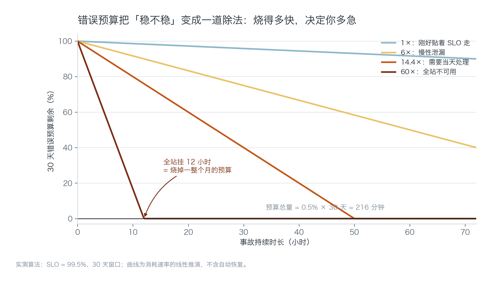
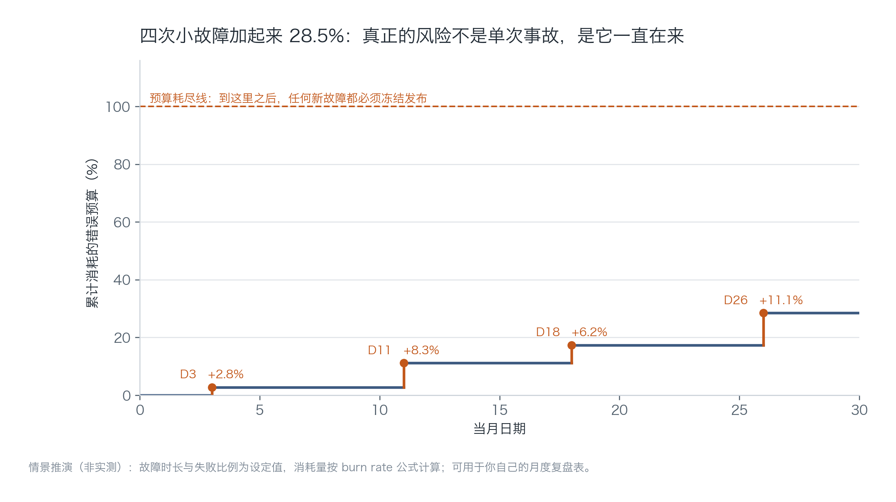
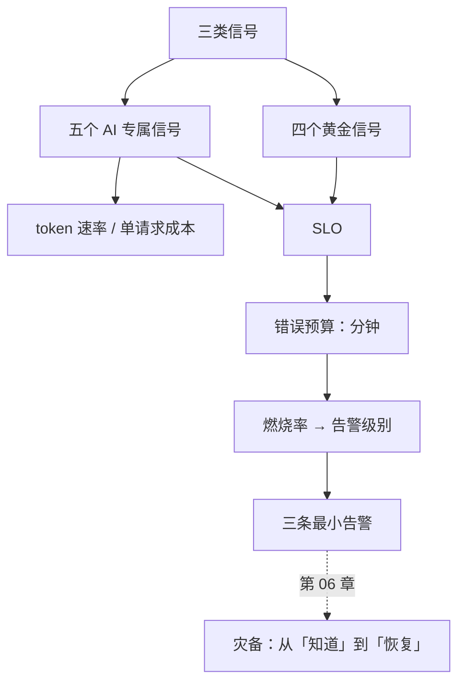

# 第 05 章：可观测性——你看不见的故障，用户会替你看

> **本章导读**：这一章解决"怎么在用户投诉之前知道出事了"。它不教工具，教三类信号、五个 AI 专属指标、以及把"稳定性"换算成分钟的方法——错误预算。
> **前置知识**：第 04 章（回滚的第一段耗时是"发现"，本章就是把这一段压下去）。
> **核心学习目标**：
> - 掌握三类信号与四个黄金信号，能为自己的产品选出最小仪表盘
> - 理解 SLO 与错误预算，能算出自己的可用故障分钟与告警阈值
> - 能设计三条不过度打扰、也不漏报的告警，并用一次人为故障验证它们

---

## 1. 认知锚点：人对自己造的东西会盲目乐观

### 1.1 一个典型的工作日

上午十点，你在改一个不相关的功能。手机震了一下，是一个付费用户："今天的纪要一直是空的，是不是坏了？"

你打开后台，发现两小时前上游转写接口开始返回 429，你的重试逻辑把 3 次重试都耗尽了，然后静默返回了空字符串。系统"正常工作"，只是结果是空的。

**没有一条告警响过。** 因为你的监控只看"服务是否存活"，而服务活得好好的。


### 1.2 直觉类比：仪表盘的意义

开车看仪表盘，不是因为你怀疑发动机。是因为**人对自己造的东西会盲目乐观**——你昨天刚保养过，你就会觉得今天不会有事。

仪表盘的作用不是提供信息，是**替你否定"应该没事"**。

**类比的边界**：车上的仪表盘有厂家替你设计好刻度（多少算过热）；软件没有厂家，刻度要你自己定——这就是 SLO 要解决的问题。

---

## 2. 第一性原理：信号、预算与告警

### 2.1 三类信号，各回答一个问题

| 信号 | 回答什么 | 典型内容 | 什么时候最有用 |
| :--- | :--- | :--- | :--- |
| **日志（Logs）** | 发生了什么 | 一条请求的入参、错误栈、模型返回 | 事后定位 |
| **指标（Metrics）** | 发生了多少 | 请求数、错误率、延迟分位、token 消耗 | 趋势与告警 |
| **链路（Traces）** | 慢在哪一段 | 一次请求经过转写→检索→模型→落库的耗时 | 定位瓶颈 |

三者不能互相替代。只有日志的人，报警要靠 grep；只有指标的人，知道"错了 3%"但不知道错在哪；只有链路的人，能看到慢，但看不到"慢是不是正常"。

### 2.2 四个黄金信号 + 五个 AI 专属信号

通用四件套（延迟、流量、错误、饱和度）在 AI 产品上不够用，因为 AI 的失败经常是"成功返回了错误的内容"。

| AI 专属信号 | 定义 | 为什么必须看 |
| :--- | :--- | :--- |
| **token 消耗速率** | 每分钟输入/输出 token | 它是成本的代理指标，异常上涨通常意味着死循环或提示词膨胀 |
| **首 token 延迟（TTFT）** | 从请求到第一个字的时间 | 用户感知的"快慢"由它决定，总延迟反而次要 |
| **拒答率 / 转人工率** | 模型拒绝或用户放弃的比例 | 它比错误率更早暴露质量问题 |
| **检索命中率** | 召回结果被引用的比例 | RAG 产品的"幻觉"多数源于检索没命中 |
| **单请求成本** | 每次请求的金额 | 它是唯一能把技术异常翻译成钱的指标 |

第一条和第五条要放在同一张图上。**成本曲线的形状，往往比错误率更早告诉你出事了**——因为死循环会先把钱烧掉，然后才把错误率推上去。

### 2.3 把稳定性换算成分钟：错误预算

SLO（服务等级目标）是一个百分比，比如 99.5%。它的补数就是"允许失败的比例"，乘上时间窗口，就是**错误预算**：

$$
\text{预算分钟} = (1 - \text{SLO}) \times 30 \times 24 \times 60
$$

99.5% → 216 分钟/月，约 3.6 小时。这个数字非常有用，因为它把"我们要稳定"变成了一句可以商量的话：**这个月还剩多少分钟可以烧。**

有了预算，就能定义"多急"。燃烧率（burn rate）是"当前消耗速度是允许速度的几倍"：

- 1× 意味着刚好贴着 SLO 走，一个月正好用完；
- 60× 意味着按这个速度，12 小时就烧光一个月的额度。



*图 5-1：横轴是事故持续时长。四条线对应四种消耗速度。最该注意的是那条最陡的：全站挂 12 小时 = 一整个月预算归零，之后任何新故障都必须冻结发布。*

### 2.4 告警设计：症状优先，多窗口确认

两条原则，能解决 80% 的告警质量问题：

**第一，报症状，不报原因。**
"错误率超过 5%" 是症状，"CPU 高" 是原因。原因不一定导致症状（CPU 高但用户没感觉），症状一定是用户能感觉到的。原因类指标适合放在仪表盘上看趋势，不适合直接叫醒人。

**第二，长窗口确认，短窗口确认它还在继续。**
只看 1 小时窗口会迟钝（小事故被平均掉），只看 5 分钟窗口会吵闹（抖动就报警）。两个窗口同时满足才报，是 Google SRE 的经典解法：

| 级别 | 长窗口 | 短窗口 | 阈值 | 含义 |
| :--- | :--- | :--- | :--- | :--- |
| P1 | 1 小时 | 5 分钟 | 14.4× | 1 小时烧掉 2% 月预算 |
| P2 | 6 小时 | 30 分钟 | 6× | 6 小时烧掉 5% 月预算 |
| P3 | 3 天 | 6 小时 | 1× | 持续泄漏，工作日处理 |

14.4 这个数是算出来的：1 小时占一个月的 0.1389%，想在这 1 小时里烧掉 2%，速率要 0.02 / 0.001389 = 14.4。

---

## 3. 手把手：给「纪要助手」装最小可观测性

### 3.1 先算预算

```bash
$ python code/ch05/slo_burn.py
```

```text
=== 1. 预算换算（30 天窗口）===
SLO             允许失败比例        每月可用故障        每周
99.0%           1.00%         432 分      100 分
99.5%           0.50%         216 分       50 分
99.9%           0.10%          43 分       10 分

本书取 SLO = 99.5%，即每月 216 分钟（约 3.6 小时）

=== 2. 燃烧率：这个速度下，多久烧光一个月预算 ===
燃烧率       含义                            烧穿时间
1.0       刚好贴着 SLO 走                    30 天
6.0       慢性泄漏                           5 天
14.4      一天内必须处理                      50 小时
60.0      全站不可用                        12 小时
```

注意 1× 那一行：**"刚好贴着 SLO 走"的意思是整整 30 天用完，不是 3.6 小时。** 这是一个常见的算错——把"预算分钟数"除以倍数，会得到 216 分钟，那是错的。正确的算法是"窗口时长 ÷ 倍数"。

### 3.2 本月四次故障的累计消耗

```text
（第 3 节多窗口阈值表已略，可自行运行查看）

=== 4. 本月四次故障的累计消耗 ===
  D3  全站不可用                       +  2.8%　累计   2.8%
  D11 转写队列积压，20% 请求失败             +  8.3%　累计  11.1%
  D18 登录故障                        +  6.2%　累计  17.4%
  D26 单模型降级，10% 请求失败              + 11.1%　累计  28.5%

  合计 28.5% —— 还在预算内，但已经用掉四分之一。
```



*图 5-2：每一次故障是一段垂直上升，平段是"没出事的时间"。四条小故障，单看每一条都可接受，加在一起用掉了 28.5%。*

这张图解释了一个反直觉的现象：**很多团队不是被一次大故障打死的，是被四次小故障耗光的。** 每次事后复盘都得出"影响不大"，但预算在持续流失，直到某个月你连一次正常发布都不敢做。

### 3.3 最小仪表盘：六个图 + 三条告警

仪表盘不要超过六个图，多了没人看：

1. 请求量与错误率（分接口）
2. 延迟 P50 / P95 / P99
3. 首 token 延迟（P95）
4. token 消耗速率（按小时）
5. 单请求成本（滚动 7 天均值）
6. 上游依赖的可用性（转写 / 模型 / 存储）

三条告警，覆盖三类失败：

| 告警 | 条件 | 覆盖什么 |
| :--- | :--- | :--- |
| A1 结果为空 | 成功响应中 `summary` 为空的占比 > 2%，持续 10 分钟 | "服务活着但结果错" |
| A2 上游超时 | 上游 429/5xx 比例 > 5%，持续 5 分钟 | 依赖故障 |
| A3 成本异常 | 单小时 token 消耗 > 过去 7 天同时段均值的 3 倍 | 死循环 / 提示词膨胀 |

A1 是最容易被漏掉的一条。多数监控只统计 HTTP 200，而"200 + 空结果"是最典型的静默失败。

### 3.4 造一次故障，验证告警

装完不等于能用。必须在预发环境主动制造一次故障，计时等告警：

```text
步骤 1  把上游转写接口的超时时间改成 1ms（模拟 429）
步骤 2  发起 20 次真实请求
步骤 3  掐表等 A2 触发，记录耗时
步骤 4  把 summary 的生成逻辑改成返回空字符串
步骤 5  重复 20 次，等 A1 触发，记录耗时
步骤 6  恢复配置，确认告警自动恢复（不会一直响）
```

判据：**每条告警在 5 分钟内触发，恢复后 10 分钟内自动消除。** 不满足的两条，改阈值或窗口，不要改目标值。

第 6 步最常被忽略。不会自动恢复的告警，会在半夜把你叫醒两次：一次是真故障，一次是故障恢复。

---

## 4. 常见误区与正反例对比

| 容易踩坑的误区 | 为什么会出错 | 正确的心智模型与做法 |
| :--- | :--- | :--- |
| **"监控就是看服务活没活"** | 存活检查只能发现进程崩溃；AI 产品最常见的失败是"活着的错" | 加"结果质量"信号：空结果率、拒答率、检索命中率 |
| **"指标越多越专业"** | 图太多没人看，告警太多会被静音，静音等于没有监控 | 六个图、三条告警起步；每加一个，先删一个 |
| **"用 5 分钟窗口最灵敏"** | 短窗口会把抖动当故障，制造告警疲劳 | 长窗口确认 + 短窗口确认，两者同时满足才报 |
| **"错误预算用完也没关系"** | 预算的意义是"决定能不能发版"；用完了还照发，等于没有 SLO | 预算耗尽 → 冻结非必要发布，直到窗口滚动过去 |
| **"先上线，监控以后补"** | 上线后的头两周是故障最密集的时期，恰好也是没有监控的时期 | 监控与告警属于上线判据（第 03 章第 3 条） |

---

## 5. 本章小结与局部知识图谱

### 5.1 核心要点

- **三类信号各司其职**：日志答"发生了什么"，指标答"多少"，链路答"慢在哪"。
- **AI 产品要额外看五个信号**，其中 token 速率与单请求成本是最早的预警。
- **SLO 把稳定性变成分钟**：99.5% = 每月 216 分钟，花完就要冻结发布。
- **燃烧率决定"多急"**：60× 是 12 小时烧光，14.4× 是 50 小时。
- **告警报症状，多窗口确认**；装完必须造一次故障验证，还要验证它能自动恢复。

### 5.2 本章概念拓扑



---

## 6. 分级通关练习与参考解析

### 基础巩固题（Tier 1：直觉与概念核验）

1. 某产品 SLO 定在 99.9%，本月已经发生两次故障共 25 分钟。问：预算还剩多少？还能不能做一次"有风险"的数据库迁移？说明理由。

2. 判断对错并说明理由："告警应该覆盖所有可能出错的地方，宁多勿少。"

### 动手应用题（Tier 2：推演与实操构建）

3. 给你的项目配一个最小仪表盘（六个图以内）和三条告警。要求：每条告警都写清"症状"而非"原因"，并给出验证方法。

4. 修改 `slo_burn.py`，把窗口从 30 天改成 7 天，重算 99.5% 的预算与 14.4× 的烧穿时间。回答：为什么短窗口适合做"发布前的健康检查"，不适合做"季度考核"？

### 深度挑战题（Tier 3：边界条件与跨章迁移）

5. 你的产品有 40% 的请求是"用户点了生成但立刻关掉页面"。这些请求既算成功（HTTP 200），也消耗了成本。请设计至少两个信号来捕捉这类"无效应答"，并说明它们会如何影响你的 SLO 定义。

<details>
<summary><strong>点击展开：本章练习参考答案与深度解析</strong></summary>

#### 1. 预算剩余

99.9% → 每月 43 分钟。已用 25 分钟，剩 18 分钟（约 42%）。

**能不能做有风险的迁移？** 要分两步看：

- 如果迁移可以 expand-contract 分四次做，每次风险窗口 < 5 分钟 → 可以做，因为最坏情况也烧不完 18 分钟。
- 如果迁移必须一次性完成、预计中断 20 分钟 → 不做。因为一次事故就会超预算，而且超了之后你没有余量应对"迁移引发的连锁问题"。

结论不是"能/不能"，是"用多大的风险窗口去换"。

#### 2. 判断对错

**错。** 告警的目标不是覆盖率，是**信噪比**。每多一条误报，人就多一次"这条不用管"的训练；训练到第十次，真告警也会被忽略。

正确做法：只对"用户能感知的坏结果"报警（症状），原因类指标放仪表盘。宁可漏掉一次小抖动，也不能让 P1 告警被静音。

#### 3. 仪表盘与告警的评分要点

合格的三条告警应该覆盖三种不同的失败模式：**结果错、依赖挂、成本爆**。如果三条都是"错误率"，说明你只覆盖了一种。

每条都要有"验证方法"，写不出验证方法的告警等于没装。

#### 4. 7 天窗口的换算

99.5% × 7 天 = 50.4 分钟预算。14.4× 的烧穿时间 = 168 / 14.4 ≈ 11.7 小时。

短窗口适合发布前检查：它反映"最近一周的真实状态"，任何近期的质量退化都会立刻显形。不适合季度考核，因为 7 天太短，一次偶发事故就能让数字难看，而它并不能代表长期水平。

**用短窗口做决策，用长窗口做评价**——反过来会得到两个错误结论。

#### 5. 无效应答的捕捉

两个信号：

1. **请求后 5 秒内页面关闭率**（前端埋点）。它直接度量"用户没等到结果就走了"。
2. **生成完成但未被复制的比例**。如果 40% 的结果生成后从未被使用，说明价值没交付。

它们对 SLO 的影响很微妙：这类请求在技术上"成功"，但在业务上"失败"。所以 SLO 应该分两层：

- **技术 SLO**（可用性、延迟）用于运维；
- **效果 SLO**（完成率、采纳率）用于产品。

把两者混成一个数字，会导致"系统很稳，但没人用"这种自欺欺人的报表。第 09 章的健康度看板会接着讲这件事。

</details>

---

## 7. 本章权威参考信源与延伸阅读 (Authoritative References)

1. **OpenTelemetry**：[OpenTelemetry](https://opentelemetry.io/) - 本章的定义与规范以此为锚（核验日期：`2026-10-23`）。
2. **DORA**：[DORA](https://dora.dev/) - 本章的定义与规范以此为锚（核验日期：`2026-10-23`）。
3. **NIST CSRC**：[NIST CSRC](https://csrc.nist.gov/) - 本章的定义与规范以此为锚（核验日期：`2026-10-23`）。

> 口径提示：以上信源用于锚定**定义与规范**，不用于外推风险概率。引用任何数字前，先核对来源年份与分母。
