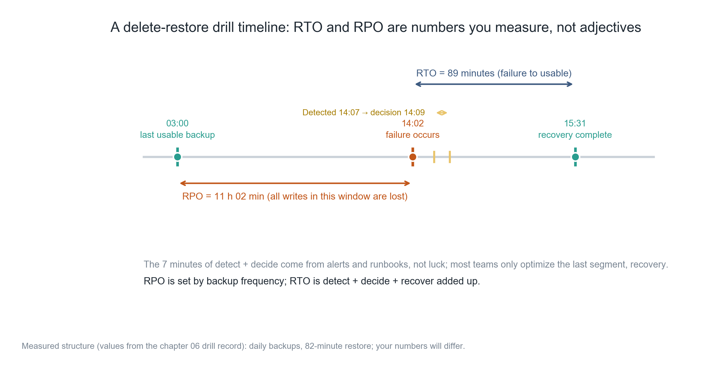
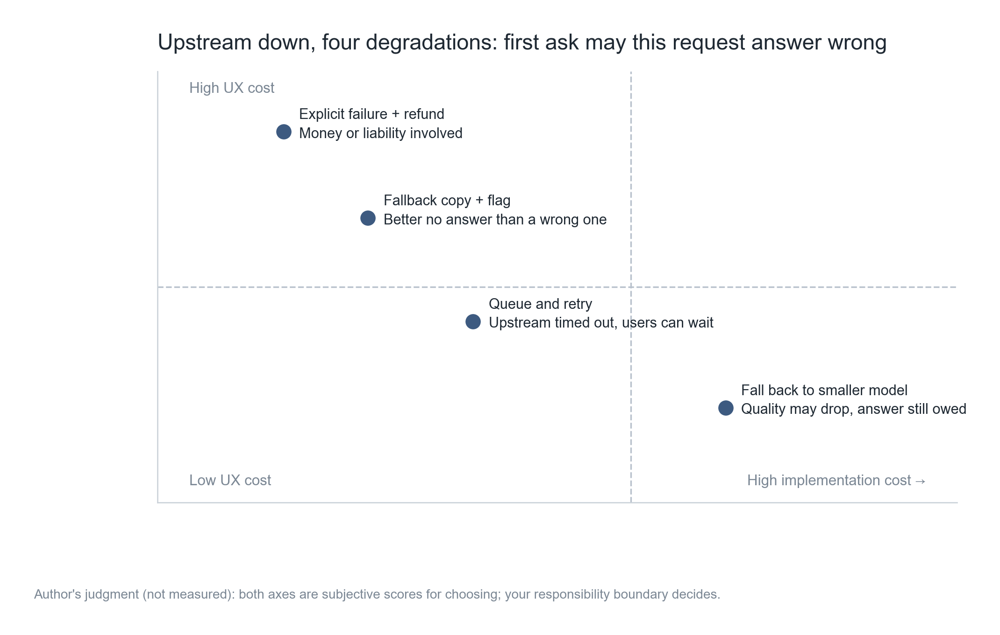
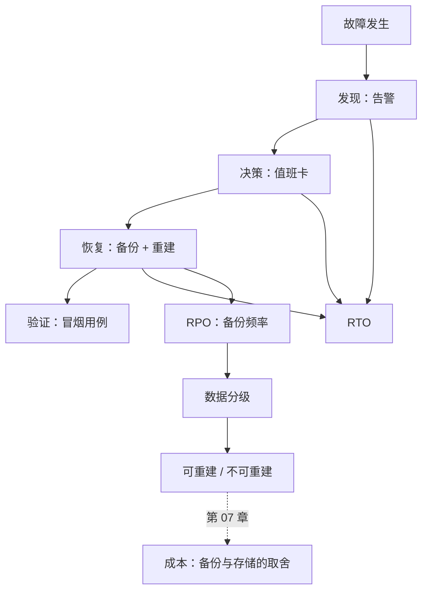

**English** | [中文](./ch06-disaster-recovery.zh.md)

# Chapter 06: Disaster Recovery — Backup Is Not the Same as Recovery

> **Chapter guide**: Backup is "I prepared"; recovery is "I did it". Between the two lies a whole set of drills. This chapter gives the business-derived method for RTO/RPO, data classification, the complete record of one real drop-table drill, and four degradation strategies for when upstream dependencies go down.
> **Prerequisites**: Chapter 04 (the third rollback layer is data), Chapter 05 (the "detection" segment's time comes from alerts).
> **Core learning objectives**:
> - Derive RTO/RPO from business language instead of copying industry numbers
> - Classify data and decide the backup strategy accordingly
> - Be able to run one recovery drill, obtain measured values, and judge whether to change the architecture or change the promise

---

## 1. Cognitive Anchor: Fire Drills Are Not Performed for Inspectors

### 1.1 An Afternoon of Dropping the Database

14:02, a user says in the group chat: "all my meeting records are gone."

You connect to the database and find the `meetings` table empty. Checking the operation log: at 13:58, to clean up test data you ran `DELETE FROM meetings WHERE created_at < '2026-10-17'`, with one wrong digit in the date — it should have been `2026-10-18`, and today is the 18th.

This means **all real data before the 18th was deleted**, including 1400 meetings from 63 paying users.

You remember you have daily backups. The 3 a.m. one is still there.

14:07, you find and confirm it. 14:09, you decide to restore. 14:12, you start downloading the backup. 15:31, the data is back. 15:48, you have verified key users' data and confirmed no secondary corruption.

**RPO 11 hours 02 minutes** (everything written between 3:00 and 14:02 is lost). **RTO 89 minutes.**


### 1.2 Intuition by Analogy: Drills and Real Fire

A person who has drilled will feel the doorknob first when there is a real fire; a person who has not drilled will look for their phone to film a video first.

This is not a difference in courage; it is **whether the actions have been rehearsed**. Recovering data is also a set of actions: find the backup, verify integrity, choose a restore point, execute the restore, rebuild indexes, verify the business. Every step has traps; only by stepping in them during a drill will you avoid sweating over documentation when it is real.

**The boundary of this analogy**: a fire drill costs time; a data drill costs "really deleting once" — many people do not dare, and so never learn whether their backup works.

---

## 2. First Principles: Two Numbers and One Drill

### 2.1 What RTO and RPO Really Are

| Metric | Definition | Who decides it | What the user feels |
| :--- | :--- | :--- | :--- |
| **RTO** | Time from failure occurrence to service restored | Detection speed + decision speed + recovery speed | "how long it was unusable" |
| **RPO** | The span of time allowed to be lost when failure occurs | Backup frequency / archival method | "how much was lost" |

These two numbers must be **derived from the business**, not pushed up from technical capability. The derivation questions are:

- "If a user loses one day of meeting records, will they ask for a refund?" → if yes, RPO must be < 24 hours.
- "If the service is down 2 hours, how many users will replace you that very night?" → beyond 5%, RTO must be pushed under 1 hour.

Technical capability is only a constraint, not a goal. **Decide first how much the business can tolerate, then see whether technology can do it; if not, change the product promise or change the architecture.**



*Figure 6-1: Note those 7 minutes of "detect + decide". Most teams only optimize the last segment "recover", because it looks most like "technical work"; but the first two segments are the real amplifiers — detect 10 minutes later, and RTO grows by 10 minutes directly.*

### 2.2 The Three Failures of Backup

| Failure | Symptom | Why it is common |
| :--- | :--- | :--- |
| **No backup** | The backup job was never configured, or configured but never enabled | At launch you were busy building features; backup was "later" |
| **Backed up but unverified** | The backup file exists, but is abnormally sized / empty / has wrong permissions | The job reports "success" but actually wrote a 0-byte file |
| **Verified but unrestorable** | The backup is complete, but restoring lacks extensions, permissions, or version compatibility | It was only ever "restored" on the same machine, never tried in a new environment |

The third is the deadliest, because it wears the coat of the first two's success. There is only one way to judge: **in a clean environment different from production, run a complete restore.**

### 2.3 Data Classification Decides the Backup Strategy

Not all data deserves a daily full backup. Three classes, ten times apart in cost:

| Class | Examples | What happens if lost | Strategy |
| :--- | :--- | :--- | :--- |
| **Rebuildable** | Cache, vector index, thumbnails | Slower, just regenerate | No backup; just make sure it can be rebuilt |
| **Rebuildable at a cost** | Intermediate transcription results, raw model outputs | Pay to re-run; users do not feel it | Weekly backup, or none at all |
| **Not rebuildable** | User audio, minutes body text, payment records | Churn, refunds, legal risk | Daily backup + off-site copy + regular drills |

The "Minutes" assistant's audio belongs to the third class (users upload once, and deletion is final), while the vector index belongs to the first class (it can be regenerated from the minutes text). **Many people back up the index too, wasting 60% of their storage spend.**

### 2.4 Dependency Single Points: What to Do When Upstream Dies

Your service is not an island. Transcription API, model API, object storage, payment channel — any one goes down and you must decide "how to handle this request".

Four strategies; first ask one question: "is this request allowed to answer wrong?"



*Figure 6-2: The horizontal axis is implementation cost, the vertical axis is experience cost. No single strategy is optimal in all scenarios — which one you choose depends on whether "the cost of answering wrong" or "the cost of waiting" is greater.*

| Strategy | Applies when | What the user sees | Cost |
| :--- | :--- | :--- | :--- |
| Queue and retry | Upstream timeouts, but the user can wait | "Processing, we will notify you shortly" | Needs a queue and notification mechanism |
| Degrade to a small model | Quality may drop but a result must be given | Slightly worse result, possibly with a notice | Needs a dual-model pipeline |
| Fallback text + marking | Better not to answer than to answer wrong | "This generation failed, please retry" | Poor experience, but no misleading |
| Explicit failure + refund | Involves money or legal liability | Explicit error + compensation | Commercial loss |

For the "Minutes" assistant: transcription down → queue (meeting records can wait 10 minutes); model down → degrade to the economy tier (slightly worse minutes are acceptable); both down → fallback and say so clearly (never return empty results).

---

## 3. Hands-on: Running a Real "Drop-Table"

### 3.1 Drill Design

Five steps; none can be skipped:

1. **Define the scenario**: delete all rows in `meetings` earlier than today (real SQL, not a simulation).
2. **Execute in staging**: use a de-identified copy of production data, not an empty local database.
3. **Time the whole thing**: start the watch at "detection", including the minutes you hesitated.
4. **Verify item by item**: not just "the data is back", but also related tables, indexes, foreign keys, and what users can see.
5. **Write it back into the docs**: put actual timings, sticking points, and fixes into the recovery handbook.

### 3.2 Run the Calculator

```bash
$ python code/ch06/rto_calc.py
```

### 3.3 Real Output

```text
=== 实测（一次演练，不是估算）===
RPO（最后一次可用备份 → 故障）　11 小时 02 分　← 这段时间的写入全丢
RTO（故障 → 恢复可用）　　　　　1 小时 29 分
  其中 发现 5 分 / 决策 2 分 / 恢复 82 分 / 验证 17 分

=== 这三段里，哪一段最值得改 ===
最长的是「恢复」：82.0 分，占 RTO 的 92%
  发现慢 → 加告警；决策慢 → 写值班卡；恢复慢 → 换备份方式或缩小数据量；验证慢 → 固化冒烟用例

=== 反推：如果业务要求 RTO ≤ 30 分钟 ===
  留给恢复的时间 = 30 - 5（发现）- 2（决策） = 23 分
  当前恢复耗时 82 分，超出 59 分。
  两条路：把数据量缩小到能在窗口内恢复，或改成「不恢复、直接切只读副本」。
```

### 3.4 Three Conclusions

**First, recovery takes 92%, but it has the least room to optimize.** Of the 82 minutes, 60 go to rebuilding the vector index — because the index has no separate backup and is rebuilt after being restored along with the data. The fix is to make the index a rebuildable asset: get the service up first, rebuild in the background. This step can push recovery down to around 25 minutes.

**Second, RPO 11 hours is the inevitable result of daily backups, not an accident.** To push it to 1 hour you must switch to hourly increments or continuous archiving (WAL streaming). The cost rises, but it is far cheaper than "losing 11 hours of meeting records".

**Third, a 30-minute RTO is impossible on the current architecture.** This is not something "a bit more effort" solves; it is a structural limit: the physical time for full restore + index rebuild is what it is. Either change the promise (tell users "recovered within 4 hours"), or change the architecture (read-only replica + sharded restore).

**This one is most worth remembering: when an RTO target cannot be met, first check whether the architecture is the thing blocking it.** If it is, writing it into the documentation beats drilling again and again.

### 3.5 Three Things to Change After the Drill

| What to change | Concrete action | How to verify |
| :--- | :--- | :--- |
| Backup frequency | Daily → hourly increments (user-content tables only) | Spot-check one time point; must restore to the hour |
| Recovery order | Restore the main table first to get the service up; rebuild indexes in the background | Record the two moments "service usable" and "index ready" |
| External promise | Write on the page "data kept 30 days; failure recovery target 4 hours" | Compare against measured values; the promise must not be better than the measurement |

The last action is often skipped, but it matters most: **a promise better than the measurement plants a trust crisis.**

---

## 4. Common Misconceptions and Correct/Incorrect Contrasts

| Easy pitfall | Why it goes wrong | The right mental model and practice |
| :--- | :--- | :--- |
| **"Having backups means having disaster recovery"** | Backup is an asset; recovery is a capability. The asset can be there while the capability is zero | Fully restore in a new environment once a quarter, timed and recorded |
| **"RTO/RPO are technical metrics"** | They are business promises at heart, decided by "how long users can tolerate" | Derive from the business first, then see if technology can do it; if not, change the promise or the architecture |
| **"All data must be backed up"** | Indexes, caches, and intermediates make up the bulk; backing them up is expensive and slows recovery | Classify first: rebuildable assets are not backed up; non-rebuildable ones go encrypted and off-site |
| **"A drill means really deleting; too dangerous"** | The cost of not drilling is "discovering the backup does not work on the day of the real deletion" | Drill in staging with a de-identified copy; production gets read-only verification only |
| **"When upstream dies, just error out; users will understand"** | Users do not understand "upstream"; they only understand "your product is broken" | Pick a degradation strategy by "is answering wrong allowed", and tell them clearly |

---

## 5. Chapter Summary and Local Knowledge Graph

### 5.1 Key Points

- **RTO = detection + decision + recovery**; the two most often ignored segments are the first two.
- **RPO is decided by backup frequency**; daily backup means 24 hours, no exceptions.
- **Of the three failures of backup**, the most dangerous is "verified but unrestorable" — it looks successful.
- **Data must be classified**; rebuildable assets are not backed up, saving a lot of money and recovery time.
- **Upstream dependencies need a degradation strategy**; which one depends on whether "answering wrong" or "waiting" costs more.

### 5.2 Concept Topology of This Chapter



---

## 6. Tiered Exercises and Reference Solutions

### Basic Consolidation (Tier 1: Intuition and Concept Check)

1. A product does a full backup daily at 03:00, and a failure occurred yesterday at 22:40. What is the RPO? If the business requires RPO ≤ 2 hours, what is the minimal change?

2. Judge whether this is true or false and explain why: "A recovery drill only needs to verify the row counts, not the business functions."

### Applied Practice (Tier 2: Reasoning and Hands-on Construction)

3. Run one recovery drill for your project, producing: the four RTO segment timings, the measured RPO, three sticking points, and three fixes to write into the docs.

4. For the four external services you depend on (transcription, model, storage, payment), pick one degradation strategy each, and write the exact copy the user would see.

### Deep Challenge (Tier 3: Boundary Conditions and Cross-Chapter Transfer)

5. Your product promises "data kept forever". One day a user demands deletion of all their data (a compliance requirement), but your backups still hold 30 days of historical copies. Analyze this contradiction, and give at least two solutions with their costs.

<details>
<summary><strong>Click to expand: reference answers and in-depth analysis for this chapter's exercises</strong></summary>

#### 1. RPO Calculation

Backup at 03:00, failure at 22:40 → RPO = 19 hours 40 minutes.

To push it under 2 hours, the minimal change: **do an incremental backup every 2 hours for the "not rebuildable" table** (no need to increment the whole database). The cost is higher job frequency and storage cost, but recovery time barely changes (incremental restore + one full).

Note: do not switch the whole database to 2-hour intervals just to satisfy RPO; that slows recovery (more increments to merge) and actually worsens RTO.

#### 2. True or False

**Wrong.** Correct row counts do not mean the business works:

- Foreign keys broken (parent rows exist, child rows missing);
- Indexes not rebuilt, queries time out;
- Audio in the storage bucket did not come back; the minutes text is there but will not open;
- Sequence/auto-increment ID collisions, new writes fail.

A passing verification is "the user can complete one full operation": log in → open a historical meeting → see the minutes → export. Only when these four steps work is it called recovered.

#### 3. Scoring Points for the Drill Record

- All four segments have concrete minute counts (not "very fast");
- At least one "sticking point" is spelled out (for example: cannot find the backup's key);
- Fixes must land in docs or config, not "pay attention later".

#### 4. Degradation Strategies and Copy

| Dependency | Strategy | Copy |
| :--- | :--- | :--- |
| Transcription | Queue and retry | "Audio received; the transcription queue is busy. Expected completion within 10 minutes; we will email you when done." |
| Model | Degrade to economy tier | "Currently generating in fast mode; the summary may be slightly brief. You can regenerate the full version with one click later." |
| Storage | Explicit failure | "Audio upload failed; please check your network and retry. Saved meetings are unaffected." |
| Payment | Explicit failure + retry | "Payment did not complete; your subscription status is unchanged. Please retry with another payment method." |

What the copy has in common: **state clearly "what happened, whether your data is safe, what to do next"**. Missing any one, users will come asking.

#### 5. The Contradiction Between "Kept Forever" and "Right to Delete"

The essence of the contradiction: **a backup is a "point-in-time snapshot" while deletion is "a modification of the current state"** — the two conflict by design.

Two solutions:

| Solution | Action | Cost |
| :--- | :--- | :--- |
| **Backup retention + promise revision** | Write explicitly "purged from backups within 30 days of deletion", and execute it after backup rotation | The "kept forever" wording must be revised; copies still exist for 30 days, so encryption and access control must be explained |
| **Crypto-shredding** | Each user's data is encrypted with its own key; on deletion destroy the key, turning the ciphertext in backups unreadable | Requires reworking the key-management architecture; complex to implement, but gives true "delete means dead" |

The first is the feasible solution for most small teams; the second is the right one when compliance demands are high. Either way, **the words "kept forever" should not appear on the page** — it cannot be done, and it becomes a handle against you when a user asks for deletion.

</details>

---

## 7. Authoritative Sources and Further Reading (Authoritative References)

1. **DORA**: [DORA](https://dora.dev/) - the definitions and norms of this chapter are anchored here (verification date: `2026-10-23`).
2. **The Twelve-Factor App**: [The Twelve-Factor App](https://12factor.net/) - the definitions and norms of this chapter are anchored here (verification date: `2026-10-23`).
3. **NIST CSRC**: [NIST CSRC](https://csrc.nist.gov/) - the definitions and norms of this chapter are anchored here (verification date: `2026-10-23`).

> Measurement note: the sources above are used to anchor **definitions and norms**, not to extrapolate risk probabilities. Before quoting any number, check the source's year and its denominator.
