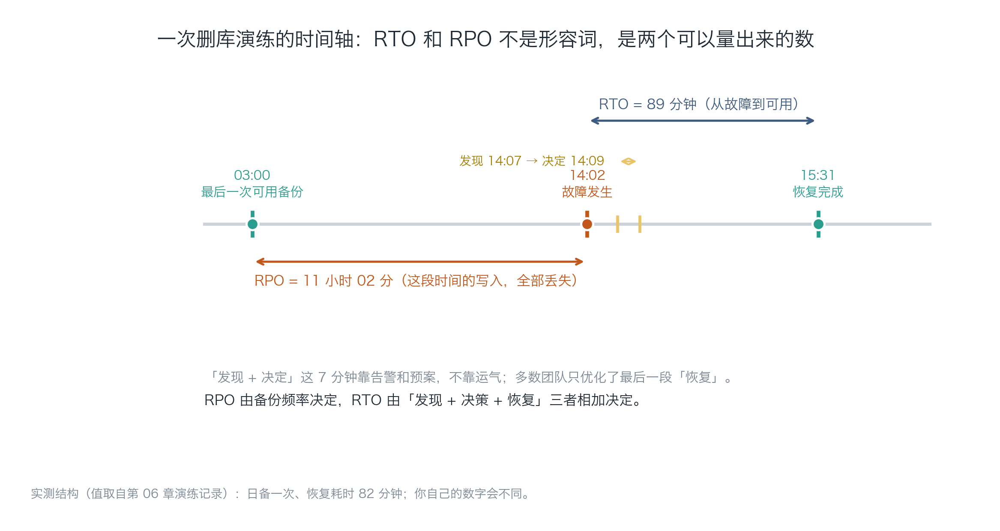
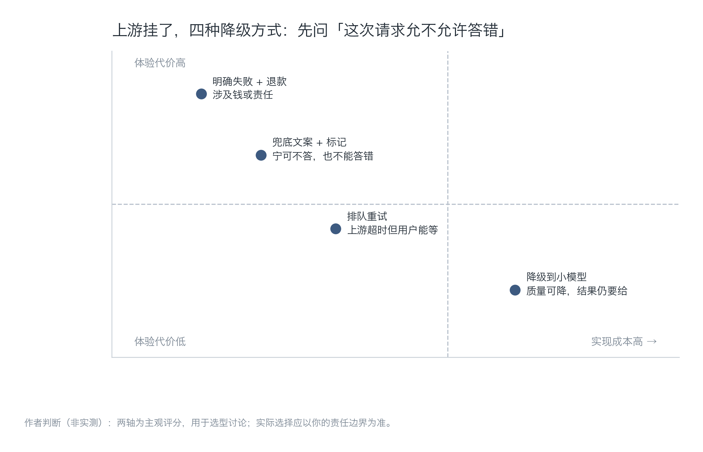
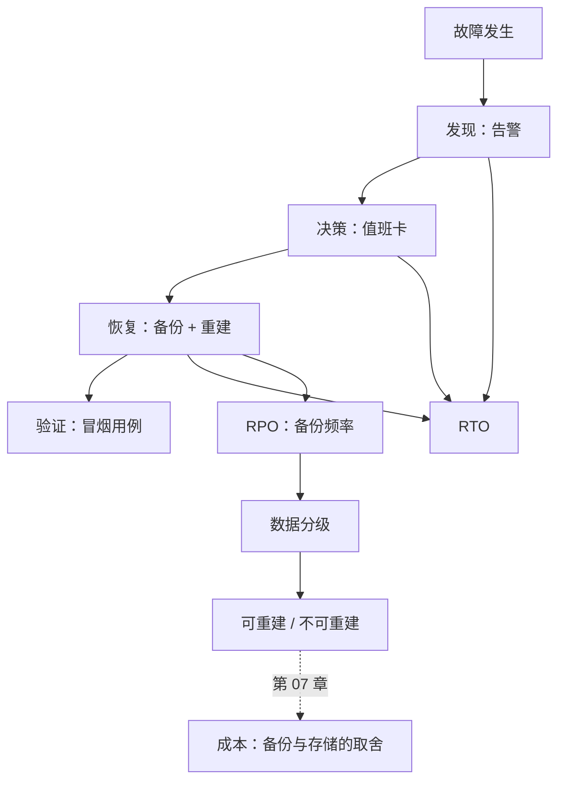

[English](./ch06-disaster-recovery.md) | **中文**

# 第 06 章：灾备与恢复——备份不等于恢复

> **本章导读**：备份是"我准备了"，恢复是"我做到了"。这两件事之间隔着一整套演练。本章给出 RTO/RPO 的业务反推法、数据分级、一次真实删库演练的完整记录，以及上游依赖挂掉时的四种降级策略。
> **前置知识**：第 04 章（回滚的第三层就是数据）、第 05 章（"发现"这一段的时间来自告警）。
> **核心学习目标**：
> - 能用业务语言反推 RTO/RPO，而不是照抄行业数字
> - 能对数据分级，并据此决定备份策略
> - 能执行一次恢复演练，拿到实测值，并判断该改架构还是改承诺

---

## 1. 认知锚点：消防演习不是演给检查看的

### 1.1 一个删库的下午

14:02，一个用户在群里说："我的会议记录全没了。"

你连上数据库，发现 `meetings` 表是空的。查操作日志：13:58，你为了清理测试数据，执行了一条 `DELETE FROM meetings WHERE created_at < '2026-10-17'`，日期写错了一位——应该是 `2026-10-18`，而今天是 18 号。

这意味着**所有 18 号之前的真实数据都被删了**，包括 63 个付费用户的 1400 场会议。

你想起自己有每日备份。凌晨 3 点那份还在。

14:07，你发现并确认。14:09，你决定恢复。14:12，你开始下载备份。15:31，数据回来了。15:48，你验证完关键用户的数据，确认没有二次损坏。

**RPO 11 小时 02 分**（3:00 到 14:02 之间的写入全部丢失）。**RTO 89 分钟。**


### 1.2 直觉类比：演习与真火

演练过的人，在真着火时会先摸门把手；没演练过的人，会先找手机拍视频。

这不是勇气差异，是**动作是否已经被排练过**。恢复数据也是一组动作：找到备份、验证完整性、选择还原点、执行还原、重建索引、验证业务。每一步都有坑，只有在演练时踩过，真出事时才不会一边查文档一边冒汗。

**类比的边界**：火灾演练的成本是时间，数据演练的成本是"真的删一次"——很多人不敢，于是永远不知道自己的备份能不能用。

---

## 2. 第一性原理：两个数字与一次演练

### 2.1 RTO 与 RPO 到底是什么

| 指标 | 定义 | 谁决定它 | 用户感知 |
| :--- | :--- | :--- | :--- |
| **RTO** | 从故障发生到服务恢复可用的时间 | 发现速度 + 决策速度 + 恢复速度 | "多久不能用" |
| **RPO** | 故障发生时，允许丢失的时间跨度 | 备份频率 / 归档方式 | "丢了多少东西" |

这两个数字必须**从业务反推**，而不是从技术能力正推。反推的问法是：

- "如果用户丢了一天的会议记录，他会退款吗？" → 会，说明 RPO 必须 < 24 小时。
- "如果服务停 2 小时，会有多少用户当晚就换掉你？" → 超过 5%，说明 RTO 要压到 1 小时以内。

技术能力只是约束，不是目标。**先定业务能忍多少，再看技术能不能做到，做不到就改产品承诺或改架构。**



*图 6-1：注意"发现 + 决定"那 7 分钟。多数团队只优化最后一段"恢复"，因为那一段最像"技术活"；但前两段才是真正的放大器——发现晚 10 分钟，RTO 直接多 10 分钟。*

### 2.2 备份的三种失败

| 失败 | 现象 | 为什么常见 |
| :--- | :--- | :--- |
| **没备** | 备份任务从来没配过，或配了没启用 | 上线时忙着做功能，备份是"以后再说" |
| **备了没验** | 备份文件存在，但大小异常 / 是空的 / 权限错误 | 任务显示"成功"，实际写了个 0 字节文件 |
| **验了恢复不了** | 备份完整，但还原时缺扩展、缺权限、版本不兼容 | 只在同一台机器上"恢复"过，从没在新环境试过 |

第三种最致命，因为它披着前两种成功的外衣。判断方法只有一个：**在干净的、与生产不同的环境里，完整走一次还原。**

### 2.3 数据分级决定备份策略

不是所有数据都值得每天全量备份。分三级，成本差十倍：

| 级别 | 例子 | 丢了会怎样 | 策略 |
| :--- | :--- | :--- | :--- |
| **可重建** | 缓存、向量索引、缩略图 | 慢一点，重新生成即可 | 不备份，只保证能重建 |
| **可重建但有成本** | 转写中间结果、模型原始输出 | 花钱重跑，用户无感 | 每周备份，或干脆不备 |
| **不可重建** | 用户音频、纪要正文、支付记录 | 用户流失、退款、法律风险 | 每日备份 + 异地副本 + 定期演练 |

「纪要助手」的音频属于第三级（用户只上传一次，删了就没了），而向量索引属于第一级（可以用纪要正文重新生成）。**很多人把索引也备份，白花了 60% 的存储费。**

### 2.4 依赖单点：上游挂了怎么办

你的服务不是孤岛。转写 API、模型 API、对象存储、支付通道，任何一个挂了，你都得决定"这次请求怎么处理"。

四种策略，先问一句"这次请求允不允许答错"：



*图 6-2：横轴是实现成本，纵轴是体验代价。没有一种策略在所有场景都最优——选哪种取决于"答错的代价"和"等待的代价"哪个更大。*

| 策略 | 适用 | 用户看到什么 | 代价 |
| :--- | :--- | :--- | :--- |
| 排队重试 | 上游超时，但用户能等 | "正在处理，稍后通知你" | 需要队列与通知机制 |
| 降级到小模型 | 质量可降，结果仍要给 | 结果略差，可能有提示 | 需要双模型链路 |
| 兜底文案 + 标记 | 宁可不答，也不能答错 | "本次生成失败，请重试" | 体验差，但不误导 |
| 明确失败 + 退款 | 涉及钱或法律责任 | 明确报错 + 补偿 | 商业损失 |

对「纪要助手」：转写挂了 → 排队（会议记录可以等 10 分钟）；模型挂了 → 降级到经济档（纪要差一点可以接受）；两者都挂 → 兜底并明确告知（不能给空结果）。

---

## 3. 手把手：做一次真实的"删库"

### 3.1 演练设计

五个步骤，一步都不能省：

1. **定义场景**：删掉 `meetings` 表中早于今天的所有行（真实 SQL，不是模拟）。
2. **在预发环境执行**：用生产数据的脱敏副本，不是本地空库。
3. **全程计时**：从"发现"开始掐表，包括你犹豫的那几分钟。
4. **逐项验证**：不只验证"数据回来了"，还要验证关联表、索引、外键、用户能看到。
5. **写回文档**：把实际耗时、卡点、改法写进恢复手册。

### 3.2 运行计算器

```bash
$ python code/ch06/rto_calc.py
```

### 3.3 真实输出

```text
=== 实测（一次演练，不是估算）===
RPO（最后一次可用备份 → 故障）　11 小时 02 分　← 这段时间的写入全丢
RTO（故障 → 恢复可用）　　　　　1 小时 29 分
  其中 发现 5 分 / 决策 2 分 / 恢复 82 分 / 验证 17 分

=== 这三段里，哪一段最值得改 ===
最长的是「恢复」：82.0 分，占 RTO 的 92%
  发现慢 → 加告警；决策慢 → 写值班卡；恢复慢 → 换备份方式或缩小数据量；验证慢 → 固化冒烟用例

=== 反推：如果业务要求 RTO ≤ 30 分钟 ===
  留给恢复的时间 = 30 - 5（发现）- 2（决策） = 23 分
  当前恢复耗时 82 分，超出 59 分。
  两条路：把数据量缩小到能在窗口内恢复，或改成「不恢复、直接切只读副本」。
```

### 3.4 三个结论

**第一，恢复占了 92%，但它的优化空间最小。** 82 分钟里，60 分钟在重建向量索引——因为索引没有单独备份，是跟着数据一起还原后重建的。改法是把索引改为可重建资产，先让服务可用，再后台重建。这一步能把恢复压到 25 分钟左右。

**第二，RPO 11 小时是日备的必然结果，不是意外。** 想压到 1 小时，就得改成每小时增量或持续归档（WAL 流式）。成本会上升，但比"丢 11 小时会议记录"便宜得多。

**第三，30 分钟的 RTO 在现有架构下做不到。** 这不是"再努力一点"能解决的，是结构性限制：全量还原 + 索引重建的物理时间摆在那里。要么改承诺（对用户写"4 小时内恢复"），要么改架构（只读副本 + 分片恢复）。

**这一条最值得记住：RTO 目标定不下来的时候，先看它是不是被架构卡住了。** 如果是，写进文档比反复演练有用。

### 3.5 演练之后要改的三样东西

| 改什么 | 具体动作 | 验证方式 |
| :--- | :--- | :--- |
| 备份频率 | 日备 → 每小时增量（仅用户内容表） | 抽查一个时间点，能还原到小时级 |
| 恢复顺序 | 先恢复主表让服务可用，索引后台重建 | 记录"服务可用"与"索引就绪"两个时刻 |
| 对外承诺 | 页面上写"数据保留 30 天，故障恢复目标 4 小时" | 与实测值对照，承诺不得优于实测 |

最后一个动作经常被跳过，但它最重要：**承诺优于实测，等于给自己埋一次信任危机。**

---

## 4. 常见误区与正反例对比

| 容易踩坑的误区 | 为什么会出错 | 正确的心智模型与做法 |
| :--- | :--- | :--- |
| **"有备份就有灾备"** | 备份是资产，恢复是能力；资产在，能力可能为零 | 每季度在新环境完整还原一次，计时并记录 |
| **"RTO/RPO 是技术指标"** | 它们本质是商业承诺，由"用户能忍多久"决定 | 先从业务反推，再看技术能否做到，做不到就改承诺或改架构 |
| **"所有数据都要备份"** | 索引、缓存、中间结果占了大头，备份它们既贵又拖慢恢复 | 先分级：可重建的不备，不可重建的加密异地 |
| **"演练等于真删，太危险"** | 不演练的代价是"真删那天才发现备份不能用" | 在预发环境用脱敏副本演练；生产环境只做只读校验 |
| **"上游挂了就报错，用户能理解"** | 用户不理解"上游"，只理解"你的产品坏了" | 按"允不允许答错"选降级策略，并明确告知 |

---

## 5. 本章小结与局部知识图谱

### 5.1 核心要点

- **RTO = 发现 + 决策 + 恢复**，三段里最容易被忽略的是前两段。
- **RPO 由备份频率决定**，日备就是 24 小时，没有例外。
- **备份的三种失败**里，最危险的是"验了恢复不了"——它看起来是成功的。
- **数据要分级**，可重建的资产不备份，能省一大笔钱和恢复时间。
- **上游依赖要有降级策略**，选哪种取决于"答错"和"等待"哪个代价更大。

### 5.2 本章概念拓扑



---

## 6. 分级通关练习与参考解析

### 基础巩固题（Tier 1：直觉与概念核验）

1. 某产品每日 03:00 全量备份，昨天 22:40 发生故障。问 RPO 是多少？如果业务要求 RPO ≤ 2 小时，最小改动是什么？

2. 判断对错并说明理由："恢复演练只需要验证数据条数对不对，不需要验证业务功能。"

### 动手应用题（Tier 2：推演与实操构建）

3. 给你的项目做一次恢复演练，产出：RTO 四段耗时、RPO 实测值、三个卡点、三条改写进文档的改法。

4. 给你依赖的四个外部服务（转写、模型、存储、支付）各选一种降级策略，并写出用户会看到的具体文案。

### 深度挑战题（Tier 3：边界条件与跨章迁移）

5. 你的产品承诺"数据永久保留"。某天用户要求删除他的全部数据（合规要求），但你的备份里还有 30 天的历史副本。请分析这个矛盾，并给出至少两种解法及各自的代价。

<details>
<summary><strong>点击展开：本章练习参考答案与深度解析</strong></summary>

#### 1. RPO 计算

03:00 备份，22:40 故障 → RPO = 19 小时 40 分。

要压到 2 小时，最小改动：**对"不可重建"的那张表做每 2 小时增量备份**（不必全库增量）。代价是备份任务频率上升、存储成本上升，但恢复时间基本不变（增量还原 + 一次全量）。

注意：不要为了满足 RPO 把全库都改成 2 小时一次，那会让恢复变慢（要合并更多增量），反而恶化 RTO。

#### 2. 判断对错

**错。** 数据条数对，不等于业务可用：

- 外键断了（父表有、子表缺）；
- 索引没重建，查询超时；
- 存储桶里的音频没回来，纪要正文在但点不开；
- 序列/自增 ID 冲突，新写入失败。

合格的验证是"用户能完成一次完整操作"：登录 → 打开一场历史会议 → 看到纪要 → 导出。这四步走通，才叫恢复。

#### 3. 演练记录的评分要点

- 四段时间都有具体分钟数（不是"很快"）；
- 至少写清一个"卡点"（例如：找不到备份的密钥）；
- 改法要能落到文档或配置里，不是"以后注意"。

#### 4. 降级策略与文案

| 依赖 | 策略 | 文案 |
| :--- | :--- | :--- |
| 转写 | 排队重试 | "音频已收到，转写队列繁忙，预计 10 分钟内完成，完成后会邮件通知你。" |
| 模型 | 降级到经济档 | "当前使用快速模式生成，摘要可能略简；稍后可一键重新生成完整版。" |
| 存储 | 明确失败 | "音频上传失败，请检查网络后重试。已保存的会议不受影响。" |
| 支付 | 明确失败 + 重试 | "支付未完成，你的订阅状态没有变化。请更换支付方式重试。" |

文案的共同点：**说清"发生了什么、你的数据有没有事、下一步做什么"**。缺任何一项，用户都会来问。

#### 5. "永久保留"与"删除权"的矛盾

矛盾的本质：**备份是"时间点快照"，删除是"对当前状态的修改"**，两者在设计上就冲突。

两种解法：

| 解法 | 做法 | 代价 |
| :--- | :--- | :--- |
| **备份保留期 + 承诺修正** | 明确写"删除后 30 天内从备份中彻底清除"，并在备份轮转后执行 | 需要修正"永久保留"的表述；30 天内仍有副本，需说明加密与访问控制 |
| **加密擦除（crypto-shredding）** | 每个用户的数据用独立密钥加密；删除时销毁密钥，备份里的密文变成不可读 | 需要改密钥管理架构；实现复杂，但能真正"删除即失效" |

第一种是多数小团队的可行解，第二种是合规要求高时的正解。无论哪种，**"永久保留"这个词都不该出现在页面上**——它既做不到，也会在用户要求删除时变成把柄。

</details>

---

## 7. 本章权威参考信源与延伸阅读 (Authoritative References)

1. **DORA**：[DORA](https://dora.dev/) - 本章的定义与规范以此为锚（核验日期：`2026-10-23`）。
2. **The Twelve-Factor App**：[The Twelve-Factor App](https://12factor.net/) - 本章的定义与规范以此为锚（核验日期：`2026-10-23`）。
3. **NIST CSRC**：[NIST CSRC](https://csrc.nist.gov/) - 本章的定义与规范以此为锚（核验日期：`2026-10-23`）。

> 口径提示：以上信源用于锚定**定义与规范**，不用于外推风险概率。引用任何数字前，先核对来源年份与分母。
