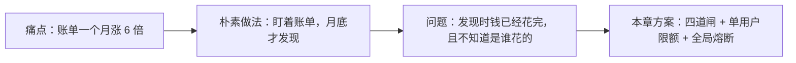
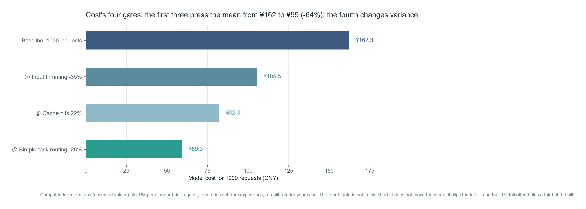
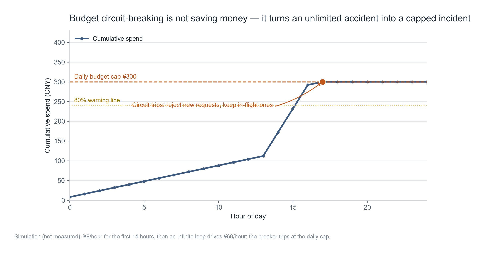
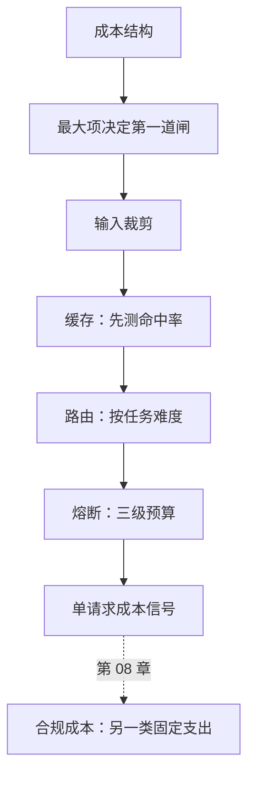

**English** | [中文](./ch07-cost-engineering.zh.md)

# Chapter 07: Cost Engineering — Budgets, Routing, Circuit Breaking

> **Chapter guide**: Cost is not a number; it is a distribution: most requests are cheap, a few are expensive, and a tiny fraction are absurdly expensive. This chapter gives four gates; the first three change the mean, the fourth changes the variance, and it explains why in this book's case the first gate is not "save tokens".
> **Prerequisites**: Chapter 02 (cost structure), Chapter 05 (token rate and per-request cost signals).
> **Core learning objectives**:
> - Master the order of the four gates and the conditions each applies to
> - Be able to design model routing "by task difficulty", not "by user tier"
> - Be able to implement per-user daily budget + global circuit breaker, and verify it really blocks

---

## 1. Cognitive Anchor: The Meter and the Circuit Breaker Are Two Different Things

### 1.1 A Month-End Surprise

Last month you spent 380 yuan on model calls. This month the bill is 2400.

You combed the logs and found no anomalous requests. User count grew only 30%. It took you half a day to find out: someone shared your product in a group chat, a batch of new users arrived, and one of them split a 3-hour interview recording into 20 segments and uploaded them repeatedly, each segment running the full pipeline — including repeated transcription and repeated summarization.

No single part of the system "erred". It simply **had no upper bound**.



### 1.2 Intuition by Analogy: Electricity Meter and Circuit Breaker

The meter tells you how much you spent; the circuit breaker cuts the power before it burns. Most people only installed a meter — so they can say precisely "we overspent by 2000 this month", but cannot stop it happening again next month.

**The boundary of this analogy**: electricity is a commodity, every kilowatt-hour costs the same; tokens are differentiated goods, the same word count can differ 20x in price. So software also needs a "routing" layer that electricity prices do not have.

---

## 2. First Principles: The Order of the Four Gates Cannot Be Shuffled

### 2.1 The Four Gates

| Order | Gate | Mechanism | What it changes | Return on investment |
| :--- | :--- | :--- | :--- | :--- |
| 1 | Input trimming | Send less unnecessary context, skip silence, compress long text | The mean | Highest (costs no money, only design) |
| 2 | Caching | Reuse results for identical/similar requests | The mean | High (depends on repeat rate) |
| 3 | Model routing | Simple tasks go to cheap models | The mean | Medium (needs tiering and evaluation) |
| 4 | Budget circuit breaker | Reject once over the cap | The variance | Mandatory (the backstop) |

The logic of the order is simple: **do the free things first, then the ones that cost money, and the ones that hurt experience last.** The circuit breaker rejects users, so it comes last; but without it the first three are all wasted — one infinite loop can eat a month of optimization results.



*Figure 7-1: This figure only draws the model-cost part (1000 requests compressed from 162.3 to 59.3). Note the caption: the fourth gate is not in the figure, because it does not change the mean; it only truncates the tail.*

### 2.2 But the First Gate Is Not Necessarily "Save Tokens"

Chapter 02 calculated a result: in the "Minutes" assistant's per-request cost, transcription is 62% and the model only 28%.

This means — **if your first reaction is "compress the prompt", you can only affect part of that 28%.** The real first gate is:

- Skip silence (a 50-minute meeting often has only 35 minutes of actual speech, cutting transcription cost by 30% directly);
- Fingerprint and deduplicate repeatedly uploaded audio (the same person uploading the same clip over and over);
- Process long meetings in asynchronous segments to avoid re-running the whole thing.

None of these three is called "cost optimization"; they look like product optimization — but their effect saves 30% of the transcription spend.

**General conclusion: the order of the four gates is fixed, but what you do inside each gate depends on the biggest item in your cost structure. Calculate the structure first (Chapter 02), then pick the gate.**

### 2.3 Caching: Measure the Hit Rate Before Writing Code

Caching comes in two kinds:

| Type | Hit condition | Risk | Applies to |
| :--- | :--- | :--- | :--- |
| Exact cache | Input completely identical | Almost none | Idempotent endpoints, duplicate submissions |
| Semantic cache | Vector similarity above threshold | False hits (answering the wrong question) | Customer-service Q&A, FAQ |

Meeting scenarios have a naturally low repeat rate (every meeting is different); exact-cache hit rates are usually only 3%–8%. **Writing a cache system for a 5% hit rate has negative return.**

So the judging standard: **first compute the hit rate offline with a batch of real requests; only above 20% is it worth acting.** This number is not an industry standard; it is the threshold corresponding to "the cost of maintaining a cache (invalidation, versioning, consistency)".

### 2.4 Model Routing: By Task Difficulty, Not by User Tier

A common bad design is "paying users get the good model, free users get the bad model". It has two problems: free users have a bad experience → never convert; paying users are indiscriminately fed the expensive model → margin gets eaten.

The right way is to tier by **task difficulty**:

| Task | Basis | Route to |
| :--- | :--- | :--- |
| Short meeting (< 15 min), single speaker | Duration + speaker count | Economy tier |
| Regular meeting | Default | Standard tier |
| Long meeting, many people, technical terms | Duration > 60 min or speakers > 3 | Flagship tier |

The basis must be **available before the call** (duration, speaker count, whether the user clicked "high quality"), not "look at quality after generation" — by then the money is already spent.

Mis-tiering has two costs: downgrading hurts experience (users complain the summary got worse), upgrading hurts margin (cost triples). So every time you adjust routing rules, watch two metrics together: **summary adoption rate** and **per-request cost**.

### 2.5 Circuit Breaking: Three Budget Levels and Blast Radius

| Granularity | Cap | After triggering | Blast radius |
| :--- | :--- | :--- | :--- |
| Single session | e.g. 50k tokens | Refuse to continue, suggest a new session | One session |
| Single user per day | e.g. 3 yuan | Refuse new requests, say it resumes tomorrow | One user |
| Global per day | e.g. 300 yuan | Refuse all new requests, alert | All users |

The coarser the granularity, the larger the blast radius. So all three levels must exist: the per-user level stops abuse, the global level stops incidents (infinite loops, being farmed).

One detail is often missed: **circuit breaking must mean "reject new requests", not "make requests cheaper"**. Degradation is another layer; mixing them leads to "thought I tripped the breaker, but it is still spending".



*Figure 7-2: The first 14 hours are steady; at hour 14 an infinite loop appears, the spending slope steepens, and when the cumulative total hits 300 yuan the breaker trips and the curve flattens. That flat line is the entire meaning of "a cap".*

---

## 3. Hands-on: Installing the Circuit Breaker

### 3.1 Core Implementation

```python
# code/ch07/budget_guard.py（节选）
def charge(self, user: str, cost: float) -> tuple[bool, str]:
    if self.tripped:
        return False, "global_tripped"
    if self.user_spend.get(user, 0.0) + cost > self.per_user_daily:
        return False, "user_quota"
    if self.total + cost > self.global_daily:
        self.tripped = True
        return False, "global_budget"
    self.user_spend[user] = self.user_spend.get(user, 0.0) + cost
    self.total += cost
    return True, "ok"
```

Note the semantics of `charge`: **ask first, spend later**. Callers must call it before issuing the model request, not record it afterwards. The record-afterwards style overspends under concurrency, and "money already spent cannot be refunded".

### 3.2 Real Run Output

```text
$ python code/ch07/budget_guard.py

=== 仿真：一个用户陷入重试循环 ===
单用户日预算 ¥3　全局日预算 ¥300

轮次        请求成本       该用户累计      全局累计  结果
1         0.46        0.46      0.46  放行
（第 2—5 轮略）
6         0.46        2.76      2.76  放行
7         0.46        2.76      2.76  拒绝（user_quota）

该用户被拦在 ¥2.76，相当于 6 次请求。
没有这道闸，重试循环会把 300 元的日预算在半小时内烧完。

=== 再模拟一个全局超支日：200 个用户同时陷入异常 ===
  03:00　全局累计 ¥276　已越过 80% 预警线
  04:00　全局累计 ¥300　已越过 80% 预警线
  熔断于第 4 小时触发，停在 ¥300。
  停在 ¥300 / ¥300：再下一个请求就会越过上限，所以被拒。
  这不是浪费，是边界：宁可卡在预算上，不要让账单翻倍。
```

### 3.3 Three Details Worth Noting

**First, the per-user level blocks at 2.76 rather than 3.00.** Because the next request costs 0.46 and the sum would exceed 3 yuan. This is the inherent behavior of "request-level" circuit breaking — it guarantees no overspend, at the cost of unused quota. If the business demands "use exactly the full quota", you must switch to dynamic trimming by remaining quota (more complex, tiny gain).

**Second, the global breaker trips at hour 4.** 200 users × 0.46 = 92 yuan/hour; the first 3 hours are 276 yuan, and the 4th hour hits the ceiling mid-way. **Note that it triggers "mid-hour"** — if you billed in hourly batches, you would overspend 92 yuan in one shot.

**Third, run the tests to verify the boundaries.**

```bash
$ python code/ch07/budget_guard.py --test
6 项断言全部通过：单用户限额、全局限额、熔断后拒绝、跨日重置。
```

These six assertions cover exactly the easiest places to get wrong: still allowing traffic after tripping, not resetting across days, and the per-user vs global checks in the wrong order.

### 3.4 The Time-Zone Trap of the Daily Reset

When should `reset_day()` be called? If by server local time, containers changing time zones make a mess; if by UTC, Chinese users' "today" starts at 8 in the morning.

The right way: **compute by the user's time zone, or standardize on one hard-coded time zone and document it.** The former costs a time-zone table to maintain; the latter makes some users feel "the quota reset time is weird".

Small teams pick the latter, but must write it on the help page: "Daily quota resets at 0:00 Beijing time."

---

## 4. Common Misconceptions and Correct/Incorrect Contrasts

| Easy pitfall | Why it goes wrong | The right mental model and practice |
| :--- | :--- | :--- |
| **"Cost optimization means compressing the prompt"** | If transcription/storage is the bulk, compressing the prompt only touches a small part | Calculate the cost structure first (Chapter 02), then decide what the first gate does |
| **"Add caching first; it is sure to save"** | In low-repeat scenarios the hit rate is single digits, and caching adds consistency problems | Compute the hit rate first; only act above 20% |
| **"Good model for paying users, bad model for free users"** | Free users never convert on a bad experience; paying users get the expensive model indiscriminately, hurting margin | Tier by task difficulty; quality needs are chosen explicitly by the user |
| **"Circuit breaking is the same as degradation"** | Degradation still spends money; circuit breaking does not; mixing them misleads | The breaker only "rejects"; degradation is another layer (Chapter 06) |
| **"A global cap is enough"** | One user can burn most of the budget within the global cap, dragging everyone down | All three budget levels are needed; finer granularity means smaller blast radius |

---

## 5. Chapter Summary and Local Knowledge Graph

### 5.1 Key Points

- **The four gates have a fixed order**: trim → cache → route → break; the first three change the mean, the fourth changes the variance.
- **What each gate does depends on the biggest cost item**; in long-audio scenarios the first gate is "transcribe less", not "fewer tokens".
- **Measure the cache hit rate first**; 20% is the empirical ROI threshold.
- **Route by task difficulty**; the basis must be available before the call.
- **Three budget levels**: session, user, global; the breaker only rejects, degradation is another layer.

### 5.2 Concept Topology of This Chapter



---

## 6. Tiered Exercises and Reference Solutions

### Basic Consolidation (Tier 1: Intuition and Concept Check)

1. A product has fixed cost 200 yuan/month, per-request cost 0.08 yuan, subscription 19 yuan/month. User A uses it 400 times a month, user B 30 times. Calculate each one's contribution margin, and explain why "the average" misleads.

2. Judge whether this is true or false and explain why: "For semantic caching, the lower the threshold the better; a higher hit rate saves more money."

### Applied Practice (Tier 2: Reasoning and Hands-on Construction)

3. Add "per-user daily budget + global daily budget" to your product, write a load-test script that pushes usage to 120% of the threshold, and record: whether the breaker trips before overspending, what the user sees, and whether recovery needs a human.

4. Design a three-tier routing rule set and run an offline evaluation on 50 real requests: whether the tiering is correct, how much cost dropped, how much quality dropped (manual scoring is fine).

### Deep Challenge (Tier 3: Boundary Conditions and Cross-Chapter Transfer)

5. Your global breaker tripped at 3 a.m. on Saturday, and you are the only one on call. The logs show one enterprise customer batch-processing 800 meetings. Give your handling order, and explain why "just raise the cap" is the worst option.

<details>
<summary><strong>Click to expand: reference answers and in-depth analysis for this chapter's exercises</strong></summary>

#### 1. Contribution Margin and the Average Trap

- A: 19 − 400 × 0.08 = 19 − 32 = **−13 yuan** (every extra A costs you 13)
- B: 19 − 30 × 0.08 = 19 − 2.4 = **16.6 yuan**

Average usage 215 times → average contribution margin 1.8 yuan, which looks like "razor-thin profit". But the real structure is "a few users with huge losses + most users healthy and profitable".

**The average adds two populations with opposite signs together**, producing a number that represents neither A nor B. The right practice is to look at the distribution (percentiles), not the mean.

#### 2. True or False

**Wrong.** The lower the threshold, the more false hits: a user asks about "the refund process", the system matches "the return process" and gives a wrong answer. The money saved is far less than the trust lost from one wrong answer.

The right practice is to annotate a batch of real queries, plot the "threshold — hit rate — accuracy" curve, and pick the lowest threshold whose accuracy is still acceptable. **The primary metric of caching is accuracy, not hit rate.**

#### 3. Scoring Points for the Load Test

All three must be recorded:

- Trip time (should be before 100% or exactly at 100%, not after 120%);
- User-side behavior (a clear error message, not a white screen or endless spinner);
- Recovery method (automatic across days, or manual reset needed).

If after tripping the user sees "unknown error", the load test does not pass — **the product experience of circuit breaking is part of circuit breaking**.

#### 4. How to Run the Routing Evaluation

The key is the words "offline evaluation": run the tiering rules over historical requests first, have a human look at 50 results, confirm no obvious mis-tiering, then go live. After launch compare the two metric groups (adoption rate, per-request cost) for a week.

If cost drops 30% but adoption drops 15%, the tiering is too aggressive — step back one tier. This trade-off has no universal answer; it depends on how quality-sensitive your users are.

#### 5. Handling a 3 a.m. Trip

The order should be:

1. **Confirm the blast radius first**: are all users rejected, or only this customer? (A global trip wrongly hits everyone)
2. **Restore service first, settle accounts after**: temporarily raise the global cap to a safe value (say 2x), while rate-limiting that customer separately.
3. **Give that customer a separate quota or route to a human**: batch processing by an enterprise customer is a legitimate need and should not be wrongly hit by global rules.
4. **Change the rules afterwards**: add "per-customer hourly quota" to the budget system so it does not collide next time.

Why "just raise the cap" is worst: it turns "one customer's anomaly" into "everyone's risk". Next time a real incident happens, your cap is already meaningless. The right practice is **to raise the fineness of granularity, not the total allowance**.

</details>

---

## 7. Authoritative Sources and Further Reading (Authoritative References)

1. **The Twelve-Factor App**: [The Twelve-Factor App](https://12factor.net/) - the definitions and norms of this chapter are anchored here (verification date: `2026-10-23`).
2. **Stripe Idempotent Requests**: [Stripe Idempotent Requests](https://stripe.com/docs/api/idempotent_requests) - the definitions and norms of this chapter are anchored here (verification date: `2026-10-23`).
3. **DORA**: [DORA](https://dora.dev/) - the definitions and norms of this chapter are anchored here (verification date: `2026-10-23`).

> Measurement note: the sources above are used to anchor **definitions and norms**, not to extrapolate risk probabilities. Before quoting any number, check the source's year and its denominator.
