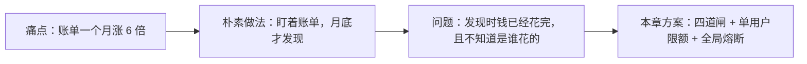
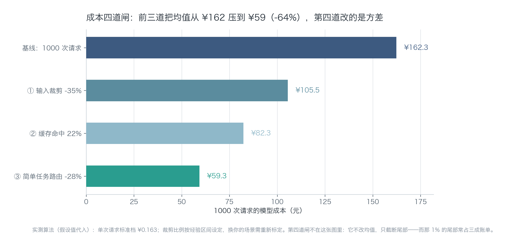
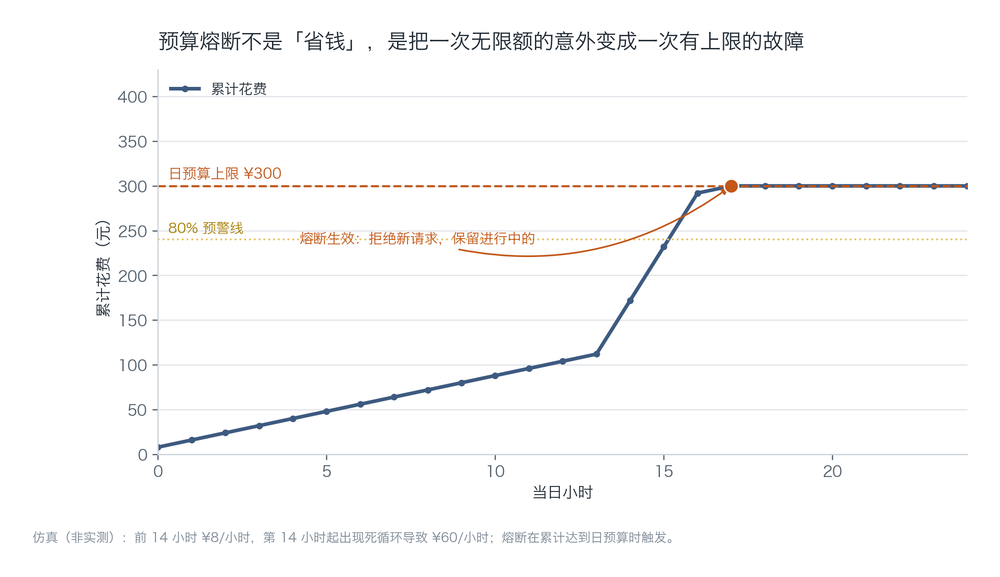
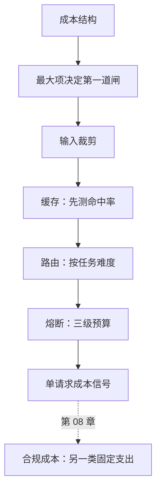

[English](./ch07-cost-engineering.md) | **中文**

# 第 07 章：成本工程——预算、路由、熔断

> **本章导读**：成本不是一个数字，是一个分布：大部分请求很便宜，少数请求很贵，极小部分请求贵到离谱。本章给出四道闸，前三道改均值，第四道改方差，并说明在本书的案例里为什么第一道闸不是"省 token"。
> **前置知识**：第 02 章（成本结构）、第 05 章（token 速率与单请求成本信号）。
> **核心学习目标**：
> - 掌握四道闸的顺序与各自的适用条件
> - 能设计"按任务难度"的模型路由，而不是"按用户等级"
> - 能实现单用户日预算 + 全局熔断，并验证它真的会拦

---

## 1. 认知锚点：电表和空气开关是两样东西

### 1.1 一个月底的惊讶

你上个月花了 380 元在模型调用上。这个月，账单是 2400。

你翻遍日志，没找到异常请求。用户数只涨了 30%。你花了半天才发现：有人在群里分享了你的产品，一批新用户进来，其中一个人把 3 小时的访谈录音切成 20 段重复上传，每一段都跑完整链路——包括重复的转写和重复的摘要。

系统没有任何一环"出错"。它只是**没有上限**。



### 1.2 直觉类比：电表与空气开关

电表让你知道花了多少；空气开关在烧起来之前断电。多数人只装了电表——所以他们能准确说出"这个月超支了 2000"，但阻止不了下个月再超一次。

**类比的边界**：电是标准品，每一度价格一样；token 是差分品，同样的字数可能差 20 倍价钱。所以软件里还需要"路由"这一层，电价没有。

---

## 2. 第一性原理：四道闸的顺序不能乱

### 2.1 四道闸

| 顺序 | 闸 | 机制 | 改的是 | 投入产出 |
| :--- | :--- | :--- | :--- | :--- |
| ① | 输入裁剪 | 少送不必要的上下文、跳过静音段、压缩长文 | 均值 | 最高（不花钱，只花设计） |
| ② | 缓存 | 相同/相似请求复用结果 | 均值 | 高（取决于重复率） |
| ③ | 模型路由 | 简单任务走便宜模型 | 均值 | 中（需要分档与评估） |
| ④ | 预算熔断 | 超过上限就拒绝 | 方差 | 必须有（兜底） |

顺序的道理很简单：**先做不花钱的，再做花钱的，最后做会伤体验的。** 熔断会拒绝用户，所以它排最后；但没有它，前三道都白做——因为一次死循环能吃掉一个月的优化成果。



*图 7-1：这张图只画了模型成本部分（1000 次请求从 162.3 压到 59.3）。注意图注：第四道闸不在图里，因为它不改均值，只截断尾部。*

### 2.2 但第一道闸未必是"省 token"

第 02 章算过一个结果：在「纪要助手」的单次成本里，转写占 62%，模型只占 28%。

这意味着——**如果你的第一反应是"压缩 prompt"，你只能影响那 28% 里的一部分。** 真正该做的第一道闸是：

- 跳过静音段（一场 50 分钟的会，实际有语音的常只有 35 分钟，转写成本直接降 30%）；
- 对重复上传的音频做指纹去重（同一个人反复传同一段）；
- 长会议分段异步处理，避免整段重跑。

这三件事都不叫"成本优化"，它们看起来像产品优化——但它们的效果是省下 30% 的转写费。

**通用结论：四道闸的顺序是固定的，但每道闸里做什么，取决于你成本结构里最大的那一项。先算结构（第 02 章），再选闸。**

### 2.3 缓存：先测命中率，再写代码

缓存分两类：

| 类型 | 命中条件 | 风险 | 适用 |
| :--- | :--- | :--- | :--- |
| 精确缓存 | 输入完全相同 | 几乎无 | 幂等接口、重复提交 |
| 语义缓存 | 向量相似度超过阈值 | 误命中（答非所问） | 客服问答、FAQ |

会议场景的重复率天然很低（每场会都不同），精确缓存命中率通常只有 3%—8%。**为 5% 的命中率写一套缓存系统，投入产出是负的。**

所以判断标准是：**先在线下用一批真实请求算命中率，超过 20% 才值得动手。** 这个数字不是行业标准，是"维护一套缓存（失效、版本、一致性）的成本"对应的门槛。

### 2.4 模型路由：按任务难度，不按用户等级

一个常见的错误设计是"付费用户走好模型，免费用户走差模型"。它有两个问题：免费用户体验差 → 永远不转化；付费用户被无差别地喂贵模型 → 毛利被吃掉。

正确做法是按**任务难度**分档：

| 任务 | 判断依据 | 路由到 |
| :--- | :--- | :--- |
| 短会议（< 15 分钟）、单人发言 | 时长 + 说话人数 | 经济档 |
| 常规会议 | 默认 | 标准档 |
| 长会议、多人、含专业术语 | 时长 > 60 分钟或说话人 > 3 | 旗舰档 |

判断依据要**在调用前就能拿到**（时长、说话人数、用户是否点了"高质量"），不能是"生成完再看质量"——那时候钱已经花了。

分档错误有两种代价：降级伤了体验（用户投诉摘要变差），升级伤了毛利（成本翻三倍）。所以每次调整路由规则，都要同时看两个指标：**摘要采纳率** 与 **单请求成本**。

### 2.5 熔断：三级预算与爆炸半径

| 粒度 | 上限 | 触发后 | 爆炸半径 |
| :--- | :--- | :--- | :--- |
| 单次会话 | 例如 5 万 token | 拒绝继续，提示开新会话 | 一个会话 |
| 单用户日 | 例如 3 元 | 拒绝新请求，提示明天恢复 | 一个用户 |
| 全局日 | 例如 300 元 | 拒绝所有新请求，告警 | 全体用户 |

粒度越粗，爆炸半径越大。所以三级都要有：单用户挡住滥用，全局挡住事故（死循环、被刷）。

一个细节常被忽略：**熔断必须是"拒绝新请求"，不能是"让请求变便宜"**。降级是另一层的事，混在一起会导致"以为自己熔断了，其实还在花钱"。



*图 7-2：前 14 小时平稳，第 14 小时出现死循环，支出斜率陡增，累计到 300 元时熔断，曲线走平。那条走平的线就是"上限"的全部意义。*

---

## 3. 手把手：把熔断装上去

### 3.1 核心实现

```python
# code/ch07/budget_guard.py（节选）
def charge(self, user: str, cost: float) -> tuple[bool, str]:
    if self.tripped:
        return False, "global_tripped"
    if self.user_spend.get(user, 0.0) + cost > self.per_user_daily:
        return False, "user_quota"
    if self.total + cost > self.global_daily:
        self.tripped = True
        return False, "global_budget"
    self.user_spend[user] = self.user_spend.get(user, 0.0) + cost
    self.total += cost
    return True, "ok"
```

注意 `charge` 的语义：**先问再花**。调用方必须在发起模型请求之前调用它，而不是事后补记。事后补记的写法在并发下会超支，而且"已经花掉的钱退不回来"。

### 3.2 真实运行输出

```text
$ python code/ch07/budget_guard.py

=== 仿真：一个用户陷入重试循环 ===
单用户日预算 ¥3　全局日预算 ¥300

轮次        请求成本       该用户累计      全局累计  结果
1         0.46        0.46      0.46  放行
（第 2—5 轮略）
6         0.46        2.76      2.76  放行
7         0.46        2.76      2.76  拒绝（user_quota）

该用户被拦在 ¥2.76，相当于 6 次请求。
没有这道闸，重试循环会把 300 元的日预算在半小时内烧完。

=== 再模拟一个全局超支日：200 个用户同时陷入异常 ===
  03:00　全局累计 ¥276　已越过 80% 预警线
  04:00　全局累计 ¥300　已越过 80% 预警线
  熔断于第 4 小时触发，停在 ¥300。
  停在 ¥300 / ¥300：再下一个请求就会越过上限，所以被拒。
  这不是浪费，是边界：宁可卡在预算上，不要让账单翻倍。
```

### 3.3 三个值得注意的细节

**第一，单用户被拦在 2.76 而不是 3.00。** 因为下一次请求要 0.46，加起来会超过 3 元。这是"请求级"熔断的固有行为——它保证不超支，代价是额度用不满。如果业务要求"恰好用满"，就要改成按剩余额度动态裁剪（更复杂，收益很小）。

**第二，全局熔断停在第 4 小时。** 200 个用户 × 0.46 = 92 元/小时，前 3 小时 276 元，第 4 小时的中途触顶。**注意它是在"小时中途"触发的**——如果按小时批量计费，就会一次性超支 92 元。

**第三，跑测试验证边界。**

```bash
$ python code/ch07/budget_guard.py --test
6 项断言全部通过：单用户限额、全局限额、熔断后拒绝、跨日重置。
```

这六条断言覆盖的正是最容易写错的地方：熔断后还在放行、跨日没有重置、用户维度与全局维度的判断顺序反了。

### 3.4 跨日重置的时区陷阱

`reset_day()` 什么时候调用？如果按服务器本地时间，容器换时区就乱；如果按 UTC，中国用户的"今天"从早上 8 点开始。

正确做法：**按用户所在时区算，或者统一用一个写死的时区并在文档里说明。** 前者的成本是要维护时区表，后者会让部分用户觉得"额度重置时间很奇怪"。

小团队选后者，但要写在帮助页里："每日额度于北京时间 0 点重置。"

---

## 4. 常见误区与正反例对比

| 容易踩坑的误区 | 为什么会出错 | 正确的心智模型与做法 |
| :--- | :--- | :--- |
| **"成本优化就是压缩 prompt"** | 如果转写/存储是大头，压 prompt 只能影响小部分 | 先算成本结构（第 02 章），再决定第一道闸做什么 |
| **"先上缓存，肯定能省"** | 低重复率场景命中率只有个位数，缓存反而增加一致性问题 | 先算命中率，超过 20% 再动手 |
| **"付费用户给好模型，免费用户给差模型"** | 免费用户体验差永远不转化；付费用户被无差别喂贵模型伤毛利 | 按任务难度分档；质量需求由用户显式选择 |
| **"熔断就是降级"** | 降级还在花钱，熔断是不花钱；混在一起会误判 | 熔断只管"拒"，降级是另一层（第 06 章） |
| **"有全局上限就够了"** | 一个用户能在全局上限内烧掉大半预算，其他用户全被拖累 | 三级预算都要有，粒度越细爆炸半径越小 |

---

## 5. 本章小结与局部知识图谱

### 5.1 核心要点

- **四道闸顺序固定**：裁剪 → 缓存 → 路由 → 熔断；前三道改均值，第四道改方差。
- **每道闸里做什么，取决于最大成本项**；在长音频场景里，第一道闸是"少转写"，不是"少 token"。
- **缓存先测命中率**，20% 是投入产出的经验门槛。
- **路由按任务难度**，判断依据必须在调用前可得。
- **三级预算**：会话、用户、全局；熔断只拒不放，降级是另一层。

### 5.2 本章概念拓扑



---

## 6. 分级通关练习与参考解析

### 基础巩固题（Tier 1：直觉与概念核验）

1. 某产品每月固定成本 200 元，单次成本 0.08 元，订阅 19 元/月。用户 A 每月用 400 次，用户 B 用 30 次。分别算贡献毛利，并说明为什么"平均值"会误导。

2. 判断对错并说明理由："语义缓存的阈值越低越好，命中率越高越省钱。"

### 动手应用题（Tier 2：推演与实操构建）

3. 给你的产品加上"单用户日预算 + 全局日预算"，写一个压测脚本把用量推到阈值的 120%，记录：熔断是否在超支前触发、用户看到什么、恢复是否需要人工。

4. 设计一套三档路由规则，并用 50 条真实请求做一次离线评估：分档是否正确、成本降了多少、质量掉了多少（人工打分即可）。

### 深度挑战题（Tier 3：边界条件与跨章迁移）

5. 你的全局熔断在周六凌晨 3 点触发了，值班的只有你。日志显示是某个企业客户在批量处理 800 场会议。请给出你的处理顺序，并说明为什么"直接提高上限"是最差的选项。

<details>
<summary><strong>点击展开：本章练习参考答案与深度解析</strong></summary>

#### 1. 贡献毛利与平均值陷阱

- A：19 − 400 × 0.08 = 19 − 32 = **−13 元**（每多一个 A，你亏 13）
- B：19 − 30 × 0.08 = 19 − 2.4 = **16.6 元**

平均用量 215 次 → 平均贡献毛利 1.8 元，看起来"微利"。但真实结构是"少数用户巨额亏损 + 多数用户健康盈利"。

**平均值把两个符号相反的人群加在了一起**，得出的数字既不代表 A 也不代表 B。正确做法是看分布（分位数）而不是均值。

#### 2. 判断对错

**错。** 阈值越低，误命中越多：用户问"退款流程"，系统匹配到"退货流程"并给出错误答案。省下的钱远小于一次错误答复带来的信任损失。

正确做法是拿一批真实 query 做标注，画出"阈值—命中率—准确率"曲线，选准确率仍可接受的最低阈值。**缓存的第一指标是准确率，不是命中率。**

#### 3. 压测的评分要点

三项都要有记录：

- 触发时刻（应该在 100% 之前或正好在 100%，不能在 120% 之后）；
- 用户侧表现（明确的错误提示，不是白屏或无限转圈）；
- 恢复方式（自动跨日恢复，还是需要人工重置）。

如果熔断后用户看到的是"未知错误"，这次压测不算通过——**熔断的产品体验也是熔断的一部分**。

#### 4. 路由评估的做法

关键在"离线评估"四个字：先用历史请求跑一遍分档规则，人工看 50 条结果，确认没有明显的错分，再上线。上线后对比两组指标（采纳率、单请求成本），观察一周。

如果成本降了 30% 但采纳率掉了 15%，说明分档太激进，要往回退一档。这个权衡没有通用答案，取决于你的用户对质量有多敏感。

#### 5. 凌晨熔断的处理顺序

顺序应该是：

1. **先确认影响面**：是所有用户被拒，还是只有该客户？（全局熔断会误伤所有人）
2. **先恢复服务，再算账**：把全局上限临时提高到一个安全值（例如 2 倍），同时对那个客户单独限流。
3. **给该客户单独开额度或走人工**：企业客户批量处理是正常需求，不该被全局规则误伤。
4. **事后改规则**：把"单客户小时额度"加进预算体系，避免下次再撞。

为什么"直接提高上限"最差：它把"一个客户的异常"变成"所有人的风险"。下次真出事故时，你的上限已经形同虚设。正确做法是**提高粒度的精细度，而不是提高总额度**。

</details>

---

## 7. 本章权威参考信源与延伸阅读 (Authoritative References)

1. **The Twelve-Factor App**：[The Twelve-Factor App](https://12factor.net/) - 本章的定义与规范以此为锚（核验日期：`2026-10-23`）。
2. **Stripe Idempotent Requests**：[Stripe Idempotent Requests](https://stripe.com/docs/api/idempotent_requests) - 本章的定义与规范以此为锚（核验日期：`2026-10-23`）。
3. **DORA**：[DORA](https://dora.dev/) - 本章的定义与规范以此为锚（核验日期：`2026-10-23`）。

> 口径提示：以上信源用于锚定**定义与规范**，不用于外推风险概率。引用任何数字前，先核对来源年份与分母。
