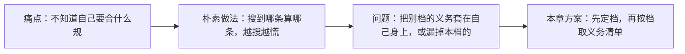
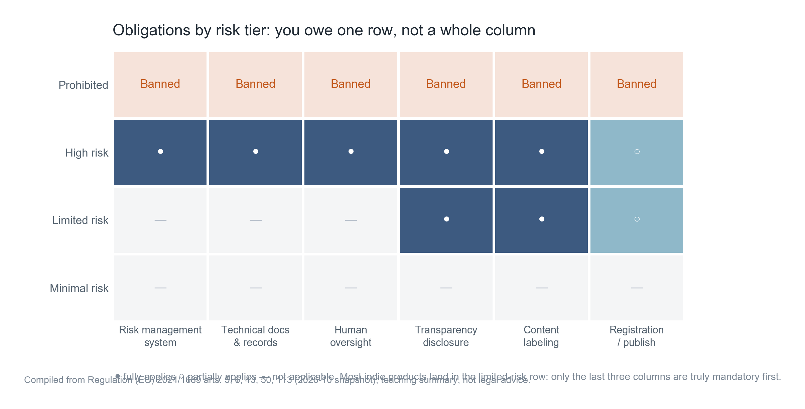
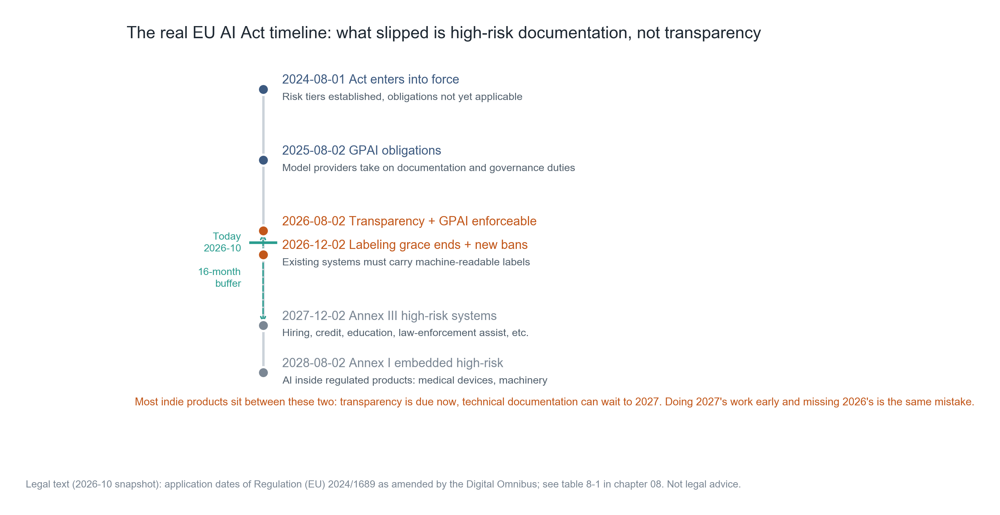
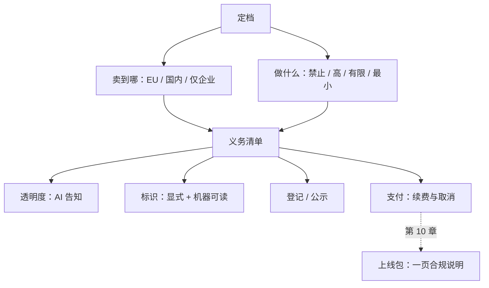

**English** | [中文](./ch08-compliance.zh.md)

# Chapter 08: Compliance Boundaries — How Regulation Lands on Buttons

> **Chapter guide**: Compliance is not "reading the regulation once"; it is "translating clauses into buttons, copy, and processes". This chapter first has you classify your tier (where you sell, what you do), then lands that tier's obligations one by one onto the interface, and finally gives the writing pattern for a one-page statement.
> **Prerequisites**: Chapter 01 (the responsibility gate), Chapter 07 (compliance cost is another kind of fixed expense).
> **Core learning objectives**:
> - Be able to judge which tier you are in under the EU AI Act, and state which article you rely on
> - Distinguish the two domestic channels of "filing" and "registration", and know which one your product takes
> - Be able to turn the three kinds of obligations — auto-renewal, content labeling, AI disclosure — into concrete interface elements

> **Scope statement**: The clauses and dates in this chapter are current as of **2026-10**. Regulations change; this book gives the method for "how to check, how to land", and does not constitute legal advice; before formal launch, re-verify against local requirements.

---

## 1. Cognitive Anchor: Opening a Shop Requires a License, but Nobody Tells You Which One at the Start

### 1.1 A Real Dilemma

You built a meeting-minutes tool for small teams; two weeks after launch you have 40 paying users. One day a user asks: "does this comply with EU rules? Our company has a branch in Germany."

You open a search and see the words "high-risk AI system", "conformity assessment", "CE marking", "technical documentation", and your scalp tingles. You start wondering: do I have to tear the whole product down and rebuild it for compliance?

The real answer is: **you are most likely not in the "high-risk" tier; the August 2 door for you is "transparency", not "the technical documentation marathon".** And the workload of these two things differs 20-fold.



### 1.2 Intuitive Analogy: Licenses and Business Scope

To open a shop you first decide "what to sell, to whom", and only then know which license to get. Selling food needs a food business license; selling books only needs a publication business license — the inspection items are completely different.

Compliance first principles are the same: **classify first, then take the list.** Get the tier wrong and everything after is wrong: either you do masses of useless work, or you miss an obligation that can get you delisted.

**The boundary of this analogy**: a license is one-off, while AI compliance is continuous (model updates and scenario changes can both move your tier). So it is not "do it once before launch", but "re-check every time the product definition changes".

---

## 2. First Principles: Two Axes Decide Your List

### 2.1 The First Axis: Where You Sell

| Market | Main rules | Trigger |
| :--- | :--- | :--- |
| European Union | EU AI Act (Regulation 2024/1689) | Placing on the market or putting into service in the EU, regardless of where the company is |
| China | Interim Measures for the Management of Generative AI Services, etc. | Providing generative AI services to the domestic public |
| Enterprise customers only (domestic) | Contracts + Personal Information Protection Law mainly | Not facing the public; usually no filing involved |

**This axis is the most easily misjudged.** "My company is in China, so I can ignore the EU" is wrong — as long as your service is open to EU users (even without active promotion), it may be in scope. Conversely, "I'm in China, so I should do the strictest thing" is also unnecessary — first look at whether you serve the public.

### 2.2 The Second Axis: What You Do

The EU AI Act has four risk tiers. Most independent products land in the third:



*Figure 8-1: Look at the "limited risk" row. Only the last three columns must be done first: transparency disclosure, content labeling, registration/publication. The first three columns (risk management system, technical documentation, human oversight) fully apply only on the "high-risk" row.*

| Tier | Typical scenarios | What you can do |
| :--- | :--- | :--- |
| Prohibited | Social scoring, manipulative techniques, generating intimate imagery without consent | Cannot be placed on the market; there is no "compliant way" |
| High-risk | Recruitment screening, credit scoring, educational assessment, critical infrastructure, law-enforcement support, medical/machinery embedding | Can be done, but requires the full compliance system (from 2027-12-02) |
| **Limited risk** | Chatbots, content generation, summarization tools | **Transparency obligations (apply now)** |
| Minimal risk | Spam filtering, recommendation ranking | No mandatory obligations |

Where does a meeting-minutes tool land? It generates summaries and interacts with users, but does not make decisions affecting rights on the user's behalf — **limited risk**. This judgment matters because it cuts your workload from "two years" to "two days".

### 2.3 The Timeline: What Was Postponed Is Documentation, Not Transparency

This table must be memorized, because masses of articles online still use the old timeline:

| Date | What happens | What it means for limited-risk products |
| :--- | :--- | :--- |
| 2024-08-01 | The Act enters into force; tiered framework established | No direct obligations |
| 2025-08-02 | General-purpose AI model (GPAI) obligations start applying | If you use third-party models, the obligations sit with the model provider |
| **2026-08-02** | The rest of the Act applies: **Article 50 transparency** + GPAI obligations enforceable | **Your main deadline** |
| 2026-12-02 | Machine-readable marking grace period for existing systems ends; new prohibitions take effect | Watermarks/metadata must be in place |
| 2027-12-02 | Annex III high-risk system obligations apply | Not relevant to you (unless you move to high-risk) |
| 2028-08-02 | Annex I embedded high-risk system obligations apply | Not relevant to you |



*Figure 8-2: Note the green "today" line falls between 2026-08 and 2026-12. It says two things: the transparency obligations are already in force, and the machine-readable marking grace period has less than two months left.*

The Digital Omnibus Act passed by the Council of the EU postpones the high-risk obligations in two tiers (Annex III to 2027-12-02, embedded to 2028-08-02), but **Article 50's transparency obligations were not postponed**. This is the source of the one error that is both "doing the 2027 work early" and "missing the 2026 work".

### 2.4 Domestic: Filing and Registration Are Two Channels

| Channel | Who takes it | Authority | Key action |
| :--- | :--- | :--- | :--- |
| **Filing** | Self-developed models offered as a service | Local cyberspace administration (forwarded to the national office) | Submit model and security assessment materials, obtain a filing number |
| **Registration** | Applications or features calling **already-filed** model capabilities via API | Local cyberspace administration | Register with consent, obtain an launch number |

The "Minutes" assistant calls an already-filed third-party model, so it takes **registration**, not filing. This is the most common situation and the easiest to get wrong — many people think they "need to file" when they only need to register.

Two more actions after launch:

- **Publication**: state the model name, filing number, or launch number in a prominent place or on the product detail page;
- **Labeling**: label generated content (explicit + implicit) per the Measures for Labeling AI-Generated and Synthetic Content.

Scale reference: as of 2026-06-30, 988 generative AI services had completed filing and 598 applications or features had completed registration (national cyberspace administration announcement, 2026-07-10). This number says two things: the channel works, and most applications take registration.

### 2.5 Payment and Subscriptions: Three Details That Get Fined Directly

This part has nothing to do with AI, but they are obligations that come with the act of "taking money", and they are the most direct to inspect:

| Obligation | Basis | Lands on the interface |
| :--- | :--- | :--- |
| Prominent notice of auto-renewal before accepting the service | Article 10 of the Regulation for the Implementation of the Consumer Rights Protection Law; Article 18 of the Measures for the Supervision and Administration of Online Transactions | Above the payment button, same font size as the price, not small gray text |
| Prominent reminder 5 days before renewal, with the consumer choosing freely | Same as above | In-app message + SMS/email, not just an in-app push |
| A prominent, simple cancellation entry available at any time during the service period | Same as above | No more than two clicks from "account" to "cancel" |

Note the practical meaning of "prominent": **same font size, not gray, no expanding needed, no clicking "more"**. One private in-app message does not count as a prominent reminder.

### 2.6 Data Compliance: Recordings Are Other People's Personal Information

Meeting recordings usually contain third-party voices, which makes them "personal information", and possibly sensitive information (when health, religion, or political opinions are involved).

Three minimal actions:

1. **Notify**: before recording, tell participants "this meeting will be recorded and used to generate minutes", with the meeting organizer obtaining consent.
2. **Minimize**: keep only the audio needed to generate the minutes; raw audio can be deleted per settings after generation.
3. **Deletable**: users can delete their meetings and derived data, and deletion must cover backups (Chapter 06 practiced this contradiction).

If you call overseas model APIs, there is one more layer: **cross-border data transfer**. This layer cannot be solved by "encrypted transmission"; it is a separate legal question requiring its own assessment.

---

## 3. Hands-on: Generating Your Own Obligation List

### 3.1 Run the Classifier

```bash
$ python code/ch08/compliance_matrix.py
```

### 3.2 Real Output (Excerpt)

```text
=== 第一步：定档（这一步错了，后面全错）===
  市场：欧盟
  面向公众：是
  判定：limited　依据：AI 与用户交互或生成内容，但不做高风险决定

=== 第二步：时间表（截至 2026-10 快照）===
  2026-08-02　透明度义务（第 50 条）+ GPAI 义务可强制执行
  2026-12-02　既有系统的机器可读标识宽限到期；新增禁令生效
  2027-12-02　附件三高风险系统义务适用
  2028-08-02　附件一嵌入型高风险系统义务适用

=== 第三步：你这个档位要做什么 ===
义务                                                  依据                时点
AI 交互告知：聊天界面明确说明「你在和 AI 交互」                         第 50(1) 条         现在
生成内容标识：图像/音频/视频/文本可识别为 AI 生成                        第 50(2) 条         现在
机器可读标记：水印或元数据（既有系统宽限至 2026-12-02）                   第 50(2) 条         现在
深伪内容显著声明                                            第 50(4) 条         现在
记录你做过什么：一页合规说明即可                                    第 50 条 / 问责原则     现在
```

### 3.3 Landing the Five Obligations on Buttons

This step is the core of the chapter: **clauses must become things users can see**, otherwise it counts as not done.

| Obligation | Concrete landing spot | Acceptance method |
| :--- | :--- | :--- |
| AI interaction disclosure | One line on the chat interface's first screen + input placeholder copy | A new user sees it within 3 seconds of first entry |
| Generated content labeling | Minutes page footer "this content is AI-generated; verify before use" + exported file carries metadata | Export one PDF and check text and metadata |
| Machine-readable marking | Metadata fields of exported files (e.g. `AIGC: true`, generation time, model identifier) | Read the file properties once with a tool |
| Deepfake declaration | This product does not generate human likenesses; mark "not applicable" and state why | This item can be found in the compliance statement |
| Record | One-page Compliance Notes, with tier basis, actions taken, review date | Anyone can understand it within 5 minutes |

The fourth row's approach is worth learning: **obligations that do not apply still get "not applicable + reason"**, not left blank. A blank reads as "not done"; writing "not applicable" is what counts as complete.

### 3.4 Skeleton of a One-Page "Cost–Compliance Boundary Statement"

This document is a required piece of Chapter 10's release package; five sections are enough:

```text
1. 我卖到哪：面向中国境内公众 + 对欧盟用户开放（未主动推广）
2. 我在哪一档：EU AI Act 有限风险，依据第 50 条；国内走登记通道
3. 现在必须做：AI 告知、内容标识、机器可读标记、模型名称与编号公示、
   自动续费双重提示、取消入口 ≤ 2 层
4. 可以排期：数据出境评估（若启用境外 API）、备份删除机制（30 天窗口）
5. 触发动作：
   - 出现深度伪造投诉 → 立即停机并复核生成链路
   - 用户要求删除 → 7 天内完成主库删除，30 天内完成备份轮转
   - 模型供应商变更 → 重新核对登记信息与公示内容
```

Section 5 is the most easily ignored part and the one that most shows professionalism. **Compliance is not a checklist; it is a set of "under what circumstances must what be done" triggers.**

---

## 4. Common Misconceptions and Correct/Incorrect Contrasts

| Easy pitfall | Why it goes wrong | The right mental model and practice |
| :--- | :--- | :--- |
| **"My company is in China; I can ignore the EU"** | Being open to EU users puts you in scope, regardless of where the company is registered | Classify "where you sell" first, then take the list; assess markets you do not actively promote to as well |
| **"AI compliance means writing heaps of technical documentation"** | That is the high-risk tier's obligation, postponed to 2027-12; limited risk only needs transparency | Classify first; doing the 2027 work early and missing the 2026 work is the same mistake |
| **"Calling someone else's model makes compliance the model provider's business"** | The provider carries GPAI obligations; you as the provider of the service still carry transparency and labeling obligations | Spell out the division: the provider handles the model, you handle the interface and content labeling |
| **"Filing and registration are the same thing"** | Self-developed models file; API-calling applications register; taking the wrong channel stalls for a long time | Confirm first whether the model is already filed, then pick the channel |
| **"Putting the auto-renewal notice in the agreement is enough"** | Clauses in the agreement do not count as "prominent"; the requirement is before acceptance + 5 days before renewal, with free choice | Put the notice next to the payment button, same font size; remind by SMS/email before renewal |

---

## 5. Chapter Summary and Local Knowledge Graph

### 5.1 Key Points

- **Classify first, then take the list**: two axes — where you sell, what you do.
- **Most independent products are limited risk**; the 2026-08-02 door is transparency, not a documentation marathon.
- **Domestic dual track**: self-developed models file, API-calling applications register; after launch, publish the model name and number.
- **Three payment items**: notice beforehand, reminder 5 days before renewal, cancellation entry ≤ 2 clicks; "prominent" has practical standards.
- **Recordings are personal information**; notify, minimize, deletable — none of the three can be missing; cross-border is a separate problem.

### 5.2 Concept Topology of This Chapter



---

## 6. Tiered Exercises and Reference Solutions

### Basic Consolidation (Tier 1: Intuition and Concept Check)

1. Which EU AI Act tier does each of the four products below fall into? Explain your reasoning.
   - (a) A recruitment system that scores résumés with AI and auto-rejects candidates.
   - (b) A tool that turns meeting recordings into minutes.
   - (c) An app that generates photos of faces that do not exist.
   - (d) Email spam filtering.

2. Judge whether this is true or false and explain why: "Once the user agrees to the privacy policy, meeting recordings can be used for model training."

### Applied Practice (Tier 2: Reasoning and Hands-on Construction)

3. Use `compliance_matrix.py` to generate your obligation list, then land every item on a concrete interface element (state location, copy, acceptance method).

4. Inspect your own subscription flow: at which step does the auto-renewal notice appear? Is its font size the same as the price? How many clicks does cancellation take? Write the results as a table.

### Deep Challenge (Tier 3: Boundary Conditions and Cross-Chapter Transfer)

5. Your product is registered in China and you now want to open it to EU users. List the checklist of items that must be completed before launch (no fewer than 6), and mark which ones change code and which only change copy.

<details>
<summary><strong>Click to expand: reference answers and in-depth analysis for this chapter's exercises</strong></summary>

#### 1. Tier Judgments

| Product | Tier | Reason |
| :--- | :--- | :--- |
| (a) Résumé scoring | **High-risk** (Annex III, recruitment) | Makes decisions affecting a person's employment; the obligation date is 2027-12-02, but Article 50 transparency applies now |
| (b) Meeting minutes | **Limited risk** | Generates content and interacts with users, but makes no decision affecting rights |
| (c) Face generation | **Depends**: generating non-consensual imagery of real people is prohibited; generating fictional faces is limited risk but needs labeling | The key is "whether it is identifiable to a real individual" and "whether consent was given" |
| (d) Spam filtering | **Minimal risk** | Does not affect user rights; no mandatory obligations |

(b) deserves one more word: if the minutes tool starts "evaluating employee speaking quality" and outputting performance suggestions, it can slide toward high-risk (HR decision support). **Change the product definition and the tier changes**, so re-check once a year.

#### 2. True or False

**Wrong, and this is the most common misunderstanding.** A privacy policy is "notification", not "authorization for everything". Using recordings for training requires:

- Separate, explicit consent (not mixed into general terms);
- Stating purpose, scope, and retention period;
- Providing an opt-out that does not affect core service;
- If third-party voices are involved, third-party rights must also be considered.

Many teams stumble here because they merge "processing necessary for the service" (generating minutes) with "extra purposes" (training models) into one thing. The former can rely on "necessary for contract performance"; the latter must obtain separate consent.

#### 3. Scoring Points for the Landing Spots

In a passing table every row can be verified by a third party. For example, the "AI interaction disclosure" row's acceptance method written as "visible within 3 seconds of a new user's first entry" is verifiable; "there is a notice on the interface" is not.

#### 4. Self-Checking the Subscription Flow

Watch three numbers: the step number where the notice appears, the ratio of notice font size to price font size, and the number of clicks to cancel.

Common problems: the notice lives under "expand to see more" (not prominent), the font is 60% of the price's (not the same size), cancellation requires an email (not simple).

#### 5. The Checklist for Expanding from China to the EU

| # | Item | Changes code? |
| :--- | :--- | :--- |
| 1 | Classify and file the record (limited risk, per Article 50) | No |
| 2 | Add AI interaction disclosure to the interface | Yes (copy + components) |
| 3 | Add explicit labels to generated content | Yes (templates) |
| 4 | Add machine-readable marking to exported files | Yes (metadata writing) |
| 5 | Add EU user clauses and data-subject rights to the privacy policy | No (copy) |
| 6 | Cross-border data assessment (if using overseas APIs) | Possibly (switch regional endpoints) |
| 7 | Build a deletion-request handling process (including backup rotation) | Yes (back-office tooling) |
| 8 | Record the compliance statement and set a review date | No |

Item 6 is the most underestimated: switching regional endpoints is not just a config change; it can also affect latency, cost, and model capability (different regions have different models available).

</details>

---

## 7. Authoritative Sources and Further Reading (Authoritative References)

1. **NIST CSRC**: [NIST CSRC](https://csrc.nist.gov/) - the definitions and norms of this chapter are anchored here (verification date: `2026-10-23`).
2. **OWASP ASVS**: [OWASP ASVS](https://www.owasp.org/www-project-application-security-verification-standard/) - the definitions and norms of this chapter are anchored here (verification date: `2026-10-23`).
3. **CVE Program**: [CVE Program](https://www.cve.org/) - the definitions and norms of this chapter are anchored here (verification date: `2026-10-23`).

> Measurement note: the sources above are used to anchor **definitions and norms**, not to extrapolate risk probabilities. Before quoting any number, check the source's year and its denominator.
