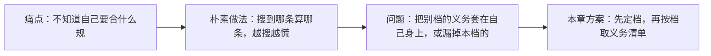
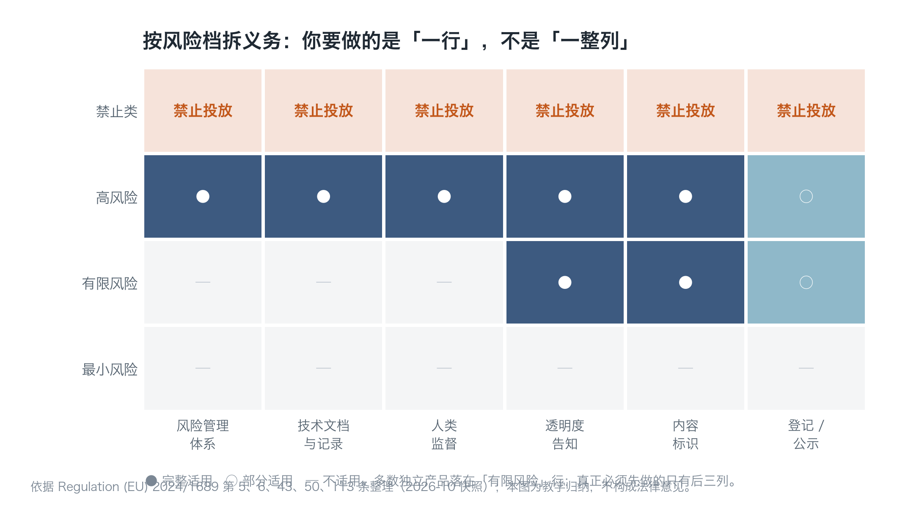
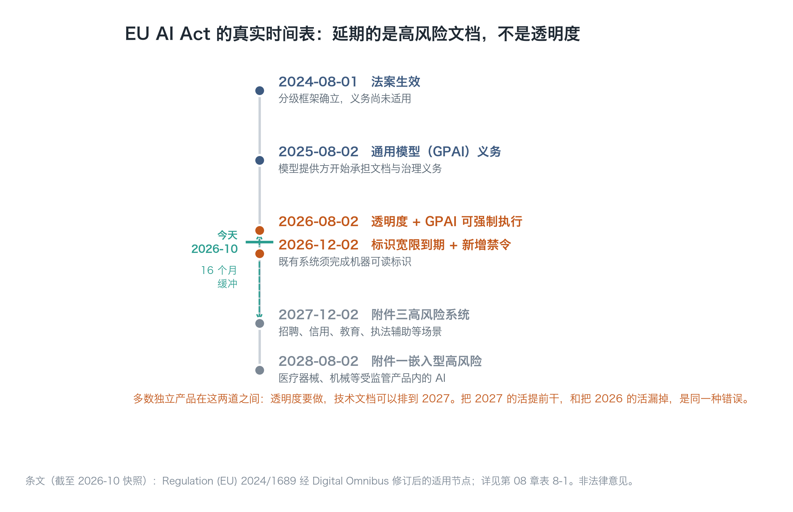
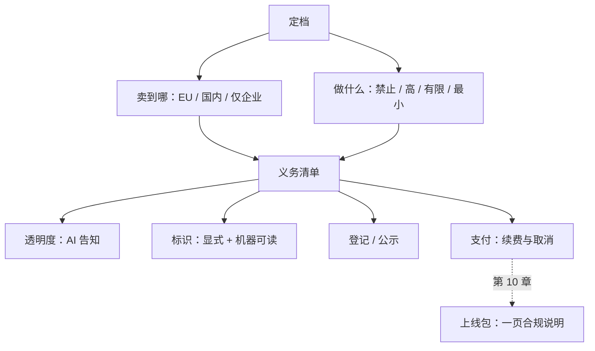

# 第 08 章：合规边界——条文怎么落到按钮上

> **本章导读**：合规不是"读一遍法规"，是"把条文翻译成按钮、文案和流程"。本章先让你定档（你卖到哪、做什么），再把该档的义务逐条落到界面上，最后给出一页说明的写法。
> **前置知识**：第 01 章（责任门）、第 07 章（合规成本是另一类固定支出）。
> **核心学习目标**：
> - 能判断自己在 EU AI Act 的哪一档，并说清依据哪一条
> - 能区分国内的"备案"与"登记"两条通道，知道自己的产品走哪条
> - 能把自动续费、内容标识、AI 告知这三类义务落成具体的界面元素

> **口径声明**：本章条文与日期截至 **2026-10**。法规会变，本书给的是"怎么查、怎么落"的方法，不构成法律意见；正式上线前请按当地要求复核。

---

## 1. 认知锚点：开店要办证，但没人一开始就告诉你办哪张

### 1.1 一个真实的困境

你做了一个面向小团队的会议纪要工具，上线两周，有 40 个付费用户。某天一个用户问："你们这个符合欧盟的规定吗？我们公司在德国有分部。"

你打开搜索，看到"高风险 AI 系统""合格性评估""CE 标记""技术文档"这些词，头皮发麻。你开始怀疑：是不是要把整个产品推倒重做合规？

真实答案是：**你大概率不在"高风险"那一档，8 月 2 日那道门对你是"透明度"，不是"技术文档马拉松"。** 而这两件事的工作量差 20 倍。



### 1.2 直觉类比：办证与经营范围

开店要先确定"卖什么、卖给谁"，然后才知道办哪张证。卖餐饮要食品经营许可，卖书只要出版物经营许可——两者的检查项目完全不同。

合规的第一性原理是一样的：**先定档，再取清单。** 定档错了，后面全错：要么做了大量无用功，要么漏掉一条能让你下架的义务。

**类比的边界**：办证是一次性的，AI 合规是持续的（模型更新、场景变化都可能改变定档）。所以它不是"上线前做一次"，而是"每次改产品定义时复查一次"。

---

## 2. 第一性原理：两道坐标轴决定你的清单

### 2.1 第一根轴：你卖到哪

| 市场 | 主要规则 | 触发条件 |
| :--- | :--- | :--- |
| 欧盟 | EU AI Act（Regulation 2024/1689） | 在欧盟投放市场或投入使用，无论公司在哪 |
| 中国 | 《生成式人工智能服务管理暂行办法》等 | 向境内公众提供生成式 AI 服务 |
| 仅企业客户（境内） | 合同 + 个人信息保护法为主 | 不面向公众，通常不涉及备案 |

**这一根轴最容易被误判。** "我公司在中国，所以不用管欧盟"是错的——只要你的服务对欧盟用户开放（哪怕没有主动推广），就可能在范围内。反过来，"我在中国，所以要按最严的做"也没必要——先看你是否面向公众。

### 2.2 第二根轴：你做什么

EU AI Act 按风险分四档。多数独立产品落在第三档：



*图 8-1：看"有限风险"这一行。真正必须先做的只有后三列：透明度告知、内容标识、登记/公示。前面三列（风险管理体系、技术文档、人类监督）在"高风险"行才完整适用。*

| 档位 | 典型场景 | 你能做什么 |
| :--- | :--- | :--- |
| 禁止类 | 社会评分、操纵性技术、未经同意的私密形象生成 | 不能投放，没有"合规做法" |
| 高风险 | 招聘筛选、信用评分、教育评估、关键基础设施、执法辅助、医疗/机械等嵌入型 | 可以做，但要走完整合规体系（2027-12-02 起） |
| **有限风险** | 聊天机器人、内容生成、摘要工具 | **透明度义务（现在就适用）** |
| 最小风险 | 垃圾邮件过滤、推荐排序 | 无强制义务 |

会议纪要工具落在哪？它生成摘要、与用户交互，但不替用户做影响权利的决定——**有限风险**。这个判断很重要，因为它把你的工作量从"两年"降到"两天"。

### 2.3 时间表：延期的是文档，不是透明度

这张表必须记住，因为网上大量文章还在用旧时间表：

| 日期 | 发生了什么 | 对有限风险产品意味着 |
| :--- | :--- | :--- |
| 2024-08-01 | 法案生效，分级框架确立 | 无直接义务 |
| 2025-08-02 | 通用 AI 模型（GPAI）义务开始适用 | 若你用第三方模型，义务在模型方 |
| **2026-08-02** | 法案其余部分适用：**第 50 条透明度** + GPAI 义务可强制执行 | **你的主要截止日** |
| 2026-12-02 | 既有系统的机器可读标识宽限到期；新增禁令生效 | 水印/元数据要到位 |
| 2027-12-02 | 附件三高风险系统义务适用 | 与你无关（除非改做高风险） |
| 2028-08-02 | 附件一嵌入型高风险系统义务适用 | 与你无关 |



*图 8-2：注意"今天"那道绿线落在 2026-08 与 2026-12 之间。它说明两件事：透明度义务已经生效，机器可读标识的宽限只剩不到两个月。*

欧盟理事会通过的《数字综合法案》把高风险义务分两档延后（附件三到 2027-12-02，嵌入型到 2028-08-02），但**第 50 条的透明度义务没有延期**。这就是"把 2027 的活提前干"和"把 2026 的活漏掉"这同一种错误的来源。

### 2.4 国内：备案与登记是两条通道

| 通道 | 谁走 | 主管 | 关键动作 |
| :--- | :--- | :--- | :--- |
| **备案** | 自研模型对外提供服务 | 属地网信部门（转报国家网信办） | 提交模型与安全评估材料，取得备案号 |
| **登记** | 通过 API 调用**已备案**模型能力的应用或功能 | 属地网信部门 | 经同意后登记，取得上线编号 |

「纪要助手」调用的是已备案的第三方模型，所以走**登记**，不是备案。这是最常见的一种情形，也是最容易被搞错的一种——很多人以为自己"要备案"，其实只需要登记。

上线后还有两个动作：

- **公示**：在显著位置或产品详情页写明所用模型名称、备案号或上线编号；
- **标识**：按《人工智能生成合成内容标识办法》对生成内容加标识（显式 + 隐式）。

规模参考：截至 2026-06-30，累计 988 款生成式 AI 服务完成备案、598 款应用或功能完成登记（国家网信办 2026-07-10 公告）。这个数字说明两件事：通道是通的，而且大多数应用走的是登记。

### 2.5 支付与订阅：三条会直接被罚的细节

这部分和 AI 无关，但它是"收钱"这个动作自带的义务，而且检查起来最直接：

| 义务 | 依据 | 落到界面 |
| :--- | :--- | :--- |
| 接受服务前显著提示自动续费 | 《消费者权益保护法实施条例》第 10 条；《网络交易监督管理办法》第 18 条 | 支付按钮上方，与价格同字号，不能是灰色小字 |
| 续费日前 5 日显著提醒，由消费者自主选择 | 同上 | 站内信 + 短信/邮件，不能只在 App 内推送 |
| 服务期内提供显著、简便的随时取消入口 | 同上 | 从"账户"点到"取消"不超过两层 |

注意"显著"这个词的实操含义：**同字号、非灰色、不需要展开、不需要点"更多"**。只在 App 内发一条私信不算显著提醒。

### 2.6 数据合规：录音是别人的个人信息

会议录音里通常有第三方的声音，这使它成为"个人信息"，而且可能是敏感信息（涉及健康、宗教、政治观点时）。

三条最小动作：

1. **告知**：录制前告知参与者"本次会议将被录音并用于生成纪要"，由会议发起人获取同意。
2. **最小化**：只保留生成纪所需的音频，生成完成后可按设置删除原始音频。
3. **可删除**：用户能删除自己的会议及其衍生数据，且删除要覆盖备份（第 06 章练过这个矛盾）。

如果调用境外模型 API，还多一层：**数据出境**。这一层不能靠"加密传输"解决，它是独立的法律问题，需要单独评估。

---

## 3. 手把手：生成你自己的义务清单

### 3.1 运行判定器

```bash
$ python code/ch08/compliance_matrix.py
```

### 3.2 真实输出（节选）

```text
=== 第一步：定档（这一步错了，后面全错）===
  市场：欧盟
  面向公众：是
  判定：limited　依据：AI 与用户交互或生成内容，但不做高风险决定

=== 第二步：时间表（截至 2026-10 快照）===
  2026-08-02　透明度义务（第 50 条）+ GPAI 义务可强制执行
  2026-12-02　既有系统的机器可读标识宽限到期；新增禁令生效
  2027-12-02　附件三高风险系统义务适用
  2028-08-02　附件一嵌入型高风险系统义务适用

=== 第三步：你这个档位要做什么 ===
义务                                                  依据                时点
AI 交互告知：聊天界面明确说明「你在和 AI 交互」                         第 50(1) 条         现在
生成内容标识：图像/音频/视频/文本可识别为 AI 生成                        第 50(2) 条         现在
机器可读标记：水印或元数据（既有系统宽限至 2026-12-02）                   第 50(2) 条         现在
深伪内容显著声明                                            第 50(4) 条         现在
记录你做过什么：一页合规说明即可                                    第 50 条 / 问责原则     现在
```

### 3.3 把五条义务落到按钮上

这一步是本章的核心：**条文必须变成用户看得见的东西**，否则等于没做。

| 义务 | 具体落点 | 验收方法 |
| :--- | :--- | :--- |
| AI 交互告知 | 对话界面首屏一行说明 + 输入框占位文案 | 新用户第一次进入，3 秒内能看到 |
| 生成内容标识 | 纪要页脚"本内容由 AI 生成，请核对后使用" + 导出文件带元数据 | 导出一份 PDF，检查文字与元数据 |
| 机器可读标记 | 导出文件的元数据字段（如 `AIGC: true`、生成时间、模型标识） | 用工具读一次文件属性 |
| 深伪声明 | 本产品不生成人物形象，标注"不适用"并写明原因 | 在合规说明里能找到这一条 |
| 记录 | 一页《合规说明》，含定档依据、已做动作、复核日期 | 任何人能在 5 分钟内读懂 |

第四行的写法值得学：**不适用的义务也要写"不适用 + 原因"**，而不是留空。留空会被理解为"没做"，写清"不适用"才是完成。

### 3.4 一页《成本—合规边界说明》的骨架

这份文档是第 10 章上线包的必备件，五段就够：

```text
1. 我卖到哪：面向中国境内公众 + 对欧盟用户开放（未主动推广）
2. 我在哪一档：EU AI Act 有限风险，依据第 50 条；国内走登记通道
3. 现在必须做：AI 告知、内容标识、机器可读标记、模型名称与编号公示、
   自动续费双重提示、取消入口 ≤ 2 层
4. 可以排期：数据出境评估（若启用境外 API）、备份删除机制（30 天窗口）
5. 触发动作：
   - 出现深度伪造投诉 → 立即停机并复核生成链路
   - 用户要求删除 → 7 天内完成主库删除，30 天内完成备份轮转
   - 模型供应商变更 → 重新核对登记信息与公示内容
```

第 5 段是最容易被忽略、也最能体现专业度的部分。**合规不是一张清单，是一组"什么情况下必须做什么"的触发器。**

---

## 4. 常见误区与正反例对比

| 容易踩坑的误区 | 为什么会出错 | 正确的心智模型与做法 |
| :--- | :--- | :--- |
| **"我公司在中国，不用管欧盟"** | 只要对欧盟用户开放就在范围内，与公司注册地无关 | 先定"卖到哪"，再取清单；对未主动推广的市场也要评估 |
| **"AI 合规就是要写一大堆技术文档"** | 那是高风险档的义务，被延期到 2027-12；有限风险只需要透明度 | 先定档；把 2027 的活提前干和漏掉 2026 的活是同一种错误 |
| **"调用别人的模型，合规是模型方的事"** | 模型方承担 GPAI 义务，你作为提供者仍承担透明度与标识义务 | 分工要写清：模型方管模型，你管界面与内容标识 |
| **"备案和登记是一回事"** | 自研模型走备案，调 API 的应用走登记；走错通道会卡很久 | 先确认模型是否已备案，再选通道 |
| **"自动续费提示放在协议里就行"** | 协议里的条款不算"显著"；要求是接受前 + 续费前 5 日，且可自主选择 | 提示放在支付按钮旁，同字号；续费前用短信/邮件提醒 |

---

## 5. 本章小结与局部知识图谱

### 5.1 核心要点

- **先定档，再取清单**：两根轴——卖到哪、做什么。
- **多数独立产品是有限风险**，2026-08-02 那道门是透明度，不是文档马拉松。
- **国内双轨**：自研模型备案，调 API 的应用登记；上线后要公示模型名称与编号。
- **支付三条**：事前提示、续费前 5 日提醒、取消入口 ≤ 2 层；"显著"有实操标准。
- **录音是个人信息**，告知、最小化、可删除三件事缺一不可；跨境是独立问题。

### 5.2 本章概念拓扑



---

## 6. 分级通关练习与参考解析

### 基础巩固题（Tier 1：直觉与概念核验）

1. 下面四个产品，各自在 EU AI Act 的哪一档？说明理由。
   - (a) 用 AI 给简历打分并自动淘汰候选人的招聘系统。
   - (b) 把会议录音转成纪要的工具。
   - (c) 生成不存在的人脸照片的应用。
   - (d) 邮件垃圾过滤。

2. 判断对错并说明理由："用户同意了隐私政策，就可以把会议录音用于模型训练。"

### 动手应用题（Tier 2：推演与实操构建）

3. 用 `compliance_matrix.py` 生成你的义务清单，然后把每一条落到具体界面元素上（写明位置、文案、验收方法）。

4. 检查你自己的订阅流程：自动续费提示在第几步？字号是否与价格一致？取消入口需要几次点击？把结果写成一张表。

### 深度挑战题（Tier 3：边界条件与跨章迁移）

5. 你的产品在中国已登记，现在想开放给欧盟用户。请列出上线前必须完成的事项清单（不少于 6 项），并标注哪几项会改动代码、哪几项只改文案。

<details>
<summary><strong>点击展开：本章练习参考答案与深度解析</strong></summary>

#### 1. 定档判断

| 产品 | 档位 | 理由 |
| :--- | :--- | :--- |
| (a) 简历打分 | **高风险**（附件三，招聘） | 对个人做出影响就业的决定；义务适用日为 2027-12-02，但第 50 条透明度现在就适用 |
| (b) 会议纪要 | **有限风险** | 生成内容、与用户交互，但不做影响权利的决定 |
| (c) 生成人脸 | **需分情况**：生成真实人物的未经同意形象属禁止；生成虚构人脸属有限风险但需标识 | 关键在"是否可识别到真实个人"与"是否经同意" |
| (d) 垃圾过滤 | **最小风险** | 不影响用户权利，无强制义务 |

(b) 值得多说一句：如果纪要工具开始"评估员工发言质量"并输出绩效建议，它就可能滑向高风险（人力资源决策辅助）。**产品定义一变，档位就变**，所以每年要复查一次。

#### 2. 判断对错

**错，而且这是最常见的误解。** 隐私政策是"告知"，不是"授权一切"。把录音用于训练需要：

- 单独的、明确的同意（不能混在通用条款里）；
- 说明用途、范围、保存期限；
- 提供拒绝的选项，且拒绝不影响核心服务；
- 若涉及第三方声音，还需考虑第三方的权利。

很多团队在这一步翻车，是因为把"服务必需的处理"（生成纪要）和"额外用途"（训练模型）混成了一件事。前者可以用"履行合同必需"，后者必须单独取得同意。

#### 3. 落点的评分要点

合格的表每一行都能被第三方验证。例如"AI 交互告知"这一行，验收方法写"新用户第一次进入 3 秒内可见"就是可验证的；写"界面上有提示"则不可验证。

#### 4. 订阅流程自查

重点看三个数字：提示出现的步骤序号、提示字号与价格字号的比值、取消所需点击次数。

常见问题：提示在"展开查看更多"里（不算显著）、字号是价格的 60%（不算同字号）、取消要发邮件（不算简便）。

#### 5. 从中国扩展到欧盟的清单

| # | 事项 | 改代码? |
| :--- | :--- | :--- |
| 1 | 定档并留档（有限风险，依据第 50 条） | 否 |
| 2 | 界面加 AI 交互告知 | 是（文案 + 组件） |
| 3 | 生成内容加显式标识 | 是（模板） |
| 4 | 导出文件加机器可读标记 | 是（元数据写入） |
| 5 | 隐私政策增加 EU 用户条款与数据主体权利 | 否（文案） |
| 6 | 数据出境评估（若使用境外 API） | 可能（换区域端点） |
| 7 | 建立删除请求处理流程（含备份轮转） | 是（后台工具） |
| 8 | 记录合规说明并设定复核日期 | 否 |

其中第 6 项最容易低估：换区域端点不只是改配置，还可能影响延迟、成本与模型能力（不同区域可用模型不同）。

</details>

---

## 7. 本章权威参考信源与延伸阅读 (Authoritative References)

1. **NIST CSRC**：[NIST CSRC](https://csrc.nist.gov/) - 本章的定义与规范以此为锚（核验日期：`2026-10-23`）。
2. **OWASP ASVS**：[OWASP ASVS](https://www.owasp.org/www-project-application-security-verification-standard/) - 本章的定义与规范以此为锚（核验日期：`2026-10-23`）。
3. **CVE Program**：[CVE Program](https://www.cve.org/) - 本章的定义与规范以此为锚（核验日期：`2026-10-23`）。

> 口径提示：以上信源用于锚定**定义与规范**，不用于外推风险概率。引用任何数字前，先核对来源年份与分母。
