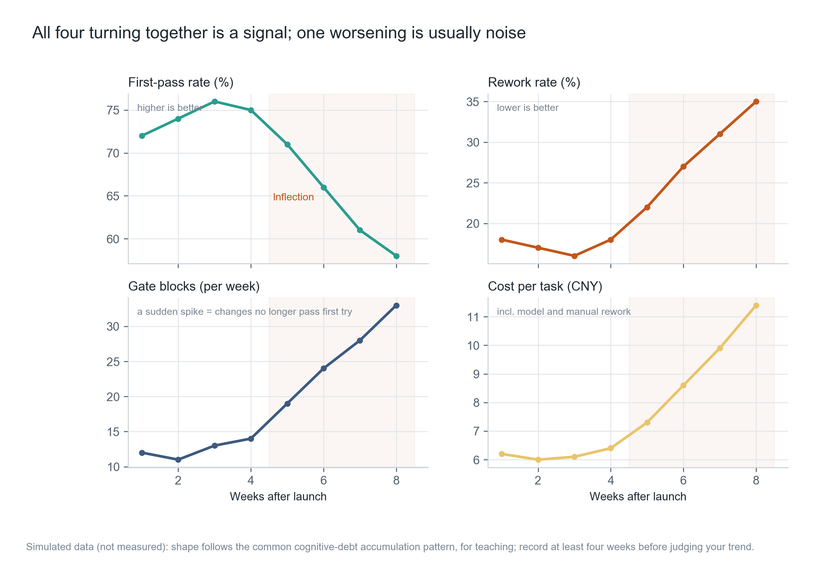
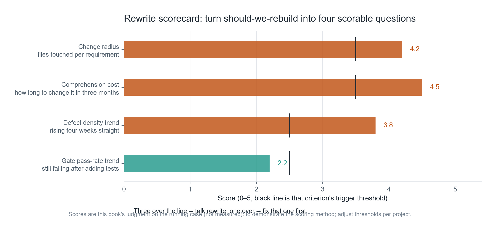
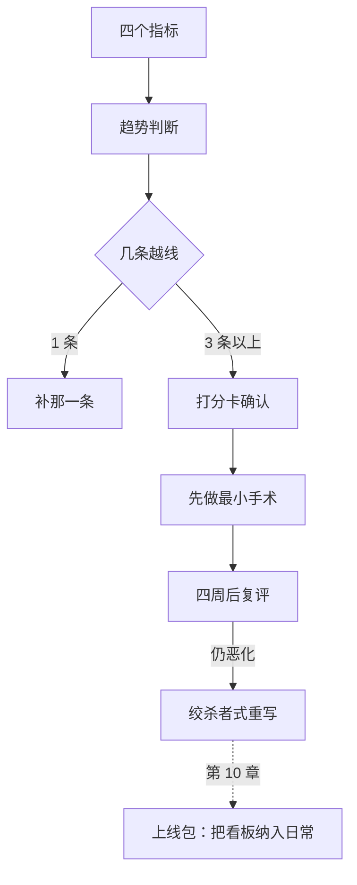

**English** | [中文](./ch09-debt-rewrite.zh.md)

# Chapter 09: Debt and Rewrites — When to Tear It Down

> **Chapter guide**: After AI pushes delivery speed up, technical debt and cognitive debt rise together, and cognitive debt is harder to measure. This chapter gives four metrics, four criteria, and one scorecard, turning "patch it or tear it down" from an emotional argument into a recomputable judgment.
> **Prerequisites**: Chapters 04–07 (rollback, monitoring, recovery, cost — they provide the data the measurements need).
> **Core learning objectives**:
> - Distinguish technical debt from cognitive debt, and state which signals observe each
> - Use four metrics to judge "whether the structure is giving way"
> - Make one rewrite decision with the four criteria, and give the "do not rewrite" alternative

---

## 1. Cognitive Anchor: Renovate or Rebuild — Look at the Load-Bearing Walls

### 1.1 An Afternoon Six Months Later

The product has been live six months; you have 180 paying users. Nothing is missing from the feature list, but every change has slowed down.

Changing one "export format" touches four files, two templates, one type definition. Afterwards three tests fail, and one of them takes you twenty minutes to understand. You open a function you wrote three months ago and the only comment is one line: `// 处理特殊情况`.

You start wondering: is it time to rewrite?


### 1.2 Intuition by Analogy: Load-Bearing Walls

Whether to tear down and rebuild an old house does not depend on how old it is; it depends on **whether the load-bearing walls have been touched**.

Peeling plaster, cracked tiles, aging pipes — all solvable by renovation. But changing the floor plan, adding a story, merging two units — that touches the structure, and at that point renovation costs more than rebuilding.

The "load-bearing walls" in software are two things: **the data model** and **permission boundaries**. Change these two and it is equivalent to rebuilding; everything else can still be repaired.

**The boundary of this analogy**: while a house is rebuilt the people can move out; while software is rewritten the users keep using it. So software rewrites are almost always "renovating while living in it" — which is why the strangler pattern exists.

---

## 2. First Principles: Two Kinds of Debt, Four Metrics

### 2.1 Technical Debt and Cognitive Debt

| Dimension | Technical debt | Cognitive debt |
| :--- | :--- | :--- |
| Where it lives | In the code (duplication, coupling, missing abstractions) | In people's heads (nobody can say why it was written this way) |
| Symptoms | Slow to change, untestable completely | Afraid to change; re-derive everything each time |
| Measurement | Change radius, defect density, coverage | Onboarding time, explanation cost, missing decision records |
| Who accrues it most easily | People under deadline pressure | People generating lots of code with AI but not reading it |

The last cell of the second row is this chapter's real background: **AI made "writing runnable code" extremely cheap, and so the growth of cognitive debt outpaced technical debt for the first time.** The function you open three months later has a single comment "handle special case" — it is not technical debt; it is a piece of output you accepted without understanding at the time.

The nastiest thing about cognitive debt is that it **throws no errors**. The code runs, the tests pass; it is just that nobody dares touch it.

### 2.2 Four Metrics: Watch the Trend, Not the Absolute Value

| Metric | Definition | Healthy signal | Deteriorating signal |
| :--- | :--- | :--- | :--- |
| **First-pass acceptance rate** | The share of submissions passing review/tests on the first try | Stable or rising | Falling for four consecutive weeks |
| **Rework rate** | The share of changes needing a second revision | Stable | Rising persistently |
| **Gate interceptions** | Problems caught by CI/review | Flat | Suddenly rising (changes get harder to pass at once) |
| **Per-task cost** | Model + human cost to complete one requirement | Flat | Rising (rework and debugging ate the efficiency) |

**Why trends and not absolute values**: one team's rework rate sits at 20% year after year but is stable — that is their normal water level; another team's rose from 10% to 18%, a lower absolute number but a trend showing the structure deteriorating.



*Figure 9-1: Four panels, all turning after week 5. A single worsening metric may just be noise; all four turning together is a structural signal.*

### 2.3 Four Rewrite Criteria

| Criterion | How to measure | Threshold (value used in this book) |
| :--- | :--- | :--- |
| **Change radius** | How many files a typical requirement touches | ≥ 4 files |
| **Comprehension cost** | How long the you of three months later needs to change one spot | ≥ half a day |
| **Defect density trend** | Whether defects per thousand lines rise for four consecutive weeks | Rising and adding tests does not help |
| **Gate pass-rate trend** | Whether first-pass rate keeps falling | Falling for four consecutive weeks |

Only when **three of the four cross the line** do you talk about rewriting. With one crossed, patch that one first — because single-metric deterioration is usually a local problem while a rewrite is global surgery.



*Figure 9-2: The black vertical lines are each criterion's threshold. The job of this card is not to answer "rewrite / don't rewrite", but to give the discussion a shared scale — otherwise every argument drifts back to "I think it's fine" versus "I think it's not".*

### 2.4 Two Anti-Patterns You Must Know

**The second-system effect.** When rewriting, people cannot resist swapping "unwanted complexity" for "wanted complexity": adding plugin systems, abstraction layers, configurability. The result is a new system more complex than the old one, just complex in more "elegant" places. The defense: **the rewrite's first version may only implement existing functionality; adding capabilities is forbidden.**

**The big-bang rewrite.** Shut down the old system, write behind closed doors for three months, then switch all at once. During those three months nobody maintains the old system, the new system gets no real feedback, and switch day carries the biggest risk. The defense: the strangler pattern — wrap a layer in the new code, migrate traffic gradually, and be able to switch back at any moment.

---

## 3. Hands-on: Running a Health Dashboard

### 3.1 Run It

```bash
$ python code/ch09/health_dashboard.py
```

The judgment logic lives in the code, to avoid going by feel every time:

```python
def worsening(values, good):
    s = slope(values)                      # 最小二乘斜率，过滤单周波动
    return s < 0 if good == "up" else s > 0

def consecutive_worse(values, good, span=4):
    tail = values[-span:]                  # 只看最近四周，且要求连续
    ...
```

### 3.2 Real Output

```text
=== 八周健康度（模拟数据，用于演示判据）===
指标                       第1周     第8周      斜率/周  判定
------------------------------------------------------------
首轮验收率（%）                72.0    58.0     -2.35  转向
返工率（%）                  18.0    35.0     +2.69  转向
门禁拦截（次/周）               12.0    33.0     +3.21  转向
单任务成本（元）                 6.2    11.4     +0.77  转向

转向指标数：4 / 4
判定：触发重写讨论。但先回答一个问题——
  是「结构撑不住了」还是「需求变了、旧结构在为新需求买单」？
  前者重写，后者只该补一层适配。

=== 打分卡：四条重写判据（0—5 分，越线即触发）===
  改动半径（改一个需求要动几个文件）                  4.2 / 阈值 3.5　越线
  理解成本（三个月后的你要多久能改）                  4.5 / 阈值 3.5　越线
  缺陷密度趋势（连续四周是否上升）                   3.8 / 阈值 2.5　越线
  门禁通过率趋势（补测试后是否仍下降）                 2.2 / 阈值 2.5　未越线

越线 3 条 → 可以谈重写，且必须同时给出「不重写」的替代方案。
```

### 3.3 Three Conclusions

**First, 4/4 turning does not mean "rewrite now".** Look at the scorecard: three crossed, exactly at the threshold. The correct move here is **first do one "do-not-rewrite" minimal surgery**, and re-run the dashboard four weeks later.

**Second, the "gate pass-rate trend" did not cross (2.2 < 2.5).** This one is key: it means your tests are still doing their job; the structure is hard to change, but changes are at least verifiable. If this one crossed too, the situation would be completely different — it would mean that after changing things you cannot tell whether you broke them.

**Third, the three "minimal actions" the program outputs are the real deliverable of this chapter.**

```text
1. 把改动半径最大的那个模块抽出一个接口层，先隔离，不重写；
2. 给最常改的两条路径补上端到端用例，把门禁通过率拉回来；
3. 四周后重跑这张看板：斜率变平 = 补对了；继续恶化 = 再谈推倒。
```

What these three share: **all are small surgeries, all finish within two weeks, none affects users who are currently using the product.**

### 3.4 If You Decide to Rewrite, How

Four hard rules; violating any one turns the rewrite into a disaster:

1. **Implement existing functionality only**; adding capabilities is forbidden (guards against the second-system effect).
2. **Strangler pattern**: the new code wraps a layer first, traffic is switched over gradually via flags, and it can be switched back at any moment.
3. **Dual-run period**: old and new run in parallel for a while, comparing outputs on the same inputs; if differences exceed the threshold, stop and investigate.
4. **A definite endpoint**: write down "when does the rewrite count as finished". A rewrite without an endpoint becomes a second permanent project.

Rule 3 is the most expensive and the most effective. It turns "I think the new system is better" into "on the same 200 inputs, output agreement is 99.5%".

---

## 4. Common Misconceptions and Correct/Incorrect Contrasts

| Easy pitfall | Why it goes wrong | The right mental model and practice |
| :--- | :--- | :--- |
| **"Ugly code should be rewritten"** | Ugly is not wrong. Rewriting ugly-but-stable code can have negative returns | Look only at the four criteria; aesthetics is not a criterion |
| **"I cannot understand the AI-written code, but it runs; leave it"** | This is the classic way cognitive debt accumulates; six months later it becomes "nobody dares change it" | Code you cannot understand is either understood before merging, or not merged; comments state "why" |
| **"One rewrite and we are done"** | The second-system effect makes the new system more complex; a rewrite without a dual-run is extremely risky | Existing features only + strangler + dual run + definite endpoint |
| **"One worsening metric means rewrite"** | Single-metric deterioration is often a local problem (one module, one requirement change) | Talk rewrite only when three of four criteria cross; do minimal surgery first, re-evaluate in four weeks |
| **"The old system needs no attention during the rewrite"** | Users are still on the old system; three months without maintenance accrues more debt | During a rewrite the old system gets necessary fixes only, and this is announced clearly |

---

## 5. Chapter Summary and Local Knowledge Graph

### 5.1 Key Points

- **Technical debt lives in the code; cognitive debt lives in people's heads**; when AI accelerates delivery, the latter grows faster and throws no errors.
- **Four metrics watch trends**: first-pass acceptance rate, rework rate, gate interceptions, per-task cost.
- **Three of four criteria crossed** before talking rewrite; otherwise do minimal surgery first.
- **The rewrite's first version implements existing functionality only**, guarding against the second-system effect.
- **Strangler + dual run + definite endpoint** are the three necessary conditions for a rewrite that does not crash.

### 5.2 Concept Topology of This Chapter



---

## 6. Tiered Exercises and Reference Solutions

### Basic Consolidation (Tier 1: Intuition and Concept Check)

1. Which of the four situations below is technical debt and which is cognitive debt? Explain your reasoning.
   - (a) The same formatting function exists in five files.
   - (b) A piece of code runs, but nobody knows why that `+ 1` is there.
   - (c) The database has no foreign-key constraints.
   - (d) A parser generated with AI three months ago that nobody dares change, because nobody knows which edge cases it covers.

2. Judge whether this is true or false and explain why: "85% coverage means the technical debt is not serious."

### Applied Practice (Tier 2: Reasoning and Hands-on Construction)

3. Build a health dashboard for your own project and fill in the numbers for four consecutive weeks (the first two weeks can be reconstructed from git and CI records). Produce a four-week report and write down your rewrite criteria.

4. Pick the module with the "largest change radius" and do one minimal surgery (extract an interface layer / add end-to-end cases), then compare first-pass acceptance rate and rework rate four weeks later.

### Deep Challenge (Tier 3: Boundary Conditions and Cross-Chapter Transfer)

5. Your product already has 180 paying users, and the rewrite is estimated at 8 weeks (20 hours per week). Estimate the risks during the rewrite, and give three concrete arrangements to reduce them.

<details>
<summary><strong>Click to expand: reference answers and in-depth analysis for this chapter's exercises</strong></summary>

#### 1. Types of Debt

| Situation | Type | Reason |
| :--- | :--- | :--- |
| (a) Five duplicated functions | Technical debt | The problem is code structure; one change touches five places, but the cause is clear |
| (b) Nobody knows why the `+ 1` | **Cognitive debt** | The code is fine; the knowledge is lost. This is the most dangerous kind, because changes get made by guessing |
| (c) No foreign keys | Technical debt | Missing structure; it can be added by migration |
| (d) The parser nobody dares change | **Cognitive debt (mixed)** | The code may be fine too, but its boundaries are unknown; add tests to turn "unknown" into "known" |

A simple judging method: **if a person familiar with the code looks and the problem remains, it is technical debt; if they look and still cannot explain it, it is cognitive debt.**

#### 2. True or False

**Wrong.** Coverage shows "code was executed", not "behavior was verified". Two common cases:

- Test assertions are weak (only asserting no exception is thrown); 90% coverage but no bugs caught;
- Critical paths uncovered while corners are covered all over.

More trustworthy metrics are **mutation testing survival rate** or **defect escape rate** (defects found after launch / total defects). Coverage is a process metric; escape rate is an outcome metric.

#### 3. Scoring Points for the Dashboard

Four weeks of data is too little and trend judgments easily distort, so the point of this exercise is not the conclusion but **building the recording habit**. A passing approach: fill in numbers on the same weekday each week, state the data sources clearly (CI records, git log, bills), never score from impression.

#### 4. Accepting the Minimal Surgery

Two numbers: first-pass acceptance rate, rework rate. If four weeks later first-pass rate is back above 70%, the surgery worked; if it fell instead, the interface layer you extracted added complexity and should be rolled back.

**Being allowed to roll back** is the precondition for such experiments; otherwise nobody dares try.

#### 5. Risks and Arrangements During a Rewrite

The risks have three layers:

- **Business risk**: competitors may ship features during those 8 weeks and you fall behind;
- **Quality risk**: the new system has no real traffic validation, and switch day is the most dangerous;
- **Human risk**: one person doing 8 weeks of rewriting loses motivation and judgment.

Three arrangements:

1. **Strangler + flags**: switch a slice of traffic after each module completes; across the 8 weeks there is always a usable old system as backstop.
2. **Dual-run comparison**: run the same batch of real requests through old and new in parallel; if output differences exceed the threshold, stop and investigate. The cost is double, so only do it for key modules.
3. **Shorten the cycle**: split the 8 weeks into two 4-week phases; the first 4 weeks build only "the most painful piece", then decide whether to continue after it ships. **Most rewrites discover after the first 4 weeks that "actually a full rewrite is not needed".**

   The third is the most often missed and saves the most money.

</details>

---

## 7. Authoritative Sources and Further Reading (Authoritative References)

1. **martinfowler.com**: [martinfowler.com](https://martinfowler.com/) - the definitions and norms of this chapter are anchored here (verification date: `2026-10-23`).
2. **Semantic Versioning 2.0.0**: [Semantic Versioning 2.0.0](https://semver.org/) - the definitions and norms of this chapter are anchored here (verification date: `2026-10-23`).
3. **DORA**: [DORA](https://dora.dev/) - the definitions and norms of this chapter are anchored here (verification date: `2026-10-23`).

> Measurement note: the sources above are used to anchor **definitions and norms**, not to extrapolate risk probabilities. Before quoting any number, check the source's year and its denominator.
