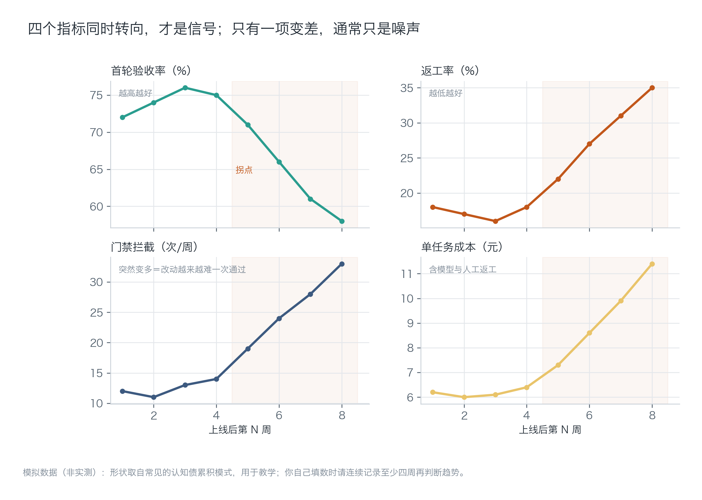
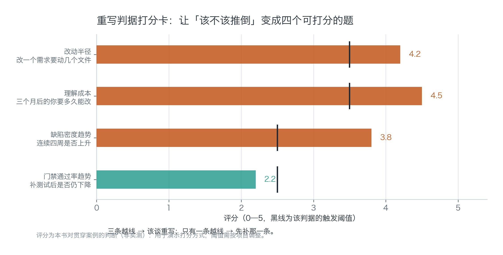
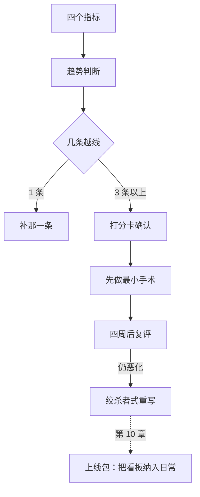

[English](./ch09-debt-rewrite.md) | **中文**

# 第 09 章：债与重写——什么时候该推倒

> **本章导读**：AI 把交付速度推上去之后，技术债和认知债会同步上涨，而认知债更难度量。本章给四个指标、四条判据和一张打分卡，把"该补还是该推倒"从情绪争论变成一次可复算的判断。
> **前置知识**：第 04—07 章（回滚、监控、恢复、成本——它们提供了度量所需的数据）。
> **核心学习目标**：
> - 能区分技术债与认知债，并说清各自该用什么信号观测
> - 能用四个指标判断"结构是不是撑不住了"
> - 能用四条判据做一次重写决策，并给出"不重写"的替代方案

---

## 1. 认知锚点：翻新还是重建，看承重墙

### 1.1 一个半年后的下午

产品上线六个月，你有 180 个付费用户。功能没少做，但每次改动都变慢了。

改一个"导出格式"，你要动四个文件、两个模板、一个类型定义。改完之后测试挂了三个，其中一个你看了二十分钟才明白为什么。你打开三个月前自己写的那个函数，注释只有一行：`// 处理特殊情况`。

你开始想：是不是该重写了？


### 1.2 直觉类比：承重墙

老房子要不要推倒重建，不看它多旧，看**承重墙动没动**。

墙皮脱落、地砖开裂、水管老化，都是翻新能解决的。但如果要改户型、加层、把两套打通，那就动到结构了——这时候翻新的成本会超过重建。

软件里的"承重墙"是两个东西：**数据模型**和**权限边界**。这两个改了，等于重建；其他都还能修。

**类比的边界**：房子重建期间人可以搬走，软件重写期间用户还在用。所以软件重写几乎总是"边住边改"，这也是绞杀者模式存在的原因。

---

## 2. 第一性原理：两种债，四个指标

### 2.1 技术债与认知债

| 维度 | 技术债 | 认知债 |
| :--- | :--- | :--- |
| 存在哪 | 代码里（重复、耦合、缺抽象） | 人脑里（没人说得清为什么这么写） |
| 症状 | 改得慢、测不全 | 不敢改、每次都要重新推理 |
| 度量 | 改动半径、缺陷密度、覆盖率 | 上手时间、解释成本、决策记录缺失 |
| 谁最容易欠 | 赶工期的人 | 用 AI 大量生成代码、但没读的人 |

第二行最后一格是这一章的现实背景：**AI 让"写出能跑的代码"变得极便宜，于是认知债的增长速度第一次超过了技术债。** 你三个月后打开的那个函数，注释只有一句"处理特殊情况"——它不是技术债，它是你当时没理解就接受了的一段输出。

认知债最麻烦的地方是它**不会报错**。代码能跑，测试能过，只是没人敢动。

### 2.2 四个指标：看趋势，不看绝对值

| 指标 | 定义 | 健康信号 | 恶化信号 |
| :--- | :--- | :--- | :--- |
| **首轮验收率** | 一次提交就通过评审/测试的比例 | 稳定或上升 | 连续四周下降 |
| **返工率** | 需要二次修改的变更占比 | 稳定 | 持续上升 |
| **门禁拦截次数** | CI/评审拦下的问题数 | 平稳 | 突然变多（改动越来越难一次通过） |
| **单任务成本** | 完成一个需求的模型 + 人工成本 | 平稳 | 上升（返工与调试吃掉了效率） |

**为什么看趋势不看绝对值**：一个团队的返工率常年 20% 但很稳定，说明这是他们的正常水位；另一个团队从 10% 涨到 18%，虽然绝对值更低，但趋势说明结构在恶化。



*图 9-1：四个面板，第 5 周之后同时转向。单个指标变差可能只是噪声；四个一起转向，才是结构信号。*

### 2.3 四条重写判据

| 判据 | 怎么量 | 阈值（本书取值） |
| :--- | :--- | :--- |
| **改动半径** | 改一个典型需求要动几个文件 | ≥ 4 个文件 |
| **理解成本** | 三个月后的你，改一处要多久 | ≥ 半天 |
| **缺陷密度趋势** | 连续四周每千行缺陷数是否上升 | 上升且补测试无效 |
| **门禁通过率趋势** | 首轮通过率是否持续下降 | 连续四周下降 |

四条里**三条越线**才谈重写。只有一条越线，先补那一条——因为单条恶化通常是局部问题，重写是全局手术。



*图 9-2：黑色竖线是每条判据的阈值。这张卡的作用不是给出"重写/不重写"的答案，而是让讨论有共同的刻度——否则每次争论都会回到"我觉得还行"和"我觉得不行"。*

### 2.4 两个必须知道的反模式

**第二系统效应。** 重写时，人会忍不住把"不想要的复杂度"换成"想要的复杂度"：加插件系统、加抽象层、加配置化。结果新系统比旧的更复杂，只是复杂在更"优雅"的地方。防御方法：**重写的第一版只允许实现现有功能，禁止新增能力。**

**大爆炸式重写。** 停掉旧系统，关起门来写三个月，然后一次性切换。这三个月里旧系统没人维护、新系统没有真实反馈，切换当天风险最大。防御方法：绞杀者模式——在新代码里包一层，逐步把流量切过去，任何时刻都能切回。

---

## 3. 手把手：跑一次健康度看板

### 3.1 运行

```bash
$ python code/ch09/health_dashboard.py
```

判定逻辑写在代码里，避免每次凭感觉：

```python
def worsening(values, good):
    s = slope(values)                      # 最小二乘斜率，过滤单周波动
    return s < 0 if good == "up" else s > 0

def consecutive_worse(values, good, span=4):
    tail = values[-span:]                  # 只看最近四周，且要求连续
    ...
```

### 3.2 真实输出

```text
=== 八周健康度（模拟数据，用于演示判据）===
指标                       第1周     第8周      斜率/周  判定
------------------------------------------------------------
首轮验收率（%）                72.0    58.0     -2.35  转向
返工率（%）                  18.0    35.0     +2.69  转向
门禁拦截（次/周）               12.0    33.0     +3.21  转向
单任务成本（元）                 6.2    11.4     +0.77  转向

转向指标数：4 / 4
判定：触发重写讨论。但先回答一个问题——
  是「结构撑不住了」，还是「需求变了、旧结构在为新需求买单」？
  前者重写，后者只该补一层适配。

=== 打分卡：四条重写判据（0—5 分，越线即触发）===
  改动半径（改一个需求要动几个文件）                  4.2 / 阈值 3.5　越线
  理解成本（三个月后的你要多久能改）                  4.5 / 阈值 3.5　越线
  缺陷密度趋势（连续四周是否上升）                   3.8 / 阈值 2.5　越线
  门禁通过率趋势（补测试后是否仍下降）                 2.2 / 阈值 2.5　未越线

越线 3 条 → 可以谈重写，且必须同时给出「不重写」的替代方案。
```

### 3.3 三个结论

**第一，4/4 转向不等于"立刻重写"。** 看打分卡：越线 3 条，刚好到门槛。这时候正确的动作是**先做一次"不重写"的最小手术**，四周后重跑看板。

**第二，"门禁通过率趋势"没有越线（2.2 < 2.5）。** 这一条很关键：它说明你的测试还在起作用，结构虽然难改，但改动至少是可验证的。如果这一条也越线，情况就完全不同——那意味着你改完之后不知道有没有改坏。

**第三，程序给出的"最小动作"三条，才是这一章真正的产出。**

```text
1. 把改动半径最大的那个模块抽出一个接口层，先隔离，不重写；
2. 给最常改的两条路径补上端到端用例，把门禁通过率拉回来；
3. 四周后重跑这张看板：斜率变平 = 补对了；继续恶化 = 再谈推倒。
```

这三条的共同点是：**都是小手术，都能在两周内完成，都不影响正在用的用户。**

### 3.4 如果决定重写，怎么重写

四条硬规则，违反任何一条都会让重写变成灾难：

1. **只实现现有功能**，禁止新增能力（防第二系统效应）。
2. **绞杀者模式**：新代码先包一层，通过开关逐步切流量，任何时刻可切回。
3. **双跑期**：新旧并行一段时间，用同样的输入比对输出，差异超过阈值就停下来查。
4. **明确终点**：写出"什么时候算重写完成"。没有终点的重写会变成第二个永久项目。

第 3 条最贵也最有效。它把"我觉得新系统更好"变成"同样 200 条输入，输出一致率 99.5%"。

---

## 4. 常见误区与正反例对比

| 容易踩坑的误区 | 为什么会出错 | 正确的心智模型与做法 |
| :--- | :--- | :--- |
| **"代码丑就该重写"** | 丑不等于错。丑但稳定的代码，重写收益可能为负 | 只看四条判据；美学不构成判据 |
| **"AI 写的代码我看不懂，但能跑，先放着"** | 这是认知债的典型积累方式，半年后会变成"没人敢改" | 看不懂的代码要么读懂再合并，要么不合并；注释写"为什么" |
| **"重写一次就好了"** | 第二系统效应会让新系统更复杂；没有双跑期的重写风险极高 | 只实现现有功能 + 绞杀者 + 双跑 + 明确终点 |
| **"指标一恶化就该重写"** | 单项恶化常是局部问题（某个模块、某次需求变更） | 四条判据三条越线才谈；先做最小手术，四周后复评 |
| **"重写期间旧系统不用管"** | 用户还在用旧系统，三个月不维护会积累更多债 | 重写期间旧系统只做必要修复，并明确公告 |

---

## 5. 本章小结与局部知识图谱

### 5.1 核心要点

- **技术债在代码里，认知债在人脑里**；AI 加速交付时，后者增长更快且不报错。
- **四个指标看趋势**：首轮验收率、返工率、门禁拦截、单任务成本。
- **四条判据三条越线**才谈重写；否则先做最小手术。
- **重写的第一版只实现现有功能**，防第二系统效应。
- **绞杀者 + 双跑 + 明确终点**，是重写不翻车的三个必要条件。

### 5.2 本章概念拓扑



---

## 6. 分级通关练习与参考解析

### 基础巩固题（Tier 1：直觉与概念核验）

1. 下面四种情况，分别属于技术债还是认知债？说明理由。
   - (a) 同一个格式化函数在五个文件里各有一份。
   - (b) 一段代码能跑，但没人知道那个 `+ 1` 为什么要加。
   - (c) 数据库没有外键约束。
   - (d) 三个月前用 AI 生成的解析器，没人敢改，因为不知道它覆盖了哪些边界。

2. 判断对错并说明理由："覆盖率 85% 说明技术债不严重。"

### 动手应用题（Tier 2：推演与实操构建）

3. 给你自己的项目建健康度看板，连续四周填数（前两周可回溯 git 与 CI 记录）。产出一张四周报，并写出你的重写判据。

4. 选一个"改动半径最大"的模块，做一个最小手术（抽接口层 / 补端到端用例），四周后对比首轮验收率与返工率。

### 深度挑战题（Tier 3：边界条件与跨章迁移）

5. 你的产品已经 180 个付费用户，重写预计需要 8 周（每周投入 20 小时）。请估算重写期间的风险，并给出三种降低风险的具体安排。

<details>
<summary><strong>点击展开：本章练习参考答案与深度解析</strong></summary>

#### 1. 债的类型

| 情况 | 类型 | 理由 |
| :--- | :--- | :--- |
| (a) 五份重复函数 | 技术债 | 问题在代码结构，改一处要改五处，但原因清楚 |
| (b) 不知道 `+ 1` 为什么加 | **认知债** | 代码没问题，知识丢了。这是最危险的一类，因为改动会靠猜 |
| (c) 没有外键 | 技术债 | 结构缺失，可用迁移补上 |
| (d) 不敢改的解析器 | **认知债（混合）** | 代码可能也没问题，但边界未知；需要补测试把"未知"变成"已知" |

判断的简易方法：**如果换一个熟悉代码的人来看，问题还在，是技术债；如果他看完也说不清，是认知债。**

#### 2. 判断对错

**错。** 覆盖率说明"代码被执行过"，不说明"行为被验证过"。两种常见情况：

- 测试断言很弱（只断言不抛异常），覆盖率 90% 但抓不到 bug；
- 关键路径没覆盖，边角覆盖了一堆。

更可信的指标是**变异测试存活率**或**缺陷逃逸率**（上线后发现的缺陷 / 总缺陷）。覆盖率是过程指标，逃逸率是结果指标。

#### 3. 看板的评分要点

四周数据太少，趋势判断容易失真，所以这一题的重点不是结论，是**建立记录习惯**。合格的做法：固定每周同一天填数，数据来源写清（CI 记录、git log、账单），不要凭印象打分。

#### 4. 最小手术的验收

两个数字：首轮验收率、返工率。如果四周后首轮验收率回到 70% 以上，说明手术有效；如果不升反降，说明你抽的接口层反而增加了复杂度，应该退回去。

**允许退回去**是这类实验的前提，否则没人敢试。

#### 5. 重写期间的风险与安排

风险有三层：

- **业务风险**：8 周里竞品可能上新功能，你被动；
- **质量风险**：新系统没有真实流量验证，切换当天最危险；
- **人的风险**：一个人做 8 周重写，动力与判断力都会衰减。

三种安排：

1. **绞杀者 + 开关**：每完成一个模块就切一部分流量，8 周里始终有可用的旧系统兜底。
2. **双跑比对**：新旧并行跑同一批真实请求，输出差异超过阈值就停下来查。代价是双倍成本，但只在关键模块做。
3. **缩短周期**：把 8 周拆成两个 4 周，第一个 4 周只做"最痛的那一块"，上线后再决定要不要继续。**大部分重写在第一个 4 周后就会发现"其实不需要全重写"。**

   第三种最容易被忽略，也最省钱。

</details>

---

## 7. 本章权威参考信源与延伸阅读 (Authoritative References)

1. **martinfowler.com**：[martinfowler.com](https://martinfowler.com/) - 本章的定义与规范以此为锚（核验日期：`2026-10-23`）。
2. **Semantic Versioning 2.0.0**：[Semantic Versioning 2.0.0](https://semver.org/) - 本章的定义与规范以此为锚（核验日期：`2026-10-23`）。
3. **DORA**：[DORA](https://dora.dev/) - 本章的定义与规范以此为锚（核验日期：`2026-10-23`）。

> 口径提示：以上信源用于锚定**定义与规范**，不用于外推风险概率。引用任何数字前，先核对来源年份与分母。
