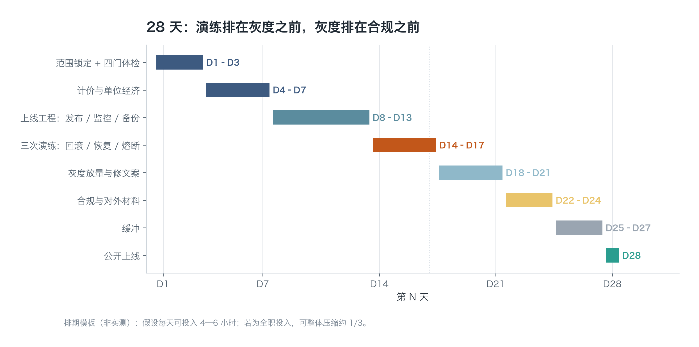
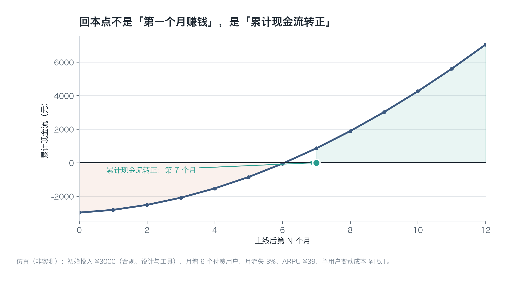
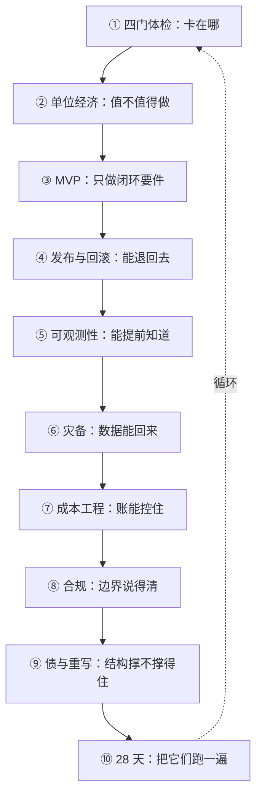

# 第 10 章：综合实战——28 天上线剧本

> **本章导读**：前九章给了九个零件，这一章把它们装成一台机器：28 天排期、20 项上线检查单、前 90 天的三张表。学完这一章，你应该能把一个真实产品推到"有人付钱、出事能退、账算得清"的状态。
> **前置知识**：第 01—09 章全部。
> **核心学习目标**：
> - 掌握 28 天排期的顺序逻辑，知道为什么演练必须排在灰度之前
> - 能用 20 项检查单做一次上线前评审，并判断"能不能开"
> - 能设计前 90 天的收入/成本/故障三张表，并用它们做定价决策

---

## 1. 认知锚点：倒计时不是为了紧张

### 1.1 一个无限延期的项目

你的产品"基本能用了"，已经能用了三个月。

每次准备上线，你都会发现一个"必须修"的问题：支付页面的文案不够好、帮助文档还没写、有个边界情况会报错。于是你修，修完又发现新的。

三个月过去，上线日期从"下周一"变成"这个月底"，再变成"等我把这块重构完"。


### 1.2 直觉类比：发射倒计时

发射台的倒计时不是为了制造紧张，是为了让每一个"再检查一遍"都有**明确的检查对象**，并且到点必须做决定。

没有倒计时，检查会变成无限延期；有了倒计时，检查会变成"这 20 项里还有哪几项没过"。

**类比的边界**：火箭错过窗口要等很久，软件可以随时上线。但"随时可以"正是它永远不上线的原因——**无限的可延期性，等于没有截止日**。

---

## 2. 第一性原理：顺序比速度重要

### 2.1 28 天排期

| 阶段 | 天 | 产出 | 为什么在这个位置 |
| :--- | :--- | :--- | :--- |
| 范围锁定 + 四门体检 | D1—D3 | 三栏表 + 上线判据 | 先定"做什么"，否则后面全是返工 |
| 计价与单位经济 | D4—D7 | 定价 + 成本表 + 盈亏平衡 | 价格决定毛利结构，晚定会推翻功能取舍 |
| 上线工程 | D8—D13 | 发布 / 监控 / 备份 | 有了范围和价格，才知道要保住什么 |
| 三次演练 | D14—D17 | 回滚 / 恢复 / 熔断记录 | **必须早于灰度**：没演练就放量是赌博 |
| 灰度放量 + 修文案 | D18—D21 | 真实流量下的问题清单 | 只有真实用户能暴露真实问题 |
| 合规与对外材料 | D22—D24 | 一页合规说明 + 价格页 | 放在灰度后，因为要按真实功能写 |
| 缓冲 | D25—D27 | 处理前面漏掉的事 | 一定会漏，留三天 |
| 公开上线 | D28 | 收款链接对外开放 | 固定日期，不因"还差一点"推迟 |



*图 10-1：看三个位置——D14—D17 的三次演练堵在灰度之前；D22—D24 的合规在灰度之后（因为要按真实功能写）；D25—D27 的缓冲不是偷懒，是给前 24 天的误差留的空间。*

### 2.2 三个顺序上的判断

**为什么演练在灰度之前。** 灰度会带来真实流量，真实流量会暴露问题。如果没有回滚能力就放量，暴露问题的那一刻你只能"边修边等"。演练的成本是三天，不演练的成本是一次事故。

**为什么合规在灰度之后。** 因为合规材料要写"我实际做了什么"。功能在灰度期间会改，提前写会写成"计划"，而监管看的是"事实"。

**为什么要有缓冲。** 28 天里必然有 2—3 天被意外吃掉（依赖升级、支付审核、域名备案）。没有缓冲的排期，等于把"延期"写进了计划。

### 2.3 学习周期与执行周期的区别

《Vibe Coding 学习规划》里阶段 5 是 5 周，本章的排期是 28 天。两者不矛盾：

- **5 周**包含消化时间（读书、练习、复盘），是按每天 4—6 小时估的；
- **28 天**是纯执行，假设你已经会了这些动作，只是把它们跑一遍。

如果你边学边做，按 5 周排；如果你已经读完前九章，按 28 天排。全职投入可以把 28 天压到 18—20 天，但**不要压缩演练那四天**。

### 2.4 上线日检查单：20 项，四组

| 组 | 回答的问题 | 项数 | 阻断项 |
| :--- | :--- | :--- | :--- |
| 能退回去 | 出事能不能 10 分钟内退回 | 4 | 3 |
| 看得见 | 用户投诉前我能不能知道 | 5 | 2 |
| 有后路 | 数据丢了、上游挂了怎么办 | 4 | 3 |
| 说得清 | 价格、续费、告知、标识写清楚没有 | 7 | 5 |

"阻断项"的意思是：**没过就不能上线**。20 项里 13 项是阻断项——这个比例看起来高，但它换来的是"上线后不用整夜盯着"。

每一项都必须能在 5 分钟内被第三方验证。写不出验证方法的条目，不算检查项。

---

## 3. 手把手：跑一次上线评审

### 3.1 运行检查单

```bash
$ python code/ch10/launch_checklist.py
```

### 3.2 真实输出（节选）

```text
=== 上线日检查单 ===

[能退回去]
  [x] R1  上一次发布可一键回滚
        验证：在预发执行一次回滚命令，计时
  [x] R2  数据库迁移可回滚或已前向兼容
        验证：查看迁移脚本，确认没有 DROP/改类型
  [x] R3  上一版镜像保留 ≥ 7 天
        验证：查看镜像仓库保留策略
  [ ] R4  特性开关可关闭新功能而不发版
        验证：关掉开关，确认功能消失且旧路径正常

[看得见]
  [x] O1  四个黄金信号已上仪表盘
  [x] O2  错误率告警 5 分钟内可达
  [ ] O3  单请求成本可在日志里查到
（中间条目略）

进度：18/20　未完成阻断项：0
结论：可以上线。上线后 24 小时内不要做任何非必要变更。
```

### 3.3 怎么读这个结果

**18/20，但阻断项全过，所以可以上线。** 这个组合是故意设计的：它说明"完成度"和"能不能开"是两个不同的判断。

没过的两项（R4 特性开关、O3 单请求成本日志）都不阻断，但要写进上线后的第一周待办。判断标准是：**它会不会让"出事时无法处理"**。会，就是阻断；不会，就是待办。

### 3.4 反过来的情况

如果你有 2 项阻断项没过，正确做法不是"加班补"，而是**改上线日期**：

> 把"明天上线"改成"这两项做完就上线"——日期是承诺，条件是门槛。

这句话值得贴在墙上。它把"延期"从失败变成了符合预期的行为，也避免了"为了赶日期而绕过检查"这种最危险的操作。

### 3.5 前 90 天的三张表

上线不是终点，是第一次真实测量的开始。三张表，每周更新一次，不要更多：

| 表 | 列 | 用来回答 |
| :--- | :--- | :--- |
| **收入表** | 日期 / 新增 / 流失 / 净增 / MRR / 渠道 | 增长是来自拉新还是留存 |
| **成本表** | 日期 / 请求数 / token / 转写分钟 / 单请求成本 / 总额 | 成本随用量怎么变 |
| **故障表** | 时间 / 影响面 / 时长 / 根因 / 修复 / 是否复发 | 稳定性在变好还是变坏 |

三张表放在一起看，能回答一个关键问题：**增长是不是健康的**。

如果 MRR 涨、单请求成本也涨得一样快，说明你在"用亏损换增长"；如果 MRR 涨、故障表里同类问题反复出现，说明增长建立在脆弱的结构上。

### 3.6 回本点怎么算



*图 10-2：初始投入 3000 元（合规、设计与工具），月增 6 个付费用户，月流失 3%，ARPU 39 元，单用户变动成本 15.1 元。累计现金流转正在第 7 个月——不是"第一个月赚钱"，而是"累计投入收回来的那个月"。*

三个变量决定回本速度：**新增速度、流失率、单用户贡献毛利**。其中流失率的影响最容易被低估：月流失 3% 意味着用户平均只待 33 个月，而月流失 8% 只待 12.5 个月——后者的回本点会被推到两年以后。

**所以早期的第一优先级不是拉新，是降低流失。** 拉新是加法，流失是乘法。

### 3.7 定价的最小实验

不要做 A/B 测试（样本量不够，结论不可信）。先做一件更简单的事：

> 上三个档位（29 / 39 / 99），企业客户加一个"联系我们"。

观察两周，看三件事：**哪个档位被选得最多、有没有人问 99 档的差别、有没有人点"联系我们"**。

这三个信号分别告诉你：主流价格带在哪、价值感知的上限在哪、有没有 To B 需求。它们比任何问卷都准，因为是用钱投的票。

### 3.8 什么时候涨价、什么时候降价

- **涨价**：单请求成本占收入比持续下降（说明你在变便宜），且流失率稳定。此时涨价是"把多余的价值收回来"。
- **降价**：新用户转化率低，但留存高（说明价值成立、门槛太高）。此时降价是"降低尝试成本"。
- **不动**：两个指标都不明确时，改别的（文案、试用期、退款政策），别动价格。价格是最响的信号，频繁改会让用户观望。

---

## 4. 常见误区与正反例对比

| 容易踩坑的误区 | 为什么会出错 | 正确的心智模型与做法 |
| :--- | :--- | :--- |
| **"等一切都准备好再上线"** | 没有终点的准备等于没有准备；真实问题只有真实用户能暴露 | 固定上线日 + 阻断项清单；阻断项过了就开 |
| **"先放量，出问题再补监控"** | 放量后的头两周是故障最密集期，恰好也是没有监控的时期 | 演练在灰度前（D14—D17），监控属于阻断项 |
| **"上线就完事了"** | 上线只是第一次真实测量，前 90 天的数据决定后续所有决策 | 三张表每周更新；用它们判断增长是否健康 |
| **"先拉新，留存以后再说"** | 流失是乘法，拉新是加法；流失 8% 时拉新几乎填不满 | 早期优先降流失；回本点对流失率极度敏感 |
| **"定价靠猜，或者抄同行"** | 同行成本结构不同，抄价格等于抄别人的毛利 | 先算盈亏平衡（第 02 章），再上三档做最小实验 |

---

## 5. 本章小结与全书收束

### 5.1 本章要点

- **28 天的顺序有逻辑**：演练早于灰度，灰度早于合规，缓冲必须有。
- **20 项检查单里 13 项阻断**；阻断项不过就改日期，不绕过。
- **完成度 ≠ 能不能开**；判断标准是"出事时能不能处理"。
- **前 90 天看三张表**：收入、成本、故障。
- **回本点由流失率主导**；早期降流失比拉新重要。
- **定价用三档做实验**，不做 A/B。

### 5.2 九章压成一张图



这张图有一条隐含的主线：**前九章都在回答"这件事值不值得继续"，第十章回答"怎么让它真的发生"。**

如果只能记住一句话：**上线不是工程事件，是商业事件。工程负责"不出事"，商业负责"值得出事"。**

### 5.3 接下来做什么

三个方向，按优先级：

1. **把这个循环再跑一遍**，换一个产品。第二次会比第一次快一倍，因为清单和判据都现成了。
2. **补第 09 章的健康度看板**，连续记录三个月。它会告诉你结构什么时候开始撑不住。
3. **回到第 01 章**，用真实的收入数据重做一次四门体检。你会发现当初的判断有几条是错的——这是正常且必要的。

---

## 6. 分级通关练习与参考解析

### 基础巩固题（Tier 1：直觉与概念核验）

1. 28 天排期里，如果把"三次演练"挪到"灰度之后"，会发生什么？请写出至少两个具体后果。

2. 判断对错并说明理由："检查单 20 项全部通过才能上线。"

### 动手应用题（Tier 2：推演与实操构建）

3. 把你的项目按 28 天排期排一遍，标出你已经能做的和还不会做的。不会做的，回到对应章节。

4. 用 `launch_checklist.py --export` 导出一份清单贴进仓库，然后逐项填写"验证方法"，要求每条都能被第三方在 5 分钟内验证。

### 深度挑战题（Tier 3：边界条件与跨章迁移）

5. 上线第 30 天，你发现：MRR 涨了 40%，但单请求成本涨了 90%，同时故障表里"转写超时"出现了 4 次。请给出你的诊断顺序和接下来两周的动作清单。

<details>
<summary><strong>点击展开：本章练习参考答案与深度解析</strong></summary>

#### 1. 演练挪到灰度之后

两个具体后果：

- **第一次真实故障会发生在没有回滚能力的时候。** 灰度期流量小但问题真实，此时出问题只能"边修边等"，而这正是回滚存在的意义。
- **你的 SLO 会在最脆弱的时期被消耗。** 灰度期的事故同样计入错误预算，等正式放量时预算已经用掉一部分，之后连正常发布都不敢做。

附加后果：演练会发现"镜像过期""迁移不可逆"这类问题，而这些问题在灰度后修，成本更高（因为已经有真实数据）。

#### 2. 判断对错

**错，但方向对。** 正确的说法是：**13 项阻断项必须全过；7 项非阻断项可以带着上线，但要写进第一周待办。**

如果要求 20 项全过，会导致两个问题：一是把非关键项当成阻塞，拖慢上线；二是为了凑齐而草率打勾，反而让检查单失去意义。

#### 3. 排期的评分要点

合格的排期有两个特征：**每个阶段有可交付物**（不是"做上线工程"，而是"回滚脚本 + 仪表盘 + 备份任务"），以及**标出了自己不会的部分**。

后者最重要。排期的价值不是让你感觉有条理，是让你提前发现"D14 要演练，但我还不会写回滚脚本"。

#### 4. 检查单的评分要点

验证方法必须包含**动作 + 判据**。例如：

- 差："检查备份是否正常"
- 好："打开备份日志，确认最近 24 小时有一次状态为 success 的记录，文件大小 > 1MB"

#### 5. MRR 涨 40%、成本涨 90%、转写超时 4 次

诊断顺序（先看结构，再看细节）：

1. **先看成本结构**：是不是新用户里"长会议"占比变高？（成本涨幅 > 收入涨幅，通常是用量结构变化）
2. **再看转写超时与成本的关系**：超时会导致重试，重试会重复计费。4 次超时可能对应几十次重试。
3. **最后看定价档位分布**：是不是有人从 29 档升到 99 档但用量暴增？（高档位若无用量上限，会直接吃掉毛利）

两周动作清单：

| 优先级 | 动作 | 判据 |
| :--- | :--- | :--- |
| P0 | 转写链路加超时上限与指数退避，禁止无限重试 | 重试次数 ≤ 2，超时率 < 1% |
| P0 | 查单请求成本 Top 20 用户，确认是否集中在少数人 | 若 5% 用户占 50% 成本 → 加单用户额度 |
| P1 | 给 99 档加"合理使用"条款与软上限 | 条款上线，超额时先提示再限流 |
| P1 | 成本表加"按用量分档"的视图 | 能看出长/短会议的毛利差异 |
| P2 | 评估是否把转写改为"仅转写有语音段" | 成本下降 ≥ 20% |

注意 P0 里的第二条：**先确认是不是集中在少数人**，再决定要不要改定价。如果成本上涨是均匀的（所有用户都变贵了），那问题在链路而不在用户，改定价只会误伤。

这个判断顺序，就是第 02 章（成本结构）、第 05 章（信号）、第 07 章（熔断）三章知识的联合应用。

</details>

---

## 7. 本章权威参考信源与延伸阅读 (Authoritative References)

1. **DORA**：[DORA](https://dora.dev/) - 本章的定义与规范以此为锚（核验日期：`2026-10-23`）。
2. **The Twelve-Factor App**：[The Twelve-Factor App](https://12factor.net/) - 本章的定义与规范以此为锚（核验日期：`2026-10-23`）。
3. **martinfowler.com**：[martinfowler.com](https://martinfowler.com/) - 本章的定义与规范以此为锚（核验日期：`2026-10-23`）。

> 口径提示：以上信源用于锚定**定义与规范**，不用于外推风险概率。引用任何数字前，先核对来源年份与分母。
