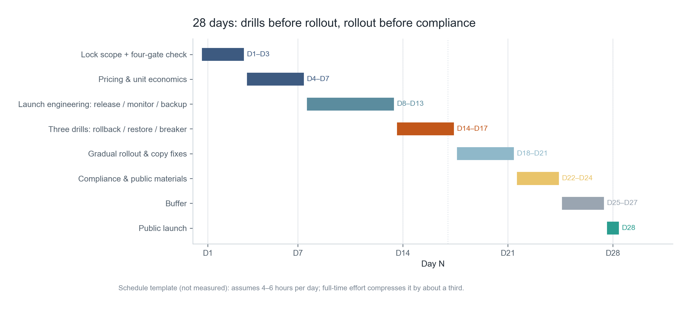
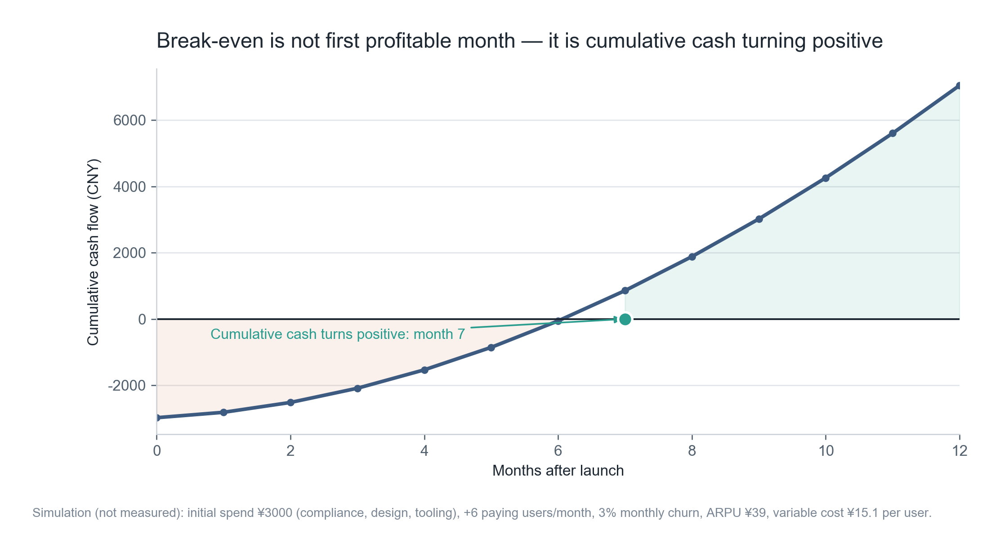
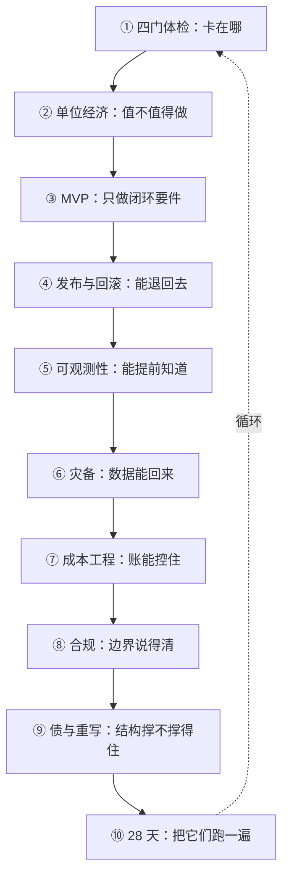

**English** | [中文](./ch10-launch-playbook.zh.md)

# Chapter 10: Putting It into Practice — The 28-Day Launch Playbook

> **Chapter guide**: The first nine chapters gave nine parts; this chapter assembles them into a machine: a 28-day schedule, a 20-item launch checklist, and three tables for the first 90 days. After this chapter you should be able to push a real product to the state of "someone pays, you can retreat when things break, the numbers add up".
> **Prerequisites**: all of Chapters 01–09.
> **Core learning objectives**:
> - Master the sequential logic of the 28-day schedule, and know why drills must come before the gradual rollout
> - Use the 20-item checklist to run one pre-launch review, and judge "can we open"
> - Design the revenue/cost/incident tables for the first 90 days, and use them for pricing decisions

---

## 1. Cognitive Anchor: The Countdown Is Not for Tension

### 1.1 A Project Delayed Forever

Your product "basically works"; it has basically worked for three months.

Every time you prepare to launch, you find a "must fix" problem: the payment page copy is not good enough, the help docs are not written, one edge case errors out. So you fix it, and after fixing find new ones.

Three months pass; the launch date moves from "next Monday" to "end of this month", then to "after I finish refactoring this part".


### 1.2 Intuition by Analogy: Launch Countdown

A launchpad countdown is not there to create tension; it gives every "check once more" a **definite object**, and forces a decision when time is up.

Without a countdown, checking becomes indefinite postponement; with one, checking becomes "which of these 20 items has not passed".

**The boundary of this analogy**: a rocket that misses its window waits a long time; software can launch whenever. But "whenever" is exactly why it never launches — **unlimited deferrability equals no deadline**.

---

## 2. First Principles: Order Matters More Than Speed

### 2.1 The 28-Day Schedule

| Phase | Days | Deliverable | Why it sits here |
| :--- | :--- | :--- | :--- |
| Scope locking + four-gate checkup | D1–D3 | Three-column table + launch criteria | Decide "what to build" first, otherwise everything after is rework |
| Pricing and unit economics | D4–D7 | Pricing + cost table + break-even | Price decides the margin structure; deciding it late overturns feature trade-offs |
| Launch engineering | D8–D13 | Release / monitoring / backup | With scope and price known, you know what must survive |
| Three drills | D14–D17 | Rollback / recovery / circuit-break records | **Must precede the gradual rollout**: ramping without drills is gambling |
| Gradual rollout + copy fixes | D18–D21 | Problem list under real traffic | Only real users expose real problems |
| Compliance and external materials | D22–D24 | One-page compliance statement + pricing page | After the rollout, because it must describe real functionality |
| Buffer | D25–D27 | Handle what the earlier phases missed | Something will be missed; leave three days |
| Public launch | D28 | Payment link opens to everyone | Fixed date; not postponed for "just a little more" |



*Figure 10-1: Look at three spots — the three drills of D14–D17 sit before the gradual rollout; compliance on D22–D24 sits after it (because it must describe real functionality); the D25–D27 buffer is not slacking, it is room for the first 24 days' errors.*

### 2.2 Three Sequential Judgments

**Why drills before the gradual rollout.** A rollout brings real traffic, and real traffic exposes problems. If you ramp without rollback ability, the moment problems surface you can only "fix while waiting". Drills cost three days; not drilling costs one incident.

**Why compliance after the gradual rollout.** Because compliance materials must state "what I actually did". Features change during the rollout; written early they become "plans", while regulators look at "facts".

**Why a buffer.** In 28 days, 2–3 days will inevitably be eaten by surprises (dependency upgrades, payment review, domain filing). A schedule without a buffer writes "delay" into the plan.

### 2.3 Learning Cycle vs. Execution Cycle

In the Vibe Coding study plan, stage 5 is 5 weeks, while this chapter's schedule is 28 days. The two do not conflict:

- **5 weeks** includes absorption time (reading, exercises, retrospectives), estimated at 4–6 hours per day;
- **28 days** is pure execution, assuming you already know these moves and are just running them once.

If you learn while doing, schedule 5 weeks; if you have finished the first nine chapters, schedule 28 days. Full-time input can compress 28 days to 18–20, but **do not compress those four drill days**.

### 2.4 Launch-Day Checklist: 20 Items, Four Groups

| Group | Question it answers | Items | Blocking items |
| :--- | :--- | :--- | :--- |
| Can retreat | Can we roll back within 10 minutes when things break | 4 | 3 |
| Can see | Can I know before users complain | 5 | 2 |
| Has a fallback | What if data is lost or upstream dies | 4 | 3 |
| Can explain | Are price, renewal, disclosure, labeling written clearly | 7 | 5 |

"Blocking item" means: **if it does not pass, you cannot launch**. 13 of the 20 are blocking — the ratio looks high, but what it buys is "no need to stare at it all night after launch".

Every item must be verifiable by a third party within 5 minutes. An item without a written verification method is not a checklist item.

---

## 3. Hands-on: Running a Launch Review

### 3.1 Run the Checklist

```bash
$ python code/ch10/launch_checklist.py
```

### 3.2 Real Output (Excerpt)

```text
=== 上线日检查单 ===

[能退回去]
  [x] R1  上一次发布可一键回滚
        验证：在预发执行一次回滚命令，计时
  [x] R2  数据库迁移可回滚或已前向兼容
        验证：查看迁移脚本，确认没有 DROP/改类型
  [x] R3  上一版镜像保留 ≥ 7 天
        验证：查看镜像仓库保留策略
  [ ] R4  特性开关可关闭新功能而不发版
        验证：关掉开关，确认功能消失且旧路径正常

[看得见]
  [x] O1  四个黄金信号已上仪表盘
  [x] O2  错误率告警 5 分钟内可达
  [ ] O3  单请求成本可在日志里查到
（中间条目略）

进度：18/20　未完成阻断项：0
结论：可以上线。上线后 24 小时内不要做任何非必要变更。
```

### 3.3 How to Read This Result

**18/20, but all blocking items passed, so you can launch.** This combination is deliberate: it shows that "completion" and "can we open" are two different judgments.

The two items that did not pass (R4 feature flag, O3 per-request cost logging) are non-blocking, but go on the first week's to-do list. The judging standard is: **will it make "unable to handle things when they break"**. If yes, it is blocking; if no, it is a to-do.

### 3.4 The Reverse Situation

If you have 2 blocking items unpassed, the correct move is not "work overtime to patch them", but **change the launch date**:

> Change "launch tomorrow" to "launch when these two are done" — the date is a promise, the condition is a threshold.

This sentence is worth putting on the wall. It turns "delay" from a failure into expected behavior, and avoids the most dangerous operation of all: "bypassing checks to hit the date".

### 3.5 The Three Tables for the First 90 Days

Launch is not the finish line; it is the start of the first real measurement. Three tables, updated weekly, no more:

| Table | Columns | What it answers |
| :--- | :--- | :--- |
| **Revenue table** | Date / new / churned / net add / MRR / channel | Is growth from acquisition or retention |
| **Cost table** | Date / request count / tokens / transcription minutes / per-request cost / total | How cost moves with usage |
| **Incident table** | Time / blast radius / duration / root cause / fix / recurrence | Is stability getting better or worse |

Read together, the three tables answer one key question: **is the growth healthy**.

If MRR rises and per-request cost rises just as fast, you are "buying growth with losses"; if MRR rises and the incident table shows the same problem recurring, the growth rests on a fragile structure.

### 3.6 How to Calculate the Payback Point



*Figure 10-2: Initial investment 3000 yuan (compliance, design, tooling), 6 new paying users per month, 3% monthly churn, ARPU 39 yuan, per-user variable cost 15.1 yuan. Cumulative cash flow turns positive in month 7 — not "profitable in month one", but "the month the cumulative investment comes back".*

Three variables decide the payback speed: **acquisition rate, churn rate, per-user contribution margin**. Of these, churn rate's impact is the most underestimated: 3% monthly churn means users stay 33 months on average, while 8% means only 12.5 months — the latter pushes the payback point past two years.

**So the early first priority is not acquisition; it is reducing churn.** Acquisition is addition; churn is multiplication.

### 3.7 The Minimal Pricing Experiment

Do not run A/B tests (sample too small, conclusions unreliable). Do something simpler first:

> Put up three tiers (29 / 39 / 99), with a "contact us" for enterprise customers.

Watch for two weeks, at three things: **which tier is chosen most, whether anyone asks about the 99 tier's difference, whether anyone clicks "contact us"**.

These three signals tell you respectively: where the mainstream price band sits, where the ceiling of value perception sits, and whether there is To B demand. They beat any survey, because they are votes cast with money.

### 3.8 When to Raise Price, When to Cut It

- **Raise**: per-request cost as a share of revenue keeps falling (you are getting cheaper), and churn is stable. Raising price now is "collecting the surplus value back".
- **Cut**: new-user conversion is low but retention is high (the value holds; the barrier is too high). Cutting now is "lowering the cost of trying".
- **Hold**: when neither metric is clear, change something else (copy, trial period, refund policy), not the price. Price is the loudest signal; changing it often makes users wait and see.

---

## 4. Common Misconceptions and Correct/Incorrect Contrasts

| Easy pitfall | Why it goes wrong | The right mental model and practice |
| :--- | :--- | :--- |
| **"Launch when everything is ready"** | Preparation without an endpoint equals no preparation; only real users expose real problems | Fixed launch date + blocking-item list; open when the blockers pass |
| **"Ramp first, add monitoring when problems appear"** | The first two weeks after ramping are the densest failure period — exactly when there is no monitoring | Drills before the gradual rollout (D14–D17); monitoring is a blocking item |
| **"Launching means done"** | Launch is only the first real measurement; the first 90 days' data decides every later decision | Update the three tables weekly; use them to judge whether growth is healthy |
| **"Acquire first; retention later"** | Churn is multiplication and acquisition is addition; at 8% churn, acquisition can hardly fill the hole | Prioritize churn reduction early; the payback point is extremely sensitive to churn |
| **"Price by guessing, or copy competitors"** | Competitors have different cost structures; copying prices copies their margins | Calculate break-even first (Chapter 02), then run the three-tier minimal experiment |

---

## 5. Chapter Summary and the Whole Book Wrapped Up

### 5.1 This Chapter's Key Points

- **The 28-day order has logic**: drills before rollout, rollout before compliance, buffer mandatory.
- **13 of the 20 checklist items are blocking**; if blockers fail, change the date, do not bypass.
- **Completion ≠ can we open**; the judging standard is "can we handle things when they break".
- **The first 90 days watch three tables**: revenue, cost, incidents.
- **The payback point is dominated by churn**; reducing churn early beats acquisition.
- **Price with a three-tier experiment**, not A/B.

### 5.2 Nine Chapters Compressed into One Figure



This figure has an implicit throughline: **the first nine chapters answer "is this worth continuing"; the tenth answers "how to make it actually happen".**

If you can only remember one sentence: **launch is not an engineering event; it is a business event. Engineering is responsible for "nothing breaks"; business is responsible for "it is worth breaking".**

### 5.3 What to Do Next

Three directions, by priority:

1. **Run the loop again** with a different product. The second time is twice as fast, because the checklists and criteria are ready-made.
2. **Add Chapter 09's health dashboard** and record for three months straight. It will tell you when the structure starts giving way.
3. **Return to Chapter 01** and redo the four-gate checkup with real revenue data. You will find several of your original judgments were wrong — this is normal and necessary.

---

## 6. Tiered Exercises and Reference Solutions

### Basic Consolidation (Tier 1: Intuition and Concept Check)

1. In the 28-day schedule, what happens if the "three drills" are moved to "after the gradual rollout"? Write at least two concrete consequences.

2. Judge whether this is true or false and explain why: "Only when all 20 checklist items pass can you launch."

### Applied Practice (Tier 2: Reasoning and Hands-on Construction)

3. Schedule your project along the 28-day plan, marking what you can already do and what you cannot yet. For what you cannot, go back to the corresponding chapter.

4. Use `launch_checklist.py --export` to export a checklist into the repository, then fill in "verification method" item by item; every one must be verifiable by a third party within 5 minutes.

### Deep Challenge (Tier 3: Boundary Conditions and Cross-Chapter Transfer)

5. On day 30 after launch you find: MRR rose 40%, but per-request cost rose 90%, and the incident table shows "transcription timeout" four times. Give your diagnostic order and the action list for the next two weeks.

<details>
<summary><strong>Click to expand: reference answers and in-depth analysis for this chapter's exercises</strong></summary>

#### 1. Moving the Drills After the Gradual Rollout

Two concrete consequences:

- **The first real failure will happen when you have no rollback ability.** Traffic during the rollout is small but problems are real; when something breaks you can only "fix while waiting" — and rollback exists exactly for this.
- **Your SLO gets consumed during the most fragile period.** Incidents during the rollout count against the error budget too; by the time you ramp fully the budget is partly spent, and afterwards you do not even dare do a normal release.

Additional consequence: drills surface problems like "expired images" and "irreversible migrations", and fixing those after the rollout costs more (because real data now exists).

#### 2. True or False

**Wrong, but the direction is right.** The correct statement: **the 13 blocking items must all pass; the 7 non-blocking items can ship with the launch, but go on the first week's to-do list.**

Requiring all 20 to pass causes two problems: it treats non-critical items as blockers and slows the launch; and it encourages hasty checkmarks just to fill the list, defeating the checklist's purpose.

#### 3. Scoring Points for the Schedule

A passing schedule has two traits: **every phase has a deliverable** (not "do launch engineering", but "rollback script + dashboard + backup job"), and **it marks the parts you cannot do**.

The second matters most. The schedule's value is not making you feel organized; it is letting you discover early that "D14 needs drills, but I cannot write a rollback script yet".

#### 4. Scoring Points for the Checklist

A verification method must contain **action + criterion**. For example:

- Bad: "check whether backups are normal"
- Good: "open the backup log and confirm at least one record with status success in the last 24 hours, file size > 1MB"

#### 5. MRR +40%, Cost +90%, Four Transcription Timeouts

Diagnostic order (structure first, then details):

1. **Look at the cost structure first**: has the share of "long meetings" among new users risen? (Cost rising faster than revenue usually means the usage mix changed.)
2. **Then look at the relation between timeouts and cost**: timeouts cause retries, and retries are billed repeatedly. 4 timeouts may correspond to dozens of retries.
3. **Finally look at the pricing-tier distribution**: did someone move from the 29 tier to the 99 tier and explode their usage? (A high tier with no usage cap eats margin directly.)

Two-week action list:

| Priority | Action | Criterion |
| :--- | :--- | :--- |
| P0 | Add timeout caps and exponential backoff to the transcription pipeline; forbid infinite retries | Retries ≤ 2, timeout rate < 1% |
| P0 | Check the top 20 users by per-request cost; confirm whether it concentrates in a few | If 5% of users cause 50% of cost → add per-user quota |
| P1 | Add a "fair use" clause and soft cap to the 99 tier | Clause live; on overage, warn first then throttle |
| P1 | Add a "by usage tier" view to the cost table | Can see margin differences between long/short meetings |
| P2 | Evaluate transcribing "only segments with speech" | Cost down ≥ 20% |

Note the second P0 item: **first confirm whether it concentrates in a few users**, then decide whether to change pricing. If the cost rise is uniform (all users got more expensive), the problem is in the pipeline, not the users, and changing pricing only hurts the wrong people.

This diagnostic order is the joint application of Chapter 02 (cost structure), Chapter 05 (signals), and Chapter 07 (circuit breaking).

</details>

---

## 7. Authoritative Sources and Further Reading (Authoritative References)

1. **DORA**: [DORA](https://dora.dev/) - the definitions and norms of this chapter are anchored here (verification date: `2026-10-23`).
2. **The Twelve-Factor App**: [The Twelve-Factor App](https://12factor.net/) - the definitions and norms of this chapter are anchored here (verification date: `2026-10-23`).
3. **martinfowler.com**: [martinfowler.com](https://martinfowler.com/) - the definitions and norms of this chapter are anchored here (verification date: `2026-10-23`).

> Measurement note: the sources above are used to anchor **definitions and norms**, not to extrapolate risk probabilities. Before quoting any number, check the source's year and its denominator.
